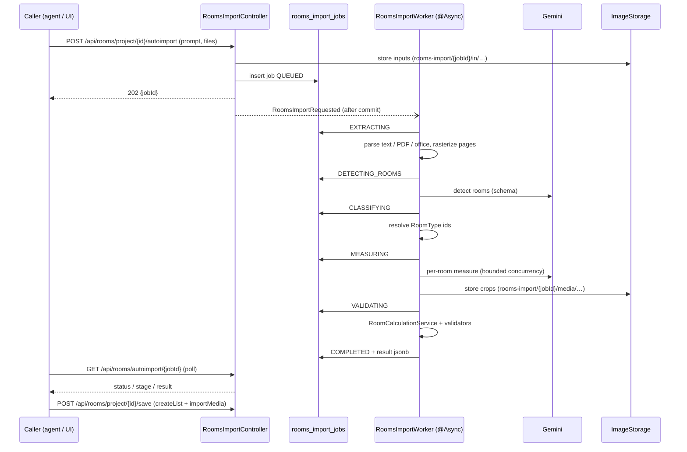

# Design Document: FOR-05-02 — Rooms auto-import (AI), room media and wall plan

## Overview

A new asynchronous pipeline turns a prompt and/or files into a **draft rooms list**. The draft is shape-compatible with the existing `RoomCreateRequest`, so the caller (loaders agent or browser UI) approves it and creates rooms through the **existing** bulk-save endpoint `POST /api/rooms/project/{projectId}/save`, extended with optional `importMedia` references. Geometry-derived metrics are always computed by the existing `RoomCalculationService`; Gemini only supplies *geometry, openings and a few non-derivable scalars* (never the derived areas), and any value it reads literally off the document is kept as `stated` for cross-validation.

The design reuses established patterns instead of inventing new ones:

| Need | Reused pattern |
|---|---|
| Async job + polling | FOR-06-03: bespoke job table, `@Async("…TaskExecutor") @TransactionalEventListener(AFTER_COMMIT, fallbackExecution = true)` worker, `REQUIRES_NEW` stage commits, sweep service, `Disabled*` fallback |
| Gemini client | `GoogleOcrService.buildGenAiClient` / `resolveCredentials` (extracted into a shared `GeminiClientFactory`) |
| Config | `OcrProperties`-style `@ConfigurationProperties` record with nested `Llm`/`Credentials` |
| Storage | `ImageStorage` seam (generic binary store, `GcsImageStorage` / `DisabledImageStorage`) |
| Media entity | `DocumentMediaEntity` / `document_media` |
| Creation | `RoomsSaveService.save` (single transaction, estimate recalc, 409 on diff) |
| Permissions | existing `ROOMS` resource; `@RequiresPermission`; project access via `ProjectAccessCache` |
| Frontend state | `roomMatrixStore` pending change set persisted in `localStorage` |



## Backend design

### B1. Package layout

`com.foremen.service.roomsimport` (new):

- `RoomsImportService` — start / get / discard; input validation; job persistence.
- `RoomsImportWorker` — async entry point (`@Async("roomsImportTaskExecutor")`).
- `RoomsImportPipeline` — orchestrates the stages (pure orchestration, injectable for tests).
- `extract/` — `InputExtractor` implementations: `TextInputExtractor`, `OfficeInputExtractor` (POI), `PdfInputExtractor` (PDFBox text + rasterize), `ImageInputExtractor` (decode, EXIF orient, convert to PNG when needed). Output: `ExtractedInput { fileName, kind, text?, List<PageImage> pages }`.
- `ai/` — `RoomsVisionClient` interface (`detectRooms`, `measureRoom`) with `GeminiRoomsVisionClient` (enabled) and `DisabledRoomsVisionClient`; DTO records mirroring the JSON schemas; `RoomsImportPrompts` (static prompt text).
- `classify/RoomTypeResolver` — maps model output to `RoomTypeEntity` ids.
- `geometry/GeometryNormalizer` — unit conversion, vertex ordering/dedup, wall list alignment, opening filtering.
- `validate/` — `DraftValidator` plus one small pure rule class per warning family (`AreaConsistencyRule`, `OpeningsRule`, `CeilingHeightRule`, `InternalCornersRule`, `GeometryValidityRule`, `CountRule`).
- `crop/RoomCropper` — bounding-box crop via `ImageIO` with margin.
- `RoomsImportSweepService` — timeout / TTL cleanup (`@Scheduled`).
- `model/` — result records (`DraftRoom`, `Warning`, `ImportResult`, …).

`com.foremen.service.room.media` (new): `RoomMediaService`, `RoomMediaAttachService` (draft → permanent copy).

`com.foremen.controller`: `RoomsImportController` (`/api`-rooted paths below), `RoomMediaController`. Both carry `@PermissionResource("ROOMS")` on the class and `@PermissionOperation`/`@RequiresPermission` on every handler (no half-annotation). They live in their own controller classes so the generic `AdminController` CRUD surface of `RoomController` is untouched.

`com.foremen.config.roomsimport`: `RoomsImportProperties`, `RoomsImportConfig` (task executor bean, conditional wiring of Gemini vs Disabled client).

### B2. Endpoints

| Method + path | Perm | Notes |
|---|---|---|
| `POST /api/rooms/project/{projectId}/autoimport` | ROOMS CREATE | multipart `prompt`, `files[]`; `202 {jobId,status}`; `429 error.roomsimport.in_progress` while a job is active |
| `GET /api/rooms/project/{projectId}/autoimport/current` | ROOMS READ | the project's single job (any status, with `result` when completed, `appliedAt`) or `204` |
| `GET /api/rooms/autoimport/{jobId}` | ROOMS READ | status/stage/result |
| `POST /api/rooms/autoimport/{jobId}/cancel` | ROOMS CREATE | cancel an **active** job; `204`; `409 error.roomsimport.not_cancellable` if terminal; `404` if gone |
| `DELETE /api/rooms/autoimport/{jobId}` | ROOMS CREATE | discard; also cancels when active; idempotent |
| `GET /api/rooms/autoimport/{jobId}/media/{mediaId}` | ROOMS READ | draft media bytes |
| (bell) in-app notifications `notification.roomsImport.completed` / `.failed` | — | emitted on `COMPLETED` / `FAILED` (incl. sweep timeout), deep-link `/projects/{projectId}/rooms` (B2b) |
| `GET /api/rooms/{roomId}/media` | ROOMS READ | list |
| `POST /api/rooms/{roomId}/media` | ROOMS UPDATE | multipart `files[]` |
| `GET /api/rooms/{roomId}/media/{mediaId}/content` | ROOMS READ | bytes |
| `DELETE /api/rooms/{roomId}/media/{mediaId}` | ROOMS UPDATE | |

Path-collision check: `/api/rooms/autoimport/**` and `/api/rooms/{roomId}/media/**` coexist with the generic `/api/rooms/{id}`; `autoimport` is a literal segment and wins over the `{id}` pattern, and `{id}` is `Long` so non-numeric segments never bind. This is verified by a controller slice test.

### B2b. Completion and failure notifications

`RoomsImportNotificationEmitter` (new `@Component`, `com.foremen.service.roomsimport`) mirrors `ProcurementOcrNotificationEmitter`:

```java
static final String TYPE_COMPLETED = "notification.roomsImport.completed";
static final String TYPE_FAILED    = "notification.roomsImport.failed";

public void emitCompleted(Long recipientUserId, Long projectId) {
    emit(recipientUserId, projectId, TYPE_COMPLETED, null);
}

public void emitFailed(Long recipientUserId, Long projectId, String failureReason) {
    emit(recipientUserId, projectId, TYPE_FAILED, failureReason);   // body = stable reason code
}

private void emit(Long recipient, Long projectId, String type, String body) {
    if (recipient == null || projectId == null) return;
    try {
        notificationService.create(recipient, type, body, "/projects/" + projectId + "/rooms");
    } catch (Exception e) {
        log.error("Failed to emit rooms-import notification {} for project {} to user {}", type, projectId, recipient, e);
    }
}
```

**When it is called.** A single place performs terminal transitions: `RoomsImportJobTerminator.complete(jobId, result)` and `.fail(jobId, reason)`. Each runs a status-conditional `UPDATE rooms_import_jobs SET status = ?, … WHERE id = ? AND status NOT IN ('COMPLETED','FAILED')` in its own `REQUIRES_NEW` transaction and returns the affected row count. Only when the count is `1` does the caller invoke the emitter (after commit). Consequences:

- a **cancelled/replaced** job (row gone) updates 0 rows ⇒ no notification and no result;
- a **worker failure racing the sweep** (or the reverse) updates 1 row for exactly one of them ⇒ at most one notification per job;
- the **sweep** uses the same `fail(jobId, "error.roomsimport.failed.timeout")`, so stuck jobs also notify the starter.

`NotificationService.create` already runs in its own `REQUIRES_NEW` transaction, so it is safe on the worker/scheduler thread. Failure notifications carry the reason code in `body`; the frontend can render a generic message and, when a translation exists for the code, append the localized reason.

Recipient resolution: `job.createdById`. The deep-link is a plain path (no query string): the Rooms tab finds the finished job itself through `GET …/autoimport/current` (F2a), so the link works even if the notification is opened days later (until the job expires, after which the Rooms screen simply opens normally). The deep-link is always clickable because the recipient started the import and therefore has `ROOMS` CREATE on the project.

Frontend: the bell resolves the type through `t(type)`, so only the locale entries `notification.roomsImport.completed` and `notification.roomsImport.failed` (PL/RU) are added (task 5.1); no bell code changes.

### B2a. One job per project, 429, cancel and current job

**Constraint.** `rooms_import_jobs` has a `UNIQUE (project_id)` index, so the database itself guarantees at most one job row per project.

**Start (`RoomsImportService.start`)** — one `@Transactional` method:

1. Validate the input (cheap checks first: empty, types, counts) and the feature flag.
2. `SELECT … FROM rooms_import_jobs WHERE project_id = ? FOR UPDATE` (`RoomsImportJobDao.findByProjectIdForUpdate`).
3. Row present and `status` non-terminal ⇒ throw `ForemenApiException(429, "error.roomsimport.in_progress", params{jobId, stage, startedAt})`; the exception handler adds `Retry-After` (a fixed estimate, e.g. 30 s, or remaining-time heuristic from the stage). Nothing is stored.
4. Row present and terminal ⇒ delete it (and register an after-commit hook that deletes the stored inputs and draft media objects), then fall through.
5. Store inputs, insert the new job `QUEUED`, publish the after-commit event.
6. A `DataIntegrityViolationException` on the unique index (two concurrent first starts, where `FOR UPDATE` found no row to lock) is caught and mapped to the same `429` after re-reading the winner's row — never a `500`.

The `429` goes through the standard error envelope used by `ForemenApiException`; the task verifies that the exception supports `params` and an extra response header, and adds both if not (small change in the shared exception handler, covered by a test).

**Cancel.** Two entry points share one service method `RoomsImportService.cancel(jobId)`: `POST /api/rooms/autoimport/{jobId}/cancel` (explicit; `409 error.roomsimport.not_cancellable` for a terminal job, `404` if gone) and `DELETE /api/rooms/autoimport/{jobId}` (generic discard; also cancels an active job). Any user with `ROOMS` CREATE and access to the project may cancel. The method deletes the row (stored objects are removed after commit) with `DELETE … WHERE id = ? AND status NOT IN (terminal)` for the cancel endpoint, so a job that finishes in the same instant yields `409` rather than silently losing a completed result. After the row is gone:

- `RoomsImportPipeline` calls `cancellation.assertActive(jobId)` (a cheap `existsById`, cached for ~1 s) before each stage and **before launching each per-room Gemini call**, so no new AI calls start; calls already in flight finish and their output is dropped (`JobCancelledException`, swallowed by the worker, logged at DEBUG, no notification);
- the executor's queued-but-not-started `RoomsImportRequested` event for a cancelled job is a no-op because the worker's first action is `markStage(QUEUED→EXTRACTING)` which updates 0 rows. `RoomsImportPipeline` re-checks existence at each stage boundary through `markStage`: `markStage` performs `UPDATE … WHERE id = ?` and treats "0 rows updated" as `JobCancelledException`, which the worker swallows without writing a result or touching anything else. In-flight Gemini calls finish and are discarded. Draft media written after the row vanished is removed by the sweep (objects under `rooms-import/{jobId}/` with no job row).

**Current job.** `GET …/autoimport/current` = `findByProjectId` (project-access verified) mapped to the same DTO as the by-id endpoint, `204` when absent. The by-id endpoint remains for the agent and for the dialog (they hold the id from the start response).

**Applied.** `applied_at` is set once when a room is created with a verified `importJobId` (see B7a). It lets the UI skip re-materialising a result that has already been saved.

**Duplicate-of-existing warnings.** `RoomsImportPipeline` loads the project's existing rooms as lightweight `(id, label, roomTypeId)` triples before validation and passes them to `DuplicateOfExistingRule` (pure; normalised label equality + same type). The existing rooms are never modified (Requirement 21).

### B3. Data model (Liquibase, next numbers after `212`)

`213-create-rooms-import-jobs.xml` — table `rooms_import_jobs`:

| column | type | note |
|---|---|---|
| `id` | BIGSERIAL PK | |
| `project_id` | BIGINT NOT NULL FK projects | |
| `created_by_id` | BIGINT NOT NULL FK users | |
| `status` | VARCHAR(24) NOT NULL | enum `RoomsImportStatus` |
| `prompt_text` | TEXT | |
| `inputs` | JSONB NOT NULL | manifest `[{fileName, contentType, sizeBytes, objectKey, kind}]` |
| `result` | JSONB | the `ImportResult` |
| `failure_reason` | VARCHAR(64) | stable code |
| `stage_log` | JSONB | `[{stage, at}]` |
| `rooms_detected`, `warnings_count` | INT | diagnostics |
| `model_id` | VARCHAR(64) | |
| `started_at`, `completed_at`, `expires_at` | TIMESTAMP | |
| `applied_at` | TIMESTAMP | set when a room is created with this job's id |
| audit columns | | from `BaseEntity` |

Guarded by `preConditions onFail="MARK_RAN"` (`not tableExists`); **`UNIQUE` index on `(project_id)`** (one job per project) and an index on `(status, expires_at)` for the sweep.

`214-create-room-media.xml` — table `room_media` as per Requirement 10.1; index on `room_id`; FK `ON DELETE CASCADE`. Entity `RoomMediaEntity`, enum `RoomMediaKind { SOURCE_CROP, UPLOAD }`.

`215-add-rooms-ai-imported.xml` — `ALTER TABLE rooms ADD COLUMN ai_imported BOOLEAN NOT NULL DEFAULT false` (guarded by `not columnExists`); `RoomEntity.aiImported` (`@Column(name = "ai_imported", nullable = false)`), exposed on `RoomDtoModel`/`RoomDtoExtendedModel` as `aiImported` and as an optional list filter `aiImported`. It is never mapped from update requests.

`mediaCount` needs no column: it is computed by a grouped count query in the room read path (batch, no N+1).

No `resources`/role-matrix seed is added: the `ROOMS` resource and its ADMIN/MANAGER grants (changeset `043`) already cover the new endpoints, so the entity-creation checklist steps 1–2 are satisfied by reuse. Step 3 (controller annotation) is applied to both new controllers. Step 4: `RoomMediaService` implements room→project resolution through the room's `project.id` (reusing `RoomService.getProjectIdPath()`); the job service verifies project access directly.

### B4. `RoomGeometry.Opening` extension

Add `private Double offset;` (nullable, mb from the wall start vertex to the opening's near edge). Jackson ignores absent values, existing jsonb rows deserialize unchanged, `RoomCalculationService` does not read it. `RoomService` geometry validation gains a soft rule: when present, `offset ≥ 0` (else `error.room.geometry.invalid`). The frontend `EditorOpening` type gains the optional field and `RoomOpeningsEditor` gets an optional "offset" input (collapsed under "advanced") so manual users can position openings too.

### B5. Pipeline stages in detail

**Stage 1 — EXTRACTING.** Each stored input is routed by detected kind (extension + content-type + magic bytes via a tiny sniffing helper; no Tika dependency):

- Text/CSV/MD → UTF-8 (BOM-aware; fall back to Windows-1250/1251 detection for PL/RU files).
- DOCX/DOC → `XWPFWordExtractor` / `WordExtractor`; tables are flattened row by row. XLSX/XLS → every sheet as `Sheet: <name>` + tab-separated rows, formulas replaced by cached values. `.doc`/`.xls` require `poi-scratchpad` (pinned to the same POI version as `poi-ooxml`, added in task 1.2).
- PDF → PDFBox `PDFTextStripper` per page; pages under `min-text-chars` are rendered at 200 DPI (`PDFRenderer`) and become image pages. Total page count is checked up front against the limit.
- Images → decode with `ImageIO` (BMP/GIF/TIFF/JPEG/PNG/WEBP via available readers), apply EXIF orientation, convert non-native formats to PNG. HEIC/HEIF are not decodable by `ImageIO`: they are forwarded to Gemini as-is (natively supported) and flagged `croppable=false`.

Output is a list of `ExtractedInput`; a `PageImage` carries `bytes`, `mimeType`, `width`, `height`, `croppable`, `ref {fileName, page}`.

**Stage 2 — DETECTING_ROOMS.** One Gemini call over the prompt + all extracted text + all page images (batched into at most N images per call, results merged). Response schema:

```json
{ "rooms": [ { "tempId": "r1", "label": "Łazienka", "typeHint": "bathroom",
               "sourceRef": { "fileName": "plan.pdf", "page": 1 },
               "bbox": [ymin, xmin, ymax, xmax],   // 0..1000 normalized, optional
               "confidence": 0.82,
               "statedCount": null } ],
  "statedRoomCount": 3, "notes": "" }
```

`statedRoomCount` feeds `ROOM_COUNT_MISMATCH`. Duplicate merging (same normalized label + same source set) happens deterministically after parsing.

**Stage 3 — CLASSIFYING.** The prompt of stage 2 already includes the `RoomType` catalogue (id, code, RU, PL) so the model returns `roomTypeId` + `typeHint`; `RoomTypeResolver` validates the id and falls back to a RU/PL/code name match on `typeHint`/`label`. Unresolved ⇒ `roomTypeId = null` + `ROOM_TYPE_UNRESOLVED` with up to three candidates in `suggestedFix`.

**Stage 4 — MEASURING.** Per draft room, bounded by `max-concurrency`, one Gemini call receives: the room crop (when `bbox` + croppable) or the full page, the relevant text, the room label/type, and the unit/scale instructions. Response schema:

```json
{ "unit": "m|cm|mm",
  "vertices": [ {"x":0,"y":0}, … ],
  "walls": [ { "wallGap": null, "finishGap": null,
               "openings": [ {"type":"DOOR|WINDOW","count":1,"height":2.0,"width":0.9,"offset":0.4} ] } ],
  "ceilingHeight": 2.6, "internalCorners": 0, "narrowPlace": null,
  "stated": { "floorArea": 12.4, "perimeter": 14.2, "doorHeight": null, … },
  "scaleEstablished": true, "confidence": 0.74 }
```

`GeometryNormalizer` converts to metres, drops consecutive duplicate vertices, aligns `walls.size == vertices.size` (pads with empty walls, trims extras with a warning), drops invalid openings (`OPENING_DROPPED`), and — only for a text-only room with stated rectangular dimensions ("3,2 × 4,1") — may synthesise a rectangle (flagged in `source.derivation = "RECTANGLE_FROM_TEXT"`; informational warning `GEOMETRY_SYNTHESIZED`).

The crop for the room is produced by `RoomCropper` (margin 4 %, clamped) and stored as draft media `SOURCE_CROP` PNG; failures degrade to `CROP_UNAVAILABLE` as per Requirement 9.2.

**Stage 5 — VALIDATING.** For each draft room:

1. Build `RoomCreateRequest`-compatible `room` (projectId, roomTypeId, label, ceilingHeight, internalCorners, narrowPlace, geometry or scalar fields).
2. If geometry is present, `RoomCalculationService.calculate(geometry, ceilingHeight)` ⇒ `calculated`; else `calculated` mirrors the scalar values.
3. Run the pure rule set against `(stated, calculated, geometry)` ⇒ warnings.

All rules are `Function<ValidationContext, List<Warning>>`; thresholds come from `RoomsImportProperties.Validation`. Rule details:

- `AREA_MISMATCH`: `|stated − calculated| / max(calculated, ε) > 0.02` (same for perimeter).
- `OPENINGS_EXCEED_WALL`: `doorArea + windowArea > perimeter × ceilingHeight` (skipped if height unknown).
- `OPENING_TOO_WIDE`: `opening.width > wallLength(i)` using the polygon edge length.
- `INTERNAL_CORNERS_MISMATCH`: reflex-vertex count via cross-product sign relative to the polygon's orientation (shoelace sign); compared with the stated/model `internalCorners`.
- `GEOMETRY_INVALID`: segment-intersection test over non-adjacent edges (O(n²), n ≤ 64 capped).
- `DIMENSION_MISSING`: per field of the 15 that is `null` and not derivable.

**Stage 6 — COMPLETED.** `result` is serialized into the jsonb column; stage log and counters stored; `expires_at = now + result-ttl`.

### B6. Result and warning model

```java
record Warning(String code, Severity severity, String roomTempId, String field,
               Map<String,Object> params, Map<String,Object> suggestedFix) {}
record DraftRoom(String tempId, double confidence, SourceRef source,
                 RoomCreateRequest room, CalculatedMetrics calculated,
                 Map<String,Object> stated, List<DraftMedia> media, List<Warning> warnings) {}
record ImportResult(List<DraftRoom> rooms, List<Warning> warnings,
                    List<InputInfo> inputs, ModelInfo modelInfo) {}
```

`RoomCreateRequest` gains `List<ImportMediaRef> importMedia` (`record ImportMediaRef(Long jobId, String mediaId)`), nullable. `RoomCreateRequest` is currently a record with a manual mapper (`RoomControllerMapper.toServiceExtendedModel`); the new field is mapped to `RoomServiceExtendedModel.importMedia` and consumed by `RoomService.create` through a post-create hook calling `RoomMediaAttachService`.

### B7. Attaching draft media on create

`RoomMediaAttachService.attach(RoomEntity room, List<ImportMediaRef> refs)`:

1. Load each job; skip with a `skippedMedia` entry if missing, expired, or `job.projectId ≠ room.projectId`.
2. Resolve the draft media object key from the job result; copy object to `rooms/{roomId}/{uuid}.png` via `ImageStorage` (store from bytes).
3. Insert `RoomMediaEntity(kind = SOURCE_CROP, uploadedBy = current user)`.

Per-file failures are caught and recorded (Requirement 9.5/9.7); they never throw into `RoomsSaveService`'s transaction. `RoomsSaveService.Result` and `RoomsSaveResponse` gain an additive `skippedMedia: List<ImportMediaRef>` (empty list when none; the frontend treats absence as empty).

### B7a. AI-imported marker

`RoomCreateRequest` gains `Long importJobId` (nullable). `RoomService.create` calls `RoomImportLinkService.link(room, importJobId)` inside the same transaction:

1. Load the job; require `job.projectId == room.projectId` and current-user project access.
2. On success: `room.aiImported = true`; `job.appliedAt = now` if null.
3. On any failure (missing, foreign, already swept): leave `aiImported = false`, record the id in `skippedImportRefs` of the save result. Never throws.

`aiImported` is not part of `RoomUpdateRequest` and the update mapper ignores it, so editing a room never clears or sets the marker; a plain boolean in a create request is not accepted (the field does not exist), so the marker cannot be forged without a valid job of the same project. `RoomsSaveService.Result`/`RoomsSaveResponse` gain additive `skippedMedia` and `skippedImportRefs` lists. Only `createList` is ever used by the import flow; no code path in the import feature touches update or delete.

Draft media ids are opaque (`m1`, `m2` … inside the job result) and are resolved only through the job row, so a caller cannot address arbitrary storage keys.

### B8. Configuration

```yaml
foremen:
  rooms-import:
    enabled: ${FOREMEN_ROOMS_IMPORT_ENABLED:false}
    # Every llm.* value defaults to what OCR already resolves (foremen.ocr.llm.*), so a stack that
    # has OCR configured needs no extra variables; FOREMEN_ROOMS_IMPORT_LLM_* only override it.
    llm:
      model: ${FOREMEN_ROOMS_IMPORT_LLM_MODEL:${foremen.ocr.llm.model:gemini-3.8-flash}}
      project: ${FOREMEN_ROOMS_IMPORT_LLM_PROJECT:${foremen.ocr.llm.project:}}
      location: ${FOREMEN_ROOMS_IMPORT_LLM_LOCATION:${foremen.ocr.llm.location:}}
      api-key: ${FOREMEN_ROOMS_IMPORT_LLM_API_KEY:${foremen.ocr.llm.api-key:}}
      credentials:
        path: ${FOREMEN_ROOMS_IMPORT_LLM_CREDENTIALS_PATH:${foremen.ocr.llm.credentials.path:}}
        location: ${FOREMEN_ROOMS_IMPORT_LLM_CREDENTIALS_LOCATION:${foremen.ocr.llm.credentials.location:}}
    limits: { max-files: 10, max-file-size: 20MB, max-pdf-pages: 50, min-pdf-text-chars: 40 }
    ttl: { result: 72h, stuck-timeout: 15m }
    max-concurrency: 4
    validation: { area-tolerance: 0.02, ceiling-min: 1.8, ceiling-max: 6.0, low-confidence: 0.6 }
spring:
  servlet:
    multipart: { max-file-size: 20MB, max-request-size: 220MB }
```

The multipart limits are global in Spring; existing endpoints that enforce their own smaller limits (`foremen.image-storage.max-upload-size`) continue to enforce them in code. Task 1.3 verifies this with the existing upload tests. The LLM settings (model, project, location, API key, credentials) default to the values already used for OCR by chaining Spring placeholders onto `foremen.ocr.llm.*`, so no duplicate configuration is needed and the two features cannot drift apart by accident; each can still be overridden independently with its `FOREMEN_ROOMS_IMPORT_LLM_*` variable. Only `enabled` has its own switch (default `false`), because the import is turned on independently of OCR.

`GeminiClientFactory` (in `com.foremen.service.ai`) takes `(apiKey, project, location, credentialsPath, credentialsLocation)` and returns a `com.google.genai.Client`; `GoogleOcrService` is refactored to delegate to it in a behaviour-preserving way (its existing tests must stay green).

### B9. Test seam

`RoomsVisionClient` is an interface; a `StubRoomsVisionClient` (profile `stub-llm`, test sources) returns canned JSON keyed by a marker in the prompt/file name. The Docker stack for API test-cases uses env `FOREMEN_ROOMS_IMPORT_LLM_STUB=true` to wire the stub, so end-to-end scenarios are deterministic; a separate live-Gemini smoke scenario is non-blocking.

## Frontend architecture (`foremen-frontend`, separate git repo)

### F1. Module map

```
src/features/rooms/
  autoimport/
    api/autoimport-api.ts          # start / get / discard / draft media URL
    api/autoimport-hooks.ts        # useStartAutoimport, useAutoimportJob (polling)
    components/GenerateRoomsButton.tsx
    components/GenerateRoomsDialog.tsx
    components/AutoimportProgress.tsx
    components/WarningsBanner.tsx
    components/RoomWarningsPopover.tsx
    lib/draftToNewRoom.ts          # DraftRoom -> NewRoomDraft
    lib/warningMessages.ts         # code -> i18n key + params
    types.ts
  media/
    api/room-media-api.ts, hooks
    components/RoomMediaSection.tsx, RoomMediaGrid.tsx, MediaLightbox.tsx
  components/RoomPlanPreview.tsx   # extended: dimensions + openings
  lib/planGeometry.ts              # pure: wall labels, opening placement, centroid
```

### F2a. Current job, non-blocking UX and AI markers

`useCurrentAutoimportJob(projectId)` (React Query on `GET …/autoimport/current`; `204` ⇒ `null`) is the single source of truth for the project's import state. It is mounted by the project workspace shell so the Rooms tab label and the tab content share one cache entry. `refetchInterval` is a function: 3 s → 6 s after 60 s while the job is active, `false` otherwise; polling pauses when `document.hidden`. Starting an import writes the start response into the same cache key, so the UI reacts immediately.

State machine rendered by `RoomsMatrixTab`:

| current job | UI |
|---|---|
| none | normal matrix; **Generate rooms** enabled |
| active | `ImportInProgressPlaceholder` inside the table area (spinner + "Auto AI import is in progress" + localized stage); the matrix stays visible and editable; **Generate rooms** disabled with tooltip; tab label spinner; **Cancel import** button (confirm dialog → `POST …/cancel` via `useCancelAutoimport`; on success or `404` invalidates the current-job query and toasts "Import cancelled"; on `409` just refreshes the query so the finished state shows) |
| completed, not applied, id not in `localStorage` `materialisedImportJobs[projectId]` | `materialiseImport(job)` appends columns once (after existing + pending new rooms), records the job id, shows `AiResultBanner` ("generated by AI — review before saving") and an `AiBadge` on each imported column |
| completed, applied | nothing to materialise; saved rooms show `AiBadge` from `room.aiImported` |
| failed | `ImportFailedBanner` (+ Try again); dismiss ⇒ `DELETE` |

`AiBadge` (small "AI" pill with tooltip) is used in `RoomDimensionsMatrix` column headers (pending imported columns via `NewRoomDraft.importJobId`, saved rooms via `aiImported`) and next to the title in `RoomEditorPage`. Discard-all calls `DELETE` on the job; closing the AI hint banner only hides it; a terminal job never blocks a new import because start replaces it. On the `429` from a stale-cache start (another user/tab started a job), the dialog shows the localized in-progress message with the stage from `params` and refreshes the current-job query.

Append-only rule in the UI: imported columns are always `createList` entries; the save payload builder never emits `updateItems`/`deleteIds` for them, and `draftToNewRoom` always passes `importJobId`.

### F2. Generate rooms flow

`GenerateRoomsButton` is added to the `RoomsMatrixTab` toolbar (gated by `usePermission('ROOMS','CREATE')` and the existing add-room gate). The dialog uses controlled file state with client-side validation mirroring Requirement 1.4/1.5. `useAutoimportJob(jobId)` is a React Query query with `refetchInterval` (2 s → 4 s after 30 s) that stops on terminal states; unmount / Cancel calls `DELETE` best-effort.

On `COMPLETED`, `draftToNewRoom` maps each `DraftRoom` to a `NewRoomDraft` and appends it through the store's existing `addNewRoom` action as ONE undoable batch. `NewRoomDraft` is extended with optional `geometry`, `importMedia`, `warnings`, `importTempId`, and the storage version key is bumped with a forward-compatible migration (older persisted drafts load with the new fields undefined). On Save, the pending-new-room → `RoomCreateRequest` mapper (in `roomMatrixStorage.ts` / `saveProjectRooms` payload builder) includes `geometry` and `importMedia`. Geometry-derived cells for an imported column are displayed from the draft's `calculated` values and flagged `CALCULATED` (the persisted result is recomputed by the backend, so they always match).

Warnings: `NewRoomColumnHeader` shows a count badge and opens `RoomWarningsPopover`; "Apply suggestion" dispatches the standard edit action with the `suggestedFix` fields so undo/redo works. The column's type picker is required while `roomTypeId` is null.

### F3. Room editor

`RoomEditorPage` adds `RoomMediaSection` below the geometry editor: React Query list, multi-file upload with progress, delete with confirm dialog, lightbox for images. `RoomPlanPreview` is extended with props `showDimensions`, `showOpenings`, `showAreaLabel` (defaults preserve the current appearance for existing usages) and delegates geometry maths to the pure `planGeometry.ts`:

- `wallLabelPlacement(vertex_i, vertex_{i+1}, polygonCentroid)` → label anchor offset outward along the wall normal, rotation angle normalised to (−90°, 90°] so text is never upside down.
- `openingPlacement(wall, opening, wallLength)` → start/end points along the wall using `offset` or centred, multiple units of one opening spaced evenly.
- Door symbol: gap in the wall line + quarter-circle swing arc toward the polygon interior; window symbol: three parallel thin lines across the wall.
- `viewBox` is computed from bounds plus padding for labels; stroke widths use `vector-effect: non-scaling-stroke` so they stay legible when scaled.

### F4. i18n

All strings under `rooms.autoimport.*`, `rooms.media.*`, `rooms.plan.*` in `pl.json` and `ru.json`; warning messages keyed `rooms.autoimport.warning.<CODE>` with `{{param}}` interpolation; backend error codes `error.roomsimport.*`, `error.room.media.*` registered in the existing error-code → message map. The existing parity tests (`rooms.i18n.test.ts`) are extended to include the new namespaces and a test asserting every warning code in the shared `WARNING_CODES` constant has a translation in both locales.

## Correctness properties

1. **Derived-values authority:** for any draft room with geometry, `calculated` equals `RoomCalculationService.calculate(geometry, ceilingHeight)` field by field (property test over generated polygons).
2. **Non-blocking validation:** for any inputs the validator returns warnings only; it never alters `room`, never throws for well-typed input (property test, including degenerate polygons).
3. **No false mismatch:** a polygon with `stated.floorArea = calculated.floorArea` (within rounding) never produces `AREA_MISMATCH`.
4. **Geometry normalisation is idempotent and shape-preserving:** `normalize(normalize(g)) == normalize(g)`; unit conversion preserves area ratios (×1e-4 for cm→m).
5. **Walls align:** after normalisation `walls.size() == vertices.size()`.
6. **Status monotonicity:** a job's stages only advance; terminal states are final.
7. **Media isolation:** attaching a draft media reference succeeds only when `job.projectId == room.projectId`; otherwise it is reported as skipped (property/integration test).
8. **Backward compatibility:** a `RoomCreateRequest` without `importMedia` and a geometry without `offset` behave identically to before (existing FOR-05-02 tests stay green).
9. **Plan rendering totality:** `planGeometry` functions return finite numbers for any polygon with ≥ 3 vertices, including collinear points (property test, fast-check).
10. **Single job per project:** under N concurrent starts for one project exactly one returns `202` and the rest `429`; the table never holds two rows for a project (integration test with a thread barrier).
11. **Append-only:** after any import-originated save, every room that existed before still exists with identical field values (property over random existing sets).
12. **Marker integrity:** `aiImported` becomes `true` only through a valid same-project `importJobId`; update requests never change it.

## Error handling

| Case | Result |
|---|---|
| Empty input | `400 error.roomsimport.input.empty` |
| Unsupported file | `415 error.roomsimport.file.type` |
| Too big / many / pages | `413`/`400 error.roomsimport.file.size|count`, `error.roomsimport.pdf.pages` |
| Disabled / unconfigured | `503 error.roomsimport.unavailable` |
| Import already running for the project | `429 error.roomsimport.in_progress` + `Retry-After`, `params {jobId, stage, startedAt}` |
| Cancel of an active job | `204`; row deleted, no new AI calls start, in-flight output dropped, no notification |
| Cancel of a finished job | `409 error.roomsimport.not_cancellable` |
| Stale `importJobId` on save | room created with `aiImported=false`, id listed in `skippedImportRefs` |
| Job not found / foreign project | `404 error.entity.not.found` |
| Stuck job | `FAILED error.roomsimport.failed.timeout` |
| Gemini down in detection | `FAILED error.roomsimport.failed.llm_unavailable` |
| One room fails | warning `ROOM_ANALYSIS_FAILED`, room returned with what is known |
| Stale media on save | room created, ref in `skippedMedia` |
| Media upload type/size/count | `error.room.media.type|size|count` |

## Testing strategy

- Unit: extractors (fixtures: txt, docx, xlsx, text PDF, scanned PDF, PNG/JPEG), `GeometryNormalizer`, every validation rule, `RoomTypeResolver`, `RoomCropper`.
- Property (jqwik): properties 1–5, 7 above.
- Integration (Testcontainers): concurrent starts (one `202`, rest `429`), terminal-job replacement, cancel of an active job, `current` endpoint (`204` / active / completed / applied), `importJobId` marker (valid / foreign / stale), append-only; start → poll → result with the stub LLM client; disabled-fallback `503`; bulk save with `importMedia` (success, foreign project, stale ref); media CRUD and cascade on room delete; permission matrix for the new endpoints (MANAGER allowed, a role without ROOMS denied); multipart size limit behaviour.
- Frontend (Vitest + React Testing Library + fast-check): dialog validation and polling states, `draftToNewRoom`, store migration, warnings popover and apply-suggestion, `planGeometry` properties, `RoomMediaSection`, i18n parity.
- Per the test-execution rules, only the affected classes are run during implementation; the full suite is run on explicit request only.

## Dependencies and scope boundary

- Builds on FOR-05-02 (matrix, store, bulk save), FOR-04-14 (calculation engine), FOR-06-03 (job/Gemini patterns), `ImageStorage`.
- Adds `poi-scratchpad` (pinned, same version as `poi-ooxml`) for legacy `.doc`/`.xls`; no other new dependency (PDFBox, POI, google-genai already present).
- Emits one notification through the existing generic `NotificationService`; does not change the notification service itself, the estimate calculation or the offer flow.
