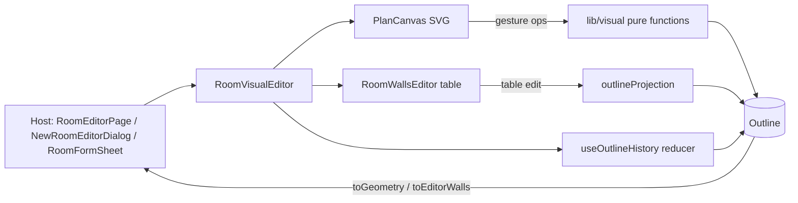

# Design Document — FOR-05-02-rooms-visual-editor

## Overview

Frontend-only (nested repo `foremen-frontend/`). The static `RoomPlanPreview` becomes an interactive
editor (`RoomVisualEditor`) composed of the SVG canvas and the existing wall table. The design rests
on one decision: **a vertex-based `Outline` model is the single source of truth**. The table rows
(`EditorWall[]`: length/turn strings) become a *projection* of it, and the stored `RoomGeometry` is a
serialization of it.

Why: today the page state is `EditorWall[]` (length + turn per wall, whole-degree turns) and the
vertices are *derived* from it (`wallsToVertices`). That model cannot express a freely dragged corner
without rounding the angles, rotating the first wall to +x and re-anchoring the first corner at the
origin. AI-generated and legacy geometry would be distorted on the first save. A vertex model keeps
the exact shape, and lengths/turns are computed for display.

No backend change. No new dependency.

## Architecture



### Module map (`foremen-frontend/src/features/rooms`)

| File | Responsibility |
|---|---|
| `lib/visual/outline.ts` | `Outline` type; `fromGeometry`, `toGeometry`, `isClosed`, `wallCount`, `wallVectors`; identity-preserving `toGeometry` for untouched outlines |
| `lib/visual/projection.ts` | `toEditorWalls(outline)` and `applyTableEdit(outline, editorWalls, autoClose)`; pose (anchor + heading) handling; formula bookkeeping |
| `lib/visual/viewport.ts` | `fitViewport(points, size, padding, minExtent)`, `worldToScreen`, `screenToWorld`; frozen-viewport helper |
| `lib/visual/snapping.ts` | `snapCorner`, `snapOpening`, guide line computation, snap radius in world units from px |
| `lib/visual/gestures/cornerWall.ts` | `moveCorner`, `translateWall`, `stretchWall` |
| `lib/visual/gestures/openings.ts` | `materializeOffsets`, `moveOpening`, `resizeOpening`, `addOpeningAt`, `removeOpening` |
| `lib/visual/gestures/draw.ts` | `appendDefaultWall`, `closeByMerge`, `closeWithWall` (keyboard nudges are mapped to the ops above inside `PlanCanvas`) |
| `lib/visual/liveSizes.ts` | `liveSizesFor(gesture, outlineBefore, outlineAfter)` → descriptors rendered by the canvas |
| `lib/visual/limits.ts` | constants (`MIN_WALL`, `MIN_OPENING_WIDTH`, `SNAP_PX`, `DEFAULT_WALL`, defaults of door/window) and `minWallLength(wall)` |
| `state/useOutlineHistory.ts` | reducer: `present`, `past[]`, `future[]`, `commit`, `preview` (non-history live state), `undo`, `redo`, `reset` |
| `components/visual/RoomVisualEditor.tsx` | Composite: toolbar (Undo, Redo, Templates, Close outline), canvas, table; owns history, selection, gesture state; emits `onChange({ geometry, editorWalls, autoClose, dirty })` |
| `components/visual/PlanCanvas.tsx` | SVG rendering + pointer handling; delegates maths to `lib/visual`; renders handles, guides, live sizes, "+" button, context menu |
| `components/visual/{CornerHandle,WallHit,OpeningHandle,LiveDimension,PlanContextMenu,AddWallButton}.tsx` | Presentational pieces |
| `components/RoomPlanPreview.tsx` | Kept as the static renderer (read-only hosts, other consumers); its drawing code is shared with the canvas through extracted `PlanLayers` so there is one drawing implementation |
| `components/RoomWallsEditor.tsx` | Table; gets `selectedWall`, `onSelectWall`, keeps `onFocusChange` |

## Data model

```ts
interface WallData { wallGap: number | null; finishGap: number | null; openings: Opening[] }

interface Outline {
  /** World metres, y up. Closed: n points, wall i = p[i] → p[(i+1) % n]. Open: n+1 points, wall i = p[i] → p[i+1]. */
  points: Vertex[]
  closed: boolean
  walls: WallData[]            // closed: n entries; open: points.length - 1 entries
  /** The geometry this outline was loaded from; used for the exact round trip. */
  source: RoomGeometry | null
  /** True after any geometry-changing operation (gesture, "+", template, table edit). */
  dirty: boolean
  /** Formula keys dropped by gestures (Requirement 9.6). */
  droppedFormulaKeys: string[]
}
```

- `fromGeometry(g)`: `points = g.vertices` exactly as stored, `closed = true`, `walls = g.walls`
  (missing/short `walls` padded with empty walls), `source = g`, `dirty = false`.
- `toGeometry(o)`: returns `null` when `!closed` or the outline is invalid; returns `o.source`
  **unchanged** when `!o.dirty`; otherwise vertices rounded to 1 mm (`roundCoord`) and walls copied.
  This makes the no-geometry-change save a no-op (Requirement 9.3). The page sends
  `dimensionFormulas` merged via the existing `mergeGeometryFormulas`, minus `droppedFormulaKeys`.
- An **open** outline is never persisted (existing save-block).
- **Pose.** The outline stores real points, so there is no hidden rotation. When a table edit needs
  length/turn arithmetic, `applyTableEdit` anchors on `points[0]` and the heading of wall 0
  (`atan2` of `p[1] − p[0]`), so the drawing does not rotate or jump (Requirement 9.5).

### Projection to and from the table

`toEditorWalls(o)`: for each wall `length = |p[i+1] − p[i]|` (3 decimals), `turn` = signed exterior
angle at the end of wall `i` (whole degrees, same convention as `wallsToVertices`: positive = left),
gaps/openings copied as strings (`offset` always filled for materialized openings). Existing
`geometryToEditorWalls(o.source, formulas)` is reused when the formulas must be shown.

`applyTableEdit(o, edited, autoClose)`:
1. Compute exact specs from the *current* outline (`length`, `turn` unrounded).
2. Replace only the fields whose strings differ from `toEditorWalls(o)`; evaluate formulas with
   `evalField`.
3. If `autoClose` and ≥ 3 walls: `closeOutline(specs)` (existing) derives the closing wall and the last
   two turns.
4. Rebuild points with `wallsToVertices(specs)`, anchored at `points[0]` with the wall-0 heading.
5. `closed = closureGap ≤ CLOSURE_TOLERANCE`; when closed the end point is dropped (snapped).
6. Walls/openings/gaps are taken from `edited` (parsed), `dirty = true`.

Property: for every outline `o`, `applyTableEdit(o, toEditorWalls(o), autoClose)` has the same points
as `o` up to 1 mm (projection is consistent).

### Viewport

`fitViewport(points, size, padding, minExtent = 4)` extends `fitToViewport` (same y flip, same
padding) with a minimum world extent and returns `{ scale, originX, originY }`. `worldToScreen` and
`screenToWorld` are exact inverses (property tested). The canvas computes the viewport:

- on mount and whenever the outline changes **outside** a gesture;
- once at gesture start, then **frozen** until release (Requirement 1.3).

The SVG keeps `viewBox="0 0 size height"`; pointer coordinates are mapped with
`svg.getScreenCTM().inverse()` into viewBox units and then `screenToWorld`.

## Gestures

All gestures follow one protocol in `PlanCanvas`:

```
pointerdown on handle  → select target, capture pointer, snapshot outline ("start"), freeze viewport
pointermove            → world = screenToWorld(p); next = op(start, target, world, modifiers); setPreview(next) (rAF throttled)
pointerup              → commit(next) as ONE history entry (if changed), clear live sizes/guides, refit viewport
Escape / pointercancel → drop preview, restore start
```

Every `op` is a pure function of the **start** outline and the **current pointer**, never of the
previous preview, so a drag is deterministic and cancellable.

### Corner drag — `moveCorner(start, i, world, {snap})`

1. Candidate = `world`.
2. Guides (when snapping is on), in world space:
   - **extension**: for each wall `j` not attached to corner `i`, the infinite line through `p[j]`,
     `p[j+1]`;
   - **right angle** at the neighbour `k = i±1`: the line through `p[k]` perpendicular to the
     neighbour's other wall (the wall attached to `k` that is not attached to `i`);
   - **straight continuation** at `k`: the line through `p[k]` along the neighbour's other wall.
3. For each guide compute the perpendicular distance from the candidate in screen px
   (`distWorld × scale`). Guides within `SNAP_PX = 10` are *active*. With one active guide the
   candidate is projected onto it; with two or more, the candidate snaps to the intersection of the
   two nearest guides when that is within the radius, else to the nearest guide. With none active the
   candidate stays free.
4. Constraint: both attached walls must be ≥ `minWallLength(wall)`; if violated the candidate is
   projected back onto the circle of that minimum length around the neighbour (nearest feasible point).
5. Result: `points[i] = candidate` (rounded to 1 mm on commit). Openings are re-clamped
   (`clampOpenings(wall)`), formulas of the two attached walls' length/turn dropped.

Open outline: the same function; the free end (last point) has only one attached wall.

### Wall translate — `translateWall(start, i, world, startWorld, {free})`

`delta = world − startWorld`. Default: `delta` is projected onto the wall's unit normal; with `Shift`
(`free`) it is used as is. Both `p[i]` and `p[i+1]` move by `delta`; wall length and direction do not
change. The neighbours' minimum-length rule (as above) limits `delta` by a binary search on the scale
factor of `delta`. Step snapping to 0.01 m of the *distance moved*.

### Wall stretch — `stretchWall(start, i, end: 'start'|'end', world)`

The dragged endpoint is projected onto the wall's own line through the fixed endpoint; the new length
is `max(minWallLength, round((world − fixed) · u, 0.01))`. The attached neighbour wall follows (shared
corner). Openings on the stretched wall keep `offset` from wall start; when `end === 'start'` the
offsets are shifted by the length change so openings stay at the same real place relative to the end
that did not move (they are measured from the start, which moved).

### Opening move/resize — `moveOpening`, `resizeOpening`

Working in wall-local coordinates `s ∈ [0, L]` (metres from wall start):

- `span = count × width`; neighbours sorted by `offset`; free interval for opening `o` =
  `[prevEnd, nextStart]` (or wall ends).
- **Move**: `s = clamp(worldProjection − grab, free.lo, free.hi − span)`; snap candidates `0`,
  `L − span`, `(L − span)/2`, neighbour edges; else 0.01 m steps. `offset = s`.
- **Resize** (`edge: 'start'|'end'`): `end` moves the right edge: `span' = clamp(sPointer − offset,
  count × MIN_OPENING_WIDTH, free.hi − offset)`; `start` moves the left edge keeping the right edge:
  `offset' = clamp(sPointer, free.lo, rightEdge − count × MIN)`, `span' = rightEdge − offset'`.
  `width = span' / count`, rounded to 1 mm.
- **Materialize offsets** (Requirement 5.6): before the first edit of a wall's openings, every
  offset-less opening of that wall gets the `offset` computed by the existing `placeOpenings` layout
  (converted from px to metres), so that nothing visibly jumps.

### Blank canvas — `appendDefaultWall`

```
empty                → points [(0,0),(2,0)], 1 wall, closed=false
open, k walls        → heading h = direction of last wall; new heading = h rotated +90° (CCW);
                       new point = last + 2 m · (cos, sin)
```
`closeByMerge(o)`: valid when open, `walls ≥ 3` (i.e. `points ≥ 4`); drops the last point, sets
`closed = true`, the last wall now ends at `p[0]`. `closeWithWall(o)`: valid when `walls ≥ 2`;
appends an empty `WallData` for wall `p[last] → p[0]`, `closed = true`. Hit-testing for the merge:
free end within `SNAP_PX` of `p[0]` at release.

### Add opening from the context menu — `addOpeningAt(o, wall, type, sClick)`

Default size from `limits.ts`; `offset = clamp(sClick − width/2)`; if it overlaps a neighbour it moves
to the nearest free span; if no free span ≥ width exists the function returns `null` and the menu item
is disabled (Requirement 7.3).

### Keyboard

A focused handle maps arrow keys to the same ops with a synthetic pointer position (`current + step`)
so one code path serves mouse and keyboard; each nudge session (until blur or 800 ms idle) is one
history entry.

## Rendering

`PlanLayers` (extracted from `RoomPlanPreview`) draws: outline, openings, labels, area, legend. The
interactive canvas adds, in z-order: guides → selection/hover highlights → hit areas (transparent,
stroke width ≥ 24 px for walls, r ≥ 12 px for corners, opening bodies) → grips → live sizes → "+"
button (HTML `<button>` positioned over the SVG top-right) → context menu (portal).

- Hover state is computed from pointer events on hit areas (`onPointerEnter/Leave`), not from
  coordinates, so it costs no per-move work.
- A single `requestAnimationFrame` throttle applies the latest pointer position per frame.
- Handles are `<g role="button" tabindex="0" aria-label>`; the canvas has `aria-describedby` pointing
  at the keyboard-help text.
- Read-only: `PlanCanvas` renders `PlanLayers` only.
- The existing `highlightWalls` (crossing walls, red) and `focus` (table-focused wall/opening, amber)
  props continue to work; selection uses a separate accent (stroke width 5 + grips).

### Live sizes

`liveSizesFor` returns descriptors `{ kind: 'wall'|'angle'|'distance'|'width', at: Vertex, text key,
params }`. Canvas renders them as small rounded labels next to the affected element, text from
`rooms.visual.live.*` keys with `fmt()` numbers.

## Table sync and host integration

`RoomVisualEditor` props:

```ts
interface RoomVisualEditorProps {
  initialGeometry: RoomGeometry | null
  initialFormulas?: Record<string, string> | null
  readOnly: boolean
  onChange: (state: VisualEditorState) => void   // { outline, geometry, editorWalls, autoClose, dirty, saveBlock }
  idPrefix?: string
}
```

- Hosts keep their form state for non-geometry fields and take `geometry`, `editorWalls`,
  `autoClose`, `droppedFormulaKeys` from `onChange`. They replace their local
  `walls/autoClose/preview` state and the `RoomPlanPreview` + `RoomWallsEditor` pair by one
  `<RoomVisualEditor/>`.
- `RoomEditorPage` save: `geometry = state.dirty ? toGeometry(outline) : room.geometry`; formulas via
  `mergeGeometryFormulas` then remove `droppedFormulaKeys`. Live metrics use
  `calculateRoomMetrics(outlineGeometryPreview, ceiling)` as today.
- `NewRoomEditorDialog` uses the same component and `applyGeometryToDraft` on save; the exact-geometry
  round trip protects AI drafts.
- `RoomFormSheet` uses the same component, canvas stacked above the table.
- `autoClose` defaults to `true` for closed outlines and `false` for open (scratch) outlines; it is a
  table-only mode (Requirement 10.3).
- Table highlight sync: `selectedWall` (canvas selection) scrolls/highlights the table row;
  `RoomWallsEditor.onFocusChange` keeps driving the canvas amber highlight.

## Undo / redo

`useOutlineHistory`: `present: Outline`, `past: Outline[]`, `future: Outline[]` (max 50, oldest dropped),
plus `preview: Outline | null` (live gesture state, not in history). `commit(next, coalesceKey?)`
pushes `present` to `past` unless `coalesceKey` equals the previous entry's key (table field focus
session, keyboard nudge session). Outlines are immutable (structural sharing), so snapshots are cheap.

## i18n (new keys, `rooms.visual.*`, pl + ru)

| Key | pl | ru |
|---|---|---|
| `rooms.visual.addWall` | Dodaj ścianę | Добавить стену |
| `rooms.visual.addWallHint` | Dodaj ścianę (domyślnie 2 m) | Добавить стену (по умолчанию 2 м) |
| `rooms.visual.closeOutline` | Zamknij obrys | Замкнуть контур |
| `rooms.visual.undo` | Cofnij | Отменить |
| `rooms.visual.redo` | Ponów | Повторить |
| `rooms.visual.hint.corner` | Przeciągnij, aby przesunąć narożnik | Перетащите, чтобы переместить угол |
| `rooms.visual.hint.wall` | Przeciągnij, aby przesunąć ścianę | Перетащите, чтобы сдвинуть стену |
| `rooms.visual.hint.wallEnd` | Przeciągnij, aby zmienić długość ściany | Перетащите, чтобы изменить длину стены |
| `rooms.visual.hint.opening` | Przeciągnij wzdłuż ściany | Перетащите вдоль стены |
| `rooms.visual.hint.openingEdge` | Przeciągnij, aby zmienić szerokość | Перетащите, чтобы изменить ширину |
| `rooms.visual.hint.freeEnd` | Wolny koniec: przeciągnij na pierwszy narożnik, aby zamknąć obrys | Свободный конец: перетащите на первый угол, чтобы замкнуть контур |
| `rooms.visual.menu.addDoor` | Dodaj drzwi | Добавить дверь |
| `rooms.visual.menu.addWindow` | Dodaj okno | Добавить окно |
| `rooms.visual.menu.deleteOpening` | Usuń otwór | Удалить проём |
| `rooms.visual.menu.noSpace` | Brak miejsca na ścianie | На стене нет свободного места |
| `rooms.visual.live.wall` | Ściana {{index}}: {{length}} m | Стена {{index}}: {{length}} м |
| `rooms.visual.live.angle` | {{angle}}° | {{angle}}° |
| `rooms.visual.live.moved` | Przesunięcie: {{distance}} m | Смещение: {{distance}} м |
| `rooms.visual.live.fromStart` | Od początku: {{value}} m | От начала: {{value}} м |
| `rooms.visual.live.fromEnd` | Do końca: {{value}} m | До конца: {{value}} м |
| `rooms.visual.live.width` | Szerokość: {{width}} m | Ширина: {{width}} м |
| `rooms.visual.live.span` | Łącznie: {{span}} m | Всего: {{span}} м |
| `rooms.visual.limit.minWall` | Minimalna długość ściany: {{min}} m | Минимальная длина стены: {{min}} м |
| `rooms.visual.aria.canvas` | Interaktywny plan pomieszczenia | Интерактивный план помещения |
| `rooms.visual.aria.corner` | Narożnik {{index}} | Угол {{index}} |
| `rooms.visual.aria.wall` | Ściana {{index}} | Стена {{index}} |
| `rooms.visual.aria.opening` | {{type}} na ścianie {{wall}} | {{type}} на стене {{wall}} |
| `rooms.visual.aria.freeEnd` | Wolny koniec obrysu | Свободный конец контура |
| `rooms.visual.keyboardHelp` | Strzałki przesuwają zaznaczony element o 1 cm, z Shift o 10 cm. Delete usuwa otwór. | Стрелки сдвигают выбранный элемент на 1 см, с Shift на 10 см. Delete удаляет проём. |

The door/window type names reuse `rooms.openingType.*`. Existing keys (`rooms.plan.*`,
`rooms.form.*`) are reused where they already exist.

## Correctness properties

Verified with `fast-check` (already a dev dependency) on the pure modules.

1. **Round trip.** `toGeometry(fromGeometry(g))` equals `g` for any accepted geometry (identity when
   `dirty = false`); after any gesture the result is still accepted by the geometry validation rules
   (≥ 3 vertices, finite, non-zero area unless self-intersecting is explicitly allowed during the drag).
2. **Corner locality.** `moveCorner` changes only `points[i]`; every other point is bit-identical.
3. **Wall translation invariants.** `translateWall` preserves the wall length and direction (within
   1e-9) and moves both endpoints by the same vector; default mode moves along the normal only.
4. **Stretch invariants.** `stretchWall` keeps the fixed endpoint and the wall direction; the length is
   a multiple of 0.01 m and ≥ `minWallLength`.
5. **Opening bounds.** After `moveOpening`/`resizeOpening`: `0 ≤ offset`, `offset + span ≤ L`,
   no overlaps, `width ≥ MIN_OPENING_WIDTH`; `height`/`count`/`type` unchanged.
6. **Snap sanity.** A candidate farther than `SNAP_PX` from every guide is returned unchanged; snapping
   is idempotent (`snap(snap(p)) = snap(p)`).
7. **Viewport inverse.** `screenToWorld(worldToScreen(p)) ≈ p`.
8. **Projection consistency.** `applyTableEdit(o, toEditorWalls(o), autoClose)` reproduces `o.points`
   within 1 mm.
9. **History.** `redo(undo(h)).present` equals `h.present`; cancelled gestures leave `past` unchanged.
10. **Default chain.** After `k` presses of "+", the open outline has `k` walls of 2.00 m, each turned
    +90° from the previous, first wall horizontal from the origin.
11. **Legacy compatibility.** The openings auto-layout of a loaded geometry equals the current
    `placeOpenings` result (golden tests with a stored room such as 1697 and an AI draft fixture).

## Error handling

- Limits (minimum wall/opening size) are enforced by clamping, never by throwing; a transient inline
  message `rooms.visual.limit.minWall` may be shown at the limit.
- A gesture on an invalid outline (e.g. self-intersecting) never blocks dragging; save-block reasons
  come from the existing `editorSaveBlockReason` evaluated on the projected table.
- A pointer-capture failure or `pointercancel` is treated as Escape (restore start state).

## Testing strategy

- **Unit + property tests (Vitest, fast-check)** for `lib/visual/*` (properties above), including
  golden fixtures: room 1697 (8 walls), a rectangle template, an L-shape template, an AI-draft with
  non-integer angles and offset-less openings, a clockwise polygon, `count` > 1 openings.
- **Component tests (Testing Library + user-event)** for `PlanCanvas`/`RoomVisualEditor`: hover
  highlight, corner drag, wall translate/stretch, opening move/resize (SVG matrix mocked), context
  menu, "+" chain, close, undo/redo, keyboard nudges, table sync, read-only mode.
- **Existing tests** that must stay green: `RoomWallsEditor.test`, `RoomPlanPreview` tests,
  `rooms.i18n.test`, `RoomFormSheet.test`, rooms matrix tests.
- **Browser (Playwright) scenarios** in `test-cases.md` against the Docker frontend.
- Frontend tests are run per file (`vitest --run <file>`).

## Dependencies and scope boundary

Depends on FOR-05-02-rooms-autoimport (geometry contract, templates dialog, wall table, plan
preview, new-room dialog) and FOR-05-02-rooms-dimensions (room editor page, form sheet). No other
spec depends on this one. Frontend repo is committed separately from specs (see workspace git
standard).
