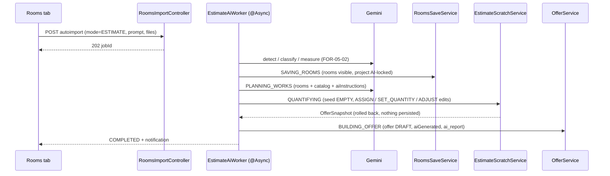
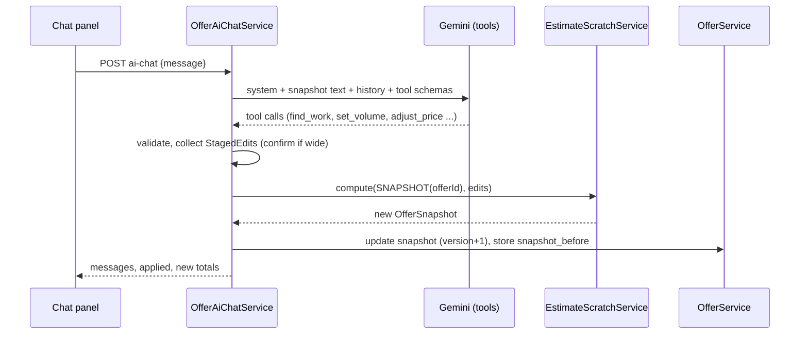

# Design Document: FOR-05-04-estimate-AI — "Create estimate" with AI

## Overview

> **Rework (see "Rework: direct-to-estimate job" below):** the job no longer builds an AI offer. It writes volumes, materials and per-cell annotations into the live estimate, one committed assignment at a time. The text below describes the first implementation; parts about offer creation, `QUANTIFYING`, `BUILDING_OFFER` and the job's scratch replay are **superseded** (B6, B7, B9 deep link, the first sequence diagram, the alternatives row "Where the AI result lives"). The chat (B8), cell meta (B11) and materials in snapshots stay.

The FOR-05-02 rooms import job becomes a two-phase job. Phase `ROOMS` is unchanged. After it, the new stages save the rooms, ask Gemini to choose works from our catalog, compute volumes and prices with the **existing estimate engine**, and store the result as a **DRAFT offer with a snapshot flagged `aiGenerated`**. A chat on the Offer tab then edits that snapshot through a fixed toolset that builds the same staged edits the estimate matrix uses.

Everything that decides a number is existing code: `VolumeResolver` (volumes), the catalog price frozen into the line, `ADJUST_LABOUR_PRICE` (markup/discount), `OfferSnapshotBuilder` (snapshot), `OfferRestoreService` (restore into the estimate). The model only proposes **which work, in which room, an optional volume, and a short reason for each decision**. Every AI cell carries a marker and an explanation record (B11).

| Need | Reused |
|---|---|
| Async job, polling, cancel, sweep, one job per project | `rooms_import_jobs`, `RoomsImportWorker`, `RoomsImportSweepService` (FOR-05-02) |
| Gemini client, JSON transport, stub | `GeminiClientFactory`, `GenAiJsonTransport`, `Stub*` pattern |
| Create rooms | `RoomsSaveService.save` (same as the manual and the FOR-05-02 path) |
| Volumes, prices, markup | `EstimateAssignmentService.applyStagedEdit` (`ASSIGN`, `SET_QUANTITY`, `ADJUST_LABOUR_PRICE`) |
| No-persist calculation | the preview mechanism (replay + rollback-only transaction) |
| Offer, snapshot, restore, compare, PDF | `OfferService`, `OfferSnapshotBuilder`, `OfferRestoreService` |
| Client invisibility | `OfferVisibilityResolver` (DRAFT is 404 for a CLIENT) |
| Notifications | `NotificationService.create` |
| Permissions | existing `ROOMS`, `ESTIMATE`, `OFFERS`, `WORK_CATEGORIES`, `WORK_ITEMS`; no new resource |

## Materials from consumption norms, stored in the snapshot

Today a manual `ASSIGN` creates the labour cell and then `seedMaterialLines(workItem, roomQty, offerPackage, consumptionsByWork)` creates one material line per consumption type with a copied price range. `EstimateLineRoomMaterialEntity` also holds the person-made parts: `qtyOverridden` + `manualQty`, `consumptionBasis`, the chosen concrete product (`concrete*Material`, `concreteNet`) and `appliedFromPackage`. The offer snapshot holds labour only (cells are `(roomId, quantity)`), and `OfferRestoreService.restore` re-creates lines and quantities **without** any material lines.

Design:

1. `EstimateMaterialSeeder` is extracted from `EstimateAssignmentService` (task 3.2, behaviour-preserving). It is the only place that seeds materials from norms, used by the assign path and by the scratch replay.
2. **The snapshot stores the material lines.** `OfferSnapshot.Cell` gets `materials: List<MaterialLine>` (version 3, with the cell's other new fields of B11). `MaterialLine` mirrors the entity: `branch`, `constructionTypeId | finishingTypeId`, `normQty`, `consumptionBasis`, `rangeMin`, `rangeMax`, `qtyOverridden`, `manualQty`, `quantity` (effective, for display), chosen product ids and `concreteNet`, `appliedFromPackage`, source ids. `OfferSnapshotBuilder` writes it for every snapshot it builds (AI and manual offers), reading the estimate's material lines.
3. **Restore uses the stored lines.** `EstimateReplaceHelper` recreates material lines from `cell.materials` (no re-seeding from norms), so overrides and chosen products survive. For a version-2 snapshot (no `materials`) nothing is created, as today. Missing material types/products are handled as in Requirement 23.4 (`skippedMaterials` in `RestoreResult`).
4. **Scratch seeded from a snapshot** (chat) loads the stored lines first; edits then flow through the normal replay: `SET_QUANTITY` changes the cell volume, non-overridden lines follow it, overridden lines keep `manualQty`, a new `ASSIGN` seeds from the norms. The result is written back into the new snapshot.
5. **Scratch in the job** seeds materials through `ASSIGN` (norms) and the builder captures them in the snapshot; no re-seeding at restore. Restoring the AI offer is therefore a faithful copy and matches a manual estimate by construction.
6. **Parity and round-trip tests** (task 3.12): (a) manual staged edits vs AI snapshot + restore compare lines, cells, overrides, prices, material lines, totals; (b) `estimate -> snapshot -> restore` is identity for materials, including an overridden quantity and a chosen product.
7. **Privacy.** Material ranges and products are staff data. The client offer read model and PDF are built from their own DTOs that never map `materials`; the reflection contract test (task 1.3, extended in 3.11/3.12) covers the nested cell types. Offer totals remain labour-only; the snapshot matrix view for staff reuses the estimate cell presentation and may show the stored lines.

Behaviour change to note: because the builder now stores materials for **every** new snapshot, a manually prepared offer restored later also gets its material lines back (today it does not). Version-2 snapshots keep today's behaviour. This is an intended fix of the restore gap and is covered by regression tests.

Not changed: offer totals (labour), offer PDF, comparison, material product choice by the AI (none).

## Answer to "what if the user opens a new session"

The browser keeps the estimate staging (FOR-05-05). The AI result is **not** staging. It is an offer row with a snapshot on the server, so any session or device sees it in the Offer tab. To work on it in the matrix the user presses the existing **Restore estimate from offer**. Chat edits also change the **offer snapshot**, not the browser staging and not the live estimate, so they survive a new session as well. Chat history is stored on the server (`offer_ai_chat_messages`).

## Architecture

> **Superseded for the job by the "Rework" section:** the first sequence diagram (QUANTIFYING via scratch, BUILDING_OFFER) is replaced by the diagram in R2. The chat sequence diagram stays valid.





## Components and Interfaces

### B1. Catalog: `aiInstructions`

- Liquibase `NNN-add-ai-instructions-to-work-catalog.xml`: `ALTER TABLE work_categories ADD ai_instructions TEXT`, same for `work_items`; each `ADD` guarded by `<not><columnExists/></not>`.
- Seed changeset `NNN-seed-ai-instructions-categories.xml` fills the 13 categories from sections 5.1 to 5.13 only `WHERE ai_instructions IS NULL`, categories matched by the work-code prefix (`SELECT DISTINCT work_category_id FROM work_items WHERE code LIKE '7.%'`). Texts are condensed rules (no prices). Seed text lives in the changeset as `<sql>` with parameterised values.
- `WorkCategoryEntity`/`WorkItemEntity.aiInstructions`; DTOs (`WorkCategoryDtoModel`, `WorkItemDtoModel`, create/update requests, MapStruct mappers); `@Size(max = 8000)`; trimmed; blank becomes `null`.
- Frontend: `work-categories` and `work-catalog` forms get a textarea "AI calculation rules" with a character counter; tables get an indicator icon when filled. Client-facing read models are untouched (they never map the field; a contract test asserts this).
- **Entity-creation checklist**: no new managed entity, so no resource seed/ABAC/dataset work. The dataset field catalogs of the dashboard (FOR-10) for `WORK_ITEMS`/`WORK_CATEGORIES` do not expose the field; `SensitiveFieldGuardTest` deny-list gets `aiInstructions`, `aiReport`.

### B2. Job model extension

> **Rework:** statuses `QUANTIFYING` and `BUILDING_OFFER` are superseded by `ASSIGNING` and `FINALIZING`; the column `offer_id` is no longer written by the job (see R1 for the migration decision). Other columns stay.

`rooms_import_jobs` (changeset `NNN-extend-rooms-import-jobs-for-estimate.xml`):

| Column | Type | Meaning |
|---|---|---|
| `mode` | varchar(16) NOT NULL DEFAULT `ROOMS_ONLY` | `ROOMS_ONLY` or `ESTIMATE` |
| `use_existing_rooms` | boolean NOT NULL DEFAULT false | skip the ROOMS phase |
| `offer_name` | varchar(255) NULL | optional name from the dialog |
| `package_code` | varchar(64) NULL | optional package for material price ranges |
| `offer_id` | bigint NULL, FK `offers` ON DELETE SET NULL | the created AI offer |
| `rooms_saved_at` | timestamp NULL | end of `SAVING_ROOMS` |
| `rooms_created` | int NULL | rooms created by the job |

`RoomsImportStatus` gains `SAVING_ROOMS`, `PLANNING_WORKS`, `QUANTIFYING`, `BUILDING_OFFER` (all non-terminal). `isTerminal()` unchanged. The sweep and the "active job" test use `!isTerminal()`, so they cover new statuses without change. The DB check/enum, if any, is extended in the same changeset.

`ESTIMATE`-mode jobs run in `EstimateAiWorker` (a new `@Async("estimateAiTaskExecutor")` listener on `RoomsImportRequested` filtered by `mode`). It delegates the `ROOMS` phase to the existing `RoomsImportPipeline` (the pipeline's last step, which stores `result` and sets `COMPLETED`, is parameterised so that for `ESTIMATE` it stops at `VALIDATING` and hands the draft to the worker). `ROOMS_ONLY` keeps its worker path byte-for-byte.

### B3. Stage SAVING_ROOMS

`EstimateAiRoomsSaver` converts every `DraftRoom` to a `RoomCreateRequest` (the shapes are compatible by FOR-05-02 design) with `importJobId` and draft media references, and calls `RoomsSaveService.save` in one transaction under the job creator's identity (the job stores `creator`; the saver runs through a technical call path that re-checks the creator's `ROOMS` CREATE and project access, so the lock guard and ABAC are not bypassed for another user).

A draft room without `roomTypeId` or failing save-time validation is skipped and reported (`ROOM_NOT_SAVED`). If nothing is saved and the project had no rooms, the job fails (`no_rooms`). On success the job commits `rooms_saved_at`, `rooms_created` in a `REQUIRES_NEW` stage transaction, so the Rooms tab can render rooms immediately.

### B4. Project lock (`AiProjectLockGuard`)

```java
@Component class AiProjectLockGuard {
  void assertUnlocked(Long projectId); // 409 error.project.ai.locked {jobId, stage}
}
```

Implementation: `RoomsImportJobDao.existsByProjectIdAndModeAndStatusNotIn(projectId, ESTIMATE, terminal)`. Called from the single write choke points:

- rooms: `RoomService` create/update/delete, `RoomsSaveService.save` (except when invoked by the saver of the job itself, via an explicit `AiJobContext` parameter), room media upload/delete;
- estimate: `EstimateAssignmentService.saveAndAssemble` and `applyLabourPriceAdjustment`, `OfferRestoreService.restore`, `OfferService` prepare/refresh/update, the chat service.

A guard-coverage test (Requirement 4.3) scans the mappings of `RoomController`, `RoomMediaController`, `EstimateMatrixController`, `OfferController` and fails when a non-GET handler is neither annotated `@AiLockExempt` nor reaches the guard (checked by an integration test that starts an ESTIMATE job row and calls every write endpoint expecting 409). Reads stay allowed.

### B5. Stage PLANNING_WORKS

`EstimateAiPlanner`:

1. `CatalogContextBuilder` loads active categories and works with `code`, names, unit, room-type attachment and `aiInstructions` (category and work), **without prices**, and renders the structured block of Requirement 7.3. If its size exceeds `max-catalog-chars`, categories are split into batches; each batch is a separate model call and the proposals are merged.
2. `RoomContextBuilder` renders saved rooms: id, label, type, the 15 dimensions.
3. The call uses the existing `GenAiJsonTransport` with a response schema: `{ works[{workCode, roomIds[], volumes[{roomId, value, unit, basis}], status, confidence, source}], assumptions[], questions[], unpriced[] }`. The same input files as the ROOMS phase are attached again (images as images, text as text).
4. `PlanResolver` (pure): resolves `workCode` to `WorkItemEntity` by exact code (active only), moves unknown or priceless works to `unpriced`, drops negative volumes, merges duplicates, and runs `PlanValidator` (rules of Requirement 5.5), producing `ResolvedPlan` + warnings. All resolver and validator classes are pure and property-tested.

The system prompt is the classpath resource `estimate-ai/system-prompt.md` (English). Its content is derived from the Standard: sections 1 to 4 (role, analysis order, geometry), 5 (work-by-section hints are NOT in the global prompt; they come from the category `aiInstructions`), 6 to 8 (coefficients, validation, missing information). The price table (section 15) is deliberately dropped.

### B6. Stage QUANTIFYING (`EstimateScratchService`)

> **Superseded for the job by R3 (per-assignment apply).** `EstimateScratchService` stays, but is called only by the offer chat (decision D-R1). `PlanToEditsConverter` and the replay of ordered `StagedEdit`s are replaced for the job by `AssignWorkTool`; the volume tolerance and price coefficient rules move into `AssignWorkService`.

```java
OfferSnapshot compute(Long projectId, Seed seed, List<StagedEdit> edits);
sealed interface Seed { Empty; Snapshot(Long offerId); Live; }
```

- `@Transactional(propagation = REQUIRES_NEW, timeout = scratchTimeout)`.
- Locks the estimate row (`findByProjectIdForUpdate`), the same lock as Save.
- Applies the seed: `Empty` deletes lines/room qtys/materials through the helper used by the restore; `Snapshot` runs the replace step of `OfferRestoreService` extracted into `EstimateReplaceHelper` (the planning part and the delete/insert part become reusable; `restore` calls the helper, behaviour identical); `Live` does nothing.
- Replays edits with `applyStagedEdit` (the same private method the preview uses, exposed package-private through a small `StagedEditReplayer` collaborator so both paths share it), then `entityManager.flush()`.
- Calls `OfferSnapshotBuilder` on the in-transaction estimate, builds the **value** snapshot, calls `setRollbackOnly()` and returns it. The replay cache hook used by preview suppresses events and collab broadcasts; audit rows are inside the rolled-back transaction.

For the job, edits are produced by `PlanToEditsConverter`:

1. one `ASSIGN` per `(work, room)` (volume by `VolumeResolver`, material seeding follows the existing assign path);
2. when a model volume differs from the resulting cell volume by more than `volume-tolerance-pct`, a `SET_QUANTITY` (manual override) edit;
3. when the prompt states a coefficient (the planner returns `coefficients[{scope, targetCode?, pct}]` only from explicit user text; the schema field is documented as "stated by the user only"), `ADJUST_LABOUR_PRICE` edits.

Materials: the existing assign path seeds material lines per consumption type. They are kept in the scratch estimate but are **not** part of the snapshot (the snapshot does not hold chosen materials, FOR-05-07b), so no extra logic is needed.

### B7. Stage BUILDING_OFFER

> **Superseded by R5.** `AiOfferWriter`, `OfferService.createAiOffer`, the `CREATE_AI_OFFER` audit and the `job.offer_id` link are removed. The offer columns `ai_generated`, `ai_job_id` (now unused by the job, kept nullable), `ai_report` stay and are filled by `OfferService.prepare` from the estimate (R5). Client invisibility rules in this section stay.

`AiOfferWriter` (single `@Transactional`):

1. builds `ai_report` from the plan warnings, assumptions, questions, unpriced and a `summary` computed from the snapshot (`byCategory` from snapshot groups);
2. (cell explanations are already inside the snapshot cells, B11) creates `OfferEntity` (status `DRAFT`, `aiGenerated = true`, `aiJobId`, name, `estimate` = the project's estimate reference (get-or-create as `EstimateService.getOrCreateForProject` does), `snapshot`, totals from the snapshot via `OfferSnapshotTotals`, `ai_report`) through `OfferService` so partial indexes, audit and totals logic are reused (`OfferService.createAiOffer(projectId, snapshot, report, jobId, name)` thin method; it never calls "prepare", which reads the live estimate);
3. writes audit `CREATE_AI_OFFER`;
4. sets `job.offer_id`, `result.estimate`, `status = COMPLETED` through the status-conditional update used by FOR-05-02 (a cancelled job updates 0 rows and the offer creation is rolled back by throwing `JobCancelledException` inside the transaction).

Offer columns (changeset `NNN-add-offers-ai-columns.xml`): `ai_generated BOOLEAN NOT NULL DEFAULT false`, `ai_job_id BIGINT NULL`, `ai_report JSONB NULL`. `OfferDtoModel`/staff read models add `aiGenerated`, `aiJobId`, `aiReport`; `ClientOfferReadModelAssembler`, `OfferHtmlBuilder`/PDF, the comparison redaction and the client portal mappers never copy them (contract test over all client read models using reflection: no property whose name starts with `ai`).

### B8. Chat (`OfferAiChatService`)

Table `offer_ai_chat_messages` (changeset `NNN-create-offer-ai-chat-messages.xml`):

| Column | Type |
|---|---|
| `id` | bigint PK (base entity) |
| `offer_id` | bigint NOT NULL FK `offers` ON DELETE CASCADE, indexed |
| `user_id` | bigint NULL |
| `role` | varchar(16) USER / ASSISTANT / SYSTEM |
| `content` | text |
| `tool_calls` | jsonb |
| `pending_action` | jsonb |
| `snapshot_before` | jsonb NULL |
| `version_before`, `version_after` | int NULL |
| `undone_at` | timestamp NULL |
| `created_at` | timestamp |

`ProjectScopedService.getProjectIdPath()` for this child is `offer.project.id`; it is not a managed CRUD entity (no controller from `AdminController`), so there is no resource seed.

Turn algorithm (`POST /api/offers/{offerId}/ai-chat`):

1. Guards: offer DRAFT with snapshot, `OFFERS` UPDATE + `ESTIMATE` UPDATE, project access, `AiProjectLockGuard`, rate limit, per-offer lock (`ConcurrentHashMap` of `ReentrantLock` plus a DB advisory lock `pg_try_advisory_xact_lock(offerId)` for multi-instance; failure to acquire is `409 error.estimateai.chat.busy`).
2. Build context: system prompt (chat variant, `estimate-ai/chat-system-prompt.md`), `SnapshotTextRenderer` output (compact table: room ids/labels; per row code, name, unit, unit price, override pct, per-room quantities, line totals; offer totals), last N turns.
3. Loop (max rounds): call Gemini with function declarations from `OfferChatToolRegistry`; for each function call run the tool. Read tools execute at once. Write tools **validate and append `StagedEdit`s to a turn buffer** (no persistence yet) and return a short validation result to the model.
4. At the end of the loop: if a confirmation is needed (Requirement 11.5), run `compute(SNAPSHOT, edits)` once to get the preview totals, store a `pending_action` in the assistant message and return without applying. If `confirmPendingId` is sent, the stored edits are applied directly.
5. Apply: `compute(SNAPSHOT(offerId), edits)` returns the new snapshot, then `OfferService.replaceAiEditedSnapshot(offerId, snapshot, turnId)` (version+1, totals, audit `AI_CHAT_EDIT`) and the turn row with `snapshot_before` are written in one transaction. The offer's `ai_report.changes[]` gets an entry.
6. Return both messages, `applied`, the offer summary and the new snapshot version.

The tool registry:

```java
interface OfferChatTool { String name(); JsonSchema params(); ToolPermission permission(); ToolResult run(ToolContext ctx, JsonNode args); }
```

`ToolContext` holds the caller principal, the offer, the snapshot, the staged-edit buffer and a read-only catalog facade. Permission checks go through the same `PermissionEvaluator` calls as the controllers (`ESTIMATE`/`OFFERS`, operation) so a role without update rights gets a tool error. Tool to edit mapping:

| Tool | Edit / call |
|---|---|
| `find_work` | `WorkItemDao` search (code, name RU/PL, active, has price) |
| `get_offer_state` | `SnapshotTextRenderer` with optional filter |
| `assign_work` | `ASSIGN` per room; `all_matching` uses `WorkItem.roomTypes` (empty = all rooms), as "apply work" does |
| `unassign_work` | `UNASSIGN` |
| `set_volume` / `clear_volume_override` | `SET_QUANTITY` / `CLEAR_QUANTITY` |
| `adjust_price` | `ADJUST_LABOUR_PRICE` (scope, target id resolved from code, pct) |
| `set_line_comment` | line comment update on the scratch estimate through the line service |

Materials are never changed by tools directly; they follow volumes (non-overridden lines) or are kept as stored (overridden lines, chosen products), see "Materials from consumption norms, stored in the snapshot".

Every write tool has a required `reason` string. It becomes the cell `rationale`/`adjustmentReason`/price `reason` (B11); a call without it is returned to the model as a tool error.

Undo: `OfferAiChatService.undo(offerId)` finds the latest turn with `version_after = offer.version` and `undone_at IS NULL`; otherwise `409 undo_stale`. It writes `snapshot_before` back via the same `replaceAiEditedSnapshot` (audit `AI_CHAT_UNDO`).

### B9. Notifications

> **Rework:** the `completed` deep link becomes `/projects/{projectId}/estimate`. Everything else here stays.

`EstimateAiNotificationEmitter` mirrors `RoomsImportNotificationEmitter`: types `notification.estimateAi.completed` and `notification.estimateAi.failed`, deep-links as in Requirement 16. The existing rooms emitter is skipped for `ESTIMATE` jobs (the transition code asks `job.mode`). Idempotence uses the same status-conditional update.

### B10. Frontend

> **Rework:** the progress stepper in `EstimateJobBanner` on the Rooms tab and its use on the Offer tab are superseded by R7 (one shared banner on the Rooms and Estimate tabs, none on the Offer tab). "Open offer" link on completion is replaced by "Open estimate".

- `features/rooms`: `GenerateRoomsDialog` becomes `CreateEstimateDialog` (same component file renamed, the rooms-only draft components remain for the API path/tests); `RoomsMatrixTab` reads `mode`/`stage`/`roomsSavedAt` from the current-job query, renders rooms when `roomsSavedAt` is set, passes `locked` to `RoomDimensionsMatrix`, room editor and media controls; new `EstimateJobBanner` (progress stepper, cancel, failed/completed states).
- `features/project-workspace`: tab strip indicator reuses the current-job query; Estimate and Offer tabs read the same query for the lock banner. A shared hook `useProjectAiLock(projectId)`.
- `features/project-offer`: `AiBadge`, `AiReportPanel`, `OfferChatPanel` (+ `useOfferAiChat`, optimistic user message, invalidates `offerSnapshot`/`offers` queries), send warning dialog.
- `features/work-categories`, `features/work-catalog`: the textarea and indicator.
- Locales: `pl.json`/`ru.json` key groups `estimateAi.*`, `offer.ai.*`, `workCatalog.aiInstructions.*`, `notification.estimateAi.*`; a parity test like `rooms.i18n.test.ts`.
- The loaders agent: the FOR-08 OpenAPI toolset document gets the new `mode` parameter and the chat endpoints are **not** exposed to the agent in this spec (out of scope).

### B11. Per-cell AI marker and explanation

**Record** (`CellAiMeta`, JSON, defined in task 1.1):

```json
{
  "origin": "JOB",            // or CHAT (+ "turnId")
  "status": "ASSUMED",        // CONFIRMED | ASSUMED | QUESTION
  "confidence": 0.72,
  "source": { "file": "plan.pdf", "page": 3 },
  "rationale": "Bathroom walls are fully tiled in the design (sheet 3), so tiling applies to all wall area.",
  "volume": {
    "source": "MODEL_OVERRIDE",   // FORMULA | UNIT_FALLBACK | MODEL_OVERRIDE | CHAT_OVERRIDE
    "formulaKey": "wallArea",
    "formulaVolume": 12.40,
    "finalVolume": 14.00,
    "correction": { "delta": 1.60, "pct": 12.9 },
    "adjustmentReason": "Niche of 1.6 m2 on the east wall (sheet 3) is tiled but is not in the room wall area."
  },
  "materials": { "seededFromNorms": true, "lines": 3, "overridden": 1 },
  "price": { "basePrice": 120.00, "effectivePrice": 138.00, "pct": 15, "scope": "PROJECT", "reason": "Coefficient +15% stated in the prompt." }
}
```

**Who writes which part.** Facts come from the engine, texts from the model or the user:

| Part | Source |
|---|---|
| `volume.source` (`FORMULA` / `UNIT_FALLBACK`), `formulaKey`, `formulaVolume` | `CellFactsResolver` calls `VolumeResolver.resolve(...)` for the cell's work and room (it returns `Resolution(volume, source, fallbackUsed)`) **even when the cell is overridden**, so the formula value is always known |
| `volume.source = MODEL_OVERRIDE` / `CHAT_OVERRIDE`, `finalVolume`, `correction` | the edit kind (`SET_QUANTITY` from the converter or from the chat) and the resulting cell quantity |
| `price.*` numbers | the line's `unitPrice`, `unitPriceOverride` and the `ADJUST_LABOUR_PRICE` edit |
| `rationale`, `adjustmentReason`, `price.reason`, `status`, `confidence`, `source` | the planner answer (job) or the tool `reason` (chat) |

**Flow in the job.** `PlanToEditsConverter` returns the edits plus a `List<CellMetaInput>` (work, room, rationale, volumeReason, status, confidence, source, price reason). `EstimateScratchService.compute(projectId, seed, edits, metaInputs)` replays the edits, then runs `CellMetaOverlay` inside the same scratch transaction: for each input it asks `CellFactsResolver` for the engine facts, builds `CellAiMeta` and sets it on the scratch `EstimateLineRoomQtyEntity.aiMeta`. `OfferSnapshotBuilder` then copies `aiMeta` into the snapshot cell. Nothing is persisted (rollback).

**Flow in the chat.** Tool calls create `CellMetaInput`s from the tool `reason`; for `adjust_price` the inputs cover every cell of the in-scope lines (so the price block appears on all of them). The scratch run seeded from the snapshot keeps the existing `ai` of untouched cells and replaces it for touched cells (`origin = CHAT`).

**Snapshot and restore.** `OfferSnapshot.Cell` grows to `(roomId, quantity, volumeOverridden, formulaKey, fallbackUsed, materials, ai)` with the old two-argument constructor kept; version 3 for new snapshots, version 2 still read. Today the snapshot cell has only `(roomId, quantity)` and restore does not set `volume_overridden`; the restore step in `EstimateReplaceHelper` is extended to set `volumeOverridden` and copy `ai` into `estimate_line_room_qty.ai_meta`. This also fixes an existing gap: a restored override used to be recomputed by the formula on the next recompute.

**Estimate matrix.** `estimate_line_room_qty.ai_meta` (JSONB NULL, changeset in task 1.1, entity field with a JSON converter like `JsonMapConverter`) is mapped to `CellDto.ai` by `EstimateMatrixAssembler`. The existing `CellDto` fields `formulaUsed`, `formulaKey`, `fallbackUsed`, `volumeOverridden` are reused for the engine facts of manual cells.

**Keeping the marker honest.** In `applyStagedEdit`, the handlers of `ASSIGN`, `UNASSIGN`, `SET_QUANTITY`, `CLEAR_QUANTITY` clear `aiMeta` unless the replay runs with `ReplayOrigin.AI` (set only by the scratch service). `ADJUST_LABOUR_PRICE` from a non-AI origin clears the `price` block of in-scope cells. A room-dimension change that recomputes a non-overridden volume clears `aiMeta` of the affected cells in `EstimateRecomputeService` (the recompute already touches those rows). Overridden volumes keep their marker because the number did not change.

**Missing reasons.** The planner schema requires `rationale` per `(work, room)`; `PlanResolver` lists the pairs without it, `EstimateAiPlanner` re-asks once for them, and the remaining get `rationale = null` plus the warning `RATIONALE_MISSING`. A model override without `volumeReason` gets `adjustmentReason = null`, the code `MODEL_VOLUME_DIFFERS` and the warning `ADJUSTMENT_REASON_MISSING`. No text is invented.

**Client safety.** The field is named `ai` on `CellDto` and on the snapshot cell, so the reflection contract test (no property starting with `ai`, nested types included) catches leaks. The client offer read model builds its own cell DTO that never maps it.

**Frontend.** `CellAiMarker` (corner overlay, status colour, correction/markup icons, `aria-label`) and `CellWhyCard` (popover/sheet, content of Requirement 22.2) live in a shared `features/estimate/components/ai` folder and are used by the Estimate matrix and by the offer snapshot matrix view (which reuses the estimate presentation, FOR-05-07b). Filters "AI cells" and "Corrected" are client-side over the loaded matrix. The chat panel renders changed cells as links that open the card.

## Rework: direct-to-estimate job

### Summary of the change

| Aspect | Before | After |
|---|---|---|
| Where the job writes | Rollback-only scratch, then a DRAFT offer | The live estimate, one committed assignment at a time |
| Unit of work | One plan, one replay | One `assign_work` tool call per assignment (work x room or rooms) |
| Materials | Seeded in the scratch, stored in the snapshot | Seeded by `EstimateMaterialSeeder` inside each assignment, rows live in the estimate |
| Cell annotation | In the snapshot cell | `estimate_line_room_qty.ai_meta`, written in the same call |
| Report | `offers.ai_report` | `estimates.ai_summary`, copied to `offers.ai_report` on offer creation |
| Stages | ... `QUANTIFYING`, `BUILDING_OFFER` | ... `SAVING_ROOMS`, `PLANNING_WORKS`, `ASSIGNING`, `FINALIZING` |
| Banner | Rooms and Offer tabs | One shared component on Rooms and Estimate tabs |

### R1. Data model changes (one changeset per concern, guarded, registered last)

- `estimates.ai_summary JSONB NULL` (`add-estimates-ai-summary`).
- `rooms_import_jobs`: `action_log JSONB NULL`, `rooms_total`, `rooms_done`, `works_total`, `works_done` INT NULL (`add-rooms-import-jobs-progress`). `RoomsImportStatus`: add `ASSIGNING`, `FINALIZING`; stop using `QUANTIFYING`, `BUILDING_OFFER`. The enum values stay in the code for one release only if a status check constraint or stored rows need them. A migration changeset maps any in-flight row with those statuses to `FAILED` (`error.estimateai.failed.superseded`), and the values are then removed from the Java enum (dead-code cleanup, task 9.4).
- `rooms_import_jobs.offer_id`: no longer written. Dropping the column is a follow-up; the DTO stops exposing it. `offers.ai_job_id` stays nullable and unused by the job.
- Not changed: `estimate_line_room_qty.ai_meta`, `offers.ai_generated`, `offers.ai_report`.

### R2. Job flow

```mermaid
sequenceDiagram
    participant UI as Rooms / Estimate tab
    participant API as RoomsImportController
    participant W as EstimateAiWorker
    participant G as Gemini
    participant A as AssignWorkService (REQUIRES_NEW per call)
    participant E as Live estimate
    UI->>API: POST autoimport (mode=ESTIMATE)
    API-->>UI: 202 jobId
    W->>G: detect / classify / measure (rooms_total, rooms_done)
    W->>W: SAVING_ROOMS (rooms visible, prompt "Go to Estimate")
    W->>G: PLANNING_WORKS (rooms + catalog + aiInstructions, no prices; works_total)
    loop each assignment
        G-->>W: tool call assign_work(...)
        W->>A: assign(workItemId, rooms, volume, meta) [AiJobContext]
        A->>E: line + cell + volume + materials + ai_meta (commit)
        A-->>W: result (cell ids, final volume) + action log entry, works_done+1
    end
    W->>W: FINALIZING (write estimates.ai_summary)
    W-->>UI: COMPLETED + notification (link: Estimate tab)
    UI->>E: poll matrix every 2 s while job active
```

### R3. `AssignWorkService` and the `assign_work` tool

- `AssignWorkTool` (a function declaration in the planner/worker loop, not in the chat registry) validates arguments and delegates to `AssignWorkService.assign(AiJobContext ctx, AssignWorkCommand cmd)`. One tool call is one assignment; the model may call it many times per model round, and the worker executes calls sequentially in order (no concurrent writes on one estimate).
- `AssignWorkService.assign` is `@Transactional(REQUIRES_NEW)`. In one transaction it: resolves the work (active, priced), checks every room belongs to the project, calls the normal assign path of `EstimateAssignmentService` for each `(work, room)` (so `VolumeResolver`, frozen price, line numbering and `EstimateMaterialSeeder` run as for a manual assign), applies `SET_QUANTITY` when the model volume differs beyond `volume-tolerance-pct`, applies a stated coefficient through the existing `ADJUST_LABOUR_PRICE` (only when the user's prompt gives one), builds `CellAiMeta` through `CellFactsResolver` and writes it to `ai_meta`, appends the action-log entry and increments `works_done`, then recomputes the estimate totals. Commit makes the result visible.
- `AiJobContext` is an explicit parameter (not a thread-local) accepted by `AiProjectLockGuard.assertUnlocked(projectId, ctx)`: when `ctx.jobId` equals the active job of the project, the guard passes. Every other check stays (the creator's `ESTIMATE` UPDATE and project access are re-checked once at job start and per call through the same evaluator).
- Idempotency: assign of an existing `(work, room)` updates the cell (volume, `ai_meta`), never duplicates the line.
- Failure handling: a call throws a typed `AssignRejected(code, params)` for expected rejections. The tool returns the code to the model, the worker appends an `ASSIGNMENT_REJECTED` action and warning, and continues. An unexpected exception rolls back only that call; the worker retries it once, then records it as rejected `EDIT_REJECTED`.
- Cancel: the worker checks the job status before each call; it stops at the first `CANCELLED`. Committed assignments stay.
- Why a tool per assignment and not one plan applied at the end: results are committed and visible immediately, a failure or cancel loses at most one assignment, and the progress counters match real writes.

### R4. Planning, tool loop and counters

`EstimateAiPlanner` still produces the resolved catalog context and the work selection (Requirement 5: code resolution, `unpriced`, validator warnings). The change is in how the plan is applied: for every resolved `(work, rooms, volume, rationale, ...)` the worker calls `assign_work` through `AssignWorkService` (the model-driven loop of the first design is not required; the deterministic `PlanResolver` output is the source of the calls, and the tool signature is the single apply entry, so a model-driven loop can be added later without a new apply path). `works_total` = number of resolved assignments, set when planning ends. `rooms_total` is set after detection (count of draft rooms), `rooms_done` increments as each room is measured, then as each room is saved.

### R5. Summary on the estimate and copy to the offer

- `FINALIZING` writes `estimates.ai_summary` (`AiSummaryWriter`, `REQUIRES_NEW`, status-conditional against cancel). Content as in Requirement 25.1. Totals and material counts are read from the live estimate after the last assignment.
- A cancelled or failed job writes the partial summary with `incomplete = true` when `works_done > 0`.
- `OfferService.prepare` (the existing create-from-estimate path) copies `estimates.ai_summary` into `offers.ai_report` and sets `ai_generated` when AI marks exist (`EstimateAiMarksQuery`: `EXISTS ai_meta IS NOT NULL` or non-null `ai_summary`). `OfferSnapshotBuilder` already copies `ai_meta` into snapshot cells and, since task 3.12, material lines. No other offer code changes. Refresh and update of an existing offer re-copy the summary only when the offer is `aiGenerated` and the estimate summary is newer than the offer's.
- Read model: `EstimateMatrixAssembler` exposes `aiSummary` and `CellDto.ai` to all roles except `CLIENT` (assembler-level redaction by role; the client read model has no such property, covered by the reflection contract test).

### R6. Poll DTO, action log and counters

- `RoomsImportJobDto` adds `actionLog[]`, `roomsTotal`, `roomsDone`, `worksTotal`, `worksDone`, drops `offerId` for `ESTIMATE` jobs.
- `JobActionLog` is a small component: `append(jobId, stage, code, params)` does a bounded prepend (newest first, truncate to 200) with a single JSONB update `UPDATE rooms_import_jobs SET action_log = (jsonb_build_array(:entry) || coalesce(action_log, '[]'))` followed by a trim to 200 in SQL (`jsonb_path_query_array`/slice) so concurrent appends from the worker and the status writer cannot lose entries. It runs inside the caller's transaction when there is one (assignment, summary), otherwise `REQUIRES_NEW`. Entries hold codes and params only.
- The log is bounded: 200 entries of about 200 bytes each, about 40 KB at most per job row.
- Counters are updated with `UPDATE ... SET works_done = works_done + 1` in the assignment transaction.

### R7. Frontend

- One shared `EstimateJobBanner` (in `features/estimate-job`) takes the current-job query result. It renders: stage label, progress text and bar when the counter pair of the stage is known (`roomsDone/roomsTotal` for detection and saving, `worksDone/worksTotal` for `ASSIGNING`), otherwise only the step label; an expandable `ActionLogList` rendered from `actionLog` with localized templates keyed by `code`, newest first, entries limited to the current stage; Cancel; failed and completed states. It is mounted in `RoomsMatrixTab` and in the Estimate tab layout, and removed from the Offer tab. Both mounts use the same component and props, enforced by a test that renders both tabs against the same job fixture and compares the DOM of the banner.
- Rooms tab: when `roomsSavedAt` appears, `GoToEstimatePrompt` shows a dismissible, non-blocking toast with a button to the Estimate tab (shown once per job id, remembered in session storage).
- Estimate tab: `useEstimateLiveRefresh(projectId, job)`: while the job is non-terminal, refetch the matrix query every 2 s (`refetchInterval`) and also when `worksDone` changes (`useEffect` invalidation); on a terminal status do one final refetch and stop. `keepPreviousData` and stable row keys keep scroll position and open "Why" cards. Controls stay disabled with the lock banner.
- `AiSummaryPanel` on the Estimate tab (from `aiSummary`). The report panel on the Offer tab stays for offers created from an AI estimate (data from `offers.ai_report`).
- Notification deep link opens `/projects/{id}/estimate`.

### R8. Decision D-R1: does `EstimateScratchService` stay?

Decision: **yes, only for the offer chat.** The chat edits the snapshot of a DRAFT offer. Those edits must not change the live estimate (the manager may have a different working estimate, and restore is a separate explicit action). The scratch replay seeded from the snapshot is the existing, tested way to compute such edits with the real engine (round-trip property, Requirement 12.6). Rewriting the chat to edit the live estimate would change its contract (Requirements 10 and 11), the undo model and the lock semantics, with no benefit for this rework. The job no longer uses the scratch service, so the `EMPTY` seed, the `metaInputs` overlay path used by the job and `PlanToEditsConverter` become dead code and are removed (task 9.4). `CellMetaOverlay` stays for the chat.

### Alternatives for the rework

| Question | Chosen | Rejected and why |
|---|---|---|
| Apply granularity | One committed transaction per assignment | One transaction for the whole plan: nothing visible until the end, long estimate lock, all-or-nothing loss on failure |
| Lock bypass | Explicit `AiJobContext` argument | Thread-local or a flag column: easy to leak into other writes |
| Report location | `estimates.ai_summary`, copied to offers | Keep only on a job row: lost after the job TTL; only on offers: needs an offer the job no longer creates |
| Action log storage | Bounded JSONB on the job row | Separate table: more writes and cleanup for a 200-entry display feature |
| Live view | Poll the matrix every 2 s | WebSocket push: collaboration channel exists but a full new event type is out of scope here |

### Rework risks

1. **Concurrency with the user.** The estimate is locked for people while the job runs (4.1), so the job is the only writer; the per-assignment transaction takes the same estimate row lock as Save, so a stray writer would serialise, not corrupt.
2. **Totals recompute cost.** Recomputing totals after each of up to hundreds of assignments. Mitigation: recompute only the touched line and the estimate header totals incrementally (the existing assign path already does this for a manual assign); measured in task 9.9.
3. **Poll load.** A 2 s matrix refetch on a large estimate. Mitigation: refetch only while a job is active and only on the Estimate tab; the matrix endpoint is the existing one.
4. **Partial result.** Cancel or failure leaves a partial estimate by design (Requirement 24.8); the banner and `ai_summary.incomplete` say so.

### Rework testing strategy

- Unit: `AssignWorkService` (volume tolerance, override reason, coefficient only when stated, rejections), `JobActionLog` (bound of 200, order, concurrent appends), `AiSummaryWriter`, `EstimateAiMarksQuery`, the guard with `AiJobContext`.
- Property tests (jqwik, at least 100 tries each): *for any* sequence of assignments the committed estimate equals a manual apply of the same triples (lines, volumes, materials, totals); *for any* number of appends the log has at most 200 entries and the newest first; assigning the same `(work, room)` twice yields one cell; *for any* cancel point the committed assignments equal `works_done`.
- Integration (Testcontainers, stub LLM): `EstimateAiWorkerIT` (stage order `SAVING_ROOMS, PLANNING_WORKS, ASSIGNING, FINALIZING`, cells visible between assignments, materials present per cell, `ai_meta` present, no offer rows created, cancel keeps lines, counters and action log in the poll DTO), `EstimateAiEndToEndIT` (job, then create an offer from the estimate: `ai_report` copied, `ai_generated = true`, snapshot has marks and materials, client 404).
- Contract: client read models have no `ai*` property (`aiSummary` included). Banner parity test across the two tabs. Frontend polling test with fake timers.

## Data Models

- `work_categories.ai_instructions`, `work_items.ai_instructions` (TEXT NULL)
- `rooms_import_jobs`: `mode`, `use_existing_rooms`, `offer_name`, `offer_id`, `rooms_saved_at`, `rooms_created`
- **Rework additions:** `estimates.ai_summary` (JSONB), `rooms_import_jobs.action_log` (JSONB, 200 entries), `rooms_import_jobs.rooms_total/rooms_done/works_total/works_done`; `offer_id` on the job is no longer written (R1)
- `offers`: `ai_generated`, `ai_job_id`, `ai_report`
- `estimate_line_room_qty.ai_meta` (JSONB NULL); `OfferSnapshot.Cell` extended with `materials[]` (version 3)
- `offer_ai_chat_messages` (new)
- `AiReport`: `{ assumptions[{code?, text, workCode?, roomId?, source?}], questions[...], unpriced[{name, unit, estimatedVolume?, reason, source?}], warnings[{code, severity, roomId?, workCode?, params}], changes[{turnId, userId, at, summaryCode, params}], summary{...}, promptVersion }`

## Correctness Properties

*A property is a characteristic or behavior that should hold true across all valid executions of a system-essentially, a formal statement about what the system should do. Properties serve as the bridge between human-readable specifications and machine-verifiable correctness guarantees.*

### Property 1: Direct assignment parity with manual apply

For any set of `(work, room, volume)` triples, the estimate produced by committing one `assign_work` call per triple equals the estimate a person gets by applying the same works to the same rooms with the same volumes: lines and numbers, cell volumes and override flags, prices, material lines and totals.

**Validates: Requirements 24.2, 24.4, 24.6**

### Property 2: Assignmen### Property 2: Assignmen### Property 2: Assignmen### Property 2: Assignmen### Pwo### Prope yiel### Property 2: Assignmen##ith the### Property 2: Assignmen### Property 2: Assignmen### Property 2: Asop### Property 2: Assignmen### Property 2: Assignmen### Propert
For any For any For any Fort of a wFor any For any For any Fort of a wFor any For any For any Fort of a wFor any For any For any Fort of a wFor any For any For any Fort of a wFor any For any For any Fort of a wFor any For any For any Fort of a wFor any For any For any Fort of a wFor any For any For any Fort of a wFor anldsFor any For any For any Fort of a wFor any For any For an`works_done` equals their count.

**Validates: Requirements 24.8, 26.2**

### Property 5: Action log is bounded and ordered

For any number of appended entries, the log holds at most 200 entries, newest first, and the retained entries are the most recent ones.

**Validates: Requirements 26.1**

### Property 6: Summary copy into the offer

For any estimatFor any estimatFor any estimatFor any estimatFor any estimatFor any estimatFor any estimatFor any estimatFor any estimatFor any estimatFor any estimatFor any estimatFor any estimatFor any estimatFor any estimatFor any estimatFor any estimatFor any estimatFor any estimatFor any estima
For any client read model type, including nested cell types, no property name starts with `ai`.

**Validates: Requirements 25.4, 24.13**

### Property 8: Snapshot round-trip through scratch (chat, retained)

For any snapshot, scratch with the snapshot seed and no edits returns an equal snapshot.

**Validates: Requirements 12.6**

## Error handling

| Situation | Result |
|---|---|
| Feature or Gemini disabled | `503 error.estimateai.unavailable` / `error.roomsimport.unavailable` |
| Estimate locked at start | `409 error.estimate.locked` |
| Active job | `429 error.roomsimport.in_progress` (existing) |
| Write while locked | `409 error.project.ai.locked {jobId, stage}` |
| Invalid plan twice | job `FAILED error.estimateai.failed.plan_invalid` |
| Unknown work code / no price | `unpriced` item (never a zero line) |
| Chat tool validation | tool result error to the model, no HTTP error |
| Chat edit rejected by engine | none applied, assistant reports |
| Chat concurrent turn | `409 error.estimateai.chat.busy` |
| Scratch lock timeout | `error.estimateai.scratch.timeout`; job retries the stage once, chat returns 503 |

## Alternatives considered

| Question | Chosen | Rejected and why |
|---|---|---|
| Where the AI result lives | Offer snapshot on the server (matches the user's idea) | Browser staging: lost with the session; shared draft of FOR-05-13: ties results to the live estimate and mixes with manual edits |
| How to compute without touching the live estimate | Scratch replay (rollback-only transaction, reuses `applyStagedEdit`) | New in-memory estimate engine: second copy of volume/price/material logic, divergence risk |
| Writing AI rows into the live estimate and snapshotting | | Would destroy a manager's existing estimate |
| `aiInstructions` language | One text column | RU/PL pair: needs sync, no UI value, model reads any language |
| Where cell explanations live | In the snapshot cell and, after restore, in `estimate_line_room_qty.ai_meta`, cleared on a non-AI edit | Only in the report (not tied to the cell, goes stale); a separate table (extra joins, no gain, snapshot already holds a copy) |
| Review gate between rooms and works | None (one process, staged saves) | Two clicks and a draft review; user asked for one process |
| Chat edits target | The offer snapshot | Live estimate: collides with browser staging and the shared draft |

## Risks

0. **Material parity drift.** If material seeding were duplicated it would diverge from manual assign. Mitigated by the single `EstimateMaterialSeeder` and the parity test.
0a. **Snapshot size and leakage.** Material lines enlarge the snapshot JSONB (cells x lines) and carry price ranges. Size is bounded by rooms x works x norms and is acceptable; leakage is prevented by the client DTOs and the contract test.

1. **Scratch transaction locks the estimate row** for a few seconds. Mitigated by the timeout, by running scratch only per job stage and per chat turn, and by the test of Requirement 12.7. If it causes visible contention, the follow-up is a dedicated per-offer scratch estimate, out of this spec.
2. **Catalog size** can exceed the model context; handled by batching (B5).
3. **Model proposes wrong volumes**; reduced by using engine formulas first and overrides only beyond tolerance, and shown in the report.
4. **Refactoring `OfferRestoreService` and the preview code** touches shipped paths; mitigated by behaviour-preserving extraction and the existing tests (run per task).

## Testing strategy

- Unit: `PlanResolver`, `PlanValidator`, `PlanToEditsConverter`, `SnapshotTextRenderer`, each chat tool (validation, permission), `CatalogContextBuilder` (batching), `AiProjectLockGuard`.
- Property tests: snapshot round-trip through scratch (no edits is identity, including `volumeOverridden` and `ai`); `CellFactsResolver` always returns the formula volume even for overridden cells; a manual edit always clears `ai`; every AI cell has `rationale` or the `RATIONALE_MISSING` warning; `PlanResolver` never yields a zero-price line; chat apply then undo restores the original snapshot; applying the same edits twice is idempotent for `SET_QUANTITY`/`ADJUST` semantic (price override computed from the original, not compounded, as the existing adjustment does).
- Integration (Testcontainers, stub LLM): ESTIMATE job end to end (rooms saved, offer created, no estimate rows written, lock during the job, release after cancel/fail), client 404 on the AI offer, restore from the AI offer, chat turn with confirm and undo, notifications once.
- Contract tests: no `ai*` property in any client read model; guard coverage test.
- Frontend: Vitest for dialog, banner, locked matrix, report panel, chat panel, i18n parity.
- Per `.kiro/steering/test-execution-rules.md`: run only affected classes with `--tests`, logs to `/tmp`.
- E2E: `test-cases.md` (API and UI scenarios on the Docker stack, LLM stub enabled).
