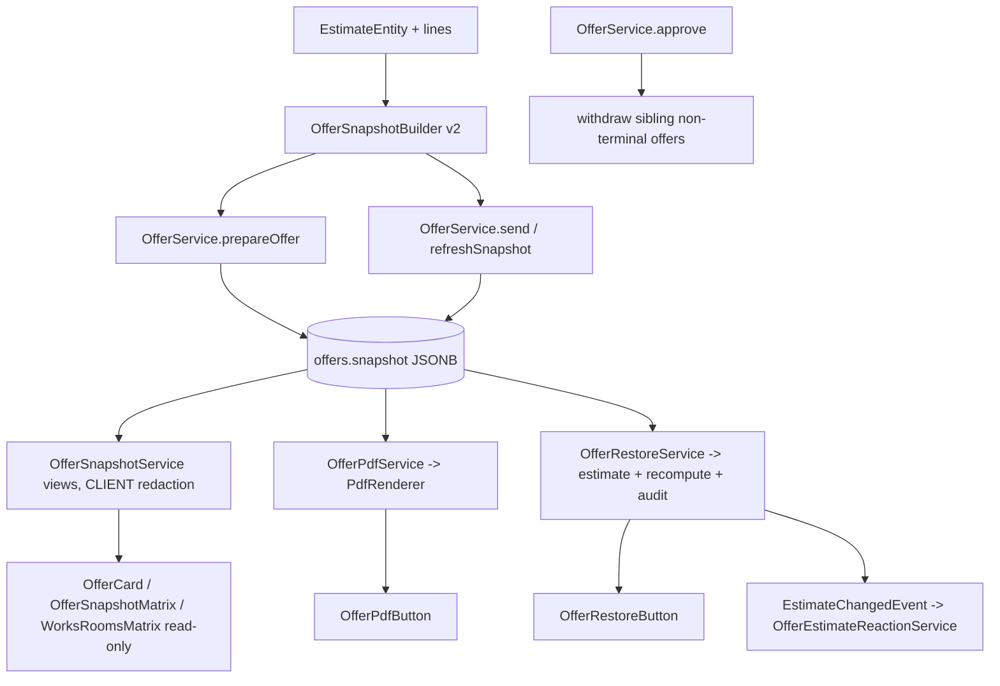

# Offer Snapshots Bugfix Design

## Overview

The offers tab (FOR-05-07, package data from FOR-05-06) cannot use the offer snapshot as intended. Eight defects (bugfix.md 1.1 to 1.8) share one cause: the snapshot is a small, write-once, prepare-time artifact that was never designed as the offer's working document. It is captured too early and never refreshed, it holds rows that belong to no room, it has no package marker and not enough data to rebuild an estimate, and nothing consumes it except a simplified table. In addition, the data model allows only one non-terminal offer per project.

The fix, in order of dependency:

1. **Snapshot lifecycle.** A DRAFT offer's snapshot is refreshed when the offer is sent (and by an explicit refresh), then frozen.
2. **Snapshot content.** Skip rows applied to no room. Add the applied package code and name, per-line price override, comment and work price reference, so the snapshot can drive a restore and a package marker.
3. **Several non-terminal offers.** Replace the partial unique index with a new changeset, drop the service check, and make the estimate-change reaction and approval act on every non-terminal offer.
4. **Consumers.** A matrix view that reuses the estimate presentation, an offer PDF endpoint and button on the existing `PdfRenderer`, a restore endpoint and action, and an offer-name dialog on the estimate's "Przygotuj ofertę".

No new managed entity or ABAC resource is introduced (everything sits under the existing `OFFERS` resource), so `.kiro/steering/entity-creation-rules.md` does not apply. The only new operation-level wiring is the `OFFERS` operations used by the new endpoints (see Fix Implementation, B7).

### Assumptions to confirm with the user

These are carried over from bugfix.md and refined here. The user answered all of them on 2026-11-20; A2 and A4 changed and are redesigned in "Round 2 design". The design is written to be cheap to change if an answer differs.

| # | Assumption | Status |
|---|------------|--------|
| A1 | Restore replaces the whole live estimate (lines, room quantities, prices, comments, applied package) with the snapshot content in one transaction, writes an audit row, and is refused with 409 `error.estimate.locked` when the estimate is not DRAFT (locked). | **Confirmed (2026-11-20)** |
| A2 | When one of several awaiting offers is approved, every other non-terminal offer of the project is withdrawn in the same transaction. | **Changed (2026-11-20): manual inactive flag, approve leaves other offers unchanged, see Round 2 D2** |
| A3 | Legacy offers without a snapshot cannot be viewed, exported to PDF or restored. | **Confirmed (2026-11-20)** |
| A4 | A restore changes the estimate, so the existing estimate-change reaction runs (seen offers are withdrawn, including the offer restored from if it is SENT). The confirmation dialog shows this impact beforehand through `impactOf`. | **Changed (2026-11-20): no offer reaction to estimate changes, see Round 2 D3** |
| A5 | During restore, snapshot cells whose room no longer exists in the project are skipped and reported in the response (`skippedRooms`); the rest of the estimate is restored. | **Confirmed (2026-11-20)** |
| A6 | An explicit refresh of a DRAFT snapshot is a user action ("Refresh from estimate") on the DRAFT offer; DRAFT snapshots are not refreshed automatically on every estimate edit, only on send. | **Confirmed (2026-11-20)** |
| A7 | A legacy DRAFT offer (no snapshot) receives a snapshot when it is sent or refreshed. Legacy offers in other statuses stay without one. | **Confirmed (2026-11-20)** |

## Glossary

- **Bug_Condition (C)**: an offer snapshot is requested, listed, exported, restored or prepared and at least one of the eight defects of bugfix.md applies (early or outdated snapshot, rows applied to no room, second non-terminal offer, PDF or restore requested, prepare triggered from the estimate, applied package not marked).
- **Property (P)**: the desired behavior for those inputs, as defined by bugfix.md 2.1 to 2.8.
- **Preservation**: behavior of bugfix.md 3.1 to 3.8 that must not change (status machine, CLIENT redaction, legacy marker, naming rules, comparison, estimate behavior, existing PDFs).
- **Non-terminal offer**: an offer whose status is not `APPROVED`, `REJECTED` or `WITHDRAWN` (`DRAFT`, `SENT`, `CHANGES_REQUESTED`, `COUNTERED`).
- **Frozen snapshot**: the snapshot of an offer that left DRAFT. It is never written again.
- **Package marker**: the applied package code and localized name stored in the snapshot (`appliedPackageCode`, `appliedPackageNameRu`, `appliedPackageNamePl`), shown in list, view, comparison and PDF.
- **OfferSnapshotBuilder**: `service/offer/OfferSnapshotBuilder.java`, a static builder that turns the live `EstimateEntity` into an `OfferSnapshot`.
- **OfferSnapshot**: `service/offer/OfferSnapshot.java`, the JSONB record stored in `offers.snapshot` (`OfferEntity.snapshot`, currently `updatable = false`).
- **OfferService.prepareOffer / send / approve**: the lifecycle methods in `service/OfferService.java`.
- **OfferEstimateReactionService**: `service/offer/OfferEstimateReactionService.java`, the reaction to a committed estimate change (withdraw seen offers, revise after approval).
- **WorksRoomsMatrix**: `foremen-frontend/src/features/estimate/components/WorksRoomsMatrix.tsx`, the estimate grid (works as rows, rooms as columns, grouped by work category).
- **PdfRenderer**: `service/document/pdf/PdfRenderer.java`, the XHTML to PDF seam used by document signing and client proformas.

## Bug Details

### Bug Condition

The bug manifests whenever an offer snapshot is used for something other than a one-time empty-or-early view. The snapshot is built once in `OfferService.prepareOffer` and `OfferEntity.snapshot` is `updatable = false`, so a snapshot taken before the estimate was filled stays empty. `OfferSnapshotBuilder` adds a row for every estimate line, including lines without room quantity cells. `OfferSnapshot` has no package field and no per-line override or comment. `prepareOffer` throws 409 `error.offer.active.exists` when any non-terminal offer exists, backed by `ux_offers_active_project` (changeset 128). No PDF, restore or matrix-view code path exists, and `EstimateTab.handlePrepareOffer` calls prepare with no name.

**Formal Specification:**
```
FUNCTION isBugCondition(input)
  INPUT: input of type OfferSnapshotRequest
         { action, offer, project, estimate, estimateChangedAfterCapture }
  OUTPUT: boolean

  RETURN (input.action IN {VIEW, LIST, SEND} AND input.offer.status == DRAFT
            AND input.estimateChangedAfterCapture AND snapshotIsStale(input.offer))        // 1.1
      OR (input.action == BUILD AND EXISTS line IN input.estimate.lines
            WHERE appliedToNoRoom(line))                                                    // 1.2
      OR (input.action == VIEW AND NOT isEstimateMatrixPresentation(viewOf(input.offer)))   // 1.3
      OR (input.action == PDF AND NOT pdfAvailable(input.offer))                            // 1.4
      OR (input.action == PREPARE AND nonTerminalOfferCount(input.project) >= 1)            // 1.5
      OR (input.action == RESTORE)                                                          // 1.6
      OR (input.action == PREPARE_FROM_ESTIMATE AND NOT nameAsked())                        // 1.7
      OR (input.action IN {PREPARE, VIEW, LIST, COMPARE}
            AND input.estimate.appliedPackageCode != NULL
            AND NOT packageMarkerPresent(input.offer))                                      // 1.8
END FUNCTION
```

### Examples

- **1.1** Project 1531: offer 261 "Bazowy" is prepared at 19:50:11, the estimate line is added at 19:50:45, the offer is sent. Actual: snapshot `rooms: []`, `groups: []`, totals 0 while the offer shows 2705.29 net. Expected: the sent snapshot has the work, its room cells and totals 2705.29 net / 2921.71 gross.
- **1.2** An estimate with 5 works, one of which has no room quantity cell. Actual: the snapshot view shows 5 rows, one with an empty quantity. Expected: 4 rows.
- **1.3** The executor opens "View" at the bottom of the versions list. Actual: a custom table without the estimate's work-type grouping style. Expected: a read-only works by rooms matrix, reachable from each offer row.
- **1.4** The user needs a PDF for the client. Actual: no endpoint, no button. Expected: `GET /api/offers/{id}/pdf` and a button.
- **1.5** Offer 261 is SENT and the executor prepares another one. Actual: 409 `error.offer.active.exists`. Expected: a second offer is created, both are listed.
- **1.6** The executor wants the estimate as it was in offer 261. Actual: no action. Expected: "Restore" with confirmation; the estimate returns to the snapshot content.
- **1.7** "Przygotuj ofertę" on the estimate. Actual: the offer is created named "Offer 9" and the app navigates. Expected: a dialog asks for the name first; cancel creates nothing.
- **1.8** An estimate with `applied_package_code = 'PREMIUM'`. Actual: no marker in list, view, comparison, PDF. Expected: the package name is shown. With `applied_package_code = NULL` (project 1531) no marker is shown.
- **Edge** A legacy offer without a snapshot: view, PDF, restore and compare stay hidden (3.3).

## Expected Behavior

### Preservation Requirements

**Unchanged Behaviors:**
- The status machine, role gates and audit rows of send, approve, reject, withdraw and negotiate (3.1).
- CLIENT sees no DRAFT offers (404) and never receives `baseUnitPrice`, `baseValueNet`, labour comparison or margins, in the list, the snapshot, the comparison and the PDF (3.2).
- Legacy offers without a snapshot keep the "no snapshot" marker and hide view, compare, PDF and restore (3.3).
- Prepare from the offers tab keeps the optional name, the default "Offer N" for a blank name, and `error.offer.name.too.long` above 255 characters (3.4).
- Comparison of two snapshots of one project returns added, removed and changed works and the total delta; different projects return 400 (3.5).
- The estimate-change reaction of FOR-05-07 keeps its rules (withdraw seen offers, new DRAFT after an approved offer), now applied to each affected non-terminal offer (3.6).
- Estimate editing, package apply and labour price adjustment (FOR-05-03, FOR-05-04, FOR-05-06) and the estimate matrix components do not change behavior (3.7).
- Document signing and client payment PDFs keep using `PdfRenderer` with unchanged output (3.8).

**Scope:**
All inputs outside the eight defect conditions are unaffected: offers that are already past DRAFT keep their stored snapshot byte for byte, single-offer projects behave as before except that the second prepare is now allowed, and every endpoint other than the new ones keeps its contract (new JSON fields are additive; `ignoreUnknown = true` already tolerates them on read).

## Hypothesized Root Cause

1. **Write-once snapshot.** `OfferEntity.snapshot` is `updatable = false` and only `prepareOffer` writes it. A DRAFT offer prepared against an empty or partial estimate keeps that picture. The live totals come from `recomputeTotals`, so the offer header and the snapshot disagree (1.1).
2. **Builder takes every line.** `OfferSnapshotBuilder.build` iterates `estimate.getLines()` without checking for room cells, so it emits rows with `cells = []` and `quantity = 0` (1.2).
3. **Snapshot model too small.** `OfferSnapshot` carries display data only. It has no applied package, no per-line `unit_price_override` and `comment`, no `workPriceId`. The effective price and base price exist, but without the override and comment the estimate cannot be rebuilt (1.6, 1.8).
4. **No consumers.** There is no PDF service for offers, no restore service, and the frontend renders the snapshot with a separate table component (`OfferSnapshotPanel`) rather than the estimate presentation (1.3, 1.4, 1.6).
5. **Single-offer assumption in several places.** `OfferService.prepareOffer` (409 check), `ux_offers_active_project`, `OfferEstimateReactionService.withdraw` (picks one offer with `max(id)`), `OfferService.getCurrentOfferByProject` and `OfferTab` (one `offerId` state, hooks bound to one offer) all assume one active offer (1.5).
6. **Prepare wired without a name in the estimate tab.** `EstimateTab.handlePrepareOffer` passes only the project id, although the backend already accepts a name (1.7).

## Correctness Properties

Property 1: Bug Condition - Snapshot reflects the estimate at send time and is frozen afterwards

_For any_ DRAFT offer whose estimate changed after the snapshot was captured, the fixed system SHALL rebuild the snapshot from the current estimate when the offer is sent (and on explicit refresh of the DRAFT offer), so its totals equal the live offer totals, and SHALL reject any later write to the snapshot of an offer that left DRAFT.

**Validates: Requirements 2.1**

Property 2: Bug Condition - Snapshot rows are always applied to a room

_For any_ estimate, the fixed `OfferSnapshotBuilder` SHALL emit only rows with at least one room cell of positive quantity (or a positive total quantity), SHALL emit only groups with at least one row, and SHALL list only rooms that appear in a remaining cell.

**Validates: Requirements 2.2**

Property 3: Bug Condition - Snapshot is shown as the estimate matrix

_For any_ offer with a snapshot, the fixed system SHALL render it through the estimate matrix presentation (works by rooms, grouped by work category, per-room quantities, totals) in read-only mode, reachable from each row of the offers list, with no staging, edit or assignment controls.

**Validates: Requirements 2.3**

Property 4: Bug Condition - Offer PDF is generated from the snapshot with role-appropriate content

_For any_ offer with a snapshot visible to the caller, `GET /api/offers/{id}/pdf` SHALL return a PDF generated from that snapshot only (name, date, project, package marker, category-grouped matrix, totals, VAT rate) in the caller's locale; for a CLIENT the document SHALL contain no base price, labour comparison or margin, and a DRAFT offer SHALL answer 404 to a CLIENT.

**Validates: Requirements 2.4**

Property 5: Bug Condition - Several non-terminal offers per project

_For any_ project with n >= 0 non-terminal offers, preparing an offer SHALL succeed and produce n + 1 non-terminal offers, each with its own status, totals and snapshot; approving one SHALL withdraw all the other non-terminal offers of the project (A2).

**Validates: Requirements 2.5**

Property 6: Bug Condition - Restore round trip

_For any_ offer with a snapshot and any DRAFT estimate, restore SHALL replace the estimate content in one transaction so that rebuilding the snapshot from the restored estimate gives the same rows, cells, prices, comments, package code and totals as the source snapshot (rooms that no longer exist excepted, A5), SHALL write one audit row, and SHALL answer 409 without changing anything when the estimate is locked or the offer has no snapshot.

**Validates: Requirements 2.6**

Property 7: Bug Condition - Prepare from the estimate asks for a name

_For any_ press of "Przygotuj ofertę" on the estimate tab, the fixed UI SHALL open a name dialog first, SHALL call prepare with the entered name (optional, max 255) only on confirm, SHALL navigate only after success, and SHALL create nothing on cancel.

**Validates: Requirements 2.7**

Property 8: Bug Condition - Package marker

_For any_ prepared offer, the snapshot SHALL contain the estimate's applied package code and names when one is applied and none when it is not, and list, view, comparison and PDF SHALL show the marker if and only if the snapshot has one.

**Validates: Requirements 2.8**

Property 9: Preservation - Everything outside the defect conditions is unchanged

_For any_ input where the bug condition does NOT hold (offers past DRAFT, CLIENT reads, legacy offers, naming, comparison, status transitions, estimate editing, signing and payment PDFs), the fixed system SHALL produce the same result as the original system, with the single exception of additive JSON fields.

**Validates: Requirements 3.1, 3.2, 3.3, 3.4, 3.5, 3.6, 3.7, 3.8**

## Fix Implementation

### Changes Required

Assuming the root cause analysis is correct. Two repositories are touched, as described in `.kiro/steering/git-repo-structure.md`: backend, migration and spec in the root repo, frontend in the nested `foremen-frontend/` repo.

#### Backend

**B1. Snapshot content** - `service/offer/OfferSnapshot.java`, `OfferSnapshotBuilder.java`

- Bump `OfferSnapshotBuilder.VERSION` to 2. Readers accept version 1 and 2 (`ignoreUnknown`); version 1 snapshots have no restore data, so restore is refused for them (see B6).
- `OfferSnapshot` gets top-level `appliedPackageCode`, `appliedPackageNameRu`, `appliedPackageNamePl` (all nullable).
- `OfferSnapshot.Row` gets `unitPriceOverride` (nullable, the raw `unit_price_override`), `comment`, `workPriceId` and `lineNo`. The existing `unitPrice` (effective) and `baseUnitPrice` (original) stay with their meaning. The labour adjustment inputs are exactly `unit_price` and `unit_price_override`; no separate percentage is stored, because the matrix keeps only the resulting override.
- `OfferSnapshot.Cell` is unchanged (`roomId`, `quantity`). `OfferSnapshot.Room` gets `typeCode` nullable only if the restore needs it to match rooms; matching is by `roomId` first and by label as a fallback (A5 still skips unmatched rooms).
- `build(...)` gains the package parameters (resolved by the caller through `OfferPackageDao.findByCode`, null-safe) and skips a line when it has no cell with a non-null positive quantity. Groups are created only when a row survives. Rooms are registered only from surviving rows, so the room list has no empty columns.

**B2. Snapshot lifecycle** - `OfferEntity`, `OfferService`

- `OfferEntity.snapshot`: change `updatable = false` to updatable. Immutability moves from the column to the service, enforced by one private method `assertSnapshotWritable(offer)` that throws 409 `error.offer.illegal.transition` unless the status is `DRAFT`. It is the only writer besides `prepareOffer`.
- New `OfferService.refreshSnapshot(offerId)`: resolves the offer, asserts DRAFT, calls `recomputeTotals`, rebuilds the snapshot from the live estimate and saves. Exposed as `POST /api/offers/{offerId}/refresh-snapshot` (A6).
- `OfferService.send`: before the status transition, if the offer is DRAFT, call the same refresh (recompute totals, rebuild snapshot) so the client receives numbers equal to the snapshot (A7 covers a legacy DRAFT). The transition happens in the same transaction, so there is no moment where a SENT offer has a stale snapshot. After the transition the snapshot is never written again.
- `prepareOffer(projectId, name)`: unchanged signature. It passes the package marker to the builder.
- `OfferVersions`' "hasSnapshot" is unchanged (`snapshot != null`).

**B3. Several non-terminal offers** - changeset, `OfferService`, `OfferDao`

- New changeset `foremen-backend/database_files/changesets/267-drop-offers-active-project-index.xml` (take the next free number at edit time; 265 is the highest today). It contains one changeSet with `<preConditions onFail="MARK_RAN"><indexExists indexName="ux_offers_active_project" tableName="offers"/></preConditions>` that runs `DROP INDEX IF EXISTS ux_offers_active_project;`. The rollback recreates the index from changeset 128 (`CREATE UNIQUE INDEX ... ON offers (project_id) WHERE status NOT IN ('APPROVED','REJECTED','WITHDRAWN')`) guarded by a precondition that no project has two non-terminal offers, so the rollback cannot fail on data created after the change. A second plain index `ix_offers_project_status` on `(project_id, status)` is created with an `indexExists` NOT precondition and `MARK_RAN`, to keep the non-terminal lookup cheap. Register the file LAST in `database_files/changelog.xml` after the current last include (`265-standard-work-sets-update-grant.xml`).
- `OfferService.prepareOffer`: remove the `findByProjectIdAndStatusNotIn` check and the 409. Remove the constant `ACTIVE_OFFER_EXISTS_MESSAGE` and the `error.offer.active.exists` keys from `messages.properties` and `messages_ru.properties` only after no reference remains (they are unused after the fix, and removing them avoids a dead error code).
- `OfferService.approve`: after the status transition, load `findByProjectIdAndStatusNotIn(projectId, TERMINAL)`, and for each other offer run `offerStatusMachine.transition(status, WITHDRAW, SYSTEM_ACTOR)`, save, and write an audit row with operation `SYSTEM_WITHDRAW_ON_APPROVE` and the approved offer id (A2). The same-transaction rule keeps the project from having an approved offer plus live competing ones.
- `OfferEstimateReactionService`: `classify` already looks at all non-terminal offers. `withdraw` is changed from "the one with max id" to "every offer in `WITHDRAWABLE`", one audit row per offer; the `Reaction` record keeps the first/last offer id for the existing listener, and carries the withdrawn ids in an additional list field. `revise` is unchanged (it runs only when no non-terminal offer exists). DRAFT offers are still left alone by the reaction; their snapshot is refreshed on send (Property 1).
- `OfferService.getCurrentOfferByProject` stays and returns the latest non-terminal offer, else the latest offer. It is kept for existing callers and for `OfferEstimateImpact` hints; the offers tab no longer depends on it (B5/F2).
- `OfferDao.findByProjectIdAndStatusNotIn` javadoc is updated; no signature change.
- Existing tests that assert the old rule are updated: `OfferServiceIntegrationTest` (409 on second prepare becomes success), `OfferApprovalMigrationIntegrationTest.partialUniqueIndexEnforcesOneActiveOfferPerProject` (becomes "two non-terminal offers can coexist"), `OfferServicePrepareOfferPropertyTest` and `OfferEstimateReactionServiceTest` (multi-offer withdraw).

**B4. Snapshot read model** - `OfferSnapshotViews`, `OfferSnapshotService`

- `OfferSummary` gains `appliedPackageCode` and `appliedPackageName` (localized), derived from the snapshot (null when none or no snapshot). `SnapshotView` gains the same two fields and per-row `comment` and `unitPriceOverride` is NOT exposed to CLIENT (override is a staff-side labour figure). `Comparison` sides gain the package marker so the comparison panel can show each side's package.
- CLIENT redaction stays allow-list based: new fields are added to the allow-list only where listed here (package marker yes; override, work price id, line number no).
- Rows are already filtered at build time. Stored version 1 snapshots can still contain empty rows, so `OfferSnapshotService` also filters rows without cells when it builds a view (read-time guard, no data migration).

**B5. Offer PDF** - new `service/offer/OfferPdfService`, `OfferHtmlBuilder`, `OfferPdfLabels`; `OfferSnapshotController`

- `OfferPdfService.render(offerId, role, language)` resolves the offer through the same visibility rules as `OfferSnapshotService.snapshot` (404 for a DRAFT offer seen by a CLIENT, 404 when no snapshot, A3), builds XHTML with `OfferHtmlBuilder`, and calls `PdfRenderer.renderToPdf`. The PDF is generated on demand from the frozen snapshot and is not stored; for a DRAFT offer it uses the current stored snapshot.
- Content: title with the offer name, creation or sent date, project name and address, package marker when present, a table grouped by work category with works as rows and rooms as columns plus a total column, totals net, VAT at the snapshot's `vatRatePct`, gross. Staff variant may show effective unit prices; the CLIENT variant is built from the redacted view (`OfferSnapshotViews`), so it cannot contain base prices or margins by construction.
- Labels follow `ProformaPdfLabels.forLanguage` (pl, ru). Failures map to 502 `error.offer.pdf.failed` like `ProformaPdfService`.
- Endpoint: `GET /api/offers/{offerId}/pdf` in `OfferSnapshotController`, `@RequiresPermission(OFFERS, READ)`, `Content-Disposition: attachment; filename="<offer-name-slug>-<id>.pdf"`, `application/pdf`. The renderer bean and `PdfFreezeService` are untouched (3.8).

**B6. Restore** - new `service/offer/OfferRestoreService`, endpoint in `OfferController`

- `POST /api/offers/{offerId}/restore`, `@RequiresPermission(OFFERS, UPDATE)` (executor roles only through the existing matrix; CLIENT has no UPDATE). Response: `{ restoredLines, skippedRooms[], estimateTotals }`.
- Steps in one `@Transactional` method:
  1. Resolve the offer; 404 when missing, 404 `error.offer.snapshot.missing` when there is no snapshot or its version is below 2 (A3).
  2. Resolve the estimate of the offer; `DraftGateGuard.assertDraft(estimate)` gives 409 `error.estimate.locked` (A1).
  3. Delete the estimate's lines (room quantities and per-room material rows follow through the existing `ON DELETE CASCADE` and the estimate services' cleanup path); recreate lines from the snapshot rows in `lineNo` order: work item by `workItemId` (a work that no longer exists is skipped and counted), `unitPrice` from `baseUnitPrice`, `unitPriceOverride`, `comment`, `workPrice` by `workPriceId` when it still exists, room quantities from cells for rooms that still exist (others go to `skippedRooms`, A5).
  4. Set `estimate.appliedPackageCode` from the snapshot (null clears it).
  5. Recompute the estimate through the existing `EstimateRecomputeService` so `quantity`, `valueNet` and totals are derived the normal way; no totals are copied from the snapshot.
  6. Write one `AuditLogEntity` (`entityClass = Offer`, `operation = RESTORE_ESTIMATE`, before and after JSON with counts and totals, acting user).
  7. Publish `EstimateChangedEvent` with trigger `OFFER_RESTORE` so the normal offer reaction runs after commit (A4).
- Per-line chosen materials are not part of the snapshot, so a restore returns lines and room quantities; material selections are re-derived by the existing estimate path when materials are re-applied. This limit is stated in the confirmation dialog and recorded as an open point.

**B7. Operation wiring** - no new resource

- `OFFERS` already has `READ` and `UPDATE` operations seeded (changeset 133). The new handlers use `@RequiresPermission` with these existing pairs, so no seed changeset is needed beyond 267 and `PermissionAnnotationValidator` is satisfied. `OfferController` and `OfferSnapshotController` stay as they are in terms of annotations.
- `DatasetCoverage`: no change (no new resource).

**B8. i18n (backend)** - `messages.properties` (PL) and `messages_ru.properties` (RU)

- New keys: `error.offer.snapshot.missing`, `error.offer.pdf.failed`, `error.offer.restore.locked` (reuses `error.estimate.locked` text if present, otherwise a restore-specific message), `error.offer.snapshot.frozen`. Existing `error.offer.illegal.transition` is reused for a write to a frozen snapshot.

#### Frontend (`foremen-frontend/`)

**F1. Snapshot matrix view** - `features/project-offer/components/OfferSnapshotMatrix.tsx` (new), `OfferSnapshotPanel.tsx` (replaced)

- A pure adapter `state/snapshotToMatrix.ts` maps `SnapshotView` to the `EstimateMatrixDto` shape used by `WorksRoomsMatrix`: groups to work-type groups, rows to work rows, cells to room cells with the quantity and the line value, totals to the matrix totals. Staff-only labour and cost fields are left empty.
- `OfferSnapshotMatrix` renders `WorksRoomsMatrix` with `canEdit={false}` and no-op handlers, inside a dialog or an inline expandable panel opened from each offer row. Implementation note: `WorksRoomsMatrix` takes assignment, hammer and report callbacks; if a read-only render still shows controls that need the estimate store, add a small `readOnly` presentational prop that hides them, without changing the default behavior (3.7), and cover it in the existing `WorksRoomsMatrix.test.tsx`.
- The matrix header shows the package marker (name) when present. `OfferSnapshotPanel` is reduced to a wrapper that loads the snapshot and renders `OfferSnapshotMatrix`, so existing imports keep working.

**F2. Offers tab with several offers** - `OfferTab.tsx`, `OfferVersions.tsx`, new `OfferCard.tsx`

- `OfferTab` stops holding one `offerId`. It uses `fetchOfferList(projectId)` and renders one `OfferCard` per non-terminal offer (header, totals, package marker, status, own actions send, withdraw, approve, reject, refresh snapshot for DRAFT, view, PDF, restore) followed by the history of terminal offers (`OfferVersions`). The per-offer hooks (`useSendOffer(offerId, ...)`, etc.) move into `OfferCard`, which is already offer-scoped.
- The "Prepare offer" block with the name input moves to the top of the tab and is shown always for executors (not only in the "no offer" or "terminal" state).
- Approve of one offer invalidates the list query, so the withdrawn siblings disappear from the awaiting list (A2).
- Each row exposes: View (opens F1), PDF (F3), Restore (F4). All are hidden when `hasSnapshot` is false (3.3).

**F3. PDF button** - `features/project-offer/components/OfferPdfButton.tsx`, `api/offer-api.ts`

- Copy of the `ClientPaymentPdfButton` pattern: `fetchOfferPdf(offerId)` returns a blob, opened in a new tab through `URL.createObjectURL`, revoked after 60 s; error toast `offers.pdf.error`.

**F4. Restore action** - `OfferRestoreButton.tsx`, `api/offer-api.ts`

- `restoreOffer(offerId)` calls `POST /api/offers/{id}/restore`. The button opens an `AlertDialog` that states what is replaced, that materials are re-derived, and the offer impact from `impactOf` (A4). It is disabled with a tooltip when the estimate is locked (status not DRAFT) or when the estimate tab has staged, unsaved edits (it reads the existing `estimateMatrixStore`/`projectStagedEdits` state and asks the user to save or discard first). After success it invalidates the estimate matrix, offers list and offer queries and shows a toast with skipped rooms if any.
- Visible to executor roles only (the existing `usePermission` check for `OFFERS` update).

**F5. Offer name on "Przygotuj ofertę"** - `features/estimate/EstimateTab.tsx`, new `PrepareOfferDialog.tsx`

- `handlePrepareOffer` opens `PrepareOfferDialog` (an input with `maxLength` 255, optional, default placeholder "Offer N", the same `zod` rule as the offers-tab input). Confirm calls `prepareOffer.mutate({ projectId, name })` and navigates to `/projects/{id}/pricing` in `onSuccess`; cancel closes without a request. `prepareOffer` in `offer-api.ts` already sends the optional name; the hook `usePrepareOffer` accepts it, and `EstimateTab.test.tsx` is updated to reach prepare through the dialog.

**F6. Package marker everywhere** - `OfferSummaryHeader`, `OfferVersions`, `OfferComparisonPanel`, `OfferSnapshotMatrix`

- A small `PackageMarker` component renders a badge with the package name from the view model when `appliedPackageName` is set, and nothing otherwise. Used in the card header, versions list, comparison side headers and the matrix header.

**F7. i18n (frontend)** - `locales/pl.json`, `locales/ru.json`

- New keys under `offers.*` and `estimate.*`: `offers.snapshot.view`, `offers.snapshot.refresh`, `offers.snapshot.refreshed`, `offers.snapshot.noSnapshot` (existing, kept), `offers.pdf.download`, `offers.pdf.error`, `offers.restore.action`, `offers.restore.confirmTitle`, `offers.restore.confirmBody`, `offers.restore.impactWithdraw`, `offers.restore.lockedHint`, `offers.restore.stagedHint`, `offers.restore.success`, `offers.restore.skippedRooms`, `offers.package.marker`, `offers.list.awaiting`, `offers.list.history`, `offers.prepare.nameLabel` (existing, reused), `estimate.prepareOffer.dialogTitle`, `estimate.prepareOffer.nameLabel`, `estimate.prepareOffer.namePlaceholder`, `estimate.prepareOffer.confirm`, `estimate.prepareOffer.cancel`. PL and RU are added together; the project's key parity check (if present) must pass.

## Architecture



The fix extends the existing offer services; it adds three backend services (PDF, restore, HTML builder) and four frontend components, and changes no layer boundaries.

## Components and Interfaces

New or changed endpoints, all under `/api/offers` and the existing `OFFERS` resource:

| Method and path | Operation | Result |
|-----------------|-----------|--------|
| `POST /project/{projectId}/prepare` | CREATE (existing) | 200, no longer 409 when other offers exist |
| `POST /{offerId}/refresh-snapshot` | UPDATE | DRAFT offer with a rebuilt snapshot; 409 when not DRAFT |
| `GET /{offerId}/pdf` | READ | `application/pdf`; 404 when no snapshot or DRAFT for CLIENT |
| `POST /{offerId}/restore` | UPDATE | `{ restoredLines, skippedRooms, estimateTotals }`; 409 when locked; 404 when no snapshot |
| `GET /project/{projectId}/list`, `GET /{offerId}/snapshot`, `GET /compare` | READ (existing) | additive fields `appliedPackageCode`, `appliedPackageName` |

Frontend interfaces: `fetchOfferPdf(offerId): Promise<Blob>`, `restoreOffer(offerId)`, `refreshOfferSnapshot(offerId)`, `prepareOffer({ projectId, name? })`, and the pure adapter `snapshotToMatrix(view): EstimateMatrixDto`.

## Data Models

- `offers.snapshot` (JSONB, existing): `OfferSnapshot` version 2 adds `appliedPackageCode`, `appliedPackageNameRu`, `appliedPackageNamePl` and, per row, `unitPriceOverride`, `comment`, `workPriceId`, `lineNo`. Version 1 snapshots remain readable and are not migrated.
- Schema change: changeset 267 drops `ux_offers_active_project` and adds a non-unique index on `offers(project_id, status)`. No new tables or columns.

## Error Handling

- 409 `error.estimate.locked` on restore of a locked estimate; 409 `error.offer.illegal.transition` on a snapshot write for an offer past DRAFT.
- 404 `error.offer.snapshot.missing` for PDF and restore of a legacy or version 1 snapshot; 404 for a DRAFT offer requested by a CLIENT.
- 502 `error.offer.pdf.failed` when rendering fails. 400 `error.offer.name.too.long` is unchanged.
- `error.offer.active.exists` is removed together with its check.

## Testing Strategy

### Validation Approach

Two phases: first surface counterexamples on the UNFIXED code, then verify the fix and preservation. Per `.kiro/steering/test-execution-rules.md`, backend runs select only the affected classes with `--tests`, write to `/tmp/for-05-07b-test.log` (`> /tmp/for-05-07b-test.log 2>&1; echo "EXIT=$?"`) and the result is read from `foremen-backend/build/test-results/test/TEST-<fqcn>.xml`. The full suite is run only on explicit request (about 20 minutes). Compile-only checks use `./gradlew compileJava` and `compileTestJava`. Frontend tests run with `vitest --run` for the affected files only.

### Exploratory Bug Condition Checking

**Goal**: Surface counterexamples that demonstrate the bug BEFORE implementing the fix. Confirm or refute the root cause analysis. If refuted, re-hypothesize.

**Test Plan**: Write the tests below first and run them on the unfixed code. They are placed in new classes so existing tests are not edited before the fix.

**Test Cases**:
1. **Empty snapshot after late fill (1.1)** - `OfferSnapshotRefreshExplorationTest` (integration, Testcontainers like `OfferSnapshotIntegrationTest`): prepare an offer on an empty estimate, add a line with a room quantity, send the offer, read the snapshot. Assert the snapshot totals equal the live offer totals and the snapshot has the row. Fails on unfixed code (snapshot is empty).
2. **Row applied to no room (1.2)** - `OfferSnapshotBuilderTest` (unit): estimate with one line without cells. Assert it is absent from the snapshot. Fails on unfixed code.
3. **Second non-terminal offer (1.5)** - integration: prepare twice for one project. Assert both succeed. Fails with 409 on unfixed code; also fails at the database level through `ux_offers_active_project` if the service check is bypassed.
4. **Package marker (1.8)** - unit: estimate with `appliedPackageCode`. Assert the snapshot has the code and name. Fails (no field).
5. **Restore and PDF absent (1.4, 1.6)** - endpoint tests expecting 200 on `/pdf` and `/restore`. Fail with 404 on unfixed code.
6. **Prepare without name (1.7)** - vitest on `EstimateTab`: click prepare and expect a dialog. Fails (the mutation fires immediately).

**Expected Counterexamples**:
- Offer 261 shape: SENT offer with `rooms: []`, totals 0 against a live total greater than 0.
- A row with `cells = []` present in a snapshot.
- 409 `error.offer.active.exists` on the second prepare.
- Possible causes: write-once snapshot, builder without a room filter, single-offer guard, missing endpoints, missing dialog.

### Fix Checking

**Goal**: Verify that for all inputs where the bug condition holds, the fixed system produces the expected behavior.

**Pseudocode:**
```
FOR ALL input WHERE isBugCondition(input) DO
  result := fixedSystem(input)
  ASSERT expectedBehavior(result)
END FOR
```

where `expectedBehavior` covers: snapshot totals equal live totals at send and the snapshot is frozen afterwards; no row without a cell; matrix view with the estimate structure; PDF content from the snapshot; n + 1 non-terminal offers after prepare and n - 1 siblings withdrawn on approve; restore round trip; name dialog before prepare; marker if and only if package applied.

### Preservation Checking

**Goal**: Verify that for all inputs where the bug condition does NOT hold, the fixed system produces the same result as the original system.

**Pseudocode:**
```
FOR ALL input WHERE NOT isBugCondition(input) DO
  ASSERT originalSystem(input) = fixedSystem(input)
END FOR
```

**Testing Approach**: Property-based testing (jqwik on the backend, fast-check on the frontend where a pure function exists) is recommended for preservation because it generates many estimates, statuses and role combinations and catches edge cases that hand-written examples miss.

**Test Plan**: Observe behavior on UNFIXED code first (status transitions, CLIENT redaction, naming, comparison, estimate reaction with one offer), then write property tests that capture it and run them after the fix.

**Test Cases**:
1. **Status machine and gates (3.1)** - existing `OfferStatusMachinePropertyTest` and `TerminalOfferImmutabilityPropertyTest` re-run unchanged.
2. **CLIENT redaction and DRAFT hiding (3.2)** - extend `OfferSnapshotIntegrationTest` with the new endpoints (PDF text contains no base price for CLIENT) and re-run the existing cases.
3. **Legacy offers (3.3)** - integration: an offer with `snapshot = NULL` returns "no snapshot" on view, 404 on PDF and restore.
4. **Naming (3.4)** - `OfferServicePrepareOfferPropertyTest` (name trimmed, default "Offer N", `error.offer.name.too.long` above 255).
5. **Comparison (3.5)** - existing compare tests re-run; add a case with a package marker on both sides.
6. **Reaction with one offer (3.6)** - `OfferEstimateReactionServiceTest` single-offer cases unchanged; new multi-offer cases added.
7. **Estimate behavior and other PDFs (3.7, 3.8)** - re-run the proforma PDF test and `WorksRoomsMatrix.test.tsx` unchanged.
8. **Frozen snapshot bytes** - property: for any offer past DRAFT, the stored snapshot JSON is identical before and after an estimate edit, a send of another offer, a restore and an approve of another offer.

### Unit Tests

- `OfferSnapshotBuilderTest`: skips lines without cells, drops empty groups and unused rooms, stores override, comment, work price id and package marker, null-safe package.
- `OfferHtmlBuilderTest`: CLIENT variant has no base price strings; staff variant has them; PL and RU labels; package marker present or absent.
- `OfferRestoreServiceTest` (Mockito-light): refuses a locked estimate, a missing snapshot and a version 1 snapshot; counts skipped works and rooms.
- `OfferEstimateReactionServiceTest`: withdraws every `WITHDRAWABLE` offer, leaves DRAFT, writes one audit row per offer.
- Frontend: `snapshotToMatrix.test.ts`, `PrepareOfferDialog.test.tsx` (confirm sends the name, cancel sends nothing, 255 limit), `OfferRestoreButton.test.tsx` (disabled when locked or staged edits exist, confirmation text), `OfferPdfButton.test.tsx`, `OfferTab.test.tsx` (several awaiting offers, per-offer actions, legacy hides actions), `PackageMarker.test.tsx`.

### Property-Based Tests

- `OfferSnapshotBuilderPropertyTest` (jqwik): for any generated estimate, every emitted row has a cell, every group has a row, every cell room is in `rooms`, and the sum of cell quantities equals the row quantity (Property 2).
- `OfferSnapshotRestoreRoundTripPropertyTest` (jqwik, integration or in-memory with the recompute service): build snapshot, restore into a fresh DRAFT estimate, rebuild, assert equality of rows, cells, prices, comments, package and totals (Property 6).
- `OfferMultiOfferPropertyTest`: for any sequence of prepare, send, withdraw and approve actions, the project has no more than one APPROVED offer after an approve, and all other offers are terminal (A2, Property 5).
- `OfferFrozenSnapshotPropertyTest`: for any status sequence, the snapshot of an offer changes only while it is DRAFT (Property 1).

### Integration Tests

Run against the Testcontainers integration setup, selected by class only:

- `OfferSnapshotRefreshIntegrationTest`: project 1531 shape (prepare, fill, send), refresh, freeze, PDF endpoint, CLIENT redaction.
- `OfferMultiOfferIntegrationTest`: two SENT offers, approve one, the other is WITHDRAWN with an audit row; the estimate change withdraws both seen offers.
- `OfferRestoreIntegrationTest`: restore into an edited DRAFT estimate (audit row, totals), 409 when the estimate is locked, rooms removed after the snapshot go to `skippedRooms`.
- `OfferApprovalMigrationIntegrationTest` (updated): the index `ux_offers_active_project` is gone after changeset 267, re-applying 267 is a no-op, two non-terminal offers can be inserted.
- Affected-class command (example):
  `./gradlew test --tests "com.foremen.service.offer.OfferSnapshotBuilderTest" --tests "com.foremen.service.offer.OfferSnapshotRefreshIntegrationTest" --tests "com.foremen.service.offer.OfferMultiOfferIntegrationTest" --tests "com.foremen.service.offer.OfferRestoreIntegrationTest" --tests "com.foremen.service.offer.OfferEstimateReactionServiceTest" --tests "com.foremen.service.offer.OfferServicePrepareOfferPropertyTest" --tests "com.foremen.service.offer.OfferServiceIntegrationTest" --tests "com.foremen.integration.OfferApprovalMigrationIntegrationTest" > /tmp/for-05-07b-test.log 2>&1; echo "EXIT=$?"`
- Frontend: `npx vitest --run src/features/project-offer src/features/estimate/EstimateTab.test.tsx src/features/estimate/components/WorksRoomsMatrix.test.tsx`.
- The spec's `test-cases.md` (API and UI browser scenarios against the Docker stack, repeatable through a generated run id) is authored in the tasks phase per `.kiro/steering/test-cases.md`.

## Round 2 design (2026-11-20)

Covers bugfix.md 1.9 to 1.14 and 2.9 to 2.16. Model: the estimate is a working sheet; an offer is a self-contained container built from the saved estimate; several offers can be sent to the client at the same time. After Round 2 the live estimate is read only when a snapshot is built (prepare, refresh, send, update).

### D1. Snapshot cache after send (2.9)

- `foremen-frontend/src/features/project-offer/api/mutation-hooks.ts`: `useSendOffer` and the update mutation invalidate `offerKeys.snapshot(offerId)` (or `offerKeys.all`, as `useRefreshOfferSnapshot` does). `useOfferSnapshot` keeps `staleTime: Infinity`, because a snapshot changes only through these mutations.

### D2. Manual inactive flag (2.10, replaces A2)

- Changeset `268-offers-inactive-flag.xml` (take the next free number at edit time): `offers.inactive boolean not null default false`, guarded by a `columnExists` NOT precondition with `MARK_RAN`, registered last in `changelog.xml`. `OfferEntity.inactive`.
- `POST /api/offers/{offerId}/deactivate` and `/activate` (`OFFERS` UPDATE, executor roles; 409 `error.offer.illegal.transition` for a terminal offer), one audit row each (`DEACTIVATE`, `ACTIVATE`).
- Client `APPROVE`, `REJECT` and `REQUEST_CHANGES` on an inactive offer answer 409 `error.offer.inactive`. Executor send and withdraw stay allowed.
- `OfferService.approve`: the Round 1 sibling withdraw is removed. Approve answers 409 `error.offer.already.approved` when the project already has an APPROVED offer.
- Read models (`OfferSummary`, offer read model, snapshot view, comparison) expose `inactive`. Frontend: badge `offer-inactive-badge` ("Nieaktywna"), toggle `offer-toggle-inactive-{id}`; the client sees the badge and no approve, reject or negotiation buttons on inactive offers.

### D3. No offer reaction to estimate changes (2.11, replaces A4)

- Remove `OfferEstimateReactionListener` and the withdraw and revise paths of `OfferEstimateReactionService`. Offers keep status, totals and snapshot on any estimate or room change, including a restore.
- The offer-impact endpoint of `EstimateMatrixController` answers `NONE` for compatibility (`@Deprecated`); `RoomsSaveService` sends `NONE`. The frontend drops `OfferImpactWarning` from the estimate Save confirmation (`EstimateTab`), `EstimateRecalcDialog` and `OfferRestoreButton`.

### D4. Simple comparison screen (2.12)

- Backend: `GET /api/offers/compare-many?ids=1,2,3` in `OfferSnapshotController` (`OFFERS` READ). 2 to 10 ids of one project with a snapshot, else 400; a DRAFT id for a CLIENT answers 404. CLIENT data goes through the existing redaction allow-list.
- Response `MultiComparison`: `offers[]` (id, name, status, inactive, version, package marker, totals net, VAT, gross); `groups[]` (category code, localized name, `valueNet` per offer); `works[]` (work item id, name, unit, category code, per offer `quantity` and `valueNet` or null, and per offer `rooms[]` with room id, label and quantity). Differences are computed on the client against the first selected offer.
- The two-offer `GET /compare` stays for existing callers (3.5).
- Frontend: checkbox `offer-select-{id}` on every card and history row with a snapshot; `offer-compare-open` ("Porównaj (n)") for 2 or more selected navigates to `/projects/{id}/pricing/compare?ids=...` (the existing `:tab/:subId` route). New `OfferComparisonPage`: one column per offer, category rows (`offer-compare-group-{code}`, cost and delta, collapsed by default) expanding to work rows (volume with unit, cost, deltas). Clicking a work cell (`offer-compare-cell-{workItemId}-{offerId}`) opens a popover with that offer rooms and volumes. No room columns. It replaces the in-tab `OfferComparisonPanel`.

### D5. Prepare into a new or an existing offer (2.13)

- `POST /api/offers/project/{projectId}/prepare` body becomes `{ name?, offerId? }`. Without `offerId` it creates a new DRAFT offer as today. With `offerId` it calls the new `OfferService.reprepare(offerId)`: 400 for an offer of another project, 409 `error.offer.reprepare.terminal` for APPROVED, REJECTED or WITHDRAWN; otherwise it rebuilds the snapshot from the saved estimate, recomputes the totals from it (D7), keeps status, name and inactive flag, increases the version (`revision`) by one and writes an audit row `REPREPARE` with the previous version and totals. The frozen-snapshot guard of Round 1 (`assertSnapshotWritable`) allows this one writer for non-terminal offers.
- Notification: when the offer is not DRAFT, an after-commit event (the `NegotiationService` pattern, so a failure never rolls back the update) notifies the CLIENT members of the project through `NotificationService` (PL and RU text: offer name and new version).
- An open discount request or negotiation round is left as is; its figures refer to the previous version (open point O2).
- Frontend: `PrepareOfferDialog` becomes a chooser used by the estimate tab and the offers tab (the inline name input of the offers tab becomes a button that opens it). It lists all offers of the project (`prepare-offer-option-{id}`: name, status, inactive badge, version; terminal ones disabled) and a "Nowa oferta" option with `prepare-offer-name-input` (max 255). Choosing a sent offer shows `prepare-offer-update-hint` (the client gets the new version and a notification).

### D6. Unsaved estimate edits (2.14)

- One `UnsavedEstimateGuard` dialog, reading the existing staged-edits store of the project, wraps "Przygotuj ofertę", "Odśwież migawkę z kosztorysu" and "Przywróć kosztorys z oferty". Actions: "Zapisz i kontynuuj" (runs the existing estimate Save and continues only on success), "Odrzuć zmiany" (discards and continues), "Anuluj". It replaces the disabled-with-tooltip state of the restore button.

### D7. Offer totals come from the snapshot (2.15)

- For offers with a version 2 snapshot, `OfferService.computeLiveTotals` is replaced by a computation over the snapshot rows (effective unit price times quantity), the offer discounts and the snapshot `vatRatePct`. The read path no longer calls `applyLiveTotals`: reads return the stored totals. `OfferDiscountService` and `NegotiationService` use the same computation. Legacy offers without a snapshot keep the live path. The labour comparison comes from the snapshot (`baseValueNet` against `valueNet`).

### D8. Send several offers at once (2.16)

- Frontend only: with DRAFT offers checked, `offer-send-selected` ("Wyślij zaznaczone (n)") calls the existing send endpoint for each, then invalidates the list. Failures are reported per offer in one toast.

### Open points, Round 2

- **O1.** The previous version of an updated offer is not kept as a separate snapshot; only the audit row records its version and totals. The client sees the current version only.
- **O2.** An open discount request or negotiation round survives an update of its offer.
- **O3.** Selecting a package on an offer (`useSelectPackage`) keeps its current behavior.

### Testing, Round 2

- Backend (affected classes only, `/tmp/for-05-07b-r2-test.log`): new `OfferInactiveFlagIntegrationTest` (toggle, client approve refused, one APPROVED per project), new `OfferReprepareIntegrationTest` (status kept, version + 1, audit, notification only when not DRAFT, terminal refused), new `OfferCompareManyIntegrationTest` (CLIENT redaction, 400 and 404 cases, rooms per work), new `EstimateChangeLeavesOffersPropertyTest`, new `OfferSnapshotTotalsTest`, updated `OfferFixCheckIntegrationTest`, `OfferServiceIntegrationTest` and `OfferApprovalMigrationIntegrationTest` (changeset 268).
- Frontend: `PrepareOfferDialog.test.tsx`, `UnsavedEstimateGuard.test.tsx`, `OfferComparisonPage.test.tsx` (expand group, deltas, rooms popover), `OfferTab.test.tsx` (inactive toggle and badge, selection, compare and send-selected buttons), send invalidates the snapshot.
- `test-cases.md` gets a Round 2 group (Russian), and the browser validation is repeated on a fresh QA project.
