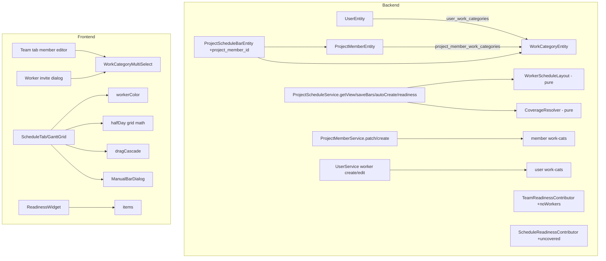

# Design Document — FOR-05-10b Gantt Granularity (per-worker planning)

## Overview

FOR-05-10b upgrades the planning Gantt from a per-work-category plan to a **per-worker** plan. The
central change: a schedule bar is now keyed by `(projectMember, workCategory)` rather than by
category alone, so a category can carry several parallel bars (one per worker who covers it) and
each worker renders in its own color. Workers gain a list of **work categories** they can perform —
a default on the user, copied into an editable per-project list on the project membership — and
auto-create uses those lists to assign and split work. Granularity drops to **half days**.

Requirement references are `R<n>.<criterion>` into `requirements.md`. Decisions referenced as
`D-<name>` are in `requirements.md` §Decisions.

This spec reuses FOR-05-10's persistence, service, controller, audit, and frontend tab, and
FOR-05-09's `ProjectMemberEntity` + Team tab, and FOR-05-11's readiness contributors. It adds two
join tables, one bar-table column, and a set of pure layout helpers; it changes no ABAC resource.

## Architecture



### Component map (what changes)

Backend:
- `UserEntity` — add `@ManyToMany`/ordered join to `WorkCategoryEntity` via `user_work_categories`.
- `ProjectMemberEntity` — add ordered join via `project_member_work_categories`.
- `ProjectScheduleBarEntity` — add nullable `project_member_id` FK; change unique key.
- `ProjectScheduleService` — rewrite `getView` row/bar mapping, `saveBars`, `autoCreate`,
  `readiness` to the per-worker model; new pure helpers `CoverageResolver`, `WorkerScheduleLayout`.
- `ProjectMemberService` — copy user categories on create; accept category edits on `PATCH`.
- `UserService` (worker create/edit) — accept and persist user categories for WORKER users.
- `TeamReadinessContributor` — add `noWorkers` outstanding item.
- `ScheduleReadinessContributor` — add `noWorkerForCategory` items from coverage.
- Liquibase changesets `154`–`156`.

Frontend (`features/project-schedule`, `features/project-team`/`project-members`, user admin):
- `WorkCategoryMultiSelect` (shared) — ordered, worker-only multiselect.
- Team member editor + worker invite dialog — embed the multiselect.
- `GanttGrid` / `GanttRow` / `GanttBar` — per-worker bars, color, half-day grid, legend.
- `ManualBarDialog` — worker picker + duration.
- `lib/halfDay.ts`, `lib/dragCascade.ts`, `lib/workerColor.ts`.
- `types.ts` — extend `ScheduleRowView` with per-worker bars + `AutoCreateResult.alert`.

## Data model

### New table `user_work_categories` (changeset 154)

| column            | type   | notes                                                        |
|-------------------|--------|--------------------------------------------------------------|
| `user_id`         | BIGINT | FK → `users(id)` ON DELETE CASCADE, NOT NULL                 |
| `work_category_id`| BIGINT | FK → `work_categories(id)` ON DELETE RESTRICT, NOT NULL      |
| `order_no`        | INT    | NOT NULL, `@OrderColumn`                                     |

PK `(user_id, order_no)`; unique `(user_id, work_category_id)`; index on `work_category_id`.
Mirrors the `project_member_tags` collection-table pattern but as an FK join.

### New table `project_member_work_categories` (changeset 155)

| column               | type   | notes                                                     |
|----------------------|--------|-----------------------------------------------------------|
| `project_member_id`  | BIGINT | FK → `project_members(id)` ON DELETE CASCADE, NOT NULL    |
| `work_category_id`   | BIGINT | FK → `work_categories(id)` ON DELETE RESTRICT, NOT NULL   |
| `order_no`           | INT    | NOT NULL, `@OrderColumn`                                  |

PK `(project_member_id, order_no)`; unique `(project_member_id, work_category_id)`; index on
`work_category_id`.

### Alter `project_schedule_bars` (changeset 156)

- Add `project_member_id` BIGINT NULL, FK → `project_members(id)` ON DELETE CASCADE. Null = the
  Uncovered_Category virtual bar (D-uncovered).
- Rename/replace the day columns with half-day columns: `start_half_days` INT (CHECK ≥ 1),
  `duration_half_days` INT (CHECK ≥ 1). Migration converts any existing `start_day`/`duration_day`
  rows by `×2` (a day n becomes half-day `2n−1` start / `2·duration` length) — safe because
  FOR-05-10 bars are whole days; see §migration.
- Drop the old unique `(schedule_id, work_category_id)`; add unique
  `(schedule_id, project_member_id, work_category_id)`. Because SQL uniqueness treats NULLs as
  distinct, enforce "at most one virtual bar per category" with a partial unique index
  `(schedule_id, work_category_id) WHERE project_member_id IS NULL`.

### JPA mappings

```java
// UserEntity
@ManyToMany
@JoinTable(name = "user_work_categories",
    joinColumns = @JoinColumn(name = "user_id"),
    inverseJoinColumns = @JoinColumn(name = "work_category_id"))
@OrderColumn(name = "order_no")
private List<WorkCategoryEntity> workCategories = new ArrayList<>();

// ProjectMemberEntity
@ManyToMany
@JoinTable(name = "project_member_work_categories",
    joinColumns = @JoinColumn(name = "project_member_id"),
    inverseJoinColumns = @JoinColumn(name = "work_category_id"))
@OrderColumn(name = "order_no")
private List<WorkCategoryEntity> workCategories = new ArrayList<>();

// ProjectScheduleBarEntity
@ManyToOne(fetch = FetchType.LAZY)
@JoinColumn(name = "project_member_id") // nullable = virtual uncovered bar
private ProjectMemberEntity projectMember;
@Column(name = "start_half_days", nullable = false)    private Integer startHalfDays;
@Column(name = "duration_half_days", nullable = false) private Integer durationHalfDays;
```

## Half-day grid (D-storage)

- Stored as integer half-day counts; `1 half-day = 0.5 day`.
- Conversions (pure, in `ScheduleCalculator` backend and `lib/halfDay.ts` frontend):
  `startDay = startHalfDays / 2.0`, `durationDays = durationHalfDays / 2.0`,
  `finishDay = (startHalfDays + durationHalfDays − 1) / 2.0`.
- Horizon: `startHalfDays + durationHalfDays − 1 ≤ 7300` (3650 days), else
  `error.schedule.too.long`.
- Validation `validateBar(startHalfDays, durationHalfDays)`: both present, both ≥ 1, finish ≤ 7300;
  a half-null or ≤ 0 value → `error.schedule.bar.invalid`.

## Coverage and auto-layout (pure helpers)

### `CoverageResolver`

Input: the derived estimate rows (category + categoryValueNet, from the existing
`ScheduleRowDerivation`), and the ACTIVE WORKER members each with their Member_Work_Categories.
Output per category: the ordered list of Covering_Workers (members whose categories include it),
possibly empty → Uncovered_Category.

```
coveringWorkers(category) = activeWorkerMembers.filter(m -> m.workCategories.contains(category))
                                               .sortedBy(member.id)
uncovered = categories.filter(c -> coveringWorkers(c).isEmpty())
```

### `WorkerScheduleLayout.autoLayout(...)`

Produces the full set of Worker_Bars.

1. For each category (in `(orderNo, id)` order) compute `categoryHalfDays = ceil(2 × duration)` where
   `duration = max(0.5, categoryValueNet / (rate × 1))` — the FOR-05-10 per-worker-day formula at
   half-day resolution. (Rate is still the global internal config; `crewSize` is replaced by the
   per-category split below.)
2. **Covered category**: `n = coveringWorkers.size`,
   `perWorkerHalfDays = max(1, ceil(categoryHalfDays / n))` (D-split). Create one bar per covering
   worker with that length; all share the category's provisional start.
3. **Uncovered category**: create one virtual bar (null member) of length `categoryHalfDays`.
4. **Sequence per worker (D-layout)**: walk categories in order; for each worker maintain a cursor =
   the half-day after their last bar's finish. A worker's next bar starts at `max(cursor,
   categoryProvisionalStart)`. Same-worker consecutive bars are back-to-back (gap 0).
5. **Neighbor overlap (R-overlap)**: when category `k+1`'s workers are disjoint from category `k`'s
   workers (different people), category `k+1`'s provisional start may be pulled back by up to
   `2` half-days (1 day), but never below `1` and never overlapping the *same* worker's own prior
   bar. Concretely the category provisional start is
   `max(1, predecessorLastFinishHalfDay + 1 − overlap)` where `overlap = 2` iff the worker sets are
   disjoint else `0`.
6. Reject with `error.schedule.too.long` if any bar finish exceeds 7300 half-days.

Output: `List<WorkerBarLayout(projectMemberId|null, workCategoryId, startHalfDays, durationHalfDays)>`
plus `uncoveredCategoryIds` and `crewEmpty` for the alert.

### Drag cascade (`lib/dragCascade.ts`, frontend; mirrored validation on save)

Given a moved/resized bar for member `m` and the current set of `m`'s bars sorted by start, set the
moved bar's new start, then for each subsequent bar of `m` set
`start = previousBar.finishHalfDay + 1`. Other members untouched (R6.2). The resulting set is sent in
one `SaveBarsRequest`; the backend re-validates the horizon (R6.3).

## API changes

All under the existing `/api/project-schedules` (`WORK_SCHEDULE`) and `/api/project-members`
(`PROJECT_MEMBERS`) / user endpoints (`USERS`). No new controller class; new/changed records only.

### `ScheduleView` (read) — `GET /api/project-schedules?projectId`

`ScheduleRowView` gains a `bars` array (replacing the single `startDay/durationDays/finishDay`
triple; those become per-bar):

```jsonc
{
  "workCategoryId": 12, "code": "...", "orderNo": 3, "name": "…",
  "lineCount": 5, "suggestedDurationDays": 4.5, "categoryValue": 1234.0,
  "covered": true,
  "bars": [
    { "projectMemberId": 7, "workerName": "Jan K.", "startDay": 1.0, "durationDays": 2.5, "finishDay": 3.0 },
    { "projectMemberId": 9, "workerName": "Piotr W.", "startDay": 1.0, "durationDays": 2.5, "finishDay": 3.0 }
  ]
}
```

An Uncovered_Category row has `covered: false` and a single bar with `projectMemberId: null`.
`ScheduleView` also gains `workers: [{ projectMemberId, name, color? }]` (color computed client-side;
field reserved) and keeps `version`, `editable`, `anchorDate`, `finishDay`, `exceedsProjectEnd`.

### `PUT /api/project-schedules/bars`

`BarEntry` becomes `{ projectMemberId: number|null, workCategoryId, startDay, durationDays }`
(days as 0.5 multiples; backend converts to half-days). Both day fields null clears that
`(member, category)` bar. Validation: category must be a current row; `(member, category)` must be a
valid Covering_Worker pairing (or `projectMemberId: null` for the virtual bar) else
`error.schedule.assignment.invalid`; grid/horizon per R3.

### `POST /api/project-schedules/auto-create`

Returns `AutoCreateResult { schedule: ScheduleView, alert: { crewEmpty: boolean,
uncoveredCategories: [{ workCategoryId, name }] } }` (R4.5). No longer 409s on an empty crew (R4.6).

### `GET /api/project-schedules/readiness`

`ScheduleReadiness` gains `uncoveredCategoryIds: number[]` to back R8.2.

### Team / user endpoints

- `GET /api/project-members?projectId` — each WORKER Team_Member_View gains
  `workCategories: [{ id, name }]`.
- `PATCH /api/project-members` — accepts `workCategoryIds: number[]` (ordered, distinct) to replace
  Member_Work_Categories (R2.2); omitted = unchanged.
- `POST /api/users/worker` and the user edit endpoint — accept `workCategoryIds: number[]` for a
  WORKER (R1.1); the user read for editing returns `workCategories` (R1.5).

## Frontend design

- **`WorkCategoryMultiSelect`** — fetches the active work-category catalog, renders an ordered,
  reorderable chip multiselect; shown only when the subject user's role is WORKER. Used in the Team
  member editor and the worker invite dialog (R1, R2).
- **Gantt** — `GanttRow` renders N bars per category (one per worker + optional virtual bar);
  `GanttBar` colors by `workerColor(projectMemberId)` (stable hash → palette) or the neutral
  unassigned style; a `WorkerLegend` lists worker → color. The time grid uses half-day columns in day
  zoom; `dragMath`/`halfDay` snap to 0.5. Dragging/resizing a bar runs `dragCascade` for that worker
  before writing the draft (R6, R7).
- **`ManualBarDialog`** — opened by clicking an empty (date × category) cell; lists the category's
  Covering_Workers, pre-fills the suggested per-worker duration, free entry on the 0.5 grid; for an
  Uncovered_Category it shows the "no worker" state (R5).
- **ReadinessWidget** — unchanged component; new outstanding items appear automatically from the
  contributors (R8).

## Readiness design (R8)

- `TeamReadinessContributor`: add — if `activeWorkerCount == 0` → BLOCKED + item
  `readiness.team.noWorkers` (targetTab `team`). (Existing no-FOREMAN logic unchanged.)
- `ScheduleReadinessContributor`: compute coverage; for each Uncovered_Category add item
  `readiness.schedule.noWorkerForCategory` with `params { category: localizedName }` (targetTab
  `team`). State becomes BLOCKED when any category is uncovered (planning cannot be complete), else
  as today.

## Migration (changeset 156) and compatibility

- The two join tables are additive (154, 155).
- The bar-table alter (156) converts existing whole-day bars to half-days (`×2`), adds the nullable
  `project_member_id`, swaps the unique constraint, and adds the partial unique index. Existing
  FOR-05-10 bars (per category, no member) become covered-by-nobody until a re-auto-create or manual
  assignment; this is acceptable for in-flight DRAFT projects and is called out in test-cases.
- All changesets are idempotent (preconditions `onFail="MARK_RAN"`) and registered last in
  `changelog.xml` in order 154 → 155 → 156.

## Error codes (new)

| code                                        | when                                             |
|---------------------------------------------|--------------------------------------------------|
| `error.user.workCategories.duplicate`       | duplicate id in a user's list (R1.2)             |
| `error.user.workCategories.invalid`         | unknown/inactive category id (R1.3)              |
| `error.member.workCategories.duplicate`     | duplicate id in a member's list (R2.2)           |
| `error.member.workCategories.invalid`       | unknown/inactive category id (R2.2)              |
| `error.schedule.assignment.invalid`         | `(member, category)` not a valid pairing (bars)  |
| `error.schedule.bar.invalid`                | off-grid / half-null bar (R3.5) — reused         |
| `error.schedule.too.long`                   | finish beyond horizon (R3.4, R6.3) — reused      |

## i18n keys (new; pl + ru, identical sets)

- `workCategory.multiselect.label`, `workCategory.multiselect.placeholder`,
  `workCategory.multiselect.empty`
- `team.member.workCategories.label`
- `worker.invite.workCategories.label`
- `schedule.manualBar.title`, `schedule.manualBar.worker`, `schedule.manualBar.duration`,
  `schedule.manualBar.noWorker`, `schedule.manualBar.unassigned`
- `schedule.legend.title`, `schedule.bar.unassigned`
- `schedule.autoCreate.alert.title`, `schedule.autoCreate.alert.crewEmpty`,
  `schedule.autoCreate.alert.uncovered`
- `readiness.team.noWorkers`, `readiness.schedule.noWorkerForCategory`
- the `error.*` codes above (backend `messages.properties` / `messages_ru.properties`)

## Testing strategy

- **Pure unit / property (backend):** `CoverageResolver` (coverage, uncovered set), `ScheduleCalculator`
  half-day conversions + horizon, `WorkerScheduleLayout` (equal split, per-worker sequencing,
  back-to-back same worker, 1-day disjoint-neighbor overlap, uncovered virtual bar, horizon reject),
  drag-cascade equivalence with the frontend.
- **Integration (backend):** user/member work-category CRUD + copy-on-create + independence;
  auto-create multi-worker + uncovered alert + empty crew no-fail; saveBars assignment validation;
  readiness `noWorkers` / `noWorkerForCategory`; ABAC on `USERS` / `PROJECT_MEMBERS` / `WORK_SCHEDULE`.
- **Frontend:** `WorkCategoryMultiSelect`, per-worker rendering + color + legend, half-day snap,
  `dragCascade`, `ManualBarDialog`, readiness items; locale parity.
- **`test-cases.md`:** API-level scenarios against the Dockerized app (this is primarily an API +
  UI spec; the Gantt interactions are browser-engine scenarios, the work-category/auto-create/
  readiness scenarios are API tests). MD report with tables; repeatable via a run-id generator.
