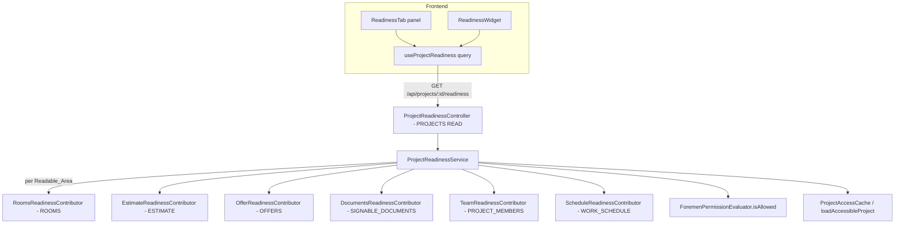

# Design Document: FOR-05-11 — Project readiness (aggregated)

## Overview

FOR-05-11 adds the **aggregated project-readiness surface** that closes the FOR-05 design stage. It
introduces a backend superinterface, `ProjectReadinessContributor`, implemented once per design-stage
area, and a thin aggregator (`ProjectReadinessController` + `ProjectReadinessService`) that composes
every contribution the caller is permitted to read into a single `Project_Readiness_View`
(`{ projectId, overallPercentage, overallState, areas[] }`). On the frontend it replaces the
placeholder `readiness` tab with a real checklist panel and switches the header `ReadinessWidget`
from its per-area fan-out to the one aggregated endpoint.

The key architectural choice (Decision D1) is **area-owned readiness**: each area's service decides
its own completion and its own percentage formula and returns a uniform `Area_Contribution`. The
aggregator never re-derives an area's completion from raw entities — it only discovers contributors,
calls each permitted one, averages the percentages with equal weight, rolls up the state, and orders
the result.



## Scope boundaries (what this spec owns vs. delegates)

| Concern | Owner |
|---------|-------|
| `ProjectReadinessContributor` superinterface + `Area_Contribution` contract | **this spec** |
| The six contributor implementations (rooms, estimate, offer, documents, team, schedule) | **this spec** (reading each area's existing entities/services) |
| Aggregator service + controller + `Project_Readiness_View` DTO | **this spec** |
| `PROJECTS` READ gate on the aggregate endpoint (no new resource) | **this spec** |
| `readiness` tab real panel + `ReadinessWidget` switch to the aggregate | **this spec** |
| `readiness.*` i18n namespace (pl + ru) | **this spec** |
| How each area computes its underlying data (geometry, pricing, BoM, offer, signing, team, bars) | the owning child spec (02 / 03 / 05 / 07 / 08 / 09 / 10) |
| The per-area readiness endpoints `/api/project-members/readiness`, `/api/project-schedules/readiness` | FOR-05-09 / FOR-05-10 (left intact) |

## Architecture

### Backend

#### `ProjectReadinessContributor` (superinterface)

```java
public interface ProjectReadinessContributor {
    /** Stable area key: rooms | estimate | offer | documents | team | schedule. */
    String areaKey();

    /** The ABAC resource that governs READ of this area's data (ROOMS, ESTIMATE, ...). */
    String areaResource();

    /** Declared order position (lower first); defines the stable area order (Req 7). */
    int order();

    /**
     * The area's readiness for the project. Read-only. Must return a well-formed
     * Area_Contribution (percentage in [0,100], state in {DONE,PARTIAL,BLOCKED}, empty items
     * iff DONE/100). Called only when the caller holds areaResource() READ.
     */
    AreaContribution contribute(Long projectId);
}
```

`AreaContribution` and `OutstandingItem` are plain carriers (records):

```java
public record AreaContribution(
        String key,            // == areaKey()
        String nameKey,        // i18n key for the area name (reuses workspace.tab.* where natural)
        int percentage,        // 0..100 (Req 1.2)
        ReadinessState state,  // DONE | PARTIAL | BLOCKED
        List<OutstandingItem> items) {}

public record OutstandingItem(
        String descriptionKey, // readiness.* i18n key
        Map<String, Object> params, // non-sensitive counts/ids only (Req 4.8)
        String targetTab) {}   // WORKSPACE_TABS key the UI jumps to
```

`ReadinessState` is a shared enum `{ DONE, PARTIAL, BLOCKED }`. The existing per-area enums
(`com.foremen.service.team.ReadinessState` with only DONE/BLOCKED, and
`ScheduleReadiness.State` with DONE/PARTIAL/BLOCKED) are **not** reused directly as the aggregate
enum; the team and schedule contributors map their area enum onto the shared three-valued enum
(team DONE→DONE, BLOCKED→BLOCKED). A new shared enum avoids coupling the aggregate to one area's
narrower enum.

A small pure helper centralizes the state→percentage fallback (Req 1.5) and the overall roll-up
(Req 4.3, 4.4) so they are property-testable without Spring:

```java
public final class ReadinessMath {
    public static int fallbackPercentage(ReadinessState s) { // DONE 100, PARTIAL 50, BLOCKED 0
    }
    public static int overallPercentage(List<AreaContribution> included) { // round(mean), 0 if empty
    }
    public static ReadinessState overallState(List<AreaContribution> included) {
        // any BLOCKED -> BLOCKED; else any PARTIAL -> PARTIAL; else DONE; empty -> BLOCKED
    }
}
```

#### `ProjectReadinessService` (aggregator)

- Injected with the `List<ProjectReadinessContributor>` (Spring collects every bean implementing the
  interface), the `ForemenPermissionEvaluator`, and the project-access collaborator
  (`ProjectAccessCache` + a `loadAccessibleProject`-style gate, mirroring
  `ProjectScheduleService.loadAccessibleProject`).
- `getReadiness(projectId)`:
  1. **Access gate** — resolve the project with the ADMIN-bypass rule; a missing or inaccessible
     project throws a byte-identical `404 error.entity.not.found` (Req 3.2, 3.3), exactly as the two
     existing readiness services do.
  2. **Readable areas** — resolve the caller's role code (from the `ROLE_*` authority, as
     `ProjectScheduleService.callerRoleCode()` does); for each contributor, include it iff
     `permissionEvaluator.isAllowed(role, contributor.areaResource(), "READ")` (ADMIN bypass) —
     Req 6.1.
  3. **Contribute** — call `contribute(projectId)` on each included contributor; collect the
     `AreaContribution`s.
  4. **Order** — sort by `contributor.order()` (the declared order of Req 7.1), independent of
     Spring discovery order.
  5. **Compose** — `overallPercentage = ReadinessMath.overallPercentage(included)`,
     `overallState = ReadinessMath.overallState(included)`.
  6. Return the `Project_Readiness_View`.
- `@Transactional(readOnly = true)` — read-only, no write, no audit (Req 11.2).

#### `ProjectReadinessController`

```java
@RestController
@RequestMapping("/api/projects")
@PermissionResource("PROJECTS")   // reuse existing resource (D7, Req 2.1/2.2)
public class ProjectReadinessController {
    @GetMapping("/{projectId}/readiness")
    @PermissionOperation("READ")
    public ResponseEntity<ProjectReadinessView> readiness(@PathVariable Long projectId) {
        return ResponseEntity.ok(projectReadinessService.getReadiness(projectId));
    }
}
```

Because the controller carries `@PermissionResource("PROJECTS")` and the handler
`@PermissionOperation("READ")`, `PermissionAnnotationValidator` accepts it at startup, and the
`PermissionInterceptor` enforces `PROJECTS` READ (401/403) before the handler runs (Req 2). The
service then owns the 404 project-scope gate (Req 3), matching the two existing readiness endpoints.
No `getProjectIdPath()` / `ProjectScopedService` CRUD surface is needed — this is a bespoke read, not
a CRUD controller, so the entity-creation-rules checklist does not apply (no new managed entity, no
new resource; see "ABAC" below).

> **Why `/api/projects/{projectId}/readiness` and not `/api/project-readiness`.** The resource being
> read is a projection *of a project*, so a sub-path of the project reads most naturally and keeps
> the `PROJECTS` resource gate honest. The two existing per-area gates live under their own area
> paths; the aggregate lives under the project.

### The six contributors

Each contributor is a `@Component` implementing `ProjectReadinessContributor`, placed in (or next to)
the area's package so the area owns its rule. Each reads only.

| key | order | nameKey | areaResource | targetTab | Source |
|-----|-------|---------|--------------|-----------|--------|
| `rooms` | 10 | `workspace.tab.rooms` | `ROOMS` | `rooms` | `RoomDao.findByProjectId` |
| `estimate` | 20 | `workspace.tab.estimate` | `ESTIMATE` | `estimate` | `EstimateDao`/`EstimateLineDao` + BoM traversal |
| `offer` | 30 | `workspace.tab.offer` | `OFFERS` | `pricing` | `OfferDao.findByProjectIdOrderByIdAsc` + `OfferVisibilityResolver` |
| `documents` | 40 | `workspace.tab.documentSigning` | `SIGNABLE_DOCUMENTS` | `documentSigning` | `SignableDocumentDao.findByProjectIdOrderByIdDesc` |
| `team` | 50 | `workspace.tab.team` | `PROJECT_MEMBERS` | `team` | `ProjectMemberService.readiness` (delegated) |
| `schedule` | 60 | `workspace.tab.scheduleDesign` | `WORK_SCHEDULE` | `scheduleDesign` | `ProjectScheduleService.readiness` (delegated) |

#### `RoomsReadinessContributor` (Req 5.1)

- Load rooms via `RoomDao.findByProjectId(projectId)`.
- No rooms → `BLOCKED`, 0%, one item `readiness.rooms.none` (`targetTab = rooms`).
- Else `withArea = rooms where floorArea != null && floorArea > 0`;
  `percentage = round(100 × withArea / total)`; `DONE` iff `withArea == total`, else `PARTIAL`.
- Items: one `readiness.rooms.noDimensions` per room without a positive area, `params = {roomName}`
  (room name/id — not a sensitive value). Ordered by room id for determinism (Req 5.8).

#### `EstimateReadinessContributor` (Req 5.2)

- Load the estimate via `EstimateDao.findByProjectId`; load lines via
  `EstimateLineDao.findByProjectIdWithWorkItemCategoryAndUnit`.
- No estimate / no lines → `BLOCKED`, 0%, one item `readiness.estimate.noWorks` (`targetTab =
  estimate`).
- Else compute two sub-fractions over the lines:
  - `pricedLines = lines where unitPrice != null && unitPrice > 0`;
  - `materialLines` = every `EstimateLineRoomMaterialEntity` reached by traversing
    `line → roomQtys → materials`; `materialLinesWithConsumption` = those with a resolved
    consumption (`qtyOverridden ? manualQty > 0 : normQty != null && normQty > 0`).
- The area percentage is the mean of the two sub-fractions that apply (priced %, bom %), each a
  simple `round(100 × ok / total)`; when there are no material lines the bom sub-fraction is 100%
  (nothing to complete). `DONE` iff every line priced **and** every material line has consumption;
  `BLOCKED` only when there are no lines; `PARTIAL` otherwise.
- Items (only when nonzero, Req 5.2): `readiness.estimate.unpricedLines` `{count}`,
  `readiness.estimate.bomIncomplete` `{count}`, both `targetTab = estimate`. `params` carry **counts
  only**, never money (Req 4.8).

#### `OfferReadinessContributor` (Req 5.3)

- Load offers via `OfferDao.findByProjectIdOrderByIdAsc`; the "current" offer is the latest
  non-terminal one, else the latest terminal (APPROVED wins for DONE).
- Map through the FOR-05-07 `OfferVisibilityResolver`:
  - `APPROVED` → `DONE`, 100%, no items;
  - `SENT`/`CHANGES_REQUESTED`/`COUNTERED` (ON_APPROVAL) → `PARTIAL`, 50%, item
    `readiness.offer.onApproval` (`targetTab = pricing`);
  - no offer / `DRAFT` / `REJECTED` / `WITHDRAWN` → `BLOCKED`, 0%, item `readiness.offer.notReady`
    (prepare/send) (`targetTab = pricing`).

#### `DocumentsReadinessContributor` (Req 5.4)

- Load the project's documents via `SignableDocumentDao.findByProjectIdOrderByIdDesc`; pick the
  newest whose `documentType.code` starts with `CONTRACT_` (the Contract_Document).
- `SIGNED` → `DONE`, 100%, no items; `PENDING_SIGNATURES` → `PARTIAL`, 50%, item
  `readiness.documents.pending`; no Contract_Document / `DRAFT` / `VOID` → `BLOCKED`, 0%, item
  `readiness.documents.notReady`. All `targetTab = documentSigning`.
- **FOR-05-08 availability.** The documents contributor and its `SIGNABLE_DOCUMENTS` gate depend on
  FOR-05-08 being present (entities + resource seeded). FOR-05-08 is implemented before FOR-05-11 in
  the FOR-05 order, so this contributor reads a live resource. Should it run against a build without
  the `SIGNABLE_DOCUMENTS` resource, the per-area READ check (Req 6) simply never grants it and the
  contributor is omitted — no crash.

#### `TeamReadinessContributor` (Req 5.5)

- Delegate to `ProjectMemberService.readiness(projectId)` → `TeamReadiness`; map `DONE`→`DONE`/100%,
  `BLOCKED`→`BLOCKED`/0% with item `readiness.team.noForeman` (`targetTab = team`).

#### `ScheduleReadinessContributor` (Req 5.6)

- Delegate to `ProjectScheduleService.readiness(projectId)` → `ScheduleReadiness` (`rowCount`,
  `scheduledCount`, `state`); `percentage = rowCount == 0 ? 0 : round(100 × scheduledCount /
  rowCount)`; map the state 1:1; item `readiness.schedule.unscheduledRows`
  `{count = rowCount − scheduledCount}` (`targetTab = scheduleDesign`) when not DONE.

> **Delegation note.** The team and schedule contributors call the owning services' existing
> `readiness(projectId)` methods, which themselves run the project-access gate. Since the aggregator
> already resolved access in step 1 for the same `projectId`, the delegated call re-runs a cheap,
> equivalent check (ADMIN bypass or cached allowed-ids) — acceptable and keeps each area's rule in
> one place.

### `Project_Readiness_View` (response DTO)

```jsonc
{
  "projectId": 42,
  "overallPercentage": 58,          // round(mean of included area percentages)
  "overallState": "PARTIAL",        // BLOCKED > PARTIAL > DONE roll-up
  "areas": [
    {
      "key": "rooms",
      "nameKey": "workspace.tab.rooms",
      "percentage": 100,
      "state": "DONE",
      "items": []
    },
    {
      "key": "estimate",
      "nameKey": "workspace.tab.estimate",
      "percentage": 70,
      "state": "PARTIAL",
      "items": [
        { "descriptionKey": "readiness.estimate.unpricedLines", "params": {"count": 3}, "targetTab": "estimate" }
      ]
    }
    // ... only Readable_Areas, in declared order
  ]
}
```

### Frontend

```
foremen-frontend/src/features/project-readiness/
  api/
    readinessApi.ts        // GET /api/projects/:projectId/readiness
    query-hooks.ts         // useProjectReadiness(projectId) + readinessKeys
  types/index.ts           // AreaContributionView, OutstandingItemView, ProjectReadinessView, ReadinessState
  components/
    ReadinessTab.tsx       // the real `readiness` tab panel
    ReadinessAreaRow.tsx   // one area: name, state label, %, outstanding items, jump-to-tab
    ReadinessDonut.tsx     // reused donut (overall %)
  describeOutstandingItem.ts  // pure (descriptionKey, params) -> t(...) wrapper
```

- `useProjectReadiness(projectId)` is a TanStack Query hook keyed on
  `readinessKeys.view(projectId)`. The area tabs' mutations (team change, schedule save, estimate
  edit, offer step, signing step, room edit) **invalidate `readinessKeys.view(projectId)`** so the
  widget and tab refetch within the usual query cycle (Req 9.6). Where an area already invalidates
  its own readiness key (team, schedule), add the aggregate key to that invalidation set.
- `ReadinessTab` renders `ReadinessDonut` (overall %) + the ordered `ReadinessAreaRow`s. Each row:
  localized area name (`t(area.nameKey)`), localized state label
  (`t('readiness.state.' + area.state.toLowerCase())`), the percentage, and the outstanding items as
  localized sentences via `describeOutstandingItem(item)` → `t(item.descriptionKey, item.params)`.
  Clicking a row/item navigates to `/projects/:projectId/:targetTab`.
- States: skeleton while loading, localized error + retry on failure (workspace stays usable), a
  localized empty state when `areas` is empty (Req 8.5, 8.6).

#### `ReadinessWidget` switch (Req 9)

The widget stops calling `useTeamReadiness` / `useScheduleReadiness` and instead calls
`useProjectReadiness(projectId)`. It renders the donut from `overallPercentage` and one chip per
`area` labeled `${t(area.nameKey)}: ${t('readiness.state.'+area.state)}`. Omitted areas simply are
not in `areas`, so they neither show a chip nor affect the headline (the headline is the server's
`overallPercentage`, Req 9.2–9.4). A failed request shows a localized "could not load" note and
leaves the page usable (Req 9.5). The per-area `useTeamReadiness` / `useScheduleReadiness` hooks are
left in place for their own specs' uses but are no longer called by the widget.

The `ReadinessWidget`'s current `readiness` prop and base-gate plumbing (the FOR-05-01 shell) are
removed in favour of the aggregated data; `ProjectWorkspacePage` passes only `projectId` (it already
does) and keeps the design-stage render gate (Req 9.3).

## ABAC

No new ABAC resource (Decision D7, Req 2.2). The aggregate endpoint reuses `PROJECTS` READ, and each
contributor is gated by its area's existing resource READ, evaluated in the service via
`ForemenPermissionEvaluator.isAllowed`. The entity-creation-rules checklist (new resource seed, ADMIN
grant, `@PermissionResource`, `getProjectIdPath()`) does **not** apply because this spec introduces no
new managed entity and no new resource — only a bespoke read controller on the existing `PROJECTS`
resource and a service that reuses existing per-area resources.

The FOR-03-08 guarded-controller enumeration test is updated to list `ProjectReadinessController` →
`PROJECTS` READ (Req 12.4). No seeded-resource assertion changes (no new resource).

## Error handling

- 401 / 403 — enforced by the `PermissionInterceptor` on `PROJECTS` READ before the handler (Req 2).
- 404 `error.entity.not.found` — missing or inaccessible project, byte-identical body (Req 3.2, 3.3),
  thrown by the service's access gate (mirrors `ProjectScheduleService.loadAccessibleProject`).
- 400 — missing/non-numeric `projectId` path value (Spring path-variable binding) (Req 3.4).
- A single contributor that throws is contained: the service logs and **omits** that area's
  contribution rather than failing the whole response, so one area's data glitch never blocks the
  headline. (The omission is treated like a non-readable area for composition; it is logged for
  diagnosis.) This keeps the readiness surface robust, consistent with the "leave the rest usable"
  theme of the UI requirements.

## Correctness properties (property-based tests)

- **Property 1 — contribution well-formedness.** For any contributor and any project state, the
  returned `AreaContribution` has `percentage ∈ [0,100]`, `state ∈ {DONE,PARTIAL,BLOCKED}`, and
  `items` empty iff `state == DONE && percentage == 100` (Req 1.2, 1.3). (Tested per contributor
  with its pure core where present, plus a shared contract test.)
- **Property 2 — fallback mapping.** `ReadinessMath.fallbackPercentage` returns exactly 100/50/0 for
  DONE/PARTIAL/BLOCKED (Req 1.5).
- **Property 3 — equal-weight average.** For any list of included contributions,
  `overallPercentage == round(sum(percentages)/n)` and `== 0` for the empty list; permuting the list
  does not change it (Req 4.3).
- **Property 4 — state roll-up.** `overallState` is BLOCKED iff any is BLOCKED; else PARTIAL iff any
  is PARTIAL; else DONE; empty → BLOCKED (Req 4.4), and is permutation-invariant.
- **Property 5 — order independence of composition.** The composed `overallPercentage`/`overallState`
  do not depend on contributor discovery order, and the returned `areas` are always in declared
  `order()` sequence (Req 7.1, 7.4).
- **Property 6 — permission scoping.** For any subset of granted Area_Resources, the included areas
  are exactly those the caller may READ, and no field of an omitted area appears in the view
  (Req 6.2, 6.3).
- **Property 7 — rooms/estimate/schedule fraction.** For random room/line/row populations, the
  rooms, estimate, and schedule percentages equal the hand-computed `round(100 × ok/total)` (or the
  mean of sub-fractions for estimate), with the documented DONE/PARTIAL/BLOCKED boundaries
  (Req 5.1, 5.2, 5.6).

## Testing strategy

- **Backend unit/property tests** for `ReadinessMath` (Properties 2–5), each contributor's pure
  derivation (Properties 1, 7), and the service's permission scoping and access gate (Property 6,
  404 behavior, order).
- **Backend ABAC integration test** (Testcontainers): 401 unauthenticated; a `PROJECTS`-READ caller
  gets 200; per-role visibility — e.g. a caller with only `ROOMS` READ sees only the rooms area; a
  caller with no area READ gets 200 + empty areas + 0% + BLOCKED; 404 for non-member and
  non-existent project with identical bodies; the FOR-03-08 enumeration includes the controller.
- **Frontend component tests** (Vitest + RTL): `ReadinessTab` loading/error/empty/populated,
  jump-to-tab navigation, localized state labels and item sentences; `ReadinessWidget` switched to
  the aggregate (donut from overall %, one chip per area, omitted areas absent, failure note);
  resolver tests unchanged after the tab panel swap.
- **Locale-parity test** for the `readiness.*` keys in pl.json / ru.json.
- Per `.kiro/steering/test-execution-rules.md`: run only the affected classes with `--tests`,
  redirect to `/tmp/for-05-11-test.log`, and read the JUnit XML; `./gradlew compileJava` /
  `compileTestJava` for fast checks; `npx vitest --run <files>` on the frontend.

## i18n keys (pl + ru)

| Key | Purpose | Params |
|-----|---------|--------|
| `workspace.tab.readiness` | tab label (exists) | — |
| `readiness.headline` | overall headline / donut caption | `{pct}` |
| `readiness.state.done` / `readiness.state.partial` / `readiness.state.blocked` | state labels | — |
| `readiness.area.goToTab` | "open area" affordance (aria/label) | `{area}` |
| `readiness.loading` / `readiness.error` / `readiness.retry` / `readiness.empty` | panel states | — |
| `readiness.widget.loadError` | widget failure note | — |
| `readiness.rooms.none` | no rooms yet | — |
| `readiness.rooms.noDimensions` | a room missing dimensions | `{roomName}` |
| `readiness.estimate.noWorks` | estimate has no lines | — |
| `readiness.estimate.unpricedLines` | N lines unpriced | `{count}` |
| `readiness.estimate.bomIncomplete` | N material lines without consumption | `{count}` |
| `readiness.offer.onApproval` | offer sent / on approval | — |
| `readiness.offer.notReady` | prepare / send the offer | — |
| `readiness.documents.pending` | contract pending signatures | — |
| `readiness.documents.notReady` | prepare / sign the contract | — |
| `readiness.team.noForeman` | assign an active foreman | — |
| `readiness.schedule.unscheduledRows` | N rows not scheduled | `{count}` |

Area names reuse `workspace.tab.*` (Req 10.4). All `readiness.*` keys are owned by this spec and must
exist in both pl.json and ru.json with identical placeholders (Req 10.2).

## Design decisions recap

- **D1** area-owned readiness via `ProjectReadinessContributor`; aggregator only composes.
- **D2** uniform `Area_Contribution { key, nameKey, percentage, state, items[] }`.
- **D3** each area owns its percentage; fractional where natural, else DONE/PARTIAL/BLOCKED → 100/50/0.
- **D4** equal-weight average for `overallPercentage`.
- **D5** `overallState` = BLOCKED > PARTIAL > DONE roll-up, returned alongside the percentage.
- **D6** per-area READ scoping; omitted areas excluded from the average and the response.
- **D7** reuse `PROJECTS` READ; no new ABAC resource.
- **D8** design-stage areas only.
- **D9** no notifications; read-only, no write, no audit.
- **D10** no new translated entity fields; description keys + params resolved on the client.
- **D11** stable declared area order, independent of bean discovery.
- **D12** rooms+dimensions = one `rooms` area; works+priced+bom = one `estimate` area (sub-conditions
  surface as outstanding items), so each equally-weighted area maps 1:1 to a workspace tab.
