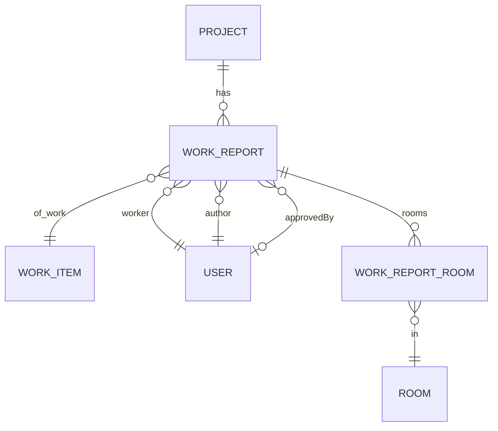
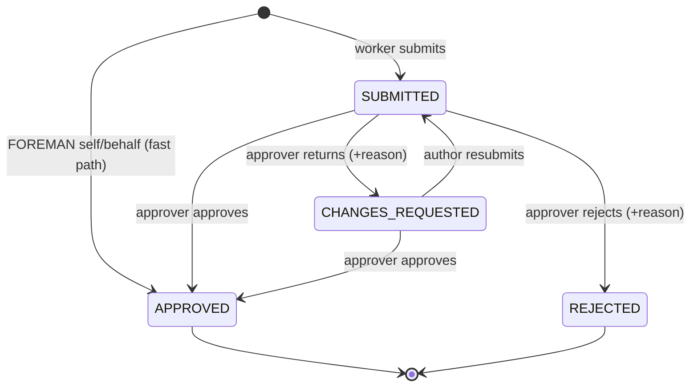

# Design Document: FOR-06-01 — Work reporting

## 1. Overview

FOR-06-01 delivers the first execution-stage feature on an `ACTIVE` project: a WORKER (or a FOREMAN
on a worker's behalf) records the work actually performed, and a FOREMAN reviews it. An approved
report is the authoritative **fact** read later by the plan/actual Gantt (FOR-06-02), the margin
matrix (FOR-06-06), and payroll (FOR-06-11).

It introduces **two** new persisted entities — `WorkReport` (project-scoped anchor) and
`WorkReportRoom` (its per-room split child) — and **one** new project-scoped ABAC resource
`WORK_REPORTS`. The spec therefore follows the `.kiro/steering/entity-creation-rules.md` checklist in
full: a seed changeset for the resource + role grants, a `@PermissionResource("WORK_REPORTS")`
controller, and a `ProjectScopedService` with `getProjectIdPath()` (the entity IS project-scoped, so
step 4 applies). The `workReporting` execution tab slot and its `WORK_REPORTS`/READ gate were already
reserved by FOR-06-00 (pointing at `PlaceholderTab`); this spec seeds the resource and swaps the
tab's `lazy` to the real panel without reshaping the `WORKSPACE_TABS` contract.

### Ownership boundary — revenue only

A `WorkReport` carries a revenue side and a cost side (FOR-05 §4.4). **This spec owns the revenue
side only** (`clientUnitPrice`, `revenueValue`). The cost side (`workerUnitPrice`, `costValue`,
`margin`) depends on `WorkerServiceRate` (FOR-06-10) and is consumed by FOR-06-11 / FOR-06-06; this
spec persists no worker rate and computes no cost. The read model MAY expose `costValue`/`margin` as
explicit nulls for forward compatibility but never computes them.

### Spans two git repos

Per `.kiro/steering/git-repo-structure.md`:

- **Root repo** — the Liquibase changesets, the `WorkReportEntity` / `WorkReportRoomEntity` +
  service + controller + DTOs/mappers, the ABAC seed, the notification emitter, and this spec.
  Committed from the workspace root.
- **Frontend repo** (`foremen-frontend/`) — the Work Reporting panel, the `workReporting` tab
  `lazy` swap, the API client, and the `pl.json`/`ru.json` keys. Committed from inside
  `foremen-frontend/`.

A full implementation needs **two commits — one per repo**.

## 2. Reused mechanisms (not re-implemented)

| Mechanism | Location | Reuse |
|-----------|----------|-------|
| `ProjectScopedService` + `getProjectIdPath()` | `foremen-backend/.../service/ProjectScopedService.java` | Base contract. `WorkReportService` implements it; `getProjectIdPath()` → `"project.id"`. Mirrors `ProjectScheduleService` / `OfferService`. |
| `stageOf(status)` / `resolveWorkspaceTabs` | `foremen-frontend/.../project-workspace/state/` | Unchanged. `ACTIVE`/`COMPLETED` → execution; the resolver surfaces `workReporting` once `WORK_REPORTS` is seeded + granted. |
| `WORKSPACE_TABS` `workReporting` slot | `foremen-frontend/.../project-workspace/types.ts` + registry | Shape unchanged; only its `lazy` is swapped from `PlaceholderTab` to the reporting panel. |
| `Notification_Service` + Bell | FOR-05-07 Requirement 13 | Consumed. Four new `notification.workReport.*` types; emit "create a notification for a recipient user". No new channel. |
| `EstimateLine.unitPrice` (frozen) + `EstimateLineRoomQty` | FOR-05-03/05 | Read for `clientUnitPrice` and Plan_Quantity. Not mutated. |
| `project_member_work_categories` | FOR-05-10b | Read for work matching (Covering_Works). No new link. |
| `ProjectMemberEntity` (ACTIVE/INACTIVE, Company_Role) | FOR-05-09 | Read to resolve ACTIVE FOREMAN approvers and ACTIVE WORKER authorship. |
| Amendment deltas (`AmendmentLine.extraUnitPrice`) | FOR-06-08 | Read if present; treated as zero until FOR-06-08 ships. |
| Object store (media) | FOR-12 | Report attachments referenced through it. |
| ABAC seed pattern | `database_files/changesets/029-seed-delivery-categories-resource.xml` + `015-seed-project-members` | Template for the project-scoped resource row + per-role grants. |

## 3. Data model



### 3.1 `WorkReportEntity`

```java
@Entity
@Table(name = "work_reports")
@Getter @Setter @NoArgsConstructor
public class WorkReportEntity extends BaseEntity {
    @ManyToOne(optional = false) private ProjectEntity project;
    @ManyToOne(optional = false) private WorkItemEntity workItem;
    @ManyToOne(optional = false) private UserEntity author;   // who created it
    @ManyToOne(optional = false) private UserEntity worker;   // whose work it records
    @Column(name = "performed_from", nullable = false) private LocalDate performedFrom;
    @Column(name = "performed_to",   nullable = false) private LocalDate performedTo;
    @Enumerated(EnumType.STRING)
    @Column(nullable = false) private WorkReportStatus status;
    @ManyToOne private UserEntity approvedBy;                 // nullable
    @Column(name = "approved_at") private OffsetDateTime approvedAt; // nullable
    @Column(name = "rejection_reason", columnDefinition = "text") private String rejectionReason;
    @Column(name = "client_unit_price", nullable = false, precision = 19, scale = 2)
    private BigDecimal clientUnitPrice = BigDecimal.ZERO;
    @Column(name = "total_quantity", precision = 19, scale = 3)
    private BigDecimal totalQuantity = BigDecimal.ZERO;       // derived
    @Column(name = "revenue_value", precision = 19, scale = 2)
    private BigDecimal revenueValue = BigDecimal.ZERO;        // derived
    @Column(columnDefinition = "text") private String note;
    @OneToMany(mappedBy = "report", cascade = ALL, orphanRemoval = true)
    private List<WorkReportRoomEntity> rooms = new ArrayList<>();
}
```

### 3.2 `WorkReportRoomEntity`

```java
@Entity
@Table(name = "work_report_rooms",
       uniqueConstraints = @UniqueConstraint(columnNames = {"report_id","room_id"}))
@Getter @Setter @NoArgsConstructor
public class WorkReportRoomEntity extends BaseEntity {
    @ManyToOne(optional = false)
    @JoinColumn(name = "report_id", nullable = false)
    private WorkReportEntity report;                          // ON DELETE CASCADE
    @ManyToOne(optional = false) private RoomEntity room;
    @Column(nullable = false, precision = 19, scale = 3) private BigDecimal quantity;   // resolved absolute
    @Column(name = "plan_quantity", precision = 19, scale = 3) private BigDecimal planQuantity; // snapshot, nullable
    @Enumerated(EnumType.STRING)
    @Column(name = "input_mode", nullable = false) private WorkReportInputMode inputMode; // ABSOLUTE | PERCENT
}
```

### 3.3 `WorkReportStatus` (server-persisted)

`SUBMITTED → APPROVED | REJECTED | CHANGES_REQUESTED`; `CHANGES_REQUESTED → SUBMITTED` (resubmit).
`APPROVED` and `REJECTED` are terminal. There is **no** server-side `DRAFT` — `DRAFT` is a
client-only localStorage state (R7). The FOREMAN self-report fast path creates a report directly in
`APPROVED` (R5).



### 3.4 Changesets

The current `changelog.xml` tail is **162**. New changesets begin at the next free `NNN` (**163**,
or the next free number if a sibling lands first), registered **last** in `changelog.xml`.

| # | File | Purpose |
|---|------|---------|
| 163 | `163-create-work-reports.xml` | `createTable work_reports` (id BIGSERIAL PK; project_id, work_item_id, author_id, worker_id BIGINT NOT NULL FKs; performed_from/performed_to DATE NOT NULL; status VARCHAR(32) NOT NULL; approved_by_id BIGINT NULL FK; approved_at TIMESTAMPTZ NULL; rejection_reason TEXT NULL; client_unit_price NUMERIC(19,2) NOT NULL DEFAULT 0; total_quantity NUMERIC(19,3) NOT NULL DEFAULT 0; revenue_value NUMERIC(19,2) NOT NULL DEFAULT 0; note TEXT NULL; audit cols). Guard `NOT tableExists` + `MARK_RAN`. |
| 164 | `164-create-work-report-rooms.xml` | `createTable work_report_rooms` (id PK; report_id BIGINT NOT NULL FK `ON DELETE CASCADE`; room_id BIGINT NOT NULL FK; quantity NUMERIC(19,3) NOT NULL; plan_quantity NUMERIC(19,3) NULL; input_mode VARCHAR(16) NOT NULL; UNIQUE(report_id, room_id); audit cols). Guard `NOT tableExists` + `MARK_RAN`. |
| 165 | `165-seed-work-reports-resource.xml` | ChangeSet A: insert `WORK_REPORTS` resource row (guard `SELECT COUNT(*) FROM resources WHERE code='WORK_REPORTS' = 0`). ChangeSet B: ADMIN CRUD. ChangeSet C: FOREMAN CREATE+READ+UPDATE+DELETE. ChangeSet D: WORKER CREATE+READ+UPDATE+DELETE (row-scoped to own records in the service). ChangeSet E: MANAGER READ+UPDATE+DELETE (no CREATE). ChangeSets F+: READ for the other admin-staff member roles (ESTIMATOR, FINANCIER). Each grant idempotent via the `role_resources` precondition. CLIENT omitted (deny-by-default) with an explanatory XML comment. |

Media attachments reference the FOR-12 object store; if FOR-12's media-link table is not yet
available, a nullable `work_report_media(report_id, object_ref, kind)` join table is added in a
further changeset (166) guarded the same way — see §6.

### 3.5 ABAC matrix (`WORK_REPORTS`)

The resource is **project-scoped** (R10.2); every grant below sits on top of the project-membership
filter. Two of the roles carry an **additional row-level scope** that the ABAC grant alone cannot
express (own-records for WORKER), enforced in the service (§4.1a).

| Role | Grant | Row scope | Rationale |
|------|-------|-----------|-----------|
| ADMIN | CREATE, READ, UPDATE, DELETE | all | Full control (matrix completeness; evaluator bypasses for literal ADMIN). |
| FOREMAN | CREATE, READ, UPDATE, DELETE | all workers | Author (self/behalf, fast path), review, correct, remove. |
| WORKER | CREATE, READ, UPDATE, DELETE | **own only** (`report.worker = caller`) | Author + edit/resubmit/remove own reports; never sees or touches another worker's. No approval. |
| MANAGER | READ, UPDATE, DELETE (**no CREATE**) | all | Oversight: correct or remove, but does not author. |
| other admin-staff member (ESTIMATOR, FINANCIER, …) | READ | all | Read-only visibility of the project's reports. |
| CLIENT | — | — | Deny-by-default (never sees internal reporting). |

**"Other admin-staff member" and the seed.** The seed grants READ to the admin-staff roles that are
project members other than MANAGER/FOREMAN — concretely the roles that already hold the broad
admin-staff read set (ESTIMATOR, FINANCIER). MANAGER additionally gets UPDATE + DELETE; FOREMAN gets
the full CRUD. The grant rows are seeded per role code in changeset 165 (§3.4). CLIENT and WORKER are
handled specially: CLIENT gets nothing; WORKER gets CRUD but is row-scoped to own records in the
service.

**Operation mapping for the custom review actions.** Approve / reject / request-changes are state
transitions on an existing report, so each is an **UPDATE** on `WORK_REPORTS` (not a new operation).
The handlers are method-level `@RequiresPermission(resource="WORK_REPORTS", operation="UPDATE")` or
inherited `@PermissionOperation(UPDATE)`. Three role rules are enforced in the service on top of the
ABAC UPDATE grant: (a) only FOREMAN/ADMIN may approve/reject/request-changes (R4.7) — MANAGER holds
UPDATE but is not an approver; (b) a WORKER's UPDATE/DELETE is restricted to own records (§4.1a); and
(c) MANAGER holds no CREATE grant, so a manager cannot author a report at all.

## 4. Backend

### 4.1 Service

`WorkReportService implements ProjectScopedService<WorkReportServiceModel,
WorkReportServiceExtendedModel, WorkReportEntity, Long>`, mirroring `ProjectScheduleService`:

- `getProjectIdPath()` → `"project.id"` (R10.2).
- `allowedProjectIds(userId)` wired to `ProjectAccessCache` (standard).
- Standard CRUD plumbing (`getDao`, `getMapper`, `getEntityManager`, `getDaoModelClass`,
  `getAuditLogDao`).
- **Validation hooks** (`validateCreate` / `validateUpdate`):
  - resolve the project's estimate; verify the `workItem` is on the estimate (R3.4,
    `error.workReport.workItem.notInEstimate`);
  - verify the `(worker, workItem)` is a Covering_Work via `project_member_work_categories`
    (R3.2, `error.workReport.workItem.notCovered`);
  - reject duplicate rooms (R2.4), non-positive quantity (R2.5), PERCENT-with-no-plan (R2.3);
  - resolve PERCENT rows to absolute (`planQuantity × percent / 100`) and snapshot `planQuantity`.
- **Derivations** (never hand-entered): `totalQuantity = Σ rooms.quantity`;
  `clientUnitPrice = frozen EstimateLine.unitPrice + Σ approved AmendmentLine.extraUnitPrice`
  (amendments read from FOR-06-08 if present, else 0); `revenueValue = round2(clientUnitPrice ×
  totalQuantity)`.
- **Status machine** methods: `submit`, `approve`, `reject(reason)`, `requestChanges(reason)`,
  `resubmit`, each guarding the allowed source status (R4.6,
  `error.workReport.status.illegalTransition`) and the actor role (R4.7). `approve`/`reject`/
  `requestChanges` require the caller to be an ACTIVE FOREMAN approver of the project.
- **Fast path**: on create, if the authoring user's Company_Role is FOREMAN, the report is created
  directly `APPROVED` with `approvedBy = author`, `approvedAt = now`, revenue frozen, and **no**
  notification (R5).
- **Immutability**: once `APPROVED`, `clientUnitPrice`/`revenueValue`/rows are frozen; an edit of an
  `APPROVED`/`REJECTED` report is refused (R4.6, R6.4).
- **Own-records scope for WORKER** (§4.1a).

### 4.1a WORKER own-records enforcement (row-level scope)

The ABAC grant gives a WORKER CRUD on `WORK_REPORTS`, but a WORKER must only ever reach **their own**
reports (`report.worker = the caller`). ABAC project-scope alone cannot express this, so the service
adds a row-level predicate on top:

- **READ / LIST.** For a WORKER caller, the list filter is intersected with `worker = caller.userId`
  (on top of the inherited project-scope filter), so a WORKER's queries return only own reports.
- **CREATE.** A WORKER may create a report only with `worker = caller`; a WORKER create request whose
  `worker` is another user is rejected with `error.workReport.worker.notSelf`.
- **UPDATE / DELETE / resubmit.** Before mutating, the service loads the target report and, when the
  caller is a WORKER, rejects the operation unless `report.worker = caller` (403 /
  `error.workReport.access.notOwner`).

FOREMAN, MANAGER, and ADMIN carry no such row restriction (all workers' reports). MANAGER has no
CREATE grant, so a manager cannot author at all. Only FOREMAN/ADMIN may run the review transitions
(R4.7); MANAGER's UPDATE/DELETE is for correction/removal, not approval.

### 4.2 Controller

`WorkReportController` — `@RestController @RequestMapping("/api/work-reports")
@PermissionResource("WORK_REPORTS")` implementing the generic CRUD contract, plus explicit review
endpoints:

| Endpoint | Op | Guard |
|----------|-----|------|
| `POST /api/work-reports` | create (submit, or fast-path approve) | CREATE |
| `GET /api/work-reports?projectId=` | list (project-scoped; WORKER → own) | READ |
| `GET /api/work-reports/{id}` | read one | READ |
| `PUT /api/work-reports/{id}` | edit (non-terminal only) / resubmit | UPDATE |
| `POST /api/work-reports/{id}/approve` | approve | UPDATE (+ FOREMAN service check) |
| `POST /api/work-reports/{id}/reject` | reject (+reason) | UPDATE (+ FOREMAN service check) |
| `POST /api/work-reports/{id}/request-changes` | return (+reason) | UPDATE (+ FOREMAN service check) |
| `DELETE /api/work-reports/{id}` | delete | DELETE |

Every in-scope handler carries a matching `@PermissionOperation`/`@RequiresPermission` so
`PermissionAnnotationValidator` passes at startup (R10.3).

### 4.3 DTOs / mappers

Per convention: `WorkReport{ServiceModel, ServiceExtendedModel}`, `WorkReport{Dto, DtoExtended,
CreateRequest, CreateResponse, UpdateRequest, UpdateResponse}Model`, plus the service and controller
mappers, and the row sub-DTO `WorkReportRoom{Model}`. The read DTO carries `clientUnitPrice`,
`totalQuantity`, `revenueValue`, localized work-item/room/worker names (ru→pl→code), status, media
refs, and explicit null `costValue`/`margin` for forward compatibility (R6.5).

### 4.4 Notification emitter

A `WorkReportNotificationEmitter` consumes the generic `Notification_Service` (FOR-05-07 R13),
resolving recipients from `project_members`:

| Trigger | Recipients | Type | Deep-link |
|---------|-----------|------|-----------|
| non-FOREMAN submit → `SUBMITTED` | every ACTIVE FOREMAN member | `notification.workReport.submitted` | `/projects/:projectId/workReporting?report=:id` |
| approve | report author | `notification.workReport.approved` | same |
| reject | report author (body carries reason) | `notification.workReport.rejected` | same |
| request-changes | report author (body carries reason) | `notification.workReport.changesRequested` | same |
| fast-path auto-approve (R5) | — (none) | — | — |

## 5. Frontend

Feature folder `foremen-frontend/src/features/project-execution/work-reporting/` (sibling of the
design-stage project-workspace features), rendering inside the `workReporting` execution tab:

- `WorkReportingPanel.tsx` — the tab panel: a filterable list (status / worker / period) + a "new
  report" action opening the builder; approver action buttons on `SUBMITTED`/`CHANGES_REQUESTED`
  rows (R11.3); WORKER sees only own reports (R11.4).
- `components/WorkReportBuilder.tsx` — worker picker (R3-limited work items), per-room rows with an
  absolute/percent-of-plan toggle, date/period selector, media upload, note; client-side draft
  (R7) persisted to `localStorage` keyed `workReport:draft:{projectId}:{userId}`, restored with a
  continue/discard prompt.
- `components/WorkReportReview.tsx` — approve / reject / request-changes with the required reason
  field.
- `api/work-reports-api.ts` — fetch/fetchOne/create/update/approve/reject/requestChanges/delete via
  the shared `apiRequest` + `buildFetchQuery`.
- `schemas/` — zod form schema (worker + workItem required; ≥1 room; per-row quantity > 0; percent in
  (0,100]; reason required on reject/request-changes).
- `types/`, `__tests__/`.

Tab wiring: swap the `workReporting` entry's `lazy` from `PlaceholderTab` to `WorkReportingPanel` in
the workspace tab registry. The `WORKSPACE_TABS` contract shape, `resolveWorkspaceTabs`, and
`stageOf` are untouched (R10.6).

### 5.1 i18n keys (PL + RU, mirrored)

- Page/list: `workReporting.pageTitle`, column headers (`column.worker`, `column.workItem`,
  `column.period`, `column.quantity`, `column.revenue`, `column.status`), filters
  (`filter.status`, `filter.worker`, `filter.period`).
- Status badges: `workReporting.status.submitted|approved|rejected|changesRequested`.
- Builder: `form.worker`, `form.workItem`, `form.room`, `form.quantity`, `form.inputMode.absolute`,
  `form.inputMode.percent`, `form.period`, `form.note`, `form.media`, `form.addRow`,
  `form.draftRestored`, `form.required`.
- Review: `action.submit`, `action.approve`, `action.reject`, `action.requestChanges`,
  `form.rejectionReason`.
- Toasts: `toast.{submitted,approved,rejected,changesRequested,saved,error}`.
- Notification titles: `notification.workReport.{submitted,approved,rejected,changesRequested}`.

Backend message bundle: every `error.workReport.*` code (R2/R3/R4) in PL + RU.

The `workspace.tab.workReporting` label is already present (seeded by FOR-06-00) and is reused
unchanged.

## 6. Media (FOR-12)

Report media is referenced through the FOR-12 object store. If FOR-12's generic media-link facility
is available, this spec reuses it; otherwise it adds a minimal nullable join table
`work_report_media(report_id, object_ref, kind)` (changeset 166) and references objects by their
store key. Media visibility rides on the report's `WORK_REPORTS` project scope (R8.4). Media is
editable while the report is non-terminal and read-only once `APPROVED`/`REJECTED` (R8.3). The exact
FOR-12 binding is resolved at implementation time; the design keeps the reference indirection so the
reporting domain does not hard-depend on a particular FOR-12 shape.

## 7. Correctness properties

- **P1 (totals).** For any report, `totalQuantity = Σ rooms.quantity` and
  `revenueValue = round2(clientUnitPrice × totalQuantity)`, always derived, never hand-entered.
- **P2 (percent resolution).** A PERCENT row with Plan_Quantity `p` and percent `x ∈ (0,100]`
  resolves to `quantity = p × x / 100`; a PERCENT row with no plan is rejected.
- **P3 (status machine).** Only the transitions in §3.3 are permitted; `APPROVED`/`REJECTED` are
  terminal; any other transition is refused with `error.workReport.status.illegalTransition`.
- **P4 (fast path).** A FOREMAN-authored report is created `APPROVED` with `approvedBy = author`,
  emits no notification, and freezes revenue exactly as a normal approval.
- **P5 (work matching).** A report persists only when `(worker, workItem)` is a Covering_Work and the
  `workItem` is on the estimate.
- **P6 (revenue freeze).** After `APPROVED`, `clientUnitPrice`/`revenueValue` are immutable under
  later estimate/amendment changes.
- **P7 (ABAC matrix).** ADMIN CRUD; FOREMAN CRUD (all workers); WORKER CRUD (own records only);
  MANAGER RUD (no CREATE); other admin-staff members (ESTIMATOR/FINANCIER) READ; CLIENT nothing. A
  WORKER can never read/mutate another worker's report and can never approve/reject/request-changes;
  a MANAGER can update/delete but not create or approve.
- **P8 (stage gating).** The reporting surface is open on `ACTIVE`, read-only on `COMPLETED`, absent
  on `DRAFT`.
- **P9 (notifications).** The four triggers emit exactly as §4.4; the fast path emits none.
- **P10 (seed idempotency).** Re-running changesets 163–165 inserts no duplicate table, resource, or
  grant.
- **P11 (locale parity).** `pl.json` and `ru.json` have identical key sets after the change.
- **P12 (startup validation).** The annotated controller passes `PermissionAnnotationValidator`.

## 8. Testing strategy

- **Backend unit/property.** `WorkReportService`: derivations (P1/P2), status machine (P3), fast
  path (P4), work matching (P5), revenue freeze (P6); an ABAC matrix property test (P7) analogous to
  the existing permission-matrix tests; a seed-idempotency check (P10) via the Testcontainers
  migration run.
- **Frontend unit.** Builder render + percent/absolute resolution (P2), draft persistence (R7),
  resolver fixtures showing `workReporting` present on `ACTIVE` / absent on `DRAFT` (P8), the zod
  schema, the locale-parity test (P11).
- **Per `.kiro/steering/test-execution-rules.md`:** run only the affected test classes with
  `--tests`, redirect to `/tmp/for-06-01-test.log`, and verify via the JUnit result XML. Do not run
  the full suite.
- **API-level `test-cases.md`** scenarios run against the Dockerized app (see `test-cases.md`).

---

## Amendment A1 — Matrix batch authoring (design)

Amendment A1 replaces the single-report `WorkReportBuilder` with a matrix batch authoring surface
and adds the two backend endpoints it needs (a progress read projection + a bulk create). It
introduces **no new entity, no schema change, no new ABAC resource, and no new notification type** —
it reuses `WorkReport` / `WorkReportRoom`, the `WORK_REPORTS` resource, the status machine, the
revenue valuation, the FOREMAN fast path, and the four `notification.workReport.*` types unchanged.

### A1.1 Backend — progress read projection (Requirement 14)

New read endpoint on the existing controller:

| Endpoint | Op | Guard |
|----------|-----|------|
| `GET /api/work-reports/progress?projectId=&workerId=` | read matrix source | `WORK_REPORTS` READ + project scope; WORKER may request only own `workerId` |

Returns a `WorkReportProgressDto`:

```
WorkReportProgressDto {
  projectId: Long,
  workerId: Long,
  rooms: [ { roomId, roomName } ],                     // the column axis (localized ru→pl→code)
  categories: [ {
    workCategoryId, workCategoryName,                   // the row group (localized)
    workItems: [ {
      workItemId, workItemName, unitCode,               // the row (localized name + unit)
      cells: [ { roomId, planQuantity|null, reportedQuantity, reportedPercent|null } ]
    } ]
  } ]
}
```

Service (`WorkReportService.progress(projectId, workerId)`):
- resolve the worker's Covering_Works (R3.1) via `project_member_work_categories` ∩ the project's
  estimate work items (same source the old builder used; now computed server-side so a WORKER no
  longer needs the raw ESTIMATE matrix client-side);
- for each `(workItem, room)`, read `planQuantity` from `EstimateLineRoomQty` and
  `reportedQuantity = Σ WorkReportRoom.quantity` over reports of that `(worker, workItem, room)` whose
  status ∈ {`SUBMITTED`, `CHANGES_REQUESTED`, `APPROVED`} (R14.2; `REJECTED` excluded);
- `reportedPercent = round(reportedQuantity / planQuantity × 100)` when a plan exists, else null;
- **omit** a work item whose every planned room is ≥ 100% (R14.4); keep one with any
  not-complete planned room or any absolute-only (no-plan) room;
- own-records guard: a WORKER caller requesting another `workerId` → `error.workReport.access.notOwner`.

This projection replaces the client-side reliance on the raw estimate matrix + team work-categories
(the Amendment-pre builder read `GET /estimates/project/{id}/matrix` + `project-members`); the
matrix now gets exactly its source from one project-scoped, own-records-safe endpoint, so the
WORKER's broad `ESTIMATE`/`PROJECT_MEMBERS` reads granted earlier are no longer required by the
reporting surface (they are left in place; narrowing them is out of scope here).

### A1.2 Backend — bulk create (Requirement 16)

| Endpoint | Op | Guard |
|----------|-----|------|
| `POST /api/work-reports/batch` | bulk create / submit | `WORK_REPORTS` CREATE + project scope + own-records |

Request `WorkReportBatchRequest { reports: [ WorkReportCreateRequest ] }` — each item is the existing
single `WorkReportCreateRequest` (R2.1 shape). Response `WorkReportBatchResponse { created: [id] }`
on success, or a `400` carrying `{ index, workItemId, roomId?, message }` for the first failing item.

`WorkReportService.createBatch(List<model>)` runs in **one `@Transactional`** (R16.4, all-or-nothing):
it iterates the items through the SAME internal create assembly (`assembleReport` → validation +
PERCENT→absolute + revenue freeze + fast-path status) used by the single create, collecting the
persisted entities; any `ForemenApiException` aborts the whole transaction (nothing persists) and is
returned with the failing item's index. On commit, the AFTER_COMMIT notification events are published
per report exactly as the single path (R16.5) — N non-FOREMAN `SUBMITTED` reports ⇒ N `submitted`
events to each ACTIVE FOREMAN; FOREMAN-authored items fast-path to `APPROVED` and emit none (R5).

Controller: `POST /{base}/batch` with `@RequiresPermission(resource="WORK_REPORTS", operation="CREATE")`.

### A1.3 Frontend — matrix authoring surface (Requirements 15, 17, 18)

The `work-reporting` feature folder's authoring entry point is swapped from `WorkReportBuilder` (the
single-report dialog) to a new matrix surface. The former review path (`WorkReportReview`), the list
panel, the API client, and the status badges are unchanged.

```
features/project-execution/work-reporting/
  WorkReportingPanel.tsx            // list + review unchanged; "new report" now opens the matrix
  components/
    WorkReportMatrix.tsx            // NEW — the matrix surface (replaces WorkReportBuilder)
    WorkReportCellPopup.tsx         // NEW — the per-cell entry popup (percent|unit + period + day step)
    WorkReportDraftPanel.tsx        // NEW — the accumulated-draft side panel (collapsible on mobile)
    WorkReportReview.tsx            // unchanged
  api/work-reports-api.ts           // + fetchProgress(projectId, workerId), + batchCreate(payloads)
  schemas/                          // + cell-entry zod (percent (0,100] | positive absolute; period)
  lib/
    matrix-draft.ts                 // NEW — the client-side draft model + grouping into batch payloads
    progress.ts                     // NEW — map WorkReportProgressDto → rows/cols; staged-overlay math
  types/                            // + WorkReportProgressDto, batch request/response, draft types
```

- **WorkReportMatrix** — loads `fetchProgress`; for a FOREMAN/MANAGER/ADMIN caller shows a worker
  picker (ACTIVE WORKER members) and (re)loads on pick; for a WORKER loads self with no picker
  (R17.1). Renders category group headers → work-item rows → room columns; each cell shows
  `planQuantity` + `reportedPercent`, overlaid with any staged entry (R15.6); a ≥100% cell is
  disabled (R17.2). Empty state when the projection is empty (R14.5).
- **WorkReportCellPopup** — opens on cell click (R15.1): a percent|absolute toggle (reusing the
  existing input-mode resolution), the unit label from `unitCode`, the period (`from`,`to`) default
  today/today with day −/+ steppers (R15.2), the no-plan block for PERCENT-without-plan (R15.3).
  Confirm stages/updates the cell's line in the draft (R15.4).
- **WorkReportDraftPanel** — lists staged lines `work · room · volume` with a running count; each
  line is editable (re-opens its cell) / removable (R17.3); holds the **Save** (bulk) action. On
  mobile it is a collapsible drawer, hidden by default, with a right-edge reveal control showing the
  staged count (R18.2/18.3).
- **Draft state** (`matrix-draft.ts`) — the staged lines live in React state + the existing
  per-project/per-author `localStorage` key (R7), restored with the continue/discard prompt and
  cleared on successful save (R15.5). `toBatchPayloads()` groups staged lines by
  `(workItemId, from, to)` into `WorkReportCreateRequest[]` for the bulk POST (R16.2).
- **Save** → `batchCreate(payloads)`; on success clear the draft + refetch progress (R16.5) + success
  toast; on a `400` surface the failing item's localized message inline on its cell/line (R16.4).

### A1.4 i18n keys (amendment delta, Requirement 19)

New `workReporting.*` keys (PL + RU mirrored): `matrix.title`, `matrix.pickWorker`,
`matrix.empty`, `matrix.categoryGroup`, `matrix.cell.plan`, `matrix.cell.percent`,
`matrix.cell.staged`; `cell.title`, `cell.modeToggle.percent`, `cell.modeToggle.absolute`,
`cell.unit`, `cell.periodFrom`, `cell.periodTo`, `cell.dayPrev`, `cell.dayNext`, `cell.confirm`,
`cell.noPlan`; `draft.title`, `draft.line`, `draft.count`, `draft.reveal`, `draft.collapse`,
`draft.remove`, `draft.edit`, `draft.save`, `draft.empty`; `toast.batchSaved`, `toast.batchError`.
The `workspace.tab.workReporting` label and the four `notification.workReport.*` titles are reused
unchanged. Any new `error.workReport.*` batch message is added PL + RU in the backend bundle.

### A1.5 Testing (amendment delta)

- **Backend.** `progress` projection (reportedQuantity counts SUBMITTED+CHANGES_REQUESTED+APPROVED,
  excludes REJECTED; ≥100% work item omitted; own-records guard) and `createBatch` (all-or-nothing
  rollback on a bad item; per-report notifications on success; fast-path items emit none) — unit
  tests on the service + a controller slice; run only the affected classes per
  `.kiro/steering/test-execution-rules.md`.
- **Frontend.** matrix mapping + staged-overlay math, cell popup percent/absolute + period stepper,
  draft grouping into batch payloads, collapsible draft on mobile, locale parity.
- **test-cases.md.** New TC group for the matrix flow (API: progress + batch; UI: cell entry →
  draft → bulk save → progress reflects; mobile collapsible), appended to the existing document.
