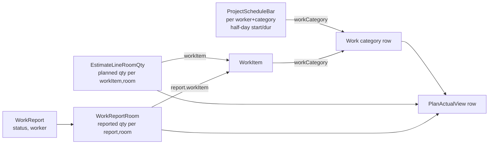

# Design Document: FOR-06-02 — Plan/actual Gantt overlay

## 1. Overview

FOR-06-02 delivers a **read-only plan/actual overlay** on the execution-stage project workspace. It
takes the planning Gantt from FOR-05-10 / FOR-05-10b (planned per-`(worker, work category)` bars in
half-days) and overlays the work actually reported in FOR-06-01 (`WorkReport` facts), producing a
per-category view of **confirmed completion**, a **pending** overlay band, and a **trajectory**
classification (on-track / at-risk / overdue) with a projected finish.

The spec introduces **no new persisted entity, no new table, no Liquibase changeset, and no new ABAC
resource**. It adds one **read-only** endpoint on the existing `WORK_SCHEDULE` resource, a pure
backend analytics assembler + trajectory helper, and a read-only frontend panel that reuses the
FOR-05-10 Gantt rendering primitives and is wired into the already-reserved `planActual` execution
tab (swapping its `lazy` from `PlaceholderTab` to the real panel).

Because it persists nothing, the `.kiro/steering/entity-creation-rules.md` checklist does **not**
apply (no resource seed, no `@PermissionResource` on a new entity, no `getProjectIdPath()` on a new
service — those already exist on the schedule stack this spec extends).

### Ownership boundary — analytics only

This spec **reads** three worlds and joins them; it owns none of them:

- **Plan (dates):** `ProjectSchedule` / `ProjectScheduleBar` (FOR-05-10/10b) — unchanged.
- **Plan (quantity):** `EstimateLine` / `EstimateLineRoomQty` (FOR-05-03/05) — unchanged.
- **Actual:** `WorkReport` / `WorkReportRoom` (FOR-06-01) — unchanged.

It computes completion and trajectory on the fly and returns a transient `PlanActualView`. No cost,
margin, or payroll figure is computed (FOR-06-06 / FOR-06-10 / FOR-06-11); any revenue roll-up it
surfaces is gated to money-viewers exactly as `ScheduleView` already gates its money fields.

### Spans two git repos

Per `.kiro/steering/git-repo-structure.md`:

- **Root repo** — the `PlanActualView` DTO family, the `PlanActualService` assembler + the
  `TrajectoryCalculator` helper, the new READ handler on the schedule controller, and this spec.
  Committed from the workspace root. **No changeset** (read-only).
- **Frontend repo** (`foremen-frontend/`) — the read-only Plan/Actual panel, the `planActual` tab
  `lazy` swap, the API client, and the `pl.json`/`ru.json` keys. Committed from inside
  `foremen-frontend/`.

A full implementation needs **two commits — one per repo**.

## 2. Reused mechanisms (not re-implemented)

| Mechanism | Location | Reuse |
|-----------|----------|-------|
| `ProjectScheduleService` + `ScheduleView` | `foremen-backend/.../service/ProjectScheduleService.java`, `.../controller/model/schedule/ScheduleView.java` | Read the planned bars, `anchorDate`, `finishDay`, day↔half-day math, the money-viewer gate. The plan/actual assembler calls the same row/bar derivation. |
| `ProjectScheduleController` (`/api/project-schedules`, `@PermissionResource("WORK_SCHEDULE")`) | `foremen-backend/.../controller/ProjectScheduleController.java` | The new `GET /plan-actual` handler is added here (same resource, READ), so no new controller/resource is needed. |
| `ProjectScopedService` project scope | `ProjectScheduleService.getProjectIdPath()` → `"project.id"` | The read reuses the schedule's project scope; the overlay never sees a project the caller cannot read. |
| `EstimateLineRoomQty.quantity` | `foremen-backend/.../dao/model/EstimateLineRoomQtyEntity.java` | Planned quantity per `(workItem, room)`. Read, not mutated. |
| `EstimateLine.unitPrice` (frozen) | `foremen-backend/.../dao/model/EstimateLineEntity.java` | The revenue unit price for a money-viewer roll-up. Read. |
| `WorkReport` / `WorkReportRoom` + `WorkReportStatus` | `foremen-backend/.../dao/model/WorkReport*.java` | The actual reported quantity, bucketed by status. Read. FOR-06-01's own-records rule reused for the WORKER drill-down. |
| `WorkReportService.progress(...)` | FOR-06-01 Amendment A1 | A close cousin (plan vs reported per `(workItem, room)`); its per-cell summation is reused/paralleled, but keyed to the schedule categories here. |
| FOR-05-10 Gantt primitives | `foremen-frontend/src/features/project-schedule/components/` (`GanttGrid`, `TimelineHeader`, `GanttRow`, `GanttBar`), `lib/halfDay.ts`, `lib/timeline.ts`, `lib/polishHolidays.ts`, `lib/workerColor.ts` | Reused read-only to render the timeline, bars, legend. The plan/actual panel adds a progress fill + pending band on top. |
| `planActual` tab slot | `foremen-frontend/src/features/project-workspace/workspaceTabs.ts` | Shape unchanged; only its `lazy` is swapped from `PlaceholderTab` to the plan/actual panel. Gate stays `WORK_SCHEDULE`/READ. |
| `Notification_Service` | FOR-05-07 R13 | **Not used** (Requirement 8 — no notifications). |

## 3. No data model change

This spec adds **no** entity, table, or changeset. The current `changelog.xml` tail is unchanged by
FOR-06-02. The join is purely in-memory in the assembler:



- **Plan window per category:** from the category's `ProjectScheduleBar`s —
  `minStartDay = min(startHalfDays)/2`, `maxFinishDay = max(startHalfDays + durationHalfDays − 1)/2`,
  `plannedDurationDays = maxFinishDay − minStartDay + 1`.
- **Planned quantity per category:** `Σ EstimateLineRoomQty.quantity` over the estimate lines whose
  `workItem.workCategory` is the category (per `(workItem, room)` cell for the drill-down).
- **Reported quantity per category/cell:** `Σ WorkReportRoom.quantity` over the project's reports for
  that `workItem` (+ `room` for the cell), bucketed by `WorkReport.status`.

## 4. Backend

### 4.1 `PlanActualService` (assembler)

A new read-only service (`com.foremen.service.PlanActualService`) — it does **not** implement a CRUD
contract; it is a query assembler that leans on `ProjectScheduleService` for the plan and on
report/estimate DAOs for quantities.

```
PlanActualView getPlanActual(Long projectId)
```

Algorithm:

1. **Authorize + frame.** Resolve the project through the same project-scope path the schedule read
   uses (reject if the caller cannot READ `WORK_SCHEDULE` for the project — R6.4). Read the
   `ScheduleView` (or its underlying row derivation) for `anchorDate`, `finishDay`, the category rows,
   and the per-worker bars. Carry `version` + a server `computedAt`.
2. **Planned quantity per `(workItem, room)`.** Load the project's estimate lines + their
   `EstimateLineRoomQty` rows once; index `planned[workItemId][roomId] = quantity`.
3. **Reported quantity per `(workItem, room)` by bucket.** Load the project's `WorkReport`s (+ rooms)
   once; fold into `confirmed[wi][room]` (APPROVED), `pending[wi][room]` (SUBMITTED +
   CHANGES_REQUESTED), `rejected[wi][room]` (REJECTED). Keep the contributing report refs for the
   drill-down (id, status, worker, period, quantity).
4. **Per category.** For each schedule category row: compute the plan window (§3); roll up planned /
   confirmed / pending quantity over its `(workItem, room)` cells; compute `confirmedCompletion`
   (quantity-weighted, R2.5) and the `overReported` / `noPlan` flags; compute the trajectory via
   `TrajectoryCalculator` (§4.2) from `(elapsedShare, confirmedCompletion, riskMargin)`; attach the
   per-worker planned bars unchanged and the per-cell drill-down.
5. **Project roll-up.** Aggregate planned/confirmed/pending, the weighted project completion, the
   per-status category counts, and the overall projected finish (latest category projected finish).
6. **Money gate.** Include the revenue roll-up (`Σ EstimateLine.unitPrice × planned/confirmed qty`)
   only for money-viewers (R6.5), resolved as `ScheduleView` does.

The service does a bounded number of queries (schedule, estimate lines + room qty, reports + rooms)
and folds in memory — no N+1 over categories/cells.

### 4.2 `TrajectoryCalculator` (pure helper)

`com.foremen.service.schedule.TrajectoryCalculator` — a pure, deterministic helper (sibling of the
existing `ScheduleCalculator`), unit-tested on boundaries (R4.6):

```
TrajectoryStatus classify(double elapsedShare, double confirmedCompletion, double riskMargin)
OptionalDouble projectFinishDay(int minStartDay, int plannedDurationDays,
                                double elapsedShare, double confirmedCompletion)
```

- `confirmedCompletion ≥ 1` → `ON_TRACK` (done).
- `elapsedShare ≥ 1` and `confirmedCompletion < 1` → `OVERDUE`.
- `elapsedShare < 1` and `confirmedCompletion < elapsedShare − riskMargin` → `AT_RISK`.
- otherwise → `ON_TRACK`.
- Projected finish (when `confirmedCompletion > 0` and a calendar anchor exists):
  `minStartDay + plannedDurationDays × (elapsedShare / confirmedCompletion)`, capped at a configured
  horizon; else empty.
- `elapsedShare` is supplied by the assembler from `today` vs the calendar anchor; when there is no
  anchor the assembler passes a sentinel and the category is classified `ON_TRACK` with a `noAnchor`
  note (R4.1).

`riskMargin` (default `0.1`) and the horizon cap come from application configuration (R4.3, R7.4),
e.g. `foremen.plan-actual.risk-margin`.

### 4.3 Controller endpoint

Added to the existing `ProjectScheduleController` (same `@PermissionResource("WORK_SCHEDULE")`, no new
resource — R6.3):

| Endpoint | Op | Guard |
|----------|-----|------|
| `GET /api/project-schedules/plan-actual?projectId=` | read the overlay | `WORK_SCHEDULE` READ (+ project scope) |

`@GetMapping("/plan-actual") @PermissionOperation("READ")`, `projectId` a required `@RequestParam
Long`, returning `PlanActualView`. The app starts clean (`PermissionAnnotationValidator`) because the
handler sits on an already-annotated controller.

### 4.4 DTOs

Package `com.foremen.controller.model.schedule` (beside `ScheduleView`):

```
PlanActualView {
  Long projectId; LocalDate anchorDate; LocalDate projectEndDate;
  double finishDay; long version; OffsetDateTime computedAt;
  PlanActualTotals totals;                       // project roll-up (R1.4)
  List<PlanActualCategory> categories;
  PlanActualMoney money;                          // null for non-money-viewers (R6.5)
}
PlanActualTotals { BigDecimal plannedQuantity, confirmedQuantity, pendingQuantity;
                   double confirmedCompletion; int onTrack, atRisk, overdue;
                   Double projectedFinishDay; }
PlanActualCategory {
  Long workCategoryId; String name;              // ru→pl→code
  double startDay, finishDay; int plannedDurationDays;
  BigDecimal plannedQuantity, confirmedQuantity, pendingQuantity, rejectedQuantity;
  double confirmedCompletion; boolean overReported; boolean noPlan;
  TrajectoryStatus trajectoryStatus; Double projectedFinishDay; String note; // noAnchor
  List<PlanActualBar> bars;                       // carried from ScheduleView (per-worker)
  List<PlanActualCell> cells;                     // drill-down
}
PlanActualBar { Long projectMemberId; String workerName; double startDay, durationDays, finishDay; }
PlanActualCell {
  Long workItemId; String workItemName; String unitCode; Long roomId; String roomName;
  BigDecimal plannedQuantity, confirmedQuantity, pendingQuantity, rejectedQuantity;
  double confirmedCompletion; boolean overReported; boolean noPlan;
  List<PlanActualReportRef> reports;              // id, status, workerName, from, to, quantity, deepLink
}
PlanActualReportRef { Long reportId; WorkReportStatus status; String workerName;
                      LocalDate performedFrom, performedTo; BigDecimal quantity; }
enum TrajectoryStatus { ON_TRACK, AT_RISK, OVERDUE }
```

All names are localized `ru→pl→code` at assembly; no persisted i18n column (R7.3, R9.1). The WORKER
drill-down filter (R3.4) drops other workers' `reports` entries while keeping the aggregate
quantities.

## 5. Frontend

A read-only sibling of the design-stage schedule feature, under
`foremen-frontend/src/features/project-execution/plan-actual/`, rendering inside the `planActual`
execution tab:

```
features/project-execution/plan-actual/
  PlanActualPanel.tsx            // the tab panel: fetch + frame + at-risk list + Gantt overlay + filters
  components/
    PlanActualGantt.tsx          // reuses FOR-05-10 GanttGrid/TimelineHeader/GanttRow primitives, read-only
    PlanActualBar.tsx            // a planned bar with a confirmed-progress fill + a distinct pending band
    TrajectoryBadge.tsx          // on-track / at-risk / overdue localized badge
    AtRiskList.tsx               // summary of AT_RISK + OVERDUE categories (completion %, projected finish)
    CategoryDrillDown.tsx        // work-item/room cells: planned/confirmed/pending/rejected, flags, report links
  api/plan-actual-api.ts         // fetchPlanActual(projectId)
  lib/overlay.ts                 // map PlanActualView → render rows; progress-fill + pending-band geometry
  types/                         // PlanActualView + nested DTO types
  __tests__/
```

- **PlanActualPanel** — fetches `GET /api/project-schedules/plan-actual?projectId`, renders the
  at-risk alert list (R5.3) above the Gantt, the overlay Gantt (R5.2), and the status/worker filters
  (R5.6); loading + empty states (R5.5). No edit affordances at all (R5.5).
- **PlanActualGantt / PlanActualBar** — reuse the FOR-05-10 timeline + bar geometry read-only; each
  category row shows the planned bar(s), a confirmed-completion fill, and a visually distinct pending
  band; the completion % label and `TrajectoryBadge` sit on the row.
- **CategoryDrillDown** — opens on category click; a table of `(workItem, room)` cells with planned /
  confirmed / pending / rejected quantities, the `overReported` / `noPlan` flags, and the
  contributing reports as deep-links to `/projects/:projectId/workReporting?report=:id` (R3.3, R5.4).
- The `WORKSPACE_TABS` contract shape, `resolveWorkspaceTabs`, and `stageOf` are untouched; only the
  `planActual` entry's `lazy` is swapped from `PlaceholderTab` to `PlanActualPanel` (R6-stage gating
  is already encoded by the tab's `stage: 'execution'`).

### 5.1 i18n keys (PL + RU, mirrored)

- Panel/legend: `planActual.pageTitle`, `planActual.legend.plan`, `planActual.legend.confirmed`,
  `planActual.legend.pending`, `planActual.legend.rejected`.
- Completion/trajectory: `planActual.completionLabel`, `planActual.status.onTrack`,
  `planActual.status.atRisk`, `planActual.status.overdue`, `planActual.projectedFinish`,
  `planActual.noAnchor`.
- At-risk list: `planActual.atRisk.heading`, `planActual.atRisk.empty`, column headers.
- Drill-down: `planActual.cell.workItem`, `.room`, `.planned`, `.confirmed`, `.pending`,
  `.rejected`, `.overReported`, `.noPlan`, and the report-ref columns (`status`, `worker`, `period`,
  `quantity`, link label).
- Filters + states: `planActual.filter.status`, `planActual.filter.worker`, `planActual.loading`,
  `planActual.empty`.

`workspace.tab.planActual` is already seeded by FOR-06-00 and reused unchanged. No English fallback;
the locale-parity test must pass (R9.2).

## 6. Correctness properties

- **P1 (read-only).** The `plan-actual` endpoint creates/updates/deletes no row, writes no audit row,
  and bumps no schedule version (R1.6, R10.1).
- **P2 (planned quantity).** A category's planned quantity equals `Σ EstimateLineRoomQty.quantity`
  over its work items' room cells.
- **P3 (bucketing).** `confirmedQty` counts only APPROVED; `pendingQty` only SUBMITTED +
  CHANGES_REQUESTED; REJECTED contributes zero to both (R2.2, R3.2).
- **P4 (completion).** Cell completion is `min(1, confirmed/planned)` for `planned>0`; a plan-less
  cell with a confirmed actual is a fully-complete unplanned actual (weight 0); over-report clamps at
  100 % with the `overReported` flag (R2.3/R2.4). Category/project completion is planned-qty-weighted
  (R2.5).
- **P5 (trajectory purity).** `TrajectoryStatus` is a pure function of `(elapsedShare,
  confirmedCompletion, riskMargin)`; pending/rejected never change it; `completion ≥ 1` ⇒ `ON_TRACK`;
  `elapsed ≥ 1 ∧ completion < 1` ⇒ `OVERDUE`; `completion < elapsed − riskMargin` ⇒ `AT_RISK` (R4).
- **P6 (no-anchor safety).** A project with no calendar anchor yields `ON_TRACK` + `noAnchor` for
  every category — no false alerts (R4.1).
- **P7 (empty plan).** No schedule / no bars ⇒ category rows with empty windows, `ON_TRACK`, no row
  created (R1.5).
- **P8 (access).** The overlay is readable exactly by the `WORK_SCHEDULE`/READ callers, project-scope
  filtered; no new resource/grant (R6). A WORKER's drill-down is filtered to their own reports (R3.4).
- **P9 (money gate).** Revenue roll-up present only for money-viewers (R6.5).
- **P10 (locale parity).** `pl.json` and `ru.json` have identical key sets after the change (R9.2).
- **P11 (startup validation).** The new READ handler on the annotated controller passes
  `PermissionAnnotationValidator` (R6.3).

## 7. Testing strategy

- **Backend unit/property.** `TrajectoryCalculator` boundary cases (P5: just-on-track, just-at-risk,
  elapsed exactly 1, completion = 1 while time-overdue, no-anchor → P6); `PlanActualService`
  completion roll-up including unplanned + over-report (P4), status bucketing (P3), empty-plan (P7),
  money-viewer gate (P9), and a read-only assertion that the assembler persists nothing / bumps no
  version (P1) via a Testcontainers read against a seeded schedule + reports.
- **Frontend unit.** Overlay geometry (progress fill + pending band from a fixture view), at-risk
  list render, drill-down table + report deep-links, resolver fixtures showing `planActual` present
  on `ACTIVE`/`COMPLETED` and absent on `DRAFT` (stage gating), the locale-parity test (P10).
- **Per `.kiro/steering/test-execution-rules.md`:** run only the affected test classes with
  `--tests`, redirect to `/tmp/for-06-02-test.log`, and verify via the JUnit result XML under
  `foremen-backend/build/test-results/test/`. Do not run the full suite.
- **API-level `test-cases.md`** scenarios run against the Dockerized app (`http://localhost:8080`,
  `GET /api/project-schedules/plan-actual`) plus a browser-engine pass of the read-only overlay on an
  `ACTIVE` project; result artifacts are MD reports with tables.
