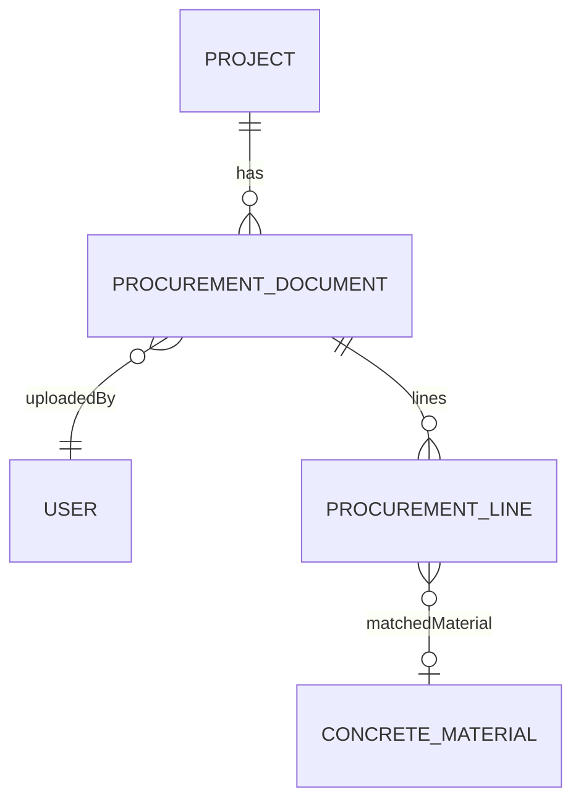
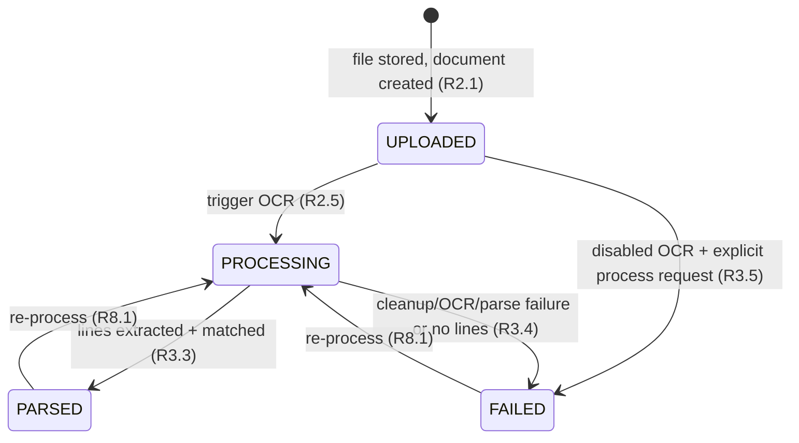

# Design Document: FOR-06-03 — Procurement intake + OCR auto-match

## Overview

FOR-06-03 is the **procurement-intake** child of the FOR-06 "project in progress" (execution-stage)
parent. On an `ACTIVE` project an authorized user (FINANCIER / MANAGER / FOREMAN) uploads a primary
procurement document — a receipt or invoice, as an image or a PDF — and the system:

1. stores the **raw** upload through the existing `ImageStorage` facility (FOR-04-17), namespaced per
   project, and creates a `ProcurementDocument` in status `UPLOADED` (Requirement 2);
2. runs a **new backend (Java) `OcrService`** that produces a **white-background** rendition of each
   page, extracts text via Google Cloud Vision `documentTextDetection`, and parses the text into
   **per-line** structured items via a Google LLM prompt — reusing the Google resources and the
   validated logic/approach of the `телеграм-бот/telegram-bot` receipt bot, not its TypeScript code
   (Requirement 3);
3. stores the **processed white-background** rendition (the image OCR runs on) as the document's
   second rendition, also via `ImageStorage` (Requirement 3.0);
4. runs a **pure, deterministic per-line `MatchEngine`** mapping each extracted line to a planned
   project material at one of four tiers — `EXACT` (100 %), `MANUFACTURER_CATEGORY` (80 %),
   `CATEGORY` (50 %), `NONE` (no match) — against the FOR-05-05b concrete-material candidate set
   (Requirements 4, 5);
5. persists the `ProcurementDocument` + its `ProcurementLine` children and transitions the document to
   `PARSED` (or `FAILED`), exposing a **read-only** proposed-match review on the `procurement`
   execution tab (Requirement 6).

The spec seeds the new project-scoped ABAC resource `PURCHASES` per the
`.kiro/steering/entity-creation-rules.md` checklist and swaps the FOR-06-00 `procurement` execution
tab from `PlaceholderTab` to the real panel (Requirement 7). It emits **no** notifications
(Requirement 9) and adds **no** new i18n columns to the transactional entities, reading every
dictionary name with the `ru → pl → code` fallback (Requirement 10).

### Ownership boundary — intake + auto-match only

This spec owns **intake and automatic matching**: the document + line entities, the upload endpoint,
the OCR service, the match engine, and the read-only review. It does **not** own the reconciled
purchases list, the manual re-link workflow, or the unplanned-expense classification — those are the
sibling **FOR-06-04-purchases-list**, which reuses the `PURCHASES` resource this spec seeds and swaps
the separate `purchases` tab. `Match_Status` here is only `AUTO` or `UNMATCHED`; the manual-override
status lives in FOR-06-04.

### A new backend OCR service — Google resources + the bot's logic, not its code

The `OcrService` is a **new Java implementation**. It reuses:

- **Google resources** — Google Cloud Vision (`documentTextDetection`) and the Google LLM (corner
  detection + per-line parse), through the Google Java client libraries.
- **The bot's validated logic/approach** — the white-background cleanup (`reprocess.ts` +
  `document-detect.ts`: EXIF auto-orient → ask the vision model for the document's four corners →
  white-out everything outside the detected quadrilateral at the page's original dimensions, with a
  full-page fallback on any detection failure), the Vision text extraction (`ocr.ts`), the PDF /
  multi-page split (`pdf.ts`), and the tolerant LLM JSON parse (`gemini.ts`) — **extended** from the
  bot's single receipt summary to **one object per purchased line**.

It does **not** import, depend on, or transliterate the bot's TypeScript. Provider credentials and the
model are read from configuration (reusing the `foremen.*` conventions), never hardcoded, and a
disabled/stub fallback lets the application start and run without the OCR provider configured.

### Spans two git repos

Per `.kiro/steering/git-repo-structure.md`:

- **Root repo** — the Liquibase changesets, the `ProcurementDocumentEntity` / `ProcurementLineEntity`
  + service + controller + DTOs/mappers, the `OcrService` + `MatchEngine`, the ABAC `PURCHASES`
  seed, the backend message bundle, and this spec. Committed from the workspace root.
- **Frontend repo** (`foremen-frontend/`) — the Procurement panel, the `procurement` tab `lazy`
  swap, the API client, and the `pl.json`/`ru.json` keys. Committed from inside `foremen-frontend/`.

A full implementation needs **two commits — one per repo**.

**Notation.** Backend in Java (Spring Boot / JPA / MapStruct / Liquibase / jqwik); frontend in
TypeScript/React (Vite, react-hook-form + zod, TanStack Query, the shared `DataTable`, i18next);
frontend property tests in fast-check + Vitest.

## 2. Reused mechanisms (not re-implemented)

| Mechanism | Location | Reuse |
|-----------|----------|-------|
| `ImageStorage` / `GcsImageStorage` / `DisabledImageStorage` (PDF-capable) | `foremen-backend/.../service/image/ImageStorage.java` | Stores the raw upload (`storeObject`, the non-image-allow-list variant accepting `application/pdf`) and the processed PNG rendition; resolves CDN / signed URLs; `deleteIfOrphan` on re-process; `isConfigured()` drives the disabled-fallback rejection (R2.1, R2.3, R2.4, R3.0, R8.1). No second object store. |
| `ProjectScopedService` + `getProjectIdPath()` | `foremen-backend/.../service/ProjectScopedService.java` | `ProcurementDocumentService` implements it; `getProjectIdPath()` → `"project.id"`, so LIST reads are auto project-filtered (R7.2). Mirrors `WorkReportService` / `MaterialsListService`. |
| FOR-05-05b concrete-material projection | `MaterialsListService` / `MaterialsListAssembler` (`EstimateMaterialsController`) | The `Planned_Material` candidate set (distinct Concrete_Materials chosen on the project's estimate, each with `producer`, material `type`, `nameRU`/`namePL`). Read, not re-defined (R4.1, R4.3). |
| `ConstructionMaterialEntity` / `FinishingMaterialEntity` (`producer`, `type`, `nameRU`/`namePL`) | `foremen-backend/.../dao/model/ConstructionMaterialEntity.java` | The material fields the three tiers compare over, read with `ru → pl → code` fallback (R4.4, R10.1). |
| `stageOf(status)` / `resolveWorkspaceTabs` / `WORKSPACE_TABS` `procurement` slot | `foremen-frontend/.../project-workspace/state/` + registry | Unchanged. `ACTIVE`/`COMPLETED` → execution; the resolver surfaces `procurement` once `PURCHASES` is seeded + granted. Only the tab's `lazy` is swapped (R7.1, R7.6). |
| ABAC seed pattern | `database_files/changesets/158-seed-unplanned-expense-categories-resource.xml` + `165-seed-work-reports-resource.xml` | Template for the project-scoped resource row + per-role grants. |
| `foremen.*` Google credential conventions | `application.yml` (`foremen.image-storage.credentials.*`, `foremen.google.*`) | The OCR provider credentials + model are read from a sibling `foremen.ocr.*` block, never hardcoded (R3.6). |
| Audit mechanism | existing `AuditLog` / `getAuditLogDao` plumbing | Upload / process / re-process / delete write audit rows (R11.1). |
| Google LLM (corner detect + per-line parse) & Cloud Vision | Google Java client libs | The OCR provider resources (R3.0, R3.1, R3.2). |

## Architecture

Two repositories are touched. The backend + migrations + spec live in the root repo; the frontend
lives in `foremen-frontend/`. The feature spans both → two commits, one per repo.

```mermaid
graph TD
    subgraph FE["foremen-frontend/ (nested repo)"]
      TAB["project-workspace registry<br/>procurement tab lazy: Placeholder → ProcurementPanel"]
      PANEL["features/project-execution/procurement/ProcurementPanel.tsx<br/>document list + upload + read-only review"]
      UPLOAD["DocumentUpload.tsx<br/>image/PDF, progress, inline server errors"]
      LINES["ProcurementLineTable.tsx + TierBadge.tsx<br/>extracted lines, proposed match, 100/80/50/no-match"]
      VIEWER["DocumentImageViewer.tsx<br/>raw + processed white-background renditions"]
      API["api/procurement-api.ts<br/>list / upload / get / reprocess / delete"]
      L["locales/pl.json + ru.json<br/>procurement.* (strict parity)"]
    end

    subgraph BE["foremen-backend/ (root repo)"]
      MIG[["167 create procurement_documents<br/>168 create procurement_lines<br/>169 seed PURCHASES resource + grants<br/>(idempotent, LAST in changelog)"]]
      CTRL["ProcurementDocumentController<br/>@PermissionResource(\"PURCHASES\")"]
      SVC["ProcurementDocumentService<br/>implements ProjectScopedService (project.id)"]
      OCR["OcrService (interface)<br/>GoogleOcrService | DisabledOcrService"]
      PIPE["cleanup → Vision OCR → LLM per-line parse"]
      MATCH["MatchEngine (pure, deterministic)<br/>tier rules + tie-break + normalization"]
      CAND["PlannedMaterialCandidateProvider<br/>reads FOR-05-05b concrete-material projection"]
      STORE(("reused: ImageStorage (raw + processed PNG)")):::reuse
    end

    TAB --> PANEL --> UPLOAD
    PANEL --> LINES --> VIEWER
    PANEL --> API --> CTRL --> SVC
    SVC --> STORE
    SVC --> OCR --> PIPE
    SVC --> MATCH
    MATCH --> CAND
    MIG --> SVC
    classDef reuse fill:#eef,stroke:#88a;
```

### Processing pipeline (upload → PARSED/FAILED)

```mermaid
sequenceDiagram
    participant U as User (Procurement tab)
    participant C as ProcurementDocumentController (PURCHASES)
    participant S as ProcurementDocumentService
    participant I as ImageStorage
    participant O as OcrService
    participant M as MatchEngine

    U->>C: POST /api/procurement-documents (multipart, CREATE)
    C->>S: upload(projectId, file)
    S->>I: isConfigured? (else error.procurement.upload.storageUnavailable)
    S->>S: validate type + size (else unsupportedType / tooLarge)
    S->>I: storeObject(file, "procurement/{projectId}/") → rawObjectKey
    S->>S: create ProcurementDocument (UPLOADED, uploadedAt)
    S->>S: status = PROCESSING; process(document) [async or inline tx]
    S->>O: cleanupAndExtract(rawBytes, mime)
    O->>O: split PDF → pages; per page: orient → detect quad → white-out → PNG
    O->>I: storeObject(processedPng, "procurement/{projectId}/processed/") → processedObjectKey
    O->>O: Vision documentTextDetection per page → concat
    O->>O: LLM per-line parse → [lines] + supplier + total
    O-->>S: OcrResult (lines, supplier, total) | failure
    alt parse ok
        S->>M: match(each line, candidateSet(projectId))
        M-->>S: (matchedMaterialId, tier, status) per line
        S->>S: persist lines, supplier, total, parsedAt; status = PARSED
    else failure
        S->>S: status = FAILED (raw + document retained, re-processable)
    end
    C-->>U: document read model (status, lines, matches)
```

## Data Models



### 4.1 `ProcurementDocumentEntity`

```java
@Entity
@Table(name = "procurement_documents")
@Getter @Setter @NoArgsConstructor
public class ProcurementDocumentEntity extends BaseEntity {
    @ManyToOne(fetch = FetchType.LAZY, optional = false)
    @JoinColumn(name = "project_id", nullable = false)
    private ProjectEntity project;                                   // project-scoped anchor (R1.1)

    @ManyToOne(fetch = FetchType.LAZY, optional = false)
    @JoinColumn(name = "uploaded_by_id", nullable = false)
    private UserEntity uploadedBy;

    @Column(name = "raw_object_key", nullable = false, length = 512)
    private String rawObjectKey;                                     // ImageStorage key of the raw upload

    @Column(name = "processed_object_key", length = 512)
    private String processedObjectKey;                               // white-background rendition; null until cleanup

    @Column(name = "source_mime_type", nullable = false, length = 100)
    private String sourceMimeType;

    @Column(name = "supplier_name", columnDefinition = "text")
    private String supplierName;                                     // nullable, from parse

    @Column(name = "document_total", precision = 19, scale = 2)
    private BigDecimal documentTotal;                                // nullable, ≥ 0, from parse

    @Enumerated(EnumType.STRING)
    @Column(nullable = false, length = 16)
    private ProcessingStatus status;                                 // UPLOADED|PROCESSING|PARSED|FAILED

    @Column(name = "uploaded_at", nullable = false)
    private OffsetDateTime uploadedAt;

    @Column(name = "parsed_at")
    private OffsetDateTime parsedAt;                                 // nullable

    @Column(name = "failure_reason", columnDefinition = "text")
    private String failureReason;                                    // nullable; a stable code for the UI

    @OneToMany(mappedBy = "document", cascade = ALL, orphanRemoval = true)
    @OrderBy("lineNo ASC")
    private List<ProcurementLineEntity> lines = new ArrayList<>();
}
```

For a multi-page PDF the processed rendition is a **per-page set**: `processedObjectKey` holds the
first page's key and the pages share the `procurement/{projectId}/processed/{documentUuid}/p{n}.png`
key convention so the viewer can enumerate them. Where cleanup falls back for a page, its processed
rendition equals its oriented original (still stored as PNG).

### 4.2 `ProcurementLineEntity`

```java
@Entity
@Table(name = "procurement_lines",
       uniqueConstraints = @UniqueConstraint(columnNames = {"document_id","line_no"}))
@Getter @Setter @NoArgsConstructor
public class ProcurementLineEntity extends BaseEntity {
    @ManyToOne(fetch = FetchType.LAZY, optional = false)
    @JoinColumn(name = "document_id", nullable = false)
    private ProcurementDocumentEntity document;                      // ON DELETE CASCADE (R1.4)

    @Column(name = "line_no", nullable = false)
    private int lineNo;                                              // ≥ 1, sequential (R3.3)

    @Column(name = "raw_name", nullable = false, columnDefinition = "text")
    private String rawName;                                         // verbatim OCR text (R10.1)

    @Column(precision = 19, scale = 3) private BigDecimal quantity;  // nullable, ≥ 0
    @Column(name = "unit_hint", columnDefinition = "text") private String unitHint;  // nullable, verbatim
    @Column(name = "unit_price", precision = 19, scale = 2) private BigDecimal unitPrice; // nullable, ≥ 0
    @Column(name = "line_total", precision = 19, scale = 2) private BigDecimal lineTotal; // nullable, ≥ 0
    @Column(name = "manufacturer_hint", columnDefinition = "text") private String manufacturerHint; // nullable

    @Column(name = "matched_material_id")
    private Long matchedMaterialId;                                  // nullable FK to Concrete_Material (R1.5)

    @Enumerated(EnumType.STRING)
    @Column(name = "match_tier", nullable = false, length = 32)
    private MatchTier matchTier;                                     // EXACT|MANUFACTURER_CATEGORY|CATEGORY|NONE

    @Enumerated(EnumType.STRING)
    @Column(name = "match_status", nullable = false, length = 16)
    private MatchStatus matchStatus;                                 // AUTO|UNMATCHED
}
```

`matchedMaterialId` is a **soft FK by id** (not a JPA `@ManyToOne`) because the matched
`Concrete_Material` may be a `ConstructionMaterial` **or** a `FinishingMaterial` — the two tier
dimensions (`producer`, `type`, name) are projected uniformly through the FOR-05-05b candidate
projection, so the line stores the `materialId` the projection keys by. The invariant "null iff tier
= NONE, and otherwise on the project's estimate" (R1.5) is enforced in the service.

### 4.3 Enums

```java
enum ProcessingStatus { UPLOADED, PROCESSING, PARSED, FAILED }
enum MatchTier        { EXACT, MANUFACTURER_CATEGORY, CATEGORY, NONE }   // 100 / 80 / 50 / 0 %
enum MatchStatus      { AUTO, UNMATCHED }
```

The `tier → percent` map (`EXACT=100`, `MANUFACTURER_CATEGORY=80`, `CATEGORY=50`, `NONE=0`) is a
**presentational label** derived from the tier, computed once in a helper and surfaced on the DTO; the
engine persists the tier, never a free continuous score (R5.8).

### 4.4 Processing-status lifecycle



`UPLOADED` is reachable but transient in the configured case; with the disabled OCR fallback a
document stays `UPLOADED` until an explicit process request marks it `FAILED` (R3.5). `PARSED` and
`FAILED` are both re-processable; the raw object and the document are never destroyed by a failure
(R3.4, R8.3).

### 4.5 Changesets

The current `changelog.xml` tail is **166**. New changesets begin at the next free `NNN` (**167**, or
the next free number if a sibling lands first), registered **last** in `changelog.xml`. The
implementer MUST confirm the next free number at build time.

| # | File | Purpose |
|---|------|---------|
| 167 | `167-create-procurement-documents.xml` | `createTable procurement_documents` (id BIGSERIAL PK; project_id, uploaded_by_id BIGINT NOT NULL FKs; raw_object_key VARCHAR(512) NOT NULL; processed_object_key VARCHAR(512) NULL; source_mime_type VARCHAR(100) NOT NULL; supplier_name TEXT NULL; document_total NUMERIC(19,2) NULL CHECK ≥ 0; status VARCHAR(16) NOT NULL; uploaded_at TIMESTAMPTZ NOT NULL; parsed_at TIMESTAMPTZ NULL; failure_reason TEXT NULL; audit cols). Guard `NOT tableExists` + `MARK_RAN`. |
| 168 | `168-create-procurement-lines.xml` | `createTable procurement_lines` (id PK; document_id BIGINT NOT NULL FK `ON DELETE CASCADE`; line_no INT NOT NULL; raw_name TEXT NOT NULL; quantity NUMERIC(19,3) NULL; unit_hint TEXT NULL; unit_price NUMERIC(19,2) NULL; line_total NUMERIC(19,2) NULL; manufacturer_hint TEXT NULL; matched_material_id BIGINT NULL; match_tier VARCHAR(32) NOT NULL; match_status VARCHAR(16) NOT NULL; UNIQUE(document_id, line_no); audit cols). Guard `NOT tableExists` + `MARK_RAN`. |
| 169 | `169-seed-purchases-resource.xml` | ChangeSet A: insert `PURCHASES` resource row (guard `SELECT COUNT(*) FROM resources WHERE code='PURCHASES' = 0`). ChangeSet B: ADMIN CRUD. ChangeSet C: FINANCIER CRUD. ChangeSet D: MANAGER CRUD. ChangeSet E: FOREMAN CRUD. ChangeSet F: other admin-staff READ (ESTIMATOR). WORKER + CLIENT omitted with an explanatory XML comment. Each grant idempotent via the `role_resources` precondition. (Per entity-creation-rules §1–§2; `PURCHASES` is shared with FOR-06-04, seeded here because this child needs it first.) |

### 4.6 ABAC matrix (`PURCHASES`)

The resource is **project-scoped** (R7.2); every grant sits on top of the project-membership filter.
The upload/process custom actions map onto CREATE / UPDATE on the document (no new operation).

| Role | Grant | Rationale |
|------|-------|-----------|
| ADMIN | CREATE, READ, UPDATE, DELETE | Matrix completeness; the evaluator bypasses for the literal ADMIN role. |
| FINANCIER | CREATE, READ, UPDATE, DELETE | Primary procurement role (R7.4). |
| MANAGER | CREATE, READ, UPDATE, DELETE | Oversight + authoring. |
| FOREMAN | CREATE, READ, UPDATE, DELETE | Buys materials on site. |
| other admin-staff (ESTIMATOR, …) | READ | Read-only visibility. |
| WORKER | — | Deny-by-default (XML comment). |
| CLIENT | — | Deny-by-default (XML comment). |

**Operation mapping.** `POST /api/procurement-documents` (upload) → CREATE;
`POST /api/procurement-documents/{id}/reprocess` → UPDATE; `GET …` → READ; `DELETE …` → DELETE. Each
in-scope handler carries a matching `@PermissionOperation` or method-level `@RequiresPermission`, so
`PermissionAnnotationValidator` classifies the controller COMPLETE at startup (R7.3). A reader with
only READ sees the panel read-only and cannot upload or re-process (R7.5).

## Components and Interfaces

### Backend components

### 5.1 `ProcurementDocumentService`

`ProcurementDocumentService implements ProjectScopedService<ProcurementDocumentServiceModel,
ProcurementDocumentServiceExtendedModel, ProcurementDocumentEntity, Long>`, mirroring
`WorkReportService`:

- `getProjectIdPath()` → `"project.id"` (R7.2); `allowedProjectIds(userId)` wired to the standard
  `ProjectAccessCache`; standard CRUD plumbing (`getDao`, `getMapper`, `getEntityManager`,
  `getDaoModelClass`, `getAuditLogDao`).
- **`upload(projectId, MultipartFile)`** (R2):
  1. reject when `ImageStorage.isConfigured()` is false →
     `error.procurement.upload.storageUnavailable` (R2.4), storing nothing;
  2. validate the content type ∈ {`image/png`, `image/jpeg`, `image/webp`, `application/pdf`} →
     `error.procurement.upload.unsupportedType` otherwise (R2.2);
  3. size guard reused from `ImageStorage` → `error.procurement.upload.tooLarge` (R2.3);
  4. `rawObjectKey = ImageStorage.storeObject(file, "procurement/" + projectId + "/")` (R2.1);
  5. persist a `ProcurementDocument` (`UPLOADED`, `uploadedAt = now`, `uploadedBy = caller`,
     `sourceMimeType`, `processedObjectKey = null`); write an audit row (R11.1);
  6. transition to `PROCESSING` and invoke `process(document)` (R2.5).
- **`process(document)`** (R3) — the OCR + parse + match orchestration (§5.2). Runs the
  `OcrService`, stores the processed rendition, sets `processedObjectKey`, matches each line via the
  `MatchEngine`, replaces the document's lines atomically, sets `supplierName`/`documentTotal`/
  `parsedAt`, and transitions `PARSED`; on any failure transitions `FAILED` with a stable
  `failureReason`, retaining the raw object + document (R3.4). Writes an audit row (R11.1).
- **`reprocess(id)`** (R8) — only for `FAILED` or `PARSED`; re-runs `process` on the **already-stored
  raw bytes** (no re-upload), regenerating the white-background rendition and replacing
  `processedObjectKey` (the superseded processed object cleaned up via `ImageStorage.deleteIfOrphan`);
  replaces all `ProcurementLine`s atomically; `PROCESSING → PARSED/FAILED`; on failure returns to
  `FAILED` with the raw upload intact (R8.2, R8.3). Until FOR-06-04 ships, re-process replaces **all**
  lines (R8.4). Rejected on a `COMPLETED` project (stage gate, R7.1).
- **`delete(id)`** — standard; cascades to `procurement_lines`; `deleteIfOrphan` on both object keys;
  audit row (R1.4, R11.1).
- **Stage gate.** `upload` and `reprocess` are refused when the project is not `ACTIVE`
  (`error.procurement.stage.notActive`); reads are allowed on `ACTIVE` and `COMPLETED`; the whole
  surface is unreachable on `DRAFT` because the tab is gated on `PURCHASES`/READ and the stage
  resolver hides it (R7.1).
- **R1.5 invariant.** Before persisting a line, assert `matchedMaterialId == null ⟺ matchTier ==
  NONE` and, when non-null, that the material id is in the project's candidate set.

### 5.2 `OcrService` — cleanup + extraction + per-line parse (new Java service)

An interface with two wirings (so the app runs with or without the provider, R3.5):

```java
public interface OcrService {
    boolean isEnabled();
    /** Produce the white-background rendition(s), OCR them, and parse per-line. Never partial:
     *  returns a complete OcrResult or throws OcrUnavailableException / OcrFailedException. */
    OcrResult process(byte[] rawBytes, String mimeType, String keyNamespace);
}

public record OcrResult(
    List<ProcessedPage> pages,          // the white-background renditions to store (R3.0)
    List<ParsedLine> lines,             // per-purchased-item structured items (R3.2)
    String supplierName,                // document-level (nullable)
    BigDecimal documentTotal) {}        // document-level (nullable)

public record ProcessedPage(byte[] pngBytes, boolean whitenedBackground) {}  // PNG, R3.0

public record ParsedLine(
    String rawName, BigDecimal quantity, String unitHint,
    BigDecimal unitPrice, BigDecimal lineTotal, String manufacturerHint) {}
```

**`GoogleOcrService`** (`@ConditionalOnProperty foremen.ocr.enabled=true`) re-implements the bot's
approach in Java, as a set of **pure, testable units** wrapped by a thin I/O orchestrator:

1. **Page split (`pdf.ts` approach).** A PDF is rasterized to per-page images (PDFBox
   `PDFRenderer`); a single image is a one-page list. Page order preserved.
2. **White-background cleanup (`reprocess.ts` + `document-detect.ts` approach), per page:**
   - auto-orient by EXIF (bake rotation, no resample);
   - ask the Google vision model for the document's four corners via the
     **`CORNER_DETECT_PROMPT`** (normalized `[0,1]` coordinates, JSON-only);
   - a **pure** `parseCornerResponse(text) → NormalizedQuad?` strips markdown fences / prose,
     validates four points in range, clamps to `[0,1]`;
   - a **pure** `normalizedToPixelQuad` + `quadAreaFraction` reject a degenerate or `< 15 %`-area
     quad → full-page fallback;
   - paint everything **outside** the quad white at the page's **original dimensions** (no crop,
     warp, or scale); encode **lossless PNG** keeping the receipt pixels untouched (R3.0);
   - on **any** failure the page falls back to its oriented original, encoded PNG, `whitenedBackground
     = false` (R3.0).
3. **Vision text extraction (`ocr.ts` approach).** `documentTextDetection` per processed page;
   a **pure** `concatenatePageTexts(List<String>)` joins pages with `--- Page n ---` separators,
   returning empty when all pages are blank (R3.1).
4. **LLM per-line parse (`gemini.ts` approach, extended).** A new **`PER_LINE_PARSE_PROMPT`** asks for
   a JSON **array**, one object per purchased line (`rawName`, and where present `quantity`,
   `unitHint`, `unitPrice`, `lineTotal`, `manufacturerHint`), plus document-level `supplierName` and
   `documentTotal`. A **pure** `parsePerLineResponse(text) → OcrParse?` strips markdown fences,
   tolerates surrounding prose, validates/normalizes each line (drops lines with no `rawName`,
   `abs()`-normalizes negative amounts as the bot does), and returns `null` on unparseable output
   (R3.2). Empty array ⇒ "no lines extracted" ⇒ `FAILED` (R3.4).
5. **Config-driven credentials (R3.6).** A `foremen.ocr.*` block mirroring `foremen.image-storage.*`:
   `enabled`, `vision.credentials.*`, `llm.model`, `llm.credentials.*`. Nothing hardcoded.

**`DisabledOcrService`** (default / `foremen.ocr.enabled=false`) — `isEnabled()` false; `process`
throws `OcrUnavailableException`. The service leaves the document `UPLOADED`, or marks it `FAILED` on
an explicit process request, with no processed rendition and no lines (R3.5). The application starts
and runs normally without the OCR provider configured.

The processed PNG page bytes are wrapped in an in-memory `MultipartFile` and stored via
`ImageStorage.storeObject(.., "procurement/{projectId}/processed/")`, keeping the raw upload unchanged
(dual-rendition, R3.0).

### 5.3 `MatchEngine` — the pure per-line tier match (R4, R5)

A pure, deterministic, **total** `@Component` with **no per-element I/O** (so it is unit- and
property-testable, R5.1):

```java
public final class MatchEngine {
    /** Highest reachable tier for one line against the candidate set. */
    public MatchResult match(ExtractedLine line, List<PlannedMaterial> candidates) { … }
}

public record PlannedMaterial(Long materialId, String manufacturer, String category,
                              List<String> names) {}   // names = [nameRU, namePL] (R4.4)
public record ExtractedLine(String rawName, String manufacturerHint) {}   // the matched dimensions
public record MatchResult(Long matchedMaterialId, MatchTier tier, MatchStatus status) {}
```

**Normalization (R5.7)** — a pure `normalize(String)`: Unicode NFD decomposition, strip combining
diacritical marks, lower-case (locale-root), collapse internal whitespace runs to a single space, and
trim. So `"Śnieżka"` and `"sniezka"` normalize equal, and case / spacing never matter. The exact rule
is documented here and property-tested. A dedicated transliteration pass is **not** required:
NFD-strip already folds PL diacritics (ś→s, ż→z, ł is handled by an explicit `ł→l` / `Ł→L` map since
it has no canonical decomposition); RU/Cyrillic is compared as-is after case/space folding (names
compare within the same script).

**Tier evaluation (highest reachable; R5.2–R5.6):**

| Tier | Condition | % |
|------|-----------|---|
| `EXACT` | a candidate whose **manufacturer** matches the line's `manufacturerHint`, whose **category** matches, **and** whose **name** matches `rawName` (all normalized) | 100 |
| `MANUFACTURER_CATEGORY` | no `EXACT`, but a candidate whose manufacturer **and** category match | 80 |
| `CATEGORY` | no higher tier, but a candidate whose category matches | 50 |
| `NONE` | no candidate at any tier → `matchedMaterialId = null`, `status = UNMATCHED` | 0 |

- **Manufacturer match** — `normalize(line.manufacturerHint)` equals `normalize(candidate.manufacturer)`
  (both non-blank). A blank hint cannot reach a manufacturer-bearing tier.
- **Category match** — the category is **inferred from the candidate** (R5.2): a candidate's category
  matches when its normalized `category` token appears in / equals the normalized `rawName`
  (containment, since the receipt line rarely names the category verbatim). The documented rule:
  `normalize(rawName).contains(normalize(candidate.category))`.
- **Name match** — `normalize(rawName).contains(normalize(candidate.name))` for any of the
  candidate's localized names (RU or PL), since the receipt line carries extra tokens (size, unit)
  around the product name.
- **Empty candidate set** (R4.2) — every line → `NONE`/`UNMATCHED`, no error.

**Tie-break (R5.6)** — when more than one candidate qualifies at the winning tier, pick a single
deterministic winner by: (1) **highest name similarity** — the longest normalized-name token overlap
(Jaccard over whitespace tokens of `rawName` ∩ `candidate.name`), then (2) **lowest `materialId`** as
the final stable key. Documented and property-tested so the same input always yields the same output.

### 5.4 `PlannedMaterialCandidateProvider`

A thin `@Component` that reads the project's `Planned_Material` set from the **existing FOR-05-05b
concrete-material projection** (`MaterialsListService` / the materials read model) and maps each
distinct chosen `Concrete_Material` to a `PlannedMaterial(materialId, manufacturer, category,
[nameRU, namePL])`, resolving the manufacturer (`producer`), the category (material `type`), and the
localized names with the `ru → pl → code` fallback (R4.1, R4.3, R4.4). No second material list is
defined. When the project has no chosen concrete materials the set is empty (R4.2).

### 5.5 `ProcurementDocumentController`

`@RestController @RequestMapping("/api/procurement-documents") @PermissionResource("PURCHASES")`
implementing the generic CRUD contract plus the upload + reprocess endpoints:

| Endpoint | Op | Guard |
|----------|-----|------|
| `POST /api/procurement-documents` (multipart: `projectId`, `file`) | upload | CREATE |
| `GET /api/procurement-documents?projectId=` | list (project-scoped) | READ |
| `GET /api/procurement-documents/{id}` | read one (document + lines + matches) | READ |
| `POST /api/procurement-documents/{id}/reprocess` | re-run OCR + match | UPDATE |
| `DELETE /api/procurement-documents/{id}` | delete | DELETE |
| `GET /api/procurement-documents/{id}/images` | resolve raw + processed image URLs | READ |

Every in-scope handler carries a matching `@PermissionOperation`/`@RequiresPermission` so
`PermissionAnnotationValidator` passes at startup (R7.3).

### 5.6 DTOs / mappers

Per convention: `ProcurementDocument{ServiceModel, ServiceExtendedModel}`, `ProcurementDocument{Dto,
DtoExtended, UploadResponse, ReprocessResponse}Model`, the row sub-DTO `ProcurementLine{Model}`, plus
the service and controller mappers. The read DTO carries: uploader (localized name), `uploadedAt`,
`supplierName`, `documentTotal`, `status`, `failureReason`, the resolved raw + processed image URLs
(via `ImageStorage.toCdnUrl` / `signedDownloadUrl`), and the ordered lines. Each
`ProcurementLineModel` carries `lineNo`, `rawName`, `quantity`, `unitHint`, `unitPrice`, `lineTotal`,
`manufacturerHint`, the proposed matched-material **localized name** (`ru → pl → code`, resolved from
the candidate projection), `matchTier`, the **derived tier percent** (100/80/50/0), and `matchStatus`.
The transactional entities carry **no** `nameRU`/`namePL` columns (R10.1).

### Frontend components

Feature folder `foremen-frontend/src/features/project-execution/procurement/` (sibling of
`work-reporting`), rendering inside the `procurement` execution tab:

- `ProcurementPanel.tsx` — the tab panel: the document list (uploader, upload time, supplier,
  document total, processing status badge, R6.1), the upload control, and the expandable per-document
  proposed-match review. **Read-only** review (R6.5): no confirm / re-link / classify actions (those
  are FOR-06-04). A reader with only READ sees the list but no upload / re-process controls (R7.5).
- `components/DocumentUpload.tsx` — accepts an image or PDF, shows upload progress and the resulting
  status chain `UPLOADED → PROCESSING → PARSED / FAILED` (R6.2); surfaces server validation errors
  (unsupportedType / tooLarge / storageUnavailable / stage) **inline** (R6.6).
- `components/ProcurementLineTable.tsx` — for a `PARSED` document, the extracted lines: raw name,
  quantity, unit, unit price, line total, the proposed matched-material name, and a localized
  **`TierBadge`** (100 % / 80 % / 50 % / no-match) (R6.3).
- `components/TierBadge.tsx` — maps `matchTier` → a localized, colour-coded badge.
- `components/DocumentImageViewer.tsx` — views the stored **raw** upload and the **processed
  white-background** rendition (per-page for a PDF); on a `FAILED` document the raw (and processed, if
  produced) remain viewable / downloadable (R6.4).
- `components/DocumentStatusBadge.tsx` — localized processing-status badge; a `FAILED` document offers
  the **re-process** action (R6.4, R8.1), hidden for a READ-only caller and on a `COMPLETED` project.
- `api/procurement-api.ts` — `list / upload / fetchOne / reprocess / delete / images` via the shared
  `apiRequest` + `buildFetchQuery`.
- `schemas/`, `types/`, `__tests__/`.

**Tab wiring.** Swap the `procurement` entry's `lazy` from `PlaceholderTab` to `ProcurementPanel` in
the workspace tab registry. The `WORKSPACE_TABS` contract shape, `resolveWorkspaceTabs`, and `stageOf`
are untouched (R7.6). The `workspace.tab.procurement` label is already seeded by FOR-06-00 and reused
unchanged.

### 6.1 i18n keys (PL + RU, mirrored) — R10

- Page/list: `procurement.pageTitle`, columns (`column.uploader`, `column.uploadedAt`,
  `column.supplier`, `column.documentTotal`, `column.status`).
- Status badges: `procurement.status.uploaded|processing|parsed|failed`.
- Upload: `procurement.upload.label`, `upload.hint`, `upload.inProgress`, `upload.accept`.
- Line table columns: `procurement.line.rawName|quantity|unit|unitPrice|lineTotal|material|tier`.
- Tier badges: `procurement.tier.exact` (100 %), `tier.manufacturerCategory` (80 %),
  `tier.category` (50 %), `tier.none` (no-match).
- Image viewer: `procurement.image.raw`, `image.processed`, `image.page`.
- Actions: `procurement.action.reprocess`, `action.viewImages`.
- Toasts: `procurement.toast.{uploaded,reprocessed,deleted,error}`.
- Inline upload errors mapped from server codes:
  `procurement.error.{unsupportedType,tooLarge,storageUnavailable,notActive}`.

Every key lands in **both** `pl.json` and `ru.json` with real PL + RU values; the locale-parity test
passes; no raw key is surfaced (R10.2, R10.4).

Backend message bundle: every `error.procurement.*` code (R2 upload rules, R3 OCR failures, the stage
gate) in PL + RU (R10.3).

## Correctness Properties

*A property is a characteristic or behavior that should hold true across all valid executions of a
system — essentially, a formal statement about what the system should do. Properties serve as the
bridge between human-readable specifications and machine-verifiable correctness guarantees.*

This feature is rich in pure, input-varying logic — the `MatchEngine` (normalization, tier
assignment, tie-break), the OCR pure helpers (corner-response parse, page-text concatenation,
per-line JSON parse), the upload type/size error conditions, the failure-retention invariant, the
line-replacement invariant, the ABAC matrix, the stage gate, and locale parity. Property-based
testing applies to that core. UI rendering (panel / upload / line table / viewer layout), the Vision
and LLM network calls, the migration run, and the controller-startup validation are **not** property
targets and are covered by component / integration / smoke tests (see Testing Strategy). After the
prework reflection, criteria restating the same underlying function were consolidated as noted in
each property's reference list.

### Property 1: Match soundness — matched id is null exactly when the tier is NONE and is otherwise an on-estimate candidate

*For any* extracted line and *any* candidate `Planned_Material` set, the engine's `MatchResult`
satisfies `matchedMaterialId == null ⟺ matchTier == NONE`, `matchStatus == UNMATCHED ⟺ matchTier ==
NONE` (and `AUTO` otherwise), and a non-null `matchedMaterialId` is always the id of a material in the
supplied candidate set (never off-estimate).

**Validates: Requirements 1.5, 4.1, 5.5**

### Property 2: Highest-reachable tier assignment

*For any* extracted line and *any* candidate set, the engine assigns the **highest** tier reachable:
`EXACT` when some candidate matches on manufacturer **and** category **and** name; else
`MANUFACTURER_CATEGORY` when some candidate matches on manufacturer **and** category; else `CATEGORY`
when some candidate matches on category; else `NONE`. In particular, against an **empty** candidate
set every line resolves to `NONE`/`UNMATCHED` with no error, and a line can never be assigned a tier
for which no candidate satisfies that tier's condition.

**Validates: Requirements 4.2, 5.2, 5.3, 5.4, 5.5**

### Property 3: Deterministic, order-independent winner (totality + tie-break)

*For any* line and *any* candidate set, `match` is total (always returns a `MatchResult`) and
deterministic (two calls on equal inputs return equal results); and for *any* permutation of the
candidate set the engine returns the **same** winner — ties at the winning tier are broken by the
documented stable rule (highest normalized-name token overlap, then lowest `materialId`), so
candidate ordering never changes the output.

**Validates: Requirements 5.1, 5.6**

### Property 4: Normalization invariance (case / whitespace / diacritics)

*For any* material name or manufacturer string, applying case changes, inserting or collapsing
whitespace, or adding/removing diacritics (e.g. `"Śnieżka"` vs `"sniezka"`, `"  FARBA  "` vs
`"farba"`) leaves `normalize(...)` unchanged, and therefore leaves the resulting `matchTier` for an
otherwise-identical line/candidate pair unchanged.

**Validates: Requirements 5.7**

### Property 5: Corner-response parse is tolerant and range-clamped

*For any* model response text — bare JSON, JSON wrapped in markdown fences, or JSON surrounded by
prose — `parseCornerResponse` returns a quad whose four points are all clamped into `[0,1]` when four
valid corner points are present, and returns `null` otherwise; and a parsed quad that is degenerate or
covers less than the documented minimum area fraction (`0.15`) yields the full-page fallback rather
than a transformed page.

**Validates: Requirements 3.0**

### Property 6: Page-text concatenation preserves order and detects emptiness

*For any* list of per-page OCR texts, `concatenatePageTexts` joins them with sequential
`--- Page n ---` separators in input order, and returns the empty string **iff** every page text is
blank/whitespace-only.

**Validates: Requirements 3.1**

### Property 7: Per-line parse tolerance and amount normalization

*For any* JSON array of line objects — optionally wrapped in markdown fences or surrounding prose —
`parsePerLineResponse` returns one `ParsedLine` per object that carries a non-blank `rawName` (objects
with no usable `rawName` are dropped), with every numeric amount (`quantity`, `unitPrice`,
`lineTotal`) normalized to a non-negative value, plus the document-level supplier/total when present;
and it returns `null` for unparseable output (so an empty/unusable result drives the `FAILED`
transition rather than persisting garbage).

**Validates: Requirements 3.2**

### Property 8: Unsupported content type is rejected and stores nothing

*For any* content type **not** in the accepted set {`image/png`, `image/jpeg`, `image/webp`,
`application/pdf`}, the upload is rejected with `error.procurement.upload.unsupportedType`, no object
is stored, and no `ProcurementDocument` is created.

**Validates: Requirements 2.2**

### Property 9: A processing failure retains the raw upload and the document

*For any* OCR failure mode — the provider throws, the parse is unparseable, or no lines are extracted
— `process` leaves the document in status `FAILED` with its `rawObjectKey` and its persisted document
row intact (never deleting the stored object or the document), and the document remains re-processable.

**Validates: Requirements 3.4, 8.3**

### Property 10: Re-processing replaces the line set atomically

*For any* document's prior `ProcurementLine` set and *any* freshly extracted line set, a successful
re-process results in the persisted lines being **exactly** the fresh set (sequential `lineNo` from 1,
none of the prior lines remaining), committed atomically; a failed re-process leaves the document
`FAILED` with the raw upload intact.

**Validates: Requirements 8.2**

### Property 11: PURCHASES ABAC matrix

*For any* role, the resolved operation set on `PURCHASES` is exactly: ADMIN → {CREATE, READ, UPDATE,
DELETE}; FINANCIER / MANAGER / FOREMAN → {CREATE, READ, UPDATE, DELETE}; other admin-staff
(ESTIMATOR) → {READ}; WORKER / CLIENT → {} (deny-by-default). Consequently a READ-only caller resolves
no CREATE/UPDATE and can neither upload nor re-process.

**Validates: Requirements 7.4, 7.5**

### Property 12: Stage gating

*For any* `Project.status`, the procurement surface is **open** (upload / process / read) exactly when
the project is `ACTIVE`, **read-only** (history visible, no upload or re-process) exactly when
`COMPLETED`, and **absent** (unreachable) for every other status (`DRAFT` / design stage).

**Validates: Requirements 7.1**

### Property 13: Locale parity

*For any* state of the two locale files after this change, `pl.json` and `ru.json` have identical key
sets (the locale-parity test passes), including every new `procurement.*` key.

**Validates: Requirements 10.2**

## Error Handling

| Condition | Code / behavior | Requirement |
|-----------|-----------------|-------------|
| Object store not configured (`DisabledImageStorage`) | reject upload `error.procurement.upload.storageUnavailable`; store nothing, create no document | R2.4 |
| Content type not accepted | reject `error.procurement.upload.unsupportedType`; store nothing, create no document | R2.2 |
| File over the configured max size | reject `error.procurement.upload.tooLarge` (reusing the `ImageStorage` size rule); store nothing | R2.3 |
| Upload / re-process on a non-`ACTIVE` project | reject `error.procurement.stage.notActive` (reads still allowed on `COMPLETED`) | R7.1 |
| OCR provider disabled + explicit process request | mark `FAILED` with `failureReason = procurement.ocr.disabled`; keep raw; no lines | R3.5 |
| Cleanup / Vision / LLM provider error | catch, mark `FAILED` with a stable `failureReason`; retain raw object + document; re-processable | R3.4 |
| LLM output unparseable or zero lines | mark `FAILED` (`procurement.ocr.noLines` / `procurement.ocr.unparseable`); retain raw | R3.4 |
| Per-page corner detection failure | per-page full-image fallback (oriented original as PNG); **not** a document failure | R3.0 |
| Caller lacks the required `PURCHASES` grant | 403 via ABAC (no custom code) | R7.5 |
| Re-process failure | return to `FAILED`, raw upload intact | R8.3 |

Every `error.procurement.*` code has PL + RU messages in the backend bundle (R10.3). The frontend maps
each code to a localized inline message and never surfaces a raw key (R6.6, R10.4). Network errors
from Vision/LLM are wrapped (`OcrFailedException`) and surfaced only as the document's `FAILED` state,
never leaking provider internals to the client.

## Testing Strategy

**Dual approach.** Property-based tests verify the universal properties in §7 (the pure
`MatchEngine`, the OCR pure helpers, the upload error conditions, the failure/replacement invariants,
the ABAC matrix, stage gating, locale parity); example-based unit / integration tests cover concrete
scenarios, orchestration, UI rendering, wiring, and the external-provider seams.

**Property-based testing library.** Backend: **jqwik** (the repo's established PBT library, per
FOR-05-05b / FOR-06-01); frontend: **fast-check + Vitest**. We do **not** implement PBT from scratch.
Each property test runs a **minimum of 100 iterations** and is tagged with a comment referencing its
design property, format: `Feature: FOR-06-03-procurement-ocr, Property {number}: {property_text}`.

**Backend property tests** (one property-based test per §7 backend property):

- P1 match soundness, P2 highest-reachable tier, P3 determinism + order-independent tie-break, P4
  normalization invariance — over generated `ExtractedLine` + `List<PlannedMaterial>` (varying case /
  whitespace / PL diacritics / Cyrillic, manufacturer/category/name overlaps, duplicates, empty set).
- P5 corner-response parse, P6 page-text concat, P7 per-line parse — over generated model-response
  strings (bare / fenced / prose-wrapped JSON, out-of-range points, negative amounts, missing
  `rawName`, empty arrays). These are the highest-value parse properties (the OCR provider output is
  adversarial), analogous to the bot's `parseCornerResponse` / `parseGeminiResponse` tests.
- P8 unsupported-type rejection, P9 failure-retains-raw, P10 atomic line replacement — the service
  layer with a stubbed `OcrService` (pass/fail modes) and an in-memory / stub `ImageStorage` so no
  external calls run.
- P11 ABAC matrix — a permission-matrix property test over `PURCHASES` × roles, analogous to the
  existing matrix tests (FOR-06-00 P4 / FOR-06-01 P7).

**Backend example / integration / smoke tests:**

- Upload happy paths (each accepted type) and the storage-unavailable path (R2.1, R2.4); `uploadedAt`
  + `PROCESSING` trigger (R2.5); sequential `lineNo` + supplier/total/`parsedAt` on `PARSED` (R3.3);
  cascade delete (R1.4); `deleteIfOrphan` on re-process (R8.1); no-notification assertion (R9.1); audit
  rows on each lifecycle op (R11.1); the candidate provider reading the FOR-05-05b projection with
  `ru → pl → code` resolution (R4.3, R4.4).
- **Seed idempotency** (changesets 167–169: no duplicate table / resource / grant on re-run) and the
  migration run — exercised by the Testcontainers migration run (R1.3).
- **Startup smoke** — context loads and `PermissionAnnotationValidator` classifies
  `ProcurementDocumentController` COMPLETE (R7.3); `foremen.ocr.*` binds with no hardcoded key (R3.6);
  the app starts with the OCR provider **disabled** (R3.5).
- The Vision / LLM calls themselves are **integration-only** (mocked in unit tests); their pure
  helpers carry the property coverage.

**Frontend unit tests** (Vitest + fast-check):

- `ProcurementPanel` / `DocumentUpload` render + the upload status chain + inline server-error mapping
  (R6.1, R6.2, R6.6); `ProcurementLineTable` + `TierBadge` over the four tiers (R6.3); the
  read-only assertion (no confirm/re-link/classify controls, R6.5); `DocumentImageViewer` showing raw
  + processed (and on `FAILED`, R6.4); the re-process control hidden for a READ-only caller and on a
  `COMPLETED` project.
- **Resolver fixtures** — `procurement` present on `ACTIVE` with `PURCHASES` granted, read-only on
  `COMPLETED`, absent on `DRAFT` (P12 / R7.1, R7.6).
- **Locale parity** test over `pl.json` / `ru.json` (P13 / R10.2); a no-raw-key render assertion
  (R10.4).

**Regression (R11.2).** The FOR-05 / FOR-06-00 behaviors not changed here — the workspace shell,
`resolveWorkspaceTabs`, `stageOf`, the other execution tabs' placeholders, the `ImageStorage`
facility, the material catalogs — continue to pass.

**Per `.kiro/steering/test-execution-rules.md`:** run only the affected test classes with `--tests`,
redirect to `/tmp/for-06-03-test.log`, and verify via the JUnit result XML under
`foremen-backend/build/test-results/test/`. Do **not** run the full suite.

**API-level `test-cases.md`.** Per `.kiro/steering/test-cases.md`, this is a mostly API-backed spec
(backend intake + OCR + match, plus a thin review UI). The `test-cases.md` authored in the tasks phase
covers the upload type/size/disabled-storage rules, the `UPLOADED → PROCESSING → PARSED/FAILED`
lifecycle, re-processing, the proposed-match tiers over a seeded planned-material set, the dual-image
renditions, the `PURCHASES` ABAC matrix per role, and the stage gate — as API scenarios against the
Dockerized app (`http://localhost:8080`, auth under `/api/auth`), with a run-id generator for
repeatability and MD report tables. Where the OCR provider is not configured in the Docker stack, the
OCR-dependent scenarios assert the disabled-fallback behavior (`UPLOADED` / `FAILED`, no lines) and the
deterministic match-engine scenarios are driven through seeded lines.
