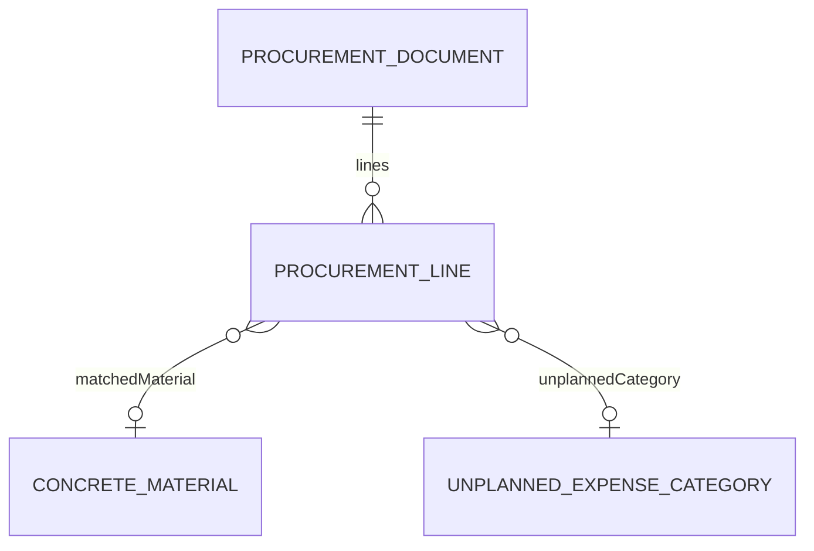
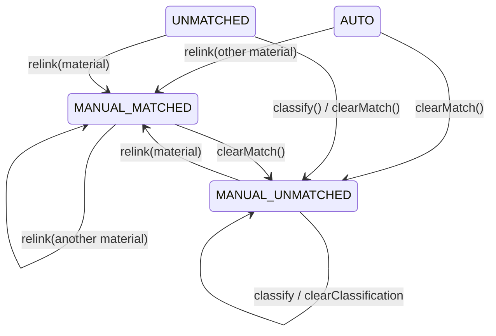

# Design Document: FOR-06-04 — Reconciled purchases list

## Overview

FOR-06-04 is the **procurement-reconciliation** child of the FOR-06 "project in progress"
(execution-stage) parent and the sibling of FOR-06-03-procurement-ocr. Where FOR-06-03 delivers
**intake + automatic matching** (upload → OCR → per-line auto-match, read-only review), FOR-06-04
turns that review into an **actionable reconciled purchases list**: on an `ACTIVE` project an
authorized user (FINANCIER / MANAGER / FOREMAN) can

1. **re-link** a line to a different planned material or **clear** its match (Requirement 2);
2. **classify** a deliberately unmatched line with an `UnplannedExpenseCategory` or **clear** the
   classification (Requirement 3);
3. read the **project-wide reconciled purchases list** across all documents, filterable by document /
   match state / unplanned category (Requirement 4);

and the spec completes FOR-06-03's deferred re-process rule (FOR-06-03 R8.4) so a re-process
**preserves manually reconciled lines** and replaces only automatic ones (Requirement 5), and swaps
the FOR-06-00 `purchases` tab from `PlaceholderTab` to the real panel (Requirement 7).

### A thin additive layer — no new entity, no new resource, no new dictionary

This spec is deliberately small. It does **not** introduce a managed entity, an ABAC resource, or a
dictionary, so the `.kiro/steering/entity-creation-rules.md` checklist produces no resource seed:

- it **extends** the FOR-06-03 `ProcurementLineEntity` with one nullable FK column
  (`unplanned_category_id`) and **broadens** the `matchStatus` enum (a string column — no schema
  change) with two manual values;
- it **rides** the existing `PURCHASES` resource (seeded by FOR-06-03, changeset 169) —
  reconciliation is `UPDATE`, the list is `READ`;
- it **reuses** the FOR-06-00 `UnplannedExpenseCategory` dictionary (changesets 157/158) and the
  FOR-06-03 `PlannedMaterialCandidateProvider` (so a re-link can only target an on-estimate material).

The only migration is a single **additive** changeset (add the nullable FK + its `ON DELETE SET NULL`
constraint), idempotent via `NOT columnExists` + `MARK_RAN`, registered last in `changelog.xml`.

### Ownership boundary — reconciliation only

This spec owns the manual re-link, the unplanned-expense classification, the reconciled list read
model, and the manual-preservation re-process rule. It does **not** own intake / OCR / auto-match
(FOR-06-03) or the plan-vs-fact materials matrix (FOR-06-05, which reads the reconciled lines this
spec produces). It never edits the verbatim OCR values (`rawName`, amounts) — it reconciles the
*match*, not the extracted data.

### Spans two git repos

Per `.kiro/steering/git-repo-structure.md`:

- **Root repo** — the additive Liquibase changeset, the `ProcurementLineEntity` extension + the
  `MatchStatus` enum broadening, the reconciliation service operations + controller endpoints + the
  reconciled-list read model + DTOs/mappers, the backend `error.purchases.*` message bundle, and this
  spec. Committed from the workspace root.
- **Frontend repo** (`foremen-frontend/`) — the Purchases panel, the `purchases` tab `lazy` swap, the
  API client, and the `pl.json`/`ru.json` keys. Committed from inside `foremen-frontend/`.

A full implementation needs **two commits — one per repo**.

**Notation.** Backend in Java (Spring Boot / JPA / MapStruct / Liquibase / jqwik); frontend in
TypeScript/React (Vite, react-hook-form + zod, TanStack Query, the shared `DataTable`, i18next);
frontend property tests in fast-check + Vitest.

## Reused mechanisms (not re-implemented)

| Mechanism | Location | Reuse |
|-----------|----------|-------|
| `ProcurementDocumentEntity` / `ProcurementLineEntity` + enums (`MatchTier`, `MatchStatus`) | `foremen-backend/.../dao/model/` (FOR-06-03) | The line is **extended** (`unplannedCategory` FK) and `MatchStatus` **broadened** (`MANUAL_MATCHED`, `MANUAL_UNMATCHED`); no parallel entity. |
| `PURCHASES` ABAC resource + role matrix | `database_files/changesets/169-seed-purchases-resource.xml` (FOR-06-03) | Reconciliation is `UPDATE`, the list is `READ`; **no new resource seeded**. |
| `UnplannedExpenseCategoryEntity` + service + the five seeded rows | FOR-06-00 (changesets 157/158) | The classification options; read with `ru → pl → code`. **No new dictionary.** |
| `PlannedMaterialCandidateProvider` | `foremen-backend/.../service/procurement/` (FOR-06-03) | Validates a re-link target is on the project's estimate; resolves the matched-material localized name. |
| `ProjectScopedService` + `getProjectIdPath()` | `foremen-backend/.../service/ProjectScopedService.java` | The reconciliation/list service resolves `document.project.id`, so LIST reads are auto project-filtered. |
| FOR-06-03 `reprocess(...)` line-replacement | `ProcurementDocumentService` (FOR-06-03) | Extended: the prior-line partition (preserve `MANUAL_*`, replace `AUTO`/`UNMATCHED`) is injected into the existing re-process path. |
| `stageOf(status)` / `resolveWorkspaceTabs` / `WORKSPACE_TABS` `purchases` slot | `foremen-frontend/.../project-workspace/state/` + registry (FOR-06-00) | Unchanged; only the `purchases` tab's `lazy` is swapped. |
| `workspace.tab.purchases` i18n label | `pl.json` / `ru.json` (FOR-06-00) | Reused unchanged. |
| Audit mechanism | existing `AuditLog` / `getAuditLogDao` | Each reconciliation action writes an audit row (R10.1). |

## Architecture

```mermaid
graph TD
    subgraph FE["foremen-frontend/ (nested repo)"]
      TAB["project-workspace registry<br/>purchases tab lazy: Placeholder → PurchasesPanel"]
      PANEL["features/project-execution/purchases/PurchasesPanel.tsx<br/>reconciled list + filters"]
      RELINK["RelinkControl.tsx<br/>planned-material picker / clear match"]
      CLASSIFY["ClassifyControl.tsx<br/>unplanned-category picker / clear"]
      STATE["MatchStateBadge.tsx + TierBadge (reused)"]
      API["api/purchases-api.ts<br/>list / relink / clearMatch / classify / clearClassification"]
      L["locales/pl.json + ru.json<br/>purchases.* (strict parity)"]
    end

    subgraph BE["foremen-backend/ (root repo)"]
      MIG[["170 add procurement_lines.unplanned_category_id<br/>(nullable FK, ON DELETE SET NULL; idempotent, LAST in changelog)"]]
      CTRL["PurchasesController (or extended ProcurementDocumentController)<br/>@PermissionResource(\"PURCHASES\")"]
      SVC["PurchaseLineReconciliationService<br/>implements ProjectScopedService (document.project.id)"]
      PART["ReprocessLinePartitioner (pure)<br/>preserve MANUAL_*, replace AUTO/UNMATCHED"]
      CAND(("reused: PlannedMaterialCandidateProvider")):::reuse
      LINE(("reused + extended: ProcurementLineEntity")):::reuse
      DICT(("reused: UnplannedExpenseCategory")):::reuse
    end

    TAB --> PANEL
    PANEL --> RELINK --> API
    PANEL --> CLASSIFY --> API
    PANEL --> STATE
    API --> CTRL --> SVC
    SVC --> CAND
    SVC --> LINE
    SVC --> DICT
    SVC --> PART
    MIG --> LINE
    classDef reuse fill:#eef,stroke:#88a;
```

### Reconciliation action flow

```mermaid
sequenceDiagram
    participant U as User (Purchases tab)
    participant C as PurchasesController (PURCHASES)
    participant S as PurchaseLineReconciliationService
    participant P as PlannedMaterialCandidateProvider
    participant D as UnplannedExpenseCategory

    U->>C: PUT /api/procurement-lines/{id}/match (materialId) [UPDATE]
    C->>S: relink(lineId, materialId)
    S->>S: stage gate — project ACTIVE? else error.purchases.stage.notActive
    S->>P: candidateSet(projectId).contains(materialId)?
    alt not on estimate
        S-->>C: error.purchases.relink.notPlanned (line unchanged)
    else on estimate
        S->>S: matchedMaterialId=materialId, matchStatus=MANUAL_MATCHED,<br/>matchTier=EXACT, unplannedCategory=null; audit
        S-->>C: updated line read model
    end

    U->>C: PUT /api/procurement-lines/{id}/classify (categoryId) [UPDATE]
    C->>S: classify(lineId, categoryId)
    S->>S: stage gate; reject if line matched (error.purchases.classify.matchedLine)
    S->>D: category exists & active? else error.purchases.classify.unknownCategory
    S->>S: unplannedCategory=categoryId, matchStatus=MANUAL_UNMATCHED,<br/>matchedMaterialId=null, matchTier=NONE; audit
    S-->>C: updated line read model
```

## Data Models



### 4.1 `ProcurementLineEntity` — extension (FOR-06-03 entity, additive)

The FOR-06-03 entity gains one field; everything else is unchanged.

```java
// added to com.foremen.dao.model.ProcurementLineEntity (FOR-06-03)
@ManyToOne(fetch = FetchType.LAZY)
@JoinColumn(name = "unplanned_category_id")          // nullable; ON DELETE SET NULL (R1.3)
private UnplannedExpenseCategoryEntity unplannedCategory;
```

`matchedMaterialId` stays the FOR-06-03 soft FK-by-id (a matched `Concrete_Material` may be a
`ConstructionMaterial` or a `FinishingMaterial`). `unplannedCategory` is a **real JPA `@ManyToOne`**
because `UnplannedExpenseCategory` is a single concrete dictionary entity.

### 4.2 `MatchStatus` — broadened enum

```java
public enum MatchStatus {
    AUTO,              // FOR-06-03: auto-matched at a tier
    UNMATCHED,         // FOR-06-03: auto-match found nothing (tier NONE)
    MANUAL_MATCHED,    // FOR-06-04: user re-linked to a chosen material
    MANUAL_UNMATCHED   // FOR-06-04: user cleared the match (may carry an unplanned category)
}
```

The column is `VARCHAR` storing the enum name (FOR-06-03), so adding values needs **no** migration;
existing rows keep `AUTO` / `UNMATCHED` (R1.2).

### 4.3 Line invariants (R1.4) — enforced in the service before every persist

| `matchStatus` | `matchedMaterialId` | `matchTier` | `unplannedCategory` |
|---------------|---------------------|-------------|---------------------|
| `AUTO` | non-null | ≠ `NONE` | null |
| `MANUAL_MATCHED` | non-null | `EXACT` | null |
| `UNMATCHED` | null | `NONE` | null **or** a category |
| `MANUAL_UNMATCHED` | null | `NONE` | null **or** a category |

So: `matchedMaterialId != null ⟺ matchStatus ∈ {AUTO, MANUAL_MATCHED}` (and tier ≠ NONE);
`unplannedCategory != null ⟹ matchedMaterialId == null`. A pure `assertInvariant(line)` helper runs
before each save and is property-tested.

### 4.4 State transitions (reconciliation)



`classify` is valid only from `UNMATCHED` / `MANUAL_UNMATCHED` (R3.3 rejects a matched line);
`clearClassification` keeps `MANUAL_UNMATCHED` and only nulls the category (R3.2).

### 4.5 Changeset

Current changelog tail after FOR-06-03 is **169**; this spec adds **170** (or the next free `NNN` if
a sibling lands first — confirm at build time), registered **last** in `changelog.xml`.

| # | File | Purpose |
|---|------|---------|
| 170 | `170-add-procurement-line-unplanned-category.xml` | `addColumn procurement_lines.unplanned_category_id BIGINT NULL` + `addForeignKeyConstraint` to `unplanned_expense_categories(id)` with `ON DELETE SET NULL`. Guard `NOT columnExists` + `onFail="MARK_RAN"` (idempotent). **No resource seed** (rides FOR-06-03 `PURCHASES`). |

No ABAC changeset: the reconciliation endpoints reuse `PURCHASES` (FOR-06-03). The `PURCHASES` matrix
already grants ADMIN / FINANCIER / MANAGER / FOREMAN full CRUD (incl. UPDATE) and ESTIMATOR READ, so
no grant change is needed.

## Components and Interfaces

### Backend components

### 5.1 `PurchaseLineReconciliationService`

A project-scoped service over `ProcurementLineEntity` (it may be a new
`implements ProjectScopedService<..., ProcurementLineEntity, Long>` or methods added to the FOR-06-03
`ProcurementDocumentService`; the design treats it as a focused service to keep the FOR-06-03 file
cohesive):

- `getProjectIdPath()` → `"document.project.id"` (R7.3), so LIST reads are auto project-filtered;
  standard CRUD plumbing (`getDao`, `getMapper`, `getEntityManager`, `getAuditLogDao`).
- **`relink(lineId, materialId)`** (R2.1, R2.2): stage-gate (project `ACTIVE`, else
  `error.purchases.stage.notActive`); verify `materialId ∈ PlannedMaterialCandidateProvider
  .candidates(projectId)` (else `error.purchases.relink.notPlanned`, line unchanged); set
  `matchedMaterialId = materialId`, `matchStatus = MANUAL_MATCHED`, `matchTier = EXACT`,
  `unplannedCategory = null`; `assertInvariant`; audit.
- **`clearMatch(lineId)`** (R2.3): stage-gate; set `matchedMaterialId = null`,
  `matchStatus = MANUAL_UNMATCHED`, `matchTier = NONE` (keep any existing `unplannedCategory`);
  `assertInvariant`; audit.
- **`classify(lineId, categoryId)`** (R3.1, R3.3, R3.4): stage-gate; reject if the line is matched
  (`AUTO`/`MANUAL_MATCHED` → `error.purchases.classify.matchedLine`); verify the category exists and
  is `active` (else `error.purchases.classify.unknownCategory`); set `unplannedCategory = category`,
  `matchStatus = MANUAL_UNMATCHED`, ensure `matchedMaterialId = null` / `matchTier = NONE`;
  `assertInvariant`; audit.
- **`clearClassification(lineId)`** (R3.2): stage-gate; set `unplannedCategory = null`, keep
  `matchStatus = MANUAL_UNMATCHED`; audit.
- **`list(projectId, filters)`** (R4): the reconciled read model (§5.3), project-filtered by the
  `ProjectScopedService` plumbing, with optional `documentId` / `matchStatus` / `unplannedCategoryId`
  filters.
- **Stage gate.** Reconciliation (`relink`/`clearMatch`/`classify`/`clearClassification`) is refused
  unless the owning project is `ACTIVE`; reads are allowed on `ACTIVE` + `COMPLETED`; the surface is
  unreachable on `DRAFT` (tab gated on `PURCHASES`/READ + the stage resolver) (R7.4).
- Emits **no** notifications (R8.1).

### 5.2 `ReprocessLinePartitioner` — the pure manual-preservation rule (R5)

A pure, deterministic `@Component` injected into the FOR-06-03 re-process path:

```java
public final class ReprocessLinePartitioner {
    /** Split the document's prior lines into those to preserve (manual) and those to drop (auto). */
    public Partition partition(List<ProcurementLineEntity> priorLines) { … }
    public record Partition(List<ProcurementLineEntity> preserve,   // matchStatus ∈ {MANUAL_MATCHED, MANUAL_UNMATCHED}
                            List<ProcurementLineEntity> replace) {}  // matchStatus ∈ {AUTO, UNMATCHED}
}
```

FOR-06-03's `reprocess(id)` is extended to: partition the prior lines; drop only `replace`; append
the freshly extracted + auto-matched lines; **keep** `preserve` with their `matchedMaterialId` /
`unplannedCategory` intact; renumber `lineNo` sequentially (preserved manual lines first, then the
fresh lines) so the `(document_id, line_no)` unique constraint holds. When `preserve` is empty the
behaviour is byte-for-byte FOR-06-03 (replace all) (R5.2). The partition is pure — no I/O — so it is
unit- and property-testable without the OCR provider (R5.3).

### 5.3 Reconciled-list read model + DTOs

Per convention: `PurchaseLine{ServiceModel, ServiceExtendedModel}` (or reuse the FOR-06-03
`ProcurementLine` service models) and the controller DTOs `PurchaseLineDtoModel` +
`PurchaseLineListResponseModel`, plus the service + controller mappers. Each row carries: the source
document (`documentId`, `supplierName`, `uploadedAt`), `lineNo`, `rawName`, `quantity`, `unitHint`,
`unitPrice`, `lineTotal`, `manufacturerHint`, the resolved matched-material **localized name**
(`ru → pl → code`, via the candidate provider) or null, `matchTier`, the **derived tier percent**
(100/80/50/0), `matchStatus`, and the `unplannedCategory` **localized name** (`ru → pl → code`) or
null (R4.1, R9.1). No `nameRU`/`namePL` columns on the entity.

Request DTOs: `RelinkRequestModel{ materialId }`, `ClassifyRequestModel{ categoryId }` (both plain
ids; clear-match / clear-classification are parameterless endpoints).

### 5.4 Controller

`@RestController @PermissionResource("PURCHASES")` (either a new `PurchasesController` under
`/api/procurement-lines`, or endpoints added to the FOR-06-03 procurement controller — the design
prefers a focused `PurchasesController` for cohesion):

| Endpoint | Op | Guard |
|----------|-----|------|
| `GET /api/procurement-lines?projectId=&documentId=&matchStatus=&unplannedCategoryId=` | reconciled list | READ |
| `PUT /api/procurement-lines/{id}/match` (body `{ materialId }`) | re-link | UPDATE |
| `DELETE /api/procurement-lines/{id}/match` | clear match | UPDATE |
| `PUT /api/procurement-lines/{id}/classify` (body `{ categoryId }`) | classify | UPDATE |
| `DELETE /api/procurement-lines/{id}/classify` | clear classification | UPDATE |

Every in-scope handler carries a matching `@PermissionOperation`/`@RequiresPermission` so
`PermissionAnnotationValidator` passes at startup (R7.2). A READ-only caller resolves no UPDATE and
cannot reconcile (R6.4).

### Frontend components

Feature folder `foremen-frontend/src/features/project-execution/purchases/` (sibling of
`procurement`), rendering inside the `purchases` execution tab:

- `PurchasesPanel.tsx` — the reconciled list (DataTable): per line the source document, raw name,
  amounts, the matched-material name + `TierBadge` or the unplanned-category name, and a
  `MatchStateBadge`; filters by document / match state / unplanned category (R6.1). Read-only when the
  caller has only READ or the project is `COMPLETED` — re-link / classify controls hidden (R6.4).
- `components/RelinkControl.tsx` — a planned-material picker (the project's candidate set) + a
  clear-match action; reflects the result immediately with a toast; maps `relink.notPlanned` inline
  (R6.2, R6.5).
- `components/ClassifyControl.tsx` — an active-`UnplannedExpenseCategory` picker + a
  clear-classification action, enabled only on an unmatched line; maps `classify.matchedLine` /
  `classify.unknownCategory` inline (R6.2, R6.5).
- `components/MatchStateBadge.tsx` — maps `matchStatus` → a localized, colour-coded badge
  (`auto` / `unmatched` / `manualMatched` / `manualUnmatched`) (R6.3).
- `components/TierBadge.tsx` — reused from / mirroring FOR-06-03 (100 % / 80 % / 50 % / no-match)
  (R6.3).
- `api/purchases-api.ts` — `list / relink / clearMatch / classify / clearClassification` via the
  shared `apiRequest` + `buildFetchQuery`.
- `schemas/`, `types/`, `__tests__/`.

**Tab wiring.** Swap the `purchases` entry's `lazy` from `PlaceholderTab` to `PurchasesPanel` in the
workspace tab registry. The `WORKSPACE_TABS` contract shape, `resolveWorkspaceTabs`, and `stageOf`
are untouched (R7.5). The `workspace.tab.purchases` label is already seeded by FOR-06-00 and reused
unchanged.

### 6.1 i18n keys (PL + RU, mirrored) — R9

- Page/list: `purchases.pageTitle`, columns (`column.document`, `column.rawName`, `column.quantity`,
  `column.unit`, `column.unitPrice`, `column.lineTotal`, `column.material`, `column.tier`,
  `column.matchState`, `column.unplannedCategory`).
- Filters: `purchases.filter.document`, `filter.matchState`, `filter.unplannedCategory`.
- Match-state badges: `purchases.matchState.auto|unmatched|manualMatched|manualUnmatched`.
- Re-link: `purchases.relink.pickMaterial`, `relink.clear`, `relink.placeholder`.
- Classify: `purchases.classify.pickCategory`, `classify.clear`, `classify.placeholder`.
- Actions / toasts: `purchases.toast.{relinked,matchCleared,classified,classificationCleared,error}`.
- Inline errors from server codes: `purchases.error.{notPlanned,classifyMatchedLine,unknownCategory,notActive}`.

Every key lands in **both** `pl.json` and `ru.json` with real PL + RU values; the locale-parity test
passes; no raw key is surfaced (R9.2, R9.4).

PL / RU values (indicative; finalized during implementation):

| key | PL | RU |
|-----|----|----|
| `purchases.pageTitle` | `Lista zakupów` | `Список закупок` |
| `purchases.matchState.auto` | `Dopasowano automatycznie` | `Сопоставлено автоматически` |
| `purchases.matchState.unmatched` | `Bez dopasowania` | `Без сопоставления` |
| `purchases.matchState.manualMatched` | `Dopasowano ręcznie` | `Сопоставлено вручную` |
| `purchases.matchState.manualUnmatched` | `Ręcznie bez dopasowania` | `Вручную без сопоставления` |

Backend message bundle: every `error.purchases.*` code (relink.notPlanned, classify.matchedLine,
classify.unknownCategory, stage.notActive) in PL + RU (R9.3).

## Correctness Properties

*A property is a characteristic or behavior that should hold true across all valid executions of the
system — a formal statement about what the system should do, bridging human-readable specifications
and machine-verifiable correctness guarantees.*

This feature's pure, input-varying core is the **line invariant** (every reconciliation action lands
a line in one of the four valid shapes), the **re-process partition** (preserve manual, replace
auto), the **candidate-set gate** on re-link, and **locale parity**. UI rendering (the list / pickers
/ badges), the controller-startup validation, and the migration run are **not** property targets and
are covered by component / integration / smoke tests.

### Property 1: Line-invariant totality across every reconciliation action

*For any* prior line state and *any* reconciliation action (`relink` with an on-estimate material,
`clearMatch`, `classify` on an unmatched line, `clearClassification`), the resulting line satisfies
the §4.3 invariant: `matchedMaterialId != null ⟺ matchStatus ∈ {AUTO, MANUAL_MATCHED}` with tier ≠
`NONE`; `matchedMaterialId == null ⟺ matchStatus ∈ {UNMATCHED, MANUAL_UNMATCHED}` with tier `NONE`;
and `unplannedCategory != null ⟹ matchedMaterialId == null`.

**Validates: Requirements 1.4, 2.1, 2.3, 3.1, 3.2**

### Property 2: Re-link candidate-set soundness

*For any* line and *any* `materialId`, `relink` sets `MANUAL_MATCHED` with that material **iff** the
material is in the project's `Planned_Material` candidate set; otherwise it rejects with
`error.purchases.relink.notPlanned` and leaves the line byte-for-byte unchanged.

**Validates: Requirements 2.1, 2.2**

### Property 3: Classify is rejected on a matched line

*For any* line whose `matchStatus` is `AUTO` or `MANUAL_MATCHED`, `classify` is rejected with
`error.purchases.classify.matchedLine` and the line is unchanged; for an `UNMATCHED` /
`MANUAL_UNMATCHED` line with an existing active category, `classify` sets `MANUAL_UNMATCHED` + the
category.

**Validates: Requirements 3.1, 3.3**

### Property 4: Re-process partition preserves manual and replaces auto

*For any* prior line set, `ReprocessLinePartitioner.partition` places every `MANUAL_MATCHED` /
`MANUAL_UNMATCHED` line in `preserve` and every `AUTO` / `UNMATCHED` line in `replace`, with
`preserve ∪ replace` equal to the input and `preserve ∩ replace` empty; and when no line is manual,
`preserve` is empty (so the re-process is FOR-06-03-equivalent — replace all).

**Validates: Requirements 5.1, 5.2, 5.3**

### Property 5: Reconciled-list projection fidelity

*For any* set of lines, the read model returns exactly the project's lines (never off-project), each
row's matched-material and unplanned-category localized names resolved by the `ru → pl → code`
fallback (null when unset), and applying a `documentId` / `matchStatus` / `unplannedCategoryId` filter
returns exactly the lines satisfying it.

**Validates: Requirements 4.1, 4.2, 4.3**

### Property 6: Locale parity

*For any* state of the two locale files after this change, `pl.json` and `ru.json` have identical key
sets (the locale-parity test passes), including every new `purchases.*` key.

**Validates: Requirements 9.2**

## Error Handling

| Condition | Code / behavior | Requirement |
|-----------|-----------------|-------------|
| Re-link to a material not on the estimate | reject `error.purchases.relink.notPlanned`; line unchanged | R2.2 |
| Reconciliation on a non-`ACTIVE` project | reject `error.purchases.stage.notActive` (reads allowed on `COMPLETED`) | R2.5, R3.5, R7.4 |
| Classify a matched (`AUTO`/`MANUAL_MATCHED`) line | reject `error.purchases.classify.matchedLine`; line unchanged | R3.3 |
| Classify with an unknown / inactive category | reject `error.purchases.classify.unknownCategory` | R3.4 |
| Caller lacks the `PURCHASES` UPDATE grant | 403 via ABAC (no custom code) | R2.4, R7.1 |
| Deleting an `UnplannedExpenseCategory` referenced by lines | `ON DELETE SET NULL` clears the classification (never cascades to the line) | R1.3 |

Every `error.purchases.*` code has PL + RU messages in the backend bundle (R9.3). The frontend maps
each code to a localized inline message and never surfaces a raw key (R6.5, R9.4).

## Testing Strategy

**Dual approach.** Property-based tests verify the universal properties in §Correctness Properties
(the line invariant, the re-link candidate gate, the classify-on-matched rejection, the re-process
partition, the read-model projection, locale parity); example-based unit / integration tests cover
concrete scenarios, orchestration, UI rendering, wiring, and the migration.

**Property-based testing library.** Backend: **jqwik** (the repo's established PBT library, per
FOR-06-03 / FOR-06-01); frontend: **fast-check + Vitest**. Each property test runs a **minimum of 100
iterations** and is tagged `Feature: FOR-06-04-purchases-list, Property {number}: {property_text}`.

**Backend property tests** — P1 line-invariant totality, P2 re-link candidate soundness, P3
classify-on-matched rejection, P4 re-process partition, P5 read-model projection — over generated
prior line states (all four match states, with/without an unplanned category), candidate sets
(including the empty set and off-estimate ids), and filter combinations, driving the service with a
stubbed `PlannedMaterialCandidateProvider` and an in-memory dictionary so no external calls run.

**Backend example / integration / smoke tests** — the additive migration (changeset 170) via the
Testcontainers migration run (R1.1, idempotent re-run); the `ON DELETE SET NULL` behaviour on
deleting a referenced category (R1.3); audit rows on each reconciliation op (R10.1); the extended
FOR-06-03 `reprocess` end-to-end preserving a manual line (R5.1) with a stubbed OCR; a startup smoke
asserting `PermissionAnnotationValidator` classifies the controller COMPLETE (R7.2) and that **no new
ABAC resource** was seeded (the `PURCHASES` matrix is unchanged from FOR-06-03).

**Frontend unit tests (Vitest + fast-check)** — `PurchasesPanel` render + filters (R6.1); the
`RelinkControl` / `ClassifyControl` flows + inline server-error mapping (R6.2, R6.5);
`MatchStateBadge` over the four states + `TierBadge` over the four tiers (R6.3); the read-only
assertion (controls hidden for READ-only + on `COMPLETED`, R6.4); resolver fixtures (`purchases`
present on `ACTIVE` with `PURCHASES`, read-only on `COMPLETED`, absent on `DRAFT`, R7.4/R7.5); the
locale-parity test (P6 / R9.2) + a no-raw-key render assertion (R9.4).

**Regression (R10.2).** The FOR-06-03 behaviors not changed here (upload, OCR, auto-match, the
read-only `procurement` tab, the `PURCHASES` resource + matrix) and the FOR-06-00
`UnplannedExpenseCategory` dictionary continue to pass; a re-process of a document with no manual
lines stays FOR-06-03-equivalent.

**Per `.kiro/steering/test-execution-rules.md`:** run only the affected test classes with `--tests`,
redirect to `/tmp/for-06-04-test.log`, and verify via the JUnit result XML under
`foremen-backend/build/test-results/test/`. Do **not** run the full suite.

**API-level `test-cases.md`.** Per `.kiro/steering/test-cases.md`, this is an API-backed spec (a
reconciliation API plus a thin reconciliation UI). The `test-cases.md` authored in the tasks phase
covers the re-link (on-estimate / off-estimate), clear-match, classify (unmatched / matched-reject /
unknown-category), clear-classification, the reconciled-list filtering, the stage gate, and the
re-process manual-preservation — as API scenarios against the Dockerized app
(`http://localhost:8080`, auth under `/api/auth`), with a run-id generator for repeatability and MD
report tables; the Purchases panel (list → re-link → classify → read-only gating) is a
**browser-engine** scenario on an `ACTIVE` project. Lines are seeded directly (or via a FOR-06-03
disabled-OCR document) so the scenarios do not depend on a live OCR provider. Written in Russian.
