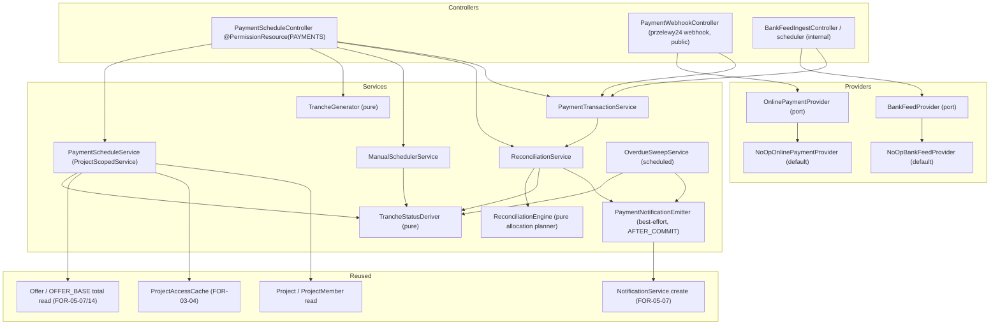
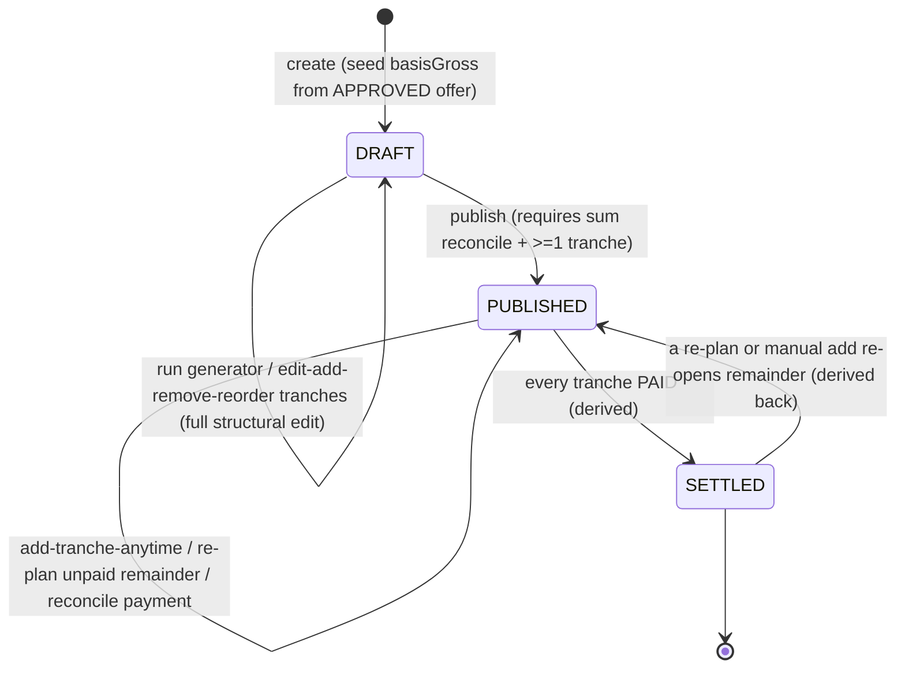
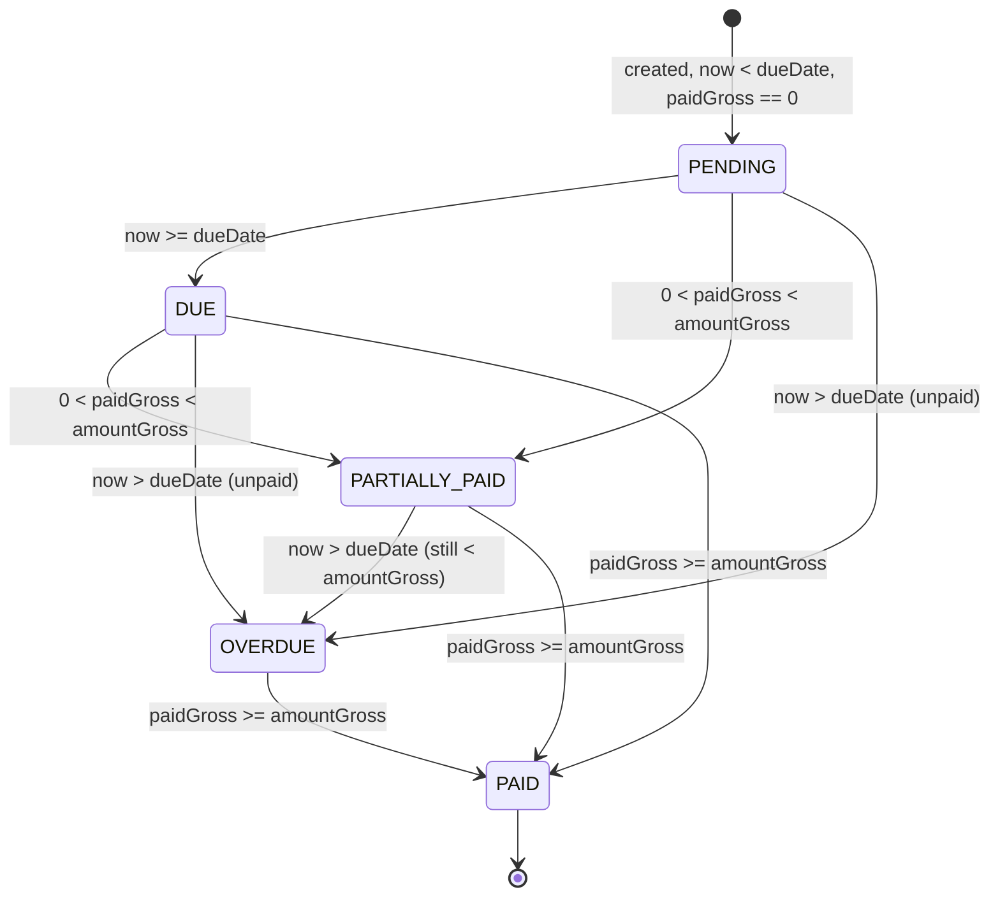

# Design Document

## Overview

FOR-06-07-client-payments delivers the **internal/admin side of client payments** for a project in
the execution (`ACTIVE`) stage. It turns the requirements' glossary entities (`PaymentSchedule`,
`PaymentTranche`, `PaymentTransaction`, `TrancheAllocation`) into a concrete, testable domain with
three status machines, a deterministic **tranche generator**, a **reconciliation engine** that
applies confirmed payments to the nearest open tranche (with under/overpayment carry-over and
unallocated credit), a **re-plan** path for the unpaid remainder, derived **overdue** state, two
credential-gated external channels (**przelewy24** online payment and a **mass-collect bank feed**)
behind a provider abstraction with a **No-Op** default, and the admin **Płatności** workspace tab.

The project total this spec schedules against is the **approved offer total** handed off by
FOR-05-07 (`Offer.totalGross` on the project's `APPROVED` offer / the `OFFER_BASE` price frozen by
FOR-05-14). This spec **reads** that total; it never recomputes pricing (Requirement 1.2, 14.4).
Amendments (FOR-06-08/09) may change the total after signing; the schedule exposes a **re-plan** of
the remaining unpaid amount but never rewrites already-settled tranches (Requirement 6).

The design is built on existing platform primitives rather than new frameworks:

- **CRUD + ABAC**: `AdminService`/`AdminController`, `@PermissionResource`/`@PermissionOperation` +
  `PermissionInterceptor`, and the FOR-03-04 `ProjectScopedService` auto project filtering
  (`getProjectIdPath()`). The new `PAYMENTS` resource and its role matrix are seeded through
  idempotent Liquibase changesets per `entity-creation-rules`.
- **Notifications**: this module is a **consumer** of the FOR-05-07
  `NotificationService.create(recipientUserId, type, body, deepLink)` extension point (verified
  signature, `@Transactional(REQUIRES_NEW)`). It never persists or delivers notifications itself;
  emission is best-effort (Requirements 9.1, 9.5).
- **Provider abstraction + No-Op stub**: the `OnlinePaymentProvider` / `BankFeedProvider` ports and
  their credential-gated `No_Op` implementations mirror the FOR-05-08 disabled-signer /
  `DisabledImageStorage` pattern (Requirements 7.2, 8.2, 14.1).
- **Offer total read**: consumes the FOR-05-07 `APPROVED` `Offer` / FOR-05-14 `OFFER_BASE`; reads,
  does not recompute (Requirements 1.2, 6.1).

### Scope boundaries (what this spec owns vs. delegates)

| Concern | Owner |
|---|---|
| `PaymentSchedule` / `PaymentTranche` / `PaymentTransaction` / `TrancheAllocation` entities + status machines | **this spec** |
| Tranche generator (`EQUAL`/`PERCENT`/`CUSTOM` × periodicity) + manual/custom scheduler + add-tranche-anytime | **this spec** |
| Reconciliation engine (nearest-open-tranche, under/overpayment carry-over, unallocated credit, idempotency, manual mark-paid) | **this spec** |
| Re-plan of the unpaid remainder; overdue detection + status derivation + sweep | **this spec** |
| `OnlinePaymentProvider` (przelewy24) + `BankFeedProvider` ports + No-Op stubs + webhook/signature | **this spec** |
| Payer-borne fee recording | **this spec** |
| `PAYMENTS` ABAC resource seed + role matrix | **this spec** |
| Płatności workspace tab (admin side) + i18n keys | **this spec** |
| Generic `NotificationService` + in-app Bell | FOR-05-07 (reused, NOT re-implemented) |
| Approved offer total / `OFFER_BASE` project price | FOR-05-07 / FOR-05-14 (consumed) |
| Amendment business flow + re-pricing of the project total | FOR-06-08 / FOR-06-09 (consumed) |
| Client-facing schedule view + client online-pay UI | FOR-09 (reuses this spec's server actions) |
| Live przelewy24 / bank-feed credentials + deployment | FOR-12 / config (only abstraction + stub here) |

### Key design decisions

1. **Tranche status is derived, never hand-set.** `TrancheStatus` is a pure function of
   `(paidGross, amountGross, dueDate, now)` computed by a pure `TrancheStatusDeriver`; the stored
   `status` column is a **materialized cache** written only by the derivation routine (Requirements
   10.1, 10.3). The same holds for `ScheduleStatus = SETTLED` (derived iff every tranche is `PAID`,
   Requirement 1.6).

2. **Reconciliation is a pure allocation planner + a thin persistence apply.** The core cascade
   (nearest-open-tranche first, carry surplus forward by `seqNo`, hold final surplus as unallocated
   credit) lives in a pure `ReconciliationEngine.plan(openTranches, amount) → AllocationPlan` with
   no persistence, so it is fully property-testable; `ReconciliationService` applies the plan,
   writing `TrancheAllocation` rows and bumping `paidGross` (Requirements 5.1–5.7).

3. **Idempotency is keyed on `(schedule, channel, externalRef)`.** A confirmed transaction with an
   `externalRef` already recorded for the schedule is a no-op on re-delivery (duplicate webhook /
   re-polled bank line); allocation never runs twice for the same transaction (Requirement 5.8).

4. **The generator is pure and sum-exact.** `TrancheGenerator.generate(basisGross, strategy,
   parts, startDate, periodicity) → List<GeneratedTranche>` is a pure function; `EQUAL` rounds to
   2 decimals and pushes the remainder onto the last tranche so `Σ amountGross == basisGross`
   exactly; `PERCENT`/`CUSTOM` reject on a sum mismatch (Requirements 2.2–2.4).

5. **Manual add-tranche is an explicit change to the total.** Adding a tranche to a `PUBLISHED`
   schedule raises `basisGross` by the added amount (it is an intentional new installment, not a
   reconciliation error), keeps the schedule `PUBLISHED`, re-derives `seqNo` by `dueDate`, and
   re-runs allocation of any held unallocated credit against the new open tranche — preserving the
   `Σ amountGross == basisGross` invariant (Requirement 3.3, 3.4).

6. **Re-plan touches only open tranches.** A re-plan recomputes `basisGross` to the new project
   total and re-authors only the not-`PAID` tranches so they re-sum to the unpaid remainder
   (`new basisGross − Σ paidGross`); every `PAID` tranche and all its `TrancheAllocation` rows are
   immutable; the schedule stays `PUBLISHED` (Requirements 6.1, 6.2, 6.4).

7. **The provider is config-selected and absence-tolerant.** `OnlinePaymentProvider` /
   `BankFeedProvider` are resolved by configuration. The default `NoOpOnlinePaymentProvider` /
   `NoOpBankFeedProvider` succeed-without-effect (disabled initiate result, empty feed, no throw),
   so the whole system runs unchanged until FOR-12 supplies credentials — exactly the FOR-05-08
   disabled-provider pattern (Requirements 7.2, 8.2, 14.1).

8. **Manual mark-tranche-paid reuses the reconciliation apply.** Marking a tranche paid records a
   `MANUAL`/`CONFIRMED` `PaymentTransaction` for the tranche's remaining amount, allocates it to
   exactly that tranche, and triggers the same downstream effects (notifications, `SETTLED`
   roll-up, audit). It is idempotent: a `PAID` tranche re-marked is a no-op; a `PARTIALLY_PAID`
   tranche settles only the remainder (Requirements 5.9–5.12).

9. **No new backend i18n columns.** The payment entities carry no human-named fields; every
   user-facing label is an enum rendered through the `Enum_Label_I18n` convention on the frontend
   (Requirement 13.3). The Płatności tab is the pre-existing FOR-06-00 placeholder whose lazy
   target this spec swaps to the real panel — no parallel tab (Requirement 12.1).

---

## Architecture

### Component map (backend)



Controllers are thin. All lifecycle decisions live in `PaymentScheduleService` /
`ReconciliationService`; the invariant arithmetic/ordering rules live in **pure collaborators**
(`TrancheGenerator`, `ReconciliationEngine`, `TrancheStatusDeriver`) so they are property-testable
with no persistence.

### Schedule lifecycle (state machine)



`DRAFT` allows full structural edits; `PUBLISHED` restricts structural mutation to the add-tranche
action and the re-plan of the unpaid remainder (Requirement 1.5). `SETTLED` is **derived**: it is
set iff every tranche is `PAID` and reverts to `PUBLISHED` if a later re-plan/add re-opens the
remainder (Requirements 1.6, 5.6). A schedule with any `CONFIRMED` allocated transaction cannot be
un-published (Requirement 4.4).

### Tranche status derivation (pure)



Derivation order (Requirement 10.1): `PAID` if `paidGross >= amountGross`; else `OVERDUE` if
`now > dueDate`; else `PARTIALLY_PAID` if `paidGross > 0`; else `DUE` if `now >= dueDate`; else
`PENDING`. The stored `status` is a materialized cache written only by `TrancheStatusDeriver`
(Requirement 10.3).

### Reconciliation sequence (confirmed payment → allocation)

```mermaid
sequenceDiagram
    participant SRC as Bank feed / przelewy24 webhook / MANUAL record
    participant TXN as PaymentTransactionService
    participant REC as ReconciliationService
    participant ENG as ReconciliationEngine (pure)
    participant DER as TrancheStatusDeriver
    participant NT as NotificationService (FOR-05-07)

    SRC->>TXN: confirmed payment (channel, externalRef, amountGross, feeGross)
    TXN->>TXN: idempotency check (schedule, channel, externalRef)
    alt already recorded
        TXN-->>SRC: no-op (same end state)
    else new
        TXN->>TXN: persist PaymentTransaction CONFIRMED
        TXN->>REC: reconcile(transaction)
        REC->>ENG: plan(openTranches by seqNo, amountGross)
        ENG-->>REC: AllocationPlan { per-tranche amounts, leftover credit }
        REC->>REC: write TrancheAllocation rows, bump paidGross
        REC->>DER: re-derive each touched tranche status
        REC->>REC: hold leftover as schedule.unallocatedCredit; SETTLED iff all PAID
        REC->>NT: emit payment.received / tranchePaid / amountMismatch (best-effort)
    end
```

### Frontend surface

The pre-existing FOR-06-00 execution-stage tab keyed **`payments`** (route
`/projects/:projectId/payments`, labelKey `workspace.tab.payments` = "Płatności", gated by
`PAYMENTS`/READ, currently a `PlaceholderTab`) has its **lazy target swapped** to a real
`PaymentsTab` in a new `features/project-payments/` module — **no parallel tab is added**
(Requirement 12.1). The tab renders the schedule, the generator + manual-scheduler controls, the
add-tranche / publish / re-plan actions, the transactions list with allocations, the MANUAL-record
action, and the per-tranche mark-as-paid action, each permission-gated by the matching `PAYMENTS`
operation and read-only for a FOREMAN (Requirements 12.2, 12.4). The reusable server actions
(initiate online payment, read schedule) are exported for FOR-09 to consume (Requirements 7.6,
14.3).

### Technology choices

- Backend: Spring Boot + JPA (existing), Liquibase for schema/seeds, MapStruct DTO mapping, jqwik
  for property tests (repo convention). Monetary fields are `NUMERIC(19,2)` / `BigDecimal` with
  `RoundingMode.HALF_UP` to 2 decimals, matching the pricing stack.
- The overdue sweep is a Spring `@Scheduled` task re-deriving tranche statuses and emitting the
  first-crossing overdue notification (Requirement 10.2); evaluation also happens on read.
- Frontend: React + react-i18next (existing); enum labels via the `Enum_Label_I18n` convention
  with PL+RU parity, PL primary (Requirements 13.1–13.4).

---

## Components and Interfaces

### Backend services

#### `PaymentScheduleService` (project-scoped)

Implements `ProjectScopedService<PaymentScheduleServiceModel, PaymentScheduleExtendedModel,
PaymentScheduleEntity, Long>` with `getProjectIdPath() = "project.id"` and `allowedProjectIds`
wired to `ProjectAccessCache` (Requirement 11.1, 11.3). It owns the schedule lifecycle:

```java
public interface PaymentScheduleService
        extends ProjectScopedService<PaymentScheduleServiceModel,
                                     PaymentScheduleExtendedModel,
                                     PaymentScheduleEntity, Long> {

    @Override default String getProjectIdPath() { return "project.id"; }

    PaymentScheduleDto create(CreateScheduleRequest req);   // -> DRAFT, seed basisGross from APPROVED offer (R1.2, R1.3)
    PaymentScheduleDto generate(Long id, GenerateRequest in);    // run TrancheGenerator, DRAFT only (R2)
    PaymentScheduleDto publish(Long id);                    // DRAFT -> PUBLISHED, requires reconcile + >=1 tranche (R4)
    PaymentScheduleDto rePlan(Long id, RePlanRequest in);   // re-author unpaid remainder, PUBLISHED (R6)
    PaymentScheduleView get(Long id);                       // schedule + tranches + aggregates + credit + derived status (R1.4)
}
```

- `create` resolves the project's `APPROVED` offer total (`Offer.totalGross` / `OFFER_BASE`); if
  there is no resolvable total it rejects with `422 error.payment.schedule.noProjectTotal` and
  creates nothing (Requirement 1.3). The UNIQUE `project_id` constraint enforces one schedule per
  project; a second create is `409 error.payment.schedule.exists` (Requirement 1.1).
- `generate` runs on a `DRAFT` schedule only and **replaces** any existing (all-unpaid) tranches
  with the generated set (Requirement 2.6); a non-`DRAFT` call is rejected (Requirement 1.5).
- `publish` asserts `Σ amountGross == basisGross` and `>= 1` tranche, else
  `422 error.payment.schedule.sumMismatch` (Requirements 3.5, 4.2); it emits the CLIENT
  `schedulePublished` notification (Requirement 4.3) and refuses to un-publish once a `CONFIRMED`
  transaction is allocated (Requirement 4.4).
- `rePlan` recomputes `basisGross` to the new total, re-authors only open tranches to re-sum to the
  unpaid remainder, leaves `PAID` tranches + allocations immutable, stays `PUBLISHED`, and on a
  negative remainder zero/closes the open tranches and surfaces the excess as unallocated credit
  with a localized info message (Requirements 6.1–6.4).

#### `TrancheGenerator` (pure)

```java
public final class TrancheGenerator {
    public List<GeneratedTranche> generate(BigDecimal basisGross, GeneratorStrategy strategy,
                                           List<BigDecimal> parts, LocalDate startDate,
                                           Periodicity periodicity, List<LocalDate> customDates);
}
```

- `EQUAL`: split into N equal parts to 2 decimals, add the rounding remainder to the LAST tranche
  so `Σ amountGross == basisGross` exactly (Requirement 2.2).
- `PERCENT`: `parts` are percentages; reject with `error.payment.generator.percentSum` unless they
  sum to exactly 100; each tranche = `round(basisGross × pct/100)` with the remainder on the last
  (Requirement 2.3).
- `CUSTOM`: `parts` are explicit amounts; reject with `error.payment.generator.amountSum` unless
  they sum to exactly `basisGross` (Requirement 2.4).
- Assigns `seqNo` 1..N and a `dueDate` per `periodicity` (`WEEKLY`/`BIWEEKLY`/`MONTHLY` stepping
  from `startDate`, or `CUSTOM_DATES` taking the explicit list). Rejects `N < 1`, any negative
  amount/percentage, or an absent start date with a localized validation message (Requirement 2.5).

Pure and property-testable: no persistence, no clock.

#### `ManualSchedulerService`

Authors/edits tranches by hand (Requirement 3). On a `DRAFT` schedule: add/edit (amount + due
date)/re-order/remove, setting `source = MANUAL`; re-derives `seqNo` as a contiguous 1..N by
`dueDate` after every mutation (Requirements 3.1, 3.2). The **add-tranche-anytime** action
(`addTranche`) is permitted even while `PUBLISHED`: it appends a tranche, re-derives `seqNo` by
`dueDate`, raises `basisGross` by the added amount, keeps the schedule `PUBLISHED`, re-derives
statuses, and re-runs allocation of any held unallocated credit against the new open tranche —
never touching a `PAID` tranche or its allocations (Requirements 3.3, 3.4). A negative/zero amount
or absent due date is `422 error.payment.tranche.invalid` (Requirement 3.6). All manual write
paths are gated by `PAYMENTS` UPDATE (Requirement 3.7).

#### `ReconciliationEngine` (pure allocation planner)

```java
public final class ReconciliationEngine {
    public AllocationPlan plan(List<OpenTranche> openBySeqNo, BigDecimal amount);
    // AllocationPlan { List<Allocation{ trancheSeqNo, applied }>, BigDecimal leftoverCredit }
}
```

Pure cascade (Requirements 5.1–5.5): apply `amount` to the first open tranche's remaining
(`amountGross − paidGross`); if `amount <` remaining → partial (tranche stays open); if `==` →
settle; if `>` → settle and carry the surplus to the next open tranche in `seqNo` order, repeating
until the amount is exhausted or no open tranche remains; any final surplus is returned as
`leftoverCredit` (held as schedule unallocated credit — no phantom tranche). Conservation holds:
`Σ applied + leftoverCredit == amount`. No persistence, no clock — fully property-testable.

#### `ReconciliationService`

Applies an `AllocationPlan` (Requirements 5.1, 5.7): for each planned allocation writes a
`TrancheAllocation { transaction, tranche, amount }` and increments the tranche's `paidGross`, adds
`leftoverCredit` to `schedule.unallocatedCredit`, re-derives each touched tranche status via
`TrancheStatusDeriver`, and sets `ScheduleStatus = SETTLED` iff every tranche is `PAID` (Requirement
5.6). It exposes:

```java
public interface ReconciliationService {
    void reconcile(PaymentTransactionEntity confirmed);       // cascade allocation (R5.1-5.7)
    PaymentScheduleView markTranchePaid(Long trancheId, ManualPayInput in); // R5.9-5.12
}
```

`markTranchePaid` records a `MANUAL`/`CONFIRMED` `PaymentTransaction` for the tranche's remaining
amount, allocates it to **exactly that tranche** (not the nearest-open cascade), sets
`paidGross = amountGross`, derives `PAID`, attributes the acting user, and accepts an optional note
+ received-at (Requirement 5.10). It is idempotent: a `PAID` tranche is a no-op; a `PARTIALLY_PAID`
tranche settles only the remainder (Requirement 5.11). It triggers the same downstream effects as
any confirmed settlement — `tranchePaid` notification, `SETTLED` roll-up, auditable allocation
(Requirement 5.12).

#### `PaymentTransactionService`

Records and confirms transactions, enforcing **idempotency** by `(schedule, channel, externalRef)`
(Requirement 5.8): a confirmed transaction whose `externalRef` is already recorded for the schedule
is a no-op (no second row, no re-allocation). Entry points:

```java
public interface PaymentTransactionService {
    void ingestBankTransaction(IncomingBankTxn txn);       // channel=BANK_TRANSFER, CONFIRMED (R8.3)
    void onOnlineWebhook(OnlineWebhookEvent event);        // CONFIRMED/FAILED/REFUNDED by externalRef (R7.3)
    PaymentTransactionDto recordManual(Long scheduleId, ManualTxnInput in); // channel=MANUAL (R8.5)
}
```

- A bank transaction that cannot be correlated to any schedule is recorded **unmatched** (not
  allocated) and surfaced for manual correlation, without failing ingest (Requirement 8.4).
- An online webhook `CONFIRMED` for a known `externalRef` runs reconciliation; `FAILED` →
  `FAILED`; reversal → `REFUNDED`, each emitting the `onlineFailed` notification on failure/reversal
  (Requirements 7.3, 9.2 row 6). The commission is recorded as `feeGross` under the
  `Payer_Borne_Fee` model and is **not** deducted from the allocated amount (Requirement 7.4).

#### `TrancheStatusDeriver` (pure)

```java
public final class TrancheStatusDeriver {
    public TrancheStatus derive(BigDecimal paidGross, BigDecimal amountGross,
                                LocalDate dueDate, Instant now);
    public ScheduleStatus deriveSchedule(List<TrancheStatus> trancheStatuses, ScheduleStatus current);
}
```

Encodes Requirement 10.1 exactly; `deriveSchedule` returns `SETTLED` iff the tranche set is
non-empty and every status is `PAID`, otherwise retains `DRAFT`/`PUBLISHED` (Requirements 1.6,
5.6). Pure; property-testable.

#### `OverdueSweepService` (scheduled)

A `@Scheduled` task that re-derives tranche statuses across `PUBLISHED` schedules and fires the
`trancheOverdue` notification **exactly once** per tranche on its first crossing into `OVERDUE`,
tracked by a persisted `overdueNotifiedAt` marker so subsequent sweeps do not re-notify
(Requirements 9.3, 10.2). Overdue state is also re-derived on read.

#### `PaymentNotificationEmitter` (best-effort)

Wraps `NotificationService.create(recipientUserId, type, body, deepLink)` for the six triggers of
Requirement 9.2. Emission is a best-effort side effect executed after the triggering transaction
commits (an `AFTER_COMMIT` `@TransactionalEventListener`, so a failure cannot roll back the
payment/tranche transition); failures are logged and swallowed (Requirements 9.1, 9.5). Each
notification carries a **deep-link** (Requirement 9.2); the `schedulePublished` row deep-links to
the FOR-09 client surface, all others to the Płatności tab.

| # | Type key | Recipient(s) | Trigger |
|---|---|---|---|
| 1 | `notification.payment.received` | MANAGER + FINANCIER | a `PaymentTransaction` becomes `CONFIRMED` and is allocated |
| 2 | `notification.payment.tranchePaid` | MANAGER + FINANCIER | a tranche reaches `PAID` |
| 3 | `notification.payment.trancheOverdue` | MANAGER + FINANCIER | a tranche first crosses into `OVERDUE` (once per tranche) |
| 4 | `notification.payment.amountMismatch` | MANAGER + FINANCIER | a confirmed payment yields under/overpayment (shortfall or carry-over) |
| 5 | `notification.payment.schedulePublished` | CLIENT | the schedule is published |
| 6 | `notification.payment.onlineFailed` | MANAGER + FINANCIER | an online payment is `FAILED` or `REFUNDED` |

#### Provider ports + No-Op stubs

```java
public interface OnlinePaymentProvider {                    // przelewy24 (R7.1)
    OnlineInitiateResult initiate(InitiatePayment req);     // create intent -> redirect/opaque
    boolean verifySignature(RawWebhook raw);                // R7.5
    OnlineWebhookEvent parse(RawWebhook raw);               // -> CONFIRMED/FAILED/REFUNDED by externalRef
}

public interface BankFeedProvider {                         // mass-collect feed (R8.1)
    List<IncomingBankTxn> poll();                           // amount, currency, externalRef, receivedAt, correlationKey
}
```

- `NoOpOnlinePaymentProvider` (default, `foremen.payments.online.provider=none`): `initiate`
  returns a **disabled** result (no external call, no throw, nothing marked `CONFIRMED`),
  `verifySignature` returns `false` (accepts no live webhooks), never throws (Requirements 7.2,
  7.5). `NoOpBankFeedProvider` (default, `foremen.payments.bankfeed.provider=none`): `poll` yields
  an empty list, never throws (Requirement 8.2). A real przelewy24 / bank implementation is
  pluggable later via FOR-12/config without redesign — mirroring the FOR-05-08 disabled-provider
  pattern.
- The webhook endpoint verifies the provider signature **when credentials are present** and rejects
  unverified calls with `401 error.payment.webhook.unverified`; under No-Op it accepts no live
  webhook (Requirement 7.5).

### Backend controllers (ABAC-wired per `entity-creation-rules`)

| Controller | `@PermissionResource` | Project-scoped | Notes |
|------------|-----------------------|:--------------:|-------|
| `PaymentScheduleController` | `PAYMENTS` | yes | all schedule/tranche/transaction/action endpoints; each handler carries a method-level `@PermissionOperation`/`@RequiresPermission` mapping to standard CRUD (R11.1, R11.4, R12.2) |
| `PaymentWebhookController` | — (public webhook) | n/a | `POST /api/payments/webhook/online`; intentionally unguarded (unauthenticated przelewy24 webhook, like `AuthController` per `entity-creation-rules`), verified by provider signature + `externalRef` (R7.5) |
| `BankFeedIngestController` | `PAYMENTS` (UPDATE) | yes | internal trigger/poll endpoint for the bank feed (or driven by a scheduler); ingest is an `UPDATE` (R8.3) |

The class-level `@PermissionResource("PAYMENTS")` combines with each handler's
`@PermissionOperation` (or a method-level `@RequiresPermission` for custom-action endpoints) so
`PermissionAnnotationValidator` classifies the controller COMPLETE at startup (Requirement 11.4).
The custom actions map to standard CRUD — `create`/`generate`/`publish` → `CREATE`/`UPDATE`;
`addTranche`/`rePlan`/`markTranchePaid`/`recordManual` → `UPDATE`; reads → `READ` — **no new ABAC
operation** is introduced (Requirement 11.1).

### Frontend components

| Component | Location | Responsibility |
|-----------|----------|----------------|
| `PaymentsTab` | `features/project-payments/components/PaymentsTab.tsx` | the swapped real tab: schedule header (basis, Σ paid, remainder, unallocated credit, derived status), tranche table, actions bar (R12.1, R12.2) |
| `TrancheTable` | `features/project-payments/components/` | per-tranche rows with derived `TrancheStatus` label, amount, due date, mark-as-paid action (R5.9, R12.2) |
| `GeneratorForm` | `features/project-payments/components/` | strategy (`EQUAL`/`PERCENT`/`CUSTOM`) + parts + start date + periodicity; validates sums client-side (R2) |
| `ManualSchedulerPanel` | `features/project-payments/components/` | add/edit/reorder/remove tranches (DRAFT) + add-tranche-anytime (PUBLISHED) (R3) |
| `PublishButton` / `RePlanDialog` | `features/project-payments/components/` | publish (reconcile check) + re-plan the unpaid remainder (R4, R6) |
| `TransactionsList` | `features/project-payments/components/` | transactions with per-tranche allocations, MANUAL-record action, unmatched transactions surface (R8.4, R12.2) |
| `usePaymentSchedule` | `features/project-payments/hooks` | data hook over the REST endpoints; also the reusable initiate-online-pay action exported for FOR-09 (R7.6, R14.3) |

Write controls are permission-gated via `usePermission` on the matching `PAYMENTS` operation and
hidden/read-only for a FOREMAN (`R(own)`) (Requirements 12.3, 12.4). Every enum is rendered through
`Enum_Label_I18n` (PL+RU), never the raw constant (Requirement 13.2).

---

## Data Models

### New entities

#### `PaymentScheduleEntity` → `payment_schedules`

| Field | Type | Notes |
|-------|------|-------|
| `id` | BIGSERIAL PK | |
| `project` | FK `projects` NOT NULL **UNIQUE** | one schedule per project; `getProjectIdPath = "project.id"` (R1.1, R11.1) |
| `currency` | VARCHAR(3) NOT NULL | from the project (R1.2) |
| `basisGross` | NUMERIC(19,2) NOT NULL CHECK >= 0 | the total being scheduled, seeded from the APPROVED offer (R1.2) |
| `source` | VARCHAR(16) NOT NULL | `GENERATED`/`MANUAL` (R1.2) |
| `status` | VARCHAR(16) NOT NULL DEFAULT `'DRAFT'` | `DRAFT`/`PUBLISHED`/`SETTLED`; `SETTLED` derived (R1.6) |
| `unallocatedCredit` | NUMERIC(19,2) NOT NULL DEFAULT 0 | held surplus (R5.5, R1.4) |
| audit cols | | `BaseEntity` |

#### `PaymentTrancheEntity` → `payment_tranches`

| Field | Type | Notes |
|-------|------|-------|
| `schedule` | FK `payment_schedules` NOT NULL ON DELETE CASCADE | scope `schedule.project.id` |
| `seqNo` | INT NOT NULL | contiguous 1..N by `dueDate`; UNIQUE `(schedule_id, seq_no)` (R2.1, R3.2) |
| `dueDate` | DATE NOT NULL | drives overdue detection (R10.1) |
| `amountGross` | NUMERIC(19,2) NOT NULL CHECK > 0 | (R3.6) |
| `paidGross` | NUMERIC(19,2) NOT NULL DEFAULT 0 CHECK >= 0 | running settled total (R5.2) |
| `status` | VARCHAR(16) NOT NULL DEFAULT `'PENDING'` | materialized cache of the derived status (R10.3) |
| `overdueNotifiedAt` | TIMESTAMPTZ nullable | first-crossing marker, one-shot overdue notify (R9.3, R10.2) |
| audit cols | | `BaseEntity` |

#### `PaymentTransactionEntity` → `payment_transactions`

| Field | Type | Notes |
|-------|------|-------|
| `schedule` | FK `payment_schedules` nullable | null while **unmatched** (R8.4); scope via join |
| `channel` | VARCHAR(16) NOT NULL | `BANK_TRANSFER`/`ONLINE`/`MANUAL` (Payment_Channel) |
| `externalRef` | VARCHAR(255) nullable | bank / przelewy24 reference; idempotency key (R5.8) |
| `amountGross` | NUMERIC(19,2) NOT NULL CHECK >= 0 | funds received |
| `feeGross` | NUMERIC(19,2) NOT NULL DEFAULT 0 | commission, client-borne, not deducted (R7.4) |
| `receivedAt` | TIMESTAMPTZ NOT NULL | |
| `status` | VARCHAR(16) NOT NULL | `PENDING`/`CONFIRMED`/`FAILED`/`REFUNDED` (Transaction_Status) |
| `note` | TEXT nullable | optional free-text for MANUAL records (R5.10) |
| `recordedBy` | FK `users` nullable | acting user for MANUAL / mark-paid (R5.10) |
| audit cols | | `BaseEntity` |

A **partial unique index** `UNIQUE (schedule_id, channel, external_ref) WHERE external_ref IS NOT
NULL` enforces idempotency at the DB layer (Requirement 5.8).

#### `TrancheAllocationEntity` → `tranche_allocations`

| Field | Type | Notes |
|-------|------|-------|
| `transaction` | FK `payment_transactions` NOT NULL ON DELETE CASCADE | the settling payment (R5.7) |
| `tranche` | FK `payment_tranches` NOT NULL | the settled tranche (R5.7) |
| `amount` | NUMERIC(19,2) NOT NULL CHECK > 0 | how much of the transaction applied here (R5.4) |
| audit cols | | `BaseEntity` |

A transaction may own several allocations (overpayment spanning tranches); a tranche may accumulate
allocations across transactions (underpayment). Allocations are append-only and **immutable** once
their tranche is `PAID` (Requirement 6.2).

### Enums (localized on the frontend via `Enum_Label_I18n`; no DB i18n columns — R13.3)

- `ScheduleStatus = { DRAFT, PUBLISHED, SETTLED }` (R1 glossary).
- `TrancheStatus = { PENDING, DUE, PARTIALLY_PAID, PAID, OVERDUE }` — derived (R10.1).
- `TransactionStatus = { PENDING, CONFIRMED, FAILED, REFUNDED }`.
- `PaymentChannel = { BANK_TRANSFER, ONLINE, MANUAL }`.
- `ScheduleSource = { GENERATED, MANUAL }`.
- `GeneratorStrategy = { EQUAL, PERCENT, CUSTOM }`; `Periodicity = { WEEKLY, BIWEEKLY, MONTHLY, CUSTOM_DATES }` (R2.1).

### DTOs

- `PaymentScheduleView` — `{ id, projectId, currency, basisGross, source, status, tranches:
  PaymentTrancheDto[], sumAmountGross, sumPaidGross, unpaidRemainder, unallocatedCredit }` (R1.4).
- `PaymentTrancheDto` — `{ id, seqNo, dueDate, amountGross, paidGross, status }`.
- `PaymentTransactionDto` — `{ id, channel, externalRef, amountGross, feeGross, receivedAt, status,
  note, allocations: TrancheAllocationDto[] }`.
- Inputs: `CreateScheduleRequest`, `GenerateRequest` (`strategy`, `parts`, `startDate`,
  `periodicity`, `customDates`), `RePlanRequest`, `ManualTxnInput`, `ManualPayInput`
  (`note?`, `receivedAt?`), `AddTrancheInput`, `InitiatePayment`.

### Liquibase changesets (idempotent, registered LAST in sequence)

Current changelog head is **170** (FOR-06-04 `170-add-procurement-line-unplanned-category.xml`).
FOR-06-07 changesets start at **171**; if sibling specs land further changesets first, use the next
free NNN. Each is guarded with `onFail="MARK_RAN"` + `NOT tableExists` / `sqlCheck` and registered
**last** in `changelog.xml`, following the `017-seed-users-resource.xml` two-changeSet
resource+grant pattern.

| # | Changeset | Purpose |
|---|-----------|---------|
| 171 | `create-payment-schedules` | `payment_schedules` + UNIQUE `project_id` + status default `DRAFT` |
| 172 | `create-payment-tranches` | `payment_tranches` + FK + UNIQUE `(schedule_id, seq_no)` + status default `PENDING` |
| 173 | `create-payment-transactions` | `payment_transactions` + FK + partial unique idempotency index |
| 174 | `create-tranche-allocations` | `tranche_allocations` + FKs |
| 175 | `seed-payments-resource` | **`PAYMENTS`** resource row + ADMIN CRUD grant + the full role matrix (R11.1, R11.2) |

The `175-seed-payments-resource` changeset seeds the project-scoped `PAYMENTS` role matrix of
Requirement 11.2 (standard CRUD only — **no** new operation):

| Resource | ADMIN | MANAGER | FOREMAN | WORKER | FINANCIER | CLIENT |
|----------|-------|---------|---------|--------|-----------|--------|
| `PAYMENTS` | CRUD | CRUD(own) | R(own) | — | CRUD(own) | R(own) |

`(own)` scoping is enforced by `ProjectScopedService` project filtering (Requirement 11.3). ADMIN
is still seeded for completeness though `ForemenPermissionEvaluator` bypasses the matrix for the
exact `ADMIN` code (`entity-creation-rules` step 2). WORKER receives no grant; CLIENT online-pay is
a dedicated FOR-09 action, not a `PAYMENTS` write (Requirement 11.2).

---

## Correctness Properties

*A property is a characteristic or behavior that should hold true across all valid executions of a
system — essentially, a formal statement about what the system should do. Properties serve as the
bridge between human-readable specifications and machine-verifiable correctness guarantees.*

Each property is a checkable invariant over generated inputs (tranche sets, amounts, action
sequences) and is independent of persistence where a pure collaborator exists (`TrancheGenerator`,
`ReconciliationEngine`, `TrancheStatusDeriver`).

### Property 1: Schedule is SETTLED iff every tranche is PAID

**Validates: Requirements 1.6, 5.6**

For any tranche-status list `T`:

```
deriveSchedule(T, current) == SETTLED  ⟺  (T is non-empty  ∧  ∀ t ∈ T : t == PAID)
```

`SETTLED` is derived by `TrancheStatusDeriver.deriveSchedule`, never assigned imperatively; for an
empty list or any non-`PAID` tranche the schedule retains `DRAFT`/`PUBLISHED`. A later re-plan or
manual add that re-opens the remainder flips it back out of `SETTLED` by the same rule.

### Property 2: The generator and manual re-sequencing preserve the sum and produce a contiguous seqNo

**Validates: Requirements 2.1, 2.2, 2.3, 2.4, 2.5, 3.2, 3.3, 3.4**

For any `basisGross > 0` and any valid generator input:

```
EQUAL(basisGross, N):   |tranches| == N  ∧  Σ amountGross == basisGross  ∧  each amount has ≤ 2 decimals
PERCENT(basisGross, P): accepted ⟺ Σ P == 100   →  Σ amountGross == basisGross ; else reject percentSum
CUSTOM(basisGross, A):  accepted ⟺ Σ A == basisGross  →  amounts preserved ; else reject amountSum
∀ output:  seqNo values == {1..N} contiguous, ordered by dueDate
invalid input (N < 1 ∨ any amount/percent < 0 ∨ startDate absent)  ⟹  rejected
```

The same contiguity holds after any sequence of manual add/remove/re-order edits (`seqNo` re-derived
to `1..N` by `dueDate`), and after an add-tranche-anytime the schedule's
`Σ amountGross == basisGross` invariant still holds with `basisGross` raised by the added amount.

### Property 3: Reconciliation conserves the payment and cascades nearest-open-first

**Validates: Requirements 5.1, 5.2, 5.3, 5.4, 5.5, 5.7, 7.4, 8.5**

For any list of open tranches ordered by `seqNo` and any payment `amount`,
`ReconciliationEngine.plan(open, amount)` satisfies:

```
Σ allocation.applied + leftoverCredit == amount                    (conservation)
∀ allocation:  applied ≤ (tranche.amountGross − tranche.paidGross)  (never over-settle a tranche)
allocations target open tranches in strictly increasing seqNo order, starting at the nearest open one
leftoverCredit > 0  ⟹  every open tranche is settled to PAID        (credit only after the last open)
Σ allocation.applied for a tranche == its paidGross increase        (auditable per tranche, R5.7)
```

The commission `feeGross` is **excluded** from `amount` here — it is recorded on the transaction and
never reduces the allocated total (Requirement 7.4). A `MANUAL`-channel confirmed payment reconciles
through the identical engine (Requirement 8.5).

### Property 4: Allocation is idempotent per (schedule, channel, externalRef)

**Validates: Requirements 5.8, 8.3**

For any confirmed transaction `x` with a non-null `externalRef`, reconciling it and then reconciling
a re-delivery with the same `(schedule, channel, externalRef)` yields the same end state:

```
reconcile(x) ; reconcile(x')   where key(x') == key(x)
    ⟹  schedule tranche paidGross, allocation set, and unallocatedCredit are identical
        to the state after reconcile(x) alone   (f(f(x)) == f(x))
```

No second transaction row is written and no amount is allocated twice.

### Property 5: Manual mark-tranche-paid is idempotent and targets exactly its tranche

**Validates: Requirements 5.9, 5.10, 5.11**

For any tranche `t` in any status, `markTranchePaid(t)`:

```
after:  t.paidGross == t.amountGross  ∧  derive(t) == PAID
settles only the remaining amount:  recorded MANUAL txn amount == (t.amountGross − t.paidGross_before)
allocation created targets exactly t  (not the nearest-open cascade)
markTranchePaid(t) applied again on an already-PAID t  ⟹  no-op (no second txn, no double allocation)
```

### Property 6: Re-plan leaves every PAID tranche and its allocations immutable

**Validates: Requirements 6.1, 6.2, 6.3, 6.4**

For any published schedule with a subset of `PAID` tranches and any new project total,
`rePlan(newTotal)`:

```
∀ PAID tranche p before:  p (amount, paidGross, seqNo) and all its TrancheAllocation rows are unchanged
Σ amountGross of the still-open tranches after == (newBasis − Σ paidGross)   (re-sum to unpaid remainder)
schedule.status stays PUBLISHED  (no un-publish)
newBasis − Σ paidGross < 0  ⟹  open tranches set to zero/closed  ∧  excess surfaced as unallocatedCredit
```

### Property 7: Tranche status is a pure derivation and the stored status is a faithful cache

**Validates: Requirements 10.1, 10.3**

For any `(paidGross, amountGross, dueDate, now)`, `TrancheStatusDeriver.derive` returns exactly:

```
PAID            if paidGross ≥ amountGross
else OVERDUE    if now > dueDate
else PARTIALLY_PAID if paidGross > 0
else DUE        if now ≥ dueDate
else PENDING
```

and after **any** mutation the persisted `status` column equals `derive(current fields)` — no hand-set
status is ever stored (the column is a materialized cache written only by the deriver).

### Property 8: Overdue notification fires exactly once per tranche

**Validates: Requirements 9.3, 10.2**

For any tranche that crosses into `OVERDUE` and any number of subsequent read/sweep evaluations while
it remains overdue:

```
count(trancheOverdue notifications emitted for the tranche) == 1
```

The first crossing sets `overdueNotifiedAt`; later evaluations of the same already-overdue tranche
emit nothing.

### Property 9: A failed notification emission never rolls back the payment transition

**Validates: Requirements 9.1, 9.5**

For any payment/tranche transition that triggers an emission, if `NotificationService.create` throws,
the triggering transition still commits:

```
transition commits  ∧  emission throws  ⟹  schedule/tranche/transaction state == the committed state
```

Emission runs `AFTER_COMMIT` and its failure is logged and swallowed (consistent with the FOR-05-07
best-effort contract).

---

## Error Handling

| Scenario | Condition | Response |
|----------|-----------|----------|
| No resolvable project total | create on a project with no `APPROVED` offer / `OFFER_BASE` | `422 error.payment.schedule.noProjectTotal` (R1.3) |
| Duplicate schedule | second create for a project | `409 error.payment.schedule.exists` (R1.1, UNIQUE) |
| Structural edit while PUBLISHED | edit/remove/re-order (not add-tranche / re-plan) on a `PUBLISHED` schedule | `409 error.payment.schedule.locked` (R1.5) |
| Generator percent sum ≠ 100 | `PERCENT` parts do not sum to 100 | `422 error.payment.generator.percentSum` (R2.3) |
| Generator custom sum ≠ basis | `CUSTOM` amounts do not sum to `basisGross` | `422 error.payment.generator.amountSum` (R2.4) |
| Invalid generator input | `N < 1`, negative amount/percent, absent start date | `422 error.payment.generator.invalid` (R2.5) |
| Invalid tranche | negative/zero amount or absent due date (add/edit) | `422 error.payment.tranche.invalid` (R3.6) |
| Publish sum mismatch / zero tranches | `Σ amountGross ≠ basisGross` or no tranches | `422 error.payment.schedule.sumMismatch` (R3.5, R4.2) |
| Un-publish after confirmed allocation | un-publish a schedule with an allocated `CONFIRMED` transaction | `409 error.payment.schedule.cannotUnpublish` (R4.4) |
| Unverified webhook | signature invalid / No-Op provider | `401 error.payment.webhook.unverified` (R7.5) |
| Duplicate confirmed transaction | re-delivered `externalRef` already recorded | no-op (idempotent, R5.8) — not an error |
| Uncorrelated bank transaction | no matching schedule | recorded **unmatched**, ingest succeeds (R8.4) — not an error |
| Out-of-scope entity | project access denied by `ProjectScopedService` | `404 error.entity.not.found` (indistinguishable from missing) |

All write endpoints validate the lifecycle preconditions of Requirements 1–8 and map to standard
CRUD ABAC operations (Requirements 11.1). Notification-emission failures never surface as errors —
they are swallowed `AFTER_COMMIT` (Requirements 9.1, 9.5).

---

## Testing Strategy

Per the workspace `test-execution-rules`: run only the affected test classes with `--tests`
filters, redirect to a temp log, and read the JUnit XML for pass/fail — never the full ~20-min
suite unless explicitly asked.

### Property-based tests (jqwik, ≥ 100 iterations each)

Each correctness property is implemented with a **single** jqwik property test, tagged
`Feature: FOR-06-07-client-payments, Property {n}: {property text}` and configured for ≥ 100
iterations. PBT applies here because the generator, the reconciliation cascade, and the status
derivation are **pure functions over a large input space** (amounts, tranche sets, action
sequences) with clear universal invariants (sum conservation, idempotence, immutability):

- **P1 SettledIff** — `TrancheStatusDeriver.deriveSchedule` over random tranche-status lists (R1.6, 5.6).
- **P2 GeneratorSumAndSeq** — `TrancheGenerator` sum-exactness + `seqNo` contiguity across strategies
  and manual re-sequencing (R2.1–2.5, 3.2–3.4).
- **P3 ReconciliationConservation** — `ReconciliationEngine.plan` conservation, per-tranche cap,
  nearest-open ordering, leftover-only-after-last, fee exclusion (R5.1–5.5, 5.7, 7.4, 8.5).
- **P4 AllocationIdempotency** — re-processing by `(schedule, channel, externalRef)` is a no-op (R5.8, 8.3).
- **P5 MarkPaidIdempotency** — mark-tranche-paid targets its tranche, settles only the remainder,
  second call is a no-op (R5.9–5.11).
- **P6 RePlanImmutability** — `PAID` tranches + allocations immutable, open tranches re-sum to the
  unpaid remainder (R6.1–6.4).
- **P7 StatusDerivation** — `TrancheStatusDeriver.derive` matches the spec ordering; stored status ==
  derived (R10.1, 10.3).
- **P8 OverdueOnce** — one-shot overdue emission across repeated sweeps (R9.3, 10.2).
- **P9 BestEffortEmission** — a throwing `NotificationService` never rolls back the transition (R9.1, 9.5).

### Unit tests (specific examples + edge cases)

- `PaymentScheduleService.create` — seed from `APPROVED` offer (R1.2); reject when no total (R1.3);
  duplicate-schedule reject (R1.1).
- `publish` — DRAFT→PUBLISHED happy path (R4.1); reject on sum mismatch / zero tranches (R4.2);
  cannot un-publish after a confirmed allocation (R4.4).
- `PaymentTransactionService` — online webhook `CONFIRMED`/`FAILED`/`REFUNDED` status mapping (R7.3);
  uncorrelated bank txn recorded unmatched (R8.4); `feeGross` recorded, not deducted (R7.4).
- No-Op providers — `NoOpOnlinePaymentProvider.initiate` returns disabled, no `CONFIRMED`, no throw
  (R7.2); `verifySignature` false (R7.5); `NoOpBankFeedProvider.poll` empty, no throw (R8.2).
- Notification recipient mapping — MANAGER+FINANCIER vs CLIENT rows (R9.2).

### Integration tests (Dockerized app, scoped classes only)

- Bank-feed ingest → `CONFIRMED` → reconcile wiring, idempotent on re-poll (R8.3).
- Manual mark-tranche-paid end-to-end downstream effects — `tranchePaid` notification + recorded
  allocation + `SETTLED` roll-up when last (R5.12).
- Webhook signature-verification path when credentials are present (R7.5).

### ABAC / startup tests

- `PAYMENTS` is reachable only with the right `(resource, operation)` grant + project membership;
  WORKER denied; FOREMAN read-only; `PermissionAnnotationValidator` passes at startup with the
  `PaymentScheduleController` fully annotated (R11.1–11.4).

### i18n completeness

- A locale-completeness check asserts every key introduced by this module — all Płatności UI text,
  every enum label (`payments.scheduleStatus.*`, `payments.trancheStatus.*`,
  `payments.transactionStatus.*`, `payments.channel.*`, `payments.generator.strategy.*`,
  `payments.generator.periodicity.*`) and every `notification.payment.*` title — has a **non-empty**
  value in **both** `pl.json` and `ru.json` (Requirements 13.1, 13.2, 13.4).

### API `test-cases.md`

Authored in the tasks phase (in Russian, per the `test-cases` steering standard): API tests against
the Dockerized app (`docker compose up`, base URL `http://localhost:8080`, `/api/...`), MD-report
tables, with a repeatability strategy (run-id generator or teardown). Because this is an API-centric
spec, the scenarios are HTTP requests against the live stack (schedule create/generate/publish,
reconcile via MANUAL record, mark-paid, re-plan), with an explicit regression group for idempotency
and re-plan immutability.

---

## Security Considerations

- **Project scope + ABAC** on every schedule endpoint via `ProjectScopedService` + `PAYMENTS`,
  standard CRUD only (no new action); a caller reaches only schedules of projects they belong to
  (Requirements 11.1, 11.3).
- **FOREMAN read-only / WORKER denied** by the seeded matrix; CLIENT `R(own)` reads their own
  schedule only — client online-pay is a dedicated FOR-09 action, not a `PAYMENTS` write
  (Requirement 11.2).
- **Webhook**: `POST /api/payments/webhook/online` is unauthenticated (provider-reachable) but
  validated by the provider signature + a known `externalRef`; under No-Op it accepts no live
  webhook (Requirement 7.5).
- **Idempotency** at the DB layer (partial unique index on `(schedule, channel, externalRef)`)
  prevents duplicate-webhook double-allocation (Requirement 5.8).
- **Secrets**: przelewy24 / bank-feed credentials come from config (FOR-12); never logged.
- **Auditability**: schedule create/publish/re-plan, each transaction, each allocation, and each
  manual mark-paid are audit-logged via the platform audit pattern; `recordedBy` captures the acting
  user for MANUAL settlements (Requirements 5.7, 5.10).

---

## Dependencies

- **FOR-05-07** — the generic `NotificationService.create(recipientUserId, type, body, deepLink)`
  extension point (`@Transactional(REQUIRES_NEW)`) + in-app Bell (Requirement 9); the `APPROVED`
  `Offer` + its total consumed as the schedule base.
- **FOR-05-14** — the `OFFER_BASE` frozen project price (consumed, not recomputed; Requirements 1.2,
  6.1).
- **FOR-06-08 / FOR-06-09** — the amendment flow that changes the project total; consumed by the
  re-plan path (Requirement 6).
- **FOR-06-00** — the realigned execution `WORKSPACE_TABS` with the `payments` `PlaceholderTab`
  (keyed `payments`, labelKey `workspace.tab.payments`, gated by `PAYMENTS`/READ) whose lazy target
  this spec swaps to the real panel (Requirement 12.1).
- **FOR-03-04 / FOR-03-08** — `ProjectMember`, `ProjectScopedService`, `@PermissionResource`,
  `PermissionInterceptor`, `PermissionAnnotationValidator`, the `entity-creation-rules` checklist.
- **FOR-05-08** — the disabled-provider / `DisabledImageStorage` pattern mirrored by the
  `NoOpOnlinePaymentProvider` / `NoOpBankFeedProvider` (Requirements 7.2, 8.2, 14.1).
- **FOR-09** — downstream consumer: the client schedule view + client online-pay UI reuse this
  spec's server actions without a server rewrite (Requirements 7.6, 14.3).
- **FOR-12** — live przelewy24 / bank-feed credentials + deployment (only the abstraction + stub
  here; Requirement 14.1).

---

## Open Questions resolved in this design

1. **Schedule base resolution** → read the `APPROVED` `Offer.totalGross` / `OFFER_BASE` price at
   create time and store it as `basisGross`; re-plan re-reads the new total (decision: store a
   snapshot, re-plan refreshes it — never live-recompute, Requirements 1.2, 6.1).
2. **Idempotency key** → `(schedule, channel, externalRef)` with a partial unique index, so a null
   `externalRef` (pure MANUAL records with no external reference) is never collapsed (decision 3).
3. **Unmatched bank transactions** → persisted with `schedule = null` and surfaced for manual
   correlation rather than dropped or failed (Requirement 8.4).
4. **Overdue one-shot marker** → a persisted `overdueNotifiedAt` on the tranche rather than an
   in-memory set, so the once-only guarantee survives restarts (Requirement 9.3).
5. **Provider library choice** → deferred to the tasks phase; isolated behind `OnlinePaymentProvider`
   / `BankFeedProvider` so a concrete przelewy24 / bank client is pluggable without touching the
   domain (Requirement 14.1).
