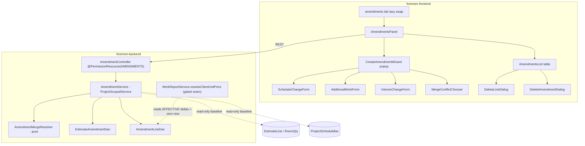

# Design Document: FOR-06-08 — Amendments (aneks authoring)

## Overview

FOR-06-08 adds the amendment-authoring domain on top of the signed estimate and schedule. It is the
**08 half** of the OVERVIEW 08/09 split: it owns the `EstimateAmendment` / `AmendmentLine` aggregate,
the amendments list, the create-amendment wizard, the same-subject merge, and line/amendment deletion
— everything **up to "ready to sign"**. Sending for signing, signing, setting/reaching the effective
date, applying the deltas to plan/fact/materials/margin, and all notifications are delegated to
FOR-06-09.

The whole spec is deliberately **inert on downstream data**: an unsigned amendment is a pure overlay.
The only production touch-point outside the new module is one method —
`WorkReportService.resolveClientUnitPrice` — which this spec makes amendment-aware but **gated to
contribute zero** until an amendment is `EFFECTIVE` (impossible without FOR-06-09). This keeps the
build behaviour-preserving while laying the seam the existing `WorkReportService` javadoc already
anticipates (`AmendmentLine.extraUnitPrice`).

### Design principles

- **Overlay, never mutate.** No write touches `EstimateEntity` / `EstimateLineEntity` /
  `EstimateLineRoomQtyEntity` / `ProjectScheduleBarEntity` / any `WorkReport`. The signed baseline
  stays the frozen source of truth.
- **Delta, not absolute.** Every line stores a diff against the baseline (`deltaQuantity`,
  `scheduleDeltaHalfDays`, the new `extraUnitPrice`), so FOR-06-09 can apply it reproducibly and the
  margin layer (which reads `WorkReport.clientUnitPrice` as-is) needs no change.
- **One open amendment, one line per subject.** Two DB-backed invariants: a partial unique index on
  `(project_id) WHERE status='OPEN'`, and a per-subject uniqueness enforced in the service with an
  explicit `Merge_Resolution` as the only way to reconcile a conflict.
- **Pure merge core.** The subject-identity + merge-resolution arithmetic lives in a persistence-free
  `AmendmentMergeResolver` so the merge rules are property-testable in isolation; the service is a thin
  apply-layer.
- **Reused, not re-implemented.** `ProjectScopedService` + ABAC (FOR-03), the estimate/schedule read
  models (FOR-05-05/10/10b), and the `AdminController` CRUD scaffold are consumed as-is.

## Architecture



## Data model

### 1. `estimate_amendments` (changeset 177)

| Column | Type | Notes |
|---|---|---|
| `id` | BIGSERIAL PK | `BaseEntity` |
| `project_id` | BIGINT NOT NULL FK → `projects` | project-scoped owner |
| `seq_no` | INT NOT NULL | 1..N per project |
| `status` | VARCHAR(32) NOT NULL DEFAULT `'OPEN'` | `Amendment_Status` |
| `effective_date` | DATE NULL | set by FOR-06-09 only |
| `signable_document_id` | BIGINT NULL FK → `signable_documents` | set by FOR-06-09 only |
| `note` | VARCHAR(1024) NULL | free text, untranslated |
| audit cols | | `created_date/by`, `updated_date/by` |

Invariant: **partial unique index** `ux_amendment_open_per_project ON estimate_amendments(project_id)
WHERE status = 'OPEN'` — at most one open amendment per project. Unique `(project_id, seq_no)`.

### 2. `amendment_lines` (changeset 178)

| Column | Type | Notes |
|---|---|---|
| `id` | BIGSERIAL PK | `BaseEntity` |
| `amendment_id` | BIGINT NOT NULL FK → `estimate_amendments` | ON DELETE CASCADE |
| `change_type` | VARCHAR(32) NOT NULL | `Change_Type` discriminator |
| `work_item_id` | BIGINT NULL FK → `work_items` | ADDITIONAL_WORK / VOLUME_CHANGE |
| `room_id` | BIGINT NULL FK → `rooms` | ADDITIONAL_WORK / VOLUME_CHANGE |
| `work_category_id` | BIGINT NULL FK → `work_categories` | SCHEDULE_CHANGE target (null = whole project) |
| `delta_quantity` | NUMERIC(12,4) NULL | signed; volume/additional-work |
| `extra_unit_price` | NUMERIC(12,2) NULL | the new unit price (the seam field) |
| `schedule_delta_half_days` | INT NULL | signed half-days; SCHEDULE_CHANGE |
| `description` | VARCHAR(1024) NULL | free text, untranslated |
| audit cols | | |

Per-subject uniqueness is enforced in the service (not a DB constraint, because the subject is
type-dependent: `(change_type, work_item_id, room_id)` for cost lines, `(SCHEDULE_CHANGE,
work_category_id)` for schedule lines — including the `NULL`-category whole-project subject, which a
plain SQL unique index would treat as always-distinct). A defensive partial index per type MAY be
added, but the authoritative guard is `AmendmentService` + `AmendmentMergeResolver`.

### 3. Enums

- `Amendment_Status` — `OPEN, SENT_FOR_SIGNING, SIGNED, EFFECTIVE, DELETED`. This spec drives `OPEN`
  and `DELETED` only; the rest are written by FOR-06-09. Labeled via the frontend Enum_Label_I18n
  convention (`amendments.status.*`).
- `Change_Type` — `SCHEDULE_CHANGE, ADDITIONAL_WORK, VOLUME_CHANGE`. Labeled via
  `amendments.changeType.*`.

Both enums carry no backend `nameRU`/`namePL`; they are rendered on the frontend (mirrors
`DocumentStatus`).

## Backend components

### `EstimateAmendmentEntity` / `AmendmentLineEntity`
`extends BaseEntity`, package `com.foremen.dao.model`. The amendment `@OneToMany(cascade = ALL,
orphanRemoval = true)` to lines; the line back-refs `@ManyToOne` amendment. FK lazy fetch per the
project convention.

### `AmendmentMergeResolver` (pure, persistence-free)
`com.foremen.service.execution.amendment.AmendmentMergeResolver`. Static/stateless:

- `AmendmentSubject subjectOf(AmendmentLine)` — `(SCHEDULE_CHANGE, workCategoryId)` or
  `(changeType, workItemId, roomId)`.
- `boolean conflicts(existing, incoming)` — subjects equal.
- `AmendmentLine resolve(existing, incoming, MergeResolution)` — applies `REPLACE` / `KEEP_EXISTING` /
  `ADD_TO`:
  - schedule `ADD_TO`: `scheduleDeltaHalfDays = existing + incoming`.
  - volume/additional-work `ADD_TO`: `deltaQuantity = existing + incoming`; `extraUnitPrice = incoming`
    (take the new price); reject if the summed `deltaQuantity` drives a volume-change line's resulting
    volume negative.
  - `REPLACE`: incoming wins. `KEEP_EXISTING`: existing wins.
- `Set<MergeResolution> offered(changeType)` — the resolutions the UI should present.

This isolates the merge rules (Requirement 5) for jqwik property tests (idempotence of
`KEEP_EXISTING`, commutative `ADD_TO` on schedule, single-line-per-subject invariant).

### `AmendmentService implements ProjectScopedService<...>`
`com.foremen.service.execution.amendment.AmendmentService`, `@Service @Transactional`.
`getProjectIdPath()` → `"project.id"`. Responsibilities:

- `create(projectId)` — guard `ACTIVE` + signed estimate baseline (Requirement 2.5); reject if an
  `OPEN` amendment exists (`error.amendment.openExists`); else insert `OPEN` with next `seqNo`.
- `getOpenOrNull(projectId)` / `list(projectId)` / `get(id)` — reads via `ProjectScopedService` filter.
- `addLine(projectId, AddLineRequest)` — validate per `Change_Type` (Requirement 3.6); resolve
  baseline references read-only (estimate line exists for `VOLUME_CHANGE`; schedule bar exists for a
  category-targeted `SCHEDULE_CHANGE`); detect `Merge_Conflict` via `AmendmentMergeResolver`; if a
  conflict and no `mergeResolution` provided → reject `error.amendment.subjectConflict` (409) carrying
  the existing line so the UI opens the chooser; else append or merge-in-place.
- `deleteLine(projectId, lineId)` / `deleteAmendment(projectId, amendmentId)` — only while `OPEN`
  (else `error.amendment.notOpen`); delete removes nothing downstream.
- Guards: all line mutations assert `status == OPEN`.

The service reads the estimate baseline via `EstimateLineDao.findByProjectIdWithWorkItemCategoryAndUnit`
(already used by `WorkReportService`) and the schedule via `ProjectScheduleDao` — both read-only.

### `AmendmentController implements AdminController<...>`
`com.foremen.controller.execution.AmendmentController`, `@RestController
@RequestMapping("/api/amendments") @PermissionResource("AMENDMENTS")`. Inherits generic CRUD
(`@PermissionOperation` on each) and adds bespoke handlers with `@RequiresPermission`:
`POST /api/amendments/open?projectId=` (create/get open), `POST /api/amendments/{id}/lines` (add line,
accepts optional `mergeResolution`), `DELETE /api/amendments/{id}/lines/{lineId}`,
`DELETE /api/amendments/{id}`. Startup `PermissionAnnotationValidator` passes (every in-scope handler
annotated).

### `resolveClientUnitPrice` seam change (the only production touch outside the module)
`WorkReportService.resolveClientUnitPrice(EstimateLineEntity line)` changes from the hard-coded zero to:

```
unitPrice + amendmentLineDao.sumExtraUnitPriceForEffectiveWorkItem(line.workItem.id, reportDate)
```

where the DAO query sums `extra_unit_price` over lines whose amendment is `EFFECTIVE` and
`effective_date <= reportDate`. Because no amendment reaches `EFFECTIVE` in this build, the sum is
always zero → price unchanged (Requirement 8.2). A unit test with a test-only `EFFECTIVE` fixture
proves the sum applies when one exists (the FOR-06-09 contract).

## ABAC seed (changeset 179)

Two-changeSet pattern per `165-seed-work-reports-resource.xml`: insert `resources` row `AMENDMENTS`
(`name_ru` «Анексы», `name_pl` «Aneksy», descriptions) guarded by `MARK_RAN`; then per-role
`role_resources` + `role_resource_operations`: ADMIN CRUD; MANAGER CRUD; FINANCIER CRUD; FOREMAN READ;
CLIENT + WORKER omitted (commented deny-by-default). Project-scope is enforced in `AmendmentService`.
Registered **last** in `changelog.xml`.

## Frontend components (`foremen-frontend/src/features/project-amendments/`)

- `AmendmentsPanel.tsx` — the tab body; the `amendments` tab `lazy` target swap in `workspaceTabs.ts`.
- `components/AmendmentsList.tsx` — standard table (seqNo, status chip, line count, effective date,
  metadata); row expand shows lines.
- `components/CreateAmendmentWizard.tsx` — popup with three **icon buttons** (schedule / additional
  work / volume), then the type-specific form.
- `components/ScheduleChangeForm.tsx` / `AdditionalWorkForm.tsx` / `VolumeChangeForm.tsx` — zod-
  validated inputs; additional-work and volume forms require full data (volume, room, price).
- `components/MergeConflictChooser.tsx` — shown when the add returns a 409 subject-conflict; renders
  existing vs new and the offered `MergeResolution` buttons.
- `components/DeleteLineDialog.tsx` / `DeleteAmendmentDialog.tsx` — confirm dialogs.
- `api/` + hooks — REST client; `schemas/` zod; `types/`. Write actions permission-gated on
  `AMENDMENTS` CREATE/UPDATE/DELETE; FOREMAN gets a read-only panel.

### Schedule delta UX
The user enters an extension in **days/weeks**; the form converts to half-days (`days × 2`) for
`scheduleDeltaHalfDays` (the `Schedule_Baseline` granularity). The target is whole-project (default) or
a specific work category.

## i18n (PL + RU)

New `amendments.*` namespace in both `pl.json` and `ru.json` (PL primary, RU secondary), full parity:
`amendments.tab`, `amendments.list.*` (headers), `amendments.wizard.*` (title + three button labels),
`amendments.changeType.{SCHEDULE_CHANGE,ADDITIONAL_WORK,VOLUME_CHANGE}`,
`amendments.status.{OPEN,SENT_FOR_SIGNING,SIGNED,EFFECTIVE,DELETED}`, `amendments.merge.*`
(chooser title + REPLACE/KEEP_EXISTING/ADD_TO), `amendments.form.*` (field labels/placeholders),
`amendments.delete.*` (line + amendment confirmations), and `error.amendment.*`
(`openExists`, `notOpen`, `subjectConflict`, validation). Backend validation messages added to the
PL+RU message bundle. The `workspace.tab.amendments` key already exists (FOR-06-00). Verified by the
locale-parity test.

## Error handling

| Condition | Response | Message key |
|---|---|---|
| Create while `OPEN` exists | 409 | `error.amendment.openExists` |
| Mutate a non-`OPEN` amendment | 409 | `error.amendment.notOpen` |
| Add duplicate-subject line without resolution | 409 (carries existing line) | `error.amendment.subjectConflict` |
| Missing/invalid type fields | 400 | `error.amendment.validation.*` |
| Volume delta drives resulting volume negative | 400 | `error.amendment.volumeNegative` |
| Non-positive `extraUnitPrice` | 400 | `error.amendment.priceInvalid` |
| Project not `ACTIVE` / no signed estimate | 400 | `error.amendment.notEligible` |

## Testing strategy

- **Pure merge core** — jqwik properties on `AmendmentMergeResolver`: subject identity;
  single-line-per-subject after any resolution; `ADD_TO` schedule commutativity/associativity;
  `KEEP_EXISTING` idempotence; `ADD_TO` volume reject-on-negative.
- **Service** — unit/slice tests: open-amendment invariant (second create rejected), add-line per type,
  409 subject-conflict without resolution, merge apply-in-place, delete line / delete amendment, OPEN
  guard on non-OPEN mutation, eligibility guard.
- **Seam** — `resolveClientUnitPrice` returns `line.unitPrice` with no `EFFECTIVE` amendment (zero
  delta, behaviour-preserving); with a test-only `EFFECTIVE` fixture the sum is applied.
- **ABAC** — matrix property test: ADMIN/MANAGER/FINANCIER CRUD, FOREMAN READ, WORKER/CLIENT none;
  project-scope enforced.
- **Frontend** — component tests for the wizard (three options render, type forms validate), the merge
  chooser (shown on 409, resolutions wired), the delete dialogs; locale-parity test.
- Per `test-execution-rules`: run only affected classes with `--tests` → `/tmp/for-06-08-test.log`;
  verify via JUnit XML. Never the full suite unless explicitly asked.
