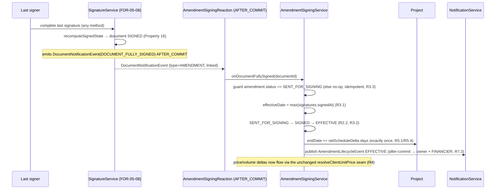

# Design Document: FOR-06-09 — Amendment signing (effect → apply deltas)

## Overview

FOR-06-09 is the **09 half** of the OVERVIEW 08/09 amendment split. FOR-06-08 stops at an `OPEN`
amendment that is "ready to be sent for signing"; this spec owns **everything after that point** and
nothing before it. It adds **no new entity, no new ABAC resource, and no new signing lifecycle** — it
is a thin **reflection + application** layer that drives an existing amendment through its remaining
`AmendmentStatus` transitions by riding the **already-built FOR-05-08 signing engine** and then
applies the amendment's stored deltas.

The whole spec reduces to five responsibilities, each a reuse-and-wire of existing machinery:

1. **Send for signing** — turn the project's `OPEN` amendment into a signable `AMENDMENT`
   `SignableDocument` through the FOR-05-08 engine (`create` → `generate` → `requestSignatures`),
   link that document back onto `EstimateAmendment.signableDocument`, and move the amendment
   `OPEN → SENT_FOR_SIGNING` (Requirement 1).
2. **Reflect the document lifecycle onto the amendment** — the linked `SignableDocument` is the
   single source of truth for signing progress; the amendment never maintains a parallel signature
   set. An **after-commit reaction** maps the document's terminal transitions onto the amendment:
   document `SIGNED` → amendment `SENT_FOR_SIGNING → SIGNED`; document **declined/voided** → amendment
   `SENT_FOR_SIGNING → OPEN` (reopen) (Requirement 2).
3. **Signed → effective** — on `SIGNED`, set `EstimateAmendment.effectiveDate` to the
   **all-parties-signed date** (the date the last signature completed) and immediately move
   `SIGNED → EFFECTIVE` (Requirement 3).
4. **Apply the deltas** — once `EFFECTIVE`:
   - **price/volume deltas** go live automatically because FOR-06-08 already wired the dormant
     `WorkReportService.resolveClientUnitPrice` seam to sum `extraUnitPrice` over `EFFECTIVE`
     amendments whose `effectiveDate <= reportDate`; this spec changes neither the seam nor the margin
     matrix — it only makes an amendment reach `EFFECTIVE` so the seam starts contributing
     (Requirement 4);
   - **schedule deltas** apply as a single shift of `Project.endDate` by the net
     `scheduleDeltaHalfDays`, leaving `Project.startDate` and every `ProjectScheduleBarEntity`
     untouched (Requirement 5).
5. **Notifications** — reuse the FOR-05-08 generic `notification.document.*` for the ceremony it
   drives and **add** three amendment-level `notification.amendment.*` types for the transitions the
   document notifications do not cover, all through the FOR-05-07 generic `NotificationService`
   (Requirement 7).

### Key design decisions

1. **The amendment reflects the document; it does not re-implement signing.** There is one signing
   lifecycle in the platform — the FOR-05-08 `DRAFT → PENDING_SIGNATURES → SIGNED (+ VOID)` machine
   with its "SIGNED iff all signatures SIGNED" derived invariant (Property 16). FOR-06-09 **observes**
   that lifecycle and maps three of the engine's terminal outcomes (`DOCUMENT_FULLY_SIGNED`,
   `DOCUMENT_SIGNING_DECLINED`, `DOCUMENT_VOIDED`) onto the amendment's own `AmendmentStatus`
   (Requirement 2.1). It never reads or writes `DocumentSignature` rows directly.

2. **The reaction is after-commit, exactly like the engine's own notifications.** The engine already
   publishes a `DocumentNotificationEvent` on an `AFTER_COMMIT` `@TransactionalEventListener`
   (`DocumentNotificationEmitter`). FOR-06-09 subscribes to the **same event** with its own
   `AFTER_COMMIT` listener (`AmendmentSigningReaction`), so the amendment transition — and the
   delta application it triggers — runs only after the signing transition has durably committed; a
   failure inside the reaction can never roll the signing itself back (Requirements 2.4, 7.6). This
   mirrors the FOR-05-08 §Key-decision-7 pattern and keeps the engine oblivious to amendments.

3. **`effectiveDate` is derived from the signatures, not an extra column on the document.** The
   `SignableDocumentEntity` has no "fully-signed-at" timestamp; the all-parties-signed date is the
   **max `signedAt`** across the document's signatures (the moment the last one completed, which is
   exactly when `recomputeSignedState` promoted the document to `SIGNED`). A pure
   `AllPartiesSignedDateResolver` computes it so it is testable without persistence (Requirement 3.1).

4. **`SIGNED → EFFECTIVE` and the two delta applications are idempotent and guarded by the status
   itself.** The reaction only applies deltas on the `SIGNED → EFFECTIVE` edge; an amendment already
   `EFFECTIVE` is a no-op. The end-date shift is therefore applied **exactly once**, and re-delivery
   of the same event (or a redundant reaction invocation) neither re-applies the price seam basis nor
   re-shifts the end date (Requirements 3.3, 5.4).

5. **The amendment stays a pure overlay — except the one agreed end-date shift.** Becoming
   `EFFECTIVE` mutates **nothing** in `EstimateEntity` / `EstimateLineEntity` /
   `EstimateLineRoomQtyEntity` / any `WorkReport` / any `ProjectScheduleBarEntity`. Price/volume
   effects flow only through the read-time seam; the single schedule mutation is `Project.endDate`.
   The stored `AmendmentLine` deltas remain the reproducible record of what changed (Requirement 10).

6. **No new resource; `AMENDMENTS` gains one new action endpoint.** Send-for-signing is an
   `AMENDMENTS` **UPDATE** on the amendment plus the FOR-05-08 `SIGNABLE_DOCUMENTS` **CREATE/UPDATE**
   grant the engine already enforces when the send orchestration calls it. The new
   `POST /api/amendments/{id}/send-for-signing` handler carries a method-level
   `@RequiresPermission(AMENDMENTS, UPDATE)` so `PermissionAnnotationValidator` still passes at
   startup (Requirement 8).

7. **The `AMENDMENT` type is not `CONTRACT_*`, so signing an amendment never activates a project.**
   The FOR-05-08 `ProjectActivationSignal` is contract-prefix gated; an `AMENDMENT` full-sign is a
   no-op for `Project.status` (Requirement 1.7) — no code is needed to "suppress" it, it simply does
   not fire.

### Scope boundaries (what this spec owns vs. consumes)

| Concern | Owner |
|---|---|
| `EstimateAmendment` / `AmendmentLine` domain, open-amendment invariant, create wizard, merge, line/amendment delete | **FOR-06-08** (consumed) |
| The dormant `resolveClientUnitPrice` seam + its `AmendmentLineDao.sumExtraUnitPriceForEffectiveWorkItem` query | **FOR-06-08** (consumed; this spec makes an amendment reach `EFFECTIVE` so the sum goes live) |
| Generic `SignableDocument`/`DocumentSignature`/`DocumentMedia` engine, the signing state machine, the four signing methods, the `AMENDMENT` type, the generic document notifications | **FOR-05-08** (consumed, never re-implemented) |
| Generic `NotificationService` + in-app bell | **FOR-05-07** (consumed) |
| `Project.startDate` anchor + derived Gantt bars (`ProjectScheduleBarEntity`) | **FOR-05-10/10b** (read; bars never mutated) |
| **Send the open amendment for signing** (create+link the `AMENDMENT` document, `OPEN → SENT_FOR_SIGNING`) | **this spec** |
| **Reflect the document lifecycle onto the amendment** (`SENT_FOR_SIGNING → SIGNED → EFFECTIVE`, `SENT_FOR_SIGNING → OPEN` on decline/withdraw) | **this spec** |
| **Set `effectiveDate`** = all-parties-signed date | **this spec** |
| **Apply the schedule delta to `Project.endDate`** | **this spec** |
| **Amendment-lifecycle notifications** (`notification.amendment.*`) | **this spec** |
| Live QTSP / podpis.gov.pl integration, object storage | FOR-12 (only the FOR-05-08 abstraction + stub exercised here) |

---

## Architecture

### Component map (backend)

```mermaid
graph TD
    subgraph Controller
      AC["AmendmentController @PermissionResource(AMENDMENTS)\n+ POST /{id}/send-for-signing"]
    end

    subgraph This spec
      ASVC["AmendmentSigningService\n(send-for-signing orchestration + effect-application)"]
      REACT["AmendmentSigningReaction\n(AFTER_COMMIT @TransactionalEventListener)"]
      DATE["AllPartiesSignedDateResolver (pure)"]
      SHIFT["ScheduleDeltaCalculator (pure)"]
      ANOTIF["AmendmentNotificationEmitter\n(AFTER_COMMIT, best-effort)"]
      AEVENT["AmendmentLifecycleEvent (record)"]
    end

    subgraph Reused — FOR-05-08 signing engine
      SDOC["SignableDocumentService\n(create / generate / requestSignatures / progress / void)"]
      SIG["SignatureService (completion/decline/callback)"]
      DNE["DocumentNotificationEvent\n(FULLY_SIGNED / DECLINED / VOIDED)"]
      DNEMIT["DocumentNotificationEmitter (generic doc notifs)"]
    end

    subgraph Reused — FOR-06-08 amendment domain
      AMSVC["AmendmentService (open-amendment reads)"]
      ADAO["EstimateAmendmentDao"]
      ALDAO["AmendmentLineDao.sumExtraUnitPriceForEffectiveWorkItem"]
    end

    subgraph Reused — platform
      WRS["WorkReportService.resolveClientUnitPrice (seam, unchanged)"]
      PROJ["Project (endDate)"]
      NOTIF["NotificationService.create (FOR-05-07)"]
    end

    AC --> ASVC
    ASVC --> AMSVC
    ASVC --> SDOC
    ASVC --> ADAO
    ASVC -.publishes AmendmentLifecycleEvent (sentForSigning).-> ANOTIF
    SIG -- publishes DocumentNotificationEvent --> DNEMIT
    SIG -- publishes DocumentNotificationEvent --> REACT
    SDOC -- publishes DocumentNotificationEvent (VOIDED) --> REACT
    REACT --> ASVC
    ASVC --> DATE
    ASVC --> SHIFT
    ASVC --> PROJ
    ASVC -.publishes AmendmentLifecycleEvent (effective / reopened).-> ANOTIF
    ANOTIF --> NOTIF
    WRS -.reads EFFECTIVE deltas (now non-zero).-> ALDAO
```

Controllers stay thin. The send orchestration and the effect-application both live in
`AmendmentSigningService`; the status-reflection trigger lives in `AmendmentSigningReaction`; the
two bits of arithmetic (all-parties-signed date, net schedule delta → day shift) live in **pure
collaborators** so they are property-testable with no persistence.

### How the reaction observes the engine (the central seam)

The FOR-05-08 `SignatureService` and `SignableDocumentService` already publish a
`DocumentNotificationEvent` (carrying `documentId`, `projectId`, `documentTypeCode`, recipients) on
`AFTER_COMMIT` for exactly the three terminal outcomes this spec cares about:

| Engine trigger (`DocumentNotificationEvent.Trigger`) | Published by | Amendment reaction |
|---|---|---|
| `DOCUMENT_FULLY_SIGNED` | `SignatureService.finishSignature` on the full-sign recompute | `SENT_FOR_SIGNING → SIGNED → EFFECTIVE` (+ set `effectiveDate`, apply deltas) |
| `DOCUMENT_SIGNING_DECLINED` | `SignatureService.finishDecline` | `SENT_FOR_SIGNING → OPEN` (reopen, clear link) |
| `DOCUMENT_VOIDED` | `SignableDocumentService.voidDocument` | `SENT_FOR_SIGNING → OPEN` (reopen, clear link) |

`AmendmentSigningReaction` is a second `AFTER_COMMIT` `@TransactionalEventListener` on that **same
event**. It filters to `documentTypeCode == "AMENDMENT"` and to a document that is actually linked
from an amendment (`EstimateAmendment.signableDocument.id == event.documentId()`); for any other
document it is a no-op. It then opens its own transaction and calls back into
`AmendmentSigningService` to perform the reflection + application. Because it runs after the signing
commit, a failure in the amendment reaction cannot roll the signing back (Requirements 2.4, 7.6); the
reaction wraps its own work defensively and logs on failure, consistent with the engine's best-effort
emitter.

> Why reuse the notification event rather than invent a new one? The event already fires exactly at
> the three terminal transitions, already carries the document id + type + project, and already runs
> `AFTER_COMMIT`. Adding a parallel "document lifecycle changed" event would duplicate the engine's
> own publish points. The tasks phase MAY instead introduce a dedicated
> `DocumentLifecycleEvent` in FOR-05-08 if a non-notification consumer is preferred, but the
> contract (after-commit, terminal-transition, id+type+project payload) is identical either way;
> this design treats the existing event as the observation seam.

### Send-for-signing sequence

```mermaid
sequenceDiagram
    participant M as MANAGER/FINANCIER
    participant AC as AmendmentController
    participant ASVC as AmendmentSigningService
    participant AM as AmendmentService (FOR-06-08)
    participant SD as SignableDocumentService (FOR-05-08)
    participant NT as NotificationService

    M->>AC: POST /api/amendments/{id}/send-for-signing (method?, level?)
    AC->>ASVC: sendForSigning(id, options)
    ASVC->>AM: load amendment, assert OPEN + non-empty (R1.1, R1.5)
    ASVC->>SD: create(AMENDMENT, projectId, sourceRef=amendmentId) → DRAFT
    ASVC->>SD: generate / saveBody (body from amendment lines + signed baseline, R1.2)
    ASVC->>SD: requestSignatures(signers = CLIENT + MANAGER, level=AdES) → freeze PDF, PENDING_SIGNATURES
    Note over SD,NT: engine emits notification.document.sentForSigning to each signer (reused, R7.2)
    ASVC->>AM: set amendment.signableDocument = doc; OPEN → SENT_FOR_SIGNING (R1.3)
    ASVC-->>NT: publish AmendmentLifecycleEvent SENT_FOR_SIGNING (after-commit → owner + FINANCIER, R7.3)
```

### Signed → effective → apply-deltas sequence



### Frontend surface

- The FOR-06-08 **Aneksy panel** (`features/project-amendments/AmendmentsPanel.tsx`, tab keyed
  `amendments`) is extended with a **Send for signing** action on an eligible `OPEN` non-empty
  amendment (gated on `AMENDMENTS` UPDATE), a **send dialog** (optional method/level pickers reusing
  the FOR-05-08 labels), a **signing-progress** read for a `SENT_FOR_SIGNING` amendment (signed/total
  + outstanding signers, read from the linked document's progress), a **link to the document** on the
  FOR-05-08 signing surface for the actual ceremony, and the **effective-date** display once set
  (Requirement 6). The sign/decline/upload ceremony itself is **not** re-built on the Aneksy tab — it
  is the engine's `documentSigning` surface, reused (Requirement 6.2).
- A FOREMAN (`AMENDMENTS` READ) sees the signing status read-only and no send action; a CLIENT reaches
  the amendment only through the FOR-05-08 / FOR-09 signing surface, not through `AMENDMENTS`
  (Requirement 6.4).

---

## Components and Interfaces

### `AmendmentSigningService` (orchestration + effect application)

`com.foremen.service.execution.amendment.AmendmentSigningService`, `@Service @Transactional`. The
single owner of this spec's business logic. It composes the FOR-06-08 `AmendmentService` reads, the
FOR-05-08 `SignableDocumentService` lifecycle calls, and the two pure calculators.

```java
public interface AmendmentSigningService {

    // --- Send for signing (Requirement 1) ---
    AmendmentServiceExtendedModel sendForSigning(Long amendmentId, SendForSigningOptions options);

    // --- Reflection callbacks (invoked by AmendmentSigningReaction, Requirement 2/3) ---
    void onDocumentFullySigned(Long documentId);   // SENT_FOR_SIGNING → SIGNED → EFFECTIVE (+ apply)
    void onDocumentReopened(Long documentId);       // decline/void → SENT_FOR_SIGNING → OPEN
}
```

- **`sendForSigning`** (Requirement 1):
  1. loads the amendment (project-access-gated through the FOR-06-08 read), asserts it is `OPEN`
     (`error.amendment.notOpen`, R1.5) and **non-empty** (`error.amendment.emptyNotSignable`, R1.1 —
     completing the FOR-06-08 R6.3 guard);
  2. creates an `AMENDMENT` `SignableDocument` on the amendment's project via
     `SignableDocumentService.create(new CreateDocumentRequest(projectId, amendmentType.id,
     title, sourceRef = amendmentId, templateLocale))` (R1.2);
  3. generates / sets the body from the amendment's lines + the signed-estimate/schedule baseline
     (`generate` when an active `AMENDMENT` template exists, else `saveBody` with a rendered summary
     body — the body-generation detail is a tasks-phase choice isolated behind this step) (R1.2);
  4. resolves the signer set — the project **CLIENT** member(s) + the executor **MANAGER**
     representative — and calls `requestSignatures(docId, new RequestSignaturesInput(method, level,
     signers))`, which freezes the immutable PDF and moves the document to `PENDING_SIGNATURES`; the
     method/level default per the engine (`AdES`) and may be overridden from the send dialog (R1.4);
  5. sets `amendment.signableDocument = doc` and transitions the amendment `OPEN → SENT_FOR_SIGNING`
     (R1.3); from here the FOR-06-08 `assertOpen` guard already rejects any line mutation (R1.3);
  6. publishes an `AmendmentLifecycleEvent(SENT_FOR_SIGNING, ...)` for the amendment owner + project
     FINANCIER (after-commit, R7.3). The engine separately emits
     `notification.document.sentForSigning` to the CLIENT signer — reused, not duplicated (R7.2).
  - ABAC: the controller gates the call on `AMENDMENTS` UPDATE; the nested `SignableDocumentService`
    calls self-enforce the `SIGNABLE_DOCUMENTS` CREATE/UPDATE grant via its `SigningAuthorizationGuard`
    (R8.2). The `AMENDMENT` type is not `CONTRACT_*`, so no project-activation hand-off fires (R1.7).

- **`onDocumentFullySigned`** (Requirements 2.2, 3):
  - resolves the amendment linked to `documentId` (via `EstimateAmendmentDao` by
    `signableDocument.id`); if none, or the amendment is **not** `SENT_FOR_SIGNING`, it is a **no-op**
    (idempotent re-processing, R3.3);
  - computes `effectiveDate = AllPartiesSignedDateResolver.resolve(doc.signatures)` = the max
    `signedAt` (the all-parties-signed date, R3.1);
  - transitions `SENT_FOR_SIGNING → SIGNED`, sets `effectiveDate`, then immediately `SIGNED →
    EFFECTIVE` (R2.2, R3.2);
  - applies the schedule delta to `Project.endDate` **exactly once** (below);
  - publishes `AmendmentLifecycleEvent(EFFECTIVE, ...)` (R7.3). Price/volume deltas need no action —
    they now flow through the unchanged seam (R4.1).

- **`onDocumentReopened`** (Requirement 2.3):
  - resolves the linked amendment; if none or not `SENT_FOR_SIGNING`, no-op;
  - transitions `SENT_FOR_SIGNING → OPEN`, clears `amendment.signableDocument` (the declined/voided
    document remains readable for audit, R2.3), leaves the lines intact so the manager may amend and
    resend;
  - publishes `AmendmentLifecycleEvent(REOPENED, ...)` (R7.3). The CLIENT-facing decline/void is
    covered by the reused `notification.document.signingDeclined` / `.voided` (R7.2, R7.4).

#### End-date shift (Requirement 5), applied inside `onDocumentFullySigned`

```java
int netHalfDays = scheduleDeltaCalculator.netHalfDays(amendment.getLines()); // Σ SCHEDULE_CHANGE deltas
if (netHalfDays != 0) {
    LocalDate shifted = scheduleDeltaCalculator.shift(project.getEndDate(), netHalfDays);
    scheduleDeltaCalculator.assertValidRange(project.getStartDate(), shifted); // R5.5
    project.setEndDate(shifted);                                               // only Project.endDate (R5.2)
}
```

- The shift happens on the single `SIGNED → EFFECTIVE` edge, so it is applied **exactly once**; a
  re-entry while already `EFFECTIVE` is short-circuited by the status guard before this block, so the
  end date is never shifted twice (R5.4, R3.3).
- No `SCHEDULE_CHANGE` line ⇒ `netHalfDays == 0` ⇒ `endDate` unchanged (R5.3).
- Only `Project.endDate` is written; `Project.startDate` and every `ProjectScheduleBarEntity` are
  untouched (R5.2, R10.2).
- If the shift would move the end date **before** the project start date, `assertValidRange` rejects
  with `409 error.amendment.endDateInvalid` (R5.5) — the transition is validated before any mutation,
  so an invalid shortening leaves the amendment `SENT_FOR_SIGNING` (the signing already committed; the
  reaction surfaces the validation failure and does not corrupt the schedule). The deterministic rule
  is **reject** (not clamp) by default; the tasks phase confirms the single rule and its message.

### `AmendmentSigningReaction` (after-commit observer)

`com.foremen.service.execution.amendment.AmendmentSigningReaction`, `@Component`. The bridge between
the FOR-05-08 engine and `AmendmentSigningService`.

```java
@TransactionalEventListener(phase = TransactionPhase.AFTER_COMMIT, fallbackExecution = true)
public void onDocumentSigning(DocumentNotificationEvent event) {
    if (event == null || !"AMENDMENT".equals(event.documentTypeCode())) return;   // not our document
    try {
        switch (event.trigger()) {
            case DOCUMENT_FULLY_SIGNED     -> signingService.onDocumentFullySigned(event.documentId());
            case DOCUMENT_SIGNING_DECLINED,
                 DOCUMENT_VOIDED           -> signingService.onDocumentReopened(event.documentId());
            default -> { /* SENT_FOR_SIGNING / SIGNED_BY_PARTY — no amendment transition */ }
        }
    } catch (Exception e) {
        log.error("Amendment signing reaction failed for document {} (trigger {})",
                  event.documentId(), event.trigger(), e);  // best-effort; never rolls back signing (R2.4, R7.6)
    }
}
```

- Runs on `AFTER_COMMIT`, so the signing transition is already durable when it fires (R2.4, R7.6).
- `fallbackExecution = true` lets it also run when published outside a transaction (unit tests),
  mirroring `DocumentNotificationEmitter`.
- The callbacks are themselves idempotent (status-guarded), so a redelivered event is safe (R3.3,
  R5.4).

### `AllPartiesSignedDateResolver` (pure)

`com.foremen.service.execution.amendment.AllPartiesSignedDateResolver`.

```java
public LocalDate resolve(List<DocumentSignatureEntity> signatures);
// = max(signature.signedAt).toLocalDate() over a non-empty, all-SIGNED set; throws if any signedAt is null.
```

Pure function of the signature set: the all-parties-signed date is the latest `signedAt` — the moment
the last signature completed and the document became `SIGNED` (Requirement 3.1). Because the resolver
is only ever called on a document the engine has already promoted to `SIGNED` (every signature
`SIGNED`, every `signedAt` set, Property 16), the input precondition holds; the resolver asserts it
defensively.

### `ScheduleDeltaCalculator` (pure)

`com.foremen.service.execution.amendment.ScheduleDeltaCalculator`.

```java
public int netHalfDays(List<AmendmentLineEntity> lines);          // Σ scheduleDeltaHalfDays over SCHEDULE_CHANGE lines
public LocalDate shift(LocalDate endDate, int netHalfDays);       // endDate.plusDays(round(netHalfDays / 2.0))
public void assertValidRange(LocalDate startDate, LocalDate shiftedEnd); // 409 error.amendment.endDateInvalid if shiftedEnd < startDate
```

- `netHalfDays` sums the signed `scheduleDeltaHalfDays` of the amendment's `SCHEDULE_CHANGE` lines
  (positive = extend, negative = shorten); cost lines (`null` delta) contribute nothing
  (Requirement 5.1).
- `shift` converts half-days to days on the half-day grid (`halfDays / 2`, rounded per the FOR-06-08
  half-day convention — `days × 2` was the authoring conversion, so `halfDays / 2` is the inverse)
  and adds them to the end date.
- `assertValidRange` is the Requirement 5.5 guard. Pure and property-testable (no persistence).

### `AmendmentNotificationEmitter` + `AmendmentLifecycleEvent` (best-effort, after-commit)

`com.foremen.service.execution.amendment.AmendmentNotificationEmitter`, `@Component`, mirroring
`DocumentNotificationEmitter`. Consumes an `AmendmentLifecycleEvent` on `AFTER_COMMIT` and creates
one in-app notification per recipient via the FOR-05-07 `NotificationService.create(recipientUserId,
type, body, deepLink)`; failures are logged and swallowed (Requirements 7.1, 7.6). Each notification
deep-links to the amendment on the Aneksy tab (`/projects/{projectId}/amendments`, R7.3, R7.5).

```java
public record AmendmentLifecycleEvent(
        Trigger trigger, Long amendmentId, Long projectId, Integer seqNo, List<Long> recipientUserIds) {
    public enum Trigger { SENT_FOR_SIGNING, REOPENED, EFFECTIVE }
}
```

| `Trigger` | Type (i18n key) | Recipient | Trigger point |
|---|---|---|---|
| `SENT_FOR_SIGNING` | `notification.amendment.sentForSigning` | amendment owner (MANAGER) + project FINANCIER | `sendForSigning` (`OPEN → SENT_FOR_SIGNING`) (R7.3) |
| `REOPENED` | `notification.amendment.reopened` | amendment owner + project FINANCIER | `onDocumentReopened` (document declined/voided → `OPEN`) (R7.3) |
| `EFFECTIVE` | `notification.amendment.effective` | amendment owner + project FINANCIER | `onDocumentFullySigned` (`→ EFFECTIVE`) (R7.3) |

The CLIENT-facing ceremony events (sent / fully-signed / declined / voided) are the reused FOR-05-08
`notification.document.*` types; this spec emits **no** second CLIENT-facing amendment notification
for the same event (R7.2, R7.4). The body identifies the amendment by project + `seqNo` and is always
clickable via its deep-link (R7.5).

### `AmendmentController` — one new endpoint

`POST /api/amendments/{id}/send-for-signing` added to the existing FOR-06-08 `AmendmentController`
(`@PermissionResource("AMENDMENTS")`), carrying `@RequiresPermission(resource = "AMENDMENTS",
operation = "UPDATE")` so the controller stays fully annotated and `PermissionAnnotationValidator`
passes at startup (Requirements 8.1, 8.4). Body: optional `SendForSigningOptions { SignatureMethod
method; SignatureLevel level; }`. It delegates to `AmendmentSigningService.sendForSigning` and returns
the refreshed amendment extended model (now `SENT_FOR_SIGNING` with its linked document id).

The amendment **read model** (FOR-06-08 `AmendmentServiceExtendedModel` / `AmendmentDtoExtendedModel`)
is extended with the linked **document id**, the **signing progress** (signed/total + outstanding
signers, read from the FOR-05-08 `SignableDocumentService.progress`), and the `effectiveDate`, so the
Aneksy tab renders them without a second lifecycle (Requirement 2.5). The progress is read-through to
the engine, not stored.

### Frontend components (`foremen-frontend/src/features/project-amendments/`)

| Component | Change | Responsibility |
|---|---|---|
| `AmendmentsPanel.tsx` | extend | wire the Send-for-signing action (OPEN+non-empty, `AMENDMENTS` UPDATE), the progress read for `SENT_FOR_SIGNING`, the effective-date display, and the link to the signing surface (R6) |
| `components/SendForSigningDialog.tsx` | **new** | confirm + optional method/level pickers (reusing FOR-05-08 labels); calls `POST /{id}/send-for-signing` (R6.1) |
| `components/AmendmentSigningProgress.tsx` | **new** | signed/total + outstanding signers for a `SENT_FOR_SIGNING` amendment, read from the linked document; a "go to document" link to `/projects/{id}/documentSigning` (R6.2) |
| `components/AmendmentStatusBadge.tsx` | reuse | already renders `amendments.status.*` for `SENT_FOR_SIGNING` / `SIGNED` / `EFFECTIVE` (FOR-06-08) (R6.3) |
| `api/` + `query-hooks` | extend | `sendForSigning` mutation; the amendment read already returns the new fields |

Action visibility is `usePermission`-gated on `AMENDMENTS` exactly as the existing panel does; a
read-only FOREMAN sees the status but no send action (R6.4).

---

## Data Models

**No new entity, no new table, no new column, no new enum.** This spec writes only fields that
FOR-06-08 already created for it to own:

- `EstimateAmendmentEntity.status` — this spec drives the `SENT_FOR_SIGNING`, `SIGNED`, `EFFECTIVE`
  transitions (and `SENT_FOR_SIGNING → OPEN` reopen) that FOR-06-08 left to it; the `AmendmentStatus`
  enum already declares all five constants.
- `EstimateAmendmentEntity.effectiveDate` (`DATE`, nullable) — set by this spec to the
  all-parties-signed date; "written only by FOR-06-09" per the FOR-06-08 entity javadoc.
- `EstimateAmendmentEntity.signableDocument` (`FK → signable_documents`, nullable, `ON DELETE SET
  NULL`) — set on send-for-signing, cleared on reopen; "written only by FOR-06-09".
- `ProjectEntity.endDate` (`DATE`, nullable, column `end_date`) — the single schedule mutation
  (Requirement 5). `startDate` is read-only here.

All signing state lives on the FOR-05-08 entities (`SignableDocumentEntity`, `DocumentSignatureEntity`
with its `signedAt`), read through the engine; the amendment never duplicates it (Requirement 2.1).

### Read-model additions (DTO only, no schema)

`AmendmentServiceExtendedModel` / `AmendmentDtoExtendedModel` gain:

| Field | Source | Requirement |
|---|---|---|
| `signableDocumentId` | `amendment.signableDocument.id` | 2.5 |
| `signingProgress` (`signedCount`, `totalCount`, `outstanding[]`) | `SignableDocumentService.progress(signableDocumentId)` (read-through) | 2.5, 6.2 |
| `effectiveDate` | `amendment.effectiveDate` | 3, 6.3 |

### Liquibase changesets

**None.** The changelog head is **179** (FOR-06-08 `179-seed-amendments-resource.xml`); no table,
resource, grant, or column is added by this spec. The `AMENDMENTS` resource + role matrix (ADMIN /
MANAGER / FINANCIER CRUD, FOREMAN READ) and the `AMENDMENT` `SignableDocumentType` seed
(`138-seed-signable-document-type-amendment`) already exist and are consumed as-is (Requirements 8.1,
9.1).

### Enums

No new enum. Reused: `AmendmentStatus` (FOR-06-08), `DocumentStatus` / `SignatureStatus` /
`SignatureMethod` / `SignatureLevel` / `DocumentNotificationEvent.Trigger` (FOR-05-08). The new
`AmendmentLifecycleEvent.Trigger` is an in-process event discriminator, not a persisted classifier.


---

## Correctness Properties

*A property is a characteristic or behavior that should hold true across all valid executions of a
system — essentially, a formal statement about what the system should do. Properties serve as the
bridge between human-readable specifications and machine-verifiable correctness guarantees.*

These properties were derived from the acceptance-criteria prework. Pure collaborators
(`AllPartiesSignedDateResolver`, `ScheduleDeltaCalculator`) are property-tested with no persistence;
the reflection / idempotence / overlay properties are tested over generated amendment + signature +
line fixtures against the `AmendmentSigningService` application logic (with the engine's terminal
outcome supplied as the input, not re-driven through the full signing ceremony).

### Property 1: Full-sign reflects onto the amendment as EFFECTIVE (SIGNED iff all signatures SIGNED)

**Validates: Requirements 2.2, 3.2**

For any amendment `a` linked to a document `d` with `a.status == SENT_FOR_SIGNING`, when `d` reaches
`SIGNED` (which, by the FOR-05-08 derived invariant, holds **iff** `d`'s signature set is non-empty
and every `DocumentSignature` is `SIGNED` — Property 16), the full-sign reaction leaves `a`
`EFFECTIVE`:

```
a.status == SENT_FOR_SIGNING  ∧  d SIGNED (⟺ ∀ s ∈ d.signatures : s.status == SIGNED, |d.signatures| > 0)
    ⟹  after onDocumentFullySigned(d):  a.status == EFFECTIVE  ∧  a.effectiveDate != null
```

The amendment never carries its own signature set; its `SIGNED → EFFECTIVE` outcome is derived purely
from the document's derived `SIGNED` state reflected across the link. The amendment never lands in a
`SIGNED` resting state — the transition to `EFFECTIVE` is immediate (R3.2).

### Property 2: Decline/void reopens to OPEN preserving the overlay (reopen round-trip)

**Validates: Requirements 2.3**

For any amendment `a` with `a.status == SENT_FOR_SIGNING` and any line set `L`, a decline or void
reaction returns `a` to `OPEN` with the link cleared and the lines byte-identical:

```
a.status == SENT_FOR_SIGNING
    ⟹  after onDocumentReopened(d):
            a.status == OPEN
          ∧ a.signableDocument == null
          ∧ a.lines ≡ L            (same count and same per-line deltas, order-insensitive)
          ∧ d still readable (unchanged, VOID/declined)
```

Reopening is the inverse of sending with respect to the amendment's editable state: the overlay (its
lines) survives the round-trip intact so the manager can amend and resend.

### Property 3: SIGNED → EFFECTIVE is idempotent

**Validates: Requirements 3.3, 3.5**

For any amendment `a`, applying the full-sign effect-transition any number of times `N ≥ 1` yields the
same end state as applying it exactly once:

```
applyEffect^N(a) == applyEffect(a)   for all N ≥ 1
where the observed state is (a.status, a.effectiveDate, a.project.endDate)
```

Once `a` is `EFFECTIVE`, a re-delivered `DOCUMENT_FULLY_SIGNED` event (or any redundant
`onDocumentFullySigned`) is short-circuited by the `status == SENT_FOR_SIGNING` guard: the status,
the `effectiveDate`, and the project end date are never re-written (`f(x) = f(f(x))`).

### Property 4: The project end-date shift is applied exactly once

**Validates: Requirements 5.1, 5.4**

For any starting `Project.endDate` `e0` and any amendment line set `L`, applying the effect-transition
any number of times `N ≥ 1` moves the end date by the net schedule delta **exactly once**:

```
netDays = round( (Σ_{l ∈ L, l.changeType == SCHEDULE_CHANGE} l.scheduleDeltaHalfDays) / 2 )
after applyEffect^N(a):  a.project.endDate == e0.plusDays(netDays)      for all N ≥ 1
```

The shift is not accumulated across redundant applications (it composes with Property 3's
idempotence): `endDate` reaches `e0 + netDays` on the first application and never moves again.

### Property 5: Net schedule delta is a pure sum over SCHEDULE_CHANGE lines

**Validates: Requirements 5.1, 5.3**

For any line set `L`, `ScheduleDeltaCalculator` satisfies:

```
netHalfDays(L) == Σ_{l ∈ L, l.changeType == SCHEDULE_CHANGE, l.scheduleDeltaHalfDays != null} l.scheduleDeltaHalfDays
shift(endDate, n) == endDate.plusDays(round(n / 2.0))
netHalfDays(L) == 0  ⟹  shift(endDate, netHalfDays(L)) == endDate
```

Cost lines (`ADDITIONAL_WORK` / `VOLUME_CHANGE`, `scheduleDeltaHalfDays == null`) contribute nothing;
a line set with no `SCHEDULE_CHANGE` line leaves the end date unchanged (R5.3, the zero case).

### Property 6: Overlay integrity — only Project.endDate is mutated; the frozen baseline is untouched

**Validates: Requirements 5.2, 10.1, 10.2, 10.3**

For any amendment `a` and any reachable baseline state `B` = (`EstimateEntity`, all
`EstimateLineEntity`, all `EstimateLineRoomQtyEntity`, all `WorkReport`, `Project.startDate`, all
`ProjectScheduleBarEntity`), applying `a`'s effect-transition leaves **all** of `B` unchanged; the
only mutation anywhere is `Project.endDate`:

```
after applyEffect(a):
    EstimateEntity, EstimateLineEntity, EstimateLineRoomQtyEntity, WorkReport  — all unchanged
    Project.startDate                                                          — unchanged
    ProjectScheduleBarEntity (every bar)                                       — unchanged
    Project.endDate                                                            — the sole write (Property 4)
and the applied effect is fully derivable from a.lines + the frozen baseline (no hidden state)
```

Price/volume effects never mutate a row — they flow only through the read-time
`resolveClientUnitPrice` seam — and the applied schedule effect is a pure function of the stored
`SCHEDULE_CHANGE` lines, so the whole application is reproducible from the lines plus the frozen
baseline (R10.3).

### Property 7: The effective date is the latest signature completion time

**Validates: Requirements 3.1**

For any non-empty, all-`SIGNED` signature set `S` (every `signedAt` set, as guaranteed when the
document is `SIGNED`), `AllPartiesSignedDateResolver` returns the latest completion date, independent
of iteration order:

```
resolve(S) == max_{s ∈ S} s.signedAt  . toLocalDate()
resolve is order-insensitive: resolve(S) == resolve(permute(S))
```

This is the date all parties had signed — the moment the last signature completed and the document
became `SIGNED`.

### Property 8: Price resolution respects the effective-date boundary

**Validates: Requirements 4.1, 4.2, 4.4**

For any amended work item with baseline `line.unitPrice` and effective amendment extra deltas
`Σ extraUnitPrice`, and any report date `r`, the client unit price resolved by the (unchanged)
`resolveClientUnitPrice` seam is the baseline plus the deltas **iff** the report falls on or after the
effective date:

```
resolveClientUnitPrice(line, r)
    == line.unitPrice + (r >= amendment.effectiveDate ? Σ extraUnitPrice : 0)
   for an amendment that is EFFECTIVE with a set effectiveDate
```

A report dated before the effective date keeps the frozen baseline; one on/after it reflects the
amended price. The formula itself is owned (and unchanged) by FOR-06-08; this property validates that
making the amendment `EFFECTIVE` with a correct `effectiveDate` drives the boundary correctly.

### Property 9: Locale parity for every introduced i18n key

**Validates: Requirements 9.3**

For every i18n key introduced by this spec (the Send-for-signing UI labels, the three error messages,
the signing-progress / effective-date labels, and the three `notification.amendment.*` types), both
`pl.json` and `ru.json` contain a non-empty value:

```
∀ key ∈ introducedKeys :  pl.json[key] is non-empty  ∧  ru.json[key] is non-empty
```

A key missing from either file, or present but empty, is a defect caught by the locale-parity test.

---

## Error Handling

| Scenario | Condition | Response |
|---|---|---|
| Send an empty amendment | `sendForSigning` on an amendment with no lines | `409 error.amendment.emptyNotSignable` (R1.1) |
| Send a non-`OPEN` amendment | no `OPEN` amendment, or status ∈ {`SENT_FOR_SIGNING`, `SIGNED`, `EFFECTIVE`, `DELETED`} | `409 error.amendment.notOpen` (R1.5) |
| Mutate lines after send | add/delete line once the amendment left `OPEN` | `409 error.amendment.notOpen` (FOR-06-08 `assertOpen`, R1.3, R3.5) |
| Invalid end-date shift | shift would move `Project.endDate` before `Project.startDate` | `409 error.amendment.endDateInvalid` (R5.5) |
| Send without permission | caller lacks `AMENDMENTS` UPDATE (or the engine rejects `SIGNABLE_DOCUMENTS` CREATE/UPDATE) | `403` (ABAC) (R8.2) |
| Out-of-scope amendment | project access denied by `ProjectScopedService` on the FOR-06-08 read | `404 error.entity.not.found` (indistinguishable from missing) |
| Reaction / notification failure | an exception inside `AmendmentSigningReaction` or `AmendmentNotificationEmitter` | logged and swallowed; the committed signing transition is **never** rolled back (R2.4, R7.6) |

The signing-ceremony errors (illegal transition, evidence required, hash mismatch, CLIENT-forbidden
write) are owned by the FOR-05-08 engine and surface unchanged through the reused signing surface; this
spec adds no new ceremony error. The three `error.amendment.*` codes above are the only new validation
messages, localized PL + RU (Requirement 9.2).

---

## Testing Strategy

Per the workspace `test-execution-rules`: run only the affected test classes with `--tests` filters,
redirect to a temp log (`/tmp/for-06-09-test.log`), and read the JUnit XML
(`foremen-backend/build/test-results/test/TEST-<fqcn>.xml`) for pass/fail — never the full ~20-min
suite unless explicitly asked.

PBT **is appropriate** for this feature: the reflection mapping, the idempotence / exactly-once
guarantees, the pure schedule-delta arithmetic, the effective-date resolver, the price-boundary
resolution, and the overlay-integrity invariant are all universal "for all inputs" statements over
generated amendment / signature / line fixtures. PBT is **not** used for the ABAC wiring, the
after-commit reliability guarantee, the engine-call orchestration, or the UI affordances — those are
example / integration / smoke tests (see the prework classifications).

### Property-based tests (jqwik)

Each property test runs a minimum of **100 iterations** and is tagged
`// Feature: FOR-06-09-amendment-signing, Property {n}: {property text}`:

- **Property 1** — `AmendmentReflectionPropertyTest`: for any `SENT_FOR_SIGNING` amendment linked to a
  document whose generated signature set is all-`SIGNED`, `onDocumentFullySigned` ends `EFFECTIVE`
  with a set `effectiveDate`.
- **Property 2** — `AmendmentReopenPropertyTest`: for any `SENT_FOR_SIGNING` amendment + line set, a
  decline/void reaction yields `OPEN`, cleared link, and lines unchanged.
- **Property 3** — `AmendmentEffectIdempotencePropertyTest`: applying `onDocumentFullySigned` `N ≥ 1`
  times yields the same `(status, effectiveDate, endDate)`.
- **Property 4** — `EndDateShiftExactlyOncePropertyTest`: `endDate` moves by the net delta exactly
  once across `N` applications.
- **Property 5** — `ScheduleDeltaCalculatorPropertyTest` (pure): `netHalfDays` is the sum over
  `SCHEDULE_CHANGE` lines; `shift` is `plusDays(round(n/2))`; zero case leaves the date unchanged.
- **Property 6** — `AmendmentOverlayIntegrityPropertyTest`: applying the effect leaves estimate /
  line / room-qty / work-report rows, `startDate`, and all schedule bars unchanged; only `endDate`
  changes; the effect is derivable from lines + baseline.
- **Property 7** — `AllPartiesSignedDatePropertyTest` (pure): `resolve == max(signedAt)`,
  order-insensitive.
- **Property 8** — `PriceResolutionBoundaryPropertyTest`: the resolved client unit price equals
  baseline + (`reportDate >= effectiveDate ? Σ extraUnitPrice : 0`).
- **Property 9** — the locale-parity test (below) asserts the completeness property for every
  introduced key.

### Unit / example tests

- `AmendmentSigningService` send-for-signing: empty-amendment reject (R1.1), non-`OPEN` reject across
  the status enum (R1.5, exhaustive), signer set = CLIENT + MANAGER with default `AdES` (R1.4),
  `OPEN → SENT_FOR_SIGNING` + link set (R1.3), no project-activation for the `AMENDMENT` type (R1.7),
  single-in-flight (R3.4).
- `AmendmentSigningService` reflection callbacks: full-sign path ends `EFFECTIVE` immediately (R3.2);
  reopen clears the link and preserves lines (R2.3); `EFFECTIVE`-reentry is a no-op (R3.3).
- `ScheduleDeltaCalculator.assertValidRange`: valid vs. invalid shortening → `error.amendment.endDateInvalid`
  (R5.5, edge cases including exact `shiftedEnd == startDate`).
- `AmendmentNotificationEmitter`: each trigger → correct type + recipients (owner + FINANCIER) +
  deep-link; emits only `notification.amendment.*`, never a `document.*` duplicate, never a second
  CLIENT notification (R7.2, R7.3, R7.4, R7.5); a `NotificationService` failure is swallowed (R7.6).

### Integration tests (Dockerized app, affected classes only)

- **Required seam example (R4.4)**: with an `EFFECTIVE` amendment, a new work report on an amended
  `(workItem)` resolves `line.unitPrice + Σ extraUnitPrice`; a report dated before `effectiveDate`
  resolves the baseline `line.unitPrice`. Exercised on the public `WorkReportService.create` path (the
  seam is private; `clientUnitPrice` is frozen onto the report), mirroring the FOR-06-08
  `WorkReportAmendmentSeamTest` but with a genuinely `EFFECTIVE` amendment produced through the
  signing flow.
- **After-commit reaction (R2.4, R7.6)**: driving a linked `AMENDMENT` document to `SIGNED` (through
  the engine) flips the amendment to `EFFECTIVE` after the signing commits; a thrown reaction leaves
  the signing committed.
- **End-to-end lifecycle**: `OPEN → SENT_FOR_SIGNING` (send) → ceremony → `SIGNED → EFFECTIVE`, and
  the decline/void → `OPEN` reopen path, against the live stack.

### ABAC / startup tests

- The new `POST /api/amendments/{id}/send-for-signing` resolves to `AMENDMENTS` UPDATE; a role lacking
  the grant is rejected; `PermissionAnnotationValidator` passes at startup (the handler is annotated)
  (R8.1, R8.2, R8.4). No new `resources` row is introduced (R8.1).

### Frontend tests

- Component tests for `SendForSigningDialog` (renders for an `OPEN` non-empty amendment with
  `AMENDMENTS` UPDATE; method/level pickers), `AmendmentSigningProgress` (signed/total + outstanding +
  link to `/projects/{id}/documentSigning`), the status badge (`SENT_FOR_SIGNING` / `SIGNED` /
  `EFFECTIVE` via `amendments.status.*`), and FOREMAN read-only visibility (R6).
- **Locale-parity test (Property 9, R9.3)**: every key introduced by this spec has a non-empty value
  in both `pl.json` and `ru.json`.

### API `test-cases.md`

Authored in the tasks phase (in Russian, per the `test-cases` steering standard): API tests against
the Dockerized app (`docker compose up`, base URL `http://localhost:8080`, `/api/...`) for the
send-for-signing → sign → effective → price-seam-live and the decline/void → reopen flows, with
MD-report tables and a repeatability strategy (run-id generator or teardown).

---

## Dependencies

- **FOR-06-08** — `EstimateAmendmentEntity` (with the nullable `effectiveDate` + `signableDocument`
  FK this spec writes), `AmendmentLineEntity`, the `AmendmentStatus` enum, the `AMENDMENTS` ABAC
  resource + role matrix, the Aneksy panel, the `AmendmentService` reads, and the dormant
  `resolveClientUnitPrice` seam + `AmendmentLineDao.sumExtraUnitPriceForEffectiveWorkItem` (consumed;
  made live by reaching `EFFECTIVE`).
- **FOR-05-08** — the `SignableDocumentService` (`create` / `generate` / `requestSignatures` /
  `progress` / `voidDocument`), `SignatureService` (completion / decline / callback), the signing
  lifecycle + derived "SIGNED iff all signatures SIGNED" (Property 16), the `AMENDMENT`
  `SignableDocumentType` (already seeded), the `DocumentNotificationEvent` + `DocumentNotificationEmitter`
  (the observation seam + reused ceremony notifications), and the contract-prefix-gated
  `ProjectActivationSignal` (which deliberately does **not** fire for `AMENDMENT`).
- **FOR-06-01** — `WorkReportService.resolveClientUnitPrice`, unchanged; it goes live when an
  amendment reaches `EFFECTIVE`.
- **FOR-06-06** — the margin matrix reads `WorkReport.clientUnitPrice` as-is; no change (R4.3).
- **FOR-05-10 / FOR-05-10b** — `Project.startDate` anchors the derived bars; this spec shifts
  `Project.endDate` only and never touches `ProjectScheduleBarEntity`.
- **FOR-05-07** — the generic `NotificationService.create` + in-app bell (in-app channel only).
- **FOR-03-04 / FOR-03-08** — `ProjectScopedService`, `@PermissionResource`,
  `PermissionAnnotationValidator`, the `entity-creation-rules` checklist (no new entity/resource, so
  only the controller-annotation step applies to the one new endpoint).

## Open Questions resolved in this design

1. **How does the amendment observe the document's terminal transitions?** → by subscribing to the
   existing FOR-05-08 `DocumentNotificationEvent` on a second `AFTER_COMMIT`
   `@TransactionalEventListener` (`AmendmentSigningReaction`), filtered to `AMENDMENT`-type linked
   documents — no new event is required, though the tasks phase MAY promote this to a dedicated
   `DocumentLifecycleEvent` in FOR-05-08 with the identical after-commit contract.
2. **Where does `effectiveDate` come from?** → the max `signedAt` across the document's signatures
   (`AllPartiesSignedDateResolver`), since the `SignableDocument` has no explicit full-sign timestamp.
3. **Clamp or reject an invalid end-date shortening?** → **reject** (`error.amendment.endDateInvalid`)
   as the deterministic rule; the tasks phase confirms the single rule + message.
4. **Body generation for the amendment document** → rendered from the amendment's lines + the signed
   baseline via the engine's `generate` (active `AMENDMENT` template) or `saveBody` fallback; the
   concrete body layout is a tasks-phase detail isolated behind the send orchestration's step 3.
