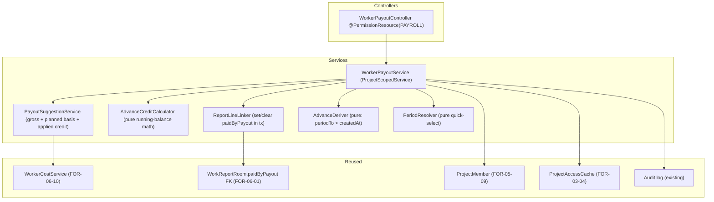
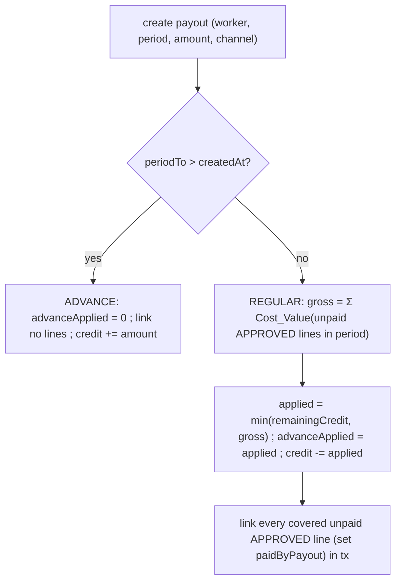
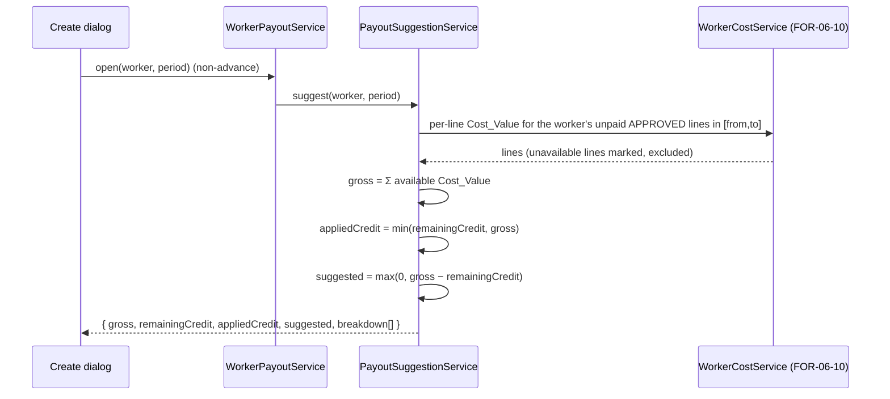

# Design Document: FOR-06-11 — Payroll (worker payouts)

## Overview

FOR-06-11-payroll is the **worker payout** child of the FOR-06 "project in progress" (execution
stage) parent. Where FOR-06-07 (client payments) tracks money **in** (what the client pays),
payroll tracks money **out** — the surface where a FINANCIER, MANAGER, or ADMIN issues a
`WorkerPayout` to a worker for the work performed on an `ACTIVE` / `COMPLETED` project and marks it
paid. It renders the **Rozliczenie wynagrodzeń** (Payroll) execution tab inside the FOR-05 project
workspace.

The cost of a payout is **never computed here**. A regular payout's gross value is
`Σ Cost_Value` over the worker's **unpaid** `APPROVED` `WorkReport` lines in the chosen period, read
through the FOR-06-10 **`WorkerCostService`** (the single cost-side seam) **verbatim** — there is
**no second cost formula** (Requirement 3.1, Non-Goal). Payroll adds the **persisted payout record**,
its two-status lifecycle, the create dialog with period quick-select, the **advance-credit** running
balance, and the UI tab — the mutable state that FOR-06-10's read-only derivation deliberately omits.

### What payroll adds over FOR-06-10

FOR-06-10 exposes a per-worker aggregate (`WorkerCostByWorkerDto`) and a per-report line
(`WorkerCostLineDto`) with **no persisted state**. FOR-06-11 adds:

- a new **project-scoped managed entity `WorkerPayout`** following the full
  `.kiro/steering/entity-creation-rules.md` checklist — a new ABAC resource `PAYROLL`, a seed
  changeset + role matrix, `@PermissionResource("PAYROLL")`, and `getProjectIdPath()`;
- a **nullable FK `WorkReportRoom.paidByPayout`** as the paid-by marker — a report line is **paid**
  iff the FK is set, **payable** iff null. There is **no new `WorkReport` status**; the FOR-06-01
  status machine is unchanged (Requirement 6.1);
- a **two-status lifecycle** `PLANNED → PAID`, hard-delete allowed only while `PLANNED`;
- a **create dialog** with period quick-select, the unpaid-work summary, the auto-filled
  (Σ `Cost_Value` − remaining advance credit) overridable amount, and the payment channel;
- the **advance-credit mechanism** — a worker-level running prepaid balance drawn down at payout
  time, **never splitting a report**;
- the `Payment_Channel` enum (`BANK_TRANSFER` / `CASH`) with PL + RU labels;
- the realigned **Payroll** execution tab (slot reserved by FOR-06-00), gated on `PAYROLL`.

### The two financial mechanisms (confirmed with the product owner)

**1. Report paid-by linkage (no double payment, no new status).** A regular (reports-based) payout,
within its create transaction, sets the `paidByPayout` FK on every `APPROVED`, unpaid report line it
covers, so those lines can never be paid again. The "unpaid reported work items" set for a worker in
a period is exactly that worker's `APPROVED` report lines in the window whose FK is null. Deleting a
`PLANNED` payout **clears** those FKs, making the lines payable again (Requirements 6.1–6.6).

**2. Advance credit (a worker-level prepaid balance, never splitting a report).** An **advance** is
**derived**, not a flag the user sets: a payout is an advance when its `periodTo` is **after** its
creation date. An advance links **no** report lines and sets **no** FK; instead its amount
**increases** the worker's **remaining advance credit** on the project. The credit is never drawn at
the report level. When a later **regular** payout is created, its suggested amount is
`max(0, gross − remaining credit)`; the applied offset `min(remaining credit, gross)` is recorded as
`advanceApplied` and **subtracted** from the running balance. The covered report lines are **fully**
linked regardless of how much credit offset the cash — the credit reduces the ongoing payment, not
individual reports. So the running balance is: advances **increase** it; regular payouts **decrease**
it by the applied offset; it never goes negative (Requirements 5.5, 5.6).

### Ownership boundary

This spec owns the `WorkerPayout` entity + its service + the `paidByPayout` FK + the `PAYROLL`
resource + the payroll tab. It does **not** own the worker-cost formula (FOR-06-10, consumed
verbatim), work reporting / the report status machine up to `APPROVED` (FOR-06-01, read; it only
sets/clears the new FK), the `WorkerType` dictionary / tiers (FOR-05-06), worker-type assignment
(FOR-05-09), client payments (FOR-06-07), or the margin matrix (FOR-06-06). It emits **no**
notifications (Requirement 9).

### Spans two git repos

Per `.kiro/steering/git-repo-structure.md`:

- **Root repo** — the Liquibase changesets (`worker_payouts` table + the `paid_by_payout_id` FK
  column + the `PAYROLL` seed), the `WorkerPayoutEntity` + service + controller + DTOs/mappers, the
  `paidByPayout` field on the existing `WorkReportRoomEntity`, and this spec. Committed from the
  workspace root.
- **Frontend repo** (`foremen-frontend/`) — the Payroll panel + create dialog, the `payroll` tab
  `lazy` swap, the API client, and the `pl.json` / `ru.json` keys. Committed from inside
  `foremen-frontend/`.

A full implementation needs **two commits — one per repo**.

**Notation.** Backend in Java (Spring Boot / JPA / MapStruct / jqwik); frontend in TypeScript/React
(Vite, TanStack Query, i18next).

## Reused mechanisms (not re-implemented)

| Mechanism | Location | Reuse |
|-----------|----------|-------|
| FOR-06-10 `WorkerCostService` (the single cost seam) | `foremen-backend/.../service/workercost/WorkerCostService.java` | `costForProject(projectId)` → per-worker + per-line read model; `costFor(report, baseTier, baseType, memberMap)` per report; `findBaseType()` + `activeWorkerTypesByWorkerId(projectId)`. The gross and the planned basis both fold **its** `Cost_Value`; **no second cost formula** (R3.1). |
| FOR-06-01 `WorkReportRoom` (report line) | `foremen-backend/.../dao/model/WorkReportRoomEntity.java` | The paid-by marker `paidByPayout` is a new nullable FK **on this entity**. `APPROVED` lines are read; the FOR-06-01 status machine is unchanged (R6.1, R6.5). |
| FOR-06-01 `WorkReport` (`worker`, `workItem`, `status`, `performedFrom/To`, `clientUnitPrice`, `totalQuantity`) | `WorkReportService` / `WorkReportDao` | The period / worker filter + the cost inputs (read as-is). No re-pricing. |
| FOR-05-09 `ProjectMember` (ACTIVE, `workerType`) | `ProjectMemberDao` | The worker picker + the ACTIVE-member check (R4.6); the tier resolution rides FOR-06-10's member map. |
| `ProjectScopedService` + `getProjectIdPath()` | `foremen-backend/.../service/ProjectScopedService.java` | `WorkerPayoutService` implements it; `getProjectIdPath()` → `"project.id"`, so LIST reads are auto project-filtered (R10.2, R10.5). Mirrors `WorkReportService`. |
| CRUD + ABAC (`AdminService`/`AdminController`, `@PermissionResource`/`@PermissionOperation`, `PermissionInterceptor`, `PermissionAnnotationValidator`) | FOR-03-08 | The `PAYROLL` resource + role matrix seeded through idempotent Liquibase changesets per `entity-creation-rules` (R10.1–10.4). |
| `ru → pl → code` localized-name fallback | existing dictionary read convention | Worker / work-item / room / tier name — no new backend i18n column (R8.1). |
| FOR-06-00 `payroll` `WORKSPACE_TABS` slot (`PlaceholderTab`, gated `PAYROLL`/READ) | `foremen-frontend/.../project-workspace/workspaceTabs.ts` | The slot already exists; this spec seeds `PAYROLL` and swaps its `lazy` to the real panel — no contract reshape (R10.6). |
| FOR-06-07 money-in sibling shape (project-scoped entity + status + channel enum) | `FOR-06-07-client-payments` | The money-out counterpart mirrors its entity / status / enum conventions. |

## Architecture

### Component map (backend)



The controller is thin. All lifecycle decisions live in `WorkerPayoutService`; the input-varying
arithmetic lives in **pure collaborators** (`AdvanceCreditCalculator`, `AdvanceDeriver`,
`PeriodResolver`, and the suggested-amount math) so they are property-testable with no persistence.
The cost itself is **not** re-derived — `PayoutSuggestionService` folds FOR-06-10's `Cost_Value`.

### Payout lifecycle (state machine)

```mermaid
stateDiagram-v2
    [*] --> PLANNED: create (regular: link lines + apply credit ; advance: add credit)
    PLANNED --> PAID: mark paid (set paidAt, freeze)
    PLANNED --> [*]: hard-delete (release lines, reverse credit)
    PAID --> [*]: terminal (no edit / re-pay / delete)
```



`PLANNED` is mutable only insofar as it can be marked paid or hard-deleted; a `PLANNED` payout may be
deleted, which releases its linked report lines and reverses its credit effect (Requirement 7.3).
`PAID` is **terminal**: amount, period, channel, linked lines, and applied credit are frozen, and any
edit / re-pay / delete is rejected (Requirements 7.1, 7.2).

### Advance derivation + credit flow



`isAdvance` is **derived from the dates**, never a user-set flag (Requirement 5.3). The remaining
advance credit for a worker on a project is a running balance:
`Σ(advance amounts) − Σ(advanceApplied on regular payouts)`, never negative (glossary,
Requirement 5.6).

### Suggested-amount sequence (non-advance)



### Frontend surface

The pre-existing FOR-06-00 execution-stage tab keyed **`payroll`** (labelKey `workspace.tab.payroll`,
gated by `PAYROLL`/READ, currently `PlaceholderTab`) has its **lazy target swapped** to a real
`PayrollTab` in a new `features/project-execution/payroll/` module — **no parallel tab is added**
(Requirement 10.6, 11). The tab lists the project's payouts (worker, period, advance marker,
suggested amount, applied credit, paid amount, channel, status), filters by worker + status, shows
each worker's remaining advance credit, and provides the create dialog + mark-paid / delete actions,
each permission-gated by the matching `PAYROLL` operation.

### Technology choices

- Monetary fields are `NUMERIC(19,2)` / `BigDecimal`, `RoundingMode.HALF_UP`, matching the pricing
  and FOR-06-10 cost stack. The cost itself is never re-rounded here — it is FOR-06-10's `Cost_Value`.
- Dates (`periodFrom`, `periodTo`) are `LocalDate`; the advance derivation compares `periodTo`
  against the payout's creation **date** (Requirement 5.3).
- Frontend enum labels via the enum-label i18n convention, PL primary, RU at parity.

## Components and Interfaces

### Backend services

#### `WorkerPayoutService` (project-scoped)

Implements `ProjectScopedService<WorkerPayoutServiceModel, WorkerPayoutServiceExtendedModel,
WorkerPayoutEntity, Long>` with `getProjectIdPath() = "project.id"` and `allowedProjectIds` wired to
`ProjectAccessCache` (Requirements 10.2, 10.5). It owns the lifecycle:

```java
public interface WorkerPayoutService
        extends ProjectScopedService<WorkerPayoutServiceModel,
                                     WorkerPayoutServiceExtendedModel,
                                     WorkerPayoutEntity, Long> {

    @Override default String getProjectIdPath() { return "project.id"; }

    PayoutSuggestionDto suggest(Long projectId, Long workerId,
                                LocalDate from, LocalDate to);     // dialog preview (R3)
    WorkerPayoutDto create(CreatePayoutRequest req);               // PLANNED; link/credit per advance (R4, R5)
    WorkerPayoutDto markPaid(Long id);                             // PLANNED -> PAID, freeze (R7.1)
    void delete(Long id);                                          // hard-delete PLANNED only (R7.3)
    PayrollView list(Long projectId, PayrollFilter filter);        // payouts + per-worker remaining credit (R11.1, R5.8)
}
```

- **`suggest`** computes the dialog preview without persisting: for a **non-advance** period it reads
  the worker's unpaid `APPROVED` report lines in `[from, to]` via `WorkerCostService`, sums the
  available `Cost_Value` into `gross`, computes `appliedCredit = min(remainingCredit, gross)` and
  `suggested = max(0, gross − remainingCredit)`, and returns the per-line breakdown (Requirements
  3.1–3.4). For an **advance** period it uses the worker's **planned** work (assigned work items ×
  planned quantity, costed through `WorkerCostService`) as the basis and applies **no** credit
  deduction (Requirement 3.5).
- **`create`** persists a `PLANNED` payout. It derives `isAdvance = periodTo > createdDate`
  (Requirement 5.3). For an **advance**: `advanceApplied = 0`, links **no** lines, increases the
  worker's remaining credit by `amount` (Requirement 5.5). For a **regular** payout, within one
  transaction: sets `suggestedAmount` to the computed suggestion, sets `advanceApplied =
  min(remainingCredit, gross)`, decrements the running credit by it, links every covered unpaid
  `APPROVED` line (sets `paidByPayout`), and sets `amount` to the request (default `suggestedAmount`)
  (Requirements 4.2, 4.3, 5.6). The whole create — payout row, FK updates, credit change — is
  **transactional**, all-or-nothing (Requirement 4.7).
- **`markPaid`** transitions `PLANNED → PAID`, sets `paidAt`, and freezes the record; a non-`PLANNED`
  source is `409 error.workerPayout.status.illegalTransition` (Requirements 7.1, 7.2).
- **`delete`** hard-deletes a `PLANNED` payout, clears the `paidByPayout` FK on every line it linked,
  and reverses its credit effect (an advance's added credit is removed; a regular payout's applied
  offset is returned to the balance). Deleting a `PAID` payout is rejected (Requirement 7.3). An
  advance delete whose credit was already consumed by a later regular payout is rejected with
  `409 error.workerPayout.advance.alreadyApplied` (Requirement 5.7).

#### `AdvanceCreditCalculator` (pure)

```java
public final class AdvanceCreditCalculator {
    public BigDecimal remaining(List<WorkerPayoutEntity> workerPayouts);   // Σ advances − Σ advanceApplied, ≥ 0
    public BigDecimal applied(BigDecimal remainingCredit, BigDecimal gross); // min(remaining, gross)
    public BigDecimal suggested(BigDecimal gross, BigDecimal remainingCredit); // max(0, gross − remaining)
}
```

Pure running-balance arithmetic, property-testable: the balance is never negative, `applied` is
`min(remaining, gross)`, `suggested` is `gross` less the credit floored at 0 (Requirements 5.6, 3.2).

#### `AdvanceDeriver` (pure)

```java
public final class AdvanceDeriver {
    public boolean isAdvance(LocalDate periodTo, LocalDate createdDate); // periodTo.isAfter(createdDate)
}
```

The sole classification rule (Requirement 5.3) — derived from dates, never stored as an independent
user flag (the entity may cache it, written only by this deriver).

#### `PeriodResolver` (pure)

```java
public final class PeriodResolver {
    public DateRange resolve(QuickSelect option, LocalDate today,
                             LocalDate projectStart, LocalDate lastPayoutPeriodTo);
}
```

Resolves the five quick-select options to a `[from, to]` (Requirement 5.1): **current month** (month
bounds of `today`), **previous month**, **since the last payout** (from the worker's latest payout
`periodTo`, else `projectStart`), **since project start**, and **advance payment** (a forward-looking
interval whose `periodTo` is after `today`, so `isAdvance` is true — Requirement 5.4). The issuer may
still adjust the resolved interval (Requirement 5.2).

#### `PayoutSuggestionService`

Wraps `WorkerCostService` to produce the gross + breakdown (Requirement 3). It folds the per-line
`Cost_Value` **from FOR-06-10** over the worker's unpaid `APPROVED` lines in the period — it adds no
cost arithmetic of its own (Non-Goal). An unavailable (null/zero-rate) line is **marked unavailable**
in the breakdown and **excluded** from `gross`, and such a line is **never** linked (its
`paidByPayout` stays null) (Requirement 3.4).

#### `ReportLineLinker`

Sets / clears the `WorkReportRoom.paidByPayout` FK **only** within payout create/delete (Requirement
6.5). On a regular create it sets the FK on every covered unpaid `APPROVED` line; on a `PLANNED`
delete it clears the FK on every line referencing that payout. It never runs for an advance
(Requirement 6.4) and is never reachable from the FOR-06-01 reporting surface.

### Backend controller (ABAC-wired per `entity-creation-rules`)

`WorkerPayoutController` — `@RestController @RequestMapping("/api/worker-payouts")
@PermissionResource("PAYROLL")` implementing the generic CRUD contract plus the explicit lifecycle
endpoints. Every in-scope handler carries a matching `@PermissionOperation` (or a method-level
`@RequiresPermission` for the custom actions) so `PermissionAnnotationValidator` classifies the
controller COMPLETE at startup (Requirement 10.3).

| Endpoint | Op | Notes |
|----------|-----|-------|
| `GET /api/worker-payouts?projectId=&workerId=&status=` | READ | project-scoped list + per-worker remaining credit (R11.1) |
| `GET /api/worker-payouts/suggest?projectId=&workerId=&from=&to=` | READ | dialog preview (R3) |
| `POST /api/worker-payouts` | CREATE | create a `PLANNED` payout (R4) |
| `POST /api/worker-payouts/{id}/pay` | UPDATE | mark paid (R7.1) |
| `DELETE /api/worker-payouts/{id}` | DELETE | hard-delete `PLANNED` only (R7.3) |

The mark-paid action maps onto `UPDATE` and the delete-planned action onto `DELETE` (standard CRUD —
**no new ABAC operation**); the `PLANNED`-only mutability / delete rules are enforced in the service
on top of the ABAC grant (Requirements 7, 10.4).

### Frontend components

| Component | Location | Responsibility |
|-----------|----------|----------------|
| `PayrollTab` | `features/project-execution/payroll/PayrollTab.tsx` | the swapped real tab: payout list (worker, period, advance marker, suggested, applied credit, paid amount, channel, status), worker/status filters, per-worker remaining advance credit (R11.1) |
| `CreatePayoutDialog` | `features/project-execution/payroll/components/` | worker pick, period quick-select, the unpaid/planned summary table, gross / remaining-credit / applied-credit / suggested figures, the overridable amount, the channel selector, the note (R11.2) |
| `PayoutBreakdownTable` | `features/project-execution/payroll/components/` | per-line breakdown (work item, room, period, resolved tier + base-fallback marker, qty, unit `Worker_Service_Cost`, line `Cost_Value`, unavailable `—`) (R3.3, R11.5) |
| `PayoutRowActions` | `features/project-execution/payroll/components/` | mark-as-paid + delete (planned-only, confirm) for ADMIN/MANAGER/FINANCIER; status badge (R11.3) |
| `usePayroll` | `features/project-execution/payroll/hooks` | data hook over the REST endpoints (list / suggest / create / pay / delete) |

Write controls are permission-gated via `usePermission` on the matching `PAYROLL` operation and
hidden for a FOREMAN (READ only) (Requirements 11.3, 10.4). Every enum (`Payout_Status`,
`Payment_Channel`) renders through the enum-label i18n convention, never the raw constant; an
unavailable cost renders as a localized `—` (Requirements 8.2, 8.4, 11.5).

## Data Models

### New entity

#### `WorkerPayoutEntity` → `worker_payouts`

| Field | Type | Notes |
|-------|------|-------|
| `id` | BIGSERIAL PK | `BaseEntity` |
| `project` | FK `projects` NOT NULL | `getProjectIdPath = "project.id"` (R1.1, R10.2) |
| `worker` | FK `users` NOT NULL | the paid worker (R1.1) |
| `periodFrom` | DATE NOT NULL | (R1.1) |
| `periodTo` | DATE NOT NULL, CHECK `periodTo >= periodFrom` | (R1.1, R4.5) |
| `amount` | NUMERIC(19,2) NOT NULL CHECK >= 0 | cash paid; defaults to `suggestedAmount`, overridable (R1.4, R4.4) |
| `suggestedAmount` | NUMERIC(19,2) NOT NULL CHECK >= 0 | snapshot of the computed suggestion at creation; immutable after (R1.4) |
| `advanceApplied` | NUMERIC(19,2) NOT NULL DEFAULT 0 CHECK >= 0 | credit offset applied on a regular payout, else 0 (R1.1, R5.5, R5.6) |
| `paymentChannel` | VARCHAR(16) NOT NULL | `BANK_TRANSFER` / `CASH` (R2.1) |
| `status` | VARCHAR(16) NOT NULL DEFAULT `'PLANNED'` | `PLANNED` / `PAID` (R1.1, R7) |
| `isAdvance` | BOOLEAN NOT NULL | cached derivation `periodTo > createdDate`; written only by `AdvanceDeriver` (R5.3) |
| `paidAt` | TIMESTAMPTZ nullable | set on mark-paid (R7.1) |
| `note` | TEXT nullable | optional issuer note (R1.1, R4.1) |
| audit cols | | `BaseEntity` |

The entity carries **no** `nameRU`/`namePL` i18n columns — it is transactional, not a dictionary; the
worker / work-item / room / tier names are read from the referenced entities with the `ru → pl →
code` fallback (Requirement 8.1).

### New column on the existing FOR-06-01 report line

#### `WorkReportRoomEntity.paidByPayout` → `work_report_rooms.paid_by_payout_id`

A new **nullable** `@ManyToOne` FK to `WorkerPayoutEntity` added to the existing
`WorkReportRoomEntity` (FOR-06-01):

```java
/** FOR-06-11 (R6.1): the regular WorkerPayout that paid this report line, or null when payable.
 *  Set/cleared ONLY by payout create/delete (R6.5). No new WorkReport status is introduced. */
@ManyToOne(fetch = FetchType.LAZY)
@JoinColumn(name = "paid_by_payout_id")
private WorkerPayoutEntity paidByPayout;
```

A line is **paid** iff `paidByPayout != null`, **payable** iff null (Requirement 6.1). The FOR-06-01
`WorkReport` status enum and transitions are untouched. The FK is `ON DELETE SET NULL` at the DB
level as a safety net, but in practice it is always cleared explicitly within the payout-delete
transaction (Requirement 6.3).

### Enums (localized on the frontend; no DB i18n columns — R8.1)

- `PayoutStatus = { PLANNED, PAID }` — `PAID` terminal (R7.2).
- `PaymentChannel = { BANK_TRANSFER, CASH }` (R2.1).

### DTOs

- `PayrollView` — `{ projectId, payouts: WorkerPayoutDto[], workers: WorkerCreditDto[] }` where
  `WorkerCreditDto = { workerId, workerName, remainingAdvanceCredit }` (Requirements 11.1, 5.8).
- `WorkerPayoutDto` — `{ id, workerId, workerName, periodFrom, periodTo, amount, suggestedAmount,
  advanceApplied, paymentChannel, status, isAdvance, paidAt, note }`.
- `PayoutSuggestionDto` — `{ gross, remainingCredit, appliedCredit, suggested, isAdvance,
  breakdown: PayoutLineDto[] }`.
- `PayoutLineDto` — `{ workReportRoomId, workItemName, roomName, periodFrom, periodTo,
  workerTypeName, baseTierFallback, quantity, unitServiceCost, costValue, available }` (R3.3, R3.4)
  — populated from FOR-06-10's `WorkerCostLineDto`.
- Inputs: `CreatePayoutRequest { workerId, periodFrom, periodTo, paymentChannel, amount, note? }`
  (R4.1); `PayrollFilter { workerId?, status? }`.

### Liquibase changesets (idempotent, registered LAST in sequence)

The current `changelog.xml` tail is **179** (`179-seed-amendments-resource.xml`). FOR-06-11
changesets start at **180**; if a sibling spec lands further changesets first, use the next free
`NNN`. Each is guarded with `onFail="MARK_RAN"` + `NOT tableExists` / `NOT columnExists` / `sqlCheck`
and registered **last** in `changelog.xml`, following the `017-seed-users-resource.xml`
two-changeSet resource+grant pattern.

| # | Changeset | Purpose |
|---|-----------|---------|
| 180 | `create-worker-payouts` | `worker_payouts` table (FKs to `projects` + `users`; numeric/enum/date cols; `status` default `PLANNED`; `advance_applied` default 0; `period_to >= period_from` CHECK; audit cols). Guard `NOT tableExists` + `MARK_RAN` (R1.3). |
| 181 | `add-work-report-room-paid-by-payout` | `addColumn work_report_rooms.paid_by_payout_id BIGINT NULL` + FK to `worker_payouts` `ON DELETE SET NULL`. Guard `NOT columnExists` + `MARK_RAN` (R1.3, R6.1). |
| 182 | `seed-payroll-resource` | ChangeSet A: insert the `PAYROLL` resource row (guard `SELECT COUNT(*) FROM resources WHERE code='PAYROLL' = 0`). ChangeSet B+: the role matrix grants (R10.4), each idempotent via the `role_resources` precondition. CLIENT + WORKER omitted (deny-by-default) with an explanatory XML comment. |

The `182-seed-payroll-resource` changeset seeds the project-scoped `PAYROLL` role matrix of
Requirement 10.4 (standard CRUD only — **no** new operation):

| Resource | ADMIN | MANAGER | FINANCIER | FOREMAN | CLIENT | WORKER |
|----------|-------|---------|-----------|---------|--------|--------|
| `PAYROLL` | CRUD | CRUD | CRUD | R | — | — |

ADMIN is seeded for matrix completeness though `ForemenPermissionEvaluator` bypasses the matrix for
the exact `ADMIN` code (`entity-creation-rules` step 2). MANAGER / FINANCIER get CRUD (issue, mark
paid = UPDATE, delete-planned = DELETE); FOREMAN gets READ only; CLIENT and WORKER receive no grant.
`(own)`-style scoping is enforced by `ProjectScopedService` project filtering (Requirement 10.5).

## Correctness Properties

*A property is a characteristic or behavior that should hold true across all valid executions of a
system — essentially, a formal statement about what the system should do. Properties serve as the
bridge between human-readable specifications and machine-verifiable correctness guarantees.*

PBT applies here because payroll's core is **pure arithmetic over a large input space** — the
advance-credit running balance, the suggested-amount floor, the advance date derivation, the
quick-select date resolution, the paid-by linkage set operations, the lifecycle machine, and the
ABAC matrix — each with a clear universal invariant. The cost itself is **not** re-tested here
(FOR-06-10 owns it); payroll's gross property asserts only that it equals the sum of FOR-06-10's
`Cost_Value`. Each property is implemented with a **single** jqwik test (≥ 100 iterations), tagged
`Feature: FOR-06-11-payroll, Property {n}: {property text}`.

### Property 1: Gross equals the sum of the single cost seam, excluding unavailable lines

*For any* set of the worker's `APPROVED` report lines and *any* period, the computed gross equals the
sum of FOR-06-10 `WorkerCostService` `Cost_Value` over exactly the **unpaid** (`paidByPayout` null),
in-period lines whose cost is available; a line with an unavailable (null/zero-rate) cost contributes
nothing to the gross and is never offered — adding such a line leaves the gross unchanged. No second
cost formula produces a different number.

**Validates: Requirements 3.1, 3.4**

### Property 2: Suggested amount and applied credit are the floored credit arithmetic

*For any* `gross ≥ 0` and *any* `remainingCredit ≥ 0`, for a **non-advance** payout
`appliedCredit = min(remainingCredit, gross)` and `suggested = max(0, gross − remainingCredit)`; for
an **advance** payout the suggestion uses the planned-work basis and applies **no** credit deduction
(`appliedCredit = 0`).

**Validates: Requirements 3.2, 3.5**

### Property 3: The advance-credit balance is a conserved, non-negative running total

*For any* sequence of advance and regular payouts for a worker on a project, the remaining advance
credit equals `Σ(advance amounts) − Σ(advanceApplied on regular payouts)` and is never negative; a
regular payout decrements it by exactly `min(remainingCredit, gross)`, and an advance increments it by
exactly its `amount`. Deleting a `PLANNED` payout reverses its contribution (round-trip): an advance
delete restores the balance **iff** its credit was not already consumed by a later regular payout —
otherwise the delete is rejected and nothing changes.

**Validates: Requirements 5.5, 5.6, 5.7, 1.5**

### Property 4: paidByPayout linkage is exact, reversible, and absent for advances

*For any* regular payout create, the set of report lines whose `paidByPayout` references it equals the
covered unpaid `APPROVED` in-period line set, and the worker's unpaid set afterward excludes every
such line; deleting that `PLANNED` payout clears every referencing FK, restoring the lines to payable
(create-then-delete is identity on the FK state). An **advance** payout links **no** line. A line is
**paid** iff its FK is set and **payable** iff null. Overriding the cash `amount` changes **neither**
the linked line set **nor** `advanceApplied` (both follow the gross, not the override).

**Validates: Requirements 1.2, 4.3, 4.4, 6.1, 6.2, 6.3, 6.4**

### Property 5: isAdvance is exactly periodTo-after-creation

*For any* `(periodTo, createdDate)`, `isAdvance` is true iff `periodTo` is strictly after
`createdDate`; it is derived from the dates alone, never a user-set flag.

**Validates: Requirements 5.3**

### Property 6: Period quick-select resolves to the correct interval

*For any* reference date, **current month** and **previous month** resolve to the respective calendar
month bounds; **since the last payout** resolves from the worker's latest payout `periodTo` (or the
project start when none); **since project start** resolves from the project start; and **advance
payment** resolves to a forward-looking interval whose `periodTo` is after the reference date.

**Validates: Requirements 5.1, 5.4**

### Property 7: suggestedAmount is an immutable creation snapshot; amount defaults to it

*For any* payout, `suggestedAmount` equals the value computed at creation and never changes under any
later operation; `amount` defaults to `suggestedAmount` when the issuer does not override it and may
be set to any value `≥ 0` otherwise.

**Validates: Requirements 1.4, 4.2**

### Property 8: PLANNED → PAID lifecycle; PAID is terminal and immutable

*For any* payout, the only permitted transition is `PLANNED → PAID` (setting `paidAt` and freezing
amount / period / channel / linked lines / applied credit) and a `PLANNED → (deleted)` hard-delete;
*for any* `PAID` payout every edit / re-pay / delete is rejected with
`error.workerPayout.status.illegalTransition`, changing nothing.

**Validates: Requirements 7.1, 7.2, 7.3**

### Property 9: The PAYROLL role matrix grants exactly the specified operations

*For any* role, the resolved `PAYROLL` permissions are exactly: ADMIN / MANAGER / FINANCIER →
{CREATE, READ, UPDATE, DELETE}; FOREMAN → {READ}; CLIENT and WORKER → {} — and no role reaches a
payout outside its accessible projects.

**Validates: Requirements 7.4, 10.4, 10.5**

### Property 10: Payroll is stage-gated to ACTIVE / COMPLETED

*For any* project status, the payroll surface is reachable iff the project is `ACTIVE` or `COMPLETED`
and absent on `DRAFT`.

**Validates: Requirements 10.1**

### Property 11: Seed idempotency

*For any* number of migration re-runs, the `PAYROLL` resource row and its role-matrix grants are
inserted at most once (no duplicate resource, grant, table, or column).

**Validates: Requirements 1.3, 10.4**

### Property 12: Locale parity

*For any* state of the two locale files after this change, `pl.json` and `ru.json` have identical key
sets with non-empty values (including the `Payout_Status` / `Payment_Channel` labels and every
`error.workerPayout.*` message in the backend bundle).

**Validates: Requirements 2.3, 8.2, 8.3**

### Property 13: Startup annotation completeness

*For any* application start, `PermissionAnnotationValidator` classifies `WorkerPayoutController` as
COMPLETE — the class-level `@PermissionResource("PAYROLL")` plus each in-scope handler's
`@PermissionOperation`/`@RequiresPermission` cover every guarded endpoint.

**Validates: Requirements 10.3**

## Error Handling

| Scenario | Condition | Response |
|----------|-----------|----------|
| Missing / unknown channel | create with null/invalid `paymentChannel` | `422 error.workerPayout.channel.required`, nothing changes (R2.2) |
| Invalid amount | negative / non-numeric `amount` | `422 error.workerPayout.amount.invalid`, nothing changes (R4.4) |
| Invalid period | `periodTo < periodFrom` | `422 error.workerPayout.period.invalid`, nothing changes (R4.5) |
| Worker not a member | chosen worker is not an ACTIVE project member | `422 error.workerPayout.worker.notMember`, nothing changes (R4.6) |
| Illegal transition | edit / re-pay / delete of a `PAID` payout | `409 error.workerPayout.status.illegalTransition`, nothing changes (R7.2) |
| Advance already applied | delete an advance whose credit a later regular payout consumed | `409 error.workerPayout.advance.alreadyApplied`, nothing changes (R5.7) |
| Unavailable cost line | null/zero work-item rate | marked unavailable, excluded from gross, FK never set — not an error (R3.4) |
| Out-of-scope payout | project access denied by `ProjectScopedService` | `404 error.entity.not.found` (indistinguishable from missing) (R10.5) |

The create is **transactional**: the payout row, the `paidByPayout` FK updates, and the
advance-credit balance change all commit together or not at all, so a report line is never linked
without a persisted payout and the credit balance never drifts (Requirement 4.7). No notifications
are emitted on any path (Requirement 9.1).

## Testing Strategy

Per the workspace `test-execution-rules`: run only the affected test classes with `--tests` filters,
redirect to `/tmp/for-06-11-test.log`, and read the JUnit XML under
`foremen-backend/build/test-results/test/` for pass/fail — never the full ~20-min suite unless the
user explicitly asks.

### Property-based tests (jqwik, ≥ 100 iterations each)

Each correctness property is one jqwik test tagged `Feature: FOR-06-11-payroll, Property {n}: {text}`.
PBT applies to the pure collaborators (`AdvanceCreditCalculator`, `AdvanceDeriver`, `PeriodResolver`,
the suggested-amount math, the linkage set operations, the lifecycle machine, the ABAC matrix):

- **P1 GrossViaCostSeam** — gross == Σ FOR-06-10 `Cost_Value` over the unpaid in-period available
  lines; unavailable lines excluded (R3.1, 3.4).
- **P2 SuggestedAndAppliedCredit** — `min`/`max(0, …)` arithmetic, advance planned-basis branch
  (R3.2, 3.5).
- **P3 AdvanceCreditBalance** — conserved, non-negative running total; delete-reversal round trip +
  already-applied guard (R5.5, 5.6, 5.7, 1.5).
- **P4 LinkageExactReversible** — link-on-create / release-on-delete identity, advance-links-none,
  paid/payable predicate, override-independence (R1.2, 4.3, 4.4, 6.1–6.4).
- **P5 IsAdvanceDerivation** — `periodTo > createdDate` (R5.3).
- **P6 PeriodResolver** — the five quick-select intervals (R5.1, 5.4).
- **P7 SuggestedSnapshotImmutable** — snapshot immutability + amount default (R1.4, 4.2).
- **P8 Lifecycle** — `PLANNED → PAID` only; `PAID` terminal/immutable; delete rules (R7.1–7.3).
- **P9 RoleMatrix** — exact `PAYROLL` grants per role + project scope (R7.4, 10.4, 10.5).
- **P10 StageGating** — reachable iff `ACTIVE`/`COMPLETED` (R10.1).
- **P12 LocaleParity** — identical non-empty key sets across `pl.json`/`ru.json` + the backend bundle
  (R2.3, 8.2, 8.3).

### Unit tests (specific examples + edge cases)

- `create` happy paths — a regular payout links lines + applies credit + sets `PLANNED`
  (R4.2); an advance adds credit + links no line (R5.5).
- Error edges — missing channel (R2.2), negative amount (R4.4), invalid period (R4.5), non-member
  worker (R4.6), illegal transition on a `PAID` payout (R7.2), advance-already-applied delete (R5.7).
- `suggest` — the breakdown carries every per-line field (R3.3) and renders an unavailable line as
  excluded (R3.4).
- No-notification assertion — create / pay / delete trigger **zero** `NotificationService` calls
  (R9.1).
- Enum definitions — `PaymentChannel` is exactly `{BANK_TRANSFER, CASH}` (R2.1).

### Integration tests (Dockerized app, scoped classes only)

- **Transactional create** — force a mid-create failure; assert nothing persisted (no payout, no FK
  change, no credit drift) (R4.7).
- **Project scope** — a read never returns another project's payouts; a write is confined to the
  resolved project (R10.5).
- **Audit** — a create / pay / delete each write an audit row via the existing mechanism (R12.1).
- **Seed idempotency (P11)** — the Testcontainers migration run re-applies changesets 180–182 with
  no duplicate table / column / resource / grant (R1.3, 10.4).
- **Regression (R12.2)** — FOR-06-10 `WorkerCostService`, FOR-06-01 work reporting (+ the new
  `paidByPayout` FK, status machine unchanged), FOR-06-06 margin matrix, and the FOR-05/FOR-06-00
  workspace shell + tab resolver continue to pass.

### ABAC / startup tests

- `PAYROLL` reachable only with the right `(resource, operation)` grant + project membership;
  FOREMAN read-only; CLIENT/WORKER denied; `PermissionAnnotationValidator` passes at startup with
  `WorkerPayoutController` fully annotated (P9, P13 / R10.3, 10.4).

### Frontend unit tests

- `CreatePayoutDialog` — period quick-select resolution display, the gross / remaining-credit /
  applied-credit / suggested figures, the amount override, the channel selector (R11.2).
- `PayrollTab` — list columns, worker/status filters, the advance marker, the per-worker remaining
  credit, status/channel badges (R11.1, 11.3, 11.4).
- `PayoutBreakdownTable` — an unavailable cost renders a localized `—`, never a raw key (R11.5).
- Resolver fixtures — `payroll` tab present on `ACTIVE`/`COMPLETED`, absent on `DRAFT` (P10 / R10.1,
  10.6); the locale-parity test (P12 / R8.2).

### API `test-cases.md`

Authored in the tasks phase (in Russian, per the `test-cases` steering standard): API tests against
the Dockerized app (`docker compose up`, base URL `http://localhost:8080`, auth under `/api/auth`),
MD-report tables, with a repeatability strategy (run-id generator or teardown). As an API-centric
spec, the scenarios are HTTP requests against the live stack — create a regular payout (link lines +
apply credit), create an advance (add credit), the suggested-amount preview, mark paid, delete
(release + reverse), the double-payment guard (a linked line not re-offered), the advance-already-
applied delete rejection, the `PAYROLL` ABAC matrix (ADMIN/MANAGER/FINANCIER vs FOREMAN vs a denied
role), and the project-scope gate — with an explicit regression group for linkage release and the
advance-credit balance.

## Dependencies

- **FOR-06-10-worker-cost-rates** — `WorkerCostService` (the single cost seam): per-report
  `Cost_Value`, the per-worker aggregate, the resolved worker type + base-tier fallback. Consumed
  verbatim for both the reports-based gross and the advance's planned basis; **no** cost formula
  added here (Requirement 3.1, Non-Goal).
- **FOR-06-01-work-reporting** — `WorkReport` / `WorkReportRoom`, the `APPROVED` status, the
  `WORK_REPORTS` resource. Payroll reads `APPROVED` lines and adds the nullable `paidByPayout` FK on
  `WorkReportRoom`; it adds **no** report status and alters no transition (Requirements 6.1, 6.5,
  12.2).
- **FOR-05-09-team-selection** — `ProjectMember` / `ProjectMember.workerType`; the worker picker and
  the ACTIVE-member check (Requirement 4.6).
- **FOR-06-00-execution-foundation** — reserved the `payroll` `WORKSPACE_TABS` slot (gated
  `PAYROLL`/READ, `PlaceholderTab`); this spec seeds `PAYROLL` and swaps the tab's `lazy` to the real
  panel without reshaping the contract (Requirement 10.6).
- **FOR-06-07-client-payments** — the sibling money-in surface; payroll mirrors its project-scoped
  entity + status + channel shape (money out instead of in).
- **FOR-03-04 / FOR-03-08** — `ProjectMember`, `ProjectScopedService`, `@PermissionResource`,
  `PermissionInterceptor`, `PermissionAnnotationValidator`, the `entity-creation-rules` checklist.
- **FOR-05-07-offer-approval Requirement 13** — the generic in-app `Notification_Service`. Payroll is
  **not** a consumer (Requirement 9): it emits no notifications.

## Open Questions resolved in this design

1. **Where the paid-by marker lives** → a nullable FK on `WorkReportRoom` (the report line), not a
   new `WorkReport` status and not a copy table, so paid lines are recoverable by querying the FK and
   the FOR-06-01 status machine is untouched (Requirements 6.1, 1.2).
2. **How advances reconcile** → a worker-level running credit balance applied at the *next regular
   payout's* creation (`advanceApplied = min(remaining, gross)`), never drawn at the report level and
   never splitting a report; the covered lines are fully linked regardless of the credit offset
   (Requirements 5.6, 6.6).
3. **How `isAdvance` is known** → derived from `periodTo > createdDate` (cached but deriver-written),
   not a user-set flag (Requirement 5.3).
4. **Advance delete when the credit was already spent** → rejected with
   `error.workerPayout.advance.alreadyApplied` rather than forcing the balance negative
   (Requirement 5.7).
5. **Override vs. linkage** → overriding the cash `amount` never changes the linked line set or
   `advanceApplied`; those follow the gross computation, so a smaller cash payment still fully links
   the covered work (Requirement 4.4).
