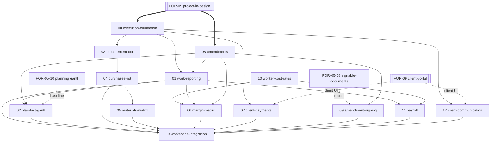

# FOR-06: Проект в работе / Project in progress (execution stage)

> **Имя папки:** `FOR-06-project-in-progress` (переименовано из `FOR-06-work-schedule`).
> `.config.kiro` `featureName` и перекрёстные ссылки из FOR-05/PROJECT/PROGRESS обновлены.

## Обзор

FOR-06 — родительская спека **стадии исполнения проекта**: всё, что происходит на проекте
**после подписания договора** (`Project.status` = `ACTIVE`). Граница между FOR-05 (стадия
проектирования, `DRAFT`) и FOR-06 — **факт подписания договора**. FOR-06 не заводит
собственное пространство проекта — оно **переиспользует единое пространство проекта FOR-05**
(`/projects/:projectId`), добавляя табы стадии исполнения; стадийный резолвер табов
(`resolveWorkspaceTabs`, FOR-05-01) переключает набор табов по `Project.status`.

FOR-06 — зонтичная спека для **всех действий на проекте в работе**. В неё **свёрнуты** ранее
отдельные верхнеуровневые спеки:

- **FOR-07 (трекинг закупок)** → теперь часть FOR-06 (закупки/первичка/матрица материалов);
- **FOR-10 (финансовый учёт)** → теперь часть FOR-06 (OCR первички, разнесение закупок по
  плану, план/факт оплат клиента, mass-collect/przelewy24, сверка банковских проводок);
- **FOR-11 (расчёт зарплат)** → теперь часть FOR-06 (себестоимость работника / `WorkerServiceRate`,
  матрица маржинальности на фактических работах, расчёт выплат по аппрувнутым отчётам).

**FOR-09 (клиентский портал) остаётся отдельной спекой** — у клиента позже будет собственный
маленький UI. FOR-06 владеет **внутренней/админской** стороной (домен, расчёты, матрицы,
админ-экраны), а клиентские read-only поверхности и клиентская часть оплат/коммуникации —
за FOR-09.

Ценовая и сметная модель принадлежит FOR-05 (`Estimate`/`EstimateLine`, цены, BoM, планировочный
Гант). FOR-06 её **читает** и накладывает исполнительные дельты (амендменты) и факт
(отчётность работников, фактические закупки, фактические оплаты).

## Скоуп FOR-06 (стадия исполнения)

Девять функциональных областей проекта в работе:

1. **Отчётность работников** — работник или прораб создаёт отчёт о проделанной работе;
   поэлементная гранулярность «работник · категория работ · конкретная работа · помещение ·
   объём», мультивыбор за день/период с общим репортуемым объёмом, черновик в localStorage,
   медиа-файлы, аппрув/отклонение прорабом, цикл правок. Работы метчатся по категориям работ
   работника на проекте.
2. **План/факт выполненных работ (Гант)** — исходный план-Гант FOR-05-10, поверх —
   подтверждённые отчёты (маппинг на категории работ), % выполнения, расчёт траектории и
   алерты по работам с риском выхода за сроки.
3. **Отчётность по купленным материалам (OCR)** — загрузка первичного документа закупки,
   OCR-распознавание позиций чека, маппинг каждой позиции на запланированный материал по тирам:
   производитель+категория+наименование = 100%, производитель+категория = 80%, категория = 50%,
   иначе — не метч.
4. **Список закупок по первичке** — соответствие позиций плану, ручная перепривязка, оставление
   части закупок без привязки с отметкой категорией из мини-справочника (рекламация,
   непредвиденный расход, материалы, топливо, иное).
5. **Матрица материалов** — исходный перечень материалов + фактические закупки; % выборки
   по плану, детализация по позиции, табы «строительные / отделочные», группировки по категориям.
6. **Матрица маржинальности работ** — исходный кошторыс + фактически зарепортанные работы с
   учётом типа работника → текущая маржа; цены до/после амендмента применяются корректно.
7. **План/факт оплат клиента** — генерируемый или ручной график оплат (разбиение суммы на
   транши, периодичность, кастомный планировщик); mass-collect банковский счёт, онлайн-оплата
   (przelewy24); трекинг входящих оплат с привязкой к ближайшему незакрытому траншу
   (недоплата фиксируется, переплата переносится, 100% → «оплачено»); комиссии платит заказчик.
8. **Амендменты (анексы)** — накопление изменений (сроки, объёмы, стоимость работ) в один
   амендмент, отправка на подписание клиенту, вступление в силу после подписи; корректный
   пересчёт маржи по старой цене ДО и по новой ПОСЛЕ амендмента.
9. **Коммуникация с клиентом** — свободный вопрос клиента → уведомление менеджеру; ответ
   админ-персонала → уведомление клиенту; медиа-вложения (фото/видео/документы).
   (Клиентская сторона рендерится FOR-09; FOR-06 владеет доменом сообщений и админ-ответами.)

## Табы стадии исполнения (в пространстве проекта FOR-05)

| Таб стадии исполнения | Назначение | Дочерняя спека |
|-----------------------|------------|----------------|
| Отчётность (Raporty pracy) | Создание/аппрув отчётов работников, объём/заработок | 01 work-reporting |
| План/факт Гант (Plan/wykonanie) | План vs факт, % выполнения, алерты траектории | 02 plan-fact-gantt |
| Закупки (Zakupy) | Загрузка первички + OCR, список закупок, соответствие плану | 03 procurement-ocr, 04 purchases-list |
| Материалы (Materiały) | Матрица «план × факт» по материалам, % выборки | 05 materials-matrix |
| Маржа (Marża) | Матрица маржинальности на фактических работах | 06 margin-matrix |
| Оплаты (Płatności) | План/факт оплат клиента, mass-collect, статусы траншей | 07 client-payments |
| Анексы (Aneksy) | Подготовка + подписание амендментов | 08 amendments, 09 amendment-signing |
| Расчёт ЗП (Rozliczenie wynagrodzeń) | Выплаты работникам по аппрувнутым отчётам | 11 payroll |
| Коммуникация (Komunikacja) | Переписка с клиентом (админ-сторона) | 12 client-communication |

## Дочерние спеки FOR-06 (стадия исполнения)

> Номера предварительные; уточняются при заведении конкретных дочерних спек. Каждая дочерняя
> спека прорабатывается отдельно (свои `requirements.md` / `design.md` / `tasks.md` /
> `test-cases.md`). i18n-поля, набор нотификаций и переводы (PL/RU) уточняются на фазе
> requirements каждой дочерней спеки (per hooks).

| # | Дочерняя спека | Тип | Область | Читает / зависит |
|---|----------------|-----|---------|-------------------|
| 00 | `FOR-06-00-execution-foundation` | full-stack | Реалайнмент исполнительных табов `WORKSPACE_TABS` под структуру FOR-06 (резолвер `resolveWorkspaceTabs`/`stageOf` переиспользуются как есть); мини-справочник категорий неплановых расходов `UnplannedExpenseCategory` (CRUD админ, R для MANAGER/FOREMAN/FINANCIER). ABAC-каркас: 00 сидит только свой ресурс, остальные — за дочерними спеками. **Спека готова** | FOR-05-01 shell, FOR-01/02/03 |
| 01 | `FOR-06-01-work-reporting` | full-stack | `WorkReport` + `WorkReportRoom` (работник · категория · работа · помещение · объём, факт в ед.изм. или % от плана), черновик в localStorage, мультивыбор за день/период, медиа, статусы (SUBMITTED/APPROVED/REJECTED/CHANGES_REQUESTED), аппрув/правка/отклонение прорабом, fast-path для отчётов прораба (сразу APPROVED, без нотификаций), матчинг работ по категориям работника, revenue-сторона (`clientUnitPrice`/`revenueValue`; cost-сторона — FOR-06-10/11), 4 нотификации через генерик-сервис; ABAC `WORK_REPORTS`. **Спека готова** | Смета/цены (FOR-05-03/05) с учётом амендментов (08), команда (FOR-05-09), категории работ работника (FOR-05-10b) |
| 02 | `FOR-06-02-plan-fact-gantt` | full-stack | Read-only наложение отчётов (01) на план-Гант (FOR-05-10/10b): % выполнения (quantity-ratio, confirmed=APPROVED), отдельный pending-бэнд, видимость ВСЕХ статусов отчётов (SUBMITTED/CHANGES_REQUESTED/APPROVED/REJECTED), расчёт траектории (on-track/at-risk/overdue) и алерты в панели. Без новой сущности/ресурса (ездит на `WORK_SCHEDULE`/READ), без нотификаций. **Спека готова** | План-Гант (FOR-05-10/10b), отчётность (01), смета (FOR-05-05b), амендменты (08) |
| 03 | `FOR-06-03-procurement-ocr` | full-stack | Загрузка первичного документа закупки (image/PDF) в существующий объектный стор `ImageStorage`; **новый Java-сервис OCR** (переиспользуются только Google-ресурсы Cloud Vision + LLM и логика телеграм-бота, не код): отбеливание фона (детект углов документа → белый фон вне квадрата), Vision-распознавание, по-строчный LLM-парс. Хранятся **обе** картинки — сырой аплоуд и обработанная с белым фоном. По-строчный маппинг каждой позиции на запланированный материал по тирам 100/80/50/нет-метча; ресурс `PURCHASES` сидится здесь (переиспользуется FOR-06-04); без нотификаций. **Requirements готовы** | BoM/материалы (FOR-05-05/05b), объектный стор `ImageStorage` (FOR-04-17, уже принимает PDF), Google Cloud Vision + LLM, логика OCR телеграм-бота |
| 04 | `FOR-06-04-purchases-list` | full-stack | Список закупок по первичке, соответствие плану, ручная перепривязка, непривязанные закупки с категорией из мини-справочника (рекламация/непредвиденный/материалы/топливо/иное) | OCR-закупки (03), мини-справочник (00) |
| 05 | `FOR-06-05-materials-matrix` | full-stack | Матрица «план × факт» по материалам: % выборки по плану, табы с/м и отд/м, группировки по категориям, детализация по позиции | Исходный перечень материалов (FOR-05-05b), фактические закупки (04) |
| 06 | `FOR-06-06-margin-matrix` | full-stack | Матрица маржинальности работ: кошторыс + фактически зарепортанные работы × тип работника → текущая маржа; цены до/после амендмента | Кошторыс/маржа (FOR-05-06), отчётность (01), себестоимость работника (10), амендменты (08) |
| 07 | `FOR-06-07-client-payments` | full-stack | План/факт оплат клиента: планировщик траншей (генератор/ручной), mass-collect счёт, przelewy24, сверка входящих оплат с привязкой к ближайшему незакрытому траншу, статусы/просрочки, комиссии на заказчика | Сумма проекта/оффер (FOR-05-07), банк-фид/проводки (внутр. FOR-06, бывш. FOR-10), FOR-09 (клиент видит график и платит) |
| 08 | `FOR-06-08-amendments` | full-stack | `EstimateAmendment` + `AmendmentLine`: накопление дельт (сроки/объёмы/стоимость) в один открытый амендмент, пересчёт относительно подписанной сметы; хранение ценовых дельт в строках | Смета/цены (FOR-05-03/05), оффер (FOR-05-07), план-Гант (FOR-05-10) |
| 09 | `FOR-06-09-amendment-signing` | full-stack | Подписание амендментов через обобщённый движок подписываемых документов (тип «Анекс/Aneks»), вступление в силу → применение дельт | Движок `SignableDocument`/`DocumentSignature` (FOR-05-08), амендменты (08) |
| 10 | `FOR-06-10-worker-cost-rates` | full-stack | `WorkerServiceRate` (себестоимость работника, cost-сторона отчётности), бывш. часть FOR-10/FOR-11 | Типы найма/тарифы (FOR-05-06), команда (FOR-05-09) |
| 11 | `FOR-06-11-payroll` | full-stack | Расчёт выплат работникам по аппрувнутым `WorkReport` × себестоимость работника (бывш. FOR-11) | Отчётность (01), себестоимость работника (10) |
| 12 | `FOR-06-12-client-communication` | full-stack | Домен сообщений клиент↔админ (свободный вопрос, ответ, медиа), уведомления менеджеру/клиенту; админ-сторона UI (клиентская — FOR-09) | Проект/команда, объектное хранилище (FOR-12), нотификации |
| 13 | `FOR-06-13-workspace-integration` | frontend | Встраивание всех исполнительных табов в пространство проекта FOR-05 | Оболочка (FOR-05-01), 01–12 |

> **Банковский фид / проводки / разнесение по проектам** (бывш. ядро FOR-10) живут внутри
> FOR-06 как инфраструктура под закупки (03/04) и оплаты (07); при необходимости выделяются в
> отдельную дочернюю спеку `FOR-06-NN-bank-reconciliation` на фазе планирования.

## Граф зависимостей (стадия исполнения)

## Рекомендуемый порядок разработки

1. **00 execution-foundation** — стадийный резолвер исполнительных табов + мини-справочник.
2. **08 amendments** — модель дельт поверх подписанной сметы (нужна для отчётности, графика, маржи).
3. **01 work-reporting** — после 00/08; revenue по ценам сметы с учётом амендментов.
4. **10 worker-cost-rates** — cost-сторона (параллельно 01).
5. **02 plan-fact-gantt** — после 01/08.
6. **03 procurement-ocr → 04 purchases-list → 05 materials-matrix** — цепочка закупок/материалов.
7. **06 margin-matrix** — после 01/08/10.
8. **09 amendment-signing** — после 08 и готового движка FOR-05-08.
9. **07 client-payments** — после 00 (может параллельно с закупками).
10. **11 payroll** — после 01/10.
11. **12 client-communication** — после 00 (клиентская сторона — FOR-09).
12. **13 workspace-integration** — в конце, встраивание всех исполнительных табов.

## Предпосылки (жёсткие зависимости)

- **FOR-05 (стадия проектирования)** — подписанный договор, смета и цены строк (03/05),
  оффер (07), движок подписываемых документов (08), подбор команды (09), планировочный Гант
  (10), гранулярность по работникам (10b).
- **FOR-05-01 workspace-shell** — единое пространство проекта и стадийный резолвер табов.
- **FOR-09 (клиентский портал)** — остаётся отдельной спекой; FOR-06 владеет доменом/админ-UI
  оплат и коммуникации, FOR-09 рендерит клиентскую сторону (просмотр графика оплат, онлайн-оплата,
  переписка).
- **FOR-01/02/03** — CRUD-фреймворк, ABAC, `ProjectScopedService`, `@PermissionResource`.
- **Объектный стор** — уже реализован: `com.foremen.service.image.ImageStorage` / `GcsImageStorage`
  (FOR-04-17), допустимые типы включают `application/pdf` + `image/*`, с `DisabledImageStorage`
  fallback. Переиспользуется для первички (FOR-06-03), медиа отчётов (FOR-06-01), сообщений и
  подписанных амендментов. Отдельная спека FOR-12 для него не требуется.
- **OCR** — в FOR-06-03 пишется **новый Java-сервис**; переиспользуются только Google-ресурсы
  (Cloud Vision `documentTextDetection` + LLM) и проверенная логика телеграм-бота
  (`services/ocr.ts`, `gemini.ts`, `pdf.ts`, `document-detect.ts`, `reprocess.ts`): отбеливание фона,
  PDF/мультистраничность, LLM-парс, расширенный до по-строчной выдачи. Код бота не импортируется.
- **FOR-12** — инфраструктура/деплой в Google Cloud; e-подпись, платёжный провайдер (przelewy24) и
  mass-collect банковская интеграция добавляются по мере готовности.

## Заметка о реорганизации (что свёрнуто в FOR-06)

- **FOR-07 procurement-tracking** → FOR-06-03/04/05 (OCR первички, список закупок, матрица материалов).
- **FOR-10 financial-accounting** → FOR-06 (OCR первички, разнесение закупок по плану, план/факт
  оплат клиента, mass-collect/przelewy24, сверка банковских проводок). Отдельная верхнеуровневая
  спека ретайрнута.
- **FOR-11 payroll** → FOR-06-10/11 (себестоимость работника + расчёт выплат). Отдельная
  верхнеуровневая спека ретайрнута.
- **FOR-09 client-portal** — НЕ сворачивается, остаётся отдельной спекой (отдельный клиентский UI).
- Из FOR-05 перенесены: амендменты, отчётность работников, исполнительная часть Ганта,
  встраивание исполнительных табов (планировочная часть-эстимация остаётся в FOR-05-10).

Перенос — на уровне планирования; физического перемещения кода нет.

---

*Обновляется при добавлении/изменении/завершении дочерних спек FOR-06 (стадия исполнения).*
