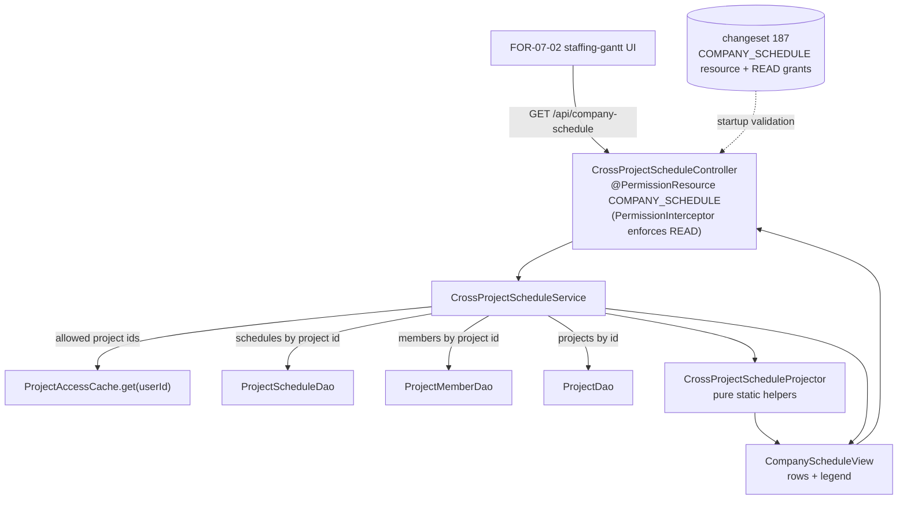

# Design Document

## Overview

FOR-07-01 adds a **backend-only, read-only** cross-project staffing projection over the existing
per-project planning Gantt. It introduces **no mutable entity or table** — the single persistence
change is one idempotent Liquibase seed changeset adding the read-only ABAC resource
`COMPANY_SCHEDULE` and its READ grants, registered last in `changelog.xml`.

The feature is delivered as:

- a bespoke read service, `CrossProjectScheduleService`, that reads every Accessible_Project's
  `project_schedule_bars` (verified: `ProjectScheduleBarEntity`, per-worker since FOR-05-10b) and the
  members of each project, and projects them into a **member-indexed** read model keyed by `User`;
- a family of **pure, static aggregation helpers** (`CrossProjectScheduleProjector` and friends) that
  hold all the testable logic — worker grouping, foreman-span synthesis, deterministic per-project
  color, absolute-date projection (reusing the verified `ScheduleCalculator.calendarDayOfHalfDay`),
  inclusive-interval overlap/conflict detection, and the Role / Project / Member / Date_Window
  filters applied conjunctively;
- a bespoke read-only controller, `CrossProjectScheduleController`, exposing a single `GET` endpoint
  guarded by `@PermissionResource("COMPANY_SCHEDULE")` + `@PermissionOperation("READ")`.

The projection combines **two bar sources** into one `MemberRow`:

- **Worker_Category_Bar** — a WORKER's `project_schedule_bars` row with a non-null `projectMember`
  (an `Uncovered_Category` null-member bar is excluded). Carries half-day fields and a work category.
- **Foreman_Span_Bar** — a synthesized bar per project an ACTIVE FOREMAN leads, spanning
  `project.startDate → project.endDate`, `kind = FOREMAN_SPAN`, no category, no half-day fields.
  Datable only when both project dates are present; excluded from conflict detection.

### Verified codebase facts (re-checked before writing)

- `ScheduleCalculator` (pure, static) exposes `calendarDayOfHalfDay(int finishHalfDay) = (finishHalfDay + 1) / 2`,
  `finishHalfDay(s, d) = s + d - 1`, `startDayFromHalfDays`, `durationDaysFromHalfDays`. Day 1 of a
  schedule is the anchor itself (`anchor.plusDays(day - 1)`).
- `ProjectScheduleBarEntity` is keyed `(schedule, projectMember, workCategory)` with a **nullable**
  `projectMember`, and half-day fields `startHalfDays` / `durationHalfDays` (both `>= 1`). The
  worker is `bar.projectMember.user` (a `UserEntity`).
- `ProjectScheduleEntity` is `@OneToOne project` (NOT NULL, UNIQUE), `@Version version`, owns `bars`.
  `ProjectScheduleDao.findByProjectId(Long)` returns `Optional`.
- `ProjectMemberEntity` carries `user`, plain `projectId` (BIGINT), `projectRole` (a `RoleEntity`
  with `code`), and `assignmentStatus` (ACTIVE / INACTIVE).
- `ProjectEntity` (table `projects`) has `name`, nullable `startDate` / `endDate` (`LocalDate`),
  `status`, and a read-only `members` collection mapped by `project_id`
  (`insertable=false, updatable=false`).
- `WorkCategoryEntity` has `nameRU`, `namePL`, `code`, `orderNo`.
- `ProjectAccessCache.get(userId)` self-loads `Set<Long>` of a user's project ids from
  `ProjectMemberDao.findDistinctProjectIdsByUserId`. `ProjectScopedService` treats an
  **exact-authority ADMIN** (authority exactly `ROLE_ADMIN` or `ADMIN`) as a `null` filter (sees all),
  and the principal name is the numeric `userId`.
- The ABAC annotation scheme: class-level `@PermissionResource("CODE")` + method-level
  `@PermissionOperation("READ")` (or method-level `@RequiresPermission`) is combined by
  `PermissionResolver`, enforced by `PermissionInterceptor`, and validated at startup by
  `PermissionAnnotationValidator` (a `@PermissionResource` controller whose in-scope handler lacks a
  matching `@PermissionOperation` fails startup). Pattern mirror: `ProjectScheduleController`
  (`@PermissionResource("WORK_SCHEDULE")`).
- The seed pattern: `153-seed-work-schedule-resource.xml` — a resource insert guarded by
  `onFail="MARK_RAN"` `COUNT(*)=0`, and each grant block an `INSERT ... SELECT ... WHERE NOT EXISTS`.
  The current last include in `changelog.xml` is `186-seed-client-messages-resource.xml`, so the new
  changeset is **187** and is appended last.

## Architecture

This is a read-only query layer with no new domain model. The controller delegates to a `@Service`
that resolves access scope through `ProjectAccessCache`, loads the needed rows through existing DAOs,
and hands them to pure helpers that build the immutable projection DTO.



**Request flow (Requirement 6, 7):**

1. The controller endpoint runs under `COMPANY_SCHEDULE` READ (ADMIN bypass included).
2. The controller validates the Date_Window (`from > to` → HTTP 400, Requirement 7.8) before calling
   the service.
3. The service resolves the caller's allowed project id set: exact-authority ADMIN → `null`
   (all projects); non-ADMIN → `ProjectAccessCache.get(userId)`; empty set → empty projection
   (Requirement 6).
4. The service intersects any supplied Project_Filter with the allowed set (ignoring out-of-scope
   ids, never widening, Requirement 7.3, 7.7).
5. For each in-scope project it loads the schedule (if any), its members, and the project row; it
   gathers raw inputs (worker bars with their worker + category, foreman members, project dates).
6. It hands the raw inputs plus the filters to `CrossProjectScheduleProjector.project(...)`, which
   returns the immutable `CompanyScheduleView`.

**Why pure helpers.** All decision logic — grouping, color, dates, overlap, filters — lives in
side-effect-free static methods on plain input records, so each correctness property is directly
property-testable without a database or Spring context (mirrors `ScheduleCalculator`).

## Components and Interfaces

### Backend package layout

| Layer | Type | Package / path | Responsibility |
|-------|------|----------------|----------------|
| Controller | `CrossProjectScheduleController` | `com.foremen.controller` | Single `GET` endpoint; ABAC annotations; Date_Window 400 guard. |
| Service | `CrossProjectScheduleService` | `com.foremen.service` | Scope resolution via `ProjectAccessCache`; load schedules/members/projects; call projector. |
| Pure logic | `CrossProjectScheduleProjector` | `com.foremen.service.companyschedule` | Static `project(...)` orchestration + the pure sub-helpers (grouping, color, date, overlap, filters, foreman-span synthesis). |
| Query params | `CompanyScheduleQuery` (record) | `com.foremen.controller.model.companyschedule` | Normalized, validated filter inputs. |
| Response DTO | `CompanyScheduleView`, `MemberRow`, `ProjectedBar`, `ProjectLegendEntry`, `ConflictPair`, `BarKind` | `com.foremen.controller.model.companyschedule` | The immutable projection JSON. |
| Projector inputs | `ProjectInput`, `WorkerBarInput`, `ForemanInput` (records) | `com.foremen.service.companyschedule` | Plain, DB-free inputs to the pure projector. |
| Seed | `187-seed-company-schedule-resource.xml` | `foremen-backend/database_files/changesets` | `COMPANY_SCHEDULE` resource + ADMIN/MANAGER READ grants. |

New message codes go in `messages.properties` / `messages_ru.properties` under a
`# === Company schedule errors (FOR-07-01) ===` section.

### Controller endpoint

```
GET /api/company-schedule
    @PermissionResource("COMPANY_SCHEDULE")  (class level)
    @PermissionOperation("READ")             (handler level)
```

Query parameters (all optional):

| Param | Type | Meaning | Requirement |
|-------|------|---------|-------------|
| `roles` | `List<String>` | Role_Filter; accepted values `FOREMAN`, `WORKER`. Omitted = both. | 7.2 |
| `projectIds` | `List<Long>` | Project_Filter; out-of-scope ids ignored. Omitted = all accessible. | 7.3 |
| `memberIds` | `List<Long>` | Member_Filter over `User` ids. Omitted = all. | 7.4 |
| `from` | `LocalDate` | Date_Window inclusive lower bound. | 7.5 |
| `to` | `LocalDate` | Date_Window inclusive upper bound. | 7.5 |

```java
@RestController
@RequestMapping("/api/company-schedule")
@PermissionResource("COMPANY_SCHEDULE")
public class CrossProjectScheduleController {

    private static final String READ = "READ";

    @GetMapping
    @PermissionOperation(READ)
    public ResponseEntity<CompanyScheduleView> getProjection(
            @RequestParam(required = false) List<String> roles,
            @RequestParam(required = false) List<Long> projectIds,
            @RequestParam(required = false) List<Long> memberIds,
            @RequestParam(required = false) @DateTimeFormat(iso = DATE) LocalDate from,
            @RequestParam(required = false) @DateTimeFormat(iso = DATE) LocalDate to) {
        // from > to -> HTTP 400 error.company.schedule.window.invalid (Requirement 7.8)
        return ResponseEntity.ok(service.getProjection(
                new CompanyScheduleQuery(roles, projectIds, memberIds, from, to)));
    }
}
```

The `from > to` guard raises `ForemenApiException(HttpStatus.BAD_REQUEST, "error.company.schedule.window.invalid")`
before any read, changing no data (Requirement 7.8).

### Persisted view state (table-state standard) — Requirement 11

This Gantt surface follows the house "table state" standard (persist filters, ordering, period
selection) but applies it as **persisted VIEW state**, not as a paginated/server-sorted list. The
endpoint's query params `roles` / `projectIds` / `memberIds` / `from` / `to` are deliberately
**exactly** the set of dimensions a persisted Gantt view needs to be faithfully replayed, so no view
dimension is un-restorable through the read contract (Requirement 11.1). Because the projection's
ordering is the fixed deterministic order of Requirement 10.4, replaying the same saved filter set
returns the same projection (Requirement 11.2).

**Where persistence lives (FOR-07-02, not here).** FOR-07-02 persists the selected view state — the
chosen Role / Project / Member selection plus the chosen time granularity (week / month) and selected
period — via the house hooks `useTableState` + `useLocalStoragePersistence`
(`foremen-frontend/src/components/data-table/hooks/`), which write to **localStorage keyed by a stable
entity key, debounced ~500ms**. FOR-07-02 maps its week/month granularity + period picker onto this
contract's single `[from, to]` Date_Window; the backend models **no** granularity enum and stores
**no** per-user view state (Requirement 11.5). The backend's only obligation is to be fully re-playable
from those saved filters.

**Deliberate divergence from the DataTable list contract.** The house paginated-table contract is
Spring `Pageable` (`page` / `size` / `sort`) plus an RSQL `query` filter served by
`AdminController.find`. This Gantt endpoint does **not** use that contract: a Gantt (rows = people, X
= dates, project-colored bars) is not paged and not server-sorted, so the endpoint exposes **no**
`page` / `size` / `sort` / `query` parameter, and its ordering is the fixed deterministic order of
Requirement 10.4 rather than a caller-controllable sort (Requirements 11.3, 11.4). The DTO shape, the
pure projector, the ABAC guarding, and the deterministic ordering are unchanged by this standard.

### Service

```java
@Service
@Transactional(readOnly = true)
public class CrossProjectScheduleService {

    /** Resolve scope, load rows, delegate to the pure projector (Requirements 1-8, 10). */
    public CompanyScheduleView getProjection(CompanyScheduleQuery query) { ... }

    /** null = exact-authority ADMIN (all projects); else the caller's allowed set via cache. */
    Set<Long> resolveAllowedProjectIds() { ... }
}
```

- `resolveAllowedProjectIds()` reuses the exact-authority ADMIN check (authority equals `ROLE_ADMIN`
  or `ADMIN`) and `ProjectAccessCache.get(userId)` — the **same** cache the per-project schedule
  service uses, so a membership invalidation is honored identically (Requirement 6.4, 6.5). A
  non-ADMIN with an empty set yields an empty projection (Requirement 6.3, 10.1).
- The service is `@Transactional(readOnly = true)`; it creates/updates/deletes no schedule row and
  bumps no version (Requirement 7.9). It does **not** implement `ProjectScopedService` — scope is
  applied explicitly in the service, because the endpoint is a bespoke read, not an `AdminController`
  CRUD surface (Requirement 6.5, 9.5).
- It reads per-project schedules through `ProjectScheduleDao.findByProjectId` (or a batched
  `findByProjectIdIn` added to the DAO) and members through `ProjectMemberDao.findByProjectId`
  (fetching `user` + `projectRole`). A project with no schedule row contributes no worker bar but
  still contributes foreman spans (Requirement 10.2).

### Pure projector (the property-testable core)

`CrossProjectScheduleProjector` is a `final` class of static methods over DB-free input records:

```java
public record ProjectInput(long projectId, String projectName,
                           LocalDate startDate, LocalDate endDate,
                           List<WorkerBarInput> workerBars,
                           List<ForemanInput> foremen) {}

public record WorkerBarInput(long userId, String userName, String roleCode,
                             long workCategoryId, String categoryNameRu, String categoryNamePl,
                             int startHalfDays, int durationHalfDays) {}   // projectMember != null only

public record ForemanInput(long userId, String userName) {}              // ACTIVE FOREMAN members

public final class CrossProjectScheduleProjector {
    public static CompanyScheduleView project(List<ProjectInput> projects,
                                              CompanyScheduleQuery filters, boolean russianLocale);

    static Map<Long, Integer> assignColors(List<Long> projectIdsInProjection);          // R3
    static LocalDate[] workerBarDates(LocalDate anchor, int startHalfDays, int durationHalfDays); // R4.1/4.3
    static LocalDate[] foremanSpanDates(LocalDate start, LocalDate end);                 // R4.2/4.4
    static boolean intervalsOverlap(LocalDate aStart, LocalDate aEnd,
                                     LocalDate bStart, LocalDate bEnd);                   // R5.2
    static List<ConflictPair> detectConflicts(List<ProjectedBar> workerBars);            // R5
    static boolean inDateWindow(ProjectedBar bar, LocalDate from, LocalDate to);         // R7.5
}
```

Key rules implemented here:

- **Uncovered exclusion (R2):** only non-null-member worker bars reach `WorkerBarInput`, so the
  projector never sees an `Uncovered_Bar`. A project with only uncovered bars and no foreman
  contributes nothing (R2.2).
- **Foreman precedence (R1.8):** if a `User` is an ACTIVE FOREMAN of a project, the projector emits
  only that user's Foreman_Span_Bar for that project and drops any of that user's worker bars for the
  **same** project.
- **Member aggregation (R1.5):** bars are grouped by `userId`; one `MemberRow` per distinct `User`
  aggregating every accessible project's bars for that user.
- **Deterministic color (R3):** `assignColors` sorts the distinct project ids ascending and assigns
  palette index `rank % PALETTE_SIZE` — stable across requests because it depends only on the id set,
  not timing. The same index is used for every bar of that project and the legend entry.
- **Absolute dates (R4):** worker bars of an anchored project use
  `anchor.plusDays(calendarDayOfHalfDay(startHalfDays) - 1)` /
  `anchor.plusDays(calendarDayOfHalfDay(startHalfDays + durationHalfDays - 1) - 1)`. Unanchored worker
  bars and partial-date foreman spans are Undatable_Bars (null dates, `unanchored = true`).
- **Conflict detection (R5):** per member, over that member's **datable Worker_Category_Bars only**,
  compare each distinct pair with the inclusive-closed-interval rule
  `a.start <= b.end && b.start <= a.end`. Foreman spans and undatable bars never form a conflict.
- **Filters (R7):** Role / Project / Member / Date_Window applied conjunctively; any Date_Window bound
  drops every Undatable_Bar (R7.5). A member with no remaining bar after filtering is omitted (R10.3).
- **Determinism (R10.4):** rows ordered by `(userName, userId)`, bars within a row by
  `(startDate NULLS LAST, projectId, workCategoryId, startHalfDays)`, legend by `projectId`.

## Data Models

No persistent model is added. The response DTO (JSON) carries **no** money, man-days, rate, or
pay-tier field (Requirement 8).

```jsonc
// CompanyScheduleView
{
  "rows": [
    {
      "userId": 42,
      "userName": "Jan Kowalski",
      "companyRole": "WORKER",          // "WORKER" | "FOREMAN" (projectRole.code of the contributing member)
      "bars": [
        {
          "kind": "WORKER_CATEGORY",    // BarKind
          "projectId": 7,
          "projectName": "Mokotów 12",
          "colorIndex": 0,
          "workCategoryId": 15,
          "workCategoryName": "Płytki",  // localized ru->pl by request locale
          "startHalfDays": 3,
          "durationHalfDays": 4,
          "startDate": "2026-04-02",     // null when unanchored
          "endDate": "2026-04-03",       // null when unanchored
          "unanchored": false
        },
        {
          "kind": "FOREMAN_SPAN",
          "projectId": 9,
          "projectName": "Wola 3",
          "colorIndex": 1,
          "workCategoryId": null,
          "workCategoryName": null,
          "startHalfDays": null,
          "durationHalfDays": null,
          "startDate": "2026-03-01",     // project.startDate; null if either project date missing
          "endDate": "2026-09-30",       // project.endDate
          "unanchored": false
        }
      ],
      "conflicts": [
        { "barIndexA": 0, "barIndexB": 2 }   // indices into this row's bars (worker bars only)
      ]
    }
  ],
  "legend": [
    { "projectId": 7, "projectName": "Mokotów 12", "colorIndex": 0 },
    { "projectId": 9, "projectName": "Wola 3", "colorIndex": 1 }
  ]
}
```

`BarKind` is the enum `{ WORKER_CATEGORY, FOREMAN_SPAN }`. `companyRole` is the contributing member's
`projectRole.code` (Requirement 1.4). A `MemberRow` appears only when it has at least one included
bar after filters (Requirement 10.3); `rows` and `legend` are empty for an empty projection
(Requirement 10.1).

## Correctness Properties

*A property is a characteristic or behavior that should hold true across all valid executions of a
system — essentially, a formal statement about what the system should do. Properties serve as the
bridge between human-readable specifications and machine-verifiable correctness guarantees.*

The pure projector and its helpers are ideal for property-based testing: they are side-effect-free
functions over structured inputs (projects, bars, members, filters) with a large input space, where
100+ generated cases exercise overlapping intervals, unanchored/partial dates, foreman precedence,
and filter combinations far better than a handful of examples.

### Property 1: One row per contributing user

*For any* set of projects with worker bars and foreman members, the projection SHALL contain exactly
one `MemberRow` per distinct `userId` that contributes at least one included bar, and SHALL never emit
a row with no identifiable user.

**Validates: Requirements 1.1, 1.5, 2.3**

### Property 2: Uncovered bars never appear

*For any* project schedule containing null-member (Uncovered) bars, no `ProjectedBar` in the
projection SHALL derive from a null-member bar.

**Validates: Requirements 2.1, 2.2, 2.4**

### Property 3: Foreman precedence over own worker bars

*For any* user who is an ACTIVE FOREMAN of a project and also owns worker bars in that same project,
the projection SHALL emit that user's Foreman_Span_Bar for that project and SHALL NOT emit any
Worker_Category_Bar of that user for that project.

**Validates: Requirements 1.3, 1.8**

### Property 4: Deterministic color by project id

*For any* two projections built from the same set of project ids, each project id SHALL receive an
identical `colorIndex` in both, and every bar of a project SHALL share its project's legend
`colorIndex`.

**Validates: Requirements 3.1, 3.2, 3.3**

### Property 5: Absolute-date projection round-trips the calculator

*For any* anchored project and worker bar, the bar's `startDate` / `endDate` SHALL equal
`anchor.plusDays(calendarDayOfHalfDay(startHalfDays) - 1)` and
`anchor.plusDays(calendarDayOfHalfDay(startHalfDays + durationHalfDays - 1) - 1)`; and a bar of an
unanchored project SHALL have null dates and `unanchored = true`.

**Validates: Requirements 4.1, 4.3**

### Property 6: Foreman span datable only when both project dates present

*For any* foreman span, its `startDate` / `endDate` SHALL equal the project's `startDate` / `endDate`
when both are present, and SHALL be null with `unanchored = true` when either is missing.

**Validates: Requirements 4.2, 4.4**

### Property 7: Conflict detection is symmetric closed-interval overlap on worker bars only

*For any* member row, a pair of that member's bars SHALL be a conflict if and only if both bars are
datable Worker_Category_Bars and `a.startDate <= b.endDate && b.startDate <= a.endDate`; foreman
spans and undatable bars SHALL never be part of any conflict pair, and no conflict SHALL span two
different users.

**Validates: Requirements 5.1, 5.2, 5.4, 5.5, 5.6**

### Property 8: Filters are conjunctive and never widen scope

*For any* combination of Role / Project / Member / Date_Window filters, every bar in the result SHALL
satisfy all supplied filters, every bar SHALL belong to an Accessible_Project, and supplying a
Project_Filter id outside the allowed set SHALL neither add bars nor change the result versus omitting
that id.

**Validates: Requirements 7.2, 7.3, 7.4, 7.7**

### Property 9: Date_Window excludes undatable bars and keeps intersecting bars

*For any* supplied Date_Window bound, the result SHALL exclude every Undatable_Bar and SHALL include a
datable bar exactly when its inclusive interval intersects `[from, to]`; with no Date_Window, every
datable and undatable bar of every Accessible_Project SHALL be included.

**Validates: Requirements 4.5, 7.5, 7.6**

### Property 10: Empty filtered members are omitted

*For any* member whose every bar is removed by the supplied filters, the projection SHALL contain no
`MemberRow` for that member.

**Validates: Requirements 10.3**

### Property 11: Deterministic ordering

*For any* input, the ordering of `rows`, of `bars` within a row, and of `legend` entries SHALL be a
pure function of the input, so identical inputs yield an identical response.

**Validates: Requirements 10.4**

### Property 12: No cost-bearing field is ever emitted

*For any* projection, no `MemberRow`, `ProjectedBar`, or legend entry SHALL carry a money, man-days,
rate, or worker-pay-tier value.

**Validates: Requirements 8.1, 8.2, 8.3**

## Error Handling

| Condition | HTTP | Code | Notes |
|-----------|------|------|-------|
| `from > to` | 400 | `error.company.schedule.window.invalid` | Controller guard before any read; changes no data (R7.8). |
| Caller lacks `COMPANY_SCHEDULE` READ | 403 | (ABAC default) | Enforced by `PermissionInterceptor`; ADMIN bypass applies. |
| No Accessible_Projects / empty allowed set | 200 | — | Empty `rows` + empty `legend` (R6.3, R10.1), not an error. |
| Accessible_Project with no schedule row | 200 | — | Contributes no worker bar; foreman spans still emitted (R10.2). |
| Out-of-scope `projectIds` entry | 200 | — | Silently ignored; never leaked (R7.3). |

All reads run in a read-only transaction, so no write or version bump can occur (R7.9).

## Testing Strategy

**Dual approach.** Property-based tests cover the universal properties of the pure projector; unit
and integration tests cover concrete examples, controller wiring, ABAC, and startup validation.

**Property-based tests (jqwik, the project's PBT library; min 100 iterations each):**

- One property test per Property 1–12 above, over generated projects / bars / members / filters.
- Each tagged `// Feature: FOR-07-01-cross-project-schedule-core, Property N: <text>`.
- Generators cover: anchored vs unanchored projects, partial foreman dates, overlapping and disjoint
  worker intervals, uncovered (null-member) bars, foreman-also-worker users, and every filter subset.

**Unit tests (JUnit):**

- `CrossProjectScheduleProjector` edge cases: empty input → empty view; single project; a member
  spanning multiple projects; a project with only uncovered bars.
- `CrossProjectScheduleService` with mocked DAOs + `ProjectAccessCache`: ADMIN sees all; non-ADMIN
  restricted to the cache set; empty set → empty projection; schedule-less accessible project still
  yields foreman spans.

**Integration tests (Spring slice / `@SpringBootTest` as used by sibling specs):**

- `CrossProjectScheduleController` GET returns 200 with the projection; `from > to` returns 400;
  caller without the grant returns 403.
- An ABAC/startup test asserting `PermissionAnnotationValidator` passes for
  `@PermissionResource("COMPANY_SCHEDULE")` + the READ handler, and that the resource + ADMIN/MANAGER
  READ grants are seeded (and that no CREATE/UPDATE/DELETE grant exists).

**Test-execution standard.** Run only the affected `--tests` classes, redirected to a temp log; never
the full ~20-minute suite (see `.kiro/steering/test-execution-rules.md`).

## Localization

The `COMPANY_SCHEDULE` resource row carries all four localized columns (Requirement 9.3), matching the
existing resource-seed shape:

| Column | Value |
|--------|-------|
| `code` | `COMPANY_SCHEDULE` |
| `name_ru` | `График компании` |
| `name_pl` | `Harmonogram firmy` |
| `description_ru` | `Сводный межпроектный график занятости работников и прорабов` |
| `description_pl` | `Zbiorczy międzyprojektowy harmonogram obsadzenia pracowników i kierowników` |

New message codes (added to `messages.properties` / `messages_ru.properties`):

| Code | PL | RU |
|------|----|----|
| `error.company.schedule.window.invalid` | `Nieprawidłowy zakres dat: „od” nie może być późniejsze niż „do”.` | `Недопустимый диапазон дат: «от» не может быть позже «до».` |
