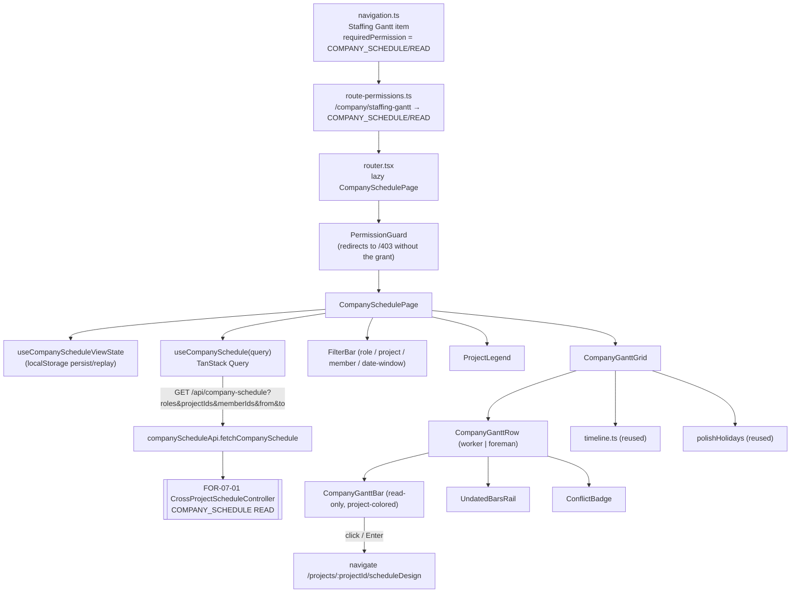

# Design Document

## Overview

FOR-07-02 is a **frontend-only, read-only** screen that renders the FOR-07-01 cross-project staffing
projection (`GET /api/company-schedule`) as a company-wide Gantt: rows are workers / foremen, the X
axis is an absolute calendar-date axis, and bars are colored per project. It adds a project legend, a
filter bar (role / project / member / date-window with a week|month granularity), a per-row conflict
indicator, and a deep-link from a bar to that project's planning-schedule tab.

It introduces **no backend code, no entity, and no new ABAC resource**. The projection, the
`COMPANY_SCHEDULE` resource (READ → ADMIN + MANAGER), and the localized resource row are all owned by
FOR-07-01. The only change to shared frontend config is **re-pointing the Staffing Gantt nav item and
its route-permission** from the interim `WORK_SCHEDULE`/READ (a FOR-07-00 placeholder) to the real
`COMPANY_SCHEDULE`/READ, so the menu item, the route guard, the page's own `usePermission` gate, and
the backend endpoint all agree on one audience.

The feature is delivered as a new frontend feature module `src/features/company-schedule/`
(mirroring the layout of `src/features/project-schedule/`), a single lazy-loaded page wired into the
router, two edits to shared config (`navigation.ts`, `route-permissions.ts`), and a new
`companySchedule.*` i18n namespace mirrored in `pl.json` / `ru.json`.

Requirement references are `R<n>.<criterion>` into `requirements.md`.

### Verified reuse inventory (re-checked before writing)

| Reuse as-is | Path | Used for |
|-------------|------|----------|
| `dayToDate` / `dateToDay` / `buildTimeline` / `barLeftPx` / `barWidthPx` / `DAY_WIDTH` / `Timeline` | `src/features/project-schedule/lib/timeline.ts` | date-axis layout, bar px positioning |
| `polishHolidays(year)` / `easterSunday` / `HolidayKey` | `src/features/project-schedule/lib/polishHolidays.ts` | weekend + holiday shading |
| `usePermission()` / `PermissionRequirement` | `src/hooks/usePermission.ts` | page + nav + route gating on `COMPANY_SCHEDULE`/READ |
| `apiRequest` | `src/lib/api-client.ts` | the GET fetch (Accept-Language, 401 refresh) |
| `isNavItemVisible`, `NAV_CONFIG`, `NavItemConfig` | `src/config/navigation.ts` | nav item + its `requiredPermission` |
| `requirementForPath`, `ROUTE_REQUIREMENTS` derivation | `src/config/route-permissions.ts` | route guard requirement |
| `React.lazy` + `SuspenseWrapper` + default export | `src/app/router.tsx` | route wiring |
| loading / error / empty pattern | `src/features/project-schedule/components/ScheduleTab.tsx` | page states |
| `WORKER_COLOR_PALETTE` (hex list only) | `src/features/project-schedule/lib/workerColor.ts` | palette colors for the new index-based `projectColor` |
| i18n init + parity test | `src/lib/i18n.ts`, `src/lib/i18n.keys.test.ts` | PL/RU key parity gate |

| Build new (this spec) | Why |
|-----------------------|-----|
| `companyScheduleApi.ts` + `companyScheduleKeys` + `useCompanySchedule` hook | the new GET contract + query key |
| `types.ts` mirroring the FOR-07-01 DTOs | `CompanyScheduleView` / `MemberRow` / `ProjectedBar` / `BarKind` / `ProjectLegendEntry` / `ConflictPair` |
| `projectColor(colorIndex)` palette fn | backend sends a 0-based index; `workerColor` is hash-based (wrong mapping) |
| company Gantt components (page, grid, row, bar, legend, filter bar, undated rail, conflict badge) | different row model (workers, project-colored, read-only) from the per-project Gantt |
| `useCompanyScheduleViewState` + typed localStorage persistence | existing persistence hook only stores the `TableState` shape |
| `companySchedule.*` i18n keys (PL + RU) | new screen strings |

## Architecture



**Load flow:**

1. `navigation.ts` gives the Staffing Gantt item `requiredPermission = COMPANY_SCHEDULE/READ`;
   `route-permissions.ts` therefore derives `/company/staffing-gantt → COMPANY_SCHEDULE/READ` from
   `NAV_CONFIG` (no `extra` entry needed, but one is added for self-description/stability) (R1).
2. `PermissionGuard` redirects a caller without the grant to `/403`; ADMIN bypass + MANAGER grant
   pass (R1.4).
3. The page restores `Persisted_View_State` from localStorage (or the default view), builds the
   query, and fetches via `useCompanySchedule` (R2, R8).
4. The response (`rows[]` + `legend[]`) drives the legend, the grid, the undated rail, and the
   conflict badges; the page renders exactly what the server returned (R2.5).

## Components and Interfaces

### Frontend feature module layout

```
src/features/company-schedule/
  api/
    companyScheduleApi.ts     // fetchCompanySchedule(query): Promise<CompanyScheduleView>
    queryKeys.ts              // companyScheduleKeys.view(serializedQuery)
  types.ts                    // CompanyScheduleView, MemberRow, ProjectedBar, BarKind,
                              //   ProjectLegendEntry, ConflictPair, CompanyScheduleQuery
  lib/
    projectColor.ts           // projectColor(colorIndex): string (index into the palette)
    dateWindow.ts             // granularity+period <-> {from,to}; period helpers (ISO week, month)
    barDates.ts               // ProjectedBar -> {startDay,endDay} via dateToDay(anchor, ...)
    viewState.ts              // serialize / parse Persisted_View_State; default view
  hooks/
    useCompanySchedule.ts     // TanStack Query read hook (staleTime 30s, retry 2)
    useCompanyScheduleViewState.ts // state + localStorage persist/replay
  components/
    CompanySchedulePage.tsx   // default export; loading/error/empty/loaded states (lazy target)
    CompanyScheduleFilterBar.tsx
    ProjectLegend.tsx
    CompanyGanttGrid.tsx      // sticky label column + scrolling date-axis timeline
    CompanyTimelineHeader.tsx // week/day columns + weekend/holiday shading (reuses timeline + holidays)
    CompanyGanttRow.tsx       // one worker/foreman row: label + track (+ undated rail + conflict badge)
    CompanyGanttBar.tsx       // read-only project-colored bar; click/Enter deep-links
    UndatedBarsRail.tsx       // chips for Undatable_Bars (no-date-window case)
    ConflictBadge.tsx
  __tests__/ ...
```

### Shared-config edits (the only changes outside the feature module)

1. **`src/config/navigation.ts`** — change the Staffing Gantt item's `requiredPermission` from
   `{ resource: 'WORK_SCHEDULE', operation: 'READ' }` to
   `{ resource: 'COMPANY_SCHEDULE', operation: 'READ' }`. Path, label (`nav.staffingGantt`), icon,
   and `bottomNav: false` stay (R1.2, R11.4).
2. **`src/config/route-permissions.ts`** — add a self-describing `extra` entry
   `'/company/staffing-gantt': { resource: 'COMPANY_SCHEDULE', operation: 'READ' }` (it also derives
   from `fromNav` now, but the explicit entry keeps the guard stable, matching the file's existing
   convention for other routes) (R1.3).
3. **`src/app/router.tsx`** — add
   `const CompanySchedulePage = React.lazy(() => import('@/features/company-schedule/components/CompanySchedulePage'))`
   and a route `{ path: 'company/staffing-gantt', element: <SuspenseWrapper><CompanySchedulePage /></SuspenseWrapper> }`
   under the `PermissionGuard` children (R1.1).

### Types (`types.ts`) — mirroring the FOR-07-01 DTOs

```ts
export type BarKind = 'WORKER_CATEGORY' | 'FOREMAN_SPAN'
export type CompanyRole = 'WORKER' | 'FOREMAN'

export interface ProjectedBar {
  kind: BarKind
  projectId: number
  projectName: string
  colorIndex: number
  workCategoryId: number | null
  workCategoryName: string | null
  startHalfDays: number | null
  durationHalfDays: number | null
  startDate: string | null   // ISO yyyy-MM-dd; null when unanchored
  endDate: string | null
  unanchored: boolean
}

export interface ConflictPair { barIndexA: number; barIndexB: number }

export interface MemberRow {
  userId: number
  userName: string
  companyRole: CompanyRole
  bars: ProjectedBar[]
  conflicts: ConflictPair[]
}

export interface ProjectLegendEntry { projectId: number; projectName: string; colorIndex: number }

export interface CompanyScheduleView {
  rows: MemberRow[]
  legend: ProjectLegendEntry[]
}

// The UI's filter state; maps to the query params.
export type Granularity = 'WEEK' | 'MONTH'
export interface CompanyScheduleQuery {
  roles?: CompanyRole[]        // omitted or both -> no `roles` param
  projectIds?: number[]
  memberIds?: number[]
  from?: string | null         // ISO date; computed from granularity+period or null (all dates)
  to?: string | null
}
```

### API (`companyScheduleApi.ts` + `queryKeys.ts`)

```ts
const COMPANY_SCHEDULE = '/api/company-schedule'

/** GET the staffing projection. Only sends the supported params (R2.1, R2.3). */
export function fetchCompanySchedule(query: CompanyScheduleQuery): Promise<CompanyScheduleView> {
  const p = new URLSearchParams()
  // roles: send only when exactly one role is selected (both/none -> omit, R2.4)
  if (query.roles && query.roles.length === 1) p.append('roles', query.roles[0]!)
  for (const id of query.projectIds ?? []) p.append('projectIds', String(id))
  for (const id of query.memberIds ?? []) p.append('memberIds', String(id))
  if (query.from) p.set('from', query.from)
  if (query.to) p.set('to', query.to)
  const qs = p.toString()
  return apiRequest<CompanyScheduleView>(qs ? `${COMPANY_SCHEDULE}?${qs}` : COMPANY_SCHEDULE)
}
```

```ts
export const companyScheduleKeys = {
  all: ['company-schedule'] as const,
  view: (query: CompanyScheduleQuery) =>
    [...companyScheduleKeys.all, serializeQuery(query)] as const, // stable key per filter set (R2.2)
}
```

`serializeQuery` canonicalizes the query (sorted ids, normalized roles, from/to) so an identical
filter set reuses the cache (R2.2) and a replayed Persisted_View_State hits the same key
(FOR-07-01 R11.2).

### Read hook (`useCompanySchedule.ts`)

```ts
export function useCompanySchedule(query: CompanyScheduleQuery) {
  return useQuery<CompanyScheduleView>({
    queryKey: companyScheduleKeys.view(query),
    queryFn: () => fetchCompanySchedule(query),
    staleTime: 30_000,
    retry: 2,
  })
}
```

Follows the house `staleTime: 30_000` / `retry: 2` convention (R2.2). No pagination / sort / RSQL
param is ever constructed (R2.3).

### View state + persistence (`useCompanyScheduleViewState.ts`, `lib/viewState.ts`)

The default view is `{ roles: undefined, projectIds: undefined, memberIds: undefined, granularity:
'MONTH', period: <current month>, dateWindowEnabled: false }` → yields `CompanyScheduleQuery` with no
`roles` / `projectIds` / `memberIds` and `from = to = null` (R6 default, R8.3).

```ts
export interface PersistedViewState {
  roles?: CompanyRole[]
  projectIds?: number[]
  memberIds?: number[]
  granularity: Granularity
  period: string            // ISO anchor of the selected week/month, e.g. '2026-04' or '2026-W15'
  dateWindowEnabled: boolean
}
```

A small typed hook mirrors `useLocalStoragePersistence` (same `foremen:` prefix convention, 500 ms
debounced write, restore-on-mount, `try/catch` graceful degradation) under the stable key
`foremen:gantt:company-schedule` (R8.1). It stores **only** the view dimensions, never the payload
(R8.4); invalid / absent JSON falls back to the default view (R8.3).

The hook exposes `{ query, viewState, setRoles, setProjects, setMembers, setGranularity, setPeriod,
setDateWindowEnabled, clear }`, where `query` is the derived `CompanyScheduleQuery` the page passes to
`useCompanySchedule`. `lib/dateWindow.ts` computes `{ from, to }` from `granularity + period`
(WEEK → ISO Monday..Sunday, MONTH → first..last day) when `dateWindowEnabled`, else `{ from: null, to:
null }` (R6.3, R6.5).

### Palette (`lib/projectColor.ts`)

```ts
import { WORKER_COLOR_PALETTE } from '@/features/project-schedule/lib/workerColor'

/** Map a backend 0-based colorIndex to a stable palette color (index-based, NOT hashed). */
export function projectColor(colorIndex: number): string {
  const n = WORKER_COLOR_PALETTE.length
  const i = ((colorIndex % n) + n) % n
  return WORKER_COLOR_PALETTE[i]!
}
```

Reuses the existing palette hex list but keyed by the server's 0-based index, matching the
deterministic color the backend assigns (FOR-07-01 R3) so the legend and every bar of a project agree
(R4.3, R7.1).

### Date-axis layout (`lib/barDates.ts` + reused `timeline.ts`)

- The page computes a single **anchor**: when a Date_Window is set, `anchor = from`; otherwise
  `anchor = min(startDate)` over all datable bars in the response (fallback to today when there are
  no datable bars). This is a `Date` built from the ISO string.
- For each datable `ProjectedBar`: `startDay = dateToDay(anchor, startDate)`,
  `endDay = dateToDay(anchor, endDate)`, then `left = barLeftPx(startDay, timeline.firstDay,
  timeline.dayWidth)` and `width = barWidthPx(endDay − startDay + 1, timeline.dayWidth)` (R4.1, R4.2).
- `buildTimeline({ zoom, anchor, finishDay, projectEndDay })` is reused with `zoom` chosen for
  readability (week zoom for a month window / wide spans, day zoom for a week window);
  `finishDay = max(endDay)` and `projectEndDay = finishDay` so the axis spans all visible bars.
- `CompanyTimelineHeader` reuses the `timeline.weeks` / `timeline.days` columns and the
  `polishHolidays` map to render weekend + holiday shading for the covered years (R4.6).

> Note: the FOR-07-01 `ProjectedBar` carries both the raw `startHalfDays` / `durationHalfDays` and
> the already-computed absolute `startDate` / `endDate`. The UI positions bars from the **dates**
> (the common absolute axis), so it does not need the project-specific half-day anchor; the half-day
> fields are available for tooltips / debugging only.

### Read-only bar (`CompanyGanttBar.tsx`)

Props: `{ bar: ProjectedBar; color: string; left: number; width: number; top: number; conflicted:
boolean; onOpen: (projectId: number) => void }`. It renders a static, focusable element
(`role="button"`, `tabIndex=0`) filled with `color`; there is **no** pointer-drag, resize, or edit
(R4.4). `onKeyDown` handles Enter / Space → `onOpen(bar.projectId)`; `onClick` → `onOpen` (R7.2,
R12.2). The accessible label is built from the i18n templates: project + category + date range for a
worker bar; project + span dates for a foreman span; an "undated" variant for an Undatable_Bar (R4.5,
R12.1). A `conflicted` bar gets an emphasis style + an accessible conflict mention (R10.2, R12.3).

### Grid and rows (`CompanyGanttGrid.tsx`, `CompanyGanttRow.tsx`)

The grid mirrors the per-project Gantt layout: a fixed-width **sticky label column** (member name +
localized role badge, R3.2, R3.3) beside a **horizontally scrolling date-axis timeline**, with a
ResizeObserver syncing each label cell's height to its track row (reused technique). Rows render in
the server's returned order with no client re-sort (R3.1). Within a row, overlapping datable bars are
stacked into vertical lanes (greedy packing, mirroring the per-project grid's lane logic). When no
Date_Window is set, a row's Undatable_Bars render in an `UndatedBarsRail` on the row (R5.1, R5.2);
with a Date_Window there are no undatable bars to show (R5.3). A row with any `conflicts[]` shows the
`ConflictBadge` (R10.1).

### Deep-link (`onOpen`)

`onOpen(projectId)` calls `navigate(\`/projects/${projectId}/scheduleDesign\`)` (react-router
`useNavigate`), SPA navigation to the FOR-05-10 planning-schedule tab of the bar's owning project
(R7.2). The page does not pre-check the target tab's resource — the workspace / tab enforces it
(R7.3).

### Page states (`CompanySchedulePage.tsx`)

Mirrors `ScheduleTab`'s state ladder: loading (spinner + `companySchedule.loading`), error
(`AlertCircle` + `companySchedule.loadError` + retry button → `refetch`), empty (zero rows →
`companySchedule.empty.*`), else the loaded layout (filter bar + legend + grid). A 403 from the
server is surfaced via the standard forbidden handling rather than the generic error (R9.5); the route
guard already redirects unauthorized callers, so a 403 here is an edge (e.g. a grant revoked
mid-session). No money / man-days field is ever read or shown (R9.4).

## Data Models

No persistent or backend model is added. The only persisted client state is the
`PersistedViewState` JSON in localStorage (view dimensions only, R8.4). All rendered data is the
transient `CompanyScheduleView` fetched per request.

## Correctness Properties

*A property is a characteristic or behavior that should hold true across all valid executions of a
system — a formal statement about what the system should do, bridging the human-readable spec and
machine-verifiable guarantees.*

The pure helpers (`projectColor`, `dateWindow`, `barDates`, `serializeQuery`, `viewState`) are
side-effect-free functions over structured inputs and are the natural property-test targets.

### Property 1: Resource alignment across menu, route, and page

*For any* evaluation, the Staffing Gantt nav item's `requiredPermission`, the
`requirementForPath('/company/staffing-gantt')` result, and the page's `usePermission` check SHALL
all equal `{ COMPANY_SCHEDULE, READ }`, and `WORK_SCHEDULE` SHALL NOT gate this route.

**Validates: Requirements 1.2, 1.3, 1.4, 1.5**

### Property 2: Query contains only supported params

*For any* `CompanyScheduleQuery`, the fetched URL SHALL contain only keys from
`{ roles, projectIds, memberIds, from, to }`, SHALL contain `roles` only when exactly one role is
selected, and SHALL never contain `page` / `size` / `sort` / `query`.

**Validates: Requirements 2.1, 2.3, 2.4**

### Property 3: Index-based project color is stable and in-palette

*For any* non-negative `colorIndex`, `projectColor(colorIndex)` SHALL return a member of the palette,
SHALL be `palette[colorIndex % palette.length]`, and SHALL be identical for identical indices (so all
bars of one project and its legend entry share one color).

**Validates: Requirements 4.3, 7.1**

### Property 4: Datable bar position matches its inclusive date interval

*For any* datable `ProjectedBar` and anchor, the computed `left` / `width` SHALL equal
`barLeftPx(dateToDay(anchor, startDate), firstGridDay, dayWidth)` and
`barWidthPx(dateToDay(anchor, endDate) − dateToDay(anchor, startDate) + 1, dayWidth)`, so the bar
spans `[startDate, endDate]` inclusively.

**Validates: Requirements 4.1, 4.2**

### Property 5: Undatable bars are never positioned on the axis

*For any* projection with `unanchored` bars and no Date_Window, every such bar SHALL be rendered in
the undated rail and SHALL receive no axis `left` / `width`; with a Date_Window set, the result SHALL
contain no undatable bar.

**Validates: Requirements 5.1, 5.3, 5.4**

### Property 6: Granularity maps deterministically to the date window

*For any* granularity + period with the Date_Window enabled, `{ from, to }` SHALL be the ISO
Monday..Sunday of the selected week (WEEK) or the first..last day of the selected month (MONTH); with
the Date_Window disabled, `from` and `to` SHALL both be null; and the granularity value SHALL never
appear in the query params.

**Validates: Requirements 6.3, 6.4, 6.5**

### Property 7: Persisted view state round-trips

*For any* `PersistedViewState`, parsing its serialized form SHALL yield an equal state; an absent or
invalid persisted value SHALL yield the default view; and the persisted object SHALL contain only view
dimensions (no projection payload).

**Validates: Requirements 8.2, 8.3, 8.4**

### Property 8: Rendered conflicts reflect the server verbatim

*For any* `MemberRow`, a Conflict_Indicator SHALL be shown iff `conflicts.length > 0`, each pair's
indices SHALL address that row's `bars`, and no conflict SHALL be derived client-side (foreman spans
never appear in `conflicts`, so they are never flagged).

**Validates: Requirements 10.1, 10.2, 10.3**

### Property 9: No cost field is ever read

*For any* projection, the page SHALL read and render only time / assignment / identity / color
fields; it SHALL reference no money, man-days, rate, or pay-tier field (the DTO carries none).

**Validates: Requirements 9.4**

## Error Handling

| Condition | UI behavior | Requirement |
|-----------|-------------|-------------|
| Query loading | Loading state (spinner + message), no partial grid | R9.1 |
| Query network / 5xx error | Error state + retry (`refetch`) | R9.2 |
| Zero rows | Empty state message for the current filters | R9.3 |
| Server 403 (grant revoked mid-session) | Standard forbidden handling, not the generic error | R9.5 |
| Caller lacks `COMPANY_SCHEDULE` READ at route entry | `PermissionGuard` redirects to `/403` (never renders the page) | R1.4 |
| localStorage unavailable / invalid persisted JSON | Fall back to the default view silently | R8.3 |
| `from > to` (cannot occur: the UI derives a valid window from granularity+period) | N/A — the UI never produces an inverted window; the backend 400 guard (FOR-07-01 R7.8) is a safety net | — |

## Testing Strategy

**Dual approach.** Property-based tests cover the pure helpers; component / integration tests cover
rendering, states, gating, filters, and the deep-link.

**Property-based tests (fast-check, the project's frontend PBT library; where present — otherwise
table-driven unit tests):** one per Property 1–9 above, over generated queries, color indices,
projected bars, granularity/period pairs, and view states. Each tagged
`// Feature: FOR-07-02-staffing-gantt-ui, Property N: <text>`.

**Unit tests (Vitest):**

- `projectColor`: in-palette, index-mod, stability.
- `dateWindow`: WEEK → Monday..Sunday; MONTH → first..last; disabled → null/null.
- `serializeQuery` / `companyScheduleApi`: URL contains only supported params; `roles` only when one
  role; no `page`/`size`/`sort`/`query`.
- `viewState`: round-trip, default fallback, dimensions-only.
- `barDates`: datable position math; undatable → no position.

**Component tests (Vitest + Testing Library):**

- `CompanySchedulePage`: loading / error (+ retry) / empty / loaded states from mocked
  `useCompanySchedule`; rows in server order; worker vs foreman role badges; no money text anywhere.
- `CompanyGanttBar`: read-only (no drag handles / no mutation); click + Enter/Space fire `onOpen`
  with the right `projectId`; conflicted emphasis + accessible conflict mention; accessible labels
  for worker / foreman / undated variants.
- `CompanyScheduleFilterBar`: changing each filter rebuilds the query and refetches; clear resets to
  default; project/member options show names; legend swatches use `projectColor`.
- `UndatedBarsRail`: shown only with no Date_Window; hidden with a window.

**Config / routing tests:**

- `navigation` test: the Staffing Gantt item's `requiredPermission` is `COMPANY_SCHEDULE`/READ and
  NOT `WORK_SCHEDULE`; `isNavItemVisible` is true under `COMPANY_SCHEDULE:READ` and false otherwise.
- `route-permissions` test: `requirementForPath('/company/staffing-gantt')` resolves to
  `{ COMPANY_SCHEDULE, READ }`.
- Confirm the `src/lib/i18n.keys.test.ts` parity test passes with the new `companySchedule.*` keys.

**Test-execution note.** Frontend tests only (no Gradle / backend run); this spec changes no backend
code. Run the Vitest suite (or the affected files) for verification.

## Localization

No backend entity field is localized by this spec (there is no entity). The `COMPANY_SCHEDULE`
resource row's localized columns are owned by FOR-07-01. This spec adds a single new frontend
namespace `companySchedule.*` to **both** `src/locales/pl.json` and `src/locales/ru.json` (parity
enforced by `src/lib/i18n.keys.test.ts`). The `nav.staffingGantt` label already exists (FOR-07-00) and
is not re-added (R11.4). Weekend / holiday marks reuse the existing `projectSchedule.holiday.*` /
`projectSchedule.legend.*` keys (R11.2).

Proposed `companySchedule.*` keys (PL / RU):

| Key | PL | RU |
|-----|----|----|
| `companySchedule.title` | Grafik zespołu (wszystkie projekty) | График команды (все проекты) |
| `companySchedule.loading` | Ładowanie grafiku… | Загрузка графика… |
| `companySchedule.loadError` | Nie udało się załadować grafiku zespołu | Не удалось загрузить график команды |
| `companySchedule.retry` | Spróbuj ponownie | Повторить |
| `companySchedule.empty.title` | Brak zaplanowanej obsady | Нет запланированной занятости |
| `companySchedule.empty.hint` | Dla wybranych filtrów nie ma pozycji grafiku | Для выбранных фильтров нет записей графика |
| `companySchedule.forbidden` | Brak uprawnień do grafiku zespołu firmy | Нет прав на график команды компании |
| `companySchedule.role.worker` | Pracownik | Работник |
| `companySchedule.role.foreman` | Kierownik | Прораб |
| `companySchedule.filter.roleLabel` | Rola | Роль |
| `companySchedule.filter.roleBoth` | Wszyscy | Все |
| `companySchedule.filter.projectLabel` | Projekty | Проекты |
| `companySchedule.filter.projectPlaceholder` | Wszystkie projekty | Все проекты |
| `companySchedule.filter.memberLabel` | Osoby | Люди |
| `companySchedule.filter.memberPlaceholder` | Wszystkie osoby | Все люди |
| `companySchedule.filter.granularityLabel` | Zakres | Диапазон |
| `companySchedule.filter.granularityWeek` | Tydzień | Неделя |
| `companySchedule.filter.granularityMonth` | Miesiąc | Месяц |
| `companySchedule.filter.periodLabel` | Okres | Период |
| `companySchedule.filter.allDates` | Wszystkie daty | Все даты |
| `companySchedule.filter.clear` | Wyczyść filtry | Сбросить фильтры |
| `companySchedule.legend.title` | Projekty | Проекты |
| `companySchedule.undated.title` | Bez dat | Без дат |
| `companySchedule.undated.hint` | Pozycje bez dat kalendarzowych (projekt bez daty rozpoczęcia) | Записи без календарных дат (проект без даты начала) |
| `companySchedule.conflict.badge` | Konflikt obsady | Конфликт занятости |
| `companySchedule.conflict.tooltip` | Ta osoba jest zaplanowana równolegle w nakładających się okresach | Этот человек запланирован параллельно в пересекающихся периодах |
| `companySchedule.bar.openSchedule` | Otwórz grafik projektu | Открыть график проекта |
| `companySchedule.bar.ariaWorker` | {{project}} — {{category}}: od {{start}} do {{end}} | {{project}} — {{category}}: с {{start}} по {{end}} |
| `companySchedule.bar.ariaForeman` | {{project}} (kierownik): od {{start}} do {{end}} | {{project}} (прораб): с {{start}} по {{end}} |
| `companySchedule.bar.ariaUndated` | {{project}}: bez dat | {{project}}: без дат |

> Values are the proposed baseline; exact wording is finalized during implementation but every key
> MUST exist in both catalogs with a non-empty value.
