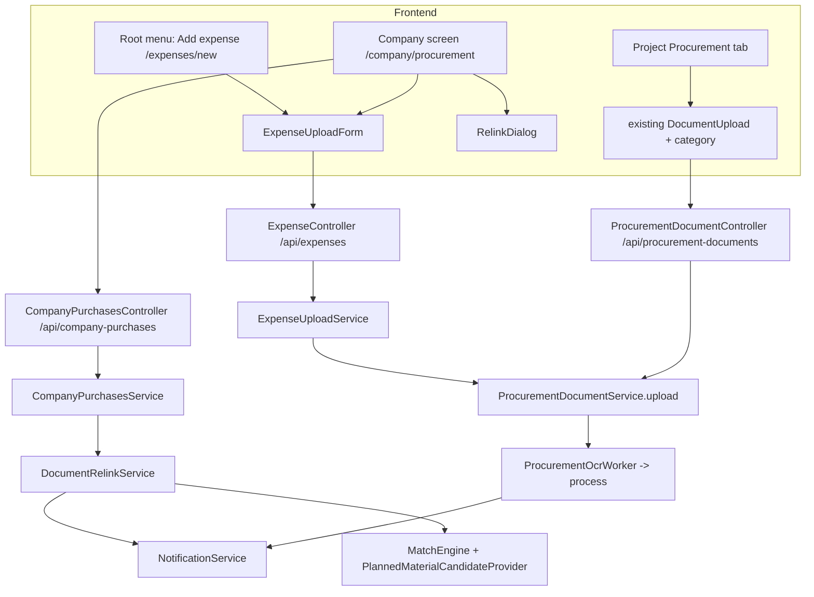

# Design Document: FOR-07-03 Company procurement

## Overview

A company expense is a `ProcurementDocument` with a nullable project. The design keeps the
FOR-06-03 upload/OCR pipeline and the FOR-06-04 line states, and adds:

- a nullable `project_id` and a document-level `expense_category_id` (2 changesets);
- a **role-gated, non-project-scoped** read/write layer for the company screen
  (`CompanyPurchasesController` + `CompanyPurchasesService`);
- a shared **expense upload** endpoint (`ExpenseController` + `ExpenseUploadService`) used by the
  company list and the universal root-menu entry;
- two ABAC resources (`COMPANY_PURCHASES`, `EXPENSE_UPLOAD`);
- frontend feature `company-procurement/` + `expense-upload/`.

### Key design decision: do not relax the project-scope guard

`ProjectScopedService.addRequiredQuery()` is `project.id IN (allowed)`; a `NULL` never matches, and
`assertProjectAccess` denies a null owning project (404). The interface javadoc forbids overriding
these and a guard test asserts the override set. Instead of relaxing the guard:

- the **per-project** services stay project-scoped and keep returning only project documents
  (ADMIN still bypasses, so ADMIN can touch no-project documents through them);
- the **company** layer is a separate service that is **not** `ProjectScopedService` and is gated by
  the ABAC role grant `COMPANY_PURCHASES`. The role grant itself defines "company-wide" access
  (ADMIN/FINANCIER/MANAGER).

This is a deliberate deviation from the OVERVIEW wording ("relax the guard to admit null") with the
same observable behavior and lower regression risk.

## Architecture



## Data model

### Changeset 207 — `207-procurement-documents-project-nullable.xml`
`ALTER TABLE procurement_documents ALTER COLUMN project_id DROP NOT NULL`, guarded by a precondition
(`SELECT is_nullable FROM information_schema.columns ... = 'NO'`, `onFail="MARK_RAN"`). FK and index kept.

### Changeset 208 — `208-procurement-documents-expense-category.xml`
Add `expense_category_id BIGINT NULL`, FK `fk_procurement_documents_expense_category` →
`unplanned_expense_categories(id)` `ON DELETE SET NULL`, index `ix_procurement_documents_category`;
also index `ix_procurement_documents_uploaded_at` on `uploaded_at DESC` when absent. Guarded by
`columnExists` preconditions.

### Changesets 209 / 210 — resource seeds
`209-seed-company-purchases-resource.xml`, `210-seed-expense-upload-resource.xml`, following
`187-seed-company-schedule-resource.xml` (resource row guarded by `MARK_RAN`; per-role grant blocks
are `INSERT ... SELECT ... WHERE NOT EXISTS`). Matrix:

| Resource | ADMIN | FINANCIER | MANAGER | FOREMAN | WORKER | ESTIMATOR | CLIENT |
|---|---|---|---|---|---|---|---|
| COMPANY_PURCHASES | R U D | R U D | R | – | – | – | – |
| EXPENSE_UPLOAD | R C | R C | R C | R C | R C | – | – |

(R=READ, C=CREATE, U=UPDATE, D=DELETE.) Registered last in `changelog.xml`.
Next free number is 207 (tail `206-seed-bank-ledger-resource.xml`); if a sibling spec lands first,
take the next free numbers in the same order.

### Entity changes
`ProcurementDocumentEntity`: `project` → `@ManyToOne(LAZY, optional = true) @JoinColumn(name="project_id")`;
new `expenseCategory` (`@ManyToOne(LAZY)`, `expense_category_id`). No other entity changes.

## Backend components

### Null-safety changes in `ProcurementDocumentService`
- `uploadDocument(Long projectId, MultipartFile, Long expenseCategoryId)`:
  `if (projectId != null) assertProjectActive(projectId)`; namespace
  `projectId == null ? "procurement/company/" : "procurement/" + projectId + "/"`;
  validates category (`active`) before storing anything; sets `expenseCategory` reference.
- `process(...)`: `keyNamespace` same rule + `/processed/`; `candidates = projectId == null ? List.of() : candidateProvider.candidatesFor(projectId)`.
  After `buildLines`, `applyExpenseCategory(document, freshLines)`: for each fresh line with
  `matchStatus == UNMATCHED` set `unplannedCategory`. Preserved manual lines untouched.
- `reprocess(id)`: `if (project != null) assertProjectActive(...)`.
- Overloads keep the existing signatures (delegating with `expenseCategoryId = null`) to avoid
  breaking callers/tests.
- `upload(...)` keeps `UploadPaymentRequest`; the cash handler is called unchanged (FOR-07-04
  already supports null project).

### `ExpenseUploadService` (new, not project-scoped)
```java
ExpenseUploadResult create(MultipartFile file, Long projectId, Long expenseCategoryId, UploadPaymentRequest payment)
ExpenseOptions options()
```
- `create`: reject `LINKED_FROM_LEDGER` / `FIND_BANK_TRANSACTION` (`error.expense.upload.paymentChoiceNotAllowed`);
  if `projectId != null` and caller not ADMIN, require `projectAccessCache.get(userId).contains(projectId)`
  else 404 `error.entity.not.found`; delegate to `ProcurementDocumentService.upload(projectId, file, expenseCategoryId, payment)`.
- `options`: ADMIN → all `ACTIVE` projects; others → `ACTIVE` projects in the cache set; active
  categories ordered by localized name; cash accounts only if the caller holds `BANK_LEDGER/READ`
  (checked via `ForemenPermissionEvaluator`).
- `status(id)`: allowed for the document's uploader or a caller with `COMPANY_PURCHASES/READ`;
  otherwise 404.

### `ExpenseController` — `/api/expenses`, `@PermissionResource("EXPENSE_UPLOAD")`
| Method | Path | Permission |
|---|---|---|
| POST | `/` | `@RequiresPermission(EXPENSE_UPLOAD, CREATE)` |
| GET | `/options` | `@RequiresPermission(EXPENSE_UPLOAD, READ)` |
| GET | `/{id}/status` | `@RequiresPermission(EXPENSE_UPLOAD, READ)` (service enforces uploader/READ) |

### `CompanyPurchasesService` (new, not project-scoped)
Queries use Criteria on `ProcurementDocumentEntity` (left-join `project`, `uploadedBy`,
`expenseCategory`) with predicates:
- `projectId` → `project.id = :p`; `noProject` → `project IS NULL`; both → 400 conflict;
- `linkStatus` on documents → `EXISTS` subquery over lines with the status predicate
  (`NO_PROJECT` ⇒ `project IS NULL`; `LINKED` ⇒ `matchStatus IN (AUTO, MANUAL_MATCHED)`;
  `CLASSIFIED` ⇒ `matchStatus IN (UNMATCHED, MANUAL_UNMATCHED) AND unplannedCategory IS NOT NULL`;
  `UNLINKED` ⇒ `project IS NOT NULL AND matchStatus IN (UNMATCHED, MANUAL_UNMATCHED) AND unplannedCategory IS NULL`);
- date range, uploader, category, `q` (`lower(supplierName) LIKE` / `invoiceNumber`).
Line counts per Link_Status come from one grouped query for the page's document ids (no N+1).
Linking-state is computed by a pure `LinkStatusResolver.resolve(hasProject, matchStatus, unplannedCategoryPresent)`.

Reads of a single document reuse `ProcurementDocumentServiceMapper` + `resolveReadFields` (extracted
to a package-private helper `ProcurementReadFields` so both services share URL signing and name
resolution without the project-scope check). Matched names come from
`candidateProvider.candidatesFor(projectId)` for project documents.

### `DocumentRelinkService` (new)
`relink(documentId, projectId)` in one `@Transactional`:
1. load document (404), validate `projectId` non-null, project exists + `ACTIVE`, not same project, status terminal (`PARSED`/`FAILED`/`UPLOADED`-with-OCR-disabled);
2. `candidates = candidateProvider.candidatesFor(projectId)`; for each line:
   - `AUTO`/`UNMATCHED` → re-run `MatchEngine` (same call used by `buildLines`), set match fields;
   - `MANUAL_MATCHED` and project **changed** (previous project non-null) and material not in candidates → reset to `UNMATCHED`/`NONE`, count `resetLines`;
   - `MANUAL_*` otherwise preserved;
   - lines that are now matched: `unplannedCategory = null`; lines unmatched without a category and `document.expenseCategory != null`: apply category;
   - `MatchEngine.satisfiesInvariant` asserted before persist;
3. set project, `saveAudit(old, saved, "UPDATE")`, publish nothing else;
4. after commit emit `notification.procurement.relinked` through `ProcurementRelinkNotificationEmitter`
   (`@TransactionalEventListener(AFTER_COMMIT)` + `REQUIRES_NEW`, best-effort).
Returns `RelinkResult(document row, matchedLines, resetLines)`.

### `CompanyPurchasesController` — `/api/company-purchases`, `@PermissionResource("COMPANY_PURCHASES")`
| Method | Path | Permission |
|---|---|---|
| GET | `/documents` | READ |
| GET | `/documents/{id}` | READ |
| GET | `/lines` | READ |
| PUT | `/documents/{id}/project` | UPDATE |
| POST | `/documents/{id}/reprocess` | UPDATE |
| DELETE | `/documents/{id}` | DELETE |

Reprocess/delete delegate to `ProcurementDocumentService.reprocess/deleteById`. Because those start
with `assertProjectAccess`, which would deny a non-ADMIN FINANCIER for a no-project document, the
company service calls new package-visible `*Unchecked` variants (authorization already enforced by the
ABAC role grant on the company endpoint). The per-project endpoints keep the guard.

### DTOs (`controller/model`)
- `CompanyDocumentRowDto(id, projectId, projectName, supplierName, documentTotal, status, failureReason, uploadedAt, uploaderName, expenseCategoryId, expenseCategoryName, paymentStatus, ledgerEntries, lineCount, Map<LinkStatus,Integer> linkCounts, rawImageUrl, processedImageUrl)` — image URLs only on `/documents/{id}` and for the viewer-open call; list rows carry `hasImages`.
- `CompanyLineRowDto(lineId, documentId, documentSupplierName, documentUploadedAt, projectId, projectName, lineNo, rawName, quantity, unitHint, unitPrice, lineTotal, manufacturerHint, matchedMaterialId, matchedMaterialName, matchTier, matchStatus, unplannedCategoryId, unplannedCategoryName, linkStatus)`.
- `RelinkRequest(Long projectId)`, `RelinkResponse(CompanyDocumentRowDto document, int matchedLines, int resetLines)`.
- `ExpenseOptionsDto(List<ProjectOption> projects, List<CategoryOption> categories, boolean canChooseCashAccount, List<CashAccountOption> cashAccounts)`.
- `LinkStatus` enum: `NO_PROJECT, LINKED, UNLINKED, CLASSIFIED`.

### Notification emitters
- New `ProcurementRelinkNotificationEmitter` → type key `notification.procurement.relinked`, body built
  from `supplier|invoiceNumber|#id` and project name, deep link
  `/projects/{projectId}/procurement?doc={id}`. Skip if actor == uploader.
- `ProcurementOcrNotificationEmitter.deepLink(projectId, documentId, recipientCanReadCompany)`: project
  present → existing link; absent → `/company/procurement?doc={id}` if the recipient holds
  `COMPANY_PURCHASES/READ`, else `null`.

### Error codes (backend bundle, PL + RU)
`error.expense.category.unknown` (400), `error.expense.upload.projectForbidden` (404 alias via
`error.entity.not.found`; code kept for explicit validation text), `error.expense.upload.paymentChoiceNotAllowed` (400),
`error.companyProcurement.filter.conflict` (400), `error.companyProcurement.relink.projectRequired` (400),
`.sameProject` (409), `.processing` (409). Reuses `error.purchases.stage.notActive`.

## Frontend

```
src/features/expense-upload/
  api/expense-api.ts          createExpense (multipart), fetchExpenseOptions, fetchExpenseStatus
  components/ExpenseUploadForm.tsx   file, project, category, cash toggle (+amount/date)
  components/ExpenseUploadPage.tsx   /expenses/new, status polling, "Add another"
  components/ExpenseUploadDialog.tsx dialog wrapper (company screen, ledger dialog)
  schemas/expenseSchema.ts    zod: file required, cashAmount > 0 when paidInCash
  types/index.ts, __tests__/
src/features/company-procurement/
  api/company-purchases-api.ts   list documents / lines / document, relink, reprocess, delete
  components/CompanyProcurementPage.tsx, FilterBar.tsx, DocumentGroupRow.tsx, FlatLinesTable.tsx,
             LinkStatusBadge.tsx, RelinkDialog.tsx, DocumentActions.tsx
  hooks/useCompanyProcurementFilters.ts   URL-synced filters
  lib/linkStatus.ts, types/index.ts, __tests__/
```

- Reuse `DocumentImageViewer`, `DocumentStatusBadge`, `PaymentStatusBadge`, `LedgerLinksCell` from
  `project-execution/procurement`.
- Project Procurement tab `DocumentUpload` gets a category `Select` (options from
  `/api/expenses/options`, falling back to the categories endpoint when the caller lacks
  `EXPENSE_UPLOAD`); `uploadProcurementDocument` appends `expenseCategoryId` when set.
- `navigation.ts`: `/company/procurement` → `COMPANY_PURCHASES/READ`; new main-section item
  `/expenses/new` (`nav.addExpense`, `receipt`, `bottomNav: true`, `EXPENSE_UPLOAD/CREATE`).
- `route-permissions.ts`: add `/company/procurement` and `/expenses/new`; `router.tsx`: lazy routes.
  Update tests asserting the old `PURCHASES/READ` for `/company/procurement`
  (`navigation.test.ts`, `route-permissions.for0704.test.ts`, `route-permissions.for0706.test.ts`).
- Locales: `nav.addExpense`, `companyProcurement.*`, `expense.*`, `notification.procurement.relinked`,
  and the new `error.*` keys, in `pl.json` and `ru.json` (identical key sets).
- FOR-07-04 `UploadInvoiceDialog`: project picker becomes optional (empty ⇒ no `projectId`), upload
  still sends `paymentChoice=LINKED_FROM_LEDGER` through the existing project-document endpoint,
  which therefore must accept an **absent** `projectId` (see below).

### Upload endpoint compatibility
`POST /api/procurement-documents` today requires `projectId`. The ledger flow (`LINKED_FROM_LEDGER`)
needs an optional project, but `ExpenseController` forbids that choice. Resolution: keep
`projectId` **required** on the project endpoint, and let `UploadInvoiceDialog` call
`POST /api/procurement-documents/company` — a thin new handler on `ProcurementDocumentController`
(`@RequiresPermission(PURCHASES, CREATE)`, optional `projectId`, `paymentChoice` incl.
`LINKED_FROM_LEDGER`) used only by the ledger dialog when no project is chosen. Project-chosen ledger
uploads keep the existing endpoint.

## Correctness properties

1. **Invariant**: after any upload, OCR, relink or reprocess, every line satisfies
   `matchedMaterialId == null ⟺ matchTier == NONE ∧ matchStatus ∈ {UNMATCHED, MANUAL_UNMATCHED}`
   and `unplannedCategory != null ⟹ matchedMaterialId == null`.
2. **No-project ⇒ unmatched**: a document with no project has no `AUTO`/`MANUAL_MATCHED` line.
3. **Manual preservation**: relink between two projects never changes a `MANUAL_UNMATCHED` line and
   changes a `MANUAL_MATCHED` line only if its material is absent from the new candidate set.
4. **Link status totality**: `LinkStatusResolver` maps every `(hasProject, matchStatus, hasCategory)`
   to exactly one `LinkStatus`; the per-status counts of a document sum to `lineCount`.
5. **Visibility**: `/lines` and `/documents` return the union of project and no-project documents
   filtered by exactly the requested project filter; with `noProject=true` every row has `projectId == null`.
6. **Idempotent relink**: relinking to the project the document is already in is rejected and leaves
   state byte-for-byte unchanged.
7. **Storage keys**: never contain the substring `null`.

## Testing strategy

Backend (run per class with `--tests`, log to `/tmp/for-07-03-test.log`, read the JUnit XML):
- unit/property (jqwik): `LinkStatusResolverTest` + property (totality), `DocumentRelinkPropertyTest`
  (invariant + manual preservation), `ExpenseCategoryApplierTest`;
- service: `ProcurementDocumentServiceNoProjectTest` (namespace, no stage gate, empty candidates),
  `ExpenseUploadServiceTest` (membership, forbidden payment choices, cash validation),
  `DocumentRelinkServiceTest`, `ProcurementOcrNotificationEmitterTest` (deep link variants);
- integration (Testcontainers): `CompanyPurchasesControllerIT` (filters all/specific/none, role
  matrix: FINANCIER/MANAGER/FOREMAN/WORKER, relink 403 for MANAGER), `ExpenseControllerIT`
  (WORKER upload with/without project, non-member 404), `Changeset207208ItTest`
  (nullable project, existing rows intact), `PermissionAnnotationValidator` startup check.
- existing guard test `ProjectScopedServiceGuardTest` must stay green (guard untouched).

Frontend (vitest `--run`): `ExpenseUploadForm`, `ExpenseUploadPage`, `CompanyProcurementPage`
(filters, grouping toggle, link-status badges), `RelinkDialog`, nav/route-permission tests,
locale key parity test (pl vs ru).
