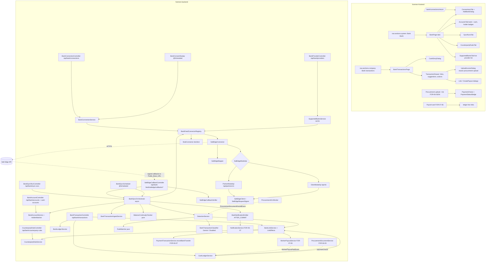

# Design Document: FOR-07-04 — Company money ledger (bank + cash)

## Overview

FOR-07-04 adds the company **money ledger**:
- bank connections (several banks, several accounts) are collected through a provider-agnostic
  **connector SPI** and normalized into one ledger;
- **cash** flows (cash accounts, manual cash entries, cash entries created by payroll and
  procurement) are recorded in the same ledger;
- every ledger line is **linked** to the entity it pays for or comes from — by a deterministic rule
  matcher, an AI classifier, and a user override that teaches a counterparty memory.

What is **reused as-is**:
- FOR-06-07 `ReconciliationService` / `ReconciliationEngine`, tranche status derivation, payment
  notifications (`payment.received`, `payment.tranchePaid`, `payment.amountMismatch`);
- FOR-07-06 `WorkerPayoutService.create(CreatePayoutRequest)` (distribution) and `markPaid(id)`;
- FOR-06-03 upload → async OCR pipeline (`ProcurementDocumentService.upload(projectId, file)`,
  `ProcurementOcrWorker`, `ImageStorage`, OCR notifications);
- `CompanyProfileEntity` (`fullName`, `nip`) for account-holder verification;
- `UnplannedExpenseCategory` dictionary (localized names);
- FOR-05-07 `NotificationService.create(recipientUserId, type, body, deepLink)`;
- Google Gen AI SDK client pattern (`GeminiMessageTranslationService`, `OcrHelpers` tolerant JSON);
- ABAC annotations, seed pattern (changeset 187), `components/data-table`, `NAV_CONFIG`.

What is **new**:

| Area | New |
|------|-----|
| Persistence | `bank_connections`, `bank_connection_secrets`, `bank_accounts` (BANK + CASH, holder match), `bank_sync_runs`, `bank_sync_run_accounts`, `bank_transactions` (channel, origin), `bank_transaction_links`, `bank_transaction_suggestions`, `bank_counterparty_rules`, `bank_balance_gaps`; 3 nullable columns on `procurement_documents` |
| Backend | `BankFeedConnector` SPI; `SaltEdgeConnector` with two mode APIs (`PARTNER` / `CLIENT`), client, signer, callback verifier, mapper; `StubConnector`; supported-banks service; sync orchestrator; ingest; balance checker; holder matcher; rule matcher (+ reverse document matching); AI classifier; link service with effects; counterparty memory; cash ledger service; notification emitter; consent sweep |
| FOR-06-07 seam | `PaymentTransactionService.recordBankTransfer(scheduleId, BankTransferInput)` |
| FOR-07-06 seams | `WorkerPayoutPaidEvent` published by `markPaid`; `markPaidFromLedger(id, paidAt, channel)`; payout DTO `ledgerEntries` |
| FOR-06-03/04 seams | OCR prompt/parser + fields `supplierNip`, `invoiceNumber`, `invoiceDate`; `ProcurementDocumentParsedEvent`; upload `paymentChoice`; derived `paymentStatus` + `ledgerEntries` on document DTOs; "mark paid in cash" action |
| ABAC | `BANK_CONNECTIONS` (ADMIN, FINANCIER CRUD), `BANK_LEDGER` (ADMIN, FINANCIER, MANAGER CRUD) |
| Frontend | `features/bank` (Bank page in the **system / administration** section, 5 tabs + return route), `features/bank-transactions` (ledger list + drawer + cash entry form, **company** section), procurement upload "Paid in cash" checkbox + payment status, payroll card ledger links, locales |

**Spans two git repos** (`.kiro/steering/git-repo-structure.md`): changesets, backend, message
bundles and this spec in the root repo; `features/bank*`, procurement / payroll UI changes,
navigation, router, route-permissions and locales in `foremen-frontend/`. Two commits.

## Architecture



### Package layout (backend)

```
com.foremen.service.bank
  ├─ connector/          BankFeedConnector, BankFeedConnectorRegistry, ConnectorError(+Class),
  │                      NormalizedAccount, NormalizedTransaction, TransactionPage, AuthorizationStart,
  │                      ConnectionState, RefreshResult, CredentialField, ProviderBank, HolderInfo
  ├─ connector/saltedge/ SaltEdgeProperties, SaltEdgeMode, SaltEdgeClient, SaltEdgeRequestSigner,
  │                      SaltEdgeCallbackVerifier, SaltEdgeMapper, SaltEdgeErrorMapper,
  │                      SaltEdgeModeApi, ClientModeApi, PartnerModeApi, SaltEdgeConnector
  ├─ connector/stub/     StubConnector, StubProperties, StubDataStore
  ├─ secret/             BankSecretCipher (AES-GCM), BankConnectionSecretService
  ├─ sync/               BankSyncOrchestrator, BankSyncExecutorConfig, BankSyncScheduler,
  │                      BankConsentSweep, SyncRunRecorder
  ├─ ingest/             BankTransactionIngestService, IbanNormalizer, CounterpartyExtractor,
  │                      BalanceContinuityChecker
  ├─ account/            BankAccountService, HolderMatcher, SupportedBanksService
  ├─ cash/               CashLedgerService, PayoutCashHook, ProcurementCashHook
  ├─ detect/             DetectionService, RuleMatcher, MatchCandidate, CandidateProvider(s),
  │                      NameSimilarity, ReverseDocumentMatcher, BankTransactionClassifier,
  │                      GeminiBankTransactionClassifier, DisabledBankTransactionClassifier,
  │                      ClassifierAnswerValidator, BankAiProperties
  ├─ link/               BankLinkService, LinkEffects, LinkStatusDeriver, DocumentPaymentStatusDeriver,
  │                      CounterpartyRuleService
  ├─ notify/             BankNotificationEmitter + events
  └─ BankConnectionService, BankLedgerService, PublicBaseUrl
com.foremen.controller.bank  BankProviderController, BankConnectionController, BankAccountController,
                             BankSyncRunController, CounterpartyRuleController,
                             BankTransactionController, SaltEdgeCallbackController,
                             StubBankFeedController (conditional)
```

## Environment configuration (externalized)

Nothing environment-specific is hard-coded. Every environment sets its own values:

| Setting | Env var | local Docker | dev VM | production (FOR-12) |
|---------|---------|--------------|--------|---------------------|
| Public base URL | `FOREMEN_PUBLIC_BASE_URL` | `http://localhost:3000` (STUB only; Salt Edge needs a tunnel) | `https://dev.foremen.eu` | prod domain |
| Salt Edge enabled | `SALTEDGE_ENABLED` | `false` | `true` | `true` |
| Salt Edge mode | `SALTEDGE_MODE` | — | `CLIENT` (current Pending account) → `PARTNER` once granted | `PARTNER` |
| Keys | `SALTEDGE_APP_ID`, `SALTEDGE_SECRET`, `SALTEDGE_PRIVATE_KEY_PATH` | — | VM env / Secret Manager | Secret Manager |
| Partner lead | `SALTEDGE_LEAD_EMAIL` | — | finance mailbox | finance mailbox |
| Fake providers | `SALTEDGE_INCLUDE_FAKE` | — | `true` | `false` |
| STUB connector | `FOREMEN_BANK_STUB_ENABLED` | `true` | `false` | `false` |
| AI | `BANK_AI_ENABLED`, `BANK_AI_*` | `false` | optional | optional |
| Secrets key | `FOREMEN_BANK_SECRETS_KEY` | test key | VM env | Secret Manager |

`PublicBaseUrl` (bean) reads `foremen.public-base-url`. It has no default, strips a trailing slash,
and exposes `returnUrl(connectionId)` → `{base}/bank/connections/return?connectionId={id}` and
`callbackUrl(type)` → `{base}/api/bank-feed/saltedge/callbacks/{type}`. The Salt Edge connector is
unavailable when the base URL is blank, or when it is not HTTPS while `include-fake-providers=false`
(Live).

## Data model (Liquibase)

Next free changeset is **201** (tail: `200-seed-measurement-unit-m.xml`). If a sibling spec lands
first, take the next free numbers in the same order. All changesets: `NOT tableExists` /
`NOT columnExists` guards, `onFail="MARK_RAN"`, audit columns (`created_date`, `created_by`,
`last_modified_date`, `last_modified_by`) as in `BaseEntity`.

| Changeset | Content |
|-----------|---------|
| `201-create-bank-connections-accounts.xml` | `bank_connections`, `bank_connection_secrets`, `bank_accounts` (BANK + CASH, holder match), `bank_balance_gaps` |
| `202-create-bank-sync-runs-transactions.xml` | `bank_sync_runs`, `bank_sync_run_accounts`, `bank_transactions` (channel, origin) |
| `203-create-bank-links-suggestions-rules.xml` | `bank_transaction_links`, `bank_transaction_suggestions`, `bank_counterparty_rules` |
| `204-procurement-documents-invoice-fields.xml` | `procurement_documents.supplier_nip`, `invoice_number`, `invoice_date` |
| `205-seed-bank-connections-resource.xml` | resource `BANK_CONNECTIONS` + ADMIN/FINANCIER CRUD |
| `206-seed-bank-ledger-resource.xml` | resource `BANK_LEDGER` + ADMIN/FINANCIER/MANAGER CRUD |

### Tables

**`bank_connections`**

| Column | Type | Notes |
|--------|------|-------|
| `id` | bigserial PK | |
| `provider` | varchar(32) NOT NULL | `SALT_EDGE`, `STUB` |
| `provider_mode` | varchar(16) | Salt Edge mode the connection was created in (`PARTNER`, `CLIENT`) |
| `provider_code` | varchar(128) | provider's bank code (e.g. Salt Edge `provider_code`) |
| `bank_name` | varchar(255) | provider-reported name |
| `bank_logo_url` | varchar(512) | |
| `display_name` | varchar(255) | user editable |
| `external_customer_id` | varchar(64) | Client customer id / Partner lead customer id |
| `external_connection_id` | varchar(64) | UNIQUE (provider, external_connection_id) where not null |
| `external_consent_id` | varchar(64) | |
| `status` | varchar(24) NOT NULL | `PENDING_AUTH`, `ACTIVE`, `CONSENT_EXPIRING`, `REAUTH_REQUIRED`, `ERROR`, `DISABLED` |
| `consent_expires_at` | timestamptz | |
| `consent_expiring_notified_for` | varchar(64) | consent id already notified (R22 row 1, once per consent) |
| `holder_names` | jsonb | connection-level holder info (names, tax ids) when fetched |
| `last_sync_at`, `last_successful_sync_at`, `next_refresh_possible_at` | timestamptz | |
| `last_error_code` | varchar(64) | |
| `last_error_message` | text | raw provider text (support only) |
| `last_sync_failed_notified_at` | timestamptz | throttle R22 row 3 |
| audit | | |

**`bank_connection_secrets`** — `connection_id` PK/FK → `bank_connections` ON DELETE CASCADE,
`ciphertext` bytea NOT NULL, `iv` bytea NOT NULL (12 bytes), `key_version` smallint NOT NULL,
`updated_at` timestamptz, `updated_by` varchar.

**`bank_accounts`**

| Column | Type | Notes |
|--------|------|-------|
| `id` | bigserial PK | |
| `type` | varchar(8) NOT NULL | `BANK`, `CASH` |
| `connection_id` | FK, nullable | NOT NULL for BANK, NULL for CASH (CHECK) |
| `external_id` | varchar(64) | NOT NULL for BANK; UNIQUE (connection_id, external_id) |
| `name`, `nature`, `holder_name` | varchar | `name` is user data for CASH |
| `iban` | varchar(34) | normalized; index; null for CASH |
| `account_number` | varchar(64) | |
| `currency` | char(3) NOT NULL | |
| `balance`, `available_balance` | numeric(19,2) | provider balance (BANK) |
| `opening_balance` | numeric(19,2) NOT NULL default 0 | CASH |
| `default_for_cash` | boolean NOT NULL default false | partial UNIQUE (currency) WHERE type='CASH' AND default_for_cash |
| `archived` | boolean NOT NULL default false | CASH |
| `balance_updated_at` | timestamptz | |
| `included_in_ledger` | boolean NOT NULL | always true for CASH |
| `closed_at_provider` | boolean NOT NULL default false | |
| `has_balance_gap` | boolean NOT NULL default false | |
| `holder_match` | varchar(10) NOT NULL default 'UNKNOWN' | `MATCH`, `MISMATCH`, `UNKNOWN` (R3.7) |
| `holder_override_by`, `holder_override_at`, `holder_override_reason` | varchar / timestamptz / text | R3.8 |
| `transactions_cursor` | varchar(64) | last seen provider transaction id |
| audit | | |

**`bank_balance_gaps`** — `id`, `account_id` FK, `period_from`, `period_to` timestamptz,
`expected` / `actual` / `difference` numeric(19,2), `acknowledged_at`, `acknowledged_by`, `note`,
`created_date`.

**`bank_sync_runs`** — `id`, `connection_id` FK, `trigger` varchar(16) (`CALLBACK`, `SCHEDULE`,
`MANUAL`, `CONNECT`), `status` varchar(16) (`QUEUED`, `RUNNING`, `SUCCEEDED`, `PARTIAL`, `FAILED`),
`started_at`, `finished_at`, `stage` varchar(64) (last `notify` stage), `accounts_seen`,
`transactions_new`, `transactions_updated`, `pending_replaced`, `rows_skipped`, `to_review` int,
`error_class` varchar(32), `error_code` varchar(64), `error_message` text, `requested_by` varchar.
Index `(connection_id, started_at desc)`. A partial unique index `(connection_id) WHERE status IN
('QUEUED','RUNNING')` enforces one active run per connection.

**`bank_sync_run_accounts`** — `run_id` FK, `account_id` FK, `transactions_new`,
`transactions_updated`, `pending_replaced`, `status`, `error_code`.

**`bank_transactions`** (ledger lines, bank and cash)

| Column | Type | Notes |
|--------|------|-------|
| `id` | bigserial PK | |
| `account_id` | FK NOT NULL | |
| `channel` | varchar(8) NOT NULL | `BANK`, `CASH` (must equal the account type) |
| `origin` | varchar(10) NOT NULL | `BANK_FEED`, `MANUAL`, `SYSTEM`; CHECK: CASH ⇒ MANUAL/SYSTEM, BANK ⇒ BANK_FEED |
| `external_id` | varchar(64) | NOT NULL for BANK_FEED; partial UNIQUE (account_id, external_id) WHERE external_id IS NOT NULL |
| `system_source` | varchar(32) | for SYSTEM: `PAYROLL_PAYOUT`, `PROCUREMENT_CASH` |
| `system_source_id` | bigint | payout id / document id; partial UNIQUE (system_source, system_source_id) |
| `status` | varchar(8) NOT NULL | `PENDING`, `POSTED` (cash always POSTED) |
| `amount` | numeric(19,2) NOT NULL | signed, ≠ 0 |
| `currency` | char(3) NOT NULL | |
| `operation_date` | date NOT NULL | |
| `booking_date` | date | NOT NULL when POSTED (CHECK) |
| `title` | text | |
| `counterparty_name` | varchar(255) | |
| `counterparty_iban` | varchar(34) | normalized; index |
| `counterparty_key` | varchar(300) | `IBAN:{iban}` or `NAME:{normalized name}`; index |
| `provider_category` | varchar(64) | |
| `counterparty_raw`, `provider_payload` | jsonb | |
| `link_status` | varchar(20) NOT NULL | derived cache (`LinkStatusDeriver`) |
| `ignored_reason` | text | non-null ⇔ IGNORED |
| `ignored_by`, `ignored_at` | | |
| `reviewed_at`, `reviewed_by` | | set when AUTO_LINKED is confirmed |
| `ai_classified_at` | timestamptz | once-per-transaction guard (R15.6) |
| `ingested_at`, `last_seen_at` | timestamptz NOT NULL | |
| `first_sync_run_id` | FK | to count `toReview` per run |
| `created_by_user` | varchar | MANUAL entries |
| audit | | |

Indexes: `(booking_date desc)`, `(link_status)`, `(account_id, booking_date)`, `(channel)`.

**`bank_transaction_links`**

| Column | Type | Notes |
|--------|------|-------|
| `id` | bigserial PK | |
| `transaction_id` | FK NOT NULL ON DELETE CASCADE | |
| `kind` | varchar(24) NOT NULL | `WORKER_PAYOUT`, `PROCUREMENT`, `CLIENT_PAYMENT`, `OTHER_EXPENSE`, `OTHER_INCOME`, `INTERNAL_TRANSFER` |
| `amount` | numeric(19,2) NOT NULL CHECK > 0 | |
| `worker_payout_id` | FK → `worker_payouts` | index |
| `procurement_document_id` | FK → `procurement_documents` | ON DELETE SET NULL + link flagged; index |
| `payment_schedule_id` | FK → `payment_schedules` | |
| `payment_transaction_id` | FK → `payment_transactions` | set after reconcile ⇒ locked |
| `project_id` | FK → `projects` | |
| `unplanned_category_id` | FK → `unplanned_expense_categories` | |
| `counter_account_id` | FK → `bank_accounts` | internal transfer (bank ↔ bank, bank ↔ cash) |
| `source` | varchar(8) NOT NULL | `RULE`, `AI`, `MANUAL` |
| `confidence` | numeric(4,3) | |
| `confirmed_at`, `confirmed_by` | | null ⇒ unconfirmed auto link |
| `note` | text | |
| audit | | |

A CHECK per kind enforces the required target column (R13.3).

**`bank_transaction_suggestions`** — the same target columns as links (no `payment_transaction_id`),
plus `rank` smallint, `rationale` varchar(300), `status` (`OPEN`, `CONFIRMED`, `REJECTED`,
`SUPERSEDED`), `source`, `confidence`, `created_date`.

**`bank_counterparty_rules`** — `id`, `counterparty_key` varchar(300) UNIQUE, `display_name`,
`target_kind` (link kind), `worker_id` FK users, `supplier_name` varchar, `supplier_nip` varchar(10),
`project_id` FK, `payment_schedule_id` FK, `unplanned_category_id` FK, `counter_account_id` FK,
`enabled` boolean, `hits` int, `last_used_at`, `origin` (`LEARNED`, `MANUAL`), audit.

**`procurement_documents` (204)** — `supplier_nip varchar(10)`, `invoice_number varchar(64)`,
`invoice_date date`, all nullable; index `(invoice_number)`. `Document_Payment_Status` is **derived**
(no column) from Σ link amounts vs `document_total`: none → `UNMATCHED`; Σ < total (or total
unknown and Σ > 0) → `PARTIALLY_PAID`; Σ ≥ total → `PAID`.

### Seeds (205, 206)

Same two-changeSet shape as `187-seed-company-schedule-resource.xml`:
1. insert resource (`code`, `name_ru`, `name_pl`, `description_ru`, `description_pl`) guarded by
   `SELECT COUNT(*) FROM resources WHERE code = '…'` = 0;
2. per role (`ADMIN`, `FINANCIER` [, `MANAGER` for `BANK_LEDGER`]) insert `role_resources` +
   `role_resource_operations` for `CREATE`, `READ`, `UPDATE`, `DELETE`, guarded with `NOT EXISTS`.

| Code | name_ru | name_pl |
|------|---------|---------|
| `BANK_CONNECTIONS` | Банковские подключения | Połączenia bankowe |
| `BANK_LEDGER` | Банковские операции | Operacje bankowe |

These are seed-row values of the existing `resources` table, not new i18n columns.

## Connector SPI

```java
public interface BankFeedConnector {
    FeedProvider provider();
    boolean isAvailable();
    List<CredentialField> credentialFields();                 // empty for SALT_EDGE
    List<ProviderBank> listBanks(String countryCode);         // live supported-bank catalogue
    AuthorizationStart startAuthorization(BankConnectionRef c, String providerBankCode, URI returnUrl);
    ConnectionState completeAuthorization(BankConnectionRef c, Map<String, String> returnParams);
    AuthorizationStart startReconnect(BankConnectionRef c, URI returnUrl);
    RefreshResult requestRefresh(BankConnectionRef c, RefreshMode mode); // INTERACTIVE | BACKGROUND
    ConnectionState fetchConnectionState(BankConnectionRef c);
    Optional<HolderInfo> fetchHolderInfo(BankConnectionRef c);  // empty when unsupported
    List<NormalizedAccount> fetchAccounts(BankConnectionRef c);
    TransactionPage fetchTransactions(BankConnectionRef c, NormalizedAccountRef a, String cursor);
    void disable(BankConnectionRef c);
}

record ProviderBank(String code, String name, String logoUrl, String homeUrl, String status,
    String mode, boolean regulated, Set<String> accountTypes, Set<String> fetchScopes,
    boolean automaticFetch, Integer maxConsentDays, Integer maxFetchInterval,
    boolean requiresOwnKeys, boolean testBank) {}

record HolderInfo(List<String> names, List<String> taxIds) {}

record NormalizedAccount(String externalId, String name, String nature, String iban,
    String accountNumber, String currency, BigDecimal balance, BigDecimal availableBalance,
    String holderName, Instant balanceAt) {}

record NormalizedTransaction(String externalId, TxnStatus status, BigDecimal amount,
    String currency, LocalDate operationDate, LocalDate bookingDate, String title,
    String counterpartyName, String counterpartyIbanRaw, String providerCategory,
    JsonNode counterpartyRaw, JsonNode payload, boolean providerDuplicate) {}

record TransactionPage(List<NormalizedTransaction> posted, List<NormalizedTransaction> pending,
    String nextCursor, boolean complete, int skippedMalformed) {}

record ConnectionState(ConnectionStatusHint status, String externalConnectionId,
    String externalConsentId, Instant consentExpiresAt, Instant nextRefreshPossibleAt,
    String providerCode, String bankName, String bankLogoUrl) {}

sealed class ConnectorError extends RuntimeException  // errorClass: CONFIG|REAUTH|LIMIT|PROVIDER|TRANSIENT
```

`BankConnectionRef` is a read-only view (`id`, `provider`, `providerMode`, external ids,
`providerCode`), so connectors never see JPA entities. `BankFeedConnectorRegistry` maps
`FeedProvider → connector` from all beans; `available()` lists providers with `isAvailable()`.

### StubConnector (dev/test)

`@ConditionalOnProperty("foremen.bank-feed.stub.enabled", havingValue = "true")`.
- Authorization is immediate: `authorizationUrl = PublicBaseUrl.returnUrl(id) + "&stub=1"`.
- `listBanks` returns two stub banks: one business, one personal.
- `StubDataStore` (in-memory, per connection) holds the accounts, holder info and transactions
  seeded via `POST /api/bank/stub/connections/{id}/data` (`StubBankFeedController`, same condition,
  `BANK_CONNECTIONS`/UPDATE).
- It honours cursors and pending lists like a real provider, so the whole ledger flow runs in the
  Docker stack.

Stub seed body (replaces the stub data of the connection; `mode=APPEND` adds to it):

```json
{ "mode": "REPLACE",
  "state": { "status": "ACTIVE", "consentExpiresAt": "2027-05-01T00:00:00Z" },
  "holder": { "names": ["Foremen Sp. z o.o."], "taxIds": ["5250000000"] },
  "failNextFetch": null,
  "accounts": [ { "externalId": "acc-1", "name": "Firmowe PLN", "nature": "account",
                  "iban": "PL61109010140000071219812874", "currency": "PLN",
                  "balance": 10000.00, "availableBalance": 10000.00,
                  "holderName": "Foremen Sp. z o.o." } ],
  "transactions": [ { "accountExternalId": "acc-1", "externalId": "t-1", "status": "POSTED",
                      "amount": -1500.00, "currency": "PLN", "operationDate": "2026-11-02",
                      "bookingDate": "2026-11-02", "title": "Wynagrodzenie 10/2026",
                      "counterpartyName": "Jan Kowalski",
                      "counterpartyIban": "PL27114020040000300201355387" } ] }
```

Stub fields:
- `state.status` accepts `ACTIVE | REAUTH | DISABLED`;
- `consentExpiresAt` drives `CONSENT_EXPIRING`;
- `failNextFetch` (`CONFIG | REAUTH | LIMIT | PROVIDER | TRANSIENT`) makes the next
  `fetchTransactions` throw that error class once (TRANSIENT is thrown for every retry of that run);
- `holder` drives `Holder_Match`.

## Salt Edge connector (detailed)

Two access modes, selected per environment by `foremen.bank-feed.saltedge.mode`:

| | `PARTNER` (production target) | `CLIENT` (current account) |
|---|---|---|
| Licence | Salt Edge's PSD2 licence; no own AISP licence or bank developer keys | own licence / own bank keys (PKO etc. return `ProviderKeyNotFound` without them) |
| Base URL | `https://www.saltedge.com/api/partners/v1` | `https://www.saltedge.com/api/v6` |
| Company identity | **lead** = `lead-email` (`POST /leads`, create-or-return) → `customer_id` | **customer** = `customer-identifier` (`POST /customers`) |
| Session | lead session create / reconnect / refresh → `redirect_url` | `POST /connections/connect` / `{id}/reconnect` / `{id}/refresh` → `connect_url` |
| Revocation on disable | partner consent revoke (mandatory for Live) | AIS consent revoke + `DELETE /connections/{id}` |
| Data reads | `/connections`, `/accounts`, `/transactions` under the Partners base | same under v6 |
| Live checklist | fake banks `fake_oauth_client_xf` + `fake_client_xf` + one sandbox handled; signing; partner consent revoked on delete; refresh + reconnect; team 2FA; end-user terms accepted | signing; HTTPS callbacks; integration review |

`SaltEdgeModeApi` is the internal port with both implementations (`PartnerModeApi`,
`ClientModeApi`). `SaltEdgeConnector` depends only on the port, so switching the mode is a
configuration change. Partners routes and field names are pinned against the Partners API v1
reference in task 5.5 and covered by fixtures. A connection keeps the `provider_mode` it was
created in; after a mode switch, old-mode connections stay readable as history, and the user adds
the banks again under the new mode.

### Configuration

```yaml
foremen:
  public-base-url: ${FOREMEN_PUBLIC_BASE_URL:}     # required per environment, no default
  bank-feed:
    sync:
      cron: "0 30 6 * * *"          # Europe/Warsaw; "-" disables
      zone: Europe/Warsaw
      stale-after: 30m
      executor: { core: 2, max: 4, queue: 50 }
    consent:
      warn-days: 14
      sweep-cron: "0 0 7 * * *"
    stub:
      enabled: ${FOREMEN_BANK_STUB_ENABLED:false}
    saltedge:
      enabled: ${SALTEDGE_ENABLED:false}
      mode: ${SALTEDGE_MODE:CLIENT}                 # PARTNER | CLIENT
      base-url: ${SALTEDGE_BASE_URL:}               # blank ⇒ default for the mode
      app-id: ${SALTEDGE_APP_ID:}
      secret: ${SALTEDGE_SECRET:}
      private-key-path: ${SALTEDGE_PRIVATE_KEY_PATH:}
      callback-public-key: ${SALTEDGE_CALLBACK_PUBLIC_KEY:}   # blank ⇒ bundled key (classpath)
      customer-identifier: ${SALTEDGE_CUSTOMER_IDENTIFIER:foremen-company}   # CLIENT
      lead-email: ${SALTEDGE_LEAD_EMAIL:}                                    # PARTNER
      fetch-days: 89
      include-fake-providers: ${SALTEDGE_INCLUDE_FAKE:true}
      country-codes: [PL]
      banks-cache-ttl: 1h
      http-timeout: 60s
  bank-ledger:
    match: { auto-threshold: 0.90, suggest-threshold: 0.50, margin: 0.20, max-suggestions: 3 }
    holder: { name-similarity: 0.80 }
    ai:
      enabled: ${BANK_AI_ENABLED:false}
      model: gemini-3.8-flash
      project: ${BANK_AI_PROJECT:}          # Vertex; blank ⇒ keyed Gemini Developer API
      location: ${BANK_AI_LOCATION:europe-central2}
      credentials-location: ${BANK_AI_CREDENTIALS:}
      max-per-run: 200
  bank-secrets:
    key: ${FOREMEN_BANK_SECRETS_KEY:}       # base64 32 bytes; key-version 1
```

Local values come from `.secrets/saltedge.env`. The dev VM takes them from its env / Secret Manager,
production from Secret Manager (FOR-12). `.env.example` lists every variable with empty values.

### `SaltEdgeClient`

Spring `RestClient` with `http-timeout`, JSON (Jackson), and the mode's base URL. Every call goes
through `exchange(method, pathAndQuery, bodyOrNull)`:
1. serialize the body once to a `String` (the same bytes are signed and sent);
2. set headers `Accept`, `Content-type`, `App-id`, `Secret`;
3. when a private key is configured, add `Expires-at = now + 60 s` and
   `Signature = SaltEdgeRequestSigner.sign(expiresAt, METHOD, fullUrl, body)`;
4. on non-2xx, parse `{error:{class,message,request_id}}` →
   `SaltEdgeErrorMapper.toConnectorError`;
5. retry `TRANSIENT` 3× with backoff 1 s / 4 s / 16 s; throw the other classes;
6. log at DEBUG with redacted headers; never log the body at INFO.

Paginated reads loop on `meta.next_id` (`from_id=` next) until null.

### `SaltEdgeRequestSigner` (pure)

`sign(long expiresAt, String method, String fullUrl, String body)` →
`Base64(RSA_SHA256(privateKey, expiresAt + "|" + METHOD + "|" + fullUrl + "|" + (body == null ? "" : body)))`.
The `fullUrl` includes the query string exactly as sent. The public half is uploaded to the Salt
Edge dashboard (Keys & Secrets → Public key).

### `SaltEdgeCallbackVerifier` (pure)

`verify(String callbackUrl, byte[] rawBody, String signatureB64, String keyVersion)` → boolean:
RSA-SHA256 verify of `callbackUrl + "|" + rawBodyAsUtf8` with the public key for `keyVersion` (the
bundled documented key; a configured key overrides it). `callbackUrl` =
`PublicBaseUrl.callbackUrl(type)` — the exact URL registered for that environment.

### Identity (customer / lead)

`ensureIdentity()`:
- **CLIENT** — reuse the `external_customer_id` stored on any Salt Edge connection (cached); else
  `POST /customers {data:{identifier: customer-identifier}}` → `data.customer_id`; on
  `DuplicatedCustomer`, `GET /customers` (paginated) and pick the matching `identifier`.
- **PARTNER** — `POST /leads {data:{email: lead-email}}` (create-or-return) → `data.customer_id`.
  Salt Edge e-mails the lead to verify the address / set up the Salt Edge dashboard account on the
  first connection.

### Connect / reconnect / refresh

```mermaid
sequenceDiagram
    participant U as FINANCIER (browser)
    participant FE as Foremen UI
    participant BE as Foremen backend
    participant SE as Salt Edge
    participant Bank as Bank (PKO / Erste)
    U->>FE: Bank > Supported banks (or Connections > Add bank), pick bank
    FE->>BE: POST /api/bank/connections {provider: SALT_EDGE, providerBankCode}
    BE->>BE: create PENDING_AUTH connection (provider_mode = configured mode)
    BE->>SE: ensure identity (customer / lead) ; open session (connect / lead session)
    SE-->>BE: connect_url / redirect_url
    BE-->>FE: {connectionId, authorizationUrl}
    FE->>SE: redirect to widget (Partner: lead e-mail + end-user terms)
    SE->>Bank: redirect (PolishAPI) — login + SCA in bank app, consent + account choice at the bank
    Bank-->>SE: consent granted
    SE->>BE: POST {Public_Base_URL}/api/bank-feed/saltedge/callbacks/success (signed)
    BE-->>SE: 200 (then async)
    SE-->>U: redirect return_to ?connectionId=…&connection_id=…
    U->>FE: /bank/connections/return
    FE->>BE: POST /api/bank/connections/{id}/complete {externalConnectionId}
    BE->>SE: read connection + consent (+ holder info)
    BE->>BE: ACTIVE + Sync_Run(CONNECT) → accounts upsert + holder match
    BE->>SE: GET /accounts, GET /transactions (paged)
```

Session body (CLIENT `POST /connections/connect`; PARTNER lead session create uses the same
`consent` / `attempt` / `provider` / `widget` blocks):

```json
{ "data": {
    "customer_id": "<customer_id>",
    "consent":  { "scopes": ["accounts", "transactions", "<holder scope if supported>"],
                  "from_date": "<today-89d>" },
    "attempt":  { "fetch_scopes": ["accounts", "balance", "transactions", "holder_info?"],
                  "fetch_from_date": "<today-89d>",
                  "return_to": "<Public_Base_URL>/bank/connections/return?connectionId=<id>",
                  "custom_fields": { "foremenConnectionId": "<id>" } },
    "widget":   { "skip_provider_selection": true },
    "provider": { "code": "<provider_code>", "include_sandboxes": true },
    "return_connection_id": true,
    "return_error_class": true,
    "automatic_refresh": true,
    "categorization": "business" } }
```

The holder scope is added only when the chosen bank's `supported_fetch_scopes` include holder info.

`startReconnect` — the mode's reconnect endpoint, sent with a fresh `consent.from_date` and the
same `attempt` → widget URL.

`requestRefresh(INTERACTIVE)`:
1. read the connection;
2. if `next_refresh_possible_at > now` → `RefreshResult.notYet(at)`;
3. otherwise call the mode's refresh endpoint with `attempt.return_to` → widget URL (the user may
   need SCA).

`BACKGROUND` mode exists in the client but is not called by the scheduler (R9.6); the daily refresh
is Salt Edge's `automatic_refresh` / `daily_refresh`.

`fetchConnectionState` — read the connection and its latest consent, then map:
- `status=active` with the consent not expired → `ACTIVE`, or `CONSENT_EXPIRING` within `warn-days`;
- `inactive`, consent `expires_at <= now`, or `revoked_at != null` → `REAUTH_REQUIRED`;
- `disabled` → `DISABLED`.

`fetchHolderInfo` reads the connection's holder info (fetched with the `holder_info` scope): names
and, when present, tax ids. The exact route / attribute is pinned in task 5.4 / 5.5. It returns
empty when the bank does not support holder info.

`disable` revokes the consent (CLIENT: AIS consent; PARTNER: partner consent) and removes the
connection. `ConnectionNotFound` and already-revoked are treated as success.

### Supported banks (`listBanks`, `SupportedBanksService`)

`GET /providers?country_code=PL&include_sandboxes={include-fake}&exclude_inactive=true` (paginated).
When fake providers are enabled, a second call uses `country_code=XF`.

| Salt Edge provider attribute | `ProviderBank` field |
|---|---|
| `code`, `name`, `logo_url`, `home_url`, `status` | `code`, `name`, `logoUrl`, `homeUrl`, `status` |
| `mode` | `mode` |
| `regulated` | `regulated` |
| `supported_account_types` | `accountTypes` (business / personal) |
| `supported_fetch_scopes` | `fetchScopes` (holder info support) |
| `automatic_fetch`, `max_consent_days`, `max_fetch_interval` | same |
| country `XF` / name contains "Sandbox" | `testBank = true` |

`requiresOwnKeys`:
- **CLIENT mode** — run a second listing with `key_owner=saltedge`. Banks absent from it need own
  client keys (`requiresOwnKeys = true`).
- **PARTNER mode** — always `false`.

`SupportedBanksService` caches the merged list per (provider, mode, country) for `banks-cache-ttl`
and exposes `fetchedAt`; `refresh=true` bypasses the cache. An empty PL list (e.g. a Pending account,
which only exposes fake providers) is returned as-is with `emptyReason = PROVIDER_STATUS_LIMITED`
when the account status is Pending (detected from `ClientPending` or an empty PL list with fake
providers present), so the UI can explain it.

### Callbacks

`SaltEdgeCallbackController` (`/api/bank-feed/saltedge/callbacks`, no ABAC annotations;
`SecurityConfig`: `requestMatchers(POST, "/api/bank-feed/saltedge/callbacks/**").permitAll()`):

1. read the raw body (≤ 1 MB) as bytes; read `Signature` and `Signature-key-version`;
2. `verifier.verify(PublicBaseUrl.callbackUrl(type), body, sig, ver)`, else
   `401 error.bank.callback.unverified`;
3. parse `{data:{connection_id, customer_id, custom_fields, stage, error_class, error_message}, meta}`;
4. publish `SaltEdgeCallbackReceived(type, data)` and return `200 {}`;
5. the `@TransactionalEventListener(AFTER_COMMIT, fallbackExecution = true)` +
   `@Async("bankSyncExecutor")` handler then acts by type:
   - `success` → resolve the connection (`external_connection_id`, else
     `custom_fields.foremenConnectionId` with a matching customer) → `completeIfPending` →
     `orchestrator.enqueue(id, CALLBACK)`;
   - `fail` → `SaltEdgeErrorMapper.fromClass(error_class)` → status per R12.4, store the error, emit;
   - `notify` → update the latest run's `stage`;
   - `destroy` → `DISABLED`.

URLs to register in the Salt Edge dashboard of each environment (Settings → Callbacks, AIS) =
`PublicBaseUrl.callbackUrl(type)`. Example for dev (`FOREMEN_PUBLIC_BASE_URL=https://dev.foremen.eu`):

| Callback | dev URL |
|----------|---------|
| Success | `https://dev.foremen.eu/api/bank-feed/saltedge/callbacks/success` |
| Fail | `https://dev.foremen.eu/api/bank-feed/saltedge/callbacks/fail` |
| Notify | `https://dev.foremen.eu/api/bank-feed/saltedge/callbacks/notify` |
| Destroy | `https://dev.foremen.eu/api/bank-feed/saltedge/callbacks/destroy` |

### Data fetch + mapping (`SaltEdgeMapper`, pure)

| Salt Edge | Ledger |
|-----------|--------|
| account `id` | `NormalizedAccount.externalId` |
| `name`, `nature`, `currency_code`, `balance` | `name`, `nature`, `currency`, `balance` |
| `extra.available_amount` | `availableBalance` |
| `extra.iban` / `extra.account_number` | `iban` / `accountNumber` |
| `extra.client_name` ?: `extra.holder_name` | `holderName` |
| transaction `id` | `externalId` |
| `status` `posted` / `pending` | `POSTED` / `PENDING` |
| `amount` (signed), `currency_code` | `amount`, `currency` |
| `made_on` | `operationDate` |
| `extra.posting_date` ?: `made_on` | `bookingDate` (POSTED only) |
| `description` (+ `" · " + extra.information`) | `title` |
| `category` | `providerCategory` |
| INCOME: `extra.payer`, `extra.payer_information` | `counterpartyName`, `counterpartyIbanRaw` (first IBAN/NRB found) |
| EXPENSE: `extra.payee`, `extra.payee_information` | same |
| `duplicated` | `providerDuplicate` (skipped by ingest) |
| whole object | `payload` |

Transactions are read with `GET /transactions?connection_id&account_id&from_id={cursor}` (posted).
Pending rows use the pending listing of the active mode; tasks 5.4 / 5.5 confirm the exact parameter
or route against the API reference and pin it in code with a fixture. The cursor stored in
`bank_accounts.transactions_cursor` is the max posted id seen. On the first sync (no cursor) the
whole consent window is read.

### Error mapping (`SaltEdgeErrorMapper`, pure)

| `error.class` | `ConnectorError` class | Connection effect | User message key |
|---------------|------------------------|-------------------|------------------|
| `WrongClientCredentials`, `ClientDisabled`, `ClientPending`, `ClientRestricted`, `SignatureNotMatch`, `ExpiresAtInvalid`, `PublicKeyNotProvided`, `MissingSignature` | CONFIG | ERROR | `error.bank.provider.config` |
| `AispConsentExpired`, `AispConsentRevoked`, `ConnectionDisabled`, `InvalidCredentials`, `AispConsentNotFound`, Partners partner-consent expired / revoked | REAUTH | REAUTH_REQUIRED | `error.bank.provider.reauth` |
| `ConnectionCannotBeRefreshed`, `BackgroundFetchLimitExceeded`, `RateLimitExceeded` | LIMIT | unchanged; run PARTIAL | `error.bank.provider.limit` |
| `FakeConnectionsLimitReached`, `ConnectionLimitReached` | LIMIT | (connect fails) | `error.bank.provider.connectionLimit` |
| `ProviderUnavailable`, `ProviderInactive`, `ProviderDisabled` | PROVIDER | ERROR | `error.bank.provider.unavailable` |
| `ProviderKeyNotFound`, `MissingProviderCredentials` | PROVIDER | ERROR | `error.bank.provider.keysRequired` |
| `ConnectionNotFound` | REAUTH (on read) / success (on disable) | REAUTH_REQUIRED | `error.bank.provider.reauth` |
| other / HTTP 5xx / timeout | TRANSIENT | ERROR after retries | `error.bank.provider.transient` |

### Salt Edge dashboard setup and status path (per environment)

1. **Pending** (current CLIENT account): fake/sandbox providers only, at most 10 fake connections
   (delete old fake connections to free slots). `GET /providers?country_code=PL` returns nothing.
2. To leave Pending (Salt Edge docs "Dashboard statuses"):
   - fill **Applications** (name "Foremen", short description, website = the environment's
     `Public_Base_URL`, logo);
   - fill **Company** (legal name, NIP, REGON, address — as in KRS);
   - register the four **callback URLs** derived from the environment's `Public_Base_URL`;
   - press **Request Test Access**; review takes ≈ 2 business days.

   In the same request, ask to move the account to **Partner mode** (production target).
3. **Test** (90 days, ≤ 100 connections): live providers usable. In CLIENT mode, banks such as PKO BP
   still require own provider keys (`requiresOwnKeys`); in PARTNER mode they work directly.
4. **Live**:
   - HTTPS callbacks;
   - request signing on (upload the public key, set `SALTEDGE_PRIVATE_KEY_PATH`);
   - team 2FA, incident e-mail, integration review;
   - PARTNER: partner consent revoked on delete, refresh + reconnect working, end-user terms in our
     ToS;
   - `include-fake-providers=false`.

## Sync orchestration

`BankSyncOrchestrator.enqueue(connectionId, trigger, requestedBy)`:
1. insert `bank_sync_runs(QUEUED)`. The partial unique index makes a second active run fail →
   catch it → mark "follow-up requested" on the active run (coalescing);
2. after commit, submit `run(runId)` to `bankSyncExecutor` (a bounded `ThreadPoolTaskExecutor`,
   `@EnableAsync` config `BankSyncExecutorConfig`).

`run(runId)` (each step in its own short transaction):
1. set `RUNNING`; `state = connector.fetchConnectionState` → update the connection (status, consent,
   `nextRefreshPossibleAt`, bank name / logo). `REAUTH` / `DISABLED` → finish `FAILED`;
2. `holder = connector.fetchHolderInfo` → store `holder_names`;
   `accounts = connector.fetchAccounts` → `BankAccountService.upsert`:
   - new accounts get the default `includedInLedger` by nature and holder match;
   - missing accounts are marked `closedAtProvider`;
   - `HolderMatcher` runs for every bank account (R3.7–3.10);
3. per included bank account:
   - loop `fetchTransactions(cursor)` until `complete` →
     `BankTransactionIngestService.ingest(account, page, runId)` → counters; update the cursor;
   - `BalanceContinuityChecker.check(previous, newBalance, postedSince)` → on a gap, write
     `bank_balance_gaps` and publish an event;
4. `DetectionService.detectNew(runId)` for POSTED `BANK_FEED` rows first ingested in this run (rules
   synchronously, AI asynchronously);
5. finish `SUCCEEDED` / `PARTIAL` / `FAILED`; `to_review` = the count of this run's new rows in
   `To_Review`; publish `BankSyncFinished(runId)`; if a follow-up was requested, enqueue once more.

`BankSyncScheduler` (`@Scheduled(cron = "${foremen.bank-feed.sync.cron:-}", zone = …)`) enqueues
`SCHEDULE` for every `ACTIVE` / `CONSENT_EXPIRING` / `ERROR` connection and marks stale runs
`FAILED`. `BankConsentSweep` (`@Scheduled sweep-cron`):
- recomputes consent statuses;
- emits `consentExpiring` once per consent id;
- removes `PENDING_AUTH` connections older than 24 h (no accounts).

Single-node assumption, as for the existing sweeps; ShedLock is noted for multi-node (FOR-12).

## Ingest (`BankTransactionIngestService`)

Per `NormalizedTransaction` (pure helpers `IbanNormalizer`, `CounterpartyExtractor`), all rows get
`channel = BANK`, `origin = BANK_FEED`:
- `providerDuplicate` → skip (`rows_skipped++`).
- POSTED → find by `(account, externalId)`:
  - found → update the mutable fields (`title`, `counterparty*`, `bookingDate`, `providerCategory`,
    `payload`, `lastSeenAt`);
  - not found → insert with `link_status = UNLINKED`, `first_sync_run_id = runId`.

  A POSTED row whose `externalId` existed as PENDING is promoted in place (status → POSTED), and
  detection runs on it.
- PENDING list per account → delete the account's PENDING rows not present in the page's pending
  list; upsert the others (never linked).

`counterpartyKey` = `IBAN:{iban}` when an IBAN is present, else `NAME:{normalize(name)}` (lowercase,
strip diacritics, collapse whitespace, drop legal suffixes `sp. z o.o.`, `s.a.`, `sp.j.`).

`IbanNormalizer`: strip spaces / dashes and uppercase; 26 digits → `PL` + digits; validate mod-97.
An invalid IBAN keeps the raw value in `counterparty_raw` and sets `counterpartyIban = null`.

## Balance continuity (`BalanceContinuityChecker`, pure)

`check(prevBalance, prevAt, newBalance, newAt, postedBookedIn(prevAt, newAt])` →
`Optional<Gap(expected = prev + Σ, actual = new, diff)>` when `|diff| > 0.01`. The check is skipped
when either balance is null and for CASH accounts. "Booked in window" compares `bookingDate` with
the dates of the balance timestamps: inclusive of the new date, exclusive of the previous.

## Account holder verification (`HolderMatcher`, pure)

`match(holderNames, holderTaxIds, accountHolderName, companyFullName, companyNip)` → `MATCH |
MISMATCH | UNKNOWN`:
1. no company profile, or no holder data at all → `UNKNOWN`;
2. a normalized tax id (digits only, last 10) equals the normalized `companyNip` → `MATCH`;
3. any holder name (account-level first, then connection-level) normalized with the
   `counterpartyKey` normalizer has token similarity ≥ `holder.name-similarity` (0.8) with the
   normalized `companyFullName` → `MATCH`;
4. otherwise → `MISMATCH`.

`BankAccountService` applies it on every upsert and on a `CompanyProfile` change
(`CompanyProfileUpdatedEvent`, or a recompute on read when absent):
- a **new** `MISMATCH` account → `includedInLedger = false`;
- an **existing** included account turning `MISMATCH` stays included, flagged with the warning
  (R3.10);
- `PATCH /bank/accounts/{id} {includedInLedger: true}` on a `MISMATCH` account requires
  `holderOverrideReason` (`400 error.bank.holder.reasonRequired`) and records `holder_override_*` +
  audit.

## Cash ledger (`CashLedgerService`)

- **Cash accounts:** CRUD (`name`, `currency`, `openingBalance`, `defaultForCash`, `archived`).
  Setting `defaultForCash` clears it on the other cash accounts of the same currency. Balance =
  `opening_balance + Σ amount` of the account's entries (computed in the read model).
- **Manual entry** `createManual(CashEntryRequest{accountId, direction, amount, date,
  counterpartyName, title, link?})`:
  1. insert `channel=CASH`, `origin=MANUAL`, `status=POSTED`, signed amount from the direction;
  2. if a link is given → `BankLinkService.createLink` in the same transaction (the effects run as
     for bank lines; a cash `WORKER_PAYOUT` marks the payout paid with channel `CASH`; a cash
     `CLIENT_PAYMENT` records a `MANUAL`-channel `PaymentTransaction`).
- **Edit / delete:** allowed for MANUAL entries without locked links
  (`409 error.bank.entry.notEditable` otherwise). Deleting removes the unlocked links; payouts keep
  their status. SYSTEM entries are read-only (`409 error.bank.entry.systemReadOnly`).
- **`PayoutCashHook`** — `@EventListener` (synchronous, inside the payroll transaction) on
  `WorkerPayoutPaidEvent(payoutId, channel, paidAt, amount, currency, workerName, note,
  fromLedger)`. When `channel == CASH && !fromLedger` and no SYSTEM entry exists for
  (`PAYROLL_PAYOUT`, payoutId):
  1. resolve the `defaultForCash` account of the currency (create `"Cash {currency}"` + default when
     missing);
  2. insert a SYSTEM expense entry (`system_source = PAYROLL_PAYOUT`, `system_source_id =
     payoutId`);
  3. add a `WORKER_PAYOUT` link with `source = MANUAL`, confirmed by the paying user → `LINKED`.

  `BANK_TRANSFER` payouts create nothing.
- **`ProcurementCashHook`** — called by `ProcurementDocumentService` when the upload `paymentChoice
  = PAID_CASH` or on "Mark paid in cash"
  (`markPaidInCash(documentId, accountId?, amount, date?)`): it creates a SYSTEM expense entry
  (`PROCUREMENT_CASH`, documentId) and links `PROCUREMENT`. `amount` is required while
  `documentTotal` is unknown.

## Detection

### Candidate providers (DB reads)

| Provider | Direction | Candidates |
|----------|-----------|------------|
| `OwnAccountCandidates` | both | own bank account by IBAN → `INTERNAL_TRANSFER` |
| `CounterpartyRuleCandidates` | both | enabled rule by `counterpartyKey` → targets of the rule kind |
| `ClientScheduleCandidates` | INCOME | `FM-{id}` reference → that project's published schedule; else schedules whose project CLIENT member name/NIP matches the counterparty |
| `PayoutCandidates` | EXPENSE | `paymentChannel = BANK_TRANSFER` payouts: `PLANNED`, and `PAID` not fully linked, payout date within ±30 days |
| `ProcurementCandidates` | EXPENSE | documents with payment status `UNMATCHED` / `PARTIALLY_PAID`, uploaded / invoice date within −90..+30 days |
| `CategoryCandidates` | EXPENSE / INCOME | for AI only: active `UnplannedExpenseCategory` list + active projects |

Detection runs only on `BANK_FEED` lines. MANUAL / SYSTEM cash lines are linked by the user or the
hooks.

### `RuleMatcher` (pure, deterministic)

Input: `TxnFacts` (direction, |amount|, bookingDate, title, counterpartyName, counterpartyIban,
counterpartyKey) + candidate lists. Output: an ordered `List<MatchCandidate(kind, targetRef, score,
reasons)>` and a `Decision(AUTO_APPLY | SUGGEST | NONE)`.

Scoring (capped at 1.0):

| Kind | Signal | Score |
|------|--------|-------|
| INTERNAL_TRANSFER | counterparty IBAN ∈ own accounts | 1.0 (AUTO) |
| CLIENT_PAYMENT | valid `FM-{projectId}` in title + published schedule | 0.95 (AUTO) |
| CLIENT_PAYMENT | counterparty ≈ client name/NIP | +0.4 |
| CLIENT_PAYMENT | amount = an open tranche remainder | +0.4 |
| CLIENT_PAYMENT | counterparty rule hit | +0.3 |
| WORKER_PAYOUT | exact amount | +0.5 |
| WORKER_PAYOUT | date ±7 d | +0.2 |
| WORKER_PAYOUT | name ≈ worker | +0.2 |
| WORKER_PAYOUT | counterparty rule hit | +0.3 |
| WORKER_PAYOUT | payout already PAID | −0.1 |
| PROCUREMENT | amount = total (±0.01) | +0.5 |
| PROCUREMENT | invoice number in title | +0.4 |
| PROCUREMENT | NIP / supplier ≈ counterparty | +0.2 |
| PROCUREMENT | date window | +0.1 |
| OTHER_EXPENSE / OTHER_INCOME | counterparty rule of that kind | 0.9 |

Decision:
- `AUTO_APPLY` — top ≥ `auto-threshold` and (top − second) ≥ `margin`;
- `SUGGEST` — candidates ≥ `suggest-threshold`, max 3;
- `NONE` — otherwise.

Name similarity = token Jaccard over normalized tokens ≥ 0.6 (`NameSimilarity`, pure). An amount
split (e.g. one transfer for two invoices) is not auto-detected; users create splits manually.

### Reverse document matching (`ReverseDocumentMatcher`)

`ProcurementOcrWorker` publishes `ProcurementDocumentParsedEvent(documentId)` (new seam) on the
`PARSED` transition. A listener (`AFTER_COMMIT`, `bankSyncExecutor`) runs the following for an
`UNMATCHED` document:
1. load `UNLINKED` / `PARTIALLY_LINKED` POSTED expense lines (bank and cash) booked within −30..+60
   days of the invoice / upload date;
2. score each line against this one document with the PROCUREMENT rows of the table above (same
   pure scorer);
3. apply the same decision rule: auto-link the line (`RULE`) or store a suggestion on the best line.

Later imports keep the document as a candidate through `ProcurementCandidates`.

### AI classifier

`GeminiBankTransactionClassifier` (`@Conditional(BankAiConfiguredCondition)` on
`foremen.bank-ledger.ai.enabled`) builds a lazy `com.google.genai.Client`, as
`GeminiMessageTranslationService` does. `DisabledBankTransactionClassifier` is used otherwise.

Prompt (English instructions, data in the user message):

```
You classify one company bank transaction of a Polish renovation company.
Choose exactly one kind allowed for the direction:
 EXPENSE: WORKER_PAYOUT, PROCUREMENT, OTHER_EXPENSE, INTERNAL_TRANSFER
 INCOME:  CLIENT_PAYMENT, OTHER_INCOME, INTERNAL_TRANSFER
Prefer one of the given candidates when it fits (return its candidateRef).
For OTHER_EXPENSE pick categoryCode from the categories list; optionally projectId from projects.
Respond with JSON ONLY, no prose, no markdown fences, in exactly this shape:
{"kind": string, "candidateRef": string|null, "categoryCode": string|null,
 "projectId": number|null, "confidence": number, "rationale": string}
confidence is 0..1; rationale ≤ 200 characters, in Polish.
TRANSACTION: {direction, amount, currency, bookingDate, title, counterpartyName,
              counterpartyIbanLast4, bankName}
CANDIDATES: [{candidateRef, kind, label, amount, date}]
CATEGORIES: [{code, namePl, nameRu}]
PROJECTS: [{id, name, city}]
```

`ClassifierAnswerValidator` (pure) enforces R15.4. The result is stored as one `AI` suggestion,
ranked after the rule suggestions. `DetectionService` calls the classifier asynchronously
(`bankSyncExecutor`) for new POSTED `BANK_FEED` transactions without `AUTO_APPLY`, at most
`max-per-run` per run, and sets `ai_classified_at`.

## Links and effects

`BankLinkService` (all methods `@Transactional`; `BANK_LEDGER` checks happen at the controller):

| Operation | Behaviour |
|-----------|-----------|
| `applyAuto(txn, candidate)` | create a link with `source=RULE`, `confirmed_at=null`; run effects |
| `confirmSuggestion(sugId, opts)` | suggestion → link (`source` kept, `confirmed_*` set); other suggestions `SUPERSEDED`; run effects; learn the rule |
| `confirmAuto(txnId)` | set `confirmed_*` on the RULE links and `reviewed_*` on the transaction |
| `rejectSuggestion(sugId)` | `REJECTED` |
| `createLink(txnId, LinkRequest, opts)` | validate (kind/direction, targets, Σ ≤ \|amount\|, target not over-linked); `source=MANUAL`; run effects; learn the rule (BANK_FEED only) |
| `replaceLink(linkId, LinkRequest)` | reject if locked; remove (inverse-effect rules) + create |
| `removeLink(linkId)` | reject if locked; delete; the payout stays PAID (warning flag in the response) |
| `ignore(txnId, reason)` / `unignore` | toggle; links must be empty to ignore |
| `rerunDetection(txnIds)` | clear OPEN suggestions; rules + AI (AI only if requested or never run) |

After every mutation, `LinkStatusDeriver.derive(txn, links, openSuggestions)` (pure, R13.5) updates
the `link_status` cache. `DocumentPaymentStatusDeriver` (pure) computes the document payment status
for DTOs.

`LinkEffects` by kind:

- **`WORKER_PAYOUT` to a `PLANNED` payout**
  - require `link.amount == payout.amount` (`409 error.bank.link.payoutAmountMismatch`);
  - call `workerPayoutService.markPaidFromLedger(id, bookingDate, channel)`. This new seam wraps
    `markPaid` and sets `paidAt`, `paymentChannel = BANK_TRANSFER | CASH`, and publishes
    `WorkerPayoutPaidEvent` with `fromLedger = true`, so no duplicate cash entry is created.
- **`WORKER_PAYOUT` to a `PAID` payout** — no effect.
- **"Create payout from ledger line"** — `workerPayoutService.create(CreatePayoutRequest{workerId,
  periodFrom/periodTo = month of bookingDate, amount, channel = line channel, note
  "bank-txn:{id}"})` → `markPaidFromLedger` → link.
- **Payout read model** — `WorkerPayoutDto.ledgerEntries[{transactionId, channel, bookingDate,
  accountName, amount}]` (FOR-07-06 DTO extension); the payroll card renders links
  `/company/bank-transactions?transactionId={id}`.
- **`CLIENT_PAYMENT`** — `paymentTransactionService.recordBankTransfer(scheduleId, new
  BankTransferInput(amount, currency, bookingDate, "bank-txn:{txnId}:{linkId}", title, channel))`
  - channel `BANK_TRANSFER` for bank lines, `MANUAL` for cash lines;
  - returns the `PaymentTransaction` id, which is stored on the link ⇒ the link is locked;
  - `recordBankTransfer` is idempotent by `(schedule, channel, externalRef)`, saves the row as
    CONFIRMED and calls `reconciliationService.reconcile(saved)`. This is the same code path as the
    correlated branch of `ingestBankTransaction`, extracted into a private shared method.
- **`PROCUREMENT`** — no write to the document. The document DTOs compute `paymentStatus` and
  `ledgerEntries`.
- **Other kinds** — no effect.

`CounterpartyRuleService.learn(txn, link)` upserts by `counterpartyKey` (BANK_FEED lines only):

| Link kind | Rule target |
|-----------|-------------|
| WORKER_PAYOUT | `worker_id` |
| PROCUREMENT | `supplier_name` / `supplier_nip` of the document |
| CLIENT_PAYMENT | `payment_schedule_id` + `project_id` |
| OTHER_* | category + project |
| INTERNAL_TRANSFER | `counter_account_id` |

It also increments `hits` and sets `last_used_at`.

### Upload invoice from a ledger line

Frontend `UploadInvoiceDialog`:
1. project picker (required until FOR-07-03);
2. call the existing `POST /api/procurement-documents` (multipart, `projectId`, `paymentChoice =
   LINKED_FROM_LEDGER`) → `201 {id}`;
3. call `POST /api/bank/transactions/{txnId}/links {kind: PROCUREMENT, procurementDocumentId,
   amount}`;
4. the drawer polls `GET /api/procurement-documents/{id}/status` until `PARSED | FAILED` (existing
   hook); `FAILED` shows "Reprocess" (existing endpoint).

`LINKED_FROM_LEDGER` skips the payment choice and the reverse matching for that document.

### Procurement upload outside the ledger (FOR-06-03/04 seam)

`POST /api/procurement-documents` gains optional multipart fields (backend API, kept for
compatibility; the procurement UI no longer sends them):
- `paymentChoice` = `NOT_LINKED` (default) | `PAID_CASH` | `FIND_BANK_TRANSACTION` |
  `LINKED_FROM_LEDGER`;
- `cashAccountId`, `cashAmount`, `cashDate` for `PAID_CASH`.

Upload UI (simplified): the procurement upload shows only a **"Paid in cash"** checkbox. The
frontend always uploads with no payment fields (`NOT_LINKED`). When the box was checked, the
upload control remembers the new document id, follows its status poll, and on `PARSED` calls
`POST /api/procurement-documents/{id}/paid-in-cash {}`. The server then books the OCR
`documentTotal` on the invoice date (else the upload date) on the default cash account. On
`FAILED` / `UPLOADED` nothing is booked. A `FAILED` / `UPLetu`FAILED` error`FAILED` / `UPLsh.amountRequired`, shown inline. The box resets after each upload.
"Find bank tra"Find bank tra"Find bank tra"Find bank tra"Find bank tra"Findaction."Find bank tra"Find bank tra"Find bank tra"Find bank tra"Find bank tra"Findaction."Find bank tn;
- `FIND_BANK_TRANSACTION` → no server action (the client links through the ledger API, using
  `GET /api/bank/transactions/link-candidates?proc  `GET /api/bntId={id}`)  `GET /api/bank/transactions/link-candidates?procs after OCR.

New `POST /api/procurement-documents/{id}/paid-in-cash {cashAccountId?, amount, date?}`
(`PURCHASES`/UPDATE). The document list / detail DTOs carry `paymentStatus` + `ledgerEntries`.
The row dialog "Mark paid in cash" sends only `amount` + `date`; `cashAccountId` is always
null (default cash account, no picker).

## REST API

All under `/api`, JSON, pageable lists (`page`, `size`, `sort`).

| Method + path | ABAC | Purpose |
|---------------|------|---------|
| `GET /bank/providers` | BANK_CONNECTIONS READ | available providers (+ Salt Edge mode) + credential field descriptors |
| `GET /bank/providers/{provider}/banks?country=PL&q=&businessOnly=&includeTest=&refresh=` | BANK_CONNECTIONS READ | live supported banks + `fetchedAt` + `emptyReason` |
| `GET /bank/connections` | BANK_CONNECTIONS READ | list |
| `GET /bank/connections/{id}` | READ | detail incl. accounts |
| `POST /bank/connections` | CREATE | `{provider, providerBankCode?, displayName?}` → `{connection, authorizationUrl}` |
| `POST /bank/connections/{id}/authorize` | UPDATE | continue authorization (new URL) |
| `POST /bank/connections/{id}/complete` | UPDATE | `{params}` from the return route |
| `POST /bank/connections/{id}/reconnect` | UPDATE | → `{authorizationUrl}` |
| `POST /bank/connections/{id}/refresh` | UPDATE | → `{authorizationUrl?}` or 409 not-yet |
| `POST /bank/connections/{id}/sync` | UPDATE | → `202 {runId}` |
| `PATCH /bank/connections/{id}` | UPDATE | rename |
| `PUT /bank/connections/{id}/credentials` | UPDATE | write-only credentials |
| `POST /bank/connections/{id}/disable` | UPDATE | |
| `DELETE /bank/connections/{id}` | DELETE | disabled + no links |
| `GET /bank/accounts?connectionId=&type=` | READ | bank + cash accounts (holder match, computed cash balance) |
| `PATCH /bank/accounts/{id}` | UPDATE | `{includedInLedger, holderOverrideReason?}` |
| `POST/PUT /bank/cash-accounts[/{id}]` | CREATE / UPDATE | cash account create / edit / archive |
| `GET /bank/accounts/{id}/balance-gaps` | READ | |
| `POST /bank/balance-gaps/{id}/acknowledge` | UPDATE | `{note}` |
| `GET /bank/sync-runs?connectionId&status&from&to` | READ | history |
| `GET /bank/sync-runs/{id}` | READ | per-account breakdown |
| `GET/POST/PUT/DELETE /bank/counterparty-rules[/{id}]` | BANK_CONNECTIONS CRUD | rules |
| `GET /bank/transactions?…filters` | BANK_LEDGER READ | ledger page + totals |
| `GET /bank/transactions/{id}` | READ | detail (payload ADMIN only) |
| `GET /bank/transactions/{id}/link-targets?kind=&q=` | READ | target picker search |
| `GET /bank/transactions/link-candidates?procurementDocumentId=` | READ | ranked lines for a document |
| `POST /bank/transactions/cash` | CREATE | manual cash entry (+ optional link) |
| `PUT /bank/transactions/{id}` | UPDATE | edit MANUAL cash entry |
| `DELETE /bank/transactions/{id}` | DELETE | delete MANUAL cash entry |
| `POST /bank/transactions/{id}/links` | CREATE | create link `{kind, amount, targets…, note, remember}` |
| `PUT /bank/links/{linkId}` | UPDATE | replace (override) |
| `DELETE /bank/links/{linkId}` | DELETE | remove |
| `POST /bank/suggestions/{id}/confirm` | UPDATE | `{remember}` |
| `POST /bank/suggestions/{id}/reject` | UPDATE | |
| `POST /bank/transactions/{id}/confirm-auto` | UPDATE | |
| `POST /bank/transactions/{id}/ignore` / `unignore` | UPDATE | |
| `POST /bank/transactions/{id}/payout` | CREATE (+ PAYROLL CREATE) | create payout from line |
| `POST /bank/transactions/detect` | UPDATE | `{ids[] \| filter, includeAi}` |
| `POST /bank/transactions/bulk/confirm` | UPDATE | `{ids[]}` |
| `POST /bank-feed/saltedge/callbacks/{type}` | permitAll + signature | Salt Edge |
| `POST /bank/stub/connections/{id}/data` | BANK_CONNECTIONS UPDATE, stub only | seed stub data |
| `POST /procurement-documents` (+ `paymentChoice`, `cash*`) | PURCHASES CREATE (existing) | upload (UI sends no payment fields) |
| `POST /procurement-documents/{id}/paid-in-cash` | PURCHASES UPDATE | mark paid in cash |

Ledger filter params: `from`, `to`, `channel`, `direction`, `connectionId`, `accountId`,
`linkStatus` (multi, incl. `TO_REVIEW`), `kind`, `projectId`, `detection` (`RULE|AI|MANUAL|NONE`),
`amountMin`, `amountMax`, `q`, `includePending` (default true), `transactionId` (opens the drawer).
Response: `{content[], page, totals{income, expense, net, count, toReview}}`.

Ledger row DTO: `id, channel, origin, status, bookingDate, operationDate, direction, amount,
currency, bankName, bankLogoUrl, connectionId, accountId, accountName, accountIbanLast4,
counterpartyName, counterpartyIban, title, linkStatus, locked, editable, detection {source,
confidence, rationale}|null, links[{id, kind, amount, label, projectId, projectName, targetUrl,
source, confirmed, locked}], openSuggestions count`.

## Frontend

```
features/bank/
  api/bank-api.ts, api/query-hooks.ts, types/index.ts
  BankPage.tsx              (Tabs: connections | accounts | sync-runs | counterparty-rules |
                             supported-banks, URL-synced)
  connections/ConnectionsTab.tsx, AddBankDialog.tsx, BankPicker.tsx, CredentialsDialog.tsx,
              ConnectionStatusBadge.tsx, ConsentBanner.tsx, ConnectionReturnPage.tsx
  accounts/AccountsTab.tsx, HolderMatchBadge.tsx, HolderOverrideDialog.tsx,
           CashAccountDialog.tsx, AcknowledgeGapDialog.tsx
  sync-runs/SyncRunsTab.tsx, SyncRunDetail.tsx
  rules/CounterpartyRulesTab.tsx, RuleEditDialog.tsx
  supported-banks/SupportedBanksTab.tsx, SupportedBankCapabilities.tsx
features/bank-transactions/
  api/…, types/…
  BankTransactionsPage.tsx, LedgerFilterBar.tsx (+ usePersistedLedgerFilters), LedgerTotalsBar.tsx,
  LedgerTable.tsx (DataTable + DataTableCards), ChannelBadge.tsx, DirectionBadge.tsx,
  LinkStatusBadge.tsx, DetectionMarker.tsx, LinkedEntityCell.tsx, CashEntryDialog.tsx,
  drawer/TransactionDrawer.tsx, LinksSection.tsx, SuggestionsSection.tsx, LinkEditor.tsx
        (KindPicker + TargetPicker per kind + amount), UploadInvoiceDialog.tsx,
        CreatePayoutFromTxnDialog.tsx, IgnoreDialog.tsx
features/project-execution/procurement/ (FOR-06-03/04, extended)
  DocumentUpload.tsx ("Paid in cash" checkbox), PaymentStatusBadge.tsx, LedgerLinksCell.tsx,
  MarkPaidInCashDialog.tsx, FindBankTransactionDialog.tsx
features/company-payroll/ (FOR-07-06, extended)
  PayoutLedgerLinks.tsx (payroll card / payout rows)
lib/iban.ts (formatIban, last4)
```

Navigation (`NAV_CONFIG`):

```ts
// nav.sections.system (administration), after Audit / document screens
{ path: '/bank', labelKey: 'nav.bank', icon: 'landmark', bottomNav: false,
  requiredPermission: { resource: 'BANK_CONNECTIONS', operation: 'READ' } },
// nav.sections.company (company-wide), after Payroll
{ path: '/company/bank-transactions', labelKey: 'nav.bankTransactions', icon: 'arrow-left-right',
  bottomNav: false, requiredPermission: { resource: 'BANK_LEDGER', operation: 'READ' } },
```

Routes:
- `/bank` → redirect to `/bank/connections`;
- `/bank/:tab` (`connections | accounts | sync-runs | counterparty-rules | supported-banks`);
- `/bank/connections/return` (`route-permissions` `extra`: BANK_CONNECTIONS/UPDATE);
- `/company/bank-transactions`.

Linked-entity URLs:

| Target | URL |
|--------|-----|
| payout | `/company/payroll/{workerId}` |
| procurement | `/projects/{projectId}/purchases?documentId={id}` |
| client payment | `/projects/{projectId}/payments` |
| project | `/projects/{projectId}` |
| ledger line (from a payout or document) | `/company/bank-transactions?transactionId={id}` |

## Notifications

`BankNotificationEmitter` follows the pattern of `PaymentNotificationEmitter`, but resolves company
roles via `UserDao.findByRoleCode` (active users, de-duplicated recipients):

| Event | Type key | Recipients | Deep-link |
|-------|----------|-----------|-----------|
| `ConsentExpiringEvent(connectionId, consentId)` | `notification.bank.consentExpiring` | ADMIN, FINANCIER | `/bank/connections?connectionId={id}` |
| `ReauthRequiredEvent(connectionId)` | `notification.bank.reauthRequired` | ADMIN, FINANCIER | same |
| `SyncFailedEvent(connectionId, runId)` (throttled 24 h via `last_sync_failed_notified_at`) | `notification.bank.syncFailed` | ADMIN, FINANCIER | `/bank/sync-runs?connectionId={id}` |
| `BalanceGapEvent(accountId, gapId)` | `notification.bank.balanceGap` | ADMIN, FINANCIER | `/bank/accounts?accountId={id}` |
| `BankSyncFinished(runId)` with `to_review > 0` | `notification.bank.transactionsToReview` | ADMIN, FINANCIER, MANAGER | `/company/bank-transactions?status=TO_REVIEW` |

All listeners are `@TransactionalEventListener(AFTER_COMMIT, fallbackExecution = true)`; failures are
logged. Cash entries and `Holder_Match` changes emit nothing (R22.5).

## Localization (frontend keys, PL / RU)

No backend `nameRU`/`namePL` columns are added. Frontend keys (both `pl.json` and `ru.json`):

| Key | PL | RU |
|-----|----|----|
| `nav.bank` | Bank | Банк |
| `nav.bankTransactions` | Operacje bankowe | Банковские операции |
| `bank.pageTitle` | Bank | Банк |
| `bank.tabs.connections` | Połączenia | Подключения |
| `bank.tabs.accounts` | Rachunki | Счета |
| `bank.tabs.syncRuns` | Historia synchronizacji | История синхронизаций |
| `bank.tabs.counterpartyRules` | Reguły kontrahentów | Правила контрагентов |
| `bank.tabs.supportedBanks` | Obsługiwane banki | Поддерживаемые банки |
| `bank.connections.add` | Dodaj bank | Добавить банк |
| `bank.connections.empty` | Brak połączonych banków | Нет подключённых банков |
| `bank.connections.col.bank` | Bank | Банк |
| `bank.connections.col.displayName` | Nazwa | Название |
| `bank.connections.col.provider` | Dostawca | Провайдер |
| `bank.connections.col.status` | Status | Статус |
| `bank.connections.col.consentUntil` | Zgoda ważna do | Согласие до |
| `bank.connections.col.lastSync` | Ostatnia synchronizacja | Последняя синхронизация |
| `bank.connections.col.accounts` | Rachunki | Счета |
| `bank.connections.action.continue` | Dokończ autoryzację | Продолжить авторизацию |
| `bank.connections.action.reconnect` | Połącz ponownie | Переподключить |
| `bank.connections.action.refresh` | Odśwież teraz | Обновить сейчас |
| `bank.connections.action.sync` | Synchronizuj | Синхронизировать |
| `bank.connections.action.rename` | Zmień nazwę | Переименовать |
| `bank.connections.action.credentials` | Dane dostępowe | Учётные данные |
| `bank.connections.action.disable` | Wyłącz | Отключить |
| `bank.connections.action.delete` | Usuń | Удалить |
| `bank.connections.disable.title` | Wyłączyć połączenie? | Отключить подключение? |
| `bank.connections.disable.body` | Dostęp do banku zostanie odwołany. Historia operacji pozostanie. | Доступ к банку будет отозван. История операций сохранится. |
| `bank.connections.delete.title` | Usunąć połączenie? | Удалить подключение? |
| `bank.connections.refresh.notYet` | Odświeżenie będzie możliwe po {{time}} | Обновление станет доступно после {{time}} |
| `bank.connections.syncStarted` | Synchronizacja rozpoczęta | Синхронизация запущена |
| `bank.connections.banner.expiring` | Zgoda dla {{bank}} wygasa {{date}}. Połącz ponownie. | Согласие для {{bank}} истекает {{date}}. Переподключите банк. |
| `bank.connections.banner.reauth` | Połączenie {{bank}} wymaga ponownej autoryzacji. | Подключение {{bank}} требует повторной авторизации. |
| `bank.add.title` | Dodaj bank | Добавить банк |
| `bank.add.provider` | Dostawca | Провайдер |
| `bank.add.bank` | Bank | Банк |
| `bank.add.searchPlaceholder` | Szukaj banku… | Поиск банка… |
| `bank.add.continue` | Przejdź do banku | Перейти в банк |
| `bank.add.hint` | Zostaniesz przekierowany do banku, aby zalogować się i potwierdzić dostęp w aplikacji. | Вы перейдёте в банк, чтобы войти и подтвердить доступ в приложении. |
| `bank.return.processing` | Kończenie połączenia… | Завершаем подключение… |
| `bank.return.success` | Bank połączony. Pobieramy operacje. | Банк подключён. Загружаем операции. |
| `bank.return.failed` | Nie udało się połączyć banku. | Не удалось подключить банк. |
| `bank.return.back` | Wróć do połączeń | Вернуться к подключениям |
| `bank.credentials.title` | Dane dostępowe | Учётные данные |
| `bank.credentials.set` | Ustawione {{date}} | Заданы {{date}} |
| `bank.credentials.notSet` | Nie ustawiono | Не заданы |
| `bank.credentials.replace` | Zastąp | Заменить |
| `bank.accounts.col.name` | Rachunek | Счёт |
| `bank.accounts.col.iban` | IBAN | IBAN |
| `bank.accounts.col.currency` | Waluta | Валюта |
| `bank.accounts.col.balance` | Saldo | Баланс |
| `bank.accounts.col.available` | Dostępne | Доступно |
| `bank.accounts.col.balanceAt` | Saldo z dnia | Баланс на |
| `bank.accounts.col.holder` | Właściciel | Владелец |
| `bank.accounts.col.included` | W rejestrze | В реестре |
| `bank.accounts.gap` | Luka w danych | Пропуск данных |
| `bank.accounts.gap.acknowledge` | Potwierdź | Подтвердить |
| `bank.accounts.gap.note` | Komentarz | Комментарий |
| `bank.accounts.closed` | Zamknięty u dostawcy | Закрыт у провайдера |
| `bank.accounts.empty` | Brak rachunków | Нет счетов |
| `bank.accounts.holderMatch.MATCH` | Właściciel zgodny z firmą | Владелец совпадает с компанией |
| `bank.accounts.holderMatch.MISMATCH` | Właściciel rachunku nie odpowiada firmie | Владелец счёта не совпадает с компанией |
| `bank.accounts.holderMatch.UNKNOWN` | Właściciel niezweryfikowany | Владелец не проверен |
| `bank.accounts.holderOverride.title` | Dodać rachunek innego właściciela do rejestru? | Включить в реестр счёт другого владельца? |
| `bank.accounts.holderOverride.body` | Właściciel rachunku ({{holder}}) różni się od firmy ({{company}}). Podaj powód. | Владелец счёта ({{holder}}) отличается от компании ({{company}}). Укажите причину. |
| `bank.accounts.holderOverride.reason` | Powód | Причина |
| `bank.accounts.holderOverride.confirm` | Dodaj do rejestru | Включить в реестр |
| `bank.accounts.cash.group` | Kasy gotówkowe | Кассы (наличные) |
| `bank.accounts.cash.add` | Dodaj kasę | Добавить кассу |
| `bank.accounts.cash.edit` | Edytuj kasę | Редактировать кассу |
| `bank.accounts.cash.archive` | Archiwizuj | Архивировать |
| `bank.accounts.cash.name` | Nazwa kasy | Название кассы |
| `bank.accounts.cash.openingBalance` | Saldo początkowe | Начальный остаток |
| `bank.accounts.cash.default` | Domyślna kasa | Касса по умолчанию |
| `bank.syncRuns.col.started` | Start | Начало |
| `bank.syncRuns.col.finished` | Koniec | Окончание |
| `bank.syncRuns.col.connection` | Połączenie | Подключение |
| `bank.syncRuns.col.trigger` | Wyzwalacz | Запуск |
| `bank.syncRuns.col.status` | Status | Статус |
| `bank.syncRuns.col.new` | Nowe | Новые |
| `bank.syncRuns.col.updated` | Zaktualizowane | Обновлённые |
| `bank.syncRuns.col.pending` | Oczekujące zastąpione | Заменено ожидающих |
| `bank.syncRuns.col.toReview` | Do sprawdzenia | На проверку |
| `bank.syncRuns.col.error` | Błąd | Ошибка |
| `bank.syncRuns.empty` | Brak synchronizacji | Синхронизаций нет |
| `bank.rules.col.counterparty` | Kontrahent | Контрагент |
| `bank.rules.col.target` | Powiązanie | Привязка |
| `bank.rules.col.hits` | Użycia | Срабатываний |
| `bank.rules.col.lastUsed` | Ostatnio | Последний раз |
| `bank.rules.col.enabled` | Aktywna | Активно |
| `bank.rules.edit` | Edytuj regułę | Редактировать правило |
| `bank.rules.empty` | Brak reguł | Правил нет |
| `bank.supported.col.bank` | Bank | Банк |
| `bank.supported.col.mode` | Sposób dostępu | Способ доступа |
| `bank.supported.col.regulated` | PSD2 | PSD2 |
| `bank.supported.col.business` | Rachunki firmowe | Бизнес-счета |
| `bank.supported.col.personal` | Rachunki osobiste | Личные счета |
| `bank.supported.col.holderInfo` | Dane właściciela | Данные владельца |
| `bank.supported.col.autoRefresh` | Codzienne odświeżanie | Ежедневное обновление |
| `bank.supported.col.maxConsentDays` | Maks. dni zgody | Макс. дней согласия |
| `bank.supported.col.status` | Status | Статус |
| `bank.supported.requiresOwnKeys` | Wymaga własnych kluczy | Нужны свои ключи |
| `bank.supported.testBank` | Bank testowy | Тестовый банк |
| `bank.supported.connect` | Połącz | Подключить |
| `bank.supported.refresh` | Odśwież listę | Обновить список |
| `bank.supported.fetchedAt` | Lista z {{time}} | Список от {{time}} |
| `bank.supported.filter.search` | Szukaj banku… | Поиск банка… |
| `bank.supported.filter.businessOnly` | Tylko firmowe | Только бизнес |
| `bank.supported.filter.hideTest` | Ukryj banki testowe | Скрыть тестовые банки |
| `bank.supported.empty.providerStatus` | Dostawca nie udostępnia jeszcze polskich banków dla tego konta. Poproś o dostęp Test/Live lub tryb Partner w panelu Salt Edge. | Провайдер пока не открывает польские банки для этого аккаунта. Запросите доступ Test/Live или режим Partner в кабинете Salt Edge. |
| `bank.supported.empty.none` | Brak banków dla wybranych filtrów | Нет банков по выбранным фильтрам |
| `bank.supported.error` | Nie udało się pobrać listy banków | Не удалось загрузить список банков |
| `bank.mode.oauth` | Przekierowanie (OAuth) | Перенаправление (OAuth) |
| `bank.mode.web` | Formularz logowania | Форма входа |
| `bank.mode.api` | API | API |
| `bank.mode.file` | Plik | Файл |
| `bank.provider.SALT_EDGE` | Salt Edge | Salt Edge |
| `bank.provider.STUB` | Testowy (stub) | Тестовый (stub) |
| `bank.connectionStatus.PENDING_AUTH` | Oczekuje autoryzacji | Ожидает авторизации |
| `bank.connectionStatus.ACTIVE` | Aktywne | Активно |
| `bank.connectionStatus.CONSENT_EXPIRING` | Zgoda wygasa | Согласие истекает |
| `bank.connectionStatus.REAUTH_REQUIRED` | Wymaga ponownej autoryzacji | Требуется переавторизация |
| `bank.connectionStatus.ERROR` | Błąd | Ошибка |
| `bank.connectionStatus.DISABLED` | Wyłączone | Отключено |
| `bank.accountType.BANK` | Rachunek bankowy | Банковский счёт |
| `bank.accountType.CASH` | Kasa | Касса |
| `bank.syncTrigger.CALLBACK` | Powiadomienie dostawcy | Уведомление провайдера |
| `bank.syncTrigger.SCHEDULE` | Harmonogram | По расписанию |
| `bank.syncTrigger.MANUAL` | Ręcznie | Вручную |
| `bank.syncTrigger.CONNECT` | Po połączeniu | После подключения |
| `bank.syncStatus.QUEUED` | W kolejce | В очереди |
| `bank.syncStatus.RUNNING` | W toku | Выполняется |
| `bank.syncStatus.SUCCEEDED` | Zakończona | Успешно |
| `bank.syncStatus.PARTIAL` | Częściowo | Частично |
| `bank.syncStatus.FAILED` | Błąd | Ошибка |
| `bankTransactions.pageTitle` | Operacje bankowe | Банковские операции |
| `bankTransactions.col.date` | Data | Дата |
| `bankTransactions.col.channel` | Kanał | Канал |
| `bankTransactions.col.direction` | Rodzaj | Вид |
| `bankTransactions.col.bank` | Bank / kasa | Банк / касса |
| `bankTransactions.col.account` | Rachunek | Счёт |
| `bankTransactions.col.counterparty` | Kontrahent | Контрагент |
| `bankTransactions.col.payer` | Płatnik | Плательщик |
| `bankTransactions.col.payee` | Odbiorca | Получатель |
| `bankTransactions.col.title` | Tytuł | Назначение |
| `bankTransactions.col.amount` | Kwota | Сумма |
| `bankTransactions.col.detection` | Wykrycie | Автоопределение |
| `bankTransactions.col.linked` | Powiązanie | Связанная сущность |
| `bankTransactions.col.status` | Status | Статус |
| `bankTransactions.filter.period` | Okres | Период |
| `bankTransactions.filter.preset.currentMonth` | Bieżący miesiąc | Текущий месяц |
| `bankTransactions.filter.preset.previousMonth` | Poprzedni miesiąc | Прошлый месяц |
| `bankTransactions.filter.preset.currentYear` | Bieżący rok | Текущий год |
| `bankTransactions.filter.channel` | Kanał | Канал |
| `bankTransactions.filter.direction` | Rodzaj | Вид |
| `bankTransactions.filter.connection` | Bank | Банк |
| `bankTransactions.filter.account` | Rachunek | Счёт |
| `bankTransactions.filter.status` | Status | Статус |
| `bankTransactions.filter.kind` | Typ powiązania | Тип привязки |
| `bankTransactions.filter.project` | Projekt | Проект |
| `bankTransactions.filter.detection` | Wykrycie | Автоопределение |
| `bankTransactions.filter.amount` | Kwota od–do | Сумма от–до |
| `bankTransactions.filter.search` | Szukaj w tytule, kontrahencie, IBAN… | Поиск по назначению, контрагенту, IBAN… |
| `bankTransactions.filter.toReview` | Do sprawdzenia | На проверку |
| `bankTransactions.filter.reset` | Wyczyść filtry | Сбросить фильтры |
| `bankTransactions.totals.income` | Wpływy | Приход |
| `bankTransactions.totals.expense` | Wydatki | Расход |
| `bankTransactions.totals.net` | Saldo okresu | Итог за период |
| `bankTransactions.totals.count` | Operacji | Операций |
| `bankTransactions.totals.toReview` | Do sprawdzenia | На проверку |
| `bankTransactions.empty` | Brak operacji dla wybranych filtrów | Нет операций по выбранным фильтрам |
| `bankTransactions.pendingBadge` | Oczekująca | Ожидает проводки |
| `bankTransactions.locked` | Powiązanie zablokowane: płatność została rozliczona | Привязка заблокирована: платёж уже разнесён |
| `bankTransactions.detection.tooltip` | {{source}} · pewność {{confidence}}% | {{source}} · уверенность {{confidence}}% |
| `bankTransactions.drawer.title` | Szczegóły operacji | Детали операции |
| `bankTransactions.drawer.links` | Powiązania | Привязки |
| `bankTransactions.drawer.suggestions` | Propozycje | Предложения |
| `bankTransactions.drawer.payload` | Dane dostawcy | Данные провайдера |
| `bankTransactions.drawer.noLinks` | Brak powiązań | Привязок нет |
| `bankTransactions.drawer.remaining` | Pozostało do powiązania: {{amount}} | Осталось привязать: {{amount}} |
| `bankTransactions.action.confirm` | Potwierdź | Подтвердить |
| `bankTransactions.action.reject` | Odrzuć | Отклонить |
| `bankTransactions.action.confirmAuto` | Potwierdź automatyczne powiązanie | Подтвердить автопривязку |
| `bankTransactions.action.link` | Powiąż ręcznie | Привязать вручную |
| `bankTransactions.action.split` | Podziel | Разделить |
| `bankTransactions.action.change` | Zmień powiązanie | Изменить привязку |
| `bankTransactions.action.remove` | Usuń powiązanie | Удалить привязку |
| `bankTransactions.action.linkPayout` | Powiąż z wypłatą | Привязать к выплате |
| `bankTransactions.action.createPayout` | Utwórz wypłatę | Создать выплату |
| `bankTransactions.action.linkDocument` | Powiąż z fakturą | Привязать к счёту |
| `bankTransactions.action.uploadInvoice` | Wgraj fakturę | Загрузить счёт |
| `bankTransactions.action.ignore` | Ignoruj | Игнорировать |
| `bankTransactions.action.unignore` | Przywróć | Вернуть |
| `bankTransactions.action.rerun` | Uruchom ponownie wykrywanie | Перезапустить автоопределение |
| `bankTransactions.action.bulkConfirm` | Potwierdź zaznaczone | Подтвердить выбранные |
| `bankTransactions.action.addCash` | Dodaj wpis gotówkowy | Добавить запись по кассе |
| `bankTransactions.action.edit` | Edytuj | Редактировать |
| `bankTransactions.action.delete` | Usuń | Удалить |
| `bankTransactions.cash.title` | Wpis gotówkowy | Запись по кассе |
| `bankTransactions.cash.method` | Sposób płatności | Способ оплаты |
| `bankTransactions.cash.methodCash` | Gotówka | Наличные |
| `bankTransactions.cash.account` | Kasa | Касса |
| `bankTransactions.cash.date` | Data | Дата |
| `bankTransactions.cash.counterparty` | Kontrahent | Контрагент |
| `bankTransactions.cash.title.field` | Opis | Описание |
| `bankTransactions.cash.linkOptional` | Powiązanie (opcjonalnie) | Привязка (необязательно) |
| `bankTransactions.cash.systemReadOnly` | Wpis utworzony automatycznie — popraw go w źródle (wynagrodzenia / zakupy). | Запись создана автоматически — исправьте её в источнике (зарплаты / закупки). |
| `bankTransactions.cash.deleteConfirm` | Usunąć wpis gotówkowy? | Удалить запись по кассе? |
| `bankTransactions.link.kind` | Typ powiązania | Тип привязки |
| `bankTransactions.link.target` | Obiekt | Объект |
| `bankTransactions.link.amount` | Kwota | Сумма |
| `bankTransactions.link.project` | Projekt (opcjonalnie) | Проект (необязательно) |
| `bankTransactions.link.projectRequired` | Projekt | Проект |
| `bankTransactions.link.category` | Kategoria | Категория |
| `bankTransactions.link.note` | Notatka | Примечание |
| `bankTransactions.link.remember` | Zapamiętaj dla tego kontrahenta | Запомнить для этого контрагента |
| `bankTransactions.link.searchPlaceholder` | Szukaj… | Поиск… |
| `bankTransactions.link.payoutStaysPaid` | Wypłata pozostaje oznaczona jako zapłacona — popraw ją w wynagrodzeniach, jeśli trzeba. | Выплата останется оплаченной — при необходимости исправьте её в зарплатах. |
| `bankTransactions.upload.title` | Wgraj fakturę do operacji | Загрузить счёт к операции |
| `bankTransactions.upload.hint` | Faktura zostanie rozpoznana automatycznie i powiązana z operacją. | Счёт будет распознан автоматически и привязан к операции. |
| `bankTransactions.upload.processing` | Rozpoznawanie faktury… | Распознаём счёт… |
| `bankTransactions.upload.failed` | Nie udało się rozpoznać faktury | Не удалось распознать счёт |
| `bankTransactions.upload.reprocess` | Rozpoznaj ponownie | Распознать повторно |
| `bankTransactions.payout.title` | Utwórz wypłatę z operacji | Создать выплату из операции |
| `bankTransactions.payout.worker` | Pracownik | Работник |
| `bankTransactions.ignore.title` | Ignorować operację? | Игнорировать операцию? |
| `bankTransactions.ignore.reason` | Powód | Причина |
| `bankTransactions.channel.BANK` | Bank | Банк |
| `bankTransactions.channel.CASH` | Gotówka | Наличные |
| `bankTransactions.origin.BANK_FEED` | Z banku | Из банка |
| `bankTransactions.origin.MANUAL` | Ręcznie | Вручную |
| `bankTransactions.origin.SYSTEM` | Automatycznie | Автоматически |
| `bankTransactions.direction.INCOME` | Wpływ | Приход |
| `bankTransactions.direction.EXPENSE` | Wydatek | Расход |
| `bankTransactions.txnStatus.PENDING` | Oczekująca | Ожидает |
| `bankTransactions.txnStatus.POSTED` | Zaksięgowana | Проведена |
| `bankTransactions.linkStatus.UNLINKED` | Niepowiązana | Не привязана |
| `bankTransactions.linkStatus.SUGGESTED` | Propozycja | Есть предложение |
| `bankTransactions.linkStatus.AUTO_LINKED` | Powiązana automatycznie | Привязана автоматически |
| `bankTransactions.linkStatus.PARTIALLY_LINKED` | Częściowo powiązana | Частично привязана |
| `bankTransactions.linkStatus.LINKED` | Powiązana | Привязана |
| `bankTransactions.linkStatus.IGNORED` | Ignorowana | Игнорируется |
| `bankTransactions.kind.WORKER_PAYOUT` | Wypłata pracownika | Выплата работнику |
| `bankTransactions.kind.PROCUREMENT` | Zakup materiałów | Закупка материалов |
| `bankTransactions.kind.CLIENT_PAYMENT` | Płatność klienta | Оплата клиента |
| `bankTransactions.kind.OTHER_EXPENSE` | Inny wydatek | Прочий расход |
| `bankTransactions.kind.OTHER_INCOME` | Inny wpływ | Прочий приход |
| `bankTransactions.kind.INTERNAL_TRANSFER` | Przelew własny | Перевод между своими счетами |
| `bankTransactions.detection.RULE` | Reguła | Правило |
| `bankTransactions.detection.AI` | AI | ИИ |
| `bankTransactions.detection.MANUAL` | Ręcznie | Вручную |
| `bankTransactions.detection.NONE` | Brak | Нет |
| `procurement.payment.choice` | Jak zapłacono? | Как оплачено? |
| `procurement.payment.NOT_LINKED` | Jeszcze nie powiązano (dopasujemy przy imporcie z banku) | Пока не связано (сопоставим при импорте из банка) |
| `procurement.payment.PAID_CASH` | Zapłacono gotówką | Оплачено наличными |
| `procurement.payment.FIND_BANK_TRANSACTION` | Znajdź operację bankową | Найти банковскую операцию |
| `procurement.payment.cashAmount` | Kwota | Сумма |
| `procurement.payment.cashAccount` | Kasa | Касса |
| `procurement.payment.markPaidInCash` | Oznacz jako zapłacone gotówką | Отметить как оплаченное наличными |
| `procurement.payment.findTitle` | Wybierz operację dla faktury | Выберите операцию для счёта |
| `procurement.paymentStatus.UNMATCHED` | Niedopasowana | Не сопоставлен |
| `procurement.paymentStatus.PARTIALLY_PAID` | Częściowo zapłacona | Частично оплачен |
| `procurement.paymentStatus.PAID` | Zapłacona | Оплачен |
| `procurement.payment.ledgerLinks` | Operacje | Операции |
| `payroll.payout.ledgerLink` | Operacja w rejestrze | Операция в реестре |
| `notification.bank.consentExpiring` | Zgoda bankowa wkrótce wygaśnie | Скоро истекает согласие банка |
| `notification.bank.reauthRequired` | Połączenie bankowe wymaga ponownej autoryzacji | Подключение банка требует повторной авторизации |
| `notification.bank.syncFailed` | Nie udało się pobrać operacji bankowych | Не удалось загрузить банковские операции |
| `notification.bank.balanceGap` | Wykryto lukę w danych rachunku | Обнаружен пропуск данных по счёту |
| `notification.bank.transactionsToReview` | Nowe operacje bankowe do sprawdzenia | Новые банковские операции ждут проверки |
| `error.bank.refresh.notYetPossible` | Odświeżenie jeszcze niemożliwe | Обновление пока недоступно |
| `error.bank.connection.hasLinks` | Nie można usunąć: operacje mają powiązania | Нельзя удалить: у операций есть привязки |
| `error.bank.secrets.notConfigured` | Szyfrowanie danych dostępowych nie jest skonfigurowane | Шифрование учётных данных не настроено |
| `error.bank.callback.unverified` | Niepoprawny podpis powiadomienia | Неверная подпись уведомления |
| `error.bank.link.kindDirection` | Ten typ powiązania nie pasuje do rodzaju operacji | Тип привязки не подходит для вида операции |
| `error.bank.link.overAllocated` | Suma powiązań przekracza kwotę operacji | Сумма привязок превышает сумму операции |
| `error.bank.link.targetOverLinked` | Obiekt jest już w pełni powiązany | Объект уже полностью привязан |
| `error.bank.link.payoutAmountMismatch` | Kwota musi być równa kwocie wypłaty | Сумма должна совпадать с суммой выплаты |
| `error.bank.link.locked` | Powiązanie zablokowane | Привязка заблокирована |
| `error.bank.link.targetRequired` | Wybierz obiekt powiązania | Выберите объект привязки |
| `error.bank.ignore.hasLinks` | Usuń powiązania przed zignorowaniem | Удалите привязки перед игнорированием |
| `error.bank.holder.reasonRequired` | Podaj powód dodania rachunku innego właściciela | Укажите причину включения счёта другого владельца |
| `error.bank.entry.notEditable` | Wpisu nie można zmienić: ma zablokowane powiązanie | Запись нельзя изменить: есть заблокированная привязка |
| `error.bank.entry.systemReadOnly` | Wpis automatyczny — zmień go w źródle | Автоматическая запись — измените её в источнике |
| `error.bank.cash.amountRequired` | Podaj kwotę płatności gotówką | Укажите сумму оплаты наличными |
| `error.bank.cash.accountArchived` | Kasa jest zarchiwizowana | Касса в архиве |
| `error.bank.provider.config` | Błąd konfiguracji dostawcy bankowego | Ошибка настройки банковского провайдера |
| `error.bank.provider.reauth` | Wymagana ponowna autoryzacja w banku | Требуется повторная авторизация в банке |
| `error.bank.provider.limit` | Przekroczono limit dostawcy, spróbuj później | Превышен лимит провайдера, попробуйте позже |
| `error.bank.provider.connectionLimit` | Osiągnięto limit połączeń u dostawcy | Достигнут лимит подключений у провайдера |
| `error.bank.provider.unavailable` | Bank jest chwilowo niedostępny | Банк временно недоступен |
| `error.bank.provider.keysRequired` | Ten bank wymaga kluczy dostawcy (tryb Client) — użyj trybu Partner | Этому банку нужны ключи провайдера (режим Client) — используйте режим Partner |
| `error.bank.provider.transient` | Chwilowy błąd dostawcy, ponowimy próbę | Временная ошибка провайдера, повторим попытку |
| `error.bank.sync.stale` | Synchronizacja przerwana | Синхронизация прервана |

The same `error.bank.*` codes are added to the backend message bundles (`messages*.properties`).
`UploadInvoiceDialog` and `CreatePayoutFromTxnDialog` reuse the existing procurement / payroll keys
for their inner fields.

## Correctness properties

1. **Ingest idempotence** — ingesting the same page twice yields the same ledger state (no new rows,
   links untouched).
2. **Pending replacement** — after a fetch, the PENDING rows of an account equal the page's pending
   list.
3. **Allocation bound** — for every line, Σ link amounts ≤ |amount|; for every payout / document,
   Σ link amounts ≤ its amount / total.
4. **Status totality** — `LinkStatusDeriver` and `DocumentPaymentStatusDeriver` return exactly one
   status for every combination; `IGNORED` ⇒ no links.
5. **Direction safety** — no link kind ever contradicts the line direction.
6. **Matcher determinism** — `RuleMatcher` output is a pure function of its inputs; AUTO only when
   threshold and margin hold.
7. **Signature round-trip** — `verify(sign(x))` is true; any byte change makes it false.
8. **Balance check soundness** — a gap is reported iff `|prev + Σ − new| > 0.01`; never for CASH.
9. **Locked links** — a link with `payment_transaction_id` is never changed or removed.
10. **IBAN normalization** — idempotent; a valid PL NRB → `PL` + 26 digits passing mod-97.
11. **One cash entry per source** — at most one SYSTEM entry per (`system_source`,
    `system_source_id`); a payout paid from the ledger never produces a SYSTEM entry.
12. **Holder match** — equal NIPs ⇒ `MATCH`; no holder data ⇒ `UNKNOWN`; a new `MISMATCH` account is
    never included without an override reason.

## Error handling

- Connector errors → `ConnectorError` class → run status / connection status / localized code.
- Validation errors → `400` / `409` with `error.bank.*` codes (existing `ForemenApiException`).
- Callback unverified → `401`; unknown connection → `200` no-op.
- AI failures → the suggestion is skipped, logged at WARN with the transaction id only.
- Effects and cash hooks run in the link / source transaction; any failure rolls back the whole
  operation.
- An empty supported-bank list is not an error (`emptyReason`); a provider failure →
  `error.bank.provider.*`.

## Testing strategy

- **Unit + jqwik:** `IbanNormalizer`, `CounterpartyExtractor`, `NameSimilarity`,
  `BalanceContinuityChecker`, `LinkStatusDeriver`, `DocumentPaymentStatusDeriver`, `HolderMatcher`,
  `RuleMatcher`, `ClassifierAnswerValidator`, `SaltEdgeRequestSigner`, `SaltEdgeCallbackVerifier`,
  `SaltEdgeMapper` (incl. supported-bank mapping), `SaltEdgeErrorMapper`, `BankSecretCipher` —
  properties 1–12.
- **Connector:** `SaltEdgeConnectorTest` with `MockRestServiceServer` and JSON fixtures under
  `src/test/resources/saltedge/{client,partner}/`:
  - client: customers, connect, connection, consents, accounts paged, transactions paged + pending,
    providers (+ `key_owner`), holder info, error bodies;
  - partner: leads, lead sessions, partner consent revoke, data reads.
- **Integration (Testcontainers):**
  - STUB end-to-end: connect → complete → sync → accounts with holder MATCH / MISMATCH →
    transactions → internal transfer AUTO, `FM-{id}` client payment AUTO → reconcile, payout
    suggestion → confirm → PAID + `ledgerEntries`, procurement link + `paymentStatus`, override +
    rule learning, ignore;
  - cash: manual entry + link, cash payout → SYSTEM entry (exactly once), procurement `PAID_CASH`,
    `NOT_LINKED` document → reverse match after the parsed event;
  - callback accept / reject; ABAC matrix (ADMIN/FINANCIER/MANAGER/FOREMAN); seeds idempotent;
  - start-up with Salt Edge disabled or with a blank `FOREMEN_PUBLIC_BASE_URL`.
- **Frontend (vitest):**
  - Bank page tabs routing (incl. supported banks, empty / error states), AddBankDialog with a
    preselected bank, return page;
  - holder badges + override dialog, cash accounts;
  - ledger filters persistence (incl. channel), cash entry dialog, drawer actions (confirm, link,
    override, remove, ignore, locked, edit / delete cash);
  - procurement "Paid in cash" checkbox (mark paid on PARSED) + payment status badge, payroll ledger links;
  - locale parity for `bank*`, `procurement.payment*`, `notification.bank.*`, `error.bank.*`.
- **Docker E2E:** `test-cases.md` (STUB connector + optional Salt Edge fake provider manual run on
  the dev environment).

Test-run policy: never the full suite; `--tests` per affected class, log to
`/tmp/for-07-04-test.log`, read the JUnit XML.
