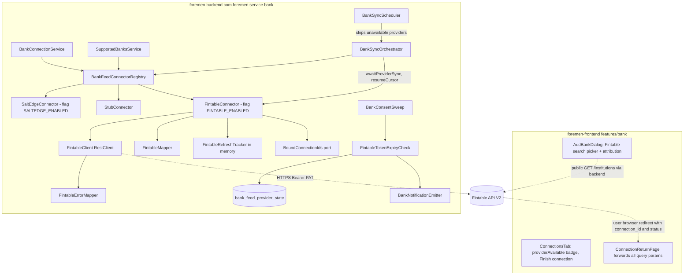
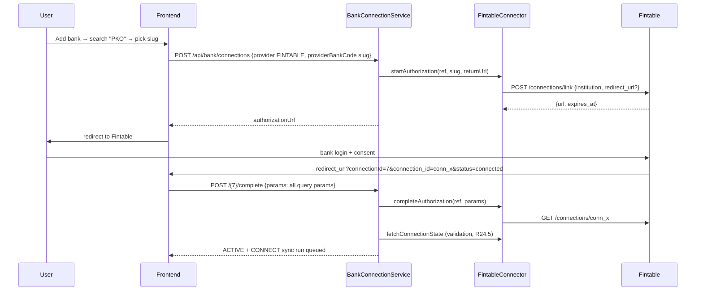

# Design Document: FOR-07-04a — Fintable bank feed connector

## Overview

A third `BankFeedConnector` (`FINTABLE`) next to `SALT_EDGE` and `STUB`. The connector talks to the
Fintable API V2, normalizes accounts and transactions, and plugs into the existing sync orchestrator,
ingest, detection and ledger UI. Salt Edge stays in the code base behind its existing flag.

Three SPI additions are needed because Fintable differs from Salt Edge:

| SPI addition | Why |
|--------------|-----|
| `resumeCursor(previous, pages)` | The orchestrator hard-codes the Salt Edge max-id cursor; Fintable resumes by `updated_at`. |
| `awaitProviderSync(ref, maxWait)` | Fintable syncs asynchronously (up to ~20 min); a pull right after "Refresh now" must wait. |
| `catalogueSearchOnly()` + `searchBanks(country, q)` | The institution directory is search-only (no "list all"). |

**Spans two git repos** (`.kiro/steering/git-repo-structure.md`): changeset, backend, message bundles,
`application.yml`, `docker-compose.yml`, `.env.example`, runbook and this spec are in the root repo;
`features/bank` changes and locales are in `foremen-frontend/`. Two commits.

## Verified facts (live token test, 2026-11-18)

| Assumption | Result |
|------------|--------|
| Token valid, read + write scope | Yes. `GET /me` 200, no-op `PATCH /sync/schedule` 200. |
| Plan | `tier: trial`, 3 connections, trial ends 2026-11-20. Real syncs need a plan. |
| One workspace per token | Yes: `ws_01M7…`, owner. |
| Polish bank coverage | Yes via `NORDIGEN` and `ENABLEBANKING` (PKO incl. iPKO Biznes, mBank, ING, Pekao, Santander, Millennium, Alior). |
| Transaction shape | `{data, next_cursor}`; `amount` string, negative = out; `id` `tx_…`; `updated_at`; `include=raw` returns the provider payload. |
| Pending | Separate snapshot endpoint (`supported`, `as_of`, no ids). Ignored. |
| Sync | `POST /sync/{id}` → `started`; second call → `already_syncing` (not an error). Default daily time `12:29 UTC`, changeable. |
| Webhooks | None. Polling only. |
| `redirect_url` | **422** unless the host is on the token's Return_Hosts list. |
| Link minting | `POST /connections/link` 201 with `url`, `expires_at` (30 min); a second call within a minute → 429. |
| Directory | Public, `q` ≥ 3 chars, 10 groups per page, `supported=1` filter, `connections[]` per group with `slug`, `provider.name`. |
| Sandbox | A Plaid sandbox connection (14 USD accounts, 67 tx, no IBAN, no `holder_name`). It proves plumbing only, not Polish data shape. |

**Open risk (closed by task 8.2).** The counterparty name / IBAN of Polish banks is only in `raw`,
whose shape is "not a contract". The mapper therefore uses a candidate-path list per backing provider
and falls back gracefully; real captures replace the hand-built fixtures.

## Architecture



### Package layout (new / changed)

```
com.foremen.service.bank.connector
  ├─ BankFeedConnector            (+ resumeCursor, awaitProviderSync, catalogueSearchOnly, searchBanks)
  ├─ ProviderBank                 (+ nullable via; compatibility constructor with the old 14 args)
  └─ fintable/
       FintableProperties, FintableConfig (@ConditionalOnProperty enabled),
       FintableClient, FintableErrorMapper, FintableMapper, FintableConnector,
       FintableRefreshTracker, FintableTokenExpiryCheck, dto/ (response records)
com.foremen.service.bank.connection   BoundConnectionIds (port) implemented by BankConnectionService
com.foremen.service.bank.sync         BankSyncOrchestrator (delegates cursor; calls awaitProviderSync),
                                      BankSyncScheduler (skips unavailable providers)
com.foremen.dao.model                 FeedProvider (+FINTABLE), BankFeedProviderStateEntity
com.foremen.dao                       BankFeedProviderStateDao
```

## Provider flags and the behaviour when Salt Edge is off

| Provider flag | Connector bean | `isAvailable()` |
|---------------|----------------|-----------------|
| `SALTEDGE_ENABLED=false` (default) | present (existing `SaltEdgeClientConfig` logic) | `false` |
| `FINTABLE_ENABLED=true` + token + HTTPS base URL + public base URL | present | `true` |
| `FINTABLE_ENABLED=false` | **no bean** (`@ConditionalOnProperty`) | n/a |

Behaviour when a connection's provider is unavailable (Salt Edge off, existing rows kept):

| Place | Behaviour |
|-------|-----------|
| `BankSyncScheduler.tick` | Filters `SYNCABLE` connections through `registry.isAvailable(provider)`; skipped ones are counted in a DEBUG log, no run, no status change, no notification. |
| Manual authorize / complete / reconnect / refresh / sync | Existing `requireConnector` → `409` `BankConnectorErrors.providerNotAvailable`. |
| `disable` | `connector.disable` is skipped when the provider is unavailable; the row becomes `DISABLED` locally. (Changes the existing "call the connector" path; covered by a test.) |
| `BankConnectionDto` | New `providerAvailable = registry.isAvailable(provider)`. |
| Salt Edge callbacks | Controller checks `registry.isAvailable(SALT_EDGE)` first; answers `200 {"ignored":"provider disabled"}`. |
| Frontend | "Provider disabled" badge; actions disabled; row stays visible. |

Registry lookup of a missing Fintable bean (`FINTABLE_ENABLED=false`) returns `find()` empty, so
`isAvailable` is `false` and the same rules apply to a `FINTABLE` row.

## Components

### FintableProperties (`@ConfigurationProperties("foremen.bank-feed.fintable")`)

Record with the properties of Requirement 2.1 (`Duration` / `LocalDate` / `List<String>` typed).
`problems()` returns the **names** of missing or invalid properties; `isAvailable(PublicBaseUrl)` is
`enabled && problems().isEmpty() && publicBaseUrl.isConfigured()`. `FintableConfig` logs `problems()`
once at ERROR when `enabled` but unavailable (mirrors `SaltEdgeClientConfig`).

### FintableClient

Thin typed wrapper over `RestClient` (base URL, timeout, `Authorization` interceptor that is never
logged). Methods return Jackson `JsonNode` / small records:

| Method | HTTP |
|--------|------|
| `me()` | `GET /me` (availability probe, plan, `can_sync`) |
| `connections()` / `connection(id)` | `GET /connections`, `GET /connections/{id}` |
| `mintLink(slug, redirectUrl)` / `mintReconnectLink(id, redirectUrl)` | `POST /connections/link`, `POST /connections/{id}/link` |
| `deleteConnection(id)` | `DELETE /connections/{id}` |
| `accounts(connectionId)` | `GET /accounts?connection_id=` |
| `transactions(accountId, since, cursor)` | `GET /accounts/{id}/transactions?order=updated&limit=500&include=raw[&updated_since=][&cursor=]` |
| `sync()` / `syncOne(id)` | `GET /sync`, `POST /sync/{id}` |
| `institutions(q, country)` | public `GET /institutions?q=&country=&supported=1` (no `Authorization`) |

`FintableErrorMapper` implements the status table of Requirement 3.2. It reads
`{"error":{"type","message"}}` and `Retry-After`.

### FintableMapper

Pure functions (jqwik-friendly):

- `account(JsonNode, Instant balanceAt) → NormalizedAccount` (type → nature map in Requirement 7.1).
- `transaction(JsonNode) → NormalizedTransaction | null` (null = malformed, counted).
- `counterparty(JsonNode tx, BigDecimal amount) → Counterparty(name, iban)`.
- `bank(JsonNode group, JsonNode connection) → ProviderBank`.
- `maxUpdatedAt(List<NormalizedTransaction>) → Instant`.

Counterparty candidate paths (`raw`), direction by sign of `amount`:

| Backing provider | Outgoing (amount < 0) | Incoming (amount > 0) |
|------------------|-----------------------|-----------------------|
| `NORDIGEN` (GoCardless) | `creditorName`, `creditorAccount.iban` | `debtorName`, `debtorAccount.iban` |
| `ENABLEBANKING` | `creditor.name`, `creditor_account.iban` | `debtor.name`, `debtor_account.iban` |
| `PLAID` | `counterparties[0].name`, – | `counterparties[0].name`, – |
| any | fallback `merchant` → `account_owner` → `null` | same |

The provider is detected from the connection id (`conn_nordigen_…`, `conn_enablebanking_…`,
`conn_plaid_…`) passed down by the connector; unknown providers use only the fallback. All paths are
verified against real captures in task 8.2 before production.

### FintableConnector



Method behaviour:

| SPI method | Fintable behaviour |
|------------|--------------------|
| `provider()` | `FINTABLE` |
| `isAvailable()` | `FintableProperties.isAvailable(publicBaseUrl)` |
| `credentialFields()` | empty |
| `listBanks` | not used (`catalogueSearchOnly`) → empty |
| `searchBanks(country, q)` | Requirement 4; 1 h cache keyed `(country, q)` |
| `startAuthorization` | Requirement 5.1–5.3; local 1/min guard (`AtomicReference<Instant>`) |
| `completeAuthorization` | Requirement 5.4–5.6; fallback binding through `BoundConnectionIds` |
| `startReconnect` | `POST /connections/{id}/link` |
| `requestRefresh` | Requirement 9.4–9.5 |
| `fetchConnectionState` | Requirement 6 |
| `fetchHolderInfo` | Requirement 7.2 |
| `fetchAccounts` | Requirement 7.1 |
| `fetchTransactions` | Requirement 8 |
| `resumeCursor` | `u:<max updated_at>` |
| `awaitProviderSync` | Requirement 9.1–9.2 |
| `disable` | `DELETE /connections/{id}`; `404` = success |

### Cursor encoding

```
stored resume cursor  : u:2026-11-18T11:04:44Z
page cursor           : p:2026-11-18T10:04:44Z|eyJ2IjoyLCJvcmRlciI6...   (since | Fintable next_cursor)
first call, no cursor : updated_since omitted
first call, u:<ts>    : updated_since = ts − cursor-overlap
```

`updated_since` is repeated with every page request because Fintable cursors are tied to the sort
order. The overlap re-reads a small window; the ingest is idempotent on `(account, externalId)`
(existing R6), so re-reads change nothing. `resumeCursor` takes the max `updated_at` read from
`payload.updated_at` of the posted rows of this run and never moves backwards.

### awaitProviderSync

```
deadline = now + maxWait
loop:
  s = GET /sync → connections[ref.externalConnectionId].sync_status
  waiting = s.state in (queued, executing, retrying)
            or (tracker.requestedAt(ref.id) != null and s.finished_at < requestedAt)
  if !waiting → clear tracker mark, return
  if now >= deadline → WARN "Fintable sync not finished", return
  sleep sync-poll-interval
```

It runs on the orchestrator executor thread (core 2 / max 4); `sync-wait` is bounded, so a thread is
held for at most 10 minutes. A `GET /sync` failure is logged and treated as "not waiting".

### Scheduling alignment

```
Fintable daily sync  05:30 Europe/Warsaw   (PATCH /sync/schedule, one-time, runbook)
Foremen daily pull   06:30 Europe/Warsaw   (foremen.bank-feed.sync.cron, unchanged)
Manual "Refresh now" POST /sync/{id} → pull waits via awaitProviderSync
```

Fintable says a sync "can take up to 20 minutes", hence the 60-minute gap.

### Refresh spacing

`FintableRefreshTracker` keeps `lastRequestedAt` per Foremen connection id in memory.
`requestRefresh` returns `notYet(last + manual-sync-interval)` locally; the persisted
`bank_connections.next_refresh_possible_at` is set by `BankConnectionService.refresh` from the result
(existing). Defaults assume the Personal plan (2 manual syncs per day → `12h`); on Business set `1h`.

### BoundConnectionIds port

```java
public interface BoundConnectionIds {
    Set<String> externalConnectionIds(FeedProvider provider);   // all bound externalConnectionId values
}
```

Implemented by `BankConnectionService` (reads `BankConnectionDao`). The connector never sees entities
(existing R4.2). The fallback binding in `completeAuthorization` needs `createdAfter =
ref's authorization start`; the start time is the `PENDING_AUTH` connection's `createdDate` /
last authorize time carried in `BankConnectionRef`. To avoid changing the record shape for every
provider, the connector keeps the last minted-link instant per connection id in the same
in-memory tracker and, when absent (restart), accepts any single unbound connection created within
the last 24 hours.

### SupportedBanksService changes

- Route: `if (connector.catalogueSearchOnly()) return searchBanks(...)`; no full-catalogue cache.
- `emptyReason`: Salt Edge special case is guarded by `provider == SALT_EDGE`; unchanged for it.
- `BankProviderController.banks` validates `q` length for search-only providers
  (`400 error.bank.fintable.searchTooShort`).

### Token expiry notification

`FintableTokenExpiryCheck.run(LocalDate today)` is called from `BankConsentSweep` (same cron):

```
if !fintable.enabled or token-expires-on blank → return
days = today → token-expires-on
level = days <= 0 ? 0 : days <= 7 ? 7 : days <= token-warn-days ? 30 : none
state = dao.findById(FINTABLE) ; if state.expiresOn != configured → reset (key = configured, level = null)
if level != none and (state.notifiedLevel == null or level < state.notifiedLevel):
    claim (REQUIRES_NEW) → publish FintableTokenExpiringEvent(level, expiresOn)
```

`BankNotificationEmitter` gets a `FintableTokenExpiringEvent` listener (`AFTER_COMMIT`,
`fallbackExecution = true`) sending `notification.bank.fintableTokenExpiring` to ADMIN and FINANCIER
(active users, de-duplicated), `body = null`, deep-link `/bank/connections`.

## Data model

Changeset `NNN-fintable-provider.xml` (next free number after `253`; re-check at implementation time).

```sql
ALTER TABLE bank_connections DROP CONSTRAINT ck_bank_connections_provider;
ALTER TABLE bank_connections ADD CONSTRAINT ck_bank_connections_provider
    CHECK (provider IN ('SALT_EDGE', 'STUB', 'FINTABLE'));

CREATE TABLE bank_feed_provider_state (
    provider                 VARCHAR(32) PRIMARY KEY,
    token_expires_on         DATE,
    token_notified_level     INTEGER,        -- 30 | 7 | 0 | NULL
    created_date             TIMESTAMP NOT NULL DEFAULT NOW(),
    created_by               VARCHAR(255),
    updated_date             TIMESTAMP,
    updated_by               VARCHAR(255),
    CONSTRAINT ck_bank_feed_provider_state_provider CHECK (provider IN ('SALT_EDGE','STUB','FINTABLE'))
);
```

Guarded with `preConditions onFail="MARK_RAN"` (constraint contains `FINTABLE` / table exists).
`BankFeedProviderStateEntity` extends the project `BaseEntity` per convention (inspect an existing
bank entity such as `BankConnectionEntity` for the exact base class and id strategy).
No `resources` / ABAC / dataset change (Requirement 15.3).

## API changes

| Endpoint | Change |
|----------|--------|
| `GET /api/bank/connections` (+ `/{id}`) | `providerAvailable` added to `BankConnectionDto`. |
| `GET /api/bank/providers` | Lists `FINTABLE` when available; `BankProviderDto` gets `searchOnly` (boolean). |
| `GET /api/bank/providers/{provider}/banks` | For search-only providers: `q` ≥ 3 chars or blank (popular); `ProviderBank.via` in rows. |
| `POST /api/bank/connections/{id}/complete` | Unchanged; params now include Fintable's `connection_id`, `status`. |
| `/api/bank-feed/saltedge/callbacks/{type}` | `200 ignored` while Salt Edge is off. |

No new endpoint.

## Error and message mapping

`ConnectorError` keys are returned through the existing `BankConnectorErrors.toApiException`. Existing
`error.bank.provider.*` keys are reused where possible.

### Backend messages (PL `messages.properties` / RU `messages_ru.properties`)

| Key | PL | RU |
|-----|----|----|
| `error.bank.fintable.tokenInvalid` | Token API Fintable jest nieprawidłowy, wygasł lub został odwołany. | Токен API Fintable недействителен, истёк или отозван. |
| `error.bank.fintable.noPlan` | Konto Fintable nie ma aktywnego planu ani okresu próbnego — synchronizacja jest niemożliwa. | В аккаунте Fintable нет активного тарифа или пробного периода — синхронизация невозможна. |
| `error.bank.fintable.forbidden` | Token Fintable nie ma wymaganych uprawnień. | У токена Fintable недостаточно прав. |
| `error.bank.fintable.rateLimited` | Fintable ogranicza liczbę żądań. Spróbuj ponownie za {0} s. | Fintable ограничивает число запросов. Повторите через {0} с. |
| `error.bank.fintable.returnHostNotAllowed` | Adres powrotu nie znajduje się na liście dozwolonych hostów tokenu Fintable (Dashboard → API → Return hosts). | Адрес возврата не входит в список разрешённых хостов токена Fintable (Dashboard → API → Return hosts). |
| `error.bank.fintable.connectionLimit` | Osiągnięto limit połączeń lub transakcji w planie Fintable. | Достигнут лимит подключений или транзакций в тарифе Fintable. |
| `error.bank.fintable.searchTooShort` | Wpisz co najmniej 3 znaki, aby wyszukać bank. | Введите не менее 3 символов для поиска банка. |
| `error.bank.fintable.notConfigured` | Fintable nie jest skonfigurowany (brak tokenu API). | Fintable не настроен (отсутствует токен API). |
| `error.bank.fintable.linkFailed` | Nie udało się ukończyć łączenia z bankiem w Fintable. Spróbuj ponownie. | Не удалось завершить подключение банка в Fintable. Повторите попытку. |

### Frontend i18n (`locales/pl.json` / `ru.json`)

| Key | PL | RU |
|-----|----|----|
| `bank.providers.FINTABLE` | Fintable | Fintable |
| `bank.fintable.poweredBy` | Dane bankowe dostarcza Fintable | Банковские данные предоставляет Fintable |
| `bank.fintable.linkLabel` | fintable.io | fintable.io |
| `bank.fintable.searchPlaceholder` | Szukaj banku (min. 3 znaki) | Поиск банка (мин. 3 символа) |
| `bank.fintable.searchHint` | Wpisz nazwę banku, np. PKO, mBank, ING. | Введите название банка, например PKO, mBank, ING. |
| `bank.fintable.popular` | Popularne banki | Популярные банки |
| `bank.fintable.noResults` | Nie znaleziono banków dla tego zapytania | По этому запросу банков не найдено |
| `bank.fintable.via` | Przez: {{provider}} | Через: {{provider}} |
| `bank.fintable.redirectNote` | Zostaniesz przekierowany do Fintable, aby zalogować się do banku. Link jest ważny 30 minut. | Вы будете перенаправлены в Fintable для входа в банк. Ссылка действует 30 минут. |
| `bank.fintable.manualReturn` | Po zakończeniu w Fintable wróć tutaj i kliknij „Zakończ połączenie". | После завершения в Fintable вернитесь сюда и нажмите «Завершить подключение». |
| `bank.fintable.finish` | Zakończ połączenie | Завершить подключение |
| `bank.fintable.finishPending` | Połączenie nie zostało jeszcze znalezione w Fintable. Ukończ logowanie w banku i spróbuj ponownie. | Подключение ещё не найдено в Fintable. Завершите вход в банк и повторите попытку. |
| `bank.fintable.refreshLimited` | Fintable ogranicza liczbę ręcznych odświeżeń. Następne możliwe: {{time}}. | Fintable ограничивает число ручных обновлений. Следующее возможно: {{time}}. |
| `bank.fintable.linkCooldown` | Nowy link można utworzyć za {{seconds}} s. | Новую ссылку можно создать через {{seconds}} с. |
| `bank.fintable.disableWarning` | Połączenie i jego dane zostaną usunięte w Fintable. Aby wznowić pobieranie, trzeba ponownie połączyć bank. Dane w Foremen pozostaną. | Подключение и его данные будут удалены в Fintable. Чтобы возобновить загрузку, нужно заново подключить банк. Данные в Foremen сохранятся. |
| `bank.connections.providerDisabled` | Dostawca wyłączony | Провайдер отключён |
| `bank.connections.providerDisabledHint` | Dostawca tego połączenia jest wyłączony w konfiguracji. Synchronizacja nie jest wykonywana. | Провайдер этого подключения отключён в конфигурации. Синхронизация не выполняется. |
| `notification.bank.fintableTokenExpiring` | Token API Fintable wkrótce wygasa | Токен API Fintable скоро истекает |

The existing `bank.connections.*` and `notification.bank.*` blocks are extended (see the existing
keys at `locales/pl.json` `bank.connections`); the exact nesting is confirmed when editing, and
`locale-parity.for0704.test.ts` is extended with the new keys.

## Frontend changes

| File | Change |
|------|--------|
| `features/bank/types/index.ts` | `FeedProvider` += `'FINTABLE'`; `BankConnection.providerAvailable`; `BankProvider.searchOnly`; `ProviderBank.via`. |
| `features/bank/lib/helpers.ts` | `defaultProvider` prefers `FINTABLE`. |
| `features/bank/connections/BankPicker.tsx` | Search-only mode: debounced input, min 3 chars, popular list when empty; shows `via`. |
| `features/bank/connections/AddBankDialog.tsx` | Fintable notes (`redirectNote`, attribution, cooldown). |
| `features/bank/connections/ConnectionsTab.tsx` | Attribution footer; `providerDisabled` badge; "Finish connection"; disabled actions; disable confirmation with `disableWarning` for Fintable. |
| `features/bank/connections/ConnectionReturnPage.tsx` | No change (already forwards all params); copy for `status=error`. |
| `features/bank/supported-banks/SupportedBanksTab.tsx` | Search mode for search-only providers. |
| `features/bank/lib/errors.ts` | Map `error.bank.fintable.*` (already generic by key; verify). |
| `locales/pl.json`, `ru.json` | Keys above. |

## Configuration and environment

`application.yml` (new block under `foremen.bank-feed`):

```yaml
    fintable:
      enabled: ${FINTABLE_ENABLED:false}
      base-url: ${FINTABLE_BASE_URL:https://fintable.io/api/v2}
      allow-insecure-base-url: ${FINTABLE_ALLOW_INSECURE_BASE_URL:false}   # tests only
      api-token: ${FINTABLE_API_TOKEN:}
      token-expires-on: ${FINTABLE_TOKEN_EXPIRES_ON:}
      workspace-id: ${FINTABLE_WORKSPACE_ID:}
      http-timeout: ${FINTABLE_HTTP_TIMEOUT:30s}
      country-codes: ${FINTABLE_COUNTRY_CODES:PL}
      provider-preference: ${FINTABLE_PROVIDER_PREFERENCE:ENABLEBANKING,NORDIGEN}
      popular-banks: ${FINTABLE_POPULAR_BANKS:PKO,mBank,ING,Pekao,Santander,Millennium,Alior}
      sync-wait: ${FINTABLE_SYNC_WAIT:10m}
      sync-poll-interval: ${FINTABLE_SYNC_POLL_INTERVAL:15s}
      manual-sync-interval: ${FINTABLE_MANUAL_SYNC_INTERVAL:12h}
      cursor-overlap: ${FINTABLE_CURSOR_OVERLAP:1h}
      token-warn-days: ${FINTABLE_TOKEN_WARN_DAYS:30}
```

`docker-compose.yml` passes each as `NAME: ${NAME:-}` (blank → property default); `.env.example` adds a
commented block pointing at `.secrets/fintable.env` (already created, git-ignored, mode 600, keys
`FINTABLE_API_TOKEN`, `FINTABLE_TOKEN_EXPIRES_ON`). Production: Secret Manager / VM environment.

Environment matrix:

| Env | `SALTEDGE_ENABLED` | `FINTABLE_ENABLED` | Notes |
|-----|--------------------|--------------------|-------|
| local | false | true (sandbox or real) | `FOREMEN_PUBLIC_BASE_URL` is HTTP → no `redirect_url`, manual return |
| dev | false | true | HTTPS host added to Return_Hosts |
| prod | false | true | prod host added to Return_Hosts; Business plan → `FINTABLE_MANUAL_SYNC_INTERVAL=1h` |

## Testing strategy

| Layer | Tests |
|-------|-------|
| Unit | `FintablePropertiesTest`, `FintableClientTest` (`MockRestServiceServer` or local `HttpServer`), `FintableErrorMapperTest`, `FintableMapperTest`, `FintableMapperPropertyTest` (jqwik: decimal exactness, sign → direction, never throws), `FintableConnectorTest`, `FintableTokenExpiryCheckTest`, `BankSyncSchedulerTest` (skip unavailable), `SupportedBanksServiceTest` (search-only), `BankSyncOrchestratorTest` (delegated cursor, `awaitProviderSync` call). |
| Integration | `FintableStartupIntegrationTest` (flags off/on), `FintableSyncIntegrationTest` (fake Fintable server: accounts, two pages, resume cursor, idempotent re-run), `SaltEdgeDisabledIntegrationTest` (callback `ignored`, DTO `providerAvailable=false`, disable skips provider), notification + marker test. |
| Frontend | `BankPicker` search mode, `AddBankDialog` Fintable notes, `ConnectionsTab` badge / finish / disable warning, locale parity. |
| E2E | `test-cases.md` (Russian): API scenarios against Docker with a fake Fintable server or the sandbox, browser scenarios, manual real-bank scenario. |

Backend runs follow `.kiro/steering/test-execution-rules.md` (affected classes only, log to
`/tmp/for-07-04a-test.log`, read the JUnit XML).

## Risks and decisions

| Risk / decision | Handling |
|-----------------|----------|
| Polish `raw` shape unverified | Candidate-path mapper with fallbacks; task 8.2 with a real bank before production. |
| Fintable's GoCardless dependency (GoCardless closed to new customers) | Prefer `ENABLEBANKING` slugs by default; direct Enable Banking connector is a candidate follow-up spec behind the same SPI. |
| Manual refresh scarce on Personal (2/day) | Daily Fintable schedule is the main path; local spacing; clear UI message. |
| Pending transactions not available | Posted-only ledger for Fintable connections (accepted by the product owner). |
| Deletions invisible | Not propagated; documented. Duplicates merged by Fintable support may leave a stale local row (manual ignore). |
| Token expiry (1 year) | Config date + 30 / 7 / 0 day notification; 401 → `CONFIG` error, connection `ERROR`, recovers on the next sync after the token is replaced. |
| Trial ends 2026-11-20 | Runbook step: subscribe before real history import; 403 → `noPlan` message. |
| `redirect_url` HTTPS + Return_Hosts | HTTP base URL omits it; manual "Finish connection" fallback. |
| Terms: first-party only, attribution | Requirement 14; attribution in UI. |
| Fintable stores bank data (processor) | Runbook note; company updates DPA / privacy documents. |
