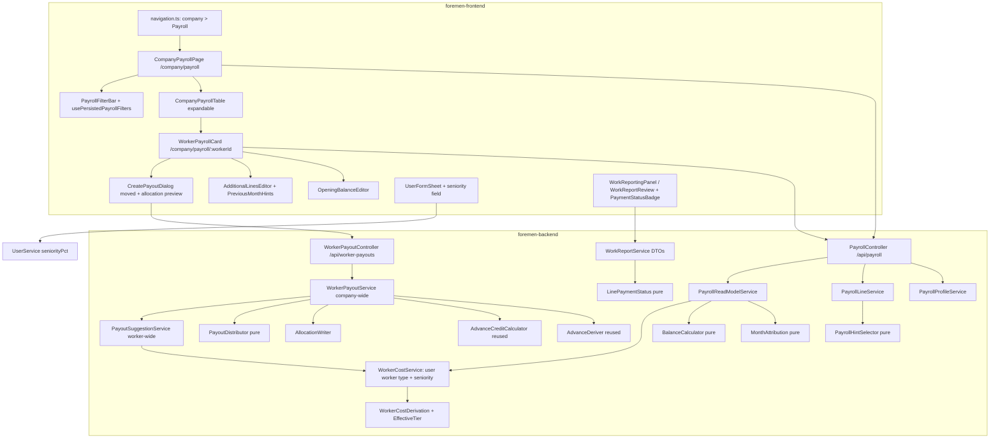

# Design Document: FOR-07-06 — Company payroll (worker-level, cross-project)

## Overview

FOR-07-06 reshapes the implemented FOR-06-11 payroll from per-(worker, project) to **per worker**
and moves its UI from the project-workspace tab to the company screen `/company/payroll`.

What is **reused as-is**:
- `PayoutStatus` (`PLANNED → PAID`), `PaymentChannel`, the mark-paid / delete lifecycle and audit;
- `AdvanceDeriver` (advance ⇔ `periodTo` after creation date) and `AdvanceCreditCalculator`
  (remaining / applied / suggested arithmetic);
- `WorkerCostDerivation` + `MarginCostService` cost math and the `/worker-types` dictionary;
- the FOR-06-11 frontend dialog / breakdown components (moved and extended);
- the `PAYROLL` ABAC resource and its seed.

What **changes**:

| Area | FOR-06-11 (today) | FOR-07-06 |
|------|-------------------|-----------|
| Payout ownership | `worker_payouts.project_id` NOT NULL | column dropped; payout = worker + `payout_date` |
| Paid marker | `work_report_rooms.paid_by_payout_id` (one payout per line, full) | `worker_payout_allocations` rows + `work_report_rooms.paid_amount` (partial, many payouts per line) |
| Suggestion scope | one project, overlap of `[from, to]` | all projects, every unpaid line with `performedFrom <= periodTo` |
| Linking | every unpaid in-period line fully linked | amount distributed oldest-first; last line may be partial |
| Advance credit | per (worker, project) | per worker |
| Worker type | `ProjectMember.workerType` | `users.worker_type_id` (+ base fallback + warning) |
| Rate | `Base × (1 + tierPct)` | `Base × (1 + tierUplift + seniorityPct)` |
| Service scope | `ProjectScopedService` | company-wide `PAYROLL` service |
| UI | project tab `payroll` | menu item `/company/payroll` + worker card; tab removed |
| FOREMAN | `PAYROLL`/READ, read-only tab | grant revoked; sees paid status on work reports |

New: additional payroll lines, worker payroll profile (opening balance), monthly balance chain,
company table and card read models, payment status on report lines, seniority on the user.

**Spans two git repos** (`.kiro/steering/git-repo-structure.md`): changesets, backend, and this
spec in the root repo; the frontend in `foremen-frontend/`. Two commits.

## Architecture



All arithmetic lives in **pure collaborators** (`EffectiveTier`, `PayoutDistributor`,
`BalanceCalculator`, `MonthAttribution`, `PayrollHintSelector`, `LinePaymentStatus`, plus the reused
`AdvanceCreditCalculator` / `AdvanceDeriver`), so the invariants are jqwik-testable without
persistence. Services are thin apply layers.

## Data model and migrations

Next free changeset is **192** (tail today: `191-rooms-sort-order.xml`). If a sibling spec lands
first, use the next free numbers in the same order. Every changeset: `author="foremen"`,
`onFail="MARK_RAN"` preconditions, registered **last** in `changelog.xml` with a comment.

| # | File | Change |
|---|------|--------|
| 192 | `192-payroll-report-line-paid-amount.xml` | drop FK `fk_work_report_rooms_paid_by_payout` + column `work_report_rooms.paid_by_payout_id` (guard `columnExists`); add `paid_amount NUMERIC(19,2) NOT NULL DEFAULT 0` + CHECK `ck_work_report_rooms_paid_amount_nonneg` (guard `NOT columnExists`) |
| 193 | `193-worker-payouts-worker-wide.xml` | drop index `ix_worker_payouts_project`, FK on `project_id`, column `worker_payouts.project_id` (guard `columnExists`); add `payout_date DATE NOT NULL DEFAULT CURRENT_DATE` (guard `NOT columnExists`); index `ix_worker_payouts_worker_date (worker_id, payout_date)` |
| 194 | `194-create-worker-payout-allocations.xml` | table `worker_payout_allocations (id, payout_id FK CASCADE, work_report_room_id FK CASCADE, amount NUMERIC(19,2) NOT NULL CHECK > 0, audit)`, unique `uq_worker_payout_allocations_payout_line`, index on `work_report_room_id` |
| 195 | `195-create-worker-payroll-lines.xml` | table `worker_payroll_lines (id, worker_id FK users, month DATE NOT NULL, name VARCHAR(255) NOT NULL, amount NUMERIC(19,2) NOT NULL CHECK <> 0, note TEXT, audit)`, index `(worker_id, month)` |
| 196 | `196-create-worker-payroll-profiles.xml` | table `worker_payroll_profiles (id, worker_id FK users UNIQUE, opening_balance NUMERIC(19,2) NOT NULL DEFAULT 0, audit)` |
| 197 | `197-add-user-seniority-pct.xml` | `users.seniority_pct NUMERIC(6,4) NOT NULL DEFAULT 0` + CHECK `0..1` |
| 198 | `198-revoke-foreman-payroll-read.xml` | delete FOREMAN `role_resource_operations` + `role_resources` rows for `PAYROLL` (guard `sqlCheck` count > 0 → else MARK_RAN), XML comment documenting the deny |

No data conversion (R1.9): existing payouts keep their rows without a project, all lines start at
`paid_amount = 0`.

### Entities

- `WorkReportRoomEntity`: remove `paidByPayout`; add `BigDecimal paidAmount` (`paid_amount`).
- `WorkerPayoutEntity`: remove `project`; add `LocalDate payoutDate`. Keep everything else.
- New `WorkerPayoutAllocationEntity {payout, workReportRoom, amount}` (`worker_payout_allocations`).
- New `WorkerPayrollLineEntity {worker, month, name, amount, note}`.
- New `WorkerPayrollProfileEntity {worker, openingBalance}`.
- `UserEntity`: add `BigDecimal seniorityPct` (`seniority_pct`).

## Backend components

### Cost seam — `WorkerCostService` / `WorkerCostDerivation` (R2)

- Replace the member-based map with `Map<Long, WorkerProfile> workerProfilesById(Collection<Long>
  workerIds)` reading `users` (active `workerType`, `seniorityPct`) in one query
  (`UserDao.findWorkerProfiles(ids)` with JOIN FETCH `workerType`).
- `activeWorkerTypesByWorkerId(projectId)` and the private member map are removed;
  `costForProject(projectId)` resolves via the workers present in the project's reports.
- New pure `EffectiveTier.of(WorkerTypeEntity typeOrNull, BigDecimal seniorityPct, WorkerTypeEntity
  baseType)` → `ResolvedTier`:
  - active non-base type: `WorkerTypeTier.uplift(type.tierPct + seniority)`, fallback = false;
  - active base type: seniority 0 → the base tier (identical to today); seniority > 0 →
    `WorkerTypeTier.uplift(seniority)`, fallback = false;
  - null / inactive type: as above with the base type, **fallback = true**.
  Because `MarginCostService.tierCost(base, uplift(x)) = base × (1 + x)`, the formula is
  `Base_Cost × (1 + tierUplift + seniorityPct)` with **no change to `MarginCostService`** (R2.3–2.4).
- `WorkerCostLineDto` gains `seniorityPct`. The margin matrix keeps its own resolution (R2.5); its
  parity test `WorkerCostFor0606ParityPropertyTest` is updated to pin parity only for workers whose
  user type equals their member type and seniority is 0, and the divergence is noted.

### `PayoutSuggestionService` (R4)

- New DAO query `WorkReportRoomDao.findPayableLines(workerId, periodTo)`:

  ```sql
  SELECT rr FROM WorkReportRoomEntity rr
    JOIN FETCH rr.report r JOIN FETCH r.workItem JOIN FETCH r.project LEFT JOIN FETCH rr.room
  WHERE r.worker.id = :workerId AND r.status = APPROVED AND r.performedFrom <= :periodTo
  ORDER BY r.performedFrom, r.performedTo, r.id, rr.id
  ```

  A `...ForUpdate` variant (`@Lock(PESSIMISTIC_WRITE)`) is used inside create (R5.8).
- Per line: `cost = WorkerCostDerivation.costValue(rate, effectiveTier, baseTier, rr.quantity)`;
  `remainder = max(0, cost − rr.paidAmount)`; lines with remainder 0 are skipped; null cost →
  unavailable.
- `gross = Σ remainder(available)`; credit from `AdvanceCreditCalculator.remaining(allPayoutsOfWorker)`
  (`WorkerPayoutDao.findByWorker(workerId)`); `applied = min(credit, gross)`;
  `suggested = max(0, gross − credit)`.
- Breakdown line `PayoutLineDto` extended: `projectId, projectName, seniorityPct, paidAmount,
  remainder, allocationPreview` (preview = `PayoutDistributor` run on `suggested + applied`).
- Advance (period end after today): planned basis = Σ over the worker's `APPROVED` lines on any
  project whose report overlaps `[from, to]`, costed on `plan_quantity`, no credit, no preview
  (FOR-06-11 behaviour, without the project filter).

### `PayoutDistributor` (pure, R5.3–5.5)

```text
distribute(D, lines in distribution order with remainder r_i):
  left = D
  for line in lines:
    if left <= 0: break
    a = min(left, r_i)
    if a > 0: emit (line, a); left -= a
  return allocations, surplus = left
```

Invariants (property-tested): `Σ a = min(D, Σ r)`; every `a ≤ r_i`; allocations are a prefix of the
order; at most the last emitted line has `a < r_i`; `surplus = max(0, D − Σ r)`; amounts scale 2,
`HALF_UP`, no negative.

### `WorkerPayoutService` (R5–R7)

Company-wide, `AdminService`-style plumbing (not `ProjectScopedService`).

- `suggest(workerId, from, to)`, `create(CreatePayoutRequest)`, `markPaid(id)`, `delete(id)`,
  `list(PayoutFilter{workerId?, from?, to?, status?})`.
- `create`: validate (period, channel, amount ≥ 0, worker is an existing WORKER) → derive advance →
  compute suggestion on locked lines → save payout (`PLANNED`, `payoutDate`, `suggestedAmount`,
  `advanceApplied`) → regular: `PayoutDistributor` on `amount + advanceApplied` →
  `AllocationWriter.write(payout, allocations)` (inserts rows, `paid_amount += a`) → audit.
- `delete`: PLANNED only; advance → worker-wide `assertAdvanceNotConsumed`; regular →
  `AllocationWriter.release(payoutId)` (`paid_amount -= a` per row, then rows go via cascade) →
  audit → hard delete.
- `ReportLineLinker` is replaced by `AllocationWriter`; `assertActiveMember` is replaced by
  `assertWorker` (`error.workerPayout.worker.invalid`).
- `PeriodResolver.QuickSelect.SINCE_PROJECT_START` is removed; `SINCE_LAST_PAYOUT` uses the worker's
  latest payout `periodTo` (fallback: the earliest unpaid line's `performedFrom`, else today).

### `PayrollLineService`, `PayrollHintSelector` (R8)

- CRUD over `WorkerPayrollLineEntity`; month normalized to `withDayOfMonth(1)`; name trimmed and
  validated; amount non-zero.
- `PayrollHintSelector.hints(previousMonthLines, currentMonthLines)` — pure: keep previous lines
  whose `name.trim().toLowerCase(Locale.ROOT)` is not in the current month's names; duplicates in
  the previous month collapse to the latest one.

### `PayrollProfileService` (R9)

- `get(workerId)` → opening balance (0 if none); `setOpeningBalance(workerId, value)` upserts.

### `PayrollReadModelService`, `MonthAttribution`, `BalanceCalculator` (R9–R11)

- Loads, for the selected workers: lines up to `to` (for balances, all lines ≤ `to`, costed once),
  payouts with `payout_date ≤ to`, additional lines with `month ≤ to`, profiles.
- `MonthAttribution`: line → `YearMonth.from(report.performedTo)`; payout →
  `YearMonth.from(payoutDate)`; additional line → `YearMonth.from(month)`.
- `BalanceCalculator.chain(opening, earnedByMonth, paidByMonth, months)` → balance per month end:
  `b(M) = b(M−1) + earned(M) − paid(M)`, with `b(before first activity) = opening`. Pure.
- Table: per worker, period sums (R10.4) + per-project sub-rows + balance at `to`; totals row.
  Workers with no activity in the period are omitted unless listed in `workerIds`.
- Card: month blocks for each `YearMonth` in `[from, to]` (R11.2), previous balance = balance at end
  of the month before `from`, hints for the current calendar month when it is in range.
- Performance: one query per data kind for all selected workers (no N+1); costing reuses one
  `baseType` and one profile map per request.

### Work-report payment status (R12)

- Pure `LinePaymentStatus.of(cost, paidAmount)` and `ReportPaymentStatus.of(lines)`.
- `WorkReportService` read mapping adds `paymentStatus` + `paidAmount` per room line and the report
  aggregate (APPROVED only). Cost for the status reuses `WorkerCostService` per page of reports
  (one profile map per page). No payout ids or channels are exposed.

### Controllers and endpoints (R14)

All `@PermissionResource("PAYROLL")` with per-handler `@RequiresPermission`.

| Method + path | Op | Request | Response |
|---------------|----|---------|----------|
| `GET /api/worker-payouts?workerId&from&to&status` | READ | filter | `List<WorkerPayoutDto>` |
| `GET /api/worker-payouts/suggest?workerId&from&to` | READ | — | `PayoutSuggestionDto` |
| `POST /api/worker-payouts` | CREATE | `CreatePayoutRequest{workerId, payoutDate?, periodFrom, periodTo, paymentChannel, amount?, note?}` | `WorkerPayoutDto` |
| `POST /api/worker-payouts/{id}/pay` | UPDATE | — | `WorkerPayoutDto` |
| `DELETE /api/worker-payouts/{id}` | DELETE | — | 204 |
| `GET /api/worker-payouts/{id}/allocations` | READ | — | `List<PayoutAllocationDto{lineId, projectName, workItemName, roomName, amount}>` |
| `GET /api/payroll/company?from&to&workerIds` | READ | — | `CompanyPayrollDto{rows[], totals}` |
| `GET /api/payroll/workers/{workerId}/card?from&to` | READ | — | `WorkerPayrollCardDto` |
| `GET /api/payroll/workers/{workerId}/hints?month` | READ | — | `List<PayrollLineDto>` |
| `POST /api/payroll/lines` | CREATE | `PayrollLineRequest{workerId, month, name, amount, note?}` | `PayrollLineDto` |
| `PUT /api/payroll/lines/{id}` | UPDATE | `PayrollLineRequest` | `PayrollLineDto` |
| `DELETE /api/payroll/lines/{id}` | DELETE | — | 204 |
| `PUT /api/payroll/workers/{workerId}/opening-balance` | UPDATE | `{openingBalance}` | `PayrollProfileDto` |

`WorkerPayoutDto` drops nothing it had except that `projectId` was never exposed; it gains
`payoutDate`. `PayrollView`/`WorkerCreditDto` are replaced by the card's `remainingAdvanceCredit`.

DTO sketches:

```java
record CompanyPayrollDto(LocalDate from, LocalDate to, List<CompanyPayrollRowDto> rows, PayrollSumsDto totals) {}
record CompanyPayrollRowDto(Long workerId, String workerName, String workerTypeName, BigDecimal seniorityPct,
        boolean workerTypeMissing, PayrollSumsDto sums, BigDecimal balanceAtTo, List<CompanyPayrollProjectRowDto> projects) {}
record CompanyPayrollProjectRowDto(Long projectId, String projectName, BigDecimal reported, BigDecimal planned, BigDecimal paid) {}
record PayrollSumsDto(BigDecimal earned, BigDecimal paid, BigDecimal reported, BigDecimal planned, BigDecimal other) {}
record WorkerPayrollCardDto(Long workerId, String workerName, String workerTypeName, BigDecimal seniorityPct,
        boolean workerTypeMissing, BigDecimal openingBalance, BigDecimal remainingAdvanceCredit, List<PayrollMonthDto> months) {}
record PayrollMonthDto(YearMonth month, List<PayrollEarnedProjectDto> earned, List<PayrollLineDto> additionalLines,
        BigDecimal total, List<WorkerPayoutDto> payouts, BigDecimal paid, BigDecimal previousBalance, BigDecimal balance,
        List<PayrollLineDto> hints) {}
record PayrollEarnedProjectDto(Long projectId, String projectName, BigDecimal amount, List<PayrollEarnedLineDto> lines) {}
record PayrollEarnedLineDto(Long workReportRoomId, String workItemName, String roomName, String unit, BigDecimal unitCost,
        BigDecimal quantity, BigDecimal cost, BigDecimal paidAmount, LinePaymentStatus paymentStatus) {}
```

### User seniority (R3)

- `UserCreateRequest` / `UserUpdateRequest` / service models / mappers gain `BigDecimal seniorityPct`;
  `UserDtoExtendedModel` returns it.
- `UserService.resolveSeniority(role, value)`: non-WORKER → 0; null → 0; outside `[0, 1]` → 400
  `error.user.seniorityPct.invalid`; called in `validateCreate/Update` and applied in
  `create/update` next to `resolveWorkerType`.

### Error codes

| Code | HTTP | PL | RU |
|------|------|----|----|
| `error.workerPayout.worker.invalid` | 422 | Wybrany użytkownik nie jest pracownikiem. | Выбранный пользователь не является работником. |
| `error.payrollLine.name.required` | 422 | Nazwa pozycji jest wymagana (do 255 znaków). | Название строки обязательно (до 255 символов). |
| `error.payrollLine.amount.invalid` | 422 | Kwota pozycji musi być liczbą różną od zera. | Сумма строки должна быть ненулевым числом. |
| `error.payrollProfile.openingBalance.invalid` | 422 | Saldo początkowe musi być liczbą. | Начальный баланс должен быть числом. |
| `error.payroll.period.invalid` | 422 | Data „od” nie może być późniejsza niż data „do”. | Дата «с» не может быть позже даты «по». |
| `error.user.seniorityPct.invalid` | 400 | Dodatek za staż musi mieścić się w zakresie 0–100%. | Надбавка за стаж должна быть в диапазоне 0–100%. |

Removed: `error.workerPayout.worker.notMember`. Kept: the other five `error.workerPayout.*` codes.

## Frontend

### Structure (`foremen-frontend/src`)

- **Removed:** `features/project-execution/payroll/PayrollTab.tsx`, the `payroll` entry + lazy import
  in `features/project-workspace/workspaceTabs.ts`, `'payroll'` from the tab-key union in
  `features/project-workspace/types.ts`, and the hard-coded `'payroll'` in
  `state/projectTabMemory.property.test.ts`, `state/resolveActiveTab.property.test.ts`,
  `state/resolveWorkspaceTabs.property.test.ts`; `payrollTab.resolver.test.ts` is replaced by a test
  asserting the tab is absent.
- **Moved + adapted** into `features/company-payroll/`: `components/CreatePayoutDialog.tsx`,
  `components/PayoutBreakdownTable.tsx`, `components/PayoutRowActions.tsx`, `lib/format.ts`,
  `lib/enum-labels.ts`, `lib/error-keys.ts`, `lib/period.ts` (drop `SINCE_PROJECT_START`, keep
  ADVANCE), `types/`, `api/`, `hooks/` (project id removed from every call and query key).
- **New** in `features/company-payroll/`:
  - `components/CompanyPayrollPage.tsx` (route `/company/payroll`),
    `components/PayrollFilterBar.tsx`, `components/CompanyPayrollTable.tsx` (expandable rows,
    `aria-expanded`, totals row), `components/WorkerPayrollCard.tsx` (route
    `/company/payroll/:workerId`), `components/PayrollMonthBlock.tsx`,
    `components/AdditionalLinesEditor.tsx`, `components/PreviousMonthHints.tsx`,
    `components/OpeningBalanceEditor.tsx`, `components/WorkerTypeWarning.tsx`;
  - `lib/dateRange.ts` (presets + `shift(range, preset, direction)`),
    `hooks/usePersistedPayrollFilters.ts` (key `foremen:company-payroll:filters`, try/catch,
    validated parse, fallback to current month — same pattern as `useCompanyScheduleViewState`);
  - `api/company-payroll-api.ts` + `hooks/useCompanyPayroll.ts` with keys
    `['companyPayroll','table',from,to,workerIds]`, `['companyPayroll','card',workerId,from,to]`,
    `['companyPayroll','hints',workerId,month]`, `['companyPayroll','suggest',workerId,from,to]`;
    every payroll mutation invalidates `['companyPayroll']`.
- **Navigation:** `config/navigation.ts` company section gets `{ path: '/company/payroll', labelKey:
  'nav.companyPayroll', icon: 'wallet', bottomNav: false, requiredPermission: { resource: 'PAYROLL',
  operation: 'READ' } }`; `config/route-permissions.ts` extra adds
  `'/company/payroll/:workerId': { resource: 'PAYROLL', operation: 'READ' }`; `app/router.tsx` adds
  lazy routes `company/payroll` and `company/payroll/:workerId`.
- **Users form:** `features/users/schemas/user-schema.ts` adds `seniorityPct: z.number().min(0).max(100)
  .optional().nullable()` (percent in the form, converted to a fraction on submit and back on load);
  `UserFormSheet.tsx` renders it inside the `isWorkerRole` block (`data-testid="user-seniority-field"`);
  types gain `seniorityPct`.
- **Work reporting:** `features/project-execution/work-reporting/components/PaymentStatusBadge.tsx`
  used in `WorkReportingPanel.tsx` (next to the status badge, APPROVED only) and
  `WorkReportReview.tsx` (per-room paid amount + badge); types gain `paymentStatus`, `paidAmount`.

### Date range rules (`lib/dateRange.ts`)

- `currentMonth(today)`, `currentYear(today)`.
- `shift`: preset `MONTH` or a custom range within one calendar month → previous/next calendar month
  (whole month); preset `YEAR` → previous/next calendar year; any other custom range → move both
  ends by `(to − from + 1)` days.
- Applying a manual date clears the preset to `CUSTOM`.

### i18n keys (PL / RU)

`companyPayroll.*` (new) — values:

| Key | PL | RU |
|-----|----|----|
| `nav.companyPayroll` | Wynagrodzenia | Зарплаты |
| `companyPayroll.pageTitle` | Wynagrodzenia | Зарплаты |
| `companyPayroll.loading` | Ładowanie… | Загрузка… |
| `companyPayroll.loadError` | Nie udało się wczytać danych | Не удалось загрузить данные |
| `companyPayroll.retry` | Spróbuj ponownie | Повторить |
| `companyPayroll.empty` | Brak danych w wybranym okresie | Нет данных за выбранный период |
| `companyPayroll.column.worker` | Pracownik | Работник |
| `companyPayroll.column.project` | Projekt | Проект |
| `companyPayroll.column.earned` | Naliczone | Начислено |
| `companyPayroll.column.paid` | Wypłacone | Выплачено |
| `companyPayroll.column.reported` | Zgłoszone prace | Отчитанные работы |
| `companyPayroll.column.planned` | Zaplanowane prace | Плановые работы |
| `companyPayroll.column.other` | Inne wypłaty | Прочие выплаты |
| `companyPayroll.column.balance` | Saldo | Баланс |
| `companyPayroll.totals` | Razem | Итого |
| `companyPayroll.expand` | Rozwiń projekty | Развернуть проекты |
| `companyPayroll.collapse` | Zwiń projekty | Свернуть проекты |
| `companyPayroll.filter.workers` | Pracownicy | Работники |
| `companyPayroll.filter.allWorkers` | Wszyscy pracownicy | Все работники |
| `companyPayroll.filter.from` | Od | С |
| `companyPayroll.filter.to` | Do | По |
| `companyPayroll.filter.preset.currentMonth` | Bieżący miesiąc | Текущий месяц |
| `companyPayroll.filter.preset.currentYear` | Bieżący rok | Текущий год |
| `companyPayroll.filter.preset.custom` | Własny zakres | Свой период |
| `companyPayroll.filter.previous` | Poprzedni okres | Предыдущий период |
| `companyPayroll.filter.next` | Następny okres | Следующий период |
| `companyPayroll.filter.reset` | Wyczyść filtry | Сбросить фильтры |
| `companyPayroll.card.back` | Wróć do listy | Назад к списку |
| `companyPayroll.card.workerType` | Typ pracownika | Тип работника |
| `companyPayroll.card.seniority` | Dodatek za staż | Надбавка за стаж |
| `companyPayroll.card.openingBalance` | Saldo początkowe | Начальный баланс |
| `companyPayroll.card.editOpeningBalance` | Zmień saldo początkowe | Изменить начальный баланс |
| `companyPayroll.card.advanceCredit` | Pozostała zaliczka | Остаток аванса |
| `companyPayroll.card.earned` | Naliczone | Заработано |
| `companyPayroll.card.paid` | Wypłacone | Выплачено |
| `companyPayroll.card.total` | Razem | Всего |
| `companyPayroll.card.previousBalance` | Saldo z poprzedniego miesiąca | Баланс прошлого месяца |
| `companyPayroll.card.balance` | Saldo | Остаток |
| `companyPayroll.card.noPayouts` | Brak wypłat w tym miesiącu | Выплат в этом месяце нет |
| `companyPayroll.card.lines.workItem` | Praca | Работа |
| `companyPayroll.card.lines.room` | Pomieszczenie | Помещение |
| `companyPayroll.card.lines.unit` | Jedn. | Ед. |
| `companyPayroll.card.lines.unitCost` | Cena | Цена |
| `companyPayroll.card.lines.quantity` | Ilość | Кол-во |
| `companyPayroll.card.lines.cost` | Kwota | Сумма |
| `companyPayroll.card.lines.paidAmount` | Wypłacono | Оплачено |
| `companyPayroll.additional.title` | Dodatkowe pozycje | Дополнительные строки |
| `companyPayroll.additional.add` | Dodaj pozycję | Добавить строку |
| `companyPayroll.additional.name` | Nazwa | Название |
| `companyPayroll.additional.namePlaceholder` | np. zwrot Multisport | напр. компенсация Multisport |
| `companyPayroll.additional.amount` | Kwota | Сумма |
| `companyPayroll.additional.amountHint` | Kwota ujemna oznacza potrącenie | Отрицательная сумма — удержание |
| `companyPayroll.additional.note` | Uwagi | Комментарий |
| `companyPayroll.additional.save` | Zapisz | Сохранить |
| `companyPayroll.additional.cancel` | Anuluj | Отмена |
| `companyPayroll.additional.edit` | Edytuj | Изменить |
| `companyPayroll.additional.delete` | Usuń | Удалить |
| `companyPayroll.additional.deleteConfirm` | Usunąć tę pozycję? | Удалить эту строку? |
| `companyPayroll.hints.title` | W poprzednim miesiącu | В прошлом месяце |
| `companyPayroll.hints.tooltip` | Kliknij, aby dodać do bieżącego miesiąca | Нажмите, чтобы добавить в текущий месяц |
| `companyPayroll.payout.create` | Utwórz wypłatę | Создать выплату |
| `companyPayroll.payout.date` | Data wypłaty | Дата выплаты |
| `companyPayroll.payout.allocation` | Rozliczenie wypłaty | Распределение выплаты |
| `companyPayroll.payout.alreadyPaid` | Już wypłacono | Уже оплачено |
| `companyPayroll.payout.remainder` | Do wypłaty | К оплате |
| `companyPayroll.payout.willAllocate` | Zostanie rozliczone | Будет оплачено |
| `companyPayroll.payout.surplus` | Nadwyżka bez przypisania | Нераспределённый остаток |
| `companyPayroll.payout.allocationsTitle` | Opłacone prace | Оплаченные работы |
| `companyPayroll.paymentStatus.unpaid` | Nieopłacone | Не оплачено |
| `companyPayroll.paymentStatus.partial` | Częściowo opłacone | Частично оплачено |
| `companyPayroll.paymentStatus.paid` | Opłacone | Оплачено |
| `companyPayroll.paymentStatus.unavailable` | Brak stawki | Нет ставки |
| `companyPayroll.warning.noWorkerType` | Nie ustawiono typu pracownika — użyto stawki bazowej | Тип работника не задан — применена базовая ставка |
| `companyPayroll.toast.lineSaved` | Pozycja zapisana | Строка сохранена |
| `companyPayroll.toast.lineDeleted` | Pozycja usunięta | Строка удалена |
| `companyPayroll.toast.openingBalanceSaved` | Saldo początkowe zapisane | Начальный баланс сохранён |
| `companyPayroll.error.generic` | Nie udało się zapisać zmian | Не удалось сохранить изменения |
| `users.form.seniority` | Dodatek za staż, % | Надбавка за стаж, % |
| `users.form.seniorityHint` | Wpisywany ręcznie; dolicza się do stawki typu pracownika | Вводится вручную; добавляется к ставке типа работника |
| `users.validation.seniorityRange` | Wartość od 0 do 100 | Значение от 0 до 100 |

The existing `payroll.*` keys used by the moved dialog (status, channel, period quick-select,
breakdown, credit, actions, delete, create, toasts, errors) are kept; `payroll.period.sinceProjectStart`
is removed; `payroll.error.workerInvalid` (PL "Wybrany użytkownik nie jest pracownikiem." /
RU "Выбранный пользователь не является работником.") replaces `payroll.error.workerNotMember`;
`workspace.tab.payroll` is removed.

## Correctness properties

1. **Effective tier** — for any base share, rate, tier uplift u ≥ 0, seniority s ∈ [0,1]:
   `unitCost = baseCost × (1 + u + s)`; with s = 0 it equals the FOR-06-10 value. (R2.3–2.4)
2. **Fallback** — a worker with no/inactive type costs as base (+ s) and is flagged. (R2.2)
3. **Distribution conservation** — `Σ allocations = min(D, Σ remainders)`, each `≤` its remainder,
   prefix of the order, ≤ 1 partial line, surplus = `max(0, D − Σ r)`. (R5.3–5.5)
4. **Paid-amount consistency** — after any sequence of creates/deletes, every line's
   `paid_amount = Σ` its allocations and `≥ 0`. (R5.9, R6.2)
5. **Delete reversibility** — create then delete a PLANNED regular payout restores every
   `paid_amount` and the credit. (R6.2)
6. **Worker-wide credit** — remaining credit is computed over all the worker's payouts, never
   negative, and an advance delete that would make it inconsistent is rejected. (R6.3, R7)
7. **Balance chain** — `b(M) = b(M−1) + earned(M) − paid(M)`, `b(start) = opening`; the card's last
   block balance equals the table's `balanceAtTo`. (R9.3, R10.2, R11.2)
8. **Month attribution** — each line/payout/additional line falls in exactly one month. (Glossary)
9. **Hints** — hints ⊆ previous month lines, none with a name present in the current month. (R8.5)
10. **Line status** — `UNPAID ⇔ paid = 0`, `PAID ⇔ paid ≥ cost`, `PARTIAL` otherwise; null cost ⇒
    `UNAVAILABLE`. (R12.1)
11. **Date shift** — shifting next then previous returns the original range; month/year presets stay
    aligned to calendar bounds. (R15.2)

## Error handling

- Validation errors: 422 with the codes above (400 for the user seniority, matching the user API).
- Illegal transitions / consumed advance: 409.
- Unknown payout / line / worker id on a path: 404 `error.entity.not.found`.
- Concurrency: create locks the worker's candidate lines (`PESSIMISTIC_WRITE`); the DB CHECKs
  (`paid_amount >= 0`, allocation `amount > 0`) are a last line of defence.
- A line whose cost later changes (e.g. worker type or seniority edited) keeps its `paid_amount`; its
  status is recomputed live and can move between `PARTIAL` and `PAID`. This is intended.

## Testing strategy

Backend (run only affected classes, log to `/tmp/for-07-06-test.log`, read JUnit XML):
- jqwik property tests: `EffectiveTierPropertyTest`, `PayoutDistributorPropertyTest`,
  `BalanceCalculatorPropertyTest`, `MonthAttributionPropertyTest`, `PayrollHintSelectorPropertyTest`,
  `LinePaymentStatusPropertyTest`; updated `AdvanceCreditCalculatorPropertyTest` (worker-wide input).
- Unit tests: `PayoutSuggestionServiceTest`, `WorkerPayoutServiceTest`, `PayrollLineServiceTest`,
  `PayrollReadModelServiceTest`, `UserServiceSeniorityTest`, `WorkerCostServiceUserTypeTest`.
- Updated/removed: `PayoutLinkageExactReversiblePropertyTest` → `AllocationReversiblePropertyTest`;
  `WorkerPayoutLifecyclePropertyTest`, `PayoutGrossViaCostSeamPropertyTest`,
  `WorkerCostFor0606ParityPropertyTest` adjusted to the new contracts.
- Integration (Testcontainers): `CompanyPayrollMigrationIntegrationTest` (192–198 idempotent, columns
  dropped/added, FOREMAN revoked), `CompanyPayrollIntegrationTest` (distribution across two projects,
  partial line, delete reversal, concurrent create), `PayrollAbacStartupIntegrationTest` updated
  (FOREMAN 403 on `/api/payroll/**` and `/api/worker-payouts/**`).

Frontend (`npx vitest --run <file>`):
- `CompanyPayrollPage.test.tsx`, `CompanyPayrollTable.test.tsx`, `PayrollFilterBar.test.tsx`,
  `dateRange.property.test.ts`, `usePersistedPayrollFilters.test.ts`, `WorkerPayrollCard.test.tsx`,
  `AdditionalLinesEditor.test.tsx`, `CreatePayoutDialog.test.tsx` (moved, worker-wide),
  `UserFormSheet` seniority test, `PaymentStatusBadge.test.tsx`, `payrollTab.removed.test.ts`,
  `route-permissions.for0706.test.ts`, `locale-parity.for0706.test.ts`; updated workspace-tab state
  tests.

E2E-style scenarios are in `test-cases.md` (API + browser).
