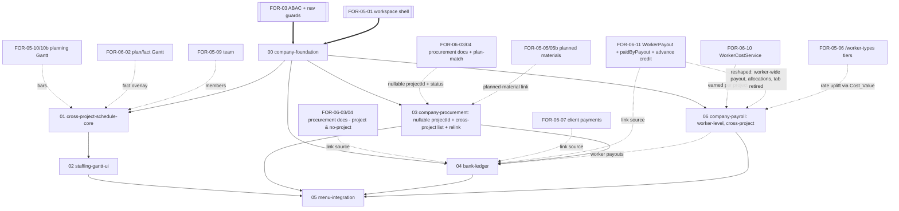

# FOR-07: Company-wide / Cross-project concerns

> **Status:** parent OVERVIEW + child-spec definitions only. No child `requirements.md` /
> `design.md` / `tasks.md` exist yet; each child is elaborated separately later. i18n fields
> (PL/RU `nameRU`/`namePL` entity variants, UI keys) and the notification set for each child
> are deferred to that child's **requirements** phase (per the workspace hooks), not fixed here.

## Overview

FOR-07 is the parent spec for **company-wide, cross-project concerns** — the views and domain
that span *all* projects at once rather than living inside a single project workspace. Where
FOR-05 (design stage) and FOR-06 (execution stage) are scoped to one `/projects/:projectId`
context, FOR-07 owns the **company dashboard** surfaces reached from the **main menu**:

1. **Company-wide worker/foreman schedule (Gantt)** — one Gantt across every project, with
   workers/foremen as rows and a date axis, bars colored by project, so staffing load and
   conflicts are visible company-wide (not per project).
2. **Company procurement / expenses (one model, optional project)** — a single procurement
   document model: the existing FOR-06-03 procurement document, with its `projectId` made
   **optional (nullable)**. A document is tied to a project **at upload time** by selecting a
   project; when uploaded from the cross-project table the project selector may simply be left
   empty, so the document is saved with **no project** (`projectId = null`). This cross-project
   screen lists **all** procurement documents (project and no-project) with:
   - a **project filter** — show all, a specific project, or "no project";
   - a per-document/line **status** — whether a line is **linked to a planned material** (matched
     to a BoM/estimate material line) or **unlinked / unplanned**, reusing the FOR-06-03/04 line
     match state (a no-project document is simply never plan-matched, since matching needs a
     project's plan);
   - a **(re)link-to-project action** for an ADMIN/FINANCIER — set or change a document's
     `projectId` after the fact (including assigning a no-project document to a project, which then
     makes plan-matching possible);
   - **grouping by / link back to the original document** — in a flattened cross-project line view
     every line must show which uploaded document it came from and link to that original (its raw +
     processed image renditions). The FK **already exists** (`ProcurementLineEntity.document` →
     `ProcurementDocumentEntity`, which holds the raw/processed object keys resolved to URLs), so
     this is a **read/DTO concern**, not new schema: the company line DTO carries its parent
     `documentId` + supplier/upload metadata + the document image URL, and the list can group lines
     under their document (collapsible) rather than showing orphan lines.

   There is **no separate `CompanyExpense` entity** — "company expense" is just a procurement
   document with `projectId = null`.
3. **Company bank-account ledger** — the company's bank-account records (transactions) with
   **linkage** to the three money flows already modeled elsewhere: project expenses (FOR-06-03/04
   purchases), client payments (FOR-06-07), salary/payout payments (FOR-06-11), plus the new
   non-project-scoped expenses from concern #2.
4. **Company payroll (worker-level, cross-project)** — the FOR-06-11 payroll lifted from the
   **worker × project** level to the **worker** level. A company table lists every worker with an
   expandable breakdown by project (rows = workers, unwound into their projects) and money columns
   **income / reported work / planned work / other payouts** over a filtered period. Clicking a
   worker opens a **worker payroll** card modeled on the reference workbook
   `2026 ЗП Сметы Графики.xlsx`, sheet `Андрей  и Сергей Andrii Zhylins`, monthly block **BG–BL**
   (July): an **Earned** half (one row per project/object + free-form **additional payroll lines**
   such as a supervision supplement or a Multisport reimbursement) and a **Paid** half (payouts with
   amount, date, comment / invoice ref), closing with **Total**, **Paid**, and a carried-over
   **Balance**. The sheet's coefficient bonus is **not** re-modeled: it is the existing
   `/worker-types` tier uplift, already inside `Cost_Value`. It reuses the FOR-06-10
   `WorkerCostService` and the FOR-06-11 `WorkerPayout` + `paidByPayout` machinery, with the payout
   no longer limited to a single project.

FOR-07 also performs a **main-menu realignment**: the top-level menu items that are really
*project-scoped* are removed (they are already reachable as tabs inside the project workspace),
and the company-wide areas above are added as new top-level menu items.

## Boundary with FOR-05 / FOR-06 (important)

| Dimension | FOR-05 / FOR-06 | FOR-07 |
|-----------|-----------------|--------|
| Scope | One project (`/projects/:projectId`) | All projects / the company |
| Entry point | Project tab inside the workspace | Top-level main-menu item |
| Schedule | Per-project planning Gantt (FOR-05-10/10b) + plan/fact Gantt (FOR-06-02) | Cross-project staffing Gantt (workers × dates × project color) |
| Procurement | Project-scoped purchases (FOR-06-03/04); `projectId` set at upload, attributed to one project's plan | Same procurement documents with `projectId` **nullable**; cross-project list (all / specific / no-project), link-status column, ADMIN/FINANCIER (re)link-to-project action |
| Payments | Project client payments (FOR-06-07), worker payouts (FOR-06-11) | Bank ledger that *references/links* all of these + procurement documents (project and no-project) |
| Payroll | Per-project payroll tab: payouts per `(worker, project)` (FOR-06-11), cost via FOR-06-10. The tab is **retired by FOR-07-06** | Worker-level payroll across all projects: workers × projects table + per-worker monthly payroll card (earned per project incl. worker-type uplift, additional payroll lines, payouts across projects, carried-over balance) |

**FOR-07 mostly READS existing domain and adds a thin cross-project layer.** It does not re-model
project purchases, client payments, or payroll — it references them. Company procurement (concern
#2) is just the existing FOR-06-03 procurement document with a **nullable `projectId`**: one
changeset to drop the NOT-NULL (and relax the project-scope guard to admit null), a cross-project
list, and an ADMIN/FINANCIER re-link action — **no new expense entity, no union**. The genuinely
new persistence is only the **bank account + bank transaction** ledger and the per-flow
**linkage** rows that tie a bank transaction to its source (project purchase / client-payment
tranche / worker payout).

## Main-menu realignment (replace project-scoped items)

Current top-level nav (`foremen-frontend/src/config/navigation.ts`, first/unnamed section). The
three project-scoped entries below are **removed** — they are already reachable inside the project
context, and the shell already has an **active-project button + project switcher** that supersedes
the standalone `/projects` menu entry:

| Item | Path | Resource | Decision under FOR-07 |
|------|------|----------|-----------------------|
| Dashboard | `/` | — | keep |
| Projects | `/projects` | `PROJECTS`/READ | **remove** from the menu — the active-project button + project switcher already provide project selection/entry |
| Rooms | `/rooms` | `ROOMS`/READ | **remove** — already a project tab (FOR-05-02 "Pomieszczenia") |
| Estimate (Kosztorys) | `/estimate` | `ESTIMATE`/READ | **remove** — already a project tab (FOR-05-05 "Kosztorys") |

New top-level company-wide items added by FOR-07:

| New item (working label) | Area | Child spec |
|--------------------------|------|------------|
| Staffing Gantt (Grafik zespołu) | cross-project worker/foreman schedule | FOR-07-02 |
| Company procurement (Zakupy firmowe) | cross-project procurement list (nullable project) | FOR-07-03 |
| Bank / Finance (Bank) | company bank-account ledger + linkage | FOR-07-04 |
| Company payroll (Wynagrodzenia) | worker-level cross-project payroll table + worker payroll card | FOR-07-06 |

> The removed `/projects`, `/rooms`, and `/estimate` routes + their nav entries are retired as
> **menu items**. The underlying `PROJECTS` / `ROOMS` / `ESTIMATE` ABAC resources stay (still used
> by the project workspace, its tabs, and the active-project switcher) — this is a nav-only change,
> not a resource change. Project selection/entry moves entirely to the active-project button +
> switcher; the FOR-05-02/05 tabs remain the canonical surfaces for rooms and estimate.
> **To confirm at FOR-07-00 requirements:** whether the project *list/management* screen remains
> reachable via the active-project switcher (e.g. a "all projects" affordance) now that `/projects`
> leaves the main menu, so project creation/management is not orphaned.

## Child specs (preliminary)

> Numbers are preliminary and firmed up when each child is created. Every child is a separate
> spec with its own `requirements.md` / `design.md` / `tasks.md` / `test-cases.md`. i18n fields,
> the notification set, and PL/RU translations are clarified per child at its requirements phase.

| # | Child spec | Type | Area | Reads / depends on |
|---|------------|------|------|--------------------|
| 00 | `FOR-07-00-company-foundation` | full-stack | Main-menu realignment: remove the three project-scoped top-level nav items (`/projects`, `/rooms`, `/estimate`) — project selection/entry already lives in the active-project button + switcher — and add the three company-wide menu items (nav resolver/guards reused as-is). ABAC scaffold: seed only the shared/company resources this parent needs (e.g. a `COMPANY` section marker); each functional resource is seeded by its owning child. No domain tables of its own. | FOR-03 (ABAC, nav guards), FOR-05-01 shell + active-project switcher, `navigation.ts` |
| 01 | `FOR-07-01-cross-project-schedule-core` | backend | Cross-project read model over the per-project Gantt bars: aggregate every project's `(projectMember, workCategory)` bars (FOR-05-10/10b) into a worker-indexed, date-ranged projection keyed by `User` (worker/foreman) across all accessible projects; per-project color assignment; overlap/conflict detection. No new mutable entity — a read/aggregation service + ABAC read resource (e.g. `COMPANY_SCHEDULE`). | Per-project planning Gantt (FOR-05-10/10b), execution plan/fact (FOR-06-02), team (FOR-05-09) |
| 02 | `FOR-07-02-staffing-gantt-ui` | frontend | The company-wide staffing Gantt screen: rows = workers/foremen, X = dates, bars colored by project, legend of projects, filter by worker/role/date window, click-through deep-link to the owning project's schedule tab. Read-only. | FOR-07-01, FOR-07-00 menu slot |
| 03 | `FOR-07-03-company-procurement` | full-stack | **Make the FOR-06-03 procurement document's `projectId` nullable** (one changeset: drop NOT-NULL; relax the project-scope guard / `ProjectScopedService` filter to admit a null `projectId` so no-project documents are reachable company-wide) + a **cross-project list** of all procurement documents with a **project filter** (all / specific / no-project) and a **link-status** column (reusing the FOR-06-04 line match state; a no-project document is never plan-matched) + an **ADMIN/FINANCIER (re)link-to-project action** that sets/changes `projectId` after the fact (assigning a no-project document to a project enables plan-matching). Each cross-project line DTO carries its parent `documentId` + document metadata + the original-document image URL (the `ProcurementLineEntity.document` FK already exists — read/DTO only), so lines **group under / link back to** their uploaded document. No new expense entity, no union. Company view gated by a new ABAC resource (e.g. `COMPANY_PURCHASES`); the per-project surfaces keep their `PURCHASES` grant. | FOR-06-03/04 procurement documents + plan-match state, project-scope guard (FOR-03-04/04a), BoM/planned materials (FOR-05-05/05b) |
| 04 | `FOR-07-04-bank-ledger` | full-stack | Company bank-account records: `BankAccount` + `BankTransaction` ledger with per-transaction **linkage** to a source — a procurement document (project or no-project, FOR-06-03/04 incl. the FOR-07-03 nullable-project ones), a client-payment tranche (FOR-06-07), or a worker payout (FOR-06-11). Import/entry of transactions, match/link UI, unlinked/uncategorized handling, reconciliation view. New ABAC resource (e.g. `BANK_LEDGER`). This is the heaviest new-persistence child. | Procurement documents (FOR-06-03/04 + FOR-07-03 nullable project), client payments (FOR-06-07), payroll payouts (FOR-06-11) |
| 05 | `FOR-07-05-menu-integration` | frontend | Final integration: wire the company surfaces (schedule, procurement, bank, payroll) into the shell, retire the removed routes/tests, verify nav permission-gating across Sidebar/Drawer/BottomNav. | FOR-07-00..04, FOR-07-06 |
| 06 | `FOR-07-06-company-payroll` | full-stack | **Worker-level payroll across projects.** (a) **Company payroll table** (new top-level menu item): rows = workers, each expandable into its projects (worker total row + one sub-row per project); columns for the filtered period: **Earned** (accrued = reported work + additional lines), **Paid** (Σ payouts actually made), **Reported work** (Σ `Cost_Value` of `APPROVED` report lines), **Planned work** (FOR-06-11 planned basis), **Other payouts** (Σ additional payroll lines, not tied to work items). Earned and Paid are separate columns, not one "income" figure. Filters: **worker** (multi-select) and **dates** — `from` / `to` plus presets **current month** (default) and **current year**, with **previous / next period** shift buttons that move the window by the preset length; the filter state is **persisted in the browser** (`localStorage`) and restored on return. (b) **Worker payroll card** (click a worker): a per-month block mirroring workbook sheet `Андрей  и Сергей Andrii Zhylins`, columns BG–BL — **Earned**: one row per project/object (Σ `Cost_Value` of the worker's `APPROVED` report lines on that project in the month, drillable to the work-item lines: name, unit, price, qty, sum) + the month's **additional payroll lines**; **Total** = Σ earned; **Paid**: the worker's payouts in the month (date, amount, comment / invoice ref); **Balance** = previous month's balance + Total − Paid, carried forward and **never closed**. Each worker has an **opening balance** (default 0). The running balance is opening balance + Σ reported work-item cost + Σ additional lines − Σ payouts (advances included), so the last month before a worker leaves is their final settlement. **Coefficients = worker type (reuse `/worker-types`, no new rate settings):** the sheet's `earned × (1 + coefficient)` is already `Tier_Cost = Base_Cost × (1 + tierPct)` in FOR-05-06 / `MarginCostService`, folded into `Cost_Value` by FOR-06-10 `WorkerCostService`. **Worker type resolution changes to the user's own type:** `users.worker_type_id` (FOR-02-07) **wins over** the per-project member type (FOR-05-09) when costing payroll. If the user has no worker type, the base tier is used (existing `baseTierFallback`) and the card and table show a **warning**. The `/worker-types` dictionary is the **source of truth** for the tier %; the sheet's toggle sums (e.g. Tool 6.5 + Car 3.25 + B2B 16.5 = 26.25 % vs. seeded `HIRED_SOLE_TRADER` +26.5 %) are only illustrative. So the card shows the resolved worker type per project row and **never** applies a second tier coefficient on top (that would double-count). **Seniority (new, user-level):** a `seniorityPct` property on the **WORKER-role user** (alongside the existing `users.worker_type_id`), **edited manually** in the admin user form. Nothing computes it: no start date and no ladder. It is added to the tier uplift, as the sheet sums them: `Base_Cost × (1 + tierPct + seniorityPct)`. **Additional payroll lines (new, not tied to work items):** a worker-level line `{worker, month, name, amount, note}` added to the Earned summary. `name` is **free text** (user data, no `nameRU`/`namePL`). `amount` is **signed**, so negative lines cover deductions such as ZUS + PIT-4R. Examples: supervision supplement ("Dop za prowadzenie"), Multisport reimbursement. Each line is a **standalone** additional payment (e.g. a reimbursement). It counts in Earned / Balance but is **not** part of the payout suggestion or the work-item distribution. **Previous-month hints (visual helper only):** in a new month, the lines the worker had last month are shown as one-click suggestions that copy name + amount into the current month; nothing is auto-created. **Payout = worker-wide, distributed onto reported work (reuses FOR-06-11 `WorkerPayout`, no project):** a payout is `{worker, date, amount}` (+ channel, note); the `worker_payouts.project_id` column is **dropped**. The suggested amount is the worker's total **unpaid** amount over `APPROVED` report lines across **all** projects. **On create**, the payout amount is **distributed** over those lines sorted by date ascending, starting from the first unpaid one, filling each line's unpaid remainder until the amount runs out. The last line touched can be **partially paid**. Each report line therefore carries a **paid amount / unpaid remainder** (fully paid ⇔ remainder = 0), and a line can be covered by several payouts. The single `WorkReportRoom.paidByPayout` FK is replaced by allocation rows `{payout, reportLine, amount}`. Deleting a `PLANNED` payout reverses its allocations. **Advance: same mechanism as FOR-06-11, but worker-wide.** A payout whose period ends after its creation date is an advance, its suggested amount is costed from planned work, and it adds to the worker's credit; a later regular payout applies `min(credit, gross)`. The credit balance is **per worker** (no longer per worker and project). **DB migration, no data migration:** existing payout / FK data is not converted. Changesets drop `work_report_rooms.paid_by_payout_id` (replaced by the allocation table) and `worker_payouts.project_id`, and add the allocation table, `users.seniority_pct`, the additional-lines table, and the per-worker opening balance. **Access: same `PAYROLL` resource** and role matrix; the service is no longer project-scoped (payouts have no project). FINANCIER and MANAGER see the company payroll list and every worker's card/details. **FOREMAN** loses `PAYROLL`/READ (revoked by changeset). They see only the **paid status / paid amount of reported work items** (paid / partially paid / unpaid per line) on work reports, not payouts or balances. The FOR-06-11 **Payroll tab is removed from the active-project workspace** (`WORKSPACE_TABS`); the company screen is the only payroll surface. | FOR-05-06 `/worker-types` tiers, FOR-06-10 `WorkerCostService` (resolution switched to the user's worker type), FOR-06-11 `WorkerPayout` + advance credit (reshaped, tab retired), FOR-06-01 work reports, FOR-02-07 user form (worker type, + seniority %), FOR-07-00 menu slot; FOR-07-04 links its payouts |

> **Open scoping questions (to confirm at FOR-07-03/04 requirements):**
> - Company procurement (03): confirm the no-project upload flow — the project selector on the
>   cross-project upload is optional and, when left empty, saves the document with
>   `projectId = null` (reusing the FOR-06-03 OCR intake unchanged). Confirm whether the
>   cross-project list is **read-only over the lines** (line edits stay in the FOR-06-04 project
>   tab) with the only company-wide write being the document-level (re)link-to-project action.
> - (Re)link authorization: the set/change-`projectId` action is ADMIN/FINANCIER only — confirm
>   whether a MANAGER may also relink documents of their own projects.
> - Link-status semantics: a no-project document has no plan to match, so it shows as unlinked;
>   once linked to a project the existing FOR-06-04 `ProcurementLine` match + `unplannedCategory`
>   states drive the status column (reuse those, don't invent new ones).
> - Line grouping / original-document link: confirm the cross-project list default — group lines
>   under their parent document (collapsible) vs. a flat line list with a "document" column — and
>   that each line exposes `documentId` + the original-document image link (raw/processed URLs
>   resolved via `ImageStorage`). The FK is already there; this is DTO shape + UI only.
> - Bank ledger (04): does it ingest transactions via file import (CSV/MT940) now, or manual entry
>   only, with bank/mass-collect integration deferred to FOR-12 infra (consistent with FOR-06-07's
>   przelewy24 note)?

> **FOR-07-06 decisions (confirmed with the product owner):**
> - **Columns:** "income" is split into two columns, **Earned** (accrued) and **Paid** (actually
>   paid out), next to Reported work, Planned work, and Other payouts.
> - **Rates:** come from the worker type. The `/worker-types` dictionary is the source of truth.
>   Its tier uplift (`Base_Cost × (1 + tierPct)`) already plays the role of the sheet's
>   Tool / Car / B2B coefficient and is already inside `Cost_Value`, so there are no new rate
>   settings or toggles.
> - **Worker type:** the **user's** `users.worker_type_id` wins over the per-project member type.
>   If it isn't set, the base tier is used and a warning is shown.
> - **Seniority:** a `seniorityPct` property on the WORKER-role user, **edited manually** (not
>   computed, no start date, no ladder), added to the tier uplift.
> - **Payout distribution:** a payout is `{worker, date, amount}` with no project. On create, its
>   amount fills the worker's unpaid `APPROVED` report lines across all projects, oldest first,
>   until it runs out. The last line touched may be partially paid, so each line tracks its
>   paid / unpaid amount. The single `paidByPayout` FK becomes allocation rows
>   `{payout, reportLine, amount}`.
> - **Advance:** same rule as implemented in FOR-06-11 (period ends after creation date → advance,
>   costed from planned work, adds credit; a regular payout applies `min(credit, gross)`), but the
>   credit is **per worker**.
> - **Additional payroll lines:** standalone additional payments (e.g. a reimbursement). Free-text
>   name (no i18n), signed amount (negative allowed), per worker per month, shown as a row in the
>   Earned summary. They are **not** part of the payout suggestion or the distribution. Last
>   month's lines are shown as a **visual helper only** (one click copies into the current month).
> - **Balance:** never closed. Per-worker opening balance (default 0) + reported work-item cost +
>   additional lines − payouts (incl. advances); the latest month is the final settlement.
> - **Migration:** schema only, no data migration. Drop `work_report_rooms.paid_by_payout_id` and
>   `worker_payouts.project_id`; add the allocation table, `users.seniority_pct`, the
>   additional-lines table, and the opening balance.
> - **Access:** same `PAYROLL` resource. FINANCIER and MANAGER see the full company payroll list
>   and every worker's details. FOREMAN sees only the paid status / paid amount of reported work
>   items, through work reports. Their `PAYROLL`/READ grant is revoked. The FOR-06-11 Payroll tab is **removed** from the active-project workspace.
>
> **Still open:** none blocking. Split into core (backend) + UI children like 01/02 if the scope
> proves heavy. i18n keys and the notification set are settled at the FOR-07-06 requirements phase.

> **FOR-07-06 status: ✅ implemented** (spec `FOR-07-06-company-payroll/`, tasks 1–10 done).
> - **Schema:** changesets 192–198 — `work_report_rooms.paid_amount` (replaces `paid_by_payout_id`),
>   worker-wide `worker_payouts` (`project_id` dropped, `payout_date` added),
>   `worker_payout_allocations`, `worker_payroll_lines`, `worker_payroll_profiles` (opening
>   balance), `users.seniority_pct`, FOREMAN `PAYROLL`/READ revoked.
> - **Backend:** cost seam resolves the user's own worker type + seniority (`EffectiveTier`);
>   worker-wide suggestion / oldest-first distribution (`PayoutDistributor`, `AllocationWriter`,
>   reversible on delete) with worker-wide advance credit; additional lines + hints + opening
>   balance; company table / worker card read model (`/api/payroll/**`); per-line and per-report
>   payment status on work-report DTOs.
> - **Frontend:** `/company/payroll` (filters persisted in `localStorage`, expandable worker ×
>   project table) and `/company/payroll/:workerId` card; project Payroll tab removed; seniority
>   field in the user form; payment-status badges in work reporting.
> - **Verified:** affected backend unit/property/integration classes green (223 tests); frontend
>   build + spec vitest green; docker stack — migrations applied, FINANCIER/MANAGER 200 and see the
>   menu item, FOREMAN 403 + no menu item + paid-status badge on approved reports.

## Dependency graph

## Recommended build order

1. **00 company-foundation** — menu realignment (remove `/rooms`, `/estimate`; add the three
   company slots) + ABAC scaffold.
2. **01 cross-project-schedule-core** → **02 staffing-gantt-ui** — the read-only company Gantt.
3. **03 company-procurement** — nullable `projectId` + cross-project list + (re)link action
   (independent of the Gantt chain; can run in parallel with 01/02). Builds directly on the
   FOR-06-03/04 procurement document, so it lands after that purchase chain exists.
4. **04 bank-ledger** — after 03 and after the FOR-06 payment/purchase/payroll flows exist, since
   it links to all of them.
5. **06 company-payroll** — after FOR-06-10/11 exist; independent of 01–03, so it can run in
   parallel with them. Lands before 04 ideally, so the bank ledger links worker-level payouts too
   (it is numbered 06 only because 05 was already referenced by existing child specs).
6. **05 menu-integration** — final wiring and retirement of the removed routes.

## Prerequisites (hard dependencies)

- **FOR-05 (design stage)** — the per-project planning Gantt (10/10b) and team (09) that FOR-07-01
  aggregates; the estimate/rooms tabs that replace the removed top-level menu items.
- **FOR-06 (execution stage)** — the execution plan/fact Gantt (02), project purchases (03/04),
  client payments (07), and payroll payouts (11) that FOR-07-04's bank ledger links to; the
  worker-cost seam (10) and payroll (11) that FOR-07-06 aggregates to the worker level.
- **FOR-05-01 workspace-shell** — the shell + nav surfaces the company items plug into.
- **FOR-03 (ABAC)** — `@PermissionResource`, nav permission-gating (`isNavItemVisible`), and the
  resource/role matrix seeding pattern for the new `COMPANY_SCHEDULE` / `COMPANY_PURCHASES` /
  `BANK_LEDGER` resources.
- **Object store** — `ImageStorage` (FOR-04-17) if company procurement (03) reuses OCR intake.
- **FOR-12** — bank/mass-collect integration and payment-provider wiring are deferred to infra,
  consistent with FOR-06-07.

## Notes on reorganization

- The **FOR-07 number is reused** for this company-wide parent. The historical "FOR-07
  procurement-tracking" top-level spec was folded into FOR-06-03/04/05 (project-scoped purchases),
  freeing the number; FOR-07 now means **company-wide / cross-project concerns**. The spec
  registries (`PROJECT.md`, `PROGRESS.md`) and the FOR-06 OVERVIEW reorganization notes have been
  updated to reflect this reuse.
- FOR-07 performs **no physical code move**; it reads FOR-05/06 domain and adds the company layer.

---

*Updated as FOR-07 child specs are added / changed / completed.*
