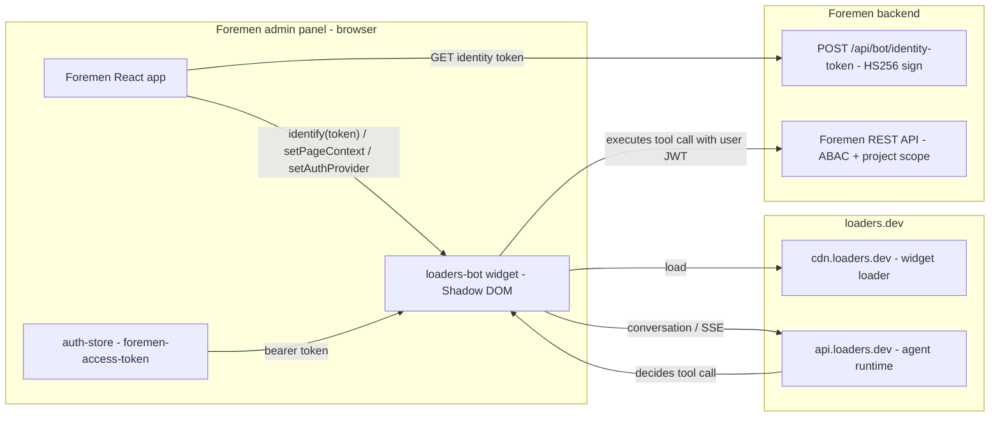

# Design Document

## Overview

FOR-08 connects the **existing** loaders-bot agentic widget to Foremen. Nothing about the agent
runtime, tool execution, chat UI, confirmation flow, or memory is built here — those are
loaders-bot features. Foremen contributes four things:

1. A stateless **identity-token endpoint** that signs the loaders-bot identity JWT with a
   server-held secret.
2. A **curated OpenAPI document** of the Foremen API, imported into the bot as its toolset.
3. **Bot configuration** (roles, Tool × Role matrix, goals + instructions) authored in the bot
   admin panel and captured as a versioned document in this repo.
4. **Frontend glue**: snippet embed, identify lifecycle, host-callback auth provider, page context.

The invariant that makes this safe: the agent performs every API call from the Foremen page using
the **user's own JWT**, so Foremen's ABAC matrix and `ProjectScopedService` scope the agent to
exactly what the user can do — and every **write** goes through the widget's confirmation prompt.



## Decisions

- **D1 — Reuse the user's JWT via a host-callback auth provider (not a tenant secret).** The agent
  calls Foremen as the user. We register `setAuthProvider` returning the current
  `foremen-access-token`. This guarantees ABAC + project-scope apply unchanged and no privileged
  service credential is ever handed to the bot. (Req 5.)
- **D2 — Identity token signed server-side only.** The HS256 identity secret lives in backend config
  (`foremen.bot.identity-secret`); the browser only ever receives the already-signed token from
  `POST /api/bot/identity-token`. The secret never reaches frontend code or logs. (Req 1.3, 1.6.)
- **D3 — Curated OpenAPI, not raw `/v3/api-docs`.** springdoc is already on the classpath and will
  emit a generic spec. We capture it once, then hand-curate a committed artifact that contains only
  the intended tools and excludes auth/webhook/admin endpoints. The curated file is the source of
  truth imported into the bot. (Req 2.)
- **D4 — Writes always confirmed.** All non-GET operations are marked as write tools in the OpenAPI
  (and the bot's default write-confirmation is left on), so every mutation is shown to the user for
  explicit approval before it is sent. GET tools may run without confirmation. (Req 5.4.)
- **D5 — Role mapping via the verified identity-claim path.** The user's Company_Role is carried in
  the identity token `roles` claim and mapped to a bot agent role by an identity-claim rule. This is
  the "verified" trust path, required for any role-restricted tool; we do not rely on a client-
  reported `/me` probe. (Req 3.2.)
- **D6 — No new entity, no new ABAC resource, no new i18n keys, no notifications.** The identity
  endpoint is stateless; the agent reuses existing endpoints and the existing resource/operation
  matrix; all visitor-facing copy is the widget's; the feature announces nothing via the bell. This
  keeps the Foremen footprint tiny and avoids the entity/i18n/notification obligations that would
  otherwise apply. (Req 1.7, 6.5, Introduction scope boundaries.)
- **D7 — Bot admin-panel state captured in-repo.** The bot configuration (toolset import procedure,
  role/matrix, goals/instructions) is authored in the loaders-bot admin panel but mirrored as a
  versioned Markdown configuration document so reviews and reproduction do not depend on the live
  panel's prior state. (Req 3.4, 4.4, 8.4.)

## Backend

### Identity-token endpoint

A single controller, e.g. `BotIdentityController` (`/api/bot`), exposing
`POST /api/bot/identity-token`. It is an authenticated self-service endpoint carrying **none** of
the three permission annotations (Unguarded — like the `/api/auth` self-service surface), so it is
reachable by any authenticated role and passes `PermissionAnnotationValidator`.

Handler outline (grounded in the existing JWT principal model, where the principal is the numeric
user id):

```java
@RestController
@RequestMapping("/api/bot")
@RequiredArgsConstructor
public class BotIdentityController {

    private final AuthService authService;          // currentUser(userId) -> roleCode, name
    private final BotIdentityTokenService tokenService;

    @PostMapping("/identity-token")
    public ResponseEntity<BotIdentityTokenResponse> identityToken(
            @AuthenticationPrincipal Long userId,
            @RequestHeader(value = HttpHeaders.ACCEPT_LANGUAGE, required = false) String acceptLanguage) {
        CurrentUserResponse me = authService.currentUser(userId);
        String locale = "ru".equalsIgnoreCase(resolveLocale(acceptLanguage)) ? "ru" : "pl";
        String token = tokenService.sign(me.id(), me.name(), locale, me.roleCode());
        return ResponseEntity.ok(new BotIdentityTokenResponse(token));
    }
}
```

`BotIdentityTokenService` signs with jjwt (already a dependency) using the configured secret:

```java
String sign(Long userId, String name, String locale, String roleCode) {
    Instant now = Instant.now();
    return Jwts.builder()
        .subject(String.valueOf(userId))
        .issuedAt(Date.from(now))
        .expiration(Date.from(now.plus(Duration.ofHours(12))))   // <= 24h
        .claim("traits", Map.of("name", name, "locale", locale))
        .claim("roles", List.of(roleCode))                       // bot role mapping key
        .signWith(Keys.hmacShaKeyFor(secret.getBytes(UTF_8)), Jwts.SIG.HS256)
        .compact();
}
```

Config + fail-fast:

```yaml
foremen:
  bot:
    identity-secret: ${FOREMEN_BOT_IDENTITY_SECRET:}
    site-key: ${FOREMEN_BOT_SITE_KEY:}   # surfaced to the frontend via build/runtime config
```

On startup, if `foremen.bot.identity-secret` is blank, a `@PostConstruct`/validator in
`BotIdentityTokenService` throws so the app fails fast rather than signing with an empty key
(Req 1.6). The response DTO is minimal: `record BotIdentityTokenResponse(String token)`.

**This endpoint is stateless** — no entity, no table, no Liquibase changeset. It reuses
`AuthService.currentUser(...)` for name + `roleCode` (the same live role graph `GET /api/auth/me`
uses).

### Curated OpenAPI toolset

- springdoc (`springdoc-openapi-starter-webmvc-ui`) already emits `/v3/api-docs` and Swagger UI.
  Because `SecurityConfig` ends with `anyRequest().authenticated()`, those endpoints are currently
  behind auth. **Stance (D3, Req 2.5):** keep them behind auth and capture the document with an
  authenticated request (an admin token) — do **not** permit-list data; only the generated API
  description is captured. Optionally add a minimal `@OpenAPIDefinition` with info/title.
- **Procedure:** boot the Docker stack, authenticate as ADMIN, `GET /v3/api-docs` → save; curate
  down to the tool operations and commit as
  `foremen-backend/src/main/resources/openapi/foremen-bot-toolset.yaml`.
- **Curation rules:**
  - **Include** (tools): projects (`/api/projects` create/list/get/update, `activate`), rooms
    (`/api/rooms` CRUD), estimate (`/api/estimates*`, `/api/estimate-lines*`, matrix preview/apply/
    assignments, `/api/estimates/project/{id}/materials` + reserve), materials/assortment
    (`/api/materials*`, assortment, `work-material-consumptions`), catalog (`/api/work-items`,
    `/api/work-prices`, `/api/work-categories`), sellers (`/api/material-sellers` list/search +
    CRUD), procurement (`/api/procurement-documents`, `/api/procurement-lines`), dictionaries
    (`measurement-units`, `vat-rates`, `room-types`, `currencies`, etc.), team
    (`/api/project-members` incl. `candidates`), schedule (`/api/project-schedules`), images
    (`/api/images` upload — used by the rooms-from-plan goal).
  - **Exclude** (never agent tools, Req 2.3): all `/api/auth/**`; `POST /api/signatures/callback`;
    `POST /api/payments/webhook/**`; and account/role administration `/api/users`, `/api/roles`,
    `/api/resources`, `/api/operations`, `/api/audit`.
  - **Security + verbs (Req 2.4):** every operation declares the bearer security scheme; GET →
    read/non-destructive, non-GET → write (so the bot's confirmation policy applies).
- **Re-capture:** the same procedure is documented in the bot configuration document so the toolset
  can be refreshed when the API changes (Req 2.6).

### CSP (where enforced)

Add the loaders-bot hosts to the delivered CSP (reverse proxy / Spring headers / frontend host):
`script-src https://cdn.loaders.dev; connect-src https://api.loaders.dev; img-src
https://cdn.loaders.dev` (production; `dev.` variants for sandbox). (Req 7.2.)

## Frontend

A small, self-contained integration module (e.g. `src/features/assistant/loaders-bot.ts`) plus a
mount point wired into the authenticated app shell. **No new UI text, no new i18n keys** — the
widget renders its own surface (Req 6.5).

### Snippet + init

The loader snippet (from the bot admin panel) is injected once on the authenticated app, with the
**site key read from runtime/build config** (`import.meta.env.VITE_LOADERS_BOT_SITE_KEY` or an
equivalent runtime config), never hardcoded (Req 6.1). It is **not** initialized on public routes
(`/login`) (Req 6.3).

### Identify lifecycle

A hook/effect bound to the auth store:

```ts
// on authenticated (after login, and after session hydration resolves authenticated)
const { token } = await apiRequest<{ token: string }>('/api/bot/identity-token', { method: 'POST' })
window.LoadersBot.identify({ token })

// on logout / clearSession
window.LoadersBot.identify(null)
```

The identity token is short-lived (≤ 24 h) and re-requested on fresh authentication; the bot
re-runs its role resolution on `identify`. (Req 6.2.)

### Auth provider (host callback)

```ts
window.LoadersBot.setAuthProvider(async ({ scheme }) => {
  if (scheme !== 'bearer') return null
  const token = useAuthStore.getState().accessToken   // current Foremen access token
  return token ? { headers: { Authorization: `Bearer ${token}` } } : null  // null = signed out
})
```

The agent's browser tool calls Foremen with this header, from the Foremen origin — so the request is
indistinguishable from the app's own and is subject to the same ABAC + project-scope. Token refresh
is handled by reading the live `accessToken` from the store at call time; the app's existing 401
refresh path keeps the stored token fresh. (Req 5.1, 5.2.)

### Page context

On route change (the widget also auto-listens to History API navigation, but we push structured
context explicitly):

```ts
// example when inside a project workspace route
window.LoadersBot.setPageContext({ pageType: 'estimate', projectId, roomId })
// generic surfaces
window.LoadersBot.setPageContext({ pageType: 'projects' })
```

Payload kept ≤ 4 KB and free of sensitive data (Req 6.4).

### Graceful degradation + consent

If `cdn.loaders.dev/widget/v1/loader.js` fails to load, the queued `LoadersBot` stub simply buffers
calls and the app is otherwise unaffected — no visible Foremen error (Req 6.6). Consent is set per
the documented stance (default `true` absent a dedicated Foremen consent banner) via
`LoadersBot.setConsent(...)` (Req 7.3).

## Bot configuration (captured in-repo)

Authored in the loaders-bot admin panel, mirrored as `bot-configuration.md` in this spec folder
(D7). It contains:

1. **Toolset import** — how the curated `foremen-bot-toolset.yaml` is imported; the auth scheme set
   to **Host callback** (bearer); the re-capture/re-curate procedure.
2. **Roles** — the seven agent roles (ADMIN/MANAGER/FOREMAN/WORKER/ESTIMATOR/FINANCIER/CLIENT) and
   their identity-claim rules (`roles` claim match), all **verified** trust.
3. **Tool × Role matrix** — each tool assigned to the roles whose Foremen ABAC grants allow it
   (mirroring the Foremen matrix). Read tools broadly; estimate-write → ADMIN/MANAGER/ESTIMATOR;
   procurement → ADMIN/MANAGER/FINANCIER; etc. Account/role-admin tools are not present at all.
4. **Goals + instructions** — the authored goals from Req 4 (materials-list import, seller search,
   project creation, step-by-step project management incl. rooms-from-plan, estimate preparation,
   and further main-feature goals), each with its role audience, milestones, and the
   "read-before-write, confirm-before-write" instruction. Each validated in the test console before
   publish.

### Goal design notes

- **Rooms from plan:** there is no single "create room from plan" endpoint. The goal guides the
  multi-step path — upload the plan image via the image endpoint, then create/update room(s) via
  `/api/rooms` with the captured geometry — and never assumes a non-existent one-call endpoint
  (Req 4.3).
- **Estimate preparation:** matrix preview endpoints (`apply-package`/`apply-work`/`recompute`/
  `preview`) are non-persisting reads; only `POST .../assignments` and the materials `reserve`
  persist and are DRAFT-gated. The goal reads the preview, proposes, then confirms the persisting
  step.
- **Project creation:** uses the custom `POST /api/projects` (generic/bulk create is disabled);
  the goal collects required fields then confirms before the single create.

## Security considerations

- **Least privilege by construction:** the agent inherits the user's JWT and nothing more; there is
  no service account, no tenant secret, no privileged bot credential. ADMIN bypass and non-ADMIN
  deny-by-default + project-scope apply unchanged.
- **Secret hygiene:** identity secret is backend-only, validated at startup, never logged or
  returned. Site key is public by design.
- **Write safety:** confirmation on every non-GET tool; the user approves each mutation.
- **Excluded surface:** auth, external webhooks, and account/role administration are absent from the
  toolset, so the agent cannot drive session, provider-callback, or user/role management flows even
  for an ADMIN user.
- **Third-party script:** loading `cdn.loaders.dev` is a deliberate third-party integration; it is
  constrained by the CSP entries and receives only the signed identity token (no raw secrets). Treat
  widget-originated events as untrusted input in any `on(...)` handlers.

## Testing strategy

- **Backend unit/integration:** `BotIdentityTokenService` signs a valid HS256 token with correct
  `sub`/`traits.locale`/`roles`; the endpoint returns 200 for an authenticated caller and is 401 for
  an unauthenticated one; startup fails fast when the secret is blank. (Req 8.1.)
- **OpenAPI artifact:** a test (or CI check) parses `foremen-bot-toolset.yaml` as OpenAPI 3, asserts
  the intended operations are present, and asserts the excluded paths (`/api/auth`, webhooks,
  `/api/users|roles|resources|operations|audit`) are absent. (Req 8.2.)
- **Frontend:** unit-test the identify-on-auth / de-identify-on-logout effect and the auth-provider
  callback (returns bearer header when a token exists, `null` when signed out) with the `LoadersBot`
  global stubbed.
- **End-to-end (bot test console + Docker stack):** identify → a read tool returns in-scope data →
  a write tool prompts confirmation then mutates → an out-of-scope id yields 403/404. (Req 8.3.)
- Follow the workspace test-execution standard: run only the affected backend test classes with
  `--tests`, write results to a temp log, and read the JUnit XML for pass/fail.
