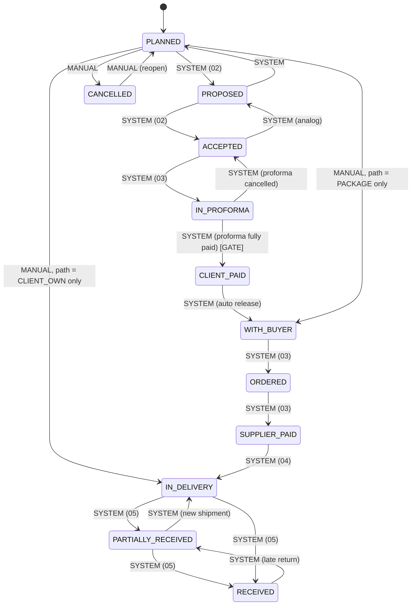

# Design Document

## Overview

FOR-11-00 adds a thin, well-fenced procurement domain on top of existing building blocks. It adds
**two persistence aggregates** (`PurchasePosition` with its `PurchasePositionVariant` history,
`PurchaseRequest`), **extends two existing tables**
(`finishing_materials`: `project_id`, `seller_id`; `material_sellers`: `nip`), introduces **one SPI**
(`NipLookupService`, shipped disabled), **one role** (`BUYER`), **three ABAC resources**, **two
notifications**, and a handful of **pure policies** (transition, price visibility, request status).

Design principles:

- **Reuse before adding.** Material master data stays in `finishing_materials`; sellers stay in
  `material_sellers`; stage labels live in the existing `delivery_statuses`; project scoping reuses
  `ProjectScopedService` through its `allowedProjectIds` extension point; notifications use the
  generic `NotificationService`; the overdue job copies `OverdueSweepService`; the SPI copies the
  translation seam.
- **Logic in code, labels in data.** The state machine is an enum + a pure policy. The dictionary only
  labels and orders stages; renaming or deactivating a status row never changes behavior.
- **Pure policies first.** Transition, price visibility and request status are stateless functions,
  tested by unit and property tests before any service uses them.
- **Do not relax guards, extend them.** BUYER gets company-wide access through the
  `allowedProjectIds` hook of the three new services only; no existing service changes its scoping.

## Architecture

```mermaid
graph TD
    subgraph API
      PM[ProjectMaterialController<br/>PROJECT_MATERIALS]
      PP[PurchasePositionController<br/>PURCHASE_POSITIONS]
      PR[PurchaseRequestController<br/>PURCHASE_REQUESTS]
      MS[MaterialSellerController<br/>+ GET /lookup]
      PL[ProcurementProjectsController<br/>GET /api/procurement/projects]
    end
    subgraph Services
      PMS[ProjectMaterialService]
      PPS[PurchasePositionService]
      LCS[PositionLifecycleService]
      PRS[PurchaseRequestService]
      MSS[MaterialSellerService]
      NLQ[SellerLookupService]
    end
    subgraph Pure
      TP[PositionTransitionPolicy]
      PV[PositionPriceVisibility]
      SD[PurchaseRequestStatusDeriver]
      ST[PositionStage mapping]
    end
    ACC[ProcurementProjectAccess<br/>ADMIN bypass / BUYER all / members]
    NIP[NipLookupService<br/>Rest... | Disabled...]
    SWEEP[PurchaseRequestOverdueSweepService]
    EMIT[ProcurementNotificationEmitter]
    NS[(NotificationService)]

    PM --> PMS --> ACC
    PP --> PPS --> ACC
    PPS --> LCS --> TP
    PP --> PV
    PR --> PRS --> ACC
    PRS --> SD
    PRS --> EMIT
    MS --> MSS
    MS --> NLQ --> NIP
    SWEEP --> EMIT --> NS
    LCS --> ST
```

### Position state machine



`ORDERED`, `SUPPLIER_PAID` and later edges are written by children 03/04/05 through
`PositionLifecycleService`; this spec ships the policy and the service, and exposes only the manual
edges over REST. The gate lives in one place: `PositionTransitionPolicy`.

## Components and Interfaces

### 1. BUYER role and access

- **Role seed** `223-seed-buyer-role.xml` (copy of the 189/136 idempotent pattern).
- **`ProcurementProjectAccess`** (`@Component`, package `com.foremen.service.procurement.access`):

```java
Set<Long> allowedProjectIds(Long userId);   // BUYER: all project ids; others: ACTIVE memberships
boolean isBuyer(Authentication a);          // authority ROLE_BUYER
boolean isMoneyPrivileged(Authentication a); // ADMIN, MANAGER, BUYER
```

  The membership query is the same `ProjectMemberDao` query the other `ProjectScopedService`
  implementations use (read `RoomService.allowedProjectIds` before copying). ADMIN keeps the exact
  `ROLE_ADMIN` bypass already in `ProjectScopedService.addRequiredQuery`.
- `PurchasePositionService`, `PurchaseRequestService` and `ProjectMaterialService` implement
  `ProjectScopedService` and delegate `allowedProjectIds` to this component. **No existing service is
  changed.**
- **Why not a separate "company" resource like COMPANY_PURCHASES?** FOR-07-03 needed a different
  *list shape* (documents across projects, null project). Here BUYER uses the same list, filtered by
  project; the single resource with a role-aware `allowedProjectIds` is simpler and keeps one set of
  endpoints.

### 2. Project-scoped finishing materials

- `FinishingMaterialEntity` gains `@ManyToOne(fetch = LAZY) ProjectEntity project` and
  `MaterialSellerEntity seller`.
- `FinishingMaterialService.addRequiredQuery()` returns `(root, q, cb) -> cb.isNull(root.get("project"))`
  (the hook defined in `ReadOnlyAdminService`). `findById` is not filtered (R2.5).
- `FinishingMaterialDao.findByActiveTrueAndRetailNetNotNull()` and `findActiveByTypes(...)` add
  `AND m.project IS NULL`.
- Consumers that read the global list through the API (estimate pickers, offer selection, assortment)
  need no change; the backend consumers listed in the context analysis (`MarginsListService`,
  `EstimateMatrixAssembler`, ... ) load by id, so they are unaffected. Task 4.1 re-reads each consumer
  once to confirm.
- **`ProjectMaterialService`** implements `AdminService` + `ProjectScopedService` over the same
  entity, with `getProjectIdPath() = "project.id"`. Because the path is non-null only for project
  rows, the scoped list returns only Project_Materials. Validation and mapping **delegate to
  `FinishingMaterialService`'s existing `validateCreate`/`validateUpdate` and mapper** (made
  package-visible/extracted if they are not already callable) and add: project required and `ACTIVE`,
  immutable project, in-use check against `PurchasePositionDao`.
- DTOs: `ProjectMaterialCreateRequest` (record), `ProjectMaterialUpdateRequest`,
  `ProjectMaterialDtoModel` (reuses the finishing DTO fields + `projectId`, `sellerId`, `sellerName`).

### 3. Seller NIP and lookup

- `MaterialSellerEntity.nip` (`VARCHAR(10)`), unique partial index
  `uk_material_sellers_nip WHERE nip IS NOT NULL`.
- `MaterialSellerService.validateCreate/validateUpdate`: normalize via `NipValidator.normalize`, but
  re-map its `error.worker.nip.invalid` to `error.materialSeller.nip.invalid`; duplicate check before
  save (409) in addition to the DB index (race-safe).
- **`SellerLookupService`**:

```java
SellerLookupResult lookup(String rawNip);
// 1. nip = NipValidator.normalize(rawNip)
// 2. dao.findByNip(nip) -> DICTIONARY
// 3. nipLookupService.isConfigured()? lookup(nip) -> REGISTRY | NONE ; else NONE(registryAvailable=false)
// 4. RestClient / IO failure -> NipLookupUnavailableException -> 502
```

- Controller: `MaterialSellerController` gets one handler
  `@GetMapping("/lookup") @RequiresPermission(resource = "MATERIAL_SELLERS", operation = "READ")`.
- Response DTO `SellerLookupResponse { String nip; Source source; MaterialSellerDtoModel seller;
  RegistryCandidate candidate; boolean registryAvailable; }`.

### 4. NIP registry SPI (non-working stub)

Package `com.foremen.service.nip` / config `com.foremen.config.nip`, mirroring the translation seam:

```java
public interface NipLookupService {
    Optional<NipLookupResult> lookup(String nip);   // throws NipLookupUnavailableException
    boolean isConfigured();
}
public record NipLookupResult(String nip, String name, String address,
                              String regon, String krs, Registry registry) {
    public enum Registry { JDG, KRS, UNKNOWN }
}
@Validated @ConfigurationProperties(prefix = "foremen.nip-lookup")
public record NipLookupProperties(boolean enabled, String baseUrl, String apiKey, Duration timeout) {
    // timeout defaults to 5s; isConfigured() = enabled && baseUrl non-blank
}
```

- `NipLookupConfiguredCondition` / `NipLookupNotConfiguredCondition` (same shape as
  `TranslationConfiguredCondition`), `@EnableConfigurationProperties`.
- **`RestNipLookupService`** (`@Conditional(Configured)`): builds a `RestClient` with the base URL and
  timeout, calls `GET ?nip={nip}` and header `X-Api-Key` (when set), deserializes with
  `FAIL_ON_UNKNOWN_PROPERTIES = false` into a private DTO, maps `registry` by string (`JDG`/`KRS`,
  default `UNKNOWN`). 404 or empty body -> `Optional.empty()`. Other errors -> wraps in
  `NipLookupUnavailableException` (message never contains the key).
- **`DisabledNipLookupService`** (`@Service @Conditional(NotConfigured)`): `Optional.empty()`,
  `isConfigured() = false`.
- Expected upstream JSON (documented in the class Javadoc):

```json
{ "nip": "1234563218", "name": "ACME Sp. z o.o.", "address": "ul. Prosta 1, 00-001 Warszawa",
  "regon": "123456785", "krs": "0000123456", "registry": "KRS" }
```

### 5. Position model, lifecycle, visibility

- **Enums:** `PositionKind`, `SourcingPath`, `PositionStatus` (the stage), `RequestStatus` (derived,
  not persisted), all stored by name.
- **`PositionStage`** utility: `statusCode(PositionStatus)` -> `new|proposed|accepted|in_proforma|
  client_paid|with_buyer|ordered|supplier_paid|in_delivery|partially_received|delivered|cancelled`
  and `rank(PositionStatus)` for ordering comparisons (`CANCELLED` unranked).
- **`PositionTransitionPolicy`** (pure):

```java
Decision decide(SourcingPath path, PositionStatus from, PositionStatus to, Actor actor);
// Decision = ALLOWED | NOT_ALLOWED | GATE_VIOLATION
enum Actor { MANUAL, SYSTEM }
```

  Rules in order: (1) `from == to` -> NOT_ALLOWED; (2) edge must exist in the graph above for the
  path; (3) if `to == WITH_BUYER && path == AGREED && from != CLIENT_PAID` -> GATE_VIOLATION;
  (4) `MANUAL` is allowed only for the edges of R8.4/R8.5; everything else requires `SYSTEM`.
- **`PositionLifecycleService.transition(id, target, actor, actorUser)`**: loads (scoped), calls the
  policy, sets `status`, persists (audit via the entity audit), publishes
  `PositionStatusChangedEvent`; throws `ForemenApiException` with the keys in R8.6.
- **`PositionPriceVisibility`** (pure):

```java
enum Audience { STAFF_FULL, SITE, CLIENT }
PositionMoney apply(Audience a, SourcingPath path, PositionStatus status, PositionMoney raw);
```

  `PositionMoney` is a small record holding the six Money_Fields. The controller mapper picks the
  audience from the authority (`ADMIN|MANAGER|BUYER` -> STAFF_FULL, otherwise SITE). `CLIENT` is
  implemented and tested but unused.
- **Filter/sort guard:** `PurchasePositionService` overrides the query parsing entry point to reject
  Money_Field names for non-STAFF_FULL callers (task 5.5 reads `ReadOnlyAdminService.parseSpecification`
  / `processSort` to place the check; `getAdminOnlyFields()` is ADMIN-only and is not sufficient).
- **`PurchasePositionService`** (`AdminService` + `ProjectScopedService`): create/update rules of R9;
  `getDefaultSort()` = `needByDate asc nulls last, id asc`.

### 6. PurchaseRequest

- `PurchaseRequestService`: CRUD, attach/detach, buyer validation (via `UserDao` + role code
  `BUYER` + active status), derived fields assembled in the mapper using
  `PurchaseRequestStatusDeriver` and `Clock`-based overdue.
- **`PurchaseRequestStatusDeriver`** (pure): input `List<PositionStatus>`; output `RequestStatus`
  (R11.8).
- Assignment event: `PurchaseRequestAssignedEvent(requestId, buyerUserId)` published when
  `assignedBuyer` changes to a non-null value.

### 7. Overdue sweep and notifications

- **`PurchaseRequestOverdueSweepService`**:

```java
@Scheduled(cron = "${foremen.procurement.request-overdue-sweep.cron:-}")
@Transactional
public void sweep() { ... }   // finds overdue + overdue_notified_at IS NULL, stamps, publishes
```

  A DAO query selects candidates (`expected_delivery_date < today AND overdue_notified_at IS NULL`);
  completed/cancelled status is excluded in code by the deriver (positions loaded per candidate).
  `expectedDeliveryDate` updates clear `overdueNotifiedAt` when moved to a date >= today.
- **`ProcurementNotificationEmitter`**: two `@TransactionalEventListener(AFTER_COMMIT,
  fallbackExecution = true)` handlers (`PurchaseRequestAssignedEvent`,
  `PurchaseRequestOverdueEvent`), recipients resolved through `UserDao` (role `BUYER`, active) and
  `ProjectMemberDao` (project, ACTIVE, `projectRole.code = 'MANAGER'`); each send wrapped in
  try/catch + `log.error`; `notificationService.create(userId, type, null, "/deliveries?request=" +
  id)`.

### 8. Datasets

`PurchasePositionsDataset` and `PurchaseRequestsDataset` (`@Component`) following `RoomsDataset`. Field
catalog per Requirement 24.1 (excludes Money_Fields, `notes`, `referenceLink`, NIP, variants).
`PROJECT_MATERIALS` is added to `DatasetCoverage.EXCLUDED`.

**BUYER sees all projects through widgets.** `DashboardQueryEngine.predicates` builds
`projectPath IN (allowedProjectIds) OR nullProjectPredicate(...)` for non-admins. Both datasets
override `nullProjectPredicate(ctx, cb, root)` to return `cb.conjunction()` when
`"BUYER".equals(ctx.roleCode())` and `null` otherwise, so the OR is always true for a BUYER and the
membership rule is unchanged for everyone else. No change to `ProjectAccessCache` or the engine.

### 9. Inline seller creation (R20)

- `SellerQuickService.findOrCreate(name, nip)`: normalize NIP when present; `dao.findByNip` hit ->
  `{seller, created=false}`; otherwise build the entity (`nameRU = namePL = trimmed name`, `active =
  true`), generate `code` with a pure `SellerCodeGenerator` (lowercase, ASCII-fold Polish/Cyrillic
  diacritics, replace non `[a-z0-9]` runs with `_`, trim to 90 chars, append `_2`, `_3`, ... on
  collision), save, return `created=true`. The unique NIP index makes a concurrent double-create fail
  safely: the loser catches the constraint violation and re-reads by NIP.
- Handler `POST /api/material-sellers/quick` on `MaterialSellerController`
  (`@RequiresPermission(MATERIAL_SELLERS, CREATE)`), request record `SellerQuickRequest(@NotBlank
  @Size(max=100) name, String nip)`, response `SellerQuickResponse(MaterialSellerDtoModel seller,
  boolean created)`.
- Frontend `features/material-sellers/components/SellerPicker.tsx` (async combobox; search sends
  `filter=nameRU~like~q,namePL~like~q,nip~like~q` through the shared `buildFetchQuery`; value =
  seller id) and `SellerQuickCreate.tsx` (popover form built on the zod schema with only `name` and
  `nip`, `useSellerLookup` for the "Find" button, `useQuickCreateSeller` mutation). The popover is
  rendered only when `usePermission().can('MATERIAL_SELLERS','CREATE')`.

### 10. Variant history (R21)

- `PurchasePositionVariantEntity` (`purchase_position_variants`), `PurchasePositionVariantDao`.
- **`PositionVariantService`** (not a separate resource; guarded by `PURCHASE_POSITIONS`):

```java
VariantView replace(Long positionId, ReplaceCommand cmd, Actor actor);   // snapshot current -> history, set new current
VariantView restore(Long positionId, Long variantId, Actor actor);        // swap
List<VariantView> history(Long positionId);                               // newest first
List<SuggestionView> suggestions(Long positionId, int limit);
```

  `replace`/`restore` load the position through `PurchasePositionService` (scoped), call the pure
  `VariantStagePolicy.allowed(status, actor)` (MANUAL: `PLANNED`/`PROPOSED`; SYSTEM: any stage before
  `WITH_BUYER`), validate material project rules (R7.5), write both rows in one transaction.
- **Suggestions query** (single JPQL): materials appearing as `plannedMaterial` of positions or as a
  variant `material` of positions in the same project whose material `type` equals the current
  material's `type`, excluding the current material, grouped by material with the latest known sale
  price (`max(createdDate)` for variants, position `updatedDate` for current options), limited.
- `PositionVariantController` at `/api/purchase-positions/{id}/variants` (`@PermissionResource` is
  inherited from the same resource through `@RequiresPermission(PURCHASE_POSITIONS, READ|UPDATE)` on
  each handler); money fields of every DTO pass through `PositionPriceVisibility`.
- The position DTO gains `variantCount` (a batched count query for lists, no N+1).
- Frontend contract for FOR-11-01: main row from the list; "history" expander calls
  `/variants`; a "pick analog" action calls `/variants/suggestions` and `replace`.

### 11. `hideDelivered` (R22)

`PurchasePositionService.addRequiredQuery()` is unchanged (scoping). The controller reads
`hideDelivered` and the service composes `status <> 'RECEIVED'` into `buildFinalSpecification`
(extra `Specification` AND-ed with the user and scope specs, so totals/pagination stay correct).
For requests the hidden set is "derived status `COMPLETED`", i.e. `EXISTS (position with status
RECEIVED) AND NOT EXISTS (position with status NOT IN ('RECEIVED','CANCELLED'))`; the visible set is
its negation, expressed with Criteria subqueries and mirroring `PurchaseRequestStatusDeriver` (an
integration test asserts the SQL result equals the deriver result over a matrix of position-stage
combinations).

### 12. Planned delivery date and upcoming list (R11.11, R23)

- `plannedDeliveryDate` is a persisted, system-owned column maintained by one component,
  `PlannedDeliveryDateSynchronizer`, called by `PurchaseRequestService` on attach, detach and on
  `expectedDeliveryDate` update. Terminal positions are skipped on update. (FOR-11-04 will call the
  same component with a shipment ETA.)
- `UpcomingDeliveriesService.upcoming(days, projectId)`: one JPQL projection over
  `PurchasePositionEntity` joined to project, material (`COALESCE(actualMaterial, plannedMaterial)`),
  producer, unit and request; WHERE stage IN the five planned-delivery stages, `plannedDeliveryDate
  <= :limit`, project scoping through `ProcurementProjectAccess` (BUYER/ADMIN all); ORDER BY
  `plannedDeliveryDate`, `project.name`. `overdue = plannedDeliveryDate < today (Europe/Warsaw)`.
  The DTO has no money fields by construction. `unitName` resolved with the existing locale
  resolver (`nameRU`/`namePL`).
- Endpoint `GET /api/purchase-positions/upcoming` is a method on `PurchasePositionController`
  (`@RequiresPermission(PURCHASE_POSITIONS, READ)`); the literal path is declared before
  `/{id}` to avoid ambiguity.

### 13. Dashboard widgets (R24)

- **Field catalog** per R24.1; `status`/`sourcingPath`/`kind` as `ENUM` with `enumValues`; label
  paths over to-one associations only (`plannedMaterial.producer.nameRU`).
- **Library seed `231-seed-procurement-dashboard-widgets.xml`** (one changeSet per widget,
  `SELECT COUNT(*) FROM dashboard_widgets WHERE code = ...` precondition, config single-line JSON
  cast to jsonb, same column list as 221):

| Code | Visualization | Size (col x row) | `project_scope` | Config essentials |
|------|---------------|------------------|-----------------|-------------------|
| `UPCOMING_DELIVERIES` | TABLE | 2 x 3 | `NONE` | filters `status IN [...]`, `plannedDeliveryDate IS_NOT_NULL`; sort `plannedDeliveryDate ASC`; limit 10; `dateField: plannedDeliveryDate`; ROW link `/deliveries` |
| `PROCUREMENT_BY_STAGE` | DONUT | 2 x 2 | `NONE` | dimension `status`; measure `COUNT(id)`; filter `status NE CANCELLED` |
| `POSITIONS_WITH_BUYER` | KPI | 1 x 1 | `NONE` | measure `COUNT(id)`; filter `status EQ WITH_BUYER`; link `/deliveries` |

  Names (RU / PL): "Ближайшие поставки" / "Najbliższe dostawy"; "Закупки по этапам" / "Zakupy wg
  etapów"; "Ждут закупки" / "Czekają na zakup". Descriptions follow the 221 style.
- **Role defaults `232-seed-procurement-dashboard-defaults.xml`**: `INSERT ... ON CONFLICT (role_id,
  cell_index) DO NOTHING` from a `VALUES` list like 222. The cells are chosen in the task by reading
  `GridMath` and the spans of the already-placed widgets (FOREMAN uses cells 0, 12, 14, 24; MANAGER
  0, 12, 14, 16, 24) and must not overlap; the existing grid/seed tests validate this. Proposed
  rows at the bottom of the grid: FOREMAN `UPCOMING_DELIVERIES`; MANAGER `UPCOMING_DELIVERIES`,
  `PROCUREMENT_BY_STAGE`; BUYER `POSITIONS_WITH_BUYER`, `UPCOMING_DELIVERIES`,
  `PROCUREMENT_BY_STAGE`; ADMIN `PROCUREMENT_BY_STAGE`. No backfill of existing users.
- **`RouteWhitelist.ROUTES`** gains `"/deliveries"`; the frontend `route-permissions` already derives
  `/deliveries` from the nav (R17.4), so `RouteWhitelistContractTest` passes.
- **Known limit:** widget filters take static values, so "next N days" cannot be a filter; the
  `UPCOMING_DELIVERIES` table instead sorts by `plannedDeliveryDate ASC` over active stages, which
  lists overdue items first. A relative-date filter would be a FOR-10 enhancement.

### 14. Frontend (inner repo `foremen-frontend/`)

- `features/material-sellers`: `types` (+`nip`), `schemas/material-seller-schema.ts` (+optional `nip`
  with checksum, `materialSellers.validation.nipInvalid`), `api/material-sellers-api.ts`
  (`lookupSellerByNip`), `api/query-hooks.ts`/`mutation-hooks.ts` (`useSellerLookup` as a mutation),
  `components/MaterialSellerFormSheet.tsx` (NIP input + "Find by NIP" button + result messages),
  `components/MaterialSellersList.tsx` (+`nip` column).
- `config/navigation.ts`: `/deliveries` item -> `PURCHASE_POSITIONS`/READ; `BOTTOM_NAV_PROFILES.BUYER
  = [item('deliveries')]`; tests in `config/__tests__/navigation.test.ts`,
  `app/guards/__tests__/PermissionGuard.test.tsx`, `app/layout/__tests__/BottomNav.test.tsx` updated.
- `config/route-permissions.ts`: derived from nav; verify `/deliveries` resolves to the new resource.
- `features/material-sellers/components/SellerPicker.tsx` and `SellerQuickCreate.tsx` (+ api
  `quickCreateSeller`, mutation `useQuickCreateSeller`), per section 9.
- `locales/pl.json`, `locales/ru.json`: keys below, in parity.

## Data Model / Migrations

Next free changeset number is **223** (current tail `222-seed-dashboard-role-defaults.xml`); if a
sibling spec lands first, use the next free numbers. Every changeset is idempotent and registered
**last** in `database_files/changelog.xml`.

| # | File | Content |
|---|------|---------|
| 223 | `223-seed-buyer-role.xml` | role `BUYER` |
| 224 | `224-add-finishing-materials-project-seller.xml` | `project_id`, `seller_id` + FKs + indexes |
| 225 | `225-add-material-sellers-nip.xml` | `nip` + partial unique index |
| 226 | `226-create-purchase-requests.xml` | table `purchase_requests` |
| 227 | `227-create-purchase-positions.xml` | tables `purchase_positions` (incl. `planned_delivery_date`) and `purchase_position_variants` |
| 228 | `228-seed-procurement-delivery-stages.xml` | new `delivery_statuses` rows + guarded `order_no` updates |
| 229 | `229-seed-procurement-resources.xml` | resources `PURCHASE_POSITIONS`, `PURCHASE_REQUESTS`, `PROJECT_MATERIALS` + role grants |
| 230 | `230-grant-buyer-reference-resources.xml` | BUYER READ grants on reference resources, sellers CRU, notifications; `MANAGER` CREATE on `MATERIAL_SELLERS` |
| 231 | `231-seed-procurement-dashboard-widgets.xml` | library widgets `UPCOMING_DELIVERIES`, `PROCUREMENT_BY_STAGE`, `POSITIONS_WITH_BUYER` |
| 232 | `232-seed-procurement-dashboard-defaults.xml` | `role_default_widgets` rows for FOREMAN, MANAGER, BUYER, ADMIN |

`purchase_requests`:

```
id BIGSERIAL PK; project_id BIGINT NOT NULL FK projects; delivery_category_id BIGINT NULL FK;
reference_number VARCHAR(100) NULL; reference_link VARCHAR(1000) NULL;
expected_delivery_date DATE NULL; assigned_buyer_id BIGINT NULL FK users;
notes VARCHAR(2000) NULL; overdue_notified_at TIMESTAMPTZ NULL;
created_date, created_by, updated_date, updated_by
INDEX (project_id), (assigned_buyer_id), (expected_delivery_date)
```

`purchase_positions`:

```
id BIGSERIAL PK; project_id BIGINT NOT NULL FK projects;
kind VARCHAR(16) NOT NULL CHECK (kind = 'FINISHING');
sourcing_path VARCHAR(16) NOT NULL; status VARCHAR(24) NOT NULL DEFAULT 'PLANNED';
planned_material_id BIGINT NOT NULL FK finishing_materials;
actual_material_id BIGINT NULL FK finishing_materials;
delivery_category_id BIGINT NULL FK delivery_categories; block_no INT NULL;
quantity NUMERIC(14,3) NOT NULL CHECK (quantity > 0);
unit_id BIGINT NOT NULL FK measurement_units;
ordered_quantity NUMERIC(14,3) NOT NULL DEFAULT 0; accepted_quantity NUMERIC(14,3) NOT NULL DEFAULT 0;
planned_purchase_price NUMERIC(14,2) NULL; sale_price NUMERIC(14,2) NULL; actual_purchase_price NUMERIC(14,2) NULL;
purchase_vat_rate_id BIGINT NULL FK vat_rates; sale_vat_rate_id BIGINT NULL FK vat_rates;
delivery_cost_share NUMERIC(14,2) NOT NULL DEFAULT 0;
need_by_date DATE NULL; order_by_date DATE NULL; decision_deadline DATE NULL;
planned_delivery_date DATE NULL;   -- system-owned, synced from purchase_requests.expected_delivery_date
purchase_request_id BIGINT NULL FK purchase_requests ON DELETE SET NULL;
estimate_reference_id BIGINT NULL FK estimate_line_room_materials ON DELETE SET NULL;
notes VARCHAR(2000) NULL; created_date, created_by, updated_date, updated_by
INDEX (project_id), (status), (purchase_request_id), (need_by_date), (planned_delivery_date)
```

`purchase_position_variants` (same changeset file 227, its own changeSet and `tableExists` guard):

```
id BIGSERIAL PK; position_id BIGINT NOT NULL FK purchase_positions ON DELETE CASCADE;
material_id BIGINT NOT NULL FK finishing_materials;
unit_sale_price NUMERIC(14,2) NULL; unit_planned_purchase_price NUMERIC(14,2) NULL;
reason VARCHAR(16) NOT NULL; note VARCHAR(500) NULL;
created_date, created_by, updated_date, updated_by      -- created_* = retirement time/user
INDEX (position_id), (material_id)
```

The `CHECK (kind = 'FINISHING')` is dropped by the changeset that enables other kinds later.

### ABAC seed (229, 230)

Resources (RU / PL name; RU / PL description):

- `PURCHASE_POSITIONS` — "Позиции закупок" / "Pozycje zakupowe"; "Позиции закупки материалов по
  проектам" / "Pozycje zakupu materiałów w projektach".
- `PURCHASE_REQUESTS` — "Заявки на закупку" / "Zlecenia zakupu"; "Внутренние заявки закупщику" /
  "Wewnętrzne zlecenia dla zakupowca".
- `PROJECT_MATERIALS` — "Материалы проекта" / "Materiały projektu"; "Материалы, созданные внутри
  проекта" / "Materiały utworzone w projekcie".

Grant matrix: Requirement 14.3 / 14.4. The `NOTIFICATIONS` grant for BUYER copies the FOREMAN rows
(`role_resource_operations` of FOREMAN x NOTIFICATIONS) with an `INSERT ... SELECT`. 230 also adds
`MANAGER` x `MATERIAL_SELLERS` CREATE (one `role_resource_operations` row on the existing
`role_resources` row), guarded by `NOT EXISTS`; `MaterialSellersResourceSeedIntegrationTest` is
updated for it.

## Notifications

See the Introduction table. Titles are resolved by the frontend from the type key (PL/RU below).
Recipients, triggers and idempotency are in Requirement 13; delivery is the in-app bell only.

## i18n

### Backend message keys (PL in `messages.properties`, RU in `messages_ru.properties`)

| Key | PL | RU |
|-----|----|----|
| `error.purchasePosition.notFound` | Nie znaleziono pozycji zakupowej. | Позиция закупки не найдена. |
| `error.purchasePosition.kindNotSupported` | Ten rodzaj materiału nie jest jeszcze obsługiwany. | Этот вид материала пока не поддерживается. |
| `error.purchasePosition.project.notActive` | Projekt nie jest w realizacji. | Проект не находится в реализации. |
| `error.purchasePosition.quantity.invalid` | Ilość musi być większa od zera. | Количество должно быть больше нуля. |
| `error.purchasePosition.price.invalid` | Cena nie może być ujemna. | Цена не может быть отрицательной. |
| `error.purchasePosition.material.projectMismatch` | Materiał należy do innego projektu. | Материал принадлежит другому проекту. |
| `error.purchasePosition.field.readOnly` | To pole jest zarządzane przez system. | Это поле управляется системой. |
| `error.purchasePosition.field.forbidden` | Brak uprawnień do filtrowania po tym polu. | Нет прав на фильтрацию по этому полю. |
| `error.purchasePosition.transition.notAllowed` | Ta zmiana statusu jest niedozwolona. | Такая смена статуса не разрешена. |
| `error.purchasePosition.transition.gateViolation` | Zakup jest możliwy dopiero po pełnej płatności proformy przez klienta. | Закупка возможна только после полной оплаты проформы клиентом. |
| `error.purchasePosition.delete.notAllowed` | Pozycję można usunąć tylko w statusie „Nowe” lub „Anulowane”. | Позицию можно удалить только в статусе «Новое» или «Отменено». |
| `error.purchaseRequest.notFound` | Nie znaleziono zlecenia zakupu. | Заявка на закупку не найдена. |
| `error.purchaseRequest.buyer.invalid` | Przypisany użytkownik musi mieć rolę zakupowca. | Назначенный пользователь должен иметь роль закупщика. |
| `error.purchaseRequest.position.projectMismatch` | Pozycja należy do innego projektu. | Позиция принадлежит другому проекту. |
| `error.purchaseRequest.position.alreadyAssigned` | Pozycja jest już w innym zleceniu. | Позиция уже входит в другую заявку. |
| `error.purchaseRequest.position.detachNotAllowed` | Pozycji nie można usunąć ze zlecenia na tym etapie. | Позицию нельзя убрать из заявки на этом этапе. |
| `error.purchaseRequest.delete.notEmpty` | Zlecenie zawiera pozycje. | В заявке есть позиции. |
| `error.projectMaterial.notFound` | Nie znaleziono materiału projektu. | Материал проекта не найден. |
| `error.projectMaterial.project.notActive` | Projekt nie jest w realizacji. | Проект не находится в реализации. |
| `error.projectMaterial.project.immutable` | Nie można zmienić projektu materiału. | Нельзя изменить проект материала. |
| `error.projectMaterial.inUse` | Materiał jest używany w pozycjach zakupowych. | Материал используется в позициях закупки. |
| `error.materialSeller.nip.invalid` | Nieprawidłowy numer NIP. | Некорректный NIP. |
| `error.materialSeller.nip.duplicate` | Sprzedawca z tym NIP już istnieje. | Продавец с таким NIP уже существует. |
| `error.nipLookup.unavailable` | Usługa wyszukiwania NIP jest niedostępna. | Сервис поиска по NIP недоступен. |
| `error.materialSeller.quick.nameRequired` | Podaj nazwę sprzedawcy (do 100 znaków). | Укажите название продавца (до 100 символов). |
| `error.purchasePosition.variant.notFound` | Nie znaleziono wariantu. | Вариант не найден. |
| `error.purchasePosition.variant.stageNotAllowed` | Na tym etapie zamiana wymaga ponownej akceptacji klienta. | На этом этапе замена требует повторного акцепта клиента. |
| `error.purchasePosition.variant.sameAsCurrent` | Wybrany materiał i cena są takie same jak obecne. | Выбранный материал и цена совпадают с текущими. |
| `error.purchasePosition.upcoming.days.invalid` | Zakres dni musi mieścić się między 1 a 60. | Количество дней должно быть от 1 до 60. |

### Frontend keys (`pl.json` / `ru.json`)

| Key | PL | RU |
|-----|----|----|
| `materialSellers.form.nip` | NIP | NIP |
| `materialSellers.form.nipPlaceholder` | 10 cyfr | 10 цифр |
| `materialSellers.table.nip` | NIP | NIP |
| `materialSellers.lookup.button` | Szukaj po NIP | Найти по NIP |
| `materialSellers.lookup.searching` | Szukam… | Поиск… |
| `materialSellers.lookup.foundInDictionary` | Sprzedawca już istnieje w słowniku: {{name}} | Продавец уже есть в справочнике: {{name}} |
| `materialSellers.lookup.foundInRegistry` | Znaleziono w rejestrze: {{name}}. Dane wstawiono do formularza. | Найдено в реестре: {{name}}. Данные подставлены в форму. |
| `materialSellers.lookup.notFound` | Nie znaleziono podmiotu o tym numerze NIP. | Субъект с таким NIP не найден. |
| `materialSellers.lookup.unavailable` | Wyszukiwanie po NIP jest niedostępne. Uzupełnij dane ręcznie. | Поиск по NIP недоступен. Заполните данные вручную. |
| `materialSellers.validation.nipInvalid` | Nieprawidłowy numer NIP. | Некорректный NIP. |
| `sellerPicker.placeholder` | Wybierz sprzedawcę | Выберите продавца |
| `sellerPicker.search` | Szukaj po nazwie lub NIP | Поиск по названию или NIP |
| `sellerPicker.empty` | Brak wyników | Ничего не найдено |
| `sellerPicker.addNew` | + Dodaj sprzedawcę | + Добавить продавца |
| `sellerQuickCreate.title` | Nowy sprzedawca | Новый продавец |
| `sellerQuickCreate.name` | Nazwa | Название |
| `sellerQuickCreate.nip` | NIP | NIP |
| `sellerQuickCreate.create` | Dodaj | Добавить |
| `sellerQuickCreate.cancel` | Anuluj | Отмена |
| `sellerQuickCreate.created` | Sprzedawca dodany | Продавец добавлен |
| `sellerQuickCreate.alreadyExists` | Sprzedawca z tym NIP już istnieje — wybrano go. | Продавец с таким NIP уже существует — он выбран. |
| `sellerQuickCreate.nameRequired` | Podaj nazwę sprzedawcy. | Укажите название продавца. |
| `notification.request.assigned` | Przypisano Ci zlecenie zakupu | Вам назначена заявка на закупку |
| `notification.request.overdue` | Zlecenie zakupu jest po terminie | Заявка на закупку просрочена |

Existing keys reused unchanged: `nav.deliveries`. Role and resource names come from the database.

## Error Handling

All errors use `ForemenApiException` with the keys above and the standard status mapping: validation
-> 400, state conflicts (transition, delete, detach, in-use, duplicate NIP, project not active) ->
409, scope violations -> 403/404 as the existing scoped services, registry failure -> 502. The
lookup never fails when the registry is disabled. The API key never appears in logs, errors or DTOs.

## Testing Strategy

Backend (selected classes only, per `.kiro/steering/test-execution-rules.md`):

- **Unit/property:** `PositionTransitionPolicyTest` + `PositionTransitionPolicyPropertyTest` (gate holds
  for every random path/stage/actor; MANUAL never enters gated stages; reachability);
  `PositionPriceVisibilityTest` + property (STAFF_FULL sees all, SITE none, CLIENT only sale price of
  AGREED >= ACCEPTED, never a purchase-side field); `PurchaseRequestStatusDeriverPropertyTest`;
  `PositionStageMappingTest` (every status maps to a seeded code); `RestNipLookupServiceTest`
  (`MockRestServiceServer`: header, query param, mapping, 404, unknown properties, timeout, key never
  in the exception message); `NipLookupConditionTest` (enabled/disabled bean selection).
- **Integration (Testcontainers):** `ProjectMaterialControllerIntegrationTest` (CRUD, hidden from
  `/api/finishing-materials`, project immutable, in-use delete), `FinishingMaterialProjectScopeTest`
  (list/count/picker/DAO queries exclude project rows; by-id works), `MaterialSellerNipIntegrationTest`
  (create/update/duplicate/invalid, filter by nip, lookup DICTIONARY/NONE/registryAvailable=false/502),
  `PurchasePositionControllerIntegrationTest` (CRUD, scoping per role incl. BUYER all projects and
  non-member isolation, validations, transition endpoint, delete rules, money visibility for FOREMAN,
  forbidden filter), `PurchaseRequestControllerIntegrationTest` (CRUD, attach/detach, buyer validation,
  derived status/overdue), `ProcurementOverdueSweepIntegrationTest` (one-shot, reset on date change,
  recipients), `ProcurementNotificationEmitterTest`.
- **Seeds/ABAC:** `BuyerRoleSeedIntegrationTest`, `ProcurementResourcesSeedIntegrationTest`
  (resources, exact grant matrix, idempotent re-run, BUYER has no grant on bank/payroll/payments),
  `DeliveryStatusesResourceSeedIntegrationTest` (updated), `DatasetCoverageTest`,
  `SensitiveFieldGuardTest`, `PermissionAnnotationValidator` startup, `ProcurementMessagesParity`-style
  test for the new keys.
- **Added by Requirements 20-24:** `SellerCodeGeneratorTest` (+ property: output always matches
  `^[a-z0-9_]{1,100}$`, collision suffixing), `SellerQuickServiceTest`, `MaterialSellerQuickIntegrationTest`
  (create, duplicate-NIP returns existing, invalid NIP, no NIP, permission matrix incl. MANAGER),
  `VariantStagePolicyTest`, `PositionVariantIntegrationTest` (replace/restore swap invariants: the
  multiset of {current + history} materials is preserved; stage rule; visibility per role;
  suggestions scoped to project and type; cascade delete; in-use project-material delete),
  `HideDeliveredIntegrationTest` (positions and requests, composition with filters/pagination,
  deriver equivalence), `PlannedDeliveryDateSynchronizerTest` + integration (attach/detach/date
  change, terminal positions untouched), `UpcomingDeliveriesIntegrationTest` (stage set, window,
  overdue flag, ordering, scope per role, no money fields, `days` validation),
  `PurchaseDatasetsBuyerScopeTest` (BUYER sees non-member projects through widgets, FOREMAN does
  not), updated `DashboardWidgetLibrarySeedTest` and `DashboardRoleDefaultsSeedTest`,
  `RouteWhitelistContractTest`.
- **Frontend (vitest):** seller form lookup states (DICTIONARY / REGISTRY / NONE / unavailable /
  invalid NIP), table `nip` column, `SellerPicker` (search, select, empty, "Add seller" visibility by
  permission), `SellerQuickCreate` (name required, NIP checksum, find-by-NIP prefill, create and
  duplicate hit select the seller), navigation + guard + bottom-bar tests, locale parity.

`test-cases.md` (Russian) covers the same behavior end-to-end against the Dockerized app (Part A API,
Part B browser).

## Assumptions and risks

- **Creation requires an `ACTIVE` project** (the FOR-06 execution stage). If procurement must start
  earlier, relax this in one place (service guard).
- **Currency is PLN**; multi-currency is out of scope.
- **`FinishingMaterialService` validation reuse** depends on how callable its `validateCreate/
  validateUpdate` are (471-line service); task 4.3 starts by reading it and extracts a shared
  validator if needed, without changing its behavior.
- **Money-field filter guard** needs a hook in the query-parsing path; if none exists, a small
  override of `parseSpecification` in `PurchasePositionService` is enough.
- **BUYER dashboards** reach all projects only through the two procurement datasets'
  `nullProjectPredicate` override; any other dataset stays membership-scoped for BUYER (and BUYER
  holds no grants on them anyway).
- **`plannedDeliveryDate` is a denormalized copy** of the request date; the single writer is
  `PlannedDeliveryDateSynchronizer`, covered by tests. Positions that have no request have no
  planned date and therefore never appear in the upcoming list or widget (a deliberate rule: a
  planned delivery needs a request with an expected date).
- **Upcoming stages** (`WITH_BUYER` .. `PARTIALLY_RECEIVED`) exclude items still being negotiated
  or awaiting client payment; if the foreman should see accepted-but-unpaid items too, change the
  stage list in one constant.
- **Widget limitation:** no relative-date filter in FOR-10 widget configs (see section 13).
- **Role defaults** are applied to new users only; existing dashboards are left untouched.
- **Quick seller duplicates:** without a NIP the endpoint cannot detect duplicates by name; the
  picker's search-before-add flow is the mitigation, and the admin can merge later.
- **`/deliveries?request={id}` deep link** is a contract for FOR-11-01; until then the placeholder
  ignores the parameter.
- **`order_no` update** in 228 is guarded to preserve admin edits; the older seed test is updated.
