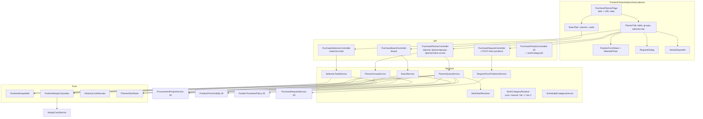

# Design Document

## Overview

FOR-11-01 puts screens on the FOR-11-00 procurement foundation. The backend part is small and
read-heavy: **three thin controllers** (planner, board, selection total), **one write endpoint**
(create request from positions), **one additive column** (`work_category_id`) and **six pure helpers**
(money math, margin, delivery-cost allocator, slice rules, work-category resolver). The frontend
part is one new feature, `features/purchase-planner/`, that replaces the `/deliveries` placeholder.

Design principles:

- **Reuse before adding.** Scoping stays `ProcurementProjectAccess`; money hiding stays
  `PositionPriceVisibility`; stage edges stay `PositionTransitionPolicy`; margin reuses
  `MarginCostService.materialMargin`; the request attach/assign rules and the `plannedDeliveryDate`
  synchronizer of 00 are called, not copied; the frontend reuses `DataTable`, the grouped-row pattern of
  `company-procurement`, `SellerPicker`, `buildFetchQuery` and the notification deep-link handler.
- **One definition, two consumers.** Every derived notion (late, urgent, slice, paid) is defined once in
  a pure class and used for the row flags **and** the SQL predicates, with an equivalence test.
- **The server decides what the user may do.** `allowedActions` is computed from the existing policy, so
  the frontend never re-implements the state machine or role rules.
- **Never leak a price.** Every money value leaves through `PositionPriceVisibility`; no endpoint
  accepts a money filter or sort.
- **No new infrastructure.** No kanban or drag-and-drop library, no websocket, no new resource, role or
  seed.

## Architecture



## Backend

### 1. Pure helpers (package `com.foremen.service.procurement.planner`)

**`PositionMoneyMath`** (static, `BigDecimal`, `HALF_UP`, scale 2):

```java
record Line(BigDecimal net, BigDecimal vat, BigDecimal gross) {}
Line saleLine(BigDecimal unitNet, BigDecimal quantity, BigDecimal vatRatePercent); // null price -> null
BigDecimal purchaseNet(BigDecimal unitNet, BigDecimal quantity);
Totals sum(List<Line> lines);                                    // sum of rounded lines
```

Rounding is per line; totals are the sum of lines, so footer totals equal the sum of the visible rows.
(The code base has no VAT/net-gross helper; this is the single place.)

**`PositionMarginCalculator`**:

```java
Margin margin(BigDecimal saleUnitNet, BigDecimal actualUnit, BigDecimal plannedUnit,
              BigDecimal quantity, BigDecimal deliveryCostShare);
// revenue = saleLine.net; cost = purchaseNet(actual ?: planned, qty) + deliveryCostShare
// null when revenue or both purchase prices are null; else MarginCostService.materialMargin(revenue, cost)
```

**`DeliveryCostAllocator.allocate(BigDecimal total, List<BigDecimal> weights)`**: largest-remainder on
cents. Shares = `floor(total_cents × w_i / Σw)`, then distribute the remaining cents to the largest
fractional remainders (ties: lower index). Σ shares == total always; Σw = 0 → even split with the
remainder to the first positions; empty list → empty. Pure and property-tested; consumed by 03.

**`PlannerSliceRules`**: a snapshot record (`PositionSnapshot`: path, status, needBy, orderBy,
plannedDelivery, variantCount) plus pure functions `isLate(s, today)`, `isUrgent(s, today, urgentDays)`,
`slice(s, today)`, and **a mirror that builds JPA `Predicate`s** (`latePredicate`, `urgentPredicate`,
`slicePredicate`) from the same constants (stage sets `BEFORE_ORDERED`, `TERMINAL`, `PAID_FROM`). The
equivalence test runs the predicates against a seeded matrix and compares with the pure result.

Stage sets (from `PositionStage.rank`): `BEFORE_ORDERED` = `PLANNED..WITH_BUYER`; `TERMINAL` =
`RECEIVED`, `CANCELLED`; `PAID_FROM` = `CLIENT_PAID` and every later non-cancelled stage.

### 2. Work-category link: automatic resolution, manual override, start date

**Model.** The position stores **only a manual override**; the automatic result is computed on read and
never persisted, so a variant replacement, an estimate change or a schedule change re-resolves by itself.

- **Changeset `233-add-purchase-positions-work-category.xml`** (next free after 232): nullable
  `work_category_id BIGINT` FK `work_categories(id)` `ON DELETE SET NULL`, index
  `idx_purchase_positions_work_category`. Idempotent (`columnExists`, `foreignKeyConstraintExists`,
  `indexExists`, `MARK_RAN`), registered **last**. Meaning: *manual override; null = automatic*.
- `PurchasePositionEntity.workCategory` (`LAZY`); `PurchasePositionCreateRequest` /
  `UpdateRequest` / `PurchasePositionDtoModel` gain `workCategoryId`; `PurchasePositionService`
  validates (exists, active; **not required to be scheduled**) and allows edits only before `ORDERED`.

**Data path (verified in the code).** `finishing_materials.type_id` (`material_types`) ->
`work_material_consumptions.finishing_material_type_id` (branch `finishing`, columns `work_item_id`,
`norm_qty`) -> `work_items.work_category_id` -> `project_schedule_bars.work_category_id`. The cardinality
is many-to-many (one type can be consumed by several works in several categories) and there is no DAO
method from a type to its works yet.

**`WorkCategoryResolver` (pure, package `com.foremen.service.procurement.planner`):**

```java
record Candidate(Long categoryId, Long workItemId) {}
record Scheduled(Long categoryId, String name, LocalDate startDate) {}
record Resolution(Long categoryId, Source source, List<Scheduled> candidates) {}   // Source: MANUAL | AUTO | NONE
Resolution resolve(Long manualCategoryId,                 // position.workCategory
                   Long materialTypeId,                   // null -> NONE
                   Map<Long, Set<Long>> estimateCategoriesByType,   // tier 1
                   Map<Long, Set<Long>> catalogCategoriesByType,    // tier 2
                   Map<Long, Scheduled> scheduledByCategory);
// manual != null            -> (manual, MANUAL, [])
// tier1 = estimateCategoriesByType[type] ∩ scheduled ; tier2 likewise over the catalog
// first non-empty tier: sort by startDate asc (nulls last), then name, then id
//   -> (first, AUTO, rest-as-candidates)
// both empty                -> (null, NONE, [])
```

**Loaders (batched per page, no per-row queries):**

1. `ScheduledCategoryService.scheduled(projectId)` -> `Map<categoryId, Scheduled>`: current schedule rows
   from `EstimateLineDao.findByProjectIdWithWorkItemCategoryAndUnit` via `ScheduleRowDerivation.deriveRows`
   (the readiness rule), intersected with the project's stored bars (`schedule.getBars()`), earliest bar per
   category, start date through `WorkStartResolver`. Cached per request for the projects on the page.
2. `WorkConsumptionLookup`:
   - tier 1: workItemIds of the project's estimate lines -> new DAO query
     `WorkMaterialConsumptionDao.findFinishingTypeCategoryPairsByWorkItemIdIn(Collection<Long>)`
     (`SELECT c.finishingMaterialType.id, wi.workCategory.id ... WHERE c.branch = 'finishing' AND
     c.workItem.id IN :ids`) -> `Map<typeId, Set<categoryId>>`;
   - tier 2: new DAO query `findFinishingTypeCategoryPairsByTypeIdIn(Collection<Long> typeIds)` over the
     whole catalog, executed **only** for the types that tier 1 did not resolve to a scheduled category.
3. `WorkStartResolver.resolve(Collection<Pair<projectId, categoryId>>)` -> `Map<Pair, LocalDate>`: one
   query over `project_schedule_bars` joined to `project_schedules` and `projects` (`start_date`),
   `MIN(start_half_days)` per (project, category). Conversion uses the same helpers as
   `ScheduleCalculator` (`startDayFromHalfDays`, anchor `project.getStartDate()`); **task 3.2 begins by
   reading `ScheduleCalculator` and `ProjectScheduleService` (~lines 500-565) to copy the exact calendar
   rule (calendar vs working days) and pins it with a test.** No schedule, bar or start date -> no entry.

**Dropdown endpoint.** `GET /api/purchase-positions/scheduled-categories?projectId=&q=` returns the
scheduled categories of the project (`{id, name, startDate}`, localized name, `q` matched
case-insensitively over `nameRU`/`namePL` with wildcard escaping, ordered by start date then name,
limit 50) using the same `ScheduledCategoryService`; scoped through `ProcurementProjectAccess`.

**Why a pure resolver and two tiers.** Tier 1 keeps the link tied to the work the project actually
contracted (precise); tier 2 covers ad hoc materials that the estimate does not mention (the product
rule that materials may be added outside the estimate). Choosing the earliest-starting category is the
conservative reading: the material must arrive before the first work that consumes it. The remaining
matches are returned as `workCategoryCandidates` so the UI can show why and offer them first.

### 3. Planner list (`PlannerQueryService`)

- Entry: `Page<PlannerRowDto> plan(PlannerFilter f, Pageable p, Authentication a)`.
- **Specification** composed from: scope (`allowedProjectIds` via `ProcurementProjectAccess`; ADMIN
  bypass), `projectId`, `status IN`, `sourcingPath`, `requestId` / `noRequest`, `buyer` (join request,
  `assignedBuyer.id = :me` / `IS NULL`), slice and urgent predicates from `PlannerSliceRules`,
  `hideDelivered` (the 00 `HideDeliveredFilter` specification, reused), text `q` (LIKE over lower-cased
  material model/sku, producer `nameRU/namePL`, seller `nameRU/namePL`, request reference, notes; the
  wildcard characters of `q` are escaped).
- **Sort** `siteDeliveryDate` = `cb.coalesce(plannedDeliveryDate, needByDate)` with nulls last (Postgres
  `NULLS LAST` through `cb.asc(...)` ordering emulated by a leading `CASE WHEN ... IS NULL`), tie-break
  `id asc`. Other sort fields map to whitelisted entity attributes; unknown → 400.
- **Row assembly (no N+1):** one page query with `join fetch` of `project`, `plannedMaterial`,
  `actualMaterial`, `unit`, `deliveryCategory`, `purchaseRequest` (+ `assignedBuyer`), `workCategory`;
  then batched lookups for `producer` and `seller` (via the `join fetch` on the materials), the
  `variantCount` (existing batched `fillVariantCounts`), then `ScheduledCategoryService`,
  `WorkConsumptionLookup`, `WorkCategoryResolver` and `WorkStartResolver` for the page (a fixed number of
  batched queries). A test asserts a bounded statement count for 100 rows.
- **Derived values per row:** `siteDeliveryDate`, `late`, `urgent`, `deliveryRisk` (R5.7), the Money block
  (`PositionMoneyMath` + `PositionMarginCalculator`; VAT percent from `purchaseVatRate`/`saleVatRate`
  `rate`; missing VAT → treated as 0 and `vat = null`), then passed through
  `PositionPriceVisibility` (non-STAFF_FULL → block `null`).
- **`allowedActions`:** computed per row from `PositionTransitionPolicy.decide(path, from, to, MANUAL)` for
  the manual targets (`WITH_BUYER` for `PACKAGE`, `IN_DELIVERY` for `CLIENT_OWN`, `CANCELLED`, `PLANNED`
  for reopen), the caller's authority (MANAGER/ADMIN for transitions, per the 00 controller rule), the
  00 edit/delete rules (R9.5/9.6) and `VariantStagePolicy` for `REPLACE_VARIANT`; the caller also needs
  the matching CRUD grant on `PURCHASE_POSITIONS` (resolved once per request from the authorities).
- **Slice counts:** one grouped query `SELECT slice-case, count(*)` using the same predicates (six
  `count(case when ...)` expressions in one statement).

`PlannerRowDto` (record, abridged):

```json
{
  "positionId": 101, "projectId": 7, "projectName": "ul. Prosta 1",
  "kind": "FINISHING", "sourcingPath": "AGREED", "status": "ACCEPTED", "statusCode": "accepted",
  "material": { "plannedMaterialId": 55, "actualMaterialId": null, "model": "Tubądzki Natura",
                "sku": "TN-60", "producerName": "Tubądzki", "sellerId": 3, "sellerName": "Castorama",
                "link": "https://...", "photo": "files/..." },
  "quantity": 12.500, "unitName": "m2", "orderedQuantity": 0, "acceptedQuantity": 0, "blockNo": 2,
  "deliveryCategoryName": "Płytki",
  "needByDate": "2026-12-10", "orderByDate": "2026-11-25", "decisionDeadline": "2026-11-20",
  "plannedDeliveryDate": "2026-12-08", "siteDeliveryDate": "2026-12-08",
  "requestId": 14, "requestReferenceNumber": "ZK-2026-014", "assignedBuyerName": "Jan Nowak",
  "workCategoryId": null, "effectiveWorkCategoryId": 9, "effectiveWorkCategoryName": "Okładziny",
  "workCategorySource": "AUTO", "workCategoryCandidates": [], "workStartDate": "2026-12-05",
  "suggestedNeedByDate": "2026-12-05",
  "late": false, "urgent": true, "deliveryRisk": true, "hasVariants": true, "variantCount": 2,
  "money": { "salePrice": 92.00, "plannedPurchasePrice": 61.50, "actualPurchasePrice": null,
             "purchaseVatRateId": 3, "saleVatRateId": 2, "deliveryCostShare": 0.00,
             "saleNetTotal": 1150.00, "saleGrossTotal": 1242.00, "costNetTotal": 768.75,
             "marginAmount": 381.25, "marginPct": 0.3315, "overCeiling": false },
  "allowedActions": ["EDIT", "CANCEL", "REPLACE_VARIANT"]
}
```

`money` is `null` for non-STAFF_FULL callers.

### 4. Groups (`PlannerGroupService`)

- Query 1 (page of groups): `SELECT request.id, MIN(siteDeliveryDate)` over the filtered specification
  grouped by `purchaseRequest` (null key = synthetic group), ordered by `MIN(...) NULLS LAST, id`,
  paged. `groupBy = NONE` returns one synthetic group over the whole filtered set.
- Query 2: fetch the request headers of the page (existing `PurchaseRequestService` mapper gives derived
  `status` and `overdue`, using `PurchaseRequestStatusDeriver` over **all** positions of the request, not
  the filtered ones).
- Query 3: a slim projection of the filtered positions of those groups (`quantity`, prices, VAT rates,
  `deliveryCostShare`, status) aggregated in Java with `PositionMoneyMath` /
  `PositionMarginCalculator`, so group totals use exactly the same rounding as the rows. `CANCELLED`
  positions are excluded from totals. Group size per page (default 20) keeps the projection small.
- `groupBy` allowed: `REQUEST`, `NONE`; others → 400 `error.purchasePlanner.groupBy.invalid`.

### 5. Selection total (`SelectionTotalService`)

Loads the ids through the scoped DAO (inaccessible ids simply do not load → `NOT_FOUND`), classifies each
(`NOT_AGREED` / `NOT_ACCEPTED` / `NO_SALE_PRICE`), computes lines with `PositionMoneyMath.saleLine` using
the sale VAT rate, groups `vatBreakdown` by rate, sets `mixedProjects` when more than one project id
remains. Audience check first: not `STAFF_FULL` → 403. No writes.

### 6. Create request from positions (`RequestFromPositionsService`)

```java
@Transactional
PurchaseRequestDtoModel create(FromPositionsRequest r) {
  validate ids non-empty; load positions (scoped); all same project else 400 mixedProjects;
  PurchaseRequestEntity req = purchaseRequestService.createInternal(projectId, r.header()); // 00 validation + assignment event
  purchaseRequestService.attach(req.getId(), r.positionIds());                              // 00 attach rules + date sync
  return mapper.toDto(reload(req));
}
```

`purchaseRequestService.createInternal` / `attach` are the existing 00 methods; if the create path is
only reachable through the controller mapper, task 4.5 extracts a service-level method without changing
behavior. The assignment event is published by the 00 code (AFTER_COMMIT), so a rollback sends nothing.

### 7. Board (`BoardService`)

One `SELECT status, count(*)` over the filtered set (stages `WITH_BUYER..RECEIVED`, `AGREED` positions
that reached `WITH_BUYER` or later plus the `PACKAGE`/`CLIENT_OWN` positions in those stages; positions
before `WITH_BUYER` are excluded by the stage filter itself) and **one window-function query**
(`ROW_NUMBER() OVER (PARTITION BY status ORDER BY site_delivery NULLS LAST, id) <= :limit`) for the cards
of all columns, avoiding six round trips. A native or `@Query` projection is acceptable; cards are
mapped with the same visibility step as rows. `RECEIVED` returns count only when `hideDelivered`.

### 8. Endpoints, guards, errors

| Method / path | Guard | Notes |
|---------------|-------|-------|
| `GET /api/purchase-positions/planner` | `PURCHASE_POSITIONS` READ | `PlannerRowDto` page |
| `GET /api/purchase-positions/planner/slice-counts` | READ | `{ALL, ON_SCHEDULE, LATE, CHANGED, PAID, NOT_PAID}` counts |
| `GET /api/purchase-positions/planner/groups` | READ | group headers + totals |
| `GET /api/purchase-positions/work-link-preview` | READ | automatic resolution for (projectId, materialId) before the position exists |
| `GET /api/purchase-positions/scheduled-categories` | READ | `{id, name, startDate}` of categories scheduled in the project, `q` search, limit 50 |
| `GET /api/purchase-positions/board` | READ | six columns |
| `POST /api/purchase-positions/selection-total` | READ + STAFF_FULL | read-only |
| `POST /api/purchase-requests/from-positions` | `PURCHASE_REQUESTS` CREATE | MANAGER/ADMIN |
| `GET /api/procurement/buyers` | `PURCHASE_REQUESTS` READ | active BUYER users `{id, name}` for the request dialog |
| `DELETE /api/purchase-positions/{id}/property?properties=workCategory` | `PURCHASE_POSITIONS` DELETE (00 generic endpoint) | reset the manual work category to automatic |

All literal paths are declared in their own controllers so they cannot clash with `/{id}` of the 00
controller (the existing `/upcoming` precedent). Handlers use `@RequiresPermission` with no class-level
`@PermissionResource` (the `PositionVariantController` precedent), so `PermissionAnnotationValidator`
passes. Errors use `ForemenApiException` with the keys in section "i18n".

### 9. Managed-entity checklist review (steering `entity-creation-rules`)

No new managed entity is added: (1) no resource seed, (2) no grant, (3) no new `@PermissionResource`
controller (handlers use `@RequiresPermission` on existing resources), (4) `ProjectScopedService` is
already implemented by the position service, (5) dataset: `workCategory` is **not** added to
`PurchasePositionsDataset` (reviewed; no dashboard use case; no sensitive field introduced).
`DatasetCoverageTest` is unaffected.

### 10. Configuration

`application.yml`: `foremen.procurement.urgent-days: ${FOREMEN_PROCUREMENT_URGENT_DAYS:14}` bound in a
`@Validated` properties record (`@Min(1) @Max(90)`); `.env.example` and `docker-compose.yml`
(`backend.environment`) pass `FOREMEN_PROCUREMENT_URGENT_DAYS=${FOREMEN_PROCUREMENT_URGENT_DAYS:-14}`.

## Frontend (inner repo `foremen-frontend/`)

### Structure

```
src/features/purchase-planner/
  PurchasePlannerPage.tsx            # tabs, URL state, project filter, hide-delivered switcher
  api/purchase-planner-api.ts        # planner, slice-counts, groups, board, selectionTotal, fromPositions
  api/query-hooks.ts, mutation-hooks.ts
  hooks/usePlannerUrlState.ts        # parse/serialize query string (pure helpers in lib/)
  hooks/usePersistedHideDelivered.ts # per-user localStorage
  lib/{filters.ts, format.ts, groupKey.ts, stageColors.ts}
  types/index.ts                     # PlannerRow, PlannerGroup, BoardColumn, SelectionTotal, ...
  schemas/position-form-schema.ts    # zod, mirrors the 00 create/update rules
  components/
    PlannerTab.tsx, PlannerToolbar.tsx, SliceBar.tsx
    PlannerTable.tsx, PlannerGroupRow.tsx, PlannerRowCells.tsx
    SelectionBar.tsx, SkippedList.tsx
    PositionFormSheet.tsx, MaterialPicker.tsx, ProjectMaterialQuickCreate.tsx
    VariantExpander.tsx, RowActionsMenu.tsx
    RequestDialog.tsx, RequestHeaderActions.tsx
    BoardTab.tsx, BoardColumn.tsx, BoardCard.tsx, PositionDrawer.tsx
  __tests__/
```

`app/pages/DeliveriesPage.tsx` becomes a re-export of the feature page (the router entry is unchanged);
the `pages.deliveries.*` keys are deleted.

### URL state and persisted preferences

- `usePlannerUrlState` reads/writes `tab`, `project`, `slice`, `urgent`, `groupBy`, `q`, `request`,
  `buyer`, `page` with `useSearchParams` (replace, not push, for filter changes); pure `parse`/`serialize`
  functions are unit-tested and ignore invalid values.
- `usePersistedHideDelivered(userId)` follows `usePersistedLedgerFilters` (validated parse, sync write,
  tolerates a missing `localStorage`); key `foremen:purchase-planner:hide-delivered:{userId}`; default
  `true`.
- Defaults by role: tab `board` for `BUYER`, else `planner`; board buyer filter `MINE` for BUYER, else
  `ALL`; planner project = working project when set, else all.

### Planner tab

- `PlannerToolbar` (search, project via `ReferenceFilter`-style select over
  `/api/procurement/projects`, stage / path / buyer filters, group-by, urgent toggle, hide-delivered
  switch, Add position) + `SliceBar` (buttons with counts from `slice-counts`).
- `PlannerTable` renders **groups** (default) or a flat list. Group rows follow `DocumentGroupRow`:
  collapsible, header (request reference, expected date, buyer, status chip, overdue marker, count,
  totals), lazy rows via the planner endpoint with `requestId` / `noRequest`. Selection state is a
  `Map<positionId, snapshot>` held in the page so ticks survive paging and expansion; it is cleared on a
  project change.
- `SelectionBar` (sticky bottom) calls `selectionTotal` (debounced 300 ms, only for STAFF_FULL); shows net
  / VAT / gross, skipped reasons, `mixedProjects` warning, **Create request**, **Clear**; "Select urgent"
  sits in the toolbar.
- Row money cells render only when `row.money != null`; late rows get a tinted background; `deliveryRisk`
  shows a warning icon with a tooltip (work starts {{date}}); `overCeiling` shows a red price chip.
- **Deep link:** `PlannerTab` reads `request` from the URL; once the groups load it finds the group
  (or fetches the header by `requestId` through the groups call with `requestId` filter), expands it,
  scrolls and highlights (the `?doc=` pattern of `CompanyProcurementPage`); not found → inline message
  `purchasePlanner.requestNotFound`.
- Mobile: `DataTable` already switches to cards; group rows become collapsible cards.

### Position form

- `PositionFormSheet` (react-hook-form + zod). Create: choose project (default the filter), path,
  material, quantity, etc. Edit: locked fields (`plannedMaterial`, `sourcingPath`, `quantity` after
  `ACCEPTED`; project always) disabled with a hint. Money inputs are rendered only for STAFF_FULL.
- `MaterialPicker`: async combobox over two sources merged client-side: global
  `/api/finishing-materials` (search) and `/api/project-materials?project.id={id}` (search); results are
  tagged "Project" or "Catalog". The 00 **`SellerPicker`** above it filters both lists by seller
  (`sellerId`). "Add project material" opens `ProjectMaterialQuickCreate` (visible with
  `PROJECT_MATERIALS`/CREATE) with the fields the 00 create request requires (category, material,
  unit, offer packages, model, SKU, producer, seller via `SellerPicker`, link, retail net, cost net);
  on success the new material is selected.
- **Work-category link (`WorkCategoryLink` component).** Shows the effective category with a source
  badge (`AUTO` / `MANUAL` / `NONE`) and its start date. A searchable combobox (debounced search over
  `GET /scheduled-categories?projectId=&q=`, candidates of an `AUTO` resolution listed first) lets the user
  change it; selecting an option sets `workCategoryId` (manual); "Reset to automatic" calls
  `DELETE /api/purchase-positions/{id}/property?properties=workCategory` (the generic clear-property
  endpoint; same stage lock as setting the override, 409 from `ORDERED`), not a `PUT` with null. When the source is `NONE` the control is highlighted with a hint. On create
  and when the material changes, the form asks the server for the automatic result with
  `GET /api/purchase-positions/work-link-preview?projectId=&materialId=` (read-only; same resolver, returns
  `{effectiveWorkCategoryId, name, source, candidates, startDate}`), so the badge is correct before the
  position exists.
- "Set from schedule" button next to `needByDate` fills it from the effective category's `startDate`;
  disabled with `purchasePlanner.form.noSchedule` when there is none. The field stays editable.
- Server errors → localized toast / field error; the sheet keeps input.

### Variants and row actions

- `VariantExpander` (inside the expanded row): history via `GET /variants`; "Pick analog" opens the
  suggestions list (`GET /variants/suggestions`) and calls `replace` (reason `ANALOG`); "Restore" calls
  `restore`; write controls need `allowedActions ∋ REPLACE_VARIANT`.
- `RowActionsMenu` renders only `allowedActions`; transitions call
  `POST /{id}/transition`; Cancel and Delete ask for confirmation; invalidate planner, groups,
  slice-counts, board queries afterwards.

### Request dialog

`RequestDialog` (create from selection, `POST /from-positions`) and `RequestHeaderActions` (edit via the
00 `PUT /api/purchase-requests/{id}`, delete when empty). Buyers for the select come from
`GET /api/procurement/buyers` (active users with the BUYER role, `{id, name}`, guarded by
`PURCHASE_REQUESTS` READ), because a MANAGER lacks `USERS` READ and cannot use `/api/users`. If the call
fails, the dialog hides the select and shows the request's `assignedBuyerName`.

### Board tab

`BoardTab` fetches `/board` (refetch on focus, `refetchInterval` 60 s while visible). `BoardColumn`
renders cards; "Load more" pages the planner endpoint with `status=X&page=n` and appends. `BoardCard`
shows the ceiling (sale price) vs purchase price with an over-ceiling warning; a click opens
`PositionDrawer` (detail + variants + allowed actions). Desktop: horizontal columns (CSS grid,
`overflow-x-auto`); mobile: a column selector (tabs) showing one column at a time.

## Data Model / Migrations

| # | File | Content |
|---|------|---------|
| 233 | `233-add-purchase-positions-work-category.xml` | `purchase_positions.work_category_id` + FK + index |

No other schema change. (If a sibling spec lands first, use the next free number; register last in
`changelog.xml`.)

## i18n

### Backend message keys (PL in `messages.properties`, RU in `messages_ru.properties`)

| Key | PL | RU |
|-----|----|----|
| `error.purchasePlanner.sort.invalid` | Nieprawidłowe pole sortowania. | Недопустимое поле сортировки. |
| `error.purchasePlanner.slice.invalid` | Nieprawidłowy filtr widoku. | Недопустимый срез. |
| `error.purchasePlanner.groupBy.invalid` | Nieprawidłowy sposób grupowania. | Недопустимый способ группировки. |
| `error.purchasePlanner.board.limit.invalid` | Limit kart musi mieścić się między 1 a 100. | Лимит карточек должен быть от 1 до 100. |
| `error.purchasePlanner.selection.empty` | Zaznacz co najmniej jedną pozycję. | Выберите хотя бы одну позицию. |
| `error.purchasePlanner.selection.tooLarge` | Zaznaczono zbyt wiele pozycji (maks. 500). | Выбрано слишком много позиций (максимум 500). |
| `error.purchaseRequest.fromPositions.empty` | Wybierz pozycje do zlecenia. | Выберите позиции для заявки. |
| `error.purchaseRequest.fromPositions.mixedProjects` | Pozycje muszą należeć do jednego projektu. | Позиции должны принадлежать одному проекту. |
| `error.purchasePosition.workCategory.invalid` | Nieprawidłowa kategoria prac. | Недопустимая категория работ. |

Existing keys reused: `error.access.denied`, the 00 `error.purchasePosition.*` and
`error.purchaseRequest.*` keys.

### Frontend keys (`pl.json` / `ru.json`, parity enforced by `i18n.keys.test.ts`)

Page and toolbar:

| Key | PL | RU |
|-----|----|----|
| `purchasePlanner.title` | Dostawy | Поставки |
| `purchasePlanner.tabs.planner` | Planer zakupów | Планировщик закупок |
| `purchasePlanner.tabs.board` | Tablica zakupowca | Доска закупщика |
| `purchasePlanner.toolbar.search` | Szukaj: materiał, sprzedawca, zlecenie | Поиск: материал, продавец, заявка |
| `purchasePlanner.toolbar.project` | Projekt | Проект |
| `purchasePlanner.toolbar.allProjects` | Wszystkie projekty | Все проекты |
| `purchasePlanner.toolbar.stage` | Etap | Этап |
| `purchasePlanner.toolbar.sourcingPath` | Ścieżka zakupu | Путь закупки |
| `purchasePlanner.toolbar.buyer` | Zakupowiec | Закупщик |
| `purchasePlanner.toolbar.buyerAll` | Wszyscy | Все |
| `purchasePlanner.toolbar.buyerMine` | Moje | Мои |
| `purchasePlanner.toolbar.buyerUnassigned` | Nieprzypisane | Не назначены |
| `purchasePlanner.toolbar.groupBy` | Grupuj | Группировка |
| `purchasePlanner.toolbar.hideDelivered` | Ukryj dostarczone | Скрыть доставленные |
| `purchasePlanner.toolbar.urgent` | Pilne | Срочные |
| `purchasePlanner.toolbar.selectUrgent` | Zaznacz pilne | Выбрать срочные |
| `purchasePlanner.toolbar.addPosition` | Dodaj pozycję | Добавить позицию |
| `purchasePlanner.groupBy.REQUEST` | Wg zleceń | По заявкам |
| `purchasePlanner.groupBy.NONE` | Bez grupowania | Без группировки |
| `purchasePlanner.slice.ALL` | Wszystkie | Все |
| `purchasePlanner.slice.ON_SCHEDULE` | W terminie | В срок |
| `purchasePlanner.slice.LATE` | Opóźnione | Просроченные |
| `purchasePlanner.slice.CHANGED` | Zmienione | Изменённые |
| `purchasePlanner.slice.PAID` | Opłacone | Оплаченные |
| `purchasePlanner.slice.NOT_PAID` | Nieopłacone | Неоплаченные |
| `purchasePlanner.empty` | Brak pozycji dla wybranych filtrów. | Нет позиций по выбранным фильтрам. |
| `purchasePlanner.clearFilters` | Wyczyść filtry | Сбросить фильтры |
| `purchasePlanner.requestNotFound` | Nie znaleziono zlecenia lub brak dostępu. | Заявка не найдена или нет доступа. |

Table columns and badges:

| Key | PL | RU |
|-----|----|----|
| `purchasePlanner.column.project` | Projekt | Проект |
| `purchasePlanner.column.material` | Materiał | Материал |
| `purchasePlanner.column.seller` | Sprzedawca | Продавец |
| `purchasePlanner.column.quantity` | Ilość | Количество |
| `purchasePlanner.column.status` | Etap | Этап |
| `purchasePlanner.column.sourcingPath` | Ścieżka | Путь |
| `purchasePlanner.column.block` | Blok | Блок |
| `purchasePlanner.column.siteDelivery` | Dostawa na budowę | Поставка на объект |
| `purchasePlanner.column.needBy` | Potrzebne do | Нужно к |
| `purchasePlanner.column.orderBy` | Zamów do | Заказать до |
| `purchasePlanner.column.decisionDeadline` | Decyzja klienta do | Решение клиента до |
| `purchasePlanner.column.workStart` | Start prac | Начало работ |
| `purchasePlanner.column.request` | Zlecenie | Заявка |
| `purchasePlanner.column.saleNet` | Sprzedaż netto | Продажа нетто |
| `purchasePlanner.column.costNet` | Zakup netto | Закупка нетто |
| `purchasePlanner.column.margin` | Marża | Маржа |
| `purchasePlanner.badge.late` | Opóźnione | Просрочено |
| `purchasePlanner.badge.risk` | Dostawa po starcie prac ({{date}}) | Поставка после начала работ ({{date}}) |
| `purchasePlanner.badge.overCeiling` | Powyżej ceny sprzedaży | Выше цены продажи |
| `purchasePlanner.badge.marginIncomplete` | Marża niepełna | Маржа неполная |
| `purchasePlanner.badge.changed` | Zmieniony materiał | Материал менялся |
| `purchasePlanner.sourcing.AGREED` | Uzgodnione | Согласовано |
| `purchasePlanner.sourcing.PACKAGE` | Z pakietu | Из пакета |
| `purchasePlanner.sourcing.CLIENT_OWN` | Klient kupuje sam | Клиент покупает сам |
| `purchasePlanner.stage.PLANNED` | Nowe | Новое |
| `purchasePlanner.stage.PROPOSED` | Zaproponowane | Предложено |
| `purchasePlanner.stage.ACCEPTED` | Zaakceptowane | Акцептовано |
| `purchasePlanner.stage.IN_PROFORMA` | W proformie | В проформе |
| `purchasePlanner.stage.CLIENT_PAID` | Opłacone przez klienta | Оплачено клиентом |
| `purchasePlanner.stage.WITH_BUYER` | U zakupowca | У закупщика |
| `purchasePlanner.stage.ORDERED` | Zamówione | Заказано |
| `purchasePlanner.stage.SUPPLIER_PAID` | Opłacone dostawcy | Оплачено поставщику |
| `purchasePlanner.stage.IN_DELIVERY` | W dostawie | В доставке |
| `purchasePlanner.stage.PARTIALLY_RECEIVED` | Częściowo odebrane | Частично принято |
| `purchasePlanner.stage.RECEIVED` | Odebrane | Принято |
| `purchasePlanner.stage.CANCELLED` | Anulowane | Отменено |

Groups, selection and requests:

| Key | PL | RU |
|-----|----|----|
| `purchasePlanner.group.noRequest` | Bez zlecenia | Без заявки |
| `purchasePlanner.group.positions` | {{count}} poz. | {{count}} поз. |
| `purchasePlanner.group.expected` | Dostawa: {{date}} | Поставка: {{date}} |
| `purchasePlanner.group.overdue` | Po terminie | Просрочена |
| `purchasePlanner.group.buyer` | Zakupowiec: {{name}} | Закупщик: {{name}} |
| `purchasePlanner.selection.count` | Zaznaczono: {{count}} | Выбрано: {{count}} |
| `purchasePlanner.selection.net` | Netto | Нетто |
| `purchasePlanner.selection.vat` | VAT | НДС |
| `purchasePlanner.selection.gross` | Brutto | Брутто |
| `purchasePlanner.selection.mixedProjects` | Zaznaczone pozycje należą do różnych projektów. | Выбранные позиции из разных проектов. |
| `purchasePlanner.selection.skipped` | Pominięte w sumie: {{count}} | Не вошли в сумму: {{count}} |
| `purchasePlanner.selection.reason.NOT_ACCEPTED` | Brak akceptacji klienta | Нет акцепта клиента |
| `purchasePlanner.selection.reason.NOT_AGREED` | Ścieżka bez proformy | Путь без проформы |
| `purchasePlanner.selection.reason.NO_SALE_PRICE` | Brak ceny sprzedaży | Нет цены продажи |
| `purchasePlanner.selection.reason.NOT_FOUND` | Pozycja niedostępna | Позиция недоступна |
| `purchasePlanner.selection.createRequest` | Utwórz zlecenie | Создать заявку |
| `purchasePlanner.selection.clear` | Wyczyść | Сбросить |
| `purchasePlanner.request.dialogTitle` | Nowe zlecenie zakupu | Новая заявка на закупку |
| `purchasePlanner.request.editTitle` | Edytuj zlecenie | Изменить заявку |
| `purchasePlanner.request.referenceNumber` | Numer zlecenia | Номер заявки |
| `purchasePlanner.request.referenceLink` | Link | Ссылка |
| `purchasePlanner.request.expectedDate` | Oczekiwana dostawa | Ожидаемая поставка |
| `purchasePlanner.request.deliveryCategory` | Kategoria dostawy | Категория поставки |
| `purchasePlanner.request.buyer` | Przypisany zakupowiec | Назначенный закупщик |
| `purchasePlanner.request.notes` | Uwagi | Примечания |
| `purchasePlanner.request.created` | Zlecenie utworzone | Заявка создана |
| `purchasePlanner.request.detach` | Usuń ze zlecenia | Убрать из заявки |
| `purchasePlanner.request.delete` | Usuń zlecenie | Удалить заявку |

Form, variants and actions:

| Key | PL | RU |
|-----|----|----|
| `purchasePlanner.form.createTitle` | Nowa pozycja zakupowa | Новая позиция закупки |
| `purchasePlanner.form.editTitle` | Edytuj pozycję | Изменить позицию |
| `purchasePlanner.form.project` | Projekt | Проект |
| `purchasePlanner.form.sourcingPath` | Ścieżka zakupu | Путь закупки |
| `purchasePlanner.form.material` | Materiał | Материал |
| `purchasePlanner.form.materialSearch` | Szukaj materiału | Поиск материала |
| `purchasePlanner.form.materialProject` | Projektowy | Проектный |
| `purchasePlanner.form.materialCatalog` | Katalog | Каталог |
| `purchasePlanner.form.sellerFilter` | Sprzedawca | Продавец |
| `purchasePlanner.form.addProjectMaterial` | + Dodaj materiał projektu | + Добавить материал проекта |
| `purchasePlanner.form.quantity` | Ilość | Количество |
| `purchasePlanner.form.unit` | Jednostka | Единица |
| `purchasePlanner.form.deliveryCategory` | Kategoria dostawy | Категория поставки |
| `purchasePlanner.form.blockNo` | Blok | Блок |
| `purchasePlanner.form.workCategory` | Kategoria prac (powiązanie z harmonogramem) | Категория работ (связь с графиком) |
| `purchasePlanner.form.workCategorySearch` | Szukaj kategorii prac w harmonogramie | Поиск категории работ в графике |
| `purchasePlanner.form.workCategoryAuto` | Automatycznie (wg normy zużycia materiału) | Автоматически (по норме расхода материала) |
| `purchasePlanner.form.workCategoryManual` | Ręcznie | Вручную |
| `purchasePlanner.form.workCategoryNone` | Nie znaleziono — wybierz prace, do których służy materiał | Не найдено — выберите работы, для которых нужен материал |
| `purchasePlanner.form.workCategoryReset` | Przywróć automatyczne | Вернуть автоматический выбор |
| `purchasePlanner.form.workCategoryOtherMatches` | Inne dopasowania | Другие совпадения |
| `purchasePlanner.form.workCategoryStart` | Start prac: {{date}} | Начало работ: {{date}} |
| `purchasePlanner.form.workCategoryNotScheduled` | Kategoria nie jest w harmonogramie projektu | Категории нет в графике проекта |
| `purchasePlanner.form.workCategoryEmpty` | Brak kategorii w harmonogramie | В графике нет подходящих категорий |
| `purchasePlanner.form.needBy` | Potrzebne do | Нужно к |
| `purchasePlanner.form.orderBy` | Zamów do | Заказать до |
| `purchasePlanner.form.decisionDeadline` | Decyzja klienta do | Решение клиента до |
| `purchasePlanner.form.setFromSchedule` | Ustaw wg harmonogramu | Взять из графика |
| `purchasePlanner.form.noSchedule` | Brak harmonogramu dla tej kategorii. | Для этой категории нет графика. |
| `purchasePlanner.form.plannedPurchasePrice` | Cena zakupu (plan, netto) | Цена закупки (план, нетто) |
| `purchasePlanner.form.salePrice` | Cena sprzedaży (netto) | Цена продажи (нетто) |
| `purchasePlanner.form.purchaseVat` | VAT zakupu | НДС закупки |
| `purchasePlanner.form.saleVat` | VAT sprzedaży | НДС продажи |
| `purchasePlanner.form.notes` | Uwagi | Примечания |
| `purchasePlanner.form.lockedHint` | Pola zablokowane na tym etapie. | Поля заблокированы на этом этапе. |
| `purchasePlanner.form.save` | Zapisz | Сохранить |
| `purchasePlanner.form.cancel` | Anuluj | Отмена |
| `purchasePlanner.form.validation.quantity` | Ilość musi być większa od zera. | Количество должно быть больше нуля. |
| `purchasePlanner.form.validation.material` | Wybierz materiał. | Выберите материал. |
| `purchasePlanner.form.validation.price` | Cena nie może być ujemna. | Цена не может быть отрицательной. |
| `purchasePlanner.projectMaterial.title` | Nowy materiał projektu | Новый материал проекта |
| `purchasePlanner.projectMaterial.created` | Materiał dodany do projektu | Материал добавлен в проект |
| `purchasePlanner.variants.title` | Historia wariantów | История вариантов |
| `purchasePlanner.variants.empty` | Brak wcześniejszych wariantów. | Предыдущих вариантов нет. |
| `purchasePlanner.variants.pickAnalog` | Wybierz analog | Выбрать аналог |
| `purchasePlanner.variants.restore` | Przywróć | Вернуть |
| `purchasePlanner.variants.reason.ANALOG` | Analog | Аналог |
| `purchasePlanner.variants.reason.REPRICED` | Zmiana ceny | Смена цены |
| `purchasePlanner.variants.reason.REJECTED` | Odrzucony | Отклонён |
| `purchasePlanner.variants.reason.MANUAL` | Ręcznie | Вручную |
| `purchasePlanner.action.edit` | Edytuj | Изменить |
| `purchasePlanner.action.sendToBuyer` | Przekaż zakupowcowi | Передать закупщику |
| `purchasePlanner.action.markClientOwn` | Klient kupił sam — w dostawie | Клиент купил сам — в доставке |
| `purchasePlanner.action.cancel` | Anuluj pozycję | Отменить позицию |
| `purchasePlanner.action.reopen` | Przywróć pozycję | Вернуть позицию |
| `purchasePlanner.action.delete` | Usuń | Удалить |
| `purchasePlanner.action.confirmCancel` | Anulować tę pozycję? | Отменить эту позицию? |
| `purchasePlanner.action.confirmDelete` | Usunąć tę pozycję? | Удалить эту позицию? |
| `purchasePlanner.action.done` | Zapisano | Сохранено |

Board:

| Key | PL | RU |
|-----|----|----|
| `buyerKanban.title` | Tablica zakupowca | Доска закупщика |
| `buyerKanban.column.WITH_BUYER` | Do zamówienia | К заказу |
| `buyerKanban.column.ORDERED` | Zamówione | Заказано |
| `buyerKanban.column.SUPPLIER_PAID` | Opłacone dostawcy | Оплачено поставщику |
| `buyerKanban.column.IN_DELIVERY` | W dostawie | В доставке |
| `buyerKanban.column.PARTIALLY_RECEIVED` | Częściowo odebrane | Частично принято |
| `buyerKanban.column.RECEIVED` | Odebrane | Принято |
| `buyerKanban.count` | {{count}} | {{count}} |
| `buyerKanban.loadMore` | Pokaż więcej | Показать ещё |
| `buyerKanban.empty` | Brak pozycji | Нет позиций |
| `buyerKanban.hiddenDelivered` | Ukryte (dostarczone): {{count}} | Скрыто (доставлено): {{count}} |
| `buyerKanban.ceiling` | Cena sprzedaży (limit) | Цена продажи (лимит) |
| `buyerKanban.purchase` | Zakup | Закупка |
| `buyerKanban.overCeiling` | Powyżej limitu | Выше лимита |
| `buyerKanban.siteDelivery` | Na budowę: {{date}} | На объект: {{date}} |
| `buyerKanban.selectColumn` | Kolumna | Колонка |
| `buyerKanban.drawerTitle` | Szczegóły pozycji | Детали позиции |

Reused unchanged: `nav.deliveries`, `notification.request.assigned`, `notification.request.overdue`,
`sellerPicker.*`, `sellerQuickCreate.*`. Removed: `pages.deliveries.*`.

## Error Handling

`ForemenApiException` with the keys above; validation → 400, state conflicts → 409 (00 keys), scope
violations → 403/404 as in 00, non-staff selection total → 403. Unknown `sort`/`slice`/`groupBy` → 400
(never a 500). The frontend shows `error.message` from the API when present (already localized by
`Accept-Language`) and falls back to a generic key.

## Testing Strategy

Backend (selected classes only, per `.kiro/steering/test-execution-rules.md`):

- **Unit / property:** `PositionMoneyMathTest` + property (Σ of rounded lines = total; VAT-rate
  breakdown reconciles); `PositionMarginCalculatorTest` (unavailable propagation, zero revenue,
  actual vs planned purchase price, delivery share); `DeliveryCostAllocatorPropertyTest` (Σ shares ==
  total, non-negative, proportional within 1 cent, zero weights, single weight, order stability);
  `PlannerSliceRulesTest` + `PlannerSliceRulesSqlEquivalenceIT` (pure result == SQL result over a
  matrix); `WorkStartResolverTest` (half-day → date, earliest bar, no schedule / bar / start date);
  `WorkCategoryResolverTest` + property (manual wins; tier 1 before tier 2; intersection with scheduled
  only; earliest start wins, deterministic tie-break; no type -> NONE; candidates exclude the winner);
  `ScheduledCategoryServiceTest` (orphan bars ignored, earliest bar per category);
  `WorkConsumptionLookupIntegrationTest` (finishing branch only, tier-2 only for unresolved types).
- **Integration (Testcontainers):** `PurchasePlannerIntegrationTest` (filters compose, default sort with
  nulls last, `q` escaping, `buyer` modes, hideDelivered, scoping per role incl. BUYER all projects and
  non-member isolation, bounded statement count for 100 rows, `allowedActions` per role/stage, money
  null for FOREMAN), `PlannerSliceCountsIntegrationTest`, `PlannerGroupsIntegrationTest` (group order,
  totals reconcile with the flat list, synthetic group, reserved `groupBy` rejected, cancelled excluded),
  `SelectionTotalIntegrationTest` (counted/skipped reasons, VAT breakdown, mixed projects, 403 for
  non-staff, inaccessible id → `NOT_FOUND`), `RequestFromPositionsIntegrationTest` (atomic rollback,
  mixed projects, assignment event once, planned-date sync, BUYER 403), `PurchaseBoardIntegrationTest`
  (six columns, order, limit/hasMore, hideDelivered count-only, gate exclusion, ceiling flag, FOREMAN
  null money), `PositionWorkCategoryIntegrationTest` (create/update/lock stage/invalid category, DTO),
  `PlannerAbacMatrixIntegrationTest` (every endpoint × ADMIN/MANAGER/BUYER/FOREMAN/FINANCIER/CLIENT),
  `PlannerMessagesParityTest`, `PermissionAnnotationValidator` startup check, existing 00 position tests
  updated for the additive field.
- **Frontend (vitest + Testing Library):** `usePlannerUrlState` parse/serialize (invalid values ignored),
  `usePersistedHideDelivered` (default ON, per user key, corrupt storage), `PlannerTable` (grouping,
  lazy expand, late highlight, money hidden when `money == null`), `SelectionBar` (debounced total,
  skipped reasons, mixed-project warning, hidden for non-staff), `PositionFormSheet` (locked fields,
  material picker merge/tagging, seller filter, set from schedule, validation), `ProjectMaterialQuickCreate`,
  `VariantExpander` (visibility by `allowedActions`), `RowActionsMenu`, `RequestDialog`, `BoardTab`
  (columns, load more, over-ceiling, mobile column selector), deep link `?request=`, role defaults
  (BUYER → board), and locale parity.

`test-cases.md` (Russian) covers the same end-to-end against the Dockerized stack (Part A API,
Part B browser).

## Assumptions and risks

- **Margin before delivery cost exists.** `deliveryCostShare` is `0` until FOR-11-03; the margin shown is
  the margin before delivery. The allocator is ready and tested; wiring is 03.
- **Work-start date rule.** The calendar conversion of half-day bars is copied from `ScheduleCalculator`;
  if the schedule uses working days the displayed date inherits that rule. Task 3.2 pins it with a test.
- **Auto-link quality.** The automatic link depends on the material having a `type` and on the work
  catalog having a consumption norm for that type; otherwise the source is `NONE` and the user picks from
  the scheduled categories. A type consumed by several scheduled works resolves to the earliest-starting
  one and lists the others as candidates.
- **Bars are per work category, not per estimate line.** The link therefore goes through the work category
  (material type -> consumption norm -> work -> category), never through `estimateReference`.
- **Request grouping only.** Grouping by external order and by proforma is reserved; the API rejects
  them until 03, and the UI does not offer them.
- **Board query.** The window-function query is the one non-JPA statement; if it proves awkward with
  Specifications, six small `LIMIT` queries (one per column) are an acceptable fallback (6 statements,
  still constant).
- **Money rounding.** Per-line rounding makes totals equal to the sum of visible rows but can differ by a
  few grosze from a document generated on the unrounded sum; FOR-11-03 must use `PositionMoneyMath` for
  the proforma so both match.
- **Buyer list for the request dialog.** Depends on what a MANAGER may read; task 8.7 verifies it and
  adds the small read endpoint only if needed.
- **Selection survives paging, not reload.** Ticks live in page state; a reload clears them (the URL
  holds filters, not selection).
- **Polling.** The board polls every 60 s; real-time push is out of scope.
- **`/deliveries?request={id}`** is now honored; the 00 notification links work end to end.
