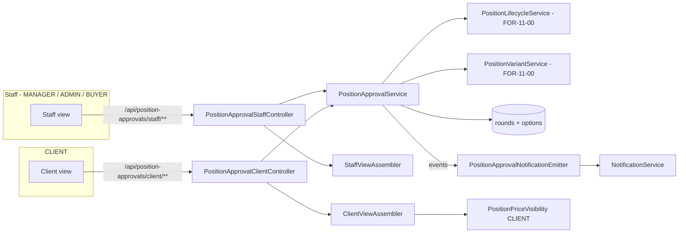
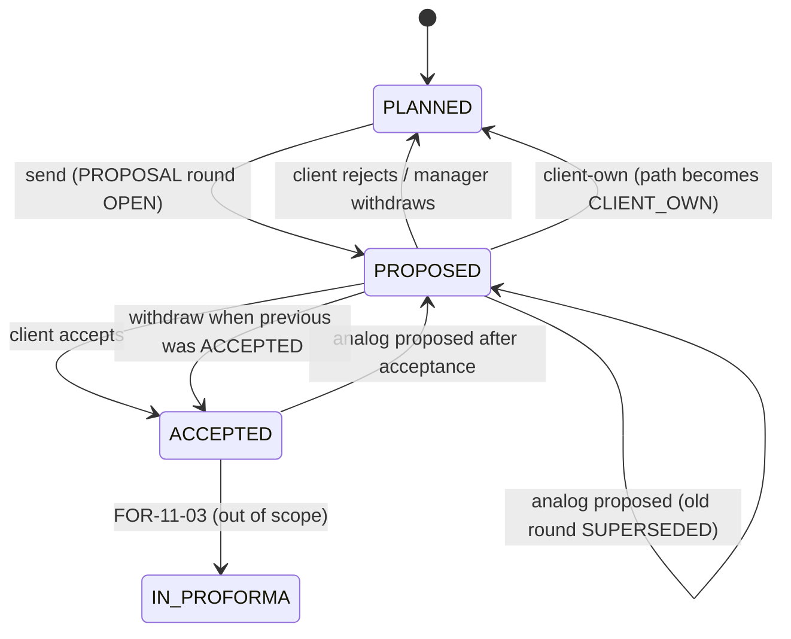

# Design Document: FOR-11-02 — Client position approval

## Overview

FOR-11-02 turns the three SYSTEM-only edges of the FOR-11-00 position state machine
(`PLANNED -> PROPOSED -> ACCEPTED`, and the way back) into a user workflow, and gives the logged-in
`CLIENT` a safe window onto it. Backend: one small domain (**approval round** + **option**), one
orchestrating service, two controllers (staff and client) with **separate DTO types**, one emitter.
Frontend: one workspace tab whose panel renders a client view or a staff view.

**Design principles**

1. **Rounds orchestrate, positions keep the truth.** A round records a request and its outcome; the
   position's stage, item and price change only through the FOR-11-00 write paths
   (`PositionLifecycleService.transition(..., SYSTEM)` and `PositionVariantService.replace(..., SYSTEM)`).
   No second state machine for the position is created.
2. **Client safety by construction.** The client read model is a separate type tree with no staff type
   inside it and no internal field name. Internal prices live only in `internalUnitPurchasePrice` of the
   option (admin-only) and in the FOR-11-00 position fields. A structural reflection test and a runtime
   sentinel test enforce this.
3. **Fixed price on accept.** The client posts the price it saw; the server compares it with the stored
   option price and with the position's base snapshot before changing anything.
4. **Reuse.** `ProcurementProjectAccess`, `PositionAudienceResolver`, `PositionPriceVisibility`,
   `PositionLifecycleService`, `PositionVariantService`, `NotificationService`, the workspace tab
   contract, the bell and its deep-link handler, and the FOR-06-12 thread (reached by navigation only).
5. **No automation on lateness.** `overdue` is derived; the amendment flow (FOR-06-08) can read it later.

**Spans two git repos** (per `.kiro/steering/git-repo-structure.md`): the root repo (changesets,
backend, messages, spec) and `foremen-frontend/` (the feature, tab, locales, tests). Two commits, made
only when the user asks.

## Architecture



Stage interplay (AGREED path; every arrow is a SYSTEM transition called by the service):



## Backend

Packages: `com.foremen.service.procurement.approval` (domain services, rules, events, emitter),
`com.foremen.controller` (controllers), `com.foremen.controller.model` (DTOs, assemblers),
`com.foremen.dao`/`dao.model` (entities, DAOs).

### 1. Data model (changesets 234 and 235)

Current tail is `232`; `233-add-purchase-positions-work-category.xml` (FOR-11-01) is on disk but not yet
registered. This spec uses **234** and **235**; if a sibling spec lands first, take the next free `NNN`.
Both changesets are appended **last** in `changelog.xml` by their own task and are idempotent.

**234-create-position-approval-tables.xml**

```text
position_approval_rounds
  id PK, <BaseEntity audit columns as in changeset 227>
  position_id           BIGINT NOT NULL FK purchase_positions(id) ON DELETE CASCADE
  round_no              INT NOT NULL
  kind                  VARCHAR(24) NOT NULL    -- PROPOSAL | ANALOG | PACKAGE_CHOICE | CLIENT_SUGGESTION | CLIENT_OWN
  status                VARCHAR(16) NOT NULL    -- OPEN | ACCEPTED | REJECTED | SUPERSEDED | WITHDRAWN | DECLARED | RESOLVED | DECLINED
  decision_deadline     DATE
  previous_status       VARCHAR(24)             -- PositionStatus before the round opened
  base_material_id      BIGINT FK finishing_materials(id)
  base_unit_sale_price  NUMERIC(14,2)
  quantity              NUMERIC(14,3)
  manager_note          VARCHAR(1000)
  suggestion_link       VARCHAR(1000)
  source_suggestion_id  BIGINT FK position_approval_rounds(id)
  decided_by_id         BIGINT FK users(id)
  decided_at            TIMESTAMP
  decided_side          VARCHAR(8)              -- CLIENT | STAFF
  on_behalf             BOOLEAN NOT NULL DEFAULT FALSE
  decision_comment      VARCHAR(1000)
  chosen_option_id      BIGINT                  -- FK added after the options table exists
  UNIQUE (position_id, round_no)
  INDEX  (position_id), INDEX (status)
  UNIQUE INDEX uq_par_open_per_position ON (position_id)
         WHERE status = 'OPEN' AND kind <> 'CLIENT_SUGGESTION'

position_approval_options
  id PK, <audit columns>
  round_id                       BIGINT NOT NULL FK position_approval_rounds(id) ON DELETE CASCADE
  material_id                    BIGINT NOT NULL FK finishing_materials(id)
  sort_order                     INT NOT NULL DEFAULT 0
  unit_sale_price                NUMERIC(14,2)           -- null for PACKAGE_CHOICE
  internal_unit_purchase_price   NUMERIC(14,2)           -- ADMIN-ONLY, never mapped to client types
  INDEX (round_id)
```

Each column/table/index/FK is its own `changeSet` guarded by `tableExists` / `columnExists` /
`indexExists` / `foreignKeyConstraintExists` with `onFail="MARK_RAN"`; the partial unique index is a
`<sql dbms="postgresql">` changeset guarded by `indexExists`.

**235-seed-position-approvals-resource.xml** (entity-creation steps 1 and 2): resource row
`POSITION_APPROVALS` (`name_ru` "Согласование позиций", `name_pl` "Zatwierdzanie pozycji",
`description_ru` "Согласование позиций закупок с клиентом", `description_pl` "Uzgadnianie pozycji zakupów
z klientem"); grants by the 229 pattern:

| Role | Operations |
|------|-----------|
| ADMIN | CREATE, READ, UPDATE, DELETE, APPROVE |
| MANAGER | CREATE, READ, UPDATE, DELETE, APPROVE |
| BUYER | READ |
| CLIENT | READ, APPROVE |

### 2. Enums and pure rules (no Spring, fully unit-testable)

| Class | Responsibility |
|-------|----------------|
| `ApprovalRoundKind`, `ApprovalRoundStatus`, `DecidedSide` | enums of Requirement 2.3 |
| `ApprovalRoundStatusMachine` | `boolean canMove(kind, from, to)`; `Set<Status> exits(kind, status)` |
| `ApprovalStageGuard` | `check(path, positionStatus, operation)` -> `OK` / `STAGE_NOT_ALLOWED` for each operation (`SEND`, `PROPOSE_ANALOG`, `SUGGEST`, `CLIENT_OWN`, `ACCEPT`, `REJECT`). **The seam for FOR-06-08**: every rule "from `IN_PROFORMA` on, only an amendment" lives here |
| `ApprovalDeadlinePolicy` | `validate(deadline, today)`; `isOverdue(round, today)` (`Europe/Warsaw`) |
| `ClientStatusMapper` | `PositionStatus + SourcingPath + hasOpenRound -> ClientStatus` (Requirement 4.3) |
| `ClientMoneyCalculator` | `unitNet, vatPercent, qty -> ClientMoneyDto`; per-line `HALF_UP` scale 2; delegates to FOR-11-01 `PositionMoneyMath` once that helper exists, otherwise self-contained |
| `ApprovalActionRules` | `allowedActions(audience, role, position, openRound, suggestions)` for both sides |

`ApprovalStageGuard` table (path `AGREED` unless stated):

| Operation | Allowed position stage |
|-----------|-----------------------|
| `SEND` | `PLANNED` |
| `SEND_CHOICE` (`PACKAGE`) | `PLANNED` |
| `PROPOSE_ANALOG` | `PROPOSED`, `ACCEPTED` |
| `SUGGEST`, `CLIENT_OWN` | `PROPOSED`, `ACCEPTED` |
| `ACCEPT`, `REJECT` | `PROPOSED` (`PACKAGE`: `PLANNED`) |
| anything | `IN_PROFORMA` and later -> `error.positionApproval.stage.notAllowed` |

### 3. `PositionApprovalService` (orchestrator, `@Service`, implements `ProjectScopedService`)

`getProjectIdPath() = "position.project.id"`; `allowedProjectIds` delegates to `ProcurementProjectAccess`.
All writes are `@Transactional`; every write calls `positionService.assertProjectAccess(positionId)` (404
outside the caller's projects), and client-side writes additionally `assertClientMember(position)` (the
caller has an ACTIVE `ProjectMember` row with role code `CLIENT` in the project; ADMIN passes only
through the on-behalf endpoints).

Core API (internal types `Command`s omitted):

```java
List<Long> send(SendCommand cmd);                       // R6.1-6.6
Long sendChoice(SendChoiceCommand cmd);                 // R6.7
Long proposeAnalog(Long positionId, AnalogCommand cmd); // R9
void accept(Long roundId, AcceptCommand cmd, Decider d);   // R7, R12 (d = CLIENT | STAFF_ON_BEHALF)
void reject(Long roundId, String comment, Decider d);     // R8, R12
Long suggest(Long positionId, SuggestCommand cmd);      // R10
void declineSuggestion(Long roundId, String note);      // R10.3
void declareClientOwn(Long positionId, String comment, Decider d); // R11, R12
void withdraw(Long roundId);                            // R13.1
void changeDeadline(Long roundId, LocalDate deadline);  // R13.2
```

`Decider` is a small record `(Long userId, DecidedSide side, boolean onBehalf)`; the **client and
on-behalf endpoints call the same method**, so rules cannot diverge.

**Accept algorithm** (`accept`):

1. Load the round `FOR UPDATE` (pessimistic write lock on the round row) and its position; assert scope
   and, for `CLIENT`, membership.
2. `ApprovalRoundStatusMachine.canMove(kind, OPEN, ACCEPTED)` else 409 `round.notOpen`.
3. `ApprovalStageGuard.check(path, position.status, ACCEPT)`.
4. Resolve the option: single option for `PROPOSAL`/`ANALOG`; `optionId` required for `PACKAGE_CHOICE`.
5. Priced option: `expectedUnitSalePrice` must equal `option.unitSalePrice` (`compareTo == 0`) else 409
   `priceChanged`.
6. `PROPOSAL`: `position.plannedMaterial.id == round.baseMaterial.id` and `position.salePrice ==
   round.baseUnitSalePrice` else 409 `stale`.
7. `ANALOG` / `PACKAGE_CHOICE`: if the option differs from the position's item or price, call
   `variantService.replace(positionId, new ReplaceCommand(materialId, unitSalePrice,
   internalUnitPurchasePrice, VariantReason.ANALOG, note), Actor.SYSTEM)`.
   (`VariantStagePolicy` already allows `SYSTEM` at `PLANNED`, `PROPOSED`, `ACCEPTED`.)
8. `AGREED`: `lifecycleService.transition(positionId, ACCEPTED, Actor.SYSTEM)`.
9. Round: `status = ACCEPTED`, `chosenOption`, `decidedBy/At/Side/onBehalf`, `decisionComment`;
   position `decisionDeadline = null` (audited system write); publish `PositionDecisionEvent`.

**Send algorithm**: validate all positions first (collect the first offender), then per position create
round + option, set `decisionDeadline`, `lifecycleService.transition(PROPOSED, SYSTEM)`; one event.

**Client-own algorithm**: supersede the open round; create the `DECLARED` round; transitions
(`ACCEPTED -> PROPOSED -> PLANNED` or `PROPOSED -> PLANNED`); `position.sourcingPath = CLIENT_OWN`
written through `PurchasePositionService` with an audit snapshot (`saveAuditWithSnapshot(before, saved,
"UPDATE")`); the 00 update rule "sourcingPath editable at PLANNED or PROPOSED" is respected because the
write happens at `PLANNED`.

**Withdraw**: round `WITHDRAWN`; target stage = `ACCEPTED` if `previousStatus == ACCEPTED` else `PLANNED`
(for `PACKAGE_CHOICE` no transition); transition SYSTEM; clear the position deadline.

**Concurrency.** One open round per position is guaranteed by the partial unique index (a racing second
`send` fails with a unique violation mapped to 409 `error.positionApproval.send.notEligible`). Decisions
lock the round row; two simultaneous accepts yield one 409 `round.notOpen`.

### 4. Read side

`ApprovalQueryService` builds both views from one query per project (positions with at least one round,
rounds, options, materials) to avoid N+1: positions fetched by `projectId`, rounds and options fetched
with `IN` on position ids and `JOIN FETCH` of material, producer and unit.

**Client types** (`com.foremen.controller.model.client`), **no import of any staff type, no purchase-side
field**:

```java
record ClientApprovalPositionDto(Long positionId, Integer blockNo, ClientItemDto item, BigDecimal quantity,
    String unitName, ClientStatus clientStatus, SourcingPath sourcingPath, ClientMoneyDto money,
    LocalDate decisionDeadline, boolean overdue, ClientRoundDto openRound,
    List<ClientRoundDto> openSuggestions, List<ClientRoundDto> history, Set<ClientAction> allowedActions) {}
record ClientItemDto(Long materialId, String model, String sku, String producerName, String link, String photo) {}
record ClientRoundDto(Long roundId, Integer roundNo, ApprovalRoundKind kind, ApprovalRoundStatus status,
    LocalDate decisionDeadline, String managerNote, String suggestionLink, String decisionComment,
    LocalDateTime decidedAt, DecidedSide decidedSide, boolean onBehalf,
    List<ClientOptionDto> options, Long chosenOptionId) {}
record ClientOptionDto(Long optionId, ClientItemDto item, ClientMoneyDto money) {}   // money null for PACKAGE_CHOICE
record ClientMoneyDto(BigDecimal unitNet, BigDecimal vatRatePercent, BigDecimal unitGross,
    BigDecimal lineNet, BigDecimal lineGross) {}
```

`ClientViewAssembler` is the **only** place that builds them. It never reads `plannedPurchasePrice`,
`actualPurchasePrice`, `internalUnitPurchasePrice`, `purchaseVatRate`, `deliveryCostShare`, seller,
request or date fields: it takes a narrowed `ClientPositionSource` record prepared by `ApprovalQueryService`
(only sale-side columns are selected in the projection), so even a coding slip cannot pull a purchase
value into scope. `money` is produced through `PositionPriceVisibility.apply(CLIENT, ...)` for the
position-level price and through the option's `unitSalePrice` for round options.

**Staff types** (`StaffApprovalPositionDto`, `StaffRoundDto`, `StaffOptionDto`) add the admin-only
values; `StaffViewAssembler` asserts `audience == STAFF_FULL` and throws 403
`error.positionApproval.staff.forbidden` otherwise.

**Leak guard (test-only utility `ClientDtoLeakGuard`).** Reflection walks the client record classes (incl.
generic type arguments and nested records) and asserts no component name contains any deny-list token
(`purchase`, `internal`, `margin`, `delivery`, `seller`, `needby`, `orderby`, `plannedDelivery`, `audit`,
`request`) and that no component type is a staff type. A second test seeds a position with distinctive
sentinels (purchase price 61.37, delivery cost 4.21, seller "SELLER-SENTINEL", internal price 59.99) and
asserts none of the sentinel strings appears in the serialized client JSON of every client endpoint.

### 5. Endpoints and guards

| Method and path | Op | Role rule | Notes |
|---|---|---|---|
| `GET /api/position-approvals/client/projects/{projectId}` | READ | scoped | Client_View list; filters `status`, `onlyPending`, `blockNo` |
| `GET /api/position-approvals/client/projects/{projectId}/summary` | READ | scoped | counts for the badge |
| `GET /api/position-approvals/client/positions/{positionId}` | READ | scoped | 404 when no round |
| `POST /api/position-approvals/client/rounds/{roundId}/accept` | APPROVE | Client_Member | body `{optionId, expectedUnitSalePrice}` |
| `POST /api/position-approvals/client/rounds/{roundId}/reject` | APPROVE | Client_Member | body `{comment}` |
| `POST /api/position-approvals/client/positions/{positionId}/suggest` | APPROVE | Client_Member | body `{link, comment}` |
| `POST /api/position-approvals/client/positions/{positionId}/client-own` | APPROVE | Client_Member | body `{comment}` |
| `GET /api/position-approvals/staff/projects/{projectId}` | READ | `STAFF_FULL` re-check | Staff_View; filters `status`, `overdue`, `blockNo`, `sourcingPath` |
| `GET /api/position-approvals/staff/positions/{positionId}/rounds` | READ | `STAFF_FULL` | history with internal prices |
| `POST /api/position-approvals/staff/send` | CREATE | MANAGER/ADMIN | R6.1 |
| `POST /api/position-approvals/staff/send-choice` | CREATE | MANAGER/ADMIN | R6.7 |
| `POST /api/position-approvals/staff/positions/{positionId}/propose-analog` | CREATE | MANAGER/ADMIN | R9 |
| `POST /api/position-approvals/staff/rounds/{roundId}/withdraw` | UPDATE | MANAGER/ADMIN | R13.1 |
| `POST /api/position-approvals/staff/rounds/{roundId}/deadline` | UPDATE | MANAGER/ADMIN | R13.2 |
| `POST /api/position-approvals/staff/suggestions/{roundId}/decline` | UPDATE | MANAGER/ADMIN | R10.3 |
| `POST /api/position-approvals/staff/rounds/{roundId}/decide-on-behalf` | APPROVE | MANAGER/ADMIN | R12 |
| `POST /api/position-approvals/staff/positions/{positionId}/client-own-on-behalf` | APPROVE | MANAGER/ADMIN | R12 |

Two controllers, `PositionApprovalClientController` and `PositionApprovalStaffController`, both
`@RestController` **without** a class-level `@PermissionResource`; every handler has an explicit
`@RequiresPermission(POSITION_APPROVALS, op)` (the 01 precedent). Role checks that the ABAC matrix cannot
express (MANAGER/ADMIN for writes, `Client_Member`, `STAFF_FULL` for the staff view) are done in the
service through `PositionAudienceResolver` and the membership lookup; a manager has `CREATE`/`UPDATE`
but a `BUYER` has neither, so `BUYER` is read-only without extra code, and a `CLIENT` has neither
`CREATE` nor `UPDATE`, so it cannot reach any staff write. The staff READ endpoints are the only staff
endpoints a client holds an operation for, and they fail on the `STAFF_FULL` re-check.

### 6. `PositionPriceVisibility` change (shared code)

```java
private static final Set<PositionStatus> CLIENT_VISIBLE = EnumSet.of(PROPOSED, ACCEPTED, IN_PROFORMA,
        CLIENT_PAID, WITH_BUYER, ORDERED, SUPPLIER_PAID, IN_DELIVERY, PARTIALLY_RECEIVED, RECEIVED);
```

Only `PROPOSED` is added; `PACKAGE` and `CLIENT_OWN` still return `NONE`. The existing unit and property
tests (FOR-11-00) that assert "PROPOSED hidden for CLIENT" are updated; no other audience changes.

### 7. Notifications

Events (published inside the transaction, consumed `AFTER_COMMIT`): `PositionsSentForDecisionEvent(
projectId, positionIds)`, `PositionAnalogProposedEvent(projectId, positionId)`,
`PositionDecisionEvent(projectId, positionId, outcome {ACCEPTED, REJECTED, CLIENT_OWN}, onBehalf,
actorUserId)`, `PositionSuggestionEvent(projectId, positionId)`.

`PositionApprovalNotificationEmitter` (`@Component`) mirrors `OfferNotificationEmitter`:
`@TransactionalEventListener(phase = AFTER_COMMIT, fallbackExecution = true)`, a try/catch around every
recipient, `notificationService.create(userId, type, null, deepLink)`. Recipient resolution uses
`ProjectMemberDao.findByProjectIdWithUserAndRole(projectId)` filtered to `ACTIVE` and role code (`CLIENT`
or `MANAGER`); the buyer set for `clientOwn` is `request.assignedBuyer` else all active users with role
`BUYER`. De-duplication by user id per event; the actor is removed from the set.

| Event | Type | Recipients | Deep link |
|---|---|---|---|
| `PositionsSentForDecisionEvent` | `notification.position.decisionRequested` | CLIENT members | `/projects/{p}/positionApprovals` |
| `PositionAnalogProposedEvent` | `notification.position.analogProposed` | CLIENT members | `...?position={id}` |
| `PositionDecisionEvent` ACCEPTED (not on behalf) | `notification.position.accepted` | MANAGER members | `...?position={id}` |
| `PositionDecisionEvent` REJECTED (not on behalf) | `notification.position.rejected` | MANAGER members | same |
| `PositionDecisionEvent` CLIENT_OWN (not on behalf) | `notification.position.clientOwn` | MANAGER members + buyer(s) | same |
| `PositionSuggestionEvent` | `notification.position.suggestionReceived` | MANAGER members | same |

### 8. Errors (`ForemenApiException`, keys in `messages.properties` PL / `messages_ru.properties` RU)

`error.positionApproval.round.notFound` (404), `.round.notOpen` (409), `.stage.notAllowed` (409),
`.stale` (409), `.priceChanged` (409), `.send.notEligible` (409, parameter: position id),
`.send.priceMissing` (409), `.choice.optionsInvalid` (400), `.option.invalid` (400),
`.option.priceNotAllowed` (400), `.option.sameAsCurrent` (409), `.deadline.invalid` (400),
`.decision.commentRequired` (400), `.suggestion.linkInvalid` (400), `.suggestion.notOpen` (409),
`.clientOwn.notAllowed` (409), `.onBehalf.forbidden` (403), `.staff.forbidden` (403),
`.material.projectMismatch` (400), `.project.notActive` (409).

PL values (default bundle) and RU values are written with the keys; a parity test lists the keys by
scanning the code constants (`static final String` with prefix `error.positionApproval.`).

### 9. Managed-entity checklist review (steering `entity-creation-rules`)

1. Resource seeded by 235, registered last. 2. ADMIN grant seeded (and MANAGER/BUYER/CLIENT). 3. Method-level
`@RequiresPermission` on all handlers (no half-annotation). 4. `getProjectIdPath()` = `position.project.id`.
5. Dataset coverage: exclusion entry for `POSITION_APPROVALS` in `DatasetCoverage` (workflow history and
action-only permission; positions covered by FOR-11-00 datasets). No dataset or library widget is added.
Sensitive-field guard: round comments and links are free text that no dataset exposes.

## Frontend (inner repo `foremen-frontend/`)

### Structure

```text
src/features/position-approval/
  api/                    positionApprovalApi.ts, queryKeys.ts, hooks (useClientApprovals, useStaffApprovals,
                          useAccept, useReject, useSuggest, useClientOwn, useSend, usePropose..., useSummary)
  types.ts                mirrors the DTOs (client and staff types kept in separate files)
  PositionApprovalsPanel.tsx   branches on useAuthStore(s => s.user?.roleCode)
  client/
    ClientApprovalsView.tsx    block groups, filter chips, empty state
    ClientPositionCard.tsx     item, status chip, price block, actions, history, discuss button
    ClientOptionCompare.tsx    old item vs analog, side by side
    PackageChoiceList.tsx      2..5 options without price
    AcceptDialog.tsx, RejectDialog.tsx, ClientOwnDialog.tsx, SuggestLinkDialog.tsx
  staff/
    StaffApprovalsView.tsx     table grouped by block, row actions
    SendBlockDialog.tsx, ProposeAnalogDialog.tsx, SendChoiceDialog.tsx
    DecideOnBehalfDialog.tsx, WithdrawDeadlineDialogs.tsx
    SuggestionsInbox.tsx, RoundHistoryDrawer.tsx
  shared/
    DeadlineBadge.tsx, RoundStatusChip.tsx, ClientStatusChip.tsx, MoneyBlock.tsx, useDeepLinkHighlight.ts
```

Reused: `DataTable`, dialog and toast primitives, `usePermission`, the PLN and locale date formatters,
`useAuthStore`, `buildFetchQuery`, the notification deep-link handler.

### Tab contract

`workspaceTabs.ts` gets a lazy import of `PositionApprovalsPanel` and the entry (after
`clientCommunication`):

```ts
{ key: 'positionApprovals', stage: 'execution', owner: 'FOR-11',
  requiredPermission: { resource: 'POSITION_APPROVALS', operation: 'READ' },
  labelKey: 'workspace.tab.positionApprovals', lazy: PositionApprovalsPanel }
```

The `owner` union gains `'FOR-11'`. The badge value comes from the `summary` endpoint through the same
mechanism other tabs use for counters (if none exists, a small `useTabBadge` slot is added to the tab
header and left optional). The deep link `?position=` is read by `useDeepLinkHighlight`, which scrolls to
the card and applies a 2-second highlight; it works when the panel mounts after the navigation.

### Client view behavior

- Data: `GET .../client/projects/{id}`; React Query keys `['position-approval','client',projectId,filters]`;
  every mutation invalidates the list and the summary.
- Groups: by `blockNo` ascending, "No block" last. A group header shows the earliest deadline among its
  open rounds and a red `DeadlineBadge` when any is overdue.
- `ClientPositionCard`: photo, producer, model, SKU, shop link (opens a new tab, `rel="noopener noreferrer"`),
  quantity + unit, `ClientStatusChip`, `MoneyBlock` (net unit, VAT %, gross unit, gross line; hidden when
  `money` is `null`), then the actions from `allowedActions`.
- Accept: `AcceptDialog` shows item and gross unit price and posts `{optionId, expectedUnitSalePrice =
  option.money.unitNet}`. On 409 `priceChanged` or `stale` the dialog closes, a toast explains, and the
  list is refetched.
- Package choice: radio list, no money anywhere, one confirmation.
- Analog: `ClientOptionCompare` renders the current item (taken from `item`, price shown only when
  `money` is present) against the proposed option.
- History: a collapsible list of closed rounds with status chips, comments and the "recorded by the
  manager" mark when `onBehalf`.
- Discuss: a button that navigates to `/projects/{id}/clientCommunication`.
- Safety net: an API-layer allow-list test asserts the panel only calls `/api/position-approvals/client/`.

### Staff view behavior

- Data: `GET .../staff/projects/{id}`; a table grouped by block, columns: item, qty, status, round
  state, deadline (with badge), sale unit, **internal purchase unit, margin %** (staff only), actions.
- `SendBlockDialog`: block selector + checkbox list; deadline date input (min = today), note; lists
  ineligible positions with the reason.
- `ProposeAnalogDialog`: reuses the project/global material picker (FOR-11-00 `PROJECT_MATERIALS`
  reads) and the 00 suggestions when permitted; sale price (required), internal purchase price,
  deadline, note, client preview card, `sourceSuggestionId` when started from the inbox.
- `DecideOnBehalfDialog`: decision radio, option choice (for a package), mandatory comment.
- `SuggestionsInbox`: open suggestions across the project, link, comment, actions.
- Buttons are enabled by `allowedActions` from the server.

### Locale keys (PL and RU at parity; `i18n.keys.test.ts` enforces)

| Key | PL | RU |
|---|---|---|
| `workspace.tab.positionApprovals` | Zatwierdzanie pozycji | Согласование позиций |
| `positionApproval.title.client` | Pozycje do decyzji | Позиции на согласование |
| `positionApproval.title.staff` | Uzgodnienie pozycji z klientem | Согласование позиций с клиентом |
| `positionApproval.block` | Blok {{no}} | Блок {{no}} |
| `positionApproval.block.none` | Bez bloku | Без блока |
| `positionApproval.deadline` | Decyzja do {{date}} | Решение до {{date}} |
| `positionApproval.deadline.overdue` | Termin decyzji minął | Срок решения истёк |
| `positionApproval.empty.client` | Brak pozycji do decyzji | Нет позиций на согласование |
| `positionApproval.empty.staff` | Brak pozycji w uzgodnieniu | Нет позиций на согласовании |
| `positionApproval.filter.pending` | Do decyzji | На решение |
| `positionApproval.filter.accepted` | Zaakceptowane | Согласованные |
| `positionApproval.filter.clientOwn` | Kupuję sam | Покупаю сам |
| `positionApproval.filter.all` | Wszystkie | Все |
| `positionApproval.clientStatus.NOT_STARTED` | Przygotowywane | Готовится |
| `positionApproval.clientStatus.AWAITING_DECISION` | Czeka na Twoją decyzję | Ждёт вашего решения |
| `positionApproval.clientStatus.ACCEPTED` | Zaakceptowano | Согласовано |
| `positionApproval.clientStatus.IN_PROGRESS` | W realizacji | В работе |
| `positionApproval.clientStatus.IN_DELIVERY` | W dostawie | В доставке |
| `positionApproval.clientStatus.RECEIVED` | Odebrano | Получено |
| `positionApproval.clientStatus.CANCELLED` | Anulowano | Отменено |
| `positionApproval.clientStatus.CLIENT_OWN` | Kupujesz samodzielnie | Вы покупаете сами |
| `positionApproval.field.item` | Pozycja | Позиция |
| `positionApproval.field.quantity` | Ilość | Количество |
| `positionApproval.field.unitNet` | Cena netto za jedn. | Цена за ед. без НДС |
| `positionApproval.field.vat` | VAT | НДС |
| `positionApproval.field.unitGross` | Cena brutto za jedn. | Цена за ед. с НДС |
| `positionApproval.field.lineGross` | Razem brutto | Итого с НДС |
| `positionApproval.field.shopLink` | Link do sklepu | Ссылка на магазин |
| `positionApproval.field.managerNote` | Uwaga menedżera | Комментарий менеджера |
| `positionApproval.field.comment` | Komentarz | Комментарий |
| `positionApproval.field.deadline` | Termin decyzji | Срок решения |
| `positionApproval.field.salePrice` | Cena sprzedaży netto | Цена продажи без НДС |
| `positionApproval.field.internalPurchasePrice` | Cena zakupu (wewnętrzna) | Закупочная цена (внутренняя) |
| `positionApproval.field.margin` | Marża | Маржа |
| `positionApproval.action.accept` | Akceptuję | Согласовать |
| `positionApproval.action.reject` | Odrzucam | Отклонить |
| `positionApproval.action.clientOwn` | Kupię samodzielnie | Куплю сам |
| `positionApproval.action.suggest` | Zaproponuj własny link | Предложить свою ссылку |
| `positionApproval.action.discuss` | Omów na czacie | Обсудить в чате |
| `positionApproval.action.choose` | Wybierz tę opcję | Выбрать этот вариант |
| `positionApproval.action.send` | Wyślij do decyzji | Отправить на согласование |
| `positionApproval.action.sendBlock` | Wyślij blok do decyzji | Отправить блок на согласование |
| `positionApproval.action.sendChoice` | Zaproponuj wybór z pakietu | Предложить выбор из пакета |
| `positionApproval.action.proposeAnalog` | Zaproponuj analog | Предложить аналог |
| `positionApproval.action.withdraw` | Wycofaj | Отозвать |
| `positionApproval.action.changeDeadline` | Zmień termin | Изменить срок |
| `positionApproval.action.decideOnBehalf` | Zapisz decyzję klienta | Записать решение клиента |
| `positionApproval.action.clientOwnOnBehalf` | Zapisz „kupuje sam” | Записать «покупает сам» |
| `positionApproval.action.decline` | Odrzuć propozycję | Отклонить предложение |
| `positionApproval.action.history` | Historia decyzji | История решений |
| `positionApproval.dialog.accept.title` | Potwierdź akceptację | Подтвердите согласование |
| `positionApproval.dialog.accept.body` | Akceptujesz {{model}} w cenie {{price}} brutto za jedn. Cena zostanie zafiksowana. | Вы согласовываете {{model}} по цене {{price}} с НДС за ед. Цена будет зафиксирована. |
| `positionApproval.dialog.reject.title` | Odrzuć pozycję | Отклонить позицию |
| `positionApproval.dialog.reject.hint` | Podaj powód (wymagane) | Укажите причину (обязательно) |
| `positionApproval.dialog.clientOwn.title` | Kupisz tę pozycję samodzielnie | Вы купите эту позицию сами |
| `positionApproval.dialog.clientOwn.body` | Zakupu dokonasz Ty. My zajmiemy się terminem i sposobem dostawy. | Покупку сделаете вы. Мы будем отслеживать срок и способ доставки. |
| `positionApproval.dialog.suggest.title` | Własny link do materiału | Своя ссылка на материал |
| `positionApproval.dialog.suggest.link` | Link (https://…) | Ссылка (https://…) |
| `positionApproval.dialog.suggest.invalid` | Podaj poprawny adres http lub https | Укажите корректный адрес http или https |
| `positionApproval.dialog.send.title` | Wyślij do decyzji klienta | Отправить на решение клиента |
| `positionApproval.dialog.send.notEligible` | Pozycje, których nie można wysłać | Позиции, которые нельзя отправить |
| `positionApproval.dialog.send.priceMissing` | Brak ceny sprzedaży lub stawki VAT | Нет цены продажи или ставки НДС |
| `positionApproval.dialog.analog.title` | Zaproponuj analog | Предложить аналог |
| `positionApproval.dialog.analog.preview` | Tak zobaczy to klient | Так увидит клиент |
| `positionApproval.dialog.choice.title` | Wybór z pakietu (2–5 opcji) | Выбор из пакета (2–5 вариантов) |
| `positionApproval.dialog.onBehalf.title` | Decyzja klienta zapisana przez menedżera | Решение клиента, записанное менеджером |
| `positionApproval.dialog.onBehalf.hint` | Opisz, jak klient zdecydował (czat, telefon) | Опишите, как клиент принял решение (чат, телефон) |
| `positionApproval.dialog.deadline.title` | Zmień termin decyzji | Изменить срок решения |
| `positionApproval.history.round` | Runda {{no}} | Раунд {{no}} |
| `positionApproval.history.onBehalf` | Zapisane przez menedżera | Записано менеджером |
| `positionApproval.history.empty` | Brak historii | История пуста |
| `positionApproval.suggestions.title` | Propozycje klienta | Предложения клиента |
| `positionApproval.suggestions.empty` | Brak propozycji | Нет предложений |
| `positionApproval.roundKind.PROPOSAL` | Propozycja | Предложение |
| `positionApproval.roundKind.ANALOG` | Analog | Аналог |
| `positionApproval.roundKind.PACKAGE_CHOICE` | Wybór z pakietu | Выбор из пакета |
| `positionApproval.roundKind.CLIENT_SUGGESTION` | Link klienta | Ссылка клиента |
| `positionApproval.roundKind.CLIENT_OWN` | Klient kupuje sam | Клиент покупает сам |
| `positionApproval.roundStatus.OPEN` | Otwarta | Открыто |
| `positionApproval.roundStatus.ACCEPTED` | Zaakceptowana | Принято |
| `positionApproval.roundStatus.REJECTED` | Odrzucona | Отклонено |
| `positionApproval.roundStatus.SUPERSEDED` | Zastąpiona | Заменено |
| `positionApproval.roundStatus.WITHDRAWN` | Wycofana | Отозвано |
| `positionApproval.roundStatus.DECLARED` | Zgłoszona | Заявлено |
| `positionApproval.roundStatus.RESOLVED` | Rozpatrzona | Рассмотрено |
| `positionApproval.roundStatus.DECLINED` | Odrzucona przez menedżera | Отклонено менеджером |
| `positionApproval.toast.accepted` | Zaakceptowano | Согласовано |
| `positionApproval.toast.rejected` | Odrzucono | Отклонено |
| `positionApproval.toast.clientOwn` | Zapisano: kupujesz samodzielnie | Записано: вы покупаете сами |
| `positionApproval.toast.suggested` | Propozycja wysłana | Предложение отправлено |
| `positionApproval.toast.sent` | Wysłano do decyzji | Отправлено на согласование |
| `positionApproval.toast.withdrawn` | Wycofano | Отозвано |
| `positionApproval.toast.priceChanged` | Cena została zmieniona. Odśwież widok. | Цена изменилась. Обновите экран. |
| `positionApproval.toast.stale` | Pozycja została zmieniona. Odśwież widok. | Позиция изменилась. Обновите экран. |
| `notification.position.decisionRequested` | Nowe pozycje czekają na Twoją decyzję | Новые позиции ждут вашего решения |
| `notification.position.analogProposed` | Zaproponowano analog pozycji | Предложен аналог позиции |
| `notification.position.accepted` | Klient zaakceptował pozycję | Клиент согласовал позицию |
| `notification.position.rejected` | Klient odrzucił pozycję | Клиент отклонил позицию |
| `notification.position.clientOwn` | Klient kupuje pozycję samodzielnie | Клиент покупает позицию сам |
| `notification.position.suggestionReceived` | Klient zaproponował własny link | Клиент предложил свою ссылку |

Server errors are returned already localized by the backend (PL/RU bundles), so the frontend adds no
`error.*` keys beyond the two refresh toasts above.

## Data model summary

New: `position_approval_rounds`, `position_approval_options` (234). Seed: resource and grants (235).
Changed rows: none. Changed code: `PositionPriceVisibility` (one stage added to the CLIENT set).

## Error handling

All failures are `ForemenApiException` with the keys above; the global handler localizes them. A
double-submit by the client yields 409 `round.notOpen` and the UI refetches. Unique-index races map to
409. Notification failures are logged and never propagate.

## Testing strategy

- **Unit and property (jqwik):** `ApprovalRoundStatusMachine` (every pair, terminal states have no exit),
  `ApprovalStageGuard` (matrix), `ClientStatusMapper`, `ClientMoneyCalculator` (rounding, non-negative,
  gross >= net), `ApprovalDeadlinePolicy` (today boundary in `Europe/Warsaw`), extended
  `PositionPriceVisibility` (PROPOSED visible only for AGREED CLIENT; PACKAGE/CLIENT_OWN never), leak
  guard reflection test over all client DTO classes.
- **Integration (Testcontainers):** send/accept/reject/withdraw happy and failure paths; analog from
  `PROPOSED` and from `ACCEPTED`; `PACKAGE_CHOICE` accept without prices; stale and price-changed;
  suggestion then analog with `sourceSuggestionId`; client-own including the audit and the path change;
  on-behalf; one-open-round index race; ABAC matrix (CLIENT 403 on every staff write, 403 on the staff
  view, no access to `/api/purchase-positions`); cross-project isolation; the sentinel JSON test on every
  client endpoint; notification recipients, de-duplication, actor exclusion and deep links; changeset
  idempotency (run twice).
- **Frontend (vitest + Testing Library):** client view renders no internal label for a payload with
  extra fields (defence test), accept dialog posts the displayed price, `priceChanged` handling, package
  choice with no money, call allow-list, tab visibility per role, deep-link highlight, staff dialogs,
  `allowedActions` gating, i18n parity.
- Test-run policy: only affected classes (`--tests`), output to `/tmp/for-11-02-test.log`, read the JUnit
  XML under `foremen-backend/build/test-results/test/`; never the full suite unless requested.

## Assumptions and risks

- **Client sees the shop link and SKU** of the offered item (the manager records the link of the shop
  where the price was taken); the seller name and the purchase price stay hidden. If the link must also
  be hidden, drop `link` from `ClientItemDto` (one place).
- **Late decision** only sets a flag; amendment automation is the seam of `ApprovalStageGuard` and
  `overdue`, delivered by FOR-06-08.
- **Reject returns to `PLANNED`** whatever the previous stage. After a rejected analog the previously
  accepted item must be re-sent; accepted by design to keep the proforma gate strict.
- **Visibility by round existence** means positions marked `CLIENT_OWN` by the manager without any round
  stay invisible to the client in this phase.
- **`PositionMoneyMath` of FOR-11-01** may not exist yet; `ClientMoneyCalculator` is self-contained and
  can delegate later without API change.
- **Client with several users:** any ACTIVE `CLIENT` member can decide; the first valid decision wins and
  the round row lock prevents a double decision.
- **Notification type `suggestionReceived`** is an addition to the OVERVIEW candidate list; removing it
  only drops the emitter branch and one locale pair.
