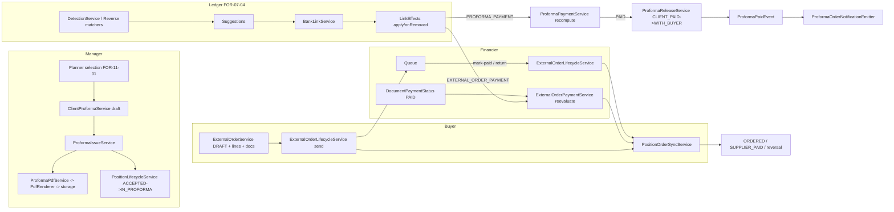

# Design Document: FOR-11-03 — Payments, proformas and external orders

## Overview

Two new aggregates and one extension of the bank ledger:

- **`ClientProforma`** (manager side, client read-only): lines frozen at issue, a stored PDF, paid by
  **ledger links** of the new kind `PROFORMA_PAYMENT`. When fully paid, the **Release** moves its
  positions `IN_PROFORMA -> CLIENT_PAID -> WITH_BUYER` through `PositionLifecycleService`.
- **`ExternalOrder`** (buyer side, financier pays): lines with partial quantities and purchase prices,
  delivery cost allocated by `DeliveryCostAllocator`, linked `ProcurementDocument`s. It becomes paid by
  the financier or by the ledger (kind `EXTERNAL_ORDER_PAYMENT` or the paid state of every linked
  document). A single `PositionOrderSyncService` derives `orderedQuantity`, `actualPurchasePrice`,
  `deliveryCostShare` and the stages `ORDERED` / `SUPPLIER_PAID` on the position.
- **FOR-07-04 extension**: two `LinkKind`s, two target columns, new CHECK constraints, forward and reverse
  matching, effects on create and **removal** of a link.

Nothing in the works `PaymentSchedule` / `ReconciliationEngine` changes. The proforma is **not** a
tranche: FOR-06-07 has no generated payment document (only `TrancheGenerator`), and one schedule per
project is based on the approved offer total, so sharing it would mix material and works money.

## Architecture



## Backend

Package roots: `com.foremen.service.procurement.proforma`, `...procurement.externalorder`,
`com.foremen.controller.procurement`, DTOs under `com.foremen.service.procurement.dto`.

### 1. Data model (changesets 236 to 239)

Next free number is **236** (current tail `235-seed-position-approvals-resource.xml`); if a sibling spec
lands first, use the next free numbers. Every changeset is idempotent and registered **last** in
`database_files/changelog.xml`.

| # | File | Content |
|---|------|---------|
| 236 | `236-create-client-proformas.xml` | `client_proformas`, `client_proforma_lines`, sequence `client_proforma_number_seq` |
| 237 | `237-create-external-orders.xml` | `external_orders`, `external_order_lines`, `external_order_documents` |
| 238 | `238-extend-bank-links-for-proforma-external-order.xml` | new columns + FKs + indexes on `bank_transaction_links` and `bank_transaction_suggestions`; drop/recreate kind CHECKs on links, suggestions, counterparty rules |
| 239 | `239-seed-proforma-external-order-resources.xml` | resources `CLIENT_PROFORMAS`, `EXTERNAL_ORDERS` and role grants, FINANCIER reference grants |

```
client_proformas:
 id BIGSERIAL PK; project_id BIGINT NOT NULL FK projects; number VARCHAR(32) NULL;
 status VARCHAR(16) NOT NULL DEFAULT 'DRAFT'; currency VARCHAR(3) NOT NULL DEFAULT 'PLN';
 issue_date DATE NULL; due_date DATE NULL; note VARCHAR(1000) NULL;
 total_net, total_vat, total_gross NUMERIC(14,2) NOT NULL DEFAULT 0; paid_gross NUMERIC(14,2) NOT NULL DEFAULT 0;
 paid_at TIMESTAMPTZ NULL; released_at TIMESTAMPTZ NULL; pdf_object_key VARCHAR(500) NULL; pdf_language VARCHAR(2) NULL;
 cancelled_at TIMESTAMPTZ NULL; cancel_reason VARCHAR(500) NULL; issued_by BIGINT NULL FK users;
 created_date, created_by, updated_date, updated_by
 CHECK (paid_gross >= 0 AND paid_gross <= total_gross OR status = 'DRAFT')
 UNIQUE INDEX uk_client_proformas_number (number) WHERE number IS NOT NULL
 INDEX (project_id), (status)

client_proforma_lines:
 id BIGSERIAL PK; proforma_id BIGINT NOT NULL FK client_proformas ON DELETE CASCADE;
 position_id BIGINT NOT NULL FK purchase_positions; line_no INT NOT NULL;
 material_id BIGINT NULL FK finishing_materials; description VARCHAR(500) NOT NULL; sku VARCHAR(100) NULL;
 quantity NUMERIC(14,3) NOT NULL; unit_name VARCHAR(50) NOT NULL; unit_sale_net NUMERIC(14,2) NOT NULL;
 vat_rate_id BIGINT NULL FK vat_rates; vat_rate_percent NUMERIC(5,2) NOT NULL;
 net, vat, gross NUMERIC(14,2) NOT NULL; active BOOLEAN NOT NULL DEFAULT TRUE
 UNIQUE (proforma_id, line_no); UNIQUE INDEX uk_proforma_lines_position_active (position_id) WHERE active
 INDEX (proforma_id), (position_id)

external_orders:
 id BIGSERIAL PK; project_id BIGINT NOT NULL FK projects; purchase_request_id BIGINT NULL FK purchase_requests ON DELETE SET NULL;
 seller_id BIGINT NOT NULL FK material_sellers; status VARCHAR(20) NOT NULL DEFAULT 'DRAFT';
 reference_number VARCHAR(100) NULL; order_link VARCHAR(1000) NULL;
 delivery_cost_net NUMERIC(14,2) NOT NULL DEFAULT 0 CHECK (>= 0); delivery_vat_rate_id BIGINT NULL FK vat_rates;
 expected_ship_date DATE NULL; expected_delivery_date DATE NULL;
 assigned_buyer_id BIGINT NULL FK users; note VARCHAR(2000) NULL; return_reason VARCHAR(500) NULL;
 sent_at, paid_at, cancelled_at TIMESTAMPTZ NULL; paid_source VARCHAR(16) NULL; paid_by BIGINT NULL FK users; paid_note VARCHAR(500) NULL;
 created_date, created_by, updated_date, updated_by
 INDEX (project_id), (seller_id), (status), (assigned_buyer_id), (purchase_request_id)

external_order_lines:
 id BIGSERIAL PK; external_order_id BIGINT NOT NULL FK external_orders ON DELETE CASCADE;
 position_id BIGINT NOT NULL FK purchase_positions; quantity NUMERIC(14,3) NOT NULL CHECK (> 0);
 unit_purchase_net NUMERIC(14,2) NOT NULL CHECK (>= 0); purchase_vat_rate_id BIGINT NULL FK vat_rates;
 delivery_cost_share NUMERIC(14,2) NOT NULL DEFAULT 0; above_ceiling_ack BOOLEAN NOT NULL DEFAULT FALSE
 UNIQUE (external_order_id, position_id); INDEX (position_id)

external_order_documents:
 id BIGSERIAL PK; external_order_id BIGINT NOT NULL FK external_orders ON DELETE CASCADE;
 procurement_document_id BIGINT NOT NULL FK procurement_documents; amount NUMERIC(14,2) NULL CHECK (amount > 0)
 UNIQUE (external_order_id, procurement_document_id); INDEX (procurement_document_id)
```

`238`: `bank_transaction_links` and `bank_transaction_suggestions` each get `client_proforma_id BIGINT NULL FK
client_proformas` and `external_order_id BIGINT NULL FK external_orders` plus indexes. The per-kind CHECKs of
changeset 203 (`ck_bank_transaction_links_kind`, `ck_bank_transaction_links_kind_target`, and the
suggestions / rules equivalents) are dropped and recreated with the two new kinds: `PROFORMA_PAYMENT`
requires `client_proforma_id` non-null and all other target columns null; `EXTERNAL_ORDER_PAYMENT` the same
with `external_order_id`. The changeset reads the exact constraint names first (task 1.3) and uses
`<preConditions onFail="MARK_RAN">` on a `SELECT` of the CHECK definition so a second run changes nothing.
The counterparty-rules table only needs the kind allow-list, not the target columns.

### 2. Enums and pure rules (no Spring, fully unit-testable)

- `ProformaStatus` (`DRAFT, ISSUED, PARTIALLY_PAID, PAID, CANCELLED`) and `ProformaStatusMachine`.
- `ProformaStatusDeriver.derive(totalGross, paidGross, current) -> ProformaStatus` (never moves a
  `DRAFT`/`CANCELLED`).
- `ProformaNumberFormatter.format(year, seq) -> "PF/2026/000123"`.
- `ProformaMath.compute(List<LineInput>) -> LineAmounts + Totals`, thin wrapper over
  `PositionMoneyMath.saleLine/sum` (FOR-11-01) so the planner total and the proforma gross cannot diverge.
- `ExternalOrderStatus` (`DRAFT, SENT_FOR_PAYMENT, PAID, CANCELLED`), `ExternalOrderStatusMachine`,
  `PaidSource` (`FINANCIER, LEDGER`).
- `ExternalOrderMath.compute(lines, deliveryNet, deliveryVatPercent) -> linesNet/Vat/Gross, deliveryGross,
  payableGross`; line gross via `PositionMoneyMath.saleLine(unitPurchaseNet, qty, vat)`.
- `ExternalOrderCoverageValidator.check(positionQuantity, otherLinesQty, thisLineQty)` (3-decimal exact).
- `ExternalOrderPaymentDeriver.derive(payableGross, ledgerPaidGross, List<DocumentPaymentStatus>) ->
  boolean` (rules 16.1/16.2, OR-ed; the empty document list contributes nothing).
- `PositionOrderStageResolver.resolve(status, quantity, coverage, coveringOrderStatuses) -> PositionStatus`
  (rules 17.2; returns the same status for anything outside `{WITH_BUYER, ORDERED, SUPPLIER_PAID}`).
- `CeilingCheck.exceeds(unitPurchaseNet, salePrice)`; `salePrice == null` never exceeds.

### 3. Proforma services

- **`ClientProformaService`** (`AdminService` + `ProjectScopedService`, `getProjectIdPath() = "project.id"`,
  `allowedProjectIds` delegated to `ProcurementProjectAccess`): create/update/delete draft, position
  validation (R3.2), snapshot builder `ProformaLineSnapshotBuilder` (item name = producer + model resolved
  in the document language, SKU, unit, VAT) used by the draft (live) and by issue (frozen).
  Position claiming relies on the partial unique index; a `DataIntegrityViolationException` on it is
  mapped to 409 `error.proforma.position.alreadyInProforma`.
- **`ProformaIssueService.issue(id, language)`** (`@Transactional`): lock row, re-validate, re-snapshot,
  `ProformaNumberService.next()` (`SELECT nextval`), set fields, `ProformaPdfService.render(proforma)`,
  transition positions, publish `ProformaIssuedEvent`. Any exception rolls back everything; the object
  storage write is the last step before the position transitions so a failed upload leaves no orphan
  (a failed transition after upload deletes the uploaded object in a `finally`-style compensation).
- **`ProformaCancelService.cancel(id, reason)`**: R5; guards `paidGross == 0` and no `PROFORMA_PAYMENT`
  link (`BankTransactionLinkDao.existsByClientProformaId`).
- **`ProformaPdfService`**: `ProformaHtmlBuilder` (pure, builds well-formed XHTML from a `ProformaDocModel`
  and a `ProformaPdfLabels` dictionary), `PdfRenderer.renderToPdf`, storage through the same object-storage
  seam `PdfFreezeService` uses (task 3.3 reads it and reuses the interface; **no new storage client**).
  Company data comes from `CompanyProfileService`; the bank account field is read there (task 3.3 confirms
  the field name; if the profile has no bank account today, the field is added to the profile and its
  admin form as part of task 3.3 and the build fails the issue with `error.proforma.companyProfile.incomplete`
  until it is filled). The payer block uses the project client display (task 3.3 confirms the source: the
  project's client member or the project owner fields).
- **`ProformaPaymentService`** (implements the `ProformaLedgerEffects` port called by `LinkEffects`):

```java
void onLinkChanged(Long proformaId);       // lock row, paid = SUM(link amounts), derive status, release when PAID
boolean canRemoveLink(Long proformaId);    // false once releasedAt != null
```

- **`ProformaReleaseService.release(proformaId)`**: R9; loops positions, `PositionLifecycleService.transition`
  twice, stamps `releasedAt`, publishes `ProformaPaidEvent(proformaId, projectId, positionIds, actorUserId)`.
  Called inside `onLinkChanged` in the same transaction; `releasedAt != null` makes it a no-op.
- **Controllers:**

| Method and path | Permission | Notes |
|-----------------|-----------|-------|
| `GET /api/client-proformas` | `CLIENT_PROFORMAS` READ | staff list, filters of R21.1 |
| `GET /api/client-proformas/{id}` | READ | staff DTO with lines, links summary |
| `POST /api/client-proformas` | CREATE | draft |
| `PUT /api/client-proformas/{id}` | UPDATE | draft only |
| `DELETE /api/client-proformas/{id}` | DELETE | draft only |
| `POST /api/client-proformas/{id}/issue` | UPDATE | body `{language: pl|ru}` default `pl` |
| `POST /api/client-proformas/{id}/cancel` | UPDATE | body `{reason}` |
| `GET /api/client-proformas/{id}/pdf` | READ | staff stream |
| `GET /api/client-proformas/client/projects/{projectId}` | READ (CLIENT only) | `ClientProformaClientDto[]` |
| `GET /api/client-proformas/client/{id}` | READ (CLIENT only) | client DTO |
| `GET /api/client-proformas/client/{id}/pdf` | READ (CLIENT only) | stream |

Client endpoints re-check `ROLE_CLIENT` and ACTIVE membership in the service (404 otherwise); the staff
endpoints reject `ROLE_CLIENT` the same way as FOR-11-02 `ApprovalAudience`. Client DTOs are separate
records; the reflection **leak guard** and sentinel tests copy the FOR-11-02 ones.

### 4. External order services

- **`ExternalOrderService`** (`AdminService` + `ProjectScopedService`): create/update header, `replaceLines`,
  `replaceDocuments`, delete draft. `replaceLines` validates (R12), reallocates delivery cost
  (`DeliveryCostAllocator`) and does **not** touch positions (drafts do not change stages). Coverage is
  computed with one aggregate query `ExternalOrderLineDao.sumQuantityByPositionExcluding(positionIds,
  orderId)` over non-cancelled orders.
- **`ExternalOrderLifecycleService`**: `send`, `markPaid`, `returnToBuyer`, `unmarkPaid`, `cancel`
  (R15). Each is `@Transactional`, row-locked, calls the pure machine, then
  `PositionOrderSyncService.syncAll(positionIds)`, then publishes the event.
- **`PositionOrderSyncService.sync(positionId)`** (R17): loads committed lines with a fetch join, computes
  `coverage`, `orderedQuantity`, weighted `actualPurchasePrice`, `deliveryCostShare`, asks the resolver,
  applies stage steps through `PositionLifecycleService`. It writes only `orderedQuantity`,
  `actualPurchasePrice`, `deliveryCostShare` and `status` of the position (SYSTEM-owned columns); the
  position update API keeps rejecting these fields (FOR-11-00 R9) and this service writes through the
  entity directly, not through the REST update path.
- **`ExternalOrderPaymentService.reevaluate(orderId)`** (R16): loads `ledgerPaidGross`
  (`BankTransactionLinkDao.sumAmountByExternalOrderId`), document statuses
  (`DocumentPaymentStatusDeriver` over `PROCUREMENT` links of each linked document), calls the pure deriver
  and applies the four cases of R16.3 to R16.5. Triggers: `ExternalOrderLedgerEffects.onLinkChanged`,
  `ExternalOrderDocumentsChanged`, and a listener on a new `ProcurementDocumentPaymentStatusChangedEvent`
  published by `LinkEffects` when a `PROCUREMENT` link is created or removed (small, additive publish;
  the existing effect for `PROCUREMENT` stays "derived status only").
- **Controller** `ExternalOrderController` at `/api/external-orders`:

| Method and path | Permission |
|-----------------|-----------|
| `GET /`, `GET /{id}` | `EXTERNAL_ORDERS` READ |
| `POST /` | CREATE |
| `PUT /{id}`, `PUT /{id}/lines`, `PUT /{id}/documents` | UPDATE |
| `DELETE /{id}` | DELETE |
| `POST /{id}/send`, `POST /{id}/cancel` | UPDATE |
| `POST /{id}/mark-paid`, `/return`, `/unmark-paid` | APPROVE |

`ExternalOrderDto` carries purchase prices; it is returned only to roles holding the grant (no client
role has any), and the controller mapper still checks `isMoneyPrivileged` (ADMIN, MANAGER, BUYER,
FINANCIER).

### 5. Ledger extension (FOR-07-04)

- `LinkKind`: add `PROFORMA_PAYMENT`, `EXTERNAL_ORDER_PAYMENT`.
- `LinkRequest`: add `clientProformaId`, `externalOrderId`; `BankTransactionLinkEntity` and the suggestion
  entity get the two `@ManyToOne` fields.
- `BankLinkService.resolve/validate`: direction (credit for proforma, debit for external order), currency
  `PLN`, linkable target status (R7.4/7.5), amount cap by line remainder and target remainder, project =
  the target's project. `removeLink`/`replaceLink` consult `LinkEffects.isLocked`.
- `LinkEffects`:

```java
case PROFORMA_PAYMENT       -> proformaLedgerEffects.onLinkChanged(link.getClientProforma().getId());
case EXTERNAL_ORDER_PAYMENT -> externalOrderLedgerEffects.onLinkChanged(link.getExternalOrder().getId());
// new
public void onRemoved(BankTransactionLinkEntity link) { ... same two cases, plus PROCUREMENT -> publish event }
public static boolean isLocked(link) { existing rule || (kind == PROFORMA_PAYMENT && proforma.releasedAt != null) }
```

  `ProformaLedgerEffects` and `ExternalOrderLedgerEffects` are small interfaces in `service.bank.link`
  implemented by the two services above, so `LinkEffects` has no compile-time dependency on the
  procurement package internals (same direction as FOR-07-03).
  The existing `CLIENT_PAYMENT` and `WORKER_PAYOUT` branches are untouched. The exact call sites of
  `onRemoved` (inside `removeLink`, `replaceLink`, `ignore`) are read in task 5.1.
- **Matching:** `TargetType` + `CLIENT_PROFORMA`, `EXTERNAL_ORDER`. `DetectionCandidateProviders` gains
  `openProformas(from, to)` and `payableExternalOrders(from, to)`; `CandidatePool.inputsFor` narrows by
  direction. `RuleMatcher` gets the six reason codes of R10.2; the proforma number is matched with the
  regex `PF[\\s/\\-]*(\\d{4})[\\s/\\-]*(\\d{6})` over the normalised title, tolerant of banks that strip
  slashes. `ReverseProformaMatcher` (on `ProformaIssuedEvent`) and `ReverseExternalOrderMatcher` (on
  `ExternalOrderSentEvent` and documents changed) mirror `ReverseDocumentMatcher` (async executor
  `BankDetectionExecutorConfig`), restricted to unlinked/partially linked lines of the right direction.
- **Search endpoint:** the manual-pick search (`BankLedger` target search, read in task 5.4) gains the two
  target types with the filters of R10.5.
- **Notification event:** after `replaceSuggestions/appendSuggestions` persists at least one suggestion of
  the new kinds, `LedgerMatchProposedEvent(transactionId)` is published once per call.

### 6. Planner extension

`PlannerGroupService.GroupBy` adds `PROFORMA`, `EXTERNAL_ORDER`. For `PROFORMA` the group query joins
`client_proforma_lines` (active) and sums the line `net/vat/gross`; positions without a line form
`NO_PROFORMA`. For `EXTERNAL_ORDER` it joins `external_order_lines` and their orders (status not
`CANCELLED`), sums purchase net/VAT/gross of the **line**, and adds `deliveryCostNet`, the two dates,
`seller`, `status`, `paidSource` of the order to the group DTO; a position in two orders appears in both
groups and the planner header total counts the position once (existing distinct sum). Row DTO additions
(`proformaId`, `proformaNumber`, `proformaStatus`, `externalOrderCount`) are staff-only and come from two
aggregate queries per page. New filters `proformaId` and `externalOrderId` extend `PlannerFilter`. The
proforma draft is started from the selection by the existing `selection` API plus
`POST /api/client-proformas`.

### 7. Notifications

`ProformaOrderNotificationEmitter` (`@Component`) mirrors `PaymentNotificationEmitter`:

| Event | Types emitted | Recipients | Deep link |
|-------|---------------|------------|-----------|
| `ProformaPaidEvent` | `notification.proforma.paid` | ACTIVE `MANAGER` members (`ProjectMemberDao.findByProjectIdWithUserAndRole`) minus actor | `/projects/{p}/clientProformas?proforma={id}` |
| `ProformaPaidEvent` | `notification.order.releasedToBuyer` | assigned buyers of the positions' requests (`PurchaseRequestDao`), else active `BUYER` users (`UserDao`) | `/deliveries/external-orders?project={p}&proforma={id}` |
| `ExternalOrderSentEvent` | `notification.externalOrder.sentForPayment` | active `FINANCIER` users minus actor | `/deliveries/external-orders?order={id}` |
| `ExternalOrderPaidEvent` | `notification.externalOrder.paid` | `assignedBuyer`, else `createdBy`, else active `BUYER` users; minus actor | `/deliveries/external-orders?order={id}` |
| `LedgerMatchProposedEvent` | `notification.invoice.matchProposed` | active `FINANCIER` users | `/bank-transactions?transaction={id}` |

`ProformaPaidEvent.actorUserId` is the ledger user who linked the payment (null for system replays);
`ExternalOrderPaidEvent.actorUserId` is the financier or null when paid by the ledger. The ledger deep link
route is confirmed against the existing `BankNotificationEmitter` (task 6.1) and the string above is
replaced by the route it uses if different.

### 8. Access, datasets and the managed-entity checklist

- `ProcurementProjectAccess.allowedProjectIds` adds `FINANCIER` to the company-wide roles (R20.1).
  `isMoneyPrivileged` stays `ADMIN, MANAGER, BUYER`; a new `isOrderPaymentRole` is `FINANCIER`.
- `ClientProformasDataset`, `ExternalOrdersDataset` (`@Component`, pattern of `RoomsDataset` and the
  FOR-11-00 datasets), `nullProjectPredicate` returning `cb.conjunction()` for `BUYER` and `FINANCIER`.
- Entity-creation checklist: step 1 seed 239, step 2 ADMIN grant (same file, second changeSet), step 3
  `@RequiresPermission` everywhere, step 4 `getProjectIdPath()`, step 5 datasets (`DatasetCoverageTest`).

### 9. Errors

Every key is thrown as `ForemenApiException(status, key)` and exists in both bundles (table in "i18n").

## Frontend (inner repo `foremen-frontend/`)

### Structure

- `src/features/client-proformas/{api,components,hooks,lib,types}`: list, draft editor, card, client cards,
  issue/cancel dialogs, `useProformas`, `useIssueProforma`, ... .
- `src/features/external-orders/{api,components,hooks,lib,types}`: list, editor, lines table, documents
  panel, financier queue, mark-paid/return dialogs.
- Ledger dialog changes live in `src/features/bank-transactions/components` (link kind select, target
  pickers, suggestion rows).
- Planner changes live in `src/features/purchase-planner` (group-by select, group header extras, "Create
  proforma" toolbar action).
- Tab contract: `src/features/project-workspace` (`clientProformas` entry, owner union `'FOR-11'` already
  added by FOR-11-02), route config `src/config/route-permissions.ts`, `/deliveries/*` routes in
  `src/app/router.tsx` (the `/deliveries` route exists at line ~329; task 9.8 reads how 01 lays out its
  tabs and adds the two sibling tabs the same way).

### Tab and route contract

| Item | Value |
|------|-------|
| Workspace tab | `clientProformas`, stage `execution`, owner `FOR-11`, permission `CLIENT_PROFORMAS` READ, label `workspace.tab.clientProformas` |
| `/deliveries/proformas` | permission `CLIENT_PROFORMAS` READ |
| `/deliveries/external-orders` | permission `EXTERNAL_ORDERS` READ |
| Query params | `?proforma={id}`, `?order={id}`, `?project={id}` open and highlight the item |

### Client view

`ClientProformaCards` renders `ClientProformaClientDto` only; the transfer title has a copy button (clipboard
API with a fallback), the PDF opens through a blob URL from `/client/{id}/pdf`. A test asserts the network
allow-list (`/api/client-proformas/client/`).

### Staff and buyer views

- `ProformaListTable` (server-side paging), `ProformaDraftEditor` (position table with totals, due date,
  note, Issue dialog), `ProformaCard` (lines, VAT breakdown, payments list, PDF, Cancel).
- `ExternalOrderList`, `ExternalOrderEditor` (header form with `SellerPicker`, lines grid with remaining
  quantity, ceiling marker + acknowledge checkbox, documents panel with the existing upload control and
  `DocumentPaymentStatus` chips, totals), `FinancierQueue` (cards with Mark paid / Return / Unmark).
- Optimistic updates are not used; mutations invalidate the list and card queries.

### Locale keys (PL and RU at parity; `i18n.keys.test.ts` enforces)

| Key | PL | RU |
|-----|----|----|
| `workspace.tab.clientProformas` | Proformy | Проформы |
| `notification.proforma.paid` | Proforma opłacona | Проформа оплачена |
| `notification.order.releasedToBuyer` | Zamówienie przekazane zakupowcowi | Заказ передан закупщику |
| `notification.externalOrder.sentForPayment` | Zamówienie do opłacenia | Заказ на оплату |
| `notification.externalOrder.paid` | Zamówienie opłacone, uzupełnij dostawę | Заказ оплачен, добавьте доставку |
| `notification.invoice.matchProposed` | Propozycja dopasowania płatności | Предложено сопоставление платежа |
| `clientProformas.title` | Proformy | Проформы |
| `clientProformas.tab.list` | Proformy klienta | Проформы клиента |
| `clientProformas.empty` | Brak proform. | Проформ нет. |
| `clientProformas.column.number` | Numer | Номер |
| `clientProformas.column.project` | Projekt | Проект |
| `clientProformas.column.status` | Status | Статус |
| `clientProformas.column.issueDate` | Data wystawienia | Дата выставления |
| `clientProformas.column.dueDate` | Termin płatności | Срок оплаты |
| `clientProformas.column.total` | Razem brutto | Итого брутто |
| `clientProformas.column.paid` | Zapłacono | Оплачено |
| `clientProformas.status.DRAFT` | Wersja robocza | Черновик |
| `clientProformas.status.ISSUED` | Wystawiona | Выставлена |
| `clientProformas.status.PARTIALLY_PAID` | Częściowo opłacona | Частично оплачена |
| `clientProformas.status.PAID` | Opłacona | Оплачена |
| `clientProformas.status.CANCELLED` | Anulowana | Отменена |
| `clientProformas.overdue` | Po terminie | Просрочена |
| `clientProformas.action.create` | Utwórz proformę | Создать проформу |
| `clientProformas.action.issue` | Wystaw | Выставить |
| `clientProformas.action.cancel` | Anuluj proformę | Отменить проформу |
| `clientProformas.action.pdf` | Pobierz PDF | Скачать PDF |
| `clientProformas.action.copyTitle` | Kopiuj tytuł przelewu | Скопировать название платежа |
| `clientProformas.issue.confirm` | Wystawić proformę na kwotę {{total}} ({{count}} poz.)? Po wystawieniu ceny są zablokowane. | Выставить проформу на сумму {{total}} ({{count}} поз.)? После выставления цены фиксируются. |
| `clientProformas.cancel.reason` | Powód anulowania | Причина отмены |
| `clientProformas.draft.positions` | Pozycje | Позиции |
| `clientProformas.draft.dueDate` | Termin płatności | Срок оплаты |
| `clientProformas.draft.note` | Uwagi | Примечание |
| `clientProformas.line.name` | Nazwa | Наименование |
| `clientProformas.line.quantity` | Ilość | Количество |
| `clientProformas.line.unitNet` | Cena netto | Цена нетто |
| `clientProformas.line.vat` | VAT | НДС |
| `clientProformas.line.gross` | Brutto | Брутто |
| `clientProformas.totals.net` | Netto | Нетто |
| `clientProformas.totals.vat` | VAT | НДС |
| `clientProformas.totals.gross` | Brutto | Брутто |
| `clientProformas.totals.remaining` | Do zapłaty | К оплате |
| `clientProformas.payments.title` | Wpłaty | Платежи |
| `clientProformas.transferTitle` | Tytuł przelewu | Назначение платежа |
| `clientProformas.notVatInvoice` | Proforma nie jest fakturą VAT. | Проформа не является счётом-фактурой. |
| `externalOrders.title` | Zamówienia zewnętrzne | Внешние заказы |
| `externalOrders.queue.title` | Do opłacenia | К оплате |
| `externalOrders.empty` | Brak zamówień. | Заказов нет. |
| `externalOrders.status.DRAFT` | Wersja robocza | Черновик |
| `externalOrders.status.SENT_FOR_PAYMENT` | Wysłane do płatności | Отправлен на оплату |
| `externalOrders.status.PAID` | Opłacone | Оплачен |
| `externalOrders.status.CANCELLED` | Anulowane | Отменён |
| `externalOrders.paidSource.FINANCIER` | Finansista | Финансист |
| `externalOrders.paidSource.LEDGER` | Bank | Банк |
| `externalOrders.column.seller` | Sprzedawca | Продавец |
| `externalOrders.column.reference` | Nr zamówienia | № заказа |
| `externalOrders.column.payable` | Do zapłaty brutto | К оплате брутто |
| `externalOrders.column.delivery` | Dostawa | Доставка |
| `externalOrders.column.buyer` | Zakupowiec | Закупщик |
| `externalOrders.form.seller` | Sprzedawca | Продавец |
| `externalOrders.form.reference` | Numer zamówienia u sprzedawcy | Номер заказа у продавца |
| `externalOrders.form.link` | Link do zamówienia | Ссылка на заказ |
| `externalOrders.form.expectedShip` | Planowana wysyłka | Плановая отгрузка |
| `externalOrders.form.expectedDelivery` | Planowana dostawa | Плановая доставка |
| `externalOrders.form.deliveryCost` | Koszt dostawy netto | Стоимость доставки нетто |
| `externalOrders.form.deliveryVat` | VAT dostawy | НДС доставки |
| `externalOrders.form.note` | Uwagi | Примечание |
| `externalOrders.lines.title` | Pozycje | Позиции |
| `externalOrders.lines.remaining` | Pozostało: {{qty}} | Осталось: {{qty}} |
| `externalOrders.lines.unitPurchase` | Cena zakupu netto | Цена закупки нетто |
| `externalOrders.lines.aboveCeiling` | Powyżej ceny sprzedaży | Выше цены продажи |
| `externalOrders.lines.acknowledge` | Potwierdzam zakup powyżej ceny sprzedaży | Подтверждаю покупку выше цены продажи |
| `externalOrders.documents.title` | Dokumenty dostawcy | Документы поставщика |
| `externalOrders.documents.attach` | Dołącz dokument | Прикрепить документ |
| `externalOrders.documents.upload` | Wgraj nowy | Загрузить новый |
| `externalOrders.documents.amount` | Kwota przypisana | Приписанная сумма |
| `externalOrders.documents.sellerMismatch` | NIP na dokumencie różni się od NIP sprzedawcy. | NIP в документе отличается от NIP продавца. |
| `externalOrders.totals.lines` | Pozycje brutto | Позиции брутто |
| `externalOrders.totals.delivery` | Dostawa brutto | Доставка брутто |
| `externalOrders.totals.payable` | Do zapłaty | К оплате |
| `externalOrders.action.send` | Wyślij do płatności | Отправить на оплату |
| `externalOrders.action.markPaid` | Oznacz jako opłacone | Отметить оплаченным |
| `externalOrders.action.return` | Zwróć zakupowcowi | Вернуть закупщику |
| `externalOrders.action.unmarkPaid` | Cofnij oznaczenie | Снять отметку об оплате |
| `externalOrders.action.cancel` | Anuluj | Отменить |
| `externalOrders.markPaid.date` | Data płatności | Дата оплаты |
| `externalOrders.markPaid.note` | Notatka | Заметка |
| `externalOrders.return.reason` | Powód zwrotu | Причина возврата |
| `externalOrders.returnedBanner` | Zwrócone przez finansistę: {{reason}} | Возвращено финансистом: {{reason}} |
| `ledgerLink.kind.PROFORMA_PAYMENT` | Płatność proformy | Оплата проформы |
| `ledgerLink.kind.EXTERNAL_ORDER_PAYMENT` | Płatność zamówienia | Оплата заказа |
| `ledgerLink.proforma.pick` | Wybierz proformę | Выберите проформу |
| `ledgerLink.externalOrder.pick` | Wybierz zamówienie | Выберите заказ |
| `ledgerLink.reason.PROFORMA_NUMBER` | Numer proformy w tytule | Номер проформы в названии платежа |
| `ledgerLink.reason.PROFORMA_AMOUNT` | Kwota równa pozostałej | Сумма равна остатку |
| `ledgerLink.reason.PROFORMA_CLIENT` | Płatnik to klient projektu | Плательщик — клиент проекта |
| `ledgerLink.reason.EXTERNAL_ORDER_AMOUNT` | Kwota równa należnej | Сумма равна сумме к оплате |
| `ledgerLink.reason.EXTERNAL_ORDER_SELLER` | Odbiorca to sprzedawca | Получатель — продавец |
| `ledgerLink.reason.EXTERNAL_ORDER_DOCUMENT` | Numer faktury w tytule | Номер счёта в названии платежа |
| `purchasePlanner.group.PROFORMA` | Proforma | Проформа |
| `purchasePlanner.group.EXTERNAL_ORDER` | Zamówienie zewnętrzne | Внешний заказ |
| `purchasePlanner.group.NO_PROFORMA` | Bez proformy | Без проформы |
| `purchasePlanner.group.NO_EXTERNAL_ORDER` | Bez zamówienia | Без заказа |
| `purchasePlanner.action.createProforma` | Utwórz proformę z zaznaczonych | Создать проформу из выбранных |

Reason-code keys follow the existing `ledgerLink.reason.*` convention; task 9.7 verifies the exact existing
prefix and renames if the project uses another.

## Data model summary

New: `client_proformas`, `client_proforma_lines`, `external_orders`, `external_order_lines`,
`external_order_documents`, sequence `client_proforma_number_seq`. Changed: `bank_transaction_links`,
`bank_transaction_suggestions` (two nullable FK columns each, new CHECKs). Position columns written by
the sync service: `ordered_quantity`, `actual_purchase_price`, `delivery_cost_share`, `status`.

## Error handling

| Key | HTTP | PL | RU |
|-----|------|----|----|
| `error.proforma.notFound` | 404 | Nie znaleziono proformy. | Проформа не найдена. |
| `error.proforma.notDraft` | 409 | Proforma nie jest wersją roboczą. | Проформа не является черновиком. |
| `error.proforma.status.notAllowed` | 409 | Ta zmiana statusu proformy jest niedozwolona. | Такая смена статуса проформы не разрешена. |
| `error.proforma.project.notActive` | 409 | Projekt nie jest w realizacji. | Проект не находится в реализации. |
| `error.proforma.position.projectMismatch` | 409 | Pozycja należy do innego projektu. | Позиция принадлежит другому проекту. |
| `error.proforma.position.notAgreed` | 409 | Proforma obejmuje tylko pozycje uzgodnione z klientem. | Проформа включает только позиции, согласованные с клиентом. |
| `error.proforma.position.notAccepted` | 409 | Pozycja nie jest zaakceptowana przez klienta. | Позиция не принята клиентом. |
| `error.proforma.position.noSalePrice` | 409 | Pozycja nie ma ceny sprzedaży lub stawki VAT. | У позиции нет цены продажи или ставки НДС. |
| `error.proforma.position.alreadyInProforma` | 409 | Pozycja jest już w innej proformie. | Позиция уже входит в другую проформу. |
| `error.proforma.position.locked` | 409 | Pozycja jest w wystawionej proformie i nie można jej zmienić. | Позиция в выставленной проформе, её нельзя изменить. |
| `error.proforma.dueDate.invalid` | 400 | Termin płatności nie może być wcześniejszy niż data wystawienia. | Срок оплаты не может быть раньше даты выставления. |
| `error.proforma.total.zero` | 409 | Suma proformy musi być większa od zera. | Сумма проформы должна быть больше нуля. |
| `error.proforma.companyProfile.incomplete` | 409 | Uzupełnij dane firmy (w tym rachunek bankowy). | Заполните данные компании (включая банковский счёт). |
| `error.proforma.pdf.failed` | 502 | Nie udało się wygenerować PDF. | Не удалось сформировать PDF. |
| `error.proforma.cancel.hasPayments` | 409 | Proforma ma wpłaty i nie może być anulowana. | По проформе есть платежи, её нельзя отменить. |
| `error.proforma.link.currency` | 409 | Proformę można opłacić tylko w PLN. | Проформа оплачивается только в PLN. |
| `error.externalOrder.notFound` | 404 | Nie znaleziono zamówienia zewnętrznego. | Внешний заказ не найден. |
| `error.externalOrder.notDraft` | 409 | Zamówienie nie jest wersją roboczą. | Заказ не является черновиком. |
| `error.externalOrder.status.notAllowed` | 409 | Ta zmiana statusu zamówienia jest niedozwolona. | Такая смена статуса заказа не разрешена. |
| `error.externalOrder.position.notPurchasable` | 409 | Pozycja nie może być zamówiona na tym etapie. | Позицию нельзя заказывать на этом этапе. |
| `error.externalOrder.position.projectMismatch` | 409 | Pozycja należy do innego projektu. | Позиция принадлежит другому проекту. |
| `error.externalOrder.line.overCoverage` | 409 | Ilość przekracza ilość pozycji. | Количество превышает количество позиции. |
| `error.externalOrder.line.aboveCeiling` | 409 | Cena zakupu przekracza cenę sprzedaży; potwierdź zakup. | Цена закупки выше цены продажи; подтвердите покупку. |
| `error.externalOrder.send.incomplete` | 409 | Dodaj pozycje oraz dokument lub numer zamówienia. | Добавьте позиции и документ или номер заказа. |
| `error.externalOrder.sellerLocked` | 409 | Nie można zmienić sprzedawcy po wysłaniu. | Нельзя менять продавца после отправки. |
| `error.externalOrder.documents.locked` | 409 | Dokumenty nie mogą być zmienione w tym statusie. | Документы нельзя менять в этом статусе. |
| `error.externalOrder.documents.overAttributed` | 409 | Przypisane kwoty przekraczają sumę dokumentu. | Приписанные суммы превышают сумму документа. |
| `error.externalOrder.paidDate.future` | 400 | Data płatności nie może być w przyszłości. | Дата оплаты не может быть в будущем. |
| `error.externalOrder.return.reasonRequired` | 400 | Podaj powód zwrotu. | Укажите причину возврата. |
| `error.externalOrder.unmark.ledgerPaid` | 409 | Zamówienie opłacone przelewem bankowym nie może być cofnięte. | Заказ, оплаченный банковским платежом, нельзя откатить. |
| `error.externalOrder.cancel.hasPayments` | 409 | Zamówienie ma powiązane płatności. | У заказа есть связанные платежи. |
| `error.externalOrder.cancel.positionsInDelivery` | 409 | Pozycje zamówienia są już w dostawie. | Позиции заказа уже в доставке. |
| `error.externalOrder.unlink.positionsInDelivery` | 409 | Pozycje zamówienia są już w dostawie. | Позиции заказа уже в доставке. |
| `error.externalOrder.link.notLinkable` | 409 | Tego zamówienia nie można powiązać z płatnością. | Этот заказ нельзя связать с платежом. |
| `error.bank.link.currencyMismatch` | 409 | Waluta transakcji nie zgadza się z walutą dokumentu. | Валюта транзакции не совпадает с валютой документа. |

A parity test scans the constants; PL and RU values are written with the keys.

## PDF labels

`ProformaPdfLabels` holds the keys `title`, `seller`, `buyer`, `nip`, `bankAccount`, `issueDate`, `dueDate`,
`paymentTitle`, `colName`, `colSku`, `colQty`, `colUnit`, `colUnitNet`, `colVat`, `colNet`, `colVatAmount`,
`colGross`, `totalNet`, `totalVat`, `totalGross`, `vatSummary`, `notVatInvoice` in `pl` and `ru` (backend
resource bundle `proforma_labels_pl.properties` / `_ru.properties`), with a key-parity test.

## Testing strategy

- **Pure (jqwik + JUnit):** the pure classes of section 2, allocation sum-exactness, money equality with the
  planner total, regex of the proforma number on noisy titles, resolver exhaustiveness.
- **Integration (Testcontainers):** per Requirement 28.2, including the CHECK constraints (a `WORKER_PAYOUT`
  link carrying a proforma id is rejected), changeset idempotency (run twice), the full flow
  ACCEPTED -> IN_PROFORMA -> (partial link) -> (full link) -> WITH_BUYER -> ORDERED -> SUPPLIER_PAID, and
  reversal paths.
- **Frontend (vitest + testing-library):** per Requirement 28.3.
- **Run policy:** only affected classes with `--tests`, output redirected to `/tmp/for-11-03-test.log`,
  verified from the JUnit XML (workspace rule); the full suite only on explicit request.

## Assumptions and risks

1. **Proforma PDF data sources** (company bank account, client display name) are verified in task 3.3;
   the bank account may require a small company-profile addition.
2. **CHECK constraint names** on the bank tables are read from changeset 203 before writing 238; a
   mismatch is a blocking finding, not guessed.
3. **Position sale-price lock** after `IN_PROFORMA` relies on FOR-11-00 R9 stage rules; task 3.2 verifies
   it and adds the guard of R4.6 only where missing.
4. **Shared-code changes** (all additive): `PositionTransitionPolicy` (two edges), `LinkKind`, `LinkRequest`,
   `LinkEffects`, `BankLinkService`, `DetectionCandidateProviders`, `RuleMatcher`, `TargetType`,
   `PlannerGroupService`/`PlannerFilter`, `ProcurementProjectAccess`. Each has its existing tests re-run.
5. **A proforma payment cannot be reversed after release** by design; a wrongly linked payment must be
   handled by an administrator through a data fix (out of scope).
6. **Ordering above quantity** is blocked; real over-delivery ("ordered 15, delivered 17") is a receipt
   event handled by FOR-11-05.
7. **Returned order** has no notification (not in the confirmed set); the buyer sees the reason on the card
   and in the list filter `status=DRAFT` with a non-empty `returnReason`.
8. **Concurrency:** proforma and order rows are locked (`PESSIMISTIC_WRITE`) for link effects and lifecycle
   transitions; the position unique index protects double inclusion.
