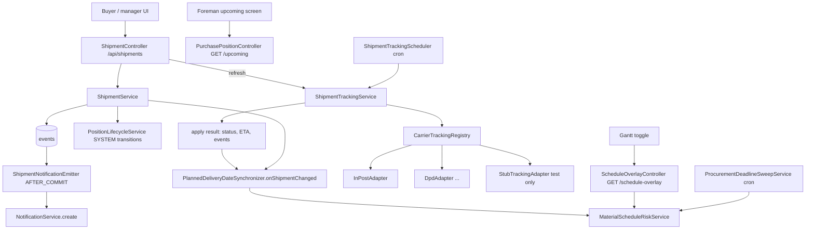

# Design Document: FOR-11-04 — Shipment tracking and delivery schedule

## Overview

FOR-11-04 adds the `Shipment` aggregate, a carrier-tracking SPI with a scheduler and manual refresh,
ETA propagation into the existing `plannedDeliveryDate`, an extended foreman `upcoming` endpoint, a
read-only materials overlay for the Gantt, a deadline sweep and four notifications. It reuses the
FOR-11-00 position machine and `PlannedDeliveryDateSynchronizer`, the FOR-11-03 external orders, the
generic `NotificationService`, the SPI + disabled-fallback pattern of `NipLookupService` /
`BankFeedConnectorRegistry`, the sweep pattern of `PurchaseRequestOverdueSweepService` and the existing
Gantt data (`ProjectScheduleBarEntity`, `ScheduledCategoryService`).

Nothing here touches money, the payment gate, the client-safe surface or the works schedule.

## Architecture



Package layout (backend, `com.foremen`):

- `dao/model`: `ShipmentEntity`, `ShipmentLineEntity`, `ShipmentEventEntity`, enums `DeliveryMethod`,
  `ShipmentStatus`, `ShipmentSource`, `EtaSource`.
- `dao`: `ShipmentDao`, `ShipmentLineDao`, `ShipmentEventDao`.
- `service/procurement/shipment`: `ShipmentService`, `ShipmentRules` (pure), `ShipmentTrackingService`,
  `ShipmentTrackingScheduler`, `TrackingBackoff` (pure), `ShipmentNotificationEmitter`, events.
- `service/procurement/shipment/tracking`: `CarrierTrackingAdapter`, `CarrierTrackingRegistry`,
  `TrackingResult`, `TrackingFailure`, `TrackingUnavailableException`, `TrackingHttpClient`,
  `TrackingProperties`, `adapters/*` (one per carrier with an `ADAPTER` verdict), `StubTrackingAdapter`.
- `service/procurement/schedule`: `MaterialScheduleRiskService`, `WorksStartResolver`,
  `ProcurementDeadlineSweepService`, `ScheduleOverlayService`.
- `controller`: `ShipmentController`; additions to `PurchasePositionController` (`upcoming` params) and
  a new `ScheduleOverlayController` mapped to `/api/purchase-positions/schedule-overlay`.

## Backend

### 1. Data model (changesets 241 to 243)

**241-create-shipments.xml**

```
shipments(
  id, project_id FK NOT NULL, external_order_id FK NULL,
  delivery_method varchar(20) NOT NULL CHECK IN ('CARRIER','SHOP_DELIVERY','PHONE_CONTACT'),
  carrier_code varchar(30), tracking_number varchar(64), tracking_url varchar(1000),
  shop_order_link varchar(1000),
  status varchar(20) NOT NULL DEFAULT 'CREATED'
     CHECK IN ('CREATED','IN_TRANSIT','OUT_FOR_DELIVERY','DELIVERED','EXCEPTION','UNKNOWN','CANCELLED'),
  status_source varchar(10) NOT NULL DEFAULT 'MANUAL' CHECK IN ('TRACKING','MANUAL'),
  eta_date date, eta_time_from time, eta_time_to time,
  eta_source varchar(10) NOT NULL DEFAULT 'TRACKING' CHECK IN ('TRACKING','MANUAL'),
  driver_name varchar(200), driver_phone varchar(40), note varchar(2000),
  shipped_at timestamptz NOT NULL, delivered_at timestamptz,
  last_event_at timestamptz, last_checked_at timestamptz, next_check_at timestamptz,
  consecutive_failures int NOT NULL DEFAULT 0,
  downtime_notified_for date,
  + BaseEntity audit columns)
shipment_lines(id, shipment_id FK, position_id FK, quantity numeric(14,3) CHECK > 0,
  UNIQUE(shipment_id, position_id))
shipment_events(id, shipment_id FK, status varchar(20) CHECK, occurred_at timestamptz,
  source varchar(10) CHECK IN ('TRACKING','MANUAL','SYSTEM'), note varchar(255), created_at)
```

Indexes: `(project_id, status)`, `(status, next_check_at) WHERE delivery_method='CARRIER'`,
`shipment_lines(position_id)`, `shipment_events(shipment_id, occurred_at)`. Cascade delete of lines and
events on shipment delete (shipments are never deleted by the application; CASCADE is for admin cleanup
and tests). A CHECK keeps `eta_time_to >= eta_time_from` when both are set.

**242-seed-shipments-resource.xml**: resource `SHIPMENTS` (two changeSets, guarded by
`onFail="MARK_RAN"` as 229/239), grants as in Requirement 1.

**243-add-position-order-by-notified-for.xml**: `purchase_positions.order_by_notified_for date NULL`.

All three are registered last in `changelog.xml`. Existing databases need no data migration.

### 2. Enums and pure rules (no Spring)

- `ShipmentStatus`: `CREATED, IN_TRANSIT, OUT_FOR_DELIVERY, DELIVERED, EXCEPTION, UNKNOWN, CANCELLED`;
  `isTerminal()` = `DELIVERED | CANCELLED`; `rank()` orders `CREATED < IN_TRANSIT < OUT_FOR_DELIVERY <
  DELIVERED`, `EXCEPTION` and `UNKNOWN` have no rank (never a "forward move" by themselves).
- `ShipmentRules` (pure, unit and property tested):
  - `normaliseTrackingNumber(String)`: trim, remove spaces, upper-case, validate `[A-Z0-9-]{4,40}`.
  - `validateMethod(DeliveryMethod, fields)`: required/ignored fields per method (R3).
  - `capFor(position)`: `orderedQuantity` for `AGREED`/`PACKAGE`, `quantity` for `CLIENT_OWN`.
  - `canShip(path, status)`: the R4.2 table.
  - `mayOverwriteStatus(current, currentSource, incoming)`: `DELIVERED` always; `TRACKING` source
    always; `MANUAL` source only when `incoming.rank > current.rank`.
  - `effectiveEta(List<EtaCandidate>, LocalDate requestDate, boolean hasDelivered, LocalDate current)`:
    the R11.1 recompute.
  - `isDelayed(old, new)`: both non-null and `new >= old + 1 day`.
- `TrackingBackoff` (pure): `nextCheck(now, failures, minInterval, cap)` = `now + min(cap, 1h *
  2^(failures-1))`, monotonic in `failures`; `isDegraded(failures)` = `failures >= 5`.
- `MaterialScheduleRiskService.flags(position, worksStart, today)` (pure core) returns
  `orderByMissed`, `downtimeRisk`, `noArrivalDate`.
- `WorksStartResolver.startDate(anchor, startHalfDays)` = `anchor.plusDays((startHalfDays + 1) / 2 - 1)`
  (integer division), the earliest bar of the category; `null` when anchor or bars are absent. This is
  consistent with `ScheduleCalculator.finishDate(anchor, day) = anchor + (day - 1)` where the day of a
  half-day `h` is `(h + 1) / 2`.

### 3. Position machine addition

`PositionTransitionPolicy` gets one SYSTEM edge in the `AGREED` / `PACKAGE` tail loop:
`system(p, IN_DELIVERY, SUPPLIER_PAID)` (with the comment "FOR-11-04 R6: reversal when the last open
shipment is cancelled"). `PositionStage` needs no change. The service guard (no other Active_Shipment,
`acceptedQuantity = 0`) lives in `ShipmentService`, not in the policy. The existing policy tests are
extended with this edge and a "nothing else changed" assertion over the full edge matrix.

### 4. ShipmentService

`ShipmentService extends ProjectScopedService` (`getProjectIdPath() = "project.id"`), because the list
needs automatic project filtering. Operations (all `@Transactional`):

- `create(request)`: validate method fields and lines (R3, R4), lock the lines' positions with
  `PESSIMISTIC_WRITE` in id order (prevents two buyers overshooting the cap), compute the cap sum from
  active line quantities, save entity + lines + first event, transition `SUPPLIER_PAID` positions to
  `IN_DELIVERY` through `PositionLifecycleService.transition(.., SYSTEM)` one by one, call
  `PlannedDeliveryDateSynchronizer.onShipmentChanged` per position, publish `ShipmentCreatedEvent`,
  and register an after-commit callback that triggers the first refresh for trackable carriers.
- `update(id, request)`: terminal check, field-group clearing on method change, manual ETA / status
  handling (R5), lines only in `CREATED`, synchronizer call for each affected position, audit snapshot.
- `cancel(id)`: R6, including the position reversal and the synchronizer.
- `revertEta(id)`: R5.2.
- `list`, `get`: DTO mapping with localisation; foreman masking of `note`.

`applyTracking(shipmentId, TrackingResult)` is **not** in this class; it lives in
`ShipmentTrackingService` (below) to keep the SPI boundary clear, and calls back into
`ShipmentService.onStatusOrEtaChanged(shipment, actor=null)`.

Shipped quantity per position is a query (`SUM(quantity)` over non-cancelled shipments) used by the
cap check and by the form's "remaining" hint; there is no stored column.

### 5. Carrier-tracking SPI

```java
public interface CarrierTrackingAdapter {
    String code();                        // "INPOST", "DPD", ...
    boolean isEnabled();                  // reads foremen.procurement.tracking.carriers.<code>.enabled
    boolean matches(String number);       // soft pattern check -> trackingNumberSuspect
    String trackingPageUrl(String number);
    TrackingResult fetch(String number) throws TrackingUnavailableException;
}
public record TrackingResult(ShipmentStatus status, Instant lastEventAt, LocalDate etaDate, String eventText) {}
public class TrackingUnavailableException extends Exception { TrackingFailure failure; }
public enum TrackingFailure { NOT_FOUND, RATE_LIMITED, BLOCKED, PARSE_ERROR, TIMEOUT, OTHER }
```

`CarrierTrackingRegistry` collects all `CarrierTrackingAdapter` beans by code (like
`BankFeedConnectorRegistry`); `find(code)` returns `Optional` and filters out disabled adapters, so a
missing, disabled or `OTHER` carrier means "manual only" without special cases elsewhere.

**Configuration** (`TrackingProperties`, `@ConfigurationProperties("foremen.procurement.tracking")`):

```yaml
foremen:
  procurement:
    tracking:
      enabled: ${FOREMEN_PROCUREMENT_TRACKING_ENABLED:false}
      cron: ${FOREMEN_PROCUREMENT_TRACKING_CRON:-}         # recommended: 0 0 8,11,14,17 * * MON-FRI
      zone: ${FOREMEN_PROCUREMENT_TRACKING_ZONE:Europe/Warsaw}
      batch-size: ${FOREMEN_PROCUREMENT_TRACKING_BATCH:200}
      min-shipment-interval: ${FOREMEN_PROCUREMENT_TRACKING_MIN_SHIPMENT_INTERVAL:30m}
      min-call-spacing: ${...:2s}
      refresh-cooldown: ${...:60s}
      carrier-pause: ${...:1h}
      connect-timeout: ${...:5s}
      read-timeout: ${...:10s}
      max-response-bytes: ${...:1048576}
      carriers:
        inpost:  { enabled: ${FOREMEN_TRACKING_INPOST_ENABLED:false} }
        dpd:     { enabled: ${FOREMEN_TRACKING_DPD_ENABLED:false} }
        # one entry per carrier with an ADAPTER verdict
      stub:
        enabled: ${FOREMEN_TRACKING_STUB_ENABLED:false}
    deadline-sweep:
      cron: ${FOREMEN_PROCUREMENT_DEADLINE_SWEEP_CRON:-}
```

As for FOR-11-00, boolean and `Duration` properties have **real defaults** (an empty env value would break
binding) and `docker-compose.yml` maps an empty cron to `-`.

**`TrackingHttpClient`** is the only outbound HTTP component: a JDK `HttpClient` with
`Redirect.NEVER`-style manual redirect check (same host only), timeouts, bounded body reading,
`User-Agent: Foremen-Tracking/1.0 (+contact)`, no body logging. Adapters receive it and a **hard-coded
base URL** (a constant, not configuration), so no user input can select a host (SSRF-safe by
construction). The per-adapter spacing and the carrier pause are kept in an in-memory
`CarrierThrottle` (`ConcurrentHashMap<code, Instant>`); a restart resets it, which is acceptable
because `next_check_at` is persisted.

**Adapter shape.** One class per carrier: `fetchRaw` (HTTP, mechanism from the spike) → `parse(String)`
(pure, fixture-tested) → `TrackingResult`. Status mapping tables live in the adapter and are covered by
fixtures. Unknown carrier wording maps to `UNKNOWN`, never throws.

**Carrier spike (Requirement 8).** The spike is a deliverable file, `carrier-spike.md`, with one section
per carrier: mechanism, URL, number pattern, redacted sample, terms-of-use note, rate-limit observation,
verdict. The adapter tasks depend on the file. Expected starting hypotheses (to be **validated**, not
assumed): InPost has a public tracking page backed by a JSON call and a documented token API (the page
mechanism is chosen only if its terms allow it); DPD, DHL, GLS, UPS and FedEx expose tracking pages
that may be JS-rendered or protected, which would yield `MANUAL_ONLY`; Poczta Polska / Pocztex and Orlen
Paczka are unknown. A `MANUAL_ONLY` verdict is a successful spike outcome.

### 6. ShipmentTrackingService and scheduler

`ShipmentTrackingService.refresh(shipmentId, boolean manual)`:

1. Load the shipment; skip if terminal, not `CARRIER`, or no enabled adapter.
2. Enforce the guards: manual cooldown (60 s from `last_checked_at`, else `429`), minimum shipment
   interval (non-manual), carrier pause and call spacing (`CarrierThrottle`).
3. Call `adapter.fetch(number)` **outside** any DB transaction (a short read transaction before, a short
   write transaction after), so a slow carrier never holds a connection.
4. On success: `apply(shipment, result)` (status per `mayOverwriteStatus`, ETA only if `eta_source =
   TRACKING`, `last_event_at`, `last_checked_at`, failures reset, `next_check_at = now + minInterval`,
   a `TRACKING` event when the status changed, `delivered_at` stamp), then
   `ShipmentService.onStatusOrEtaChanged` (synchronizer + delay/downtime events).
5. On `TrackingUnavailableException`: classify, bump `consecutive_failures` (except young `NOT_FOUND`),
   set `next_check_at = TrackingBackoff.nextCheck(...)`, pause the carrier on `RATE_LIMITED` / `BLOCKED`.
6. Never throws; returns `RefreshOutcome(UPDATED | UNCHANGED | FAILED, reason)`.

`ShipmentTrackingScheduler.run()` is `@Scheduled(cron = "${foremen.procurement.tracking.cron:-}", zone =
"${foremen.procurement.tracking.zone:Europe/Warsaw}")`, a no-op when `enabled=false`. It reads the batch
with `ShipmentDao.findDueForTracking(now, pageable)` (CARRIER, non-terminal, `next_check_at <= now`),
groups by carrier, and calls `refresh(id, false)` sequentially. It is not `@Transactional` itself.

Unit tests: `TrackingBackoff`, `mayOverwriteStatus`, throttle arithmetic; the service is tested with the
`StubTrackingAdapter`.

**`StubTrackingAdapter`** (code `STUB`, enabled only by `foremen.procurement.tracking.stub.enabled=true`):
the number prefix scripts the result, e.g. `STUBTRANSIT*` → `IN_TRANSIT` with ETA today+2,
`STUBLATE*` → `IN_TRANSIT` with ETA today+9, `STUBDELIV*` → `DELIVERED`, `STUBFAIL*` → throws
`TIMEOUT`, `STUBBLOCK*` → throws `BLOCKED`. It lives in `src/main` behind the property (like the bank-feed
stub connector) so the dockerized test scenarios can use it.

### 7. ETA propagation

`PlannedDeliveryDateSynchronizer` gains:

```java
@Transactional
public void onShipmentChanged(Long positionId) { ... }   // R11.1 via ShipmentRules.effectiveEta
```

and `onRequestDateChanged` filters out positions for which
`shipmentLineDao.existsActiveWithEta(positionId)`. `ShipmentService` compares the effective value before
and after (`isDelayed`) and publishes `ShipmentEtaDelayedEvent`; then asks `MaterialScheduleRiskService`
whether the position is at risk and publishes `ShipmentDowntimeRiskEvent` (guarded by
`downtime_notified_for`). All calls happen inside the writing transaction; the emitter runs after commit.

### 8. Upcoming endpoint extension

`UpcomingDeliveriesService` keeps its JPQL for positions. After the position list is loaded, **one
extra query** loads the Active_Shipments for the position ids:

```
SELECT sl.position.id, s FROM ShipmentLineEntity sl JOIN sl.shipment s
WHERE sl.position.id IN :ids AND s.status NOT IN ('DELIVERED','CANCELLED')
```

The service groups in memory, picks the nearest by `etaDate` (nulls last, then id) and fills the new DTO
fields (`shipmentId`, `shipmentStatus`, `deliveryMethod`, `carrierCode`, `etaDate`, `etaTimeFrom`,
`etaTimeTo`, `driverName`, `driverPhone`, `trackingPageUrl`, `shopOrderLink`, `shipmentCount`,
`degraded`). The record keeps its existing component order and appends the new ones, so existing
construction sites in tests are adapted mechanically. The optional `shipmentId` parameter narrows the
position query through a subselect on `shipment_lines`. A reflection test asserts no component name
matches `price|cost|amount|margin|vat|net|gross`.

### 9. Materials overlay

`ScheduleOverlayService.overlay(projectId)`:

1. Project access check through `ProcurementProjectAccess` (same as `upcoming`).
2. Load the project's schedule bars (`ProjectScheduleBarDao`) once, grouping by category: earliest
   `startHalfDays` per category; `anchor = project.getStartDate()`.
3. Load the project's non-cancelled positions with plannedMaterial/producer (one query) and the nearest
   Active_Shipment status per position (the batch query of section 8).
4. Resolve each position's category: `workCategory` if set, else the automatic resolution through
   `ScheduledCategoryService` / `WorkCategoryResolver`.
5. Build `categories[]` (ordered like the schedule rows: `orderNo`) with `worksStartDate` and flags from
   `MaterialScheduleRiskService`; positions without a category go to `unlinked[]`.

The response is a record tree (`ScheduleOverlayView`, `OverlayCategory`, `OverlayPosition`) with no money
fields. The controller is `@RequiresPermission(resource = "PURCHASE_POSITIONS", operation = "READ")`.

### 10. Deadline sweep

`ProcurementDeadlineSweepService.sweep()` (`@Scheduled(cron = "${foremen.procurement.deadline-sweep.cron:-}",
zone = "Europe/Warsaw")`, `@Transactional`):

- **Order-by:** `PurchasePositionDao.findOrderByMissedCandidates(today)` (query in R14.2). For each: stamp
  `order_by_notified_for = orderByDate`, collect `PositionOrderByMissedEvent(positionId, projectId)`.
- **Downtime:** `ShipmentDao.findActiveWithEtaForProjectsWithSchedule()`; per shipment, per line position,
  `MaterialScheduleRiskService.downtimeRisk(...)`; if true and `downtime_notified_for` differs from
  `eta_date`, stamp it and collect `ShipmentDowntimeRiskEvent`.
- Events are published **after** staging all stamps (as `PurchaseRequestOverdueSweepService` does); per
  item failures are caught and logged.

### 11. Notifications

`ShipmentNotificationEmitter` mirrors `ProformaOrderNotificationEmitter` (same private `emit` and
`members(projectId, roleCode)` helpers; the shared parts are copied, not refactored, to keep FOR-11-03
untouched).

| Event | Type | Recipients | Link |
|-------|------|------------|------|
| `ShipmentCreatedEvent` | `notification.shipment.shipped` | ACTIVE `MANAGER` + `FOREMAN` members, minus actor | manager `/deliveries/shipments?shipment={id}`, foreman `/deliveries/upcoming?shipment={id}` |
| `ShipmentEtaDelayedEvent` | `notification.shipment.delayed` | same | same |
| `ShipmentDowntimeRiskEvent` | `notification.shipment.downtimeRisk` | same | same |
| `PositionOrderByMissedEvent` | `notification.position.orderBy` | ACTIVE `MANAGER` members | `/deliveries?project={projectId}` |

Two `emit` calls per event for the shipment types: managers first (manager link), then foremen minus
those already notified (foreman link). The type string equals the frontend i18n key (`t(type)`), body
`null`.

### 12. Access, datasets and the managed-entity checklist

- Controller: `@RestController @RequestMapping("/api/shipments") @PermissionResource("SHIPMENTS")`;
  explicit `@RequiresPermission` on the custom actions: refresh, cancel, revert-eta → `(SHIPMENTS,
  UPDATE)`; create → CREATE; reads → READ. Annotations are complete (no half-annotation at startup).
- `ShipmentService.getProjectIdPath()` = `"project.id"`; the 404-on-no-access rule uses the existing
  `assertProjectAccess`.
- `ShipmentsDataset` in `service/dashboard/dataset/procurement/` with the fields of Requirement 18.2; the
  sensitive-field deny-list test already rejects `phone` / free text names, and the dataset omits them.
- `ProcurementProjectAccess` is unchanged.

### 13. Errors

Keys of Requirement 24 in `messages.properties` / `messages_ru.properties`. Examples (PL / RU):

| Key | PL | RU |
|-----|----|----|
| `error.shipment.notFound` | Przesyłka nie została znaleziona | Отправка не найдена |
| `error.shipment.terminal` | Przesyłka jest zamknięta i nie można jej zmienić | Отправка закрыта и не может быть изменена |
| `error.shipment.position.notShippable` | Pozycja nie jest w etapie umożliwiającym wysyłkę | Позиция не на этапе, допускающем отправку |
| `error.shipment.line.exceedsCap` | Ilość przekracza zamówioną ilość pozycji | Количество превышает заказанное по позиции |
| `error.shipment.line.exceedsOrderLine` | Ilość przekracza ilość w zamówieniu zewnętrznym | Количество превышает количество во внешнем заказе |
| `error.shipment.refresh.tooSoon` | Zbyt częste odświeżanie, spróbuj za chwilę | Слишком частое обновление, повторите позже |
| `error.shipment.refresh.carrierPaused` | Przewoźnik jest chwilowo wstrzymany | Перевозчик временно приостановлен |
| `error.shipment.refresh.notAvailable` | Odświeżanie niedostępne dla tej przesyłki | Обновление недоступно для этой отправки |

(All remaining keys of Requirement 24.2 follow the same pattern and are listed in tasks 6.x.)

## Frontend (inner repo `foremen-frontend/`)

### Structure

```
src/features/shipments/
  api/shipmentsApi.ts, queryKeys.ts, types.ts
  components/ShipmentsPage.tsx, ShipmentFilters.tsx, ShipmentTable.tsx, ShipmentFormDialog.tsx,
             ShipmentDrawer.tsx, ShipmentStatusChip.tsx, ManualEntryForm.tsx, RefreshButton.tsx
  hooks/useShipments.ts, useShipmentMutations.ts, useRefreshCooldown.ts
  lib/paths.ts, carrierLabel.ts, quantityHints.ts
src/features/upcoming-deliveries/
  UpcomingDeliveriesPage.tsx, DeliveryCard.tsx, groupByDate.ts, api/upcomingApi.ts
src/features/schedule-overlay/
  api/overlayApi.ts, MaterialsOverlayToggle.tsx, MaterialsOverlayLane.tsx, overlayGeometry.ts, legend
```

### Routes, navigation and permissions

- `route-permissions.ts`: `/deliveries/shipments`, `/deliveries/shipments/:id` → `SHIPMENTS` READ;
  `/deliveries/upcoming` → `PURCHASE_POSITIONS` READ. `router.tsx` adds the lazy pages next to the
  FOR-11-03 siblings.
- `DeliveriesSectionNav`: add the "Shipments" tab (`SHIPMENTS` READ).
- `navigation.ts`: new item `upcomingDeliveries` (`truck`, `/deliveries/upcoming`); `BOTTOM_NAV_PROFILES`
  FOREMAN → `[ACTIVE_PROJECT, item('staffingGantt'), item('addExpense'), item('upcomingDeliveries')]`
  (four slots, like FINANCIER, so the bar layout already supports it).
- External-order detail: an **"Add shipment"** button for `PAID` orders opening `ShipmentFormDialog` with
  the order and its positions prefilled.

### Shipments page and drawer

TanStack Query with URL-synced filters. The list calls `GET /api/shipments`. `RefreshButton` uses
`useRefreshCooldown` (a countdown seeded from `retryAfterSeconds` or the 60 s default after a success).
The create dialog loads the candidate positions through the existing positions API filtered by project
and stages `SUPPLIER_PAID | IN_DELIVERY | PARTIALLY_RECEIVED`, and shows "shipped / cap" using a
`shippedQuantity` read from the shipments list of the position (`GET /api/shipments?positionId=`); the
cap check itself is server-side, the client hint is advisory.

### Foreman upcoming screen

`UpcomingDeliveriesPage` is mobile-first: sticky header with the days selector, grouped sections
("Overdue", then dates), `DeliveryCard`s as in Requirement 21; `tel:` and external links use
`rel="noopener noreferrer"`. `?shipment=` highlights a card via a scroll-into-view effect.

### Gantt overlay

`MaterialsOverlayToggle` renders in the toolbar of `ScheduleTab` and `PlanActualPanel`, state in
`localStorage` per user. When on, `useScheduleOverlay(projectId)` loads the overlay and
`MaterialsOverlayLane` renders a thin lane under each category row's track using the **same timeline
scale** the Gantt already computes (`lib/timeline`): `overlayGeometry.ts` maps a date to the pixel
offset through the timeline's day width. The lane is positioned inside the existing row container
(`GanttRow` receives an optional `overlay` prop and renders the lane after the bars), so with the toggle
off the DOM is unchanged. Errors render a small inline notice.

### Locale keys (PL and RU at parity; `i18n.keys.test.ts` enforces)

Notification titles (type string = key):

| Key | PL | RU |
|-----|----|----|
| `notification.position.orderBy` | Termin zamówienia materiału minął | Наступил срок заказа материала |
| `notification.shipment.shipped` | Dostawa w drodze | Поставка в пути |
| `notification.shipment.delayed` | Dostawa opóźniona | Поставка задерживается |
| `notification.shipment.downtimeRisk` | Ryzyko przestoju: materiał dotrze po starcie prac | Риск простоя: материал придёт после начала работ |

(Stored in the existing `notifications` group of the locale files, nested as the FOR-11-03 keys are.)

Shipment statuses (`shipments.status.*`): `CREATED` Utworzona / Создана, `IN_TRANSIT` W drodze / В пути,
`OUT_FOR_DELIVERY` Wydana do doręczenia / Передана на доставку, `DELIVERED` Doręczona / Доставлена,
`EXCEPTION` Problem z dostawą / Проблема с доставкой, `UNKNOWN` Nieznany / Неизвестно, `CANCELLED`
Anulowana / Отменена.

Methods (`shipments.method.*`): `CARRIER` Przewoźnik / Перевозчик, `SHOP_DELIVERY` Dostawa sklepu /
Доставка магазина, `PHONE_CONTACT` Kontakt telefoniczny / Телефонный контакт.

Carriers (`shipments.carrier.*`): InPost, DPD, DHL, GLS, UPS, FedEx, Poczta Polska / Pocztex (`Poczta
Polska`), Orlen Paczka, `OTHER` Inny / Другой (brand names identical in both languages).

Other groups with PL / RU values (full list in `tasks.md` task 9.x): `shipments.title` Przesyłki /
Отправки; `shipments.action.refresh` Odśwież teraz / Обновить сейчас; `shipments.action.manual` Wpisz
ręcznie / Ввести вручную; `shipments.action.revertEta` Wróć do daty przewoźnika / Вернуть дату
перевозчика; `shipments.action.cancel` Anuluj przesyłkę / Отменить отправку;
`shipments.action.openTracking` Otwórz stronę przewoźnika / Открыть страницу перевозчика;
`shipments.degraded` Brak danych od przewoźnika, wpisz ręcznie / Нет данных от перевозчика, введите
вручную; `shipments.statusManual` Status wpisany ręcznie / Статус введён вручную;
`upcomingDeliveries.title` Nadchodzące dostawy / Ожидаемые поставки; `upcomingDeliveries.overdue`
Przeterminowane / Просрочено; `upcomingDeliveries.call` Zadzwoń do kierowcy / Позвонить водителю;
`upcomingDeliveries.empty` Brak dostaw w tym okresie / Нет поставок в этом периоде;
`scheduleOverlay.toggle` Materiały / Материалы; `scheduleOverlay.orderBy` Termin zamówienia / Срок
заказа; `scheduleOverlay.arrival` Dostawa / Поставка; `scheduleOverlay.risk` Dotrze {{days}} dni po
starcie prac / Придёт на {{days}} дн. позже начала работ; `nav.upcomingDeliveries` Nadchodzące dostawy /
Ожидаемые поставки; `deliveries.nav.shipments` Przesyłki / Отправки.

## Data model summary

`shipments` 1-n `shipment_lines` n-1 `purchase_positions`; `shipments` 1-n `shipment_events`;
`shipments` n-1 `external_orders` (optional); `shipments` n-1 `projects`. The only column added to an
existing table is `purchase_positions.order_by_notified_for`.

## Error handling

- Validation and stage conflicts: `ForemenApiException` with the `error.shipment.*` keys (400 / 404 /
  409); the refresh cooldown answers `429` with `retryAfterSeconds`.
- Carrier problems never surface as `5xx`: they become `refreshResult = FAILED` with a reason code.
- Notification and scheduler failures are logged and isolated per item.
- Optimistic safety: `create` locks positions in id order; `update` and `cancel` use the entity version
  of `BaseEntity` (conflict → 409).

## Testing strategy

- **Unit (pure):** `ShipmentRules`, `TrackingBackoff`, `WorksStartResolver`, risk flags, effective-ETA,
  policy matrix, DTO reflection guard, locale and message parity.
- **Property (jqwik):** cap invariant, effective-ETA invariant, order-by one-shot, back-off monotonic.
- **Adapter:** fixtures per shipped carrier plus the SPI contract test; no network.
- **Integration (Testcontainers):** create/update/cancel with real transitions; scheduler selection;
  `upcoming` extension; overlay endpoint; deadline sweep idempotence; ABAC grants per role; project
  scope 404.
- **Frontend (vitest):** routes and nav (FOREMAN bottom bar), forms, cooldown, upcoming grouping and
  deep link, overlay toggle and fail-soft, locale parity.
- **E2E:** `test-cases.md` with the `STUB` adapter.

## Assumptions and risks

- **Carrier pages may be unreadable or forbidden.** The spike can end with `MANUAL_ONLY` for most
  carriers; the feature still delivers shipments, manual ETA, upcoming screen, overlay and
  notifications. Parsing can break silently: fixtures catch regressions only for recorded formats, so
  `UNKNOWN` mapping and `degraded` surfacing are mandatory.
- **Terms of use are not verified** (product owner knows); the master switch ships `false`.
- **Single node:** no distributed lock; two nodes would double-fetch (harmless but wasteful).
- **No holiday calendar:** the cron covers weekdays only.
- **`DELIVERED` is not receipt:** the position stays `IN_DELIVERY` until FOR-11-05.
- **Cap for FOR-11-05 re-shipments:** missing or returned units will need a higher cap; FOR-11-05 will
  extend `ShipmentRules.capFor` (documented seam).
- **Overlay accuracy:** the works start is the earliest bar of the category in calendar days from the
  project start; non-working days are not modelled (as in the Gantt itself).
- **Project role codes** `MANAGER` and `FOREMAN` are used for recipients (as `ProformaOrderNotificationEmitter`
  uses `MANAGER`); `FOREMAN` exists in `ProjectMemberService`.
- **`order-by` recipient** is the manager only, per the OVERVIEW; extending to the assigned buyer is a
  one-line change.
