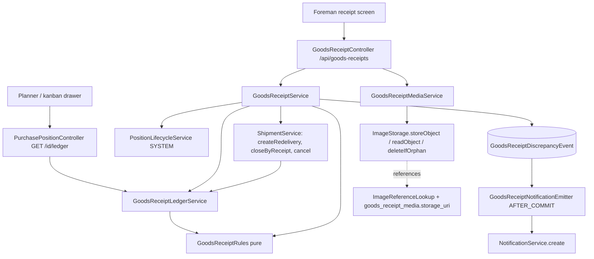

# Design Document: FOR-11-05 — Goods receipt on site

## Overview

FOR-11-05 closes the FOR-11 chain. FOR-11-04 tracks a shipment up to the carrier's claim `DELIVERED`,
which does not change the position. This spec adds the foreman's **item-by-item receipt**: an
append-only `GoodsReceipt` event per position (`ACCEPTED`, `MISSING`, `RETURNED`), a **quantity ledger**
derived from the events, position status derivation through the **existing** SYSTEM edges, automatic
**re-shipment** of released units, **shipment closure** when every line is resolved, photos, one
notification, one dataset and a mobile-first receipt screen.

It reuses `PositionLifecycleService` (SYSTEM transitions, no new edge), `ShipmentService` /
`ShipmentRules` (the documented `capFor` seam), `PlannedDeliveryDateSynchronizer`,
`ProcurementProjectAccess`, `ImageStorage.storeObject` with the `RoomMediaService` upload pattern, the
emitter pattern of `ShipmentNotificationEmitter`, `UserDao.findActiveByRoleCode`, `DatasetRegistry`
and the foreman navigation of FOR-11-04.

Nothing here touches money, the payment gate, the client-safe surface, margin, proformas or external
orders (read-only use of `externalOrder` ids for the order-line check).

### Code facts verified (and corrections to requirements.md)

Checked against the repository; where the code differs from the requirements text, **this design
follows the code** and the correction is listed in the last section.

| Fact | Evidence | Effect |
|------|----------|--------|
| SYSTEM edges `IN_DELIVERY <-> PARTIALLY_RECEIVED`, `IN_DELIVERY/PARTIALLY_RECEIVED <-> RECEIVED` exist for every path | `PositionTransitionPolicy` lines 66 to 70 | No new edge |
| `ShipmentRules.capFor(path, ordered, quantity)` returns `quantity` for `CLIENT_OWN`, else `orderedQuantity`; `canShip` admits `PARTIALLY_RECEIVED`, not `RECEIVED` | `ShipmentRules` | Cap stays as is; the new "committed" quantity is computed beside it |
| The cap check counts **all non-cancelled** shipment lines (including `DELIVERED`), per position and per external order | `ShipmentLineDao.sumActiveQuantityByPositionExcluding` / `...ByOrderExcluding` | Released units must be subtracted in both checks |
| `ShipmentService.moveToInDelivery` is private and moves only `SUPPLIER_PAID`; `reverseToSupplierPaid` checks `acceptedQuantity` and "has a delivered line" | `ShipmentService` | Both get small extensions |
| `ShipmentRules.validateMethod(SHOP_DELIVERY, ...)` accepts a blank link and blank phone (`validateUrl(null)` returns `null`) | `ShipmentRules` | The system re-delivery shipment needs no exception (open point 2) |
| `ShipmentService` does **not** implement `ProjectScopedService`; it scopes by `ProcurementProjectAccess.allowedProjectIds` and answers **404** outside the scope; `ProjectScopedService.denied` is also 404 | `ShipmentService`, `ProjectScopedService` | Scope denial is 404, not 403 (a missing ABAC grant stays 403 from `PermissionInterceptor`) |
| `PositionLifecycleService.transition(.., SYSTEM)` has no scope check and publishes `PositionStatusChangedEvent` | `PositionLifecycleService` | Usable from the receipt service |
| `PurchasePositionService` rejects an API write of `acceptedQuantity` (read-only field) | `PurchasePositionService` line 478 | This spec is the only writer |
| `ImageStorage.storeObject` has no content-type check, derives the extension from `png/jpg/webp/pdf` (else `bin`), and applies the storage size guard (`foremen.image-storage.max-upload-size`, default **5 MB**) | `GcsImageStorage`, `application.yml` line 72 | HEIC is not supported; per-file limit defaults to 5 MB |
| `RoomMediaService` validates declared type **and magic bytes**, streams bytes through `readObject`, deletes objects after commit through `deleteIfOrphan` | `RoomMediaService`, `RoomMediaSupport` | Same pattern |
| `ImageReferenceLookup.IMAGE_COLUMNS` lists every table whose column holds an object key; an unlisted column is **treated as orphan** by `deleteIfOrphan` and by the reconciliation job | `ImageReferenceLookup` | `goods_receipt_media.storage_uri` **must be registered** or photos are reclaimed |
| `ShipmentNotificationEmitter` resolves project members by `projectMemberDao.findByProjectIdWithUserAndRole` with `AssignmentStatus.ACTIVE` and role code `MANAGER` / `FOREMAN`; never throws | `ShipmentNotificationEmitter` | Same pattern; BUYER users via `UserDao.findActiveByRoleCode("BUYER")` |
| `UpcomingDeliveriesService.STAGES` excludes `RECEIVED`; `MaterialScheduleRiskService` excludes `RECEIVED` and `CANCELLED`; the synchronizer keeps the planned date of terminal positions | the three classes | Requirement 6.6 holds with no change |
| `BOTTOM_NAV_PROFILES.FOREMAN` has **four** slots (`ACTIVE_PROJECT`, `staffingGantt`, `upcomingDeliveries`, `addExpense`); `MAX_BOTTOM_SLOTS = 5` | `navigation.ts` | Adding `goodsReceipt` makes five |
| `measurement_units` has only `code`, names and `active`; there is no piece/integer flag, and shipment lines only check scale at most 3 | `MeasurementUnitEntity`, `ShipmentService.validateLineShape` | The "integer for piece units" rule of R4.3 is dropped |
| The last changeset is `243`; `changelog.xml` ends with the 243 include | repo | New: `244`, `245` |
| `ShipmentsDataset` is the template (project path `project.id`, `nullProjectPredicate` for company-wide roles) | `ShipmentsDataset` | Same for `GoodsReceiptsDataset` |

## Architecture



Package layout (backend, `com.foremen`):

- `dao/model`: `GoodsReceiptEntity`, `GoodsReceiptMediaEntity`, enum `ReceiptKind`.
- `dao`: `GoodsReceiptDao`, `GoodsReceiptMediaDao`.
- `service/procurement/receipt`: `GoodsReceiptService`, `GoodsReceiptLedgerService`,
  `GoodsReceiptRules` (pure), `GoodsReceiptMediaService`, `GoodsReceiptNotificationEmitter`,
  `GoodsReceiptDiscrepancyEvent`, `GoodsReceiptProperties`.
- `controller`: `GoodsReceiptController`; one extra handler `GET /{id}/ledger` in
  `PurchasePositionController`; DTOs under `controller/model` (`GoodsReceiptRequest`,
  `GoodsReceiptDto`, `GoodsReceiptBatchResult`, `GoodsReceiptFilter`, `PositionLedgerDto`,
  `ToReceiveDto`, `GoodsReceiptVoidRequest`, `GoodsReceiptMediaDto`).
- `service/dashboard/dataset/procurement`: `GoodsReceiptsDataset`.

Edited existing classes (minimal, listed so reviewers can check requirement 17): `ShipmentService`,
`ImageReferenceLookup`, `ShipmentEntity` (one nullable column), `DatasetCoverage` (unchanged),
`navigation.ts`, `route-permissions.ts`, `router.tsx`, the upcoming-deliveries card, the planner and
kanban drawers. `PositionTransitionPolicy` and `ShipmentRules.capFor` are **not** edited.

## Components and Interfaces

The backend components come first (sections 1 to 9), then the frontend. Table definitions are in
section 1 and summarised under Data Models.

## Backend

### 1. Data model (changesets 244 and 245)

**244-create-goods-receipts.xml**

```
goods_receipts(
  id, project_id FK NOT NULL, position_id FK NOT NULL,
  shipment_id FK NULL,
  kind varchar(10) NOT NULL CHECK IN ('ACCEPTED','MISSING','RETURNED'),
  quantity numeric(14,3) NOT NULL CHECK (quantity > 0),
  from_accepted boolean NOT NULL DEFAULT false,
  comment varchar(2000),
  occurred_at timestamptz NOT NULL,
  received_by bigint NOT NULL FK users,
  client_request_id uuid, part_no smallint NOT NULL DEFAULT 0,
  voided_at timestamptz, voided_by bigint FK users, void_reason varchar(500),
  + BaseEntity audit columns,
  CHECK (kind = 'RETURNED' OR from_accepted = false),
  CHECK ((voided_at IS NULL) = (voided_by IS NULL)),
  CHECK (voided_at IS NULL OR void_reason IS NOT NULL))
goods_receipt_media(id, receipt_id FK ON DELETE CASCADE, storage_uri varchar(512) NOT NULL,
  content_type varchar(100) NOT NULL, size_bytes bigint NOT NULL, file_name varchar(255) NOT NULL,
  + BaseEntity columns)
```

Indexes: `goods_receipts(position_id)`, `(project_id, occurred_at)`, `(shipment_id)`,
`goods_receipt_media(receipt_id)`, and a **partial unique index**
`UNIQUE (client_request_id, part_no) WHERE client_request_id IS NOT NULL`.

`part_no` is an addition to the requirements: when the server splits one request event across several
shipment lines (section 4) the rows share the `client_request_id` and differ by `part_no`, so the
uniqueness still protects a retry.

The same file has a second `<changeSet>` adding **`shipments.origin_receipt_id bigint NULL`** (FK to
`goods_receipts(id)`, `ON DELETE SET NULL`, indexed). It marks the system re-delivery shipment so a void
can find it without parsing the note. Guard: `onFail="MARK_RAN"` with a column-exists precondition.
There is no data migration; existing rows stay `NULL`.

**245-seed-goods-receipts-resource.xml**: resource `GOODS_RECEIPTS` (RU/PL name and description) and
the role grants, two `<changeSet>`s with the `MARK_RAN` `sqlCheck` preconditions of `242`. Grants:

| Role | Operations |
|------|-----------|
| ADMIN | CREATE, READ, UPDATE, DELETE |
| FOREMAN | CREATE, READ, UPDATE |
| MANAGER | CREATE, READ, UPDATE |
| BUYER | READ |
| FINANCIER, WORKER, CLIENT | none |

Both are registered **last** in `changelog.xml`, after `243`, with a short comment per include as the
FOR-11-04 entries have. `DELETE` exists only for the matrix to be complete; no endpoint uses it.

### 2. Enums and pure rules (no Spring)

`ReceiptKind`: `ACCEPTED, MISSING, RETURNED`.

`GoodsReceiptRules` is a final class of static methods (unit and property tested):

```java
record Inputs(BigDecimal cap, boolean hasShipments, BigDecimal shippedGross,
              BigDecimal accepted, BigDecimal missing,
              BigDecimal returnedDoor, BigDecimal returnedAccepted) {}   // events: non-voided sums
record Ledger(BigDecimal cap, BigDecimal acceptedNet, BigDecimal missing, BigDecimal returned,
              BigDecimal outstanding, BigDecimal surplus, BigDecimal inFlight,
              BigDecimal committed, BigDecimal remainder) {}

static Ledger ledger(Inputs in);
static PositionStatus deriveStatus(Ledger l, boolean anyNonVoidedEvent);
static void validateEvent(ReceiptKind kind, BigDecimal quantity, boolean fromAccepted,
                          String comment, Ledger before, BigDecimal lineUnresolvedOrNull);
static boolean canVoid(Set<String> roles, Long authorId, Long userId,
                       Instant occurredAt, Instant now, Duration window);
static boolean lineResolved(BigDecimal lineQuantity, BigDecimal accepted, BigDecimal missing,
                            BigDecimal returnedDoor);
static BigDecimal redeliveryQuantity(Ledger after, BigDecimal releasedByRequest);
static Set<Long> recipients(Set<Long> managers, Set<Long> buyers, Long actor);
static void validateMedia(List<MediaMeta> incoming, int existingCount, MediaLimits limits);
```

**Ledger formulas** (all sums are over non-voided events of one position; `R = returnedDoor +
returnedAccepted`):

```
expected      = hasShipments ? shippedGross : cap          // units we expect on site
shippedEff    = max(0, expected - missing - R)             // units still committed to shipments
acceptedNet   = accepted - returnedAccepted
committed     = max(shippedEff, acceptedNet)
inFlight      = max(0, shippedEff - acceptedNet)           // on shipments, not yet accepted
outstanding   = max(0, cap - acceptedNet)
surplus       = max(0, acceptedNet - cap)
remainder     = max(0, cap - committed)                    // shippable by a new shipment
```

`hasShipments` is true when the position has at least one **non-cancelled** shipment line. With no
events, `committed = shippedGross` and `remainder = max(0, cap - shippedGross)`, which is exactly the
FOR-11-04 cap rule (non-regression, Property 6).

Worked examples (cap 3):

| Events / shipments | acceptedNet | missing | returned | outstanding | inFlight | remainder |
|--------------------|-------------|---------|----------|-------------|----------|-----------|
| line 3; ACCEPTED 1, RETURNED 1 (door), MISSING 1 | 1 | 1 | 1 | **2** | 0 | 2 |
| line 2 (one unit never shipped); ACCEPTED 1, RETURNED 1 (door) | 1 | 0 | 1 | **2** | 0 | 2 |
| line 3; ACCEPTED 3, then RETURNED 1 `fromAccepted` | 2 | 0 | 1 | 1 | 0 | 1 |
| line 3; ACCEPTED 4 (over-delivery) | 4 | 0 | 0 | 0 (`surplus` 1) | 0 | 0 |

`deriveStatus` (R6.1): `acceptedNet >= cap` -> `RECEIVED`; else `anyNonVoidedEvent` ->
`PARTIALLY_RECEIVED`; else `IN_DELIVERY`.

`validateEvent` (400 for shape, 409 for ledger conflicts):

- `quantity > 0` with scale at most 3 (`error.goodsReceipt.quantity.invalid`);
- `fromAccepted` only for `RETURNED` (400 `error.goodsReceipt.fromAccepted.invalid`);
- blank `comment` for `MISSING` / `RETURNED` (`error.goodsReceipt.comment.required`);
- `MISSING` and `RETURNED` with `fromAccepted = false`: `quantity <= inFlight` of the ledger **before**
  the event, and `<= lineUnresolved` when a shipment line is addressed (409
  `error.goodsReceipt.exceedsInFlight`);
- `RETURNED` with `fromAccepted = true`: `quantity <= acceptedNet` (409
  `error.goodsReceipt.returnExceedsAccepted`);
- `ACCEPTED`: no upper bound (over-delivery, R4.5).

The batch applies events in request order and validates each against the ledger updated by the
previous ones, so `[ACCEPTED 1, RETURNED 1, MISSING 1]` is valid.

`redeliveryQuantity(after, released)` = `min(after.remainder, released)` where `released` is the sum of
`MISSING` and door-`RETURNED` quantities recorded **by this request** for the position.

`canVoid` (R5.2): ADMIN or MANAGER at any time; otherwise only the author and only while
`now - occurredAt <= window` (default `PT24H`).

`lineResolved` (R8.6, refined): `accepted + missing + returnedDoor >= lineQuantity`, where the three sums
are the non-voided events linked to that shipment and that position. A `fromAccepted` return does not
resolve anything (it takes accepted units back), so it is excluded.

`validateMedia`: at most `maxPerRequest` (8) files per request, at most `maxPerEvent` (10) per event,
declared type in `{image/jpeg, image/png, image/webp}`, `size <= maxFileSize`, and the declared type
equals the magic-byte sniff (same `sniff` rules as `RoomMediaService`, without PDF).

### 3. GoodsReceiptLedgerService

Read model shared by the receipt service, the `ledger` endpoint and `ShipmentService`:

- `ledgers(Collection<Long> positionIds)` returns `Map<Long, Ledger>` with **three queries**: the
  positions (cap through `ShipmentRules.capFor`), `GoodsReceiptDao.sumsByPosition(ids)` (rows
  `[positionId, kind, fromAccepted, SUM(quantity)]`, non-voided only) and
  `ShipmentLineDao.sumActiveQuantityByPositionExcluding(ids, -1L)` (shipped gross; absence means
  `hasShipments = false`).
- `committed(Collection<Long> positionIds, Long excludeShipmentId)` returns `committed` per position
  with the excluded shipment's lines left out of `shippedGross`. This is what `ShipmentService` uses.
- `releasedByOrder(Long orderId, Collection<Long> positionIds)` returns `MISSING + RETURNED` quantities
  of events linked to shipments of that external order (a new query in `GoodsReceiptDao`).

No money is read or returned anywhere in this service.

### 4. GoodsReceiptService

`@Service`, own project scoping like `ShipmentService` (`PROJECT_ID_PATH = "project.id"`,
`ProcurementProjectAccess.allowedProjectIds`, ADMIN unrestricted, scope denial reads as 404
`error.entity.not.found`). Every write is `@Transactional`.

**`record(GoodsReceiptRequest)`** (R4):

1. Resolve each event's idempotency: events whose `(clientRequestId, part_no = 0)` already exist are
   answered from the stored rows (their parts included) and skipped; the payload of a retry is ignored.
2. Lock the positions of the remaining events with `PESSIMISTIC_WRITE`, ids ascending (the
   `ShipmentService.lockPositions` pattern), and check scope (404) and project consistency.
3. Check the status: `IN_DELIVERY` or `PARTIALLY_RECEIVED`; `RECEIVED` only for `RETURNED` with
   `fromAccepted = true` (409 `error.goodsReceipt.notReceivable`).
4. For each event in order: compute the ledger (the stored events plus the earlier events of the batch),
   run `validateEvent`, then **allocate** to shipment lines:
   - explicit `shipmentId`: must be non-cancelled, in the project and carry a line of the position
     (400 `error.goodsReceipt.shipment.mismatch`); one row;
   - `shipmentId` null and the kind is `ACCEPTED`, `MISSING` or door-`RETURNED`: FIFO over the
     position's non-cancelled shipment lines with unresolved quantity, ordered by `etaDate` (nulls last)
     then shipment id; the quantity is **split** into one row per line (`part_no` 0, 1, ...), and any
     remainder beyond the last line (over-delivery) is stored with `shipment_id = NULL`;
   - `fromAccepted = true` returns are never linked.
5. Save rows with server time (`occurred_at`), `received_by` = the caller, flush.
6. Recompute the ledger, write `PurchasePositionEntity.acceptedQuantity = acceptedNet` through the DAO
   (this service is the only writer), derive the status and call
   `PositionLifecycleService.transition(.., SYSTEM)` when it differs. Legal edges only.
7. **Closure**: for each shipment touched by a row, if it is not terminal and every line satisfies
   `lineResolved`, call `ShipmentService.closeByReceipt(shipmentId)`.
8. **Re-delivery**: for each position with `released > 0` and `hasShipments`, call
   `ShipmentService.createRedelivery(positionId, redeliveryQuantity(...), originReceiptId)` when the
   quantity is positive. One call per position per request (R8.4).
9. Publish one `GoodsReceiptDiscrepancyEvent` per row that is `MISSING`, `RETURNED`, or an `ACCEPTED`
   that leaves `surplus > 0`; audit each row (`CREATE`); return a `GoodsReceiptBatchResult` with the
   rows, the new ledger and status per position and the ids of created re-delivery shipments.

**`void(id, reason)`** (R5): load, scope, `canVoid` (403 `error.goodsReceipt.void.forbidden`), reject a
voided row (409 `error.goodsReceipt.alreadyVoided`), set the void columns, then steps 6 and 7 of
`record` (status and `acceptedQuantity` recomputed; closure is **not** reopened, R8.6). If a shipment
with `origin_receipt_id = id` exists, is `CREATED`, still has the system values (method
`SHOP_DELIVERY`, no link, phone, ETA or driver) and a single line, it is cancelled through
`ShipmentService.cancel`; otherwise the result carries `redeliveryKept = true`. A void never notifies.

**Reads**: `list(filter, pageable)` (Specification with the project scope, `includeVoided` default
false, newest first), `get(id)`, `toReceive(projectId)` (positions in `IN_DELIVERY` /
`PARTIALLY_RECEIVED` with the ledger from `GoodsReceiptLedgerService.ledgers` and the position's
non-cancelled shipments; `DELIVERED` shipments first, then ETA ascending, nulls last, then id). No DTO
carries a price, amount or VAT. `canVoid` is computed per row for the caller so the UI can hide the
button.

### 5. ShipmentService extensions (R8.1, R8.3, R8.6, R8.7, R8.8)

The only edits to FOR-11-04 code, each covered by new tests while the old expectations stay unchanged:

| Change | Detail |
|--------|--------|
| `validateLines` cap check | Replaces `shipped(position) + q <= cap` by `ledgerService.committed(ids, excludeShipmentId) + q <= cap`. Without events `committed = shippedGross`, so results are identical |
| `validateLines` order check | `onOrder(position)` becomes `max(0, onOrder - releasedByOrder)` |
| `moveToInDelivery` | Also moves `PARTIALLY_RECEIVED -> IN_DELIVERY` (edge exists) |
| `reverseToSupplierPaid` | Adds `&& !receiptDao.existsActiveByPositionId(p.getId())` (R8.7) |
| `cancel` | A shipment with a non-voided linked receipt row cannot be cancelled: 409 `error.shipment.hasReceipts` |
| `validateLines` guard | A position with non-voided receipt events and **no** non-cancelled shipment line (a `CLIENT_OWN` position received without a shipment) cannot be put on a new shipment: 409 `error.shipment.position.hasReceipts`, because its ledger runs on the virtual expectation `cap` |
| New `createRedelivery(positionId, quantity, originReceiptId)` | Internal, no ABAC. Builds a shipment with `deliveryMethod = SHOP_DELIVERY`, no link, phone, ETA or driver, status `CREATED`, source `MANUAL`, `note = "Re-delivery after receipt {id}"`, `origin_receipt_id`, the project of the position and the `externalOrder` only when all contributing shipments share one (else `null`). It calls the shared private helpers (`validateLines`, `saveLines`, `moveToInDelivery`, `propagate`, audit) but **does not publish `ShipmentCreatedEvent`**, so the "shipped" notification is not sent; the discrepancy notification covers it |
| New `closeByReceipt(shipmentId)` | Non-terminal shipment: status `DELIVERED`, `statusSource = MANUAL`, `deliveredAt = now`, `nextCheckAt = null`, event `(DELIVERED, SYSTEM, "Closed by goods receipt")`, then `propagate`. A terminal shipment is a no-op |

`ShipmentRules` is unchanged. `PositionTransitionPolicy` is unchanged.

**Why the re-delivery quantity is `min(remainder, released)`, not `remainder`.** In the second worked
example one unit was never shipped. `remainder` is 2 (the returned unit plus the unshipped one), but the
buyer may plan that unit separately. Only the units released by the request (missing or returned) are
re-shipped automatically; the unshipped unit stays visible as `outstanding` and as a manual shipment
candidate. This resolves a gap in R8.2, which spoke of "the outstanding quantity".

### 6. Photos (R7)

`GoodsReceiptMediaService` follows `RoomMediaService`:

- `upload(receiptId, files)`: scope (404), non-voided event, author within the void window or MANAGER /
  ADMIN (the same `canVoid` predicate; 403 `error.goodsReceipt.media.forbidden`), `validateMedia`
  before anything is stored (a rejected request stores nothing), then
  `ImageStorage.storeObject(file, "goods-receipts")`, a row in `goods_receipt_media`, an audit row.
- `content(receiptId, mediaId)`: `ImageStorage.readObject`, returned as bytes with the stored content
  type (503 `error.image.storage.not.configured` when storage is off), exactly as room media.
  A signed URL is not used: it is meant for the private signing bucket and would add an IAM signing
  dependency for a few small images.
- `delete(receiptId, mediaId)`: same permission, row removed, object removed after commit through
  `deleteIfOrphan` (best effort, the reconciliation job reclaims leftovers).
- **`ImageReferenceLookup.IMAGE_COLUMNS` gets `new ImageColumn("goods_receipt_media", "storage_uri")`**
  with a `FOR-11-05` comment. Without it `deleteIfOrphan` and the reconciliation job would treat every
  receipt photo as unreferenced.
- Limits are configuration (`GoodsReceiptProperties`, prefix `foremen.goods-receipt`):
  `media.max-per-request: 8`, `media.max-per-event: 10`, `media.max-file-size: 5MB`,
  `void-window: PT24H`. 5 MB is the storage guard default (`foremen.image-storage.max-upload-size`); a
  larger value needs that variable raised as well. The frontend downscales photos before upload, so 5 MB
  is not a practical limit.
- Allowed types: JPEG, PNG, WebP. **HEIC is not accepted** (`storeObject` would store it as `.bin`).
  The file input uses `accept="image/jpeg,image/png,image/webp"`, which makes iOS Safari deliver JPEG.
- DTOs carry media id, file name, size and content type only; the storage key never leaves the backend.

### 7. Notification (R12)

`GoodsReceiptNotificationEmitter` mirrors `ShipmentNotificationEmitter`:

```java
@TransactionalEventListener(phase = AFTER_COMMIT, fallbackExecution = true)
public void onDiscrepancy(GoodsReceiptDiscrepancyEvent e)
```

Recipients = `GoodsReceiptRules.recipients(managers, buyers, actor)`: ACTIVE `MANAGER` project members
(`projectMemberDao.findByProjectIdWithUserAndRole`) plus all active users of role `BUYER`
(`UserDao.findActiveByRoleCode("BUYER")`), de-duplicated, minus the actor. Type
`notification.receipt.discrepancy`, link `/deliveries/receipt?position={positionId}`, created through
`NotificationService.create(userId, type, null, link)`. Resolution and emission are wrapped in
try/catch with `log.error`; nothing throws. The member lookup is a 15-line private copy of the
FOR-11-04 helper (extracting it would edit a finished emitter for no behavioural gain).

### 8. Access, datasets and the managed-entity checklist (R1, R14)

- Controller: `@RestController @RequestMapping("/api/goods-receipts") @PermissionResource("GOODS_RECEIPTS")`
  with an explicit `@RequiresPermission` on every handler: `POST /` CREATE; `GET /`, `GET /{id}`,
  `GET /to-receive`, `GET /{id}/media/{mediaId}/content` READ; `POST /{id}/void`, `POST /{id}/media`,
  `DELETE /{id}/media/{mediaId}` UPDATE. The ledger handler in `PurchasePositionController` carries
  `@RequiresPermission(resource = "GOODS_RECEIPTS", operation = "READ")`, which takes precedence over the
  class-level `PURCHASE_POSITIONS` resource. No half-annotated handler (`PermissionAnnotationValidator`).
- **Checklist step 4 follows the `ShipmentService` precedent**: the service does not implement the
  `ProjectScopedService` mix-in (it is DTO-based, with no service-model mapper pair) and exposes
  `PROJECT_ID_PATH = "project.id"` plus its own scoping. This is a deliberate deviation from the
  wording of the checklist, already accepted in FOR-11-04.
- `GoodsReceiptsDataset` in `service/dashboard/dataset/procurement/`: code `GOODS_RECEIPTS`,
  `requiredResources = {"GOODS_RECEIPTS"}`, root `GoodsReceiptEntity`, project path `project.id`, default
  date field `occurredAt`, fields `id`, `project.id`, `project.name`, `position.id`, `kind` (ENUM),
  `quantity` (aggregatable), `occurredAt`, and a computed boolean `voided` (`voidedAt IS NOT NULL`,
  filterable and groupable). `comment`, `void_reason`, `client_request_id`, storage fields and user ids are
  not exposed. `nullProjectPredicate` returns `cb.conjunction()` for `BUYER` (company-wide read), as
  `ShipmentsDataset` does for its company-wide roles. Widgets built on it should filter `voided = false`.
- `goods_receipt_media` is **not** a resource, so it needs no `DatasetCoverage` exclusion (R14.3).
  `DatasetCoverageTest` and `SensitiveFieldGuardTest` stay green because `GOODS_RECEIPTS` is covered by a
  dataset and the deny-list fields are absent.

### 9. Errors

`ForemenApiException` keys in `messages.properties` (PL) and `messages_ru.properties` (RU):

| Key | HTTP | PL | RU |
|-----|------|----|----|
| `error.goodsReceipt.notReceivable` | 409 | Pozycja nie jest w etapie odbioru | Позиция не на этапе приёмки |
| `error.goodsReceipt.exceedsInFlight` | 409 | Ilość przekracza ilość w drodze | Количество превышает находящееся в пути |
| `error.goodsReceipt.returnExceedsAccepted` | 409 | Zwrot przekracza przyjętą ilość | Возврат превышает принятое количество |
| `error.goodsReceipt.comment.required` | 400 | Komentarz jest wymagany | Комментарий обязателен |
| `error.goodsReceipt.quantity.invalid` | 400 | Nieprawidłowa ilość | Некорректное количество |
| `error.goodsReceipt.fromAccepted.invalid` | 400 | Flaga dotyczy tylko zwrotu | Признак допустим только для возврата |
| `error.goodsReceipt.shipment.mismatch` | 400 | Przesyłka nie pasuje do pozycji | Отправка не соответствует позиции |
| `error.goodsReceipt.alreadyVoided` | 409 | Wpis został już anulowany | Запись уже аннулирована |
| `error.goodsReceipt.void.forbidden` | 403 | Brak prawa do anulowania wpisu | Нет права аннулировать запись |
| `error.goodsReceipt.media.forbidden` | 403 | Brak prawa do zmiany zdjęć | Нет права менять фото |
| `error.goodsReceipt.media.type` / `.size` / `.count` | 400 | typ, rozmiar, liczba plików | тип, размер, число файлов |
| `error.shipment.hasReceipts` | 409 | Przesyłka ma wpisy odbioru | У отправки есть записи приёмки |
| `error.shipment.position.hasReceipts` | 409 | Pozycja ma wpisy odbioru bez przesyłki | У позиции есть приёмка без отправки |

A missing ABAC grant is 403 (`error.access.denied`, existing); a position, receipt or media id outside
the caller's projects is 404 (`error.entity.not.found`).

## Frontend (inner repo `foremen-frontend/`)

### Structure

```
src/features/goods-receipt/
  api/goodsReceiptApi.ts, queryKeys.ts, types.ts
  components/GoodsReceiptPage.tsx, ToReceiveList.tsx, PositionReceiptCard.tsx, ReceiveSheet.tsx,
             AcceptAllDialog.tsx, ReceiptHistory.tsx, VoidDialog.tsx, LedgerBar.tsx, PhotoPicker.tsx
  hooks/useToReceive.ts, useReceiptHistory.ts, useReceiptMutations.ts
  lib/validateReceipt.ts, downscaleImage.ts, newRequestId.ts
src/features/purchase-planner/ ... LedgerPanel.tsx (read-only, used by the planner and kanban drawers)
```

### Routes, navigation and permissions

- `route-permissions.ts`: `/deliveries/receipt` -> `GOODS_RECEIPTS` READ; `router.tsx` adds the lazy
  page behind the permission guard.
- `navigation.ts`: new item `goodsReceipt` (`/deliveries/receipt`, `matchPrefix`, icon `clipboard-check`,
  label `nav.goodsReceipt`, `GOODS_RECEIPTS` READ). `BOTTOM_NAV_PROFILES.FOREMAN` becomes
  `[ACTIVE_PROJECT, staffingGantt, upcomingDeliveries, goodsReceipt, addExpense]`: **five slots**, the
  current maximum (`MAX_BOTTOM_SLOTS = 5`). Other roles are unchanged.
- The existing `navigation.test.ts` and `BottomNav.test.tsx` are extended, not replaced.

### Receipt screen (mobile-first, 360 px)

`GoodsReceiptPage` has two tabs, **To receive** and **History**, both scoped to the working project.

- `PositionReceiptCard`: material label, unit, `LedgerBar` (accepted / in flight / outstanding),
  shipment chips (status, ETA, carrier code) and the **Receive** button. A `?position={id}` deep link
  scrolls to and highlights the card and opens its history.
- `ReceiveSheet` (bottom sheet): kind selector (Accepted / Missing / Returned), quantity stepper (default
  = `inFlight` for Accepted), a "from already accepted" switch for returns, comment (required for
  Missing and Returned), `PhotoPicker`, Save. `validateReceipt.ts` mirrors `validateEvent` using the
  ledger already on the card (advisory; the server decides).
- **Accept all** on a shipment sends one batch with an `ACCEPTED` event per unresolved line at its
  unresolved quantity, after a confirmation.
- Each event carries a `crypto.randomUUID()` `clientRequestId`; a failed or timed-out Save is retried
  with the same ids (safe retry). After success the card is updated from `GoodsReceiptBatchResult`
  (ledger and status per position) without a reload.
- **Photos**: saved **after** the event. `downscaleImage.ts` resizes to at most 1600 px on the long side
  (JPEG quality 0.8) on a canvas, then `POST /{id}/media`. If the upload fails the event stays and the
  card offers "retry photo" only.
- History rows show kind, quantity, author, time, comment and thumbnails (fetched through the content
  endpoint). Voided rows are struck through with the reason. **Void** opens `VoidDialog` (reason
  required) and is shown only when the DTO says `canVoid`.
- The screen shows no money; the DTOs have none.
- Staff (MANAGER, BUYER) use the same route read-only; BUYER has no Receive or Void actions (no
  `CREATE` / `UPDATE`). Planner and kanban drawers show `LedgerPanel` and the event list through
  `GET /api/purchase-positions/{id}/ledger` and `GET /api/goods-receipts?positionId=`.
- The upcoming-deliveries `DeliveryCard` shows **Receive** when the user has `GOODS_RECEIPTS` CREATE and
  the position status is `IN_DELIVERY` or `PARTIALLY_RECEIVED`; it links to
  `/deliveries/receipt?position={id}`.

### Locale keys (PL and RU at parity)

`goodsReceipt.*` (tabs, card labels, kind names, ledger labels, sheet fields, validation messages, empty,
error and retry states, void dialog, photo hints), `nav.goodsReceipt` (PL "Odbiór dostaw", RU "Приёмка
поставок") and `notification.receipt.discrepancy` (PL "Rozbieżność przy odbiorze dostawy", RU "Расхождение
при приёмке поставки"). `i18n.keys.test.ts` enforces parity; a new `locale-parity.for1105.test.ts` covers
the new groups like the FOR-11-04 one.

## Data Models

`goods_receipts` n-1 `purchase_positions`, n-1 `projects`, n-1 `shipments` (optional), n-1 `users`
(author, voider); `goods_receipt_media` n-1 `goods_receipts`; `shipments.origin_receipt_id` n-1
`goods_receipts` (optional). The only column written on an existing table by this spec is
`purchase_positions.accepted_quantity`; the only column added is `shipments.origin_receipt_id`.

## Correctness Properties

*A property is a characteristic or behavior that should hold true across all valid executions of a system-essentially, a formal statement about what the system should do. Properties serve as the bridge between human-readable specifications and machine-verifiable correctness guarantees.*

Reflection: the ledger identity checks (acceptedNet, outstanding, surplus, no events baseline,
over-delivery, door-return behaviour) collapse into Property 1; the comment, quantity and flag checks
merge into Property 3; the `acceptedQuantity` synchronisation and the void-equals-removal checks merge
into Property 5; the three non-regression checks (cap without events, no events means no change) merge
into Property 6.

### Property 1: Ledger identities

*For any* cap `>= 0`, any `hasShipments` flag, any non-negative shipped quantity and any non-negative
event sums with `returnedAccepted <= accepted`, `GoodsReceiptRules.ledger` SHALL satisfy:
`acceptedNet = accepted - returnedAccepted >= 0`; `outstanding = max(0, cap - acceptedNet)`;
`surplus = max(0, acceptedNet - cap)`; `outstanding > 0` implies `surplus = 0`; `inFlight >= 0`;
`committed = acceptedNet + inFlight`; a door return changes neither `acceptedNet` nor `surplus`; and
every output is non-negative and money-free.

**Validates: Requirements 3.1, 3.2, 3.4, 4.5, 4.6**

### Property 2: Bounds on missing, return and acceptance

*For any* ledger state and any positive quantity `q`: a `MISSING` or door-`RETURNED` event is accepted by
`validateEvent` if and only if `q <= inFlight` (and `<= lineUnresolved` when a line is addressed); a
`RETURNED` event with `fromAccepted = true` is accepted if and only if `q <= acceptedNet`; an `ACCEPTED`
event is always accepted. For *any* generated sequence of events applied through the validator,
`acceptedNet` never becomes negative and `inFlight` never becomes negative.

**Validates: Requirements 3.4, 4.4, 4.5, 4.6**

### Property 3: Event shape validation

*For any* quantity, kind, flag and comment string: `validateEvent` rejects a quantity that is `<= 0` or has
a scale above 3; rejects `fromAccepted = true` on a kind other than `RETURNED`; rejects a blank or
whitespace-only comment for `MISSING` and `RETURNED`; and accepts a missing comment for `ACCEPTED`.

**Validates: Requirements 4.3, 4.7, 2.3**

### Property 4: Status derivation

*For any* ledger and any `anyNonVoidedEvent` flag, `deriveStatus` returns `RECEIVED` if and only if
`acceptedNet >= cap`; otherwise `PARTIALLY_RECEIVED` if and only if an event exists; otherwise
`IN_DELIVERY`. *For any* current status in `{IN_DELIVERY, PARTIALLY_RECEIVED, RECEIVED}` and any derived
status, the pair is either equal (no-op) or an edge that `PositionTransitionPolicy.decide(path, from, to,
SYSTEM)` allows, for every sourcing path.

**Validates: Requirements 6.1, 6.2, 6.3**

### Property 5: Void equals removal and keeps the column in step

*For any* list of events and any subset of them voided, the ledger computed from all events with that
subset marked voided equals the ledger computed from the remaining events alone; and after *any* sequence
of record and void operations the persisted `acceptedQuantity` equals `ledger.acceptedNet`. Voiding the
same event twice is rejected the second time without changing the ledger.

**Validates: Requirements 3.3, 5.1, 5.3, 5.4**

### Property 6: Non-regression of the cap rule

*For any* sourcing path, `orderedQuantity`, `quantity` and any set of non-cancelled shipment line
quantities **without receipt events**, `ledger.committed` equals the summed shipped quantity and
`ledger.remainder` equals `max(0, ShipmentRules.capFor(path, ordered, quantity) - shipped)`; so a new
shipment line is accepted exactly when the FOR-11-04 rule accepted it. *For any* events, `remainder <=
cap` and `remainder >= 0`.

**Validates: Requirements 8.1, 17.1**

### Property 7: Re-delivery quantity

*For any* ledger after a request and any released quantity `released >= 0`, `redeliveryQuantity` equals
`min(remainder, released)`; therefore it is never negative, never exceeds `remainder` or `released`, and
`committed + redeliveryQuantity <= cap`, so creating the re-delivery shipment always passes the extended
cap check. *For any* request with several events of one position, exactly one quantity is computed, from
the final ledger.

**Validates: Requirements 8.1, 8.2, 8.4**

### Property 8: Shipment closure predicate

*For any* line quantity and non-negative `accepted`, `missing`, `returnedDoor` sums linked to that line,
`lineResolved` is true if and only if `accepted + missing + returnedDoor >= lineQuantity`; adding a
`fromAccepted` return never changes the result; and a shipment is closed only when every one of its
lines is resolved.

**Validates: Requirements 8.6**

### Property 9: Idempotent retry

*For any* valid batch, applying it twice with the same `clientRequestId`s yields the same stored rows,
the same ledger and the same response as applying it once; the second application creates no row, no
notification and no shipment.

**Validates: Requirements 4.8**

### Property 10: Batch atomicity

*For any* batch in which one event is invalid (any rejection of Properties 2 or 3, or a status
conflict), applying the batch leaves the stored rows, `acceptedQuantity`, position statuses and shipments
exactly as before.

**Validates: Requirements 4.1, 4.2**

### Property 11: Void permission

*For any* role set, author id, caller id and elapsed time, `canVoid` is true if and only if the caller is
ADMIN or MANAGER, or the caller is the author and the elapsed time is at most the configured window.

**Validates: Requirements 5.2**

### Property 12: Notification recipients

*For any* sets of project managers and buyers and any actor, `recipients` equals `(managers union
buyers) minus {actor}`, contains no duplicate, and is empty-safe; and a discrepancy event is produced
exactly for `MISSING`, `RETURNED`, and `ACCEPTED` events that leave `surplus > 0`.

**Validates: Requirements 12.1, 12.2, 12.3**

### Property 13: Media validation

*For any* list of files with declared type, size and magic bytes, `validateMedia` accepts it if and only if
the count per request is at most 8, the total per event is at most 10, every declared type is JPEG, PNG
or WebP, every size is within the limit and every declared type equals the sniffed type.

**Validates: Requirements 7.2**

## Error Handling

- Validation: 400 with `error.goodsReceipt.*`; ledger and status conflicts: 409; missing grant: 403;
  scope: 404. A batch is one transaction; the first failing event rolls everything back (Property 10).
- Stage and ledger checks run **after** the position lock, so two phones receiving the same position at
  the same time are serialised and the second sees the first one's ledger.
- Notification, closure side effects and object cleanup are best effort: an emitter exception is logged
  and never fails the request; a failed object delete after commit is left to the reconciliation job.
- Storage disabled: photo upload and content answer 503 `error.image.storage.not.configured`; events are
  unaffected.
- Photo upload failure is isolated from the event: the event stays recorded, the client retries the photo.
- A re-delivery that cannot be created (for example the cap check fails because of a concurrent manual
  shipment) fails the whole request with the shipment error key; the foreman retries and the second try
  sees the new shipment. This is rare and keeps the ledger and the shipments consistent.

## Testing Strategy

Property-based testing **applies** to the pure rules (`GoodsReceiptRules`, ledger formulas, validators,
predicates). It does not apply to the controller wiring, schema, storage, notifications delivery or the
React screens; those use example-based and integration tests.

- **Library:** jqwik (already in the backend, `.jqwik-database` is present). Each property is implemented
  by **one** `@Property(tries = 100)` method (more for Properties 1, 2 and 6) in
  `GoodsReceiptRulesPropertyTest`, with a tag comment
  `Feature: FOR-11-05-goods-receipt, Property N: <title>`. Generators produce decimals with scale 0 to 3,
  quantities up to 1000, event sequences up to 20 events and random sourcing paths.
- **Properties 4 and 6** call the real `PositionTransitionPolicy` and `ShipmentRules.capFor`.
  **Properties 5, 9 and 10** run as service tests over an in-memory model of the DAOs (or as
  Testcontainers integration tests with generated small batches); the pure part is covered in the rules
  test.
- **Unit tests:** `GoodsReceiptRulesTest` (worked examples of the table in section 2, every error key),
  `GoodsReceiptServiceTest` (allocation and FIFO split, closure, re-delivery, void with and without
  cancelling the re-delivery, status at `RECEIVED` with a later return), `ShipmentServiceTest` additions
  (old expectations untouched; new tests for `committed`, `moveToInDelivery`, `reverseToSupplierPaid`
  guard, `cancel` guard, `createRedelivery`, `closeByReceipt`), `GoodsReceiptNotificationEmitterTest`,
  `GoodsReceiptMediaServiceTest` (magic bytes, limits, nothing stored on rejection), DTO reflection guard
  (no price, amount, VAT, storage key), message-file parity.
- **Integration (Testcontainers):** record, batch, retry with the same `clientRequestId`, void, closure,
  re-delivery, the permission matrix per role (FOREMAN create and read, BUYER read only, FINANCIER and
  CLIENT 403), project scope 404 for a foreman of another project, `PermissionAnnotationValidator`
  startup, changeset 244 and 245 (schema CHECKs, `MARK_RAN` re-run), `ImageReferenceLookup` returns
  `isReferenced = true` for a stored photo key, `GoodsReceiptsDataset` registered and
  `DatasetCoverageTest` / `SensitiveFieldGuardTest` green.
- **Regression:** the FOR-11-04 shipment tests, the position transition tests and the upcoming tests run
  unchanged.
- **Frontend (vitest):** route and permission guard, navigation and `BottomNav` (FOREMAN five slots, other
  roles unchanged), `validateReceipt` mirrors the server examples, receive sheet flows, accept-all batch,
  retry with the same request ids, photo retry, deep link highlight, void dialog visibility, locale parity.
- **Test execution:** only the affected classes with `--tests`, output redirected to `/tmp/for-11-05-test.log`
  and results read from `build/test-results/test/*.xml` (workspace rule).
- **E2E:** `test-cases.md` (Russian, authored in its own task) with API scenarios against the Docker stack
  (the `STUB` carrier adapter keeps tracking off) and browser scenarios for the receipt screen; run-id
  generator for repeatability; a regression group; the MD report template.

## Decisions on the open points

| # | Open point of requirements.md | Decision |
|---|-------------------------------|----------|
| 1 | `RETURNED` semantics | Keep the **`from_accepted` flag** on `RETURNED` (two meanings, DB CHECK that it is only allowed on `RETURNED`). A fourth kind would change the enum, the dataset and every kind switch for no extra capability. Ledger formulas treat the two cases explicitly (door return releases in-flight units; `fromAccepted` takes units out of `acceptedNet`) |
| 2 | Re-delivery shipment | Created automatically with `SHOP_DELIVERY` and **no** link, phone, ETA or driver. Verified: `ShipmentRules.validateMethod` accepts exactly that, so **no exception for system shipments is needed**. Created only when the position has at least one non-cancelled shipment line, with quantity `min(remainder, released)`; no "nothing in flight" condition, because released units are by definition not in flight. No `ShipmentCreatedEvent` is published |
| 3 | Shipment closure | Closing sets `DELIVERED` (source `MANUAL`, event source `SYSTEM`) when every line satisfies `accepted + missing + returnedDoor >= quantity` of linked events; `fromAccepted` returns do not count. A void does **not** reopen the shipment (the buyer can edit it). An event without `shipmentId` is allocated FIFO to unresolved lines, split over lines when needed, so closure works without the foreman picking a shipment. A shipment with receipt rows cannot be cancelled |
| 4 | Void window and photo limits | Author: 24 hours (`foremen.goods-receipt.void-window`, `PT24H`); MANAGER and ADMIN: always. Photos optional for every kind. Limits are configuration: 8 per request, 10 per event, **5 MB** per file (the storage guard default) instead of 10 MB, with client-side downscaling. HEIC is dropped (see section 6) |
| 5 | Recipients | Active `MANAGER` project members (member lookup as in `ShipmentNotificationEmitter`) plus all active `BUYER` users from `UserDao.findActiveByRoleCode("BUYER")`, de-duplicated, minus the actor. Verified that the DAO method exists |
| 6 | Over-delivery | Accepted and flagged (`surplus`, discrepancy notification). It does not change `orderedQuantity`, `actualPurchasePrice`, margin or the supplier payment |

## Corrections to requirements.md found during verification

These do not need a separate approval round, but `requirements.md` should be aligned when it is next
edited:

1. **R1.5 / R16.2 (403 for another project):** the code answers **404** for a position, shipment or
   receipt outside the caller's projects (`ProjectScopedService.denied`, `ShipmentService.load`). 403 is
   only for a missing ABAC grant. The tests assert 404 for scope and 403 for a missing grant.
2. **R1.4 (`ProjectScopedService`):** `ShipmentService` does not implement it; this spec follows the
   same precedent (section 8).
3. **R4.3 (integer for piece units):** no piece flag exists on `measurement_units`; the rule is dropped.
4. **R4.4 (bound only for `MISSING`):** door-`RETURNED` is bounded by `inFlight` as well, otherwise it
   could release units that were never on a shipment.
5. **R2.1 (unique `client_request_id`):** the index is `(client_request_id, part_no)` because a request
   event can split over several shipment lines.
6. **R7.2 (HEIC, 10 MB):** JPEG, PNG, WebP and 5 MB by default; see section 6.
7. **R7.3 (stream or signed URL):** bytes are streamed through `ImageStorage.readObject`, as for room media.
8. **R8.2 (quantity and in-flight condition):** `min(remainder, released)` without the "nothing in
   flight" condition (open point 2).
9. **R8.5 ("units accepted later" cancels the re-delivery):** only a void cancels it; a re-delivery that
   later receives goods is the vehicle for them.
10. **R8.6 (`ACCEPTED + MISSING + RETURNED`):** `fromAccepted` returns are excluded from line resolution.
11. **R11.1 (FOREMAN has three bottom slots):** it has four; five after this spec, the maximum.
12. **R14.3:** `goods_receipt_media` is not a resource; no `DatasetCoverage` entry.
13. **R2.4 (comment may change):** no endpoint edits a comment; rows are immutable except the void
    columns.
14. **Not in requirements:** `ImageReferenceLookup` registration of `goods_receipt_media.storage_uri` is
    required (section 6), `shipments.origin_receipt_id` is added (section 1), and `ShipmentService` gets
    the extensions of section 5.

## Assumptions and risks

- **Receipt rows are not money events.** Margin keeps using `orderedQuantity` and `actualPurchasePrice`;
  a financial correction after a return is a separate change.
- **A `CLIENT_OWN` position received without any shipment** runs on the virtual expectation `cap`; the
  system does not auto-create a re-delivery for it and refuses a later hand-made shipment while receipt
  events exist (`error.shipment.position.hasReceipts`). The manager records the outstanding units by
  further receipt events instead.
- **Closure is not reversible by a void.** The buyer edits the shipment by hand in that rare case.
- **Two status transitions per request are possible** (derive, then re-delivery moves
  `PARTIALLY_RECEIVED -> IN_DELIVERY`); both are audited through `PositionStatusChangedEvent`.
- **Single transaction size:** a batch from "Accept all" is bounded by the lines of one shipment; no
  paging is needed.
- **Connection:** the screen needs a connection; the `clientRequestId` makes manual retries safe but there
  is no offline queue (out of scope).
- **iOS HEIC behaviour** relies on Safari converting to JPEG when `accept` lists only JPEG, PNG and WebP;
  if a device still sends HEIC, the server answers 400 `error.goodsReceipt.media.type` and the user sees
  the message.
- **`PositionOrderSyncService`** writes `orderedQuantity`; nothing else writes `acceptedQuantity` after
  this spec, so the column cannot drift from the ledger.
