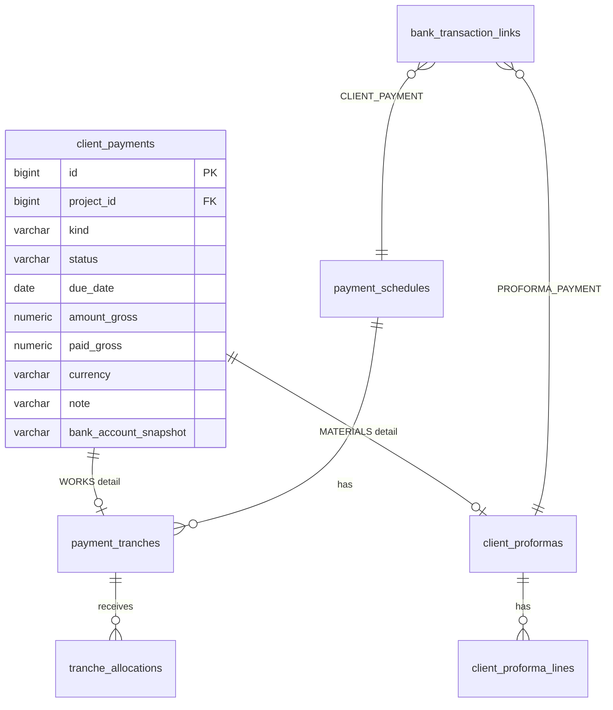

# Design Document: FOR-11-06 — Delivery UX refinements

## Overview

This design changes six areas without touching the FOR-11 principles. Each area reuses what exists:

| Area | Reused | New |
|------|--------|-----|
| Unified client payment | `PaymentTrancheEntity`, `ClientProformaEntity`, `ReconciliationEngine`, `ProformaStatusDeriver`, `BankLinkService`, `ProformaPdfService`, `ProjectScopedService` | `ClientPaymentEntity` base, `ClientPaymentService`, `ClientPaymentController`, `ClientPaymentStatusMapper`, client-safe DTO |
| Project bank account | `CompanyProfileService`, `ProformaHtmlBuilder`, audit log | `projects.bank_account`, `IbanValidator`, `ProjectBankAccountService`, `EffectiveBankAccountResolver` |
| Estimate positions | `MaterialsListService`, `WorkCategoryResolver`, `PurchasePositionService`, `ProjectActivationService` | `EstimateSyncService`, nullable material, `estimate_source_key` |
| Approvals table | `StaffApprovalsView`, send / decide-on-behalf / withdraw services, `SelectionTotalService`, `MaterialPicker`, `PositionVariantService` | thumbnail field, selection bar, two bulk endpoints |
| Buyer | `ExternalOrderService`, `ExternalOrderLifecycleService`, `PositionLifecycleService`, `HideDeliveredFilter`, `ShipmentFormDialog` | `payment_link`, buyer-added endpoint and flagged edge, `QuickPurchaseService` |
| Receipt delegation | `GoodsReceiptService`, `GoodsReceiptNotificationEmitter`, `ProjectMemberDao`, bottom-bar profiles | `goods_receipt_delegations`, `GoodsReceiptDelegationService`, WORKER grant |

**Two repos.** Backend, specs and changesets commit from the workspace root; every `foremen-frontend/` change
commits from inside `foremen-frontend/` (the root repo ignores it).

## 1. Data model

### 1.1 Base table with per-kind detail tables



`client_payments` (changeset 247):

| Column | Type | Notes |
|--------|------|-------|
| `id` | bigint identity PK | the id used by the API |
| `project_id` | bigint NOT NULL FK `projects` | project scope path `project.id`; indexed |
| `kind` | varchar(16) NOT NULL | CHECK `kind IN ('WORKS','MATERIALS')` |
| `status` | varchar(24) NOT NULL | per-kind stored status; CHECK ties values to the kind |
| `due_date` | date | null for a draft proforma |
| `amount_gross` | numeric(14,2) NOT NULL | tranche amount or proforma `total_gross` |
| `paid_gross` | numeric(14,2) NOT NULL DEFAULT 0 | |
| `currency` | varchar(3) NOT NULL DEFAULT 'PLN' | |
| `note` | varchar(1000) | |
| `bank_account_snapshot` | varchar(34) | set when a MATERIALS payment is issued (R4.6) |
| audit columns | | `created_date`, `created_by`, `updated_*` (house pattern) |

Indexes: `(project_id, due_date, id)` for the default list order, `(project_id, kind, status)`.

Detail tables keep their own ids and every existing foreign key:

- `payment_tranches` gets `client_payment_id` (NOT NULL after backfill, unique FK). Columns
  `amount_gross`, `paid_gross`, `due_date`, `status` move to the base row.
- `client_proformas` gets `client_payment_id` (NOT NULL after backfill, unique FK). Columns `status`, `due_date`,
  `total_gross` (-> `amount_gross`), `paid_gross`, `currency`, `note` move to the base row. `number`, `issue_date`,
  `total_net`, `total_vat`, `pdf_object_key`, `pdf_language`, `released_at`, `cancelled_at`, `cancel_reason`,
  `issued_by`, `paid_at` stay on the detail.
- `client_proforma_lines` is unchanged (it keeps `proforma_id`, `position_id`, `material_id`); the spec name
  `client_payment_lines` of the requirements is the same table, **not renamed**, to keep the position links and
  the proforma-lock queries (`ClientProformaLineDao.findActiveByPositionId`) stable.
- `tranche_allocations`, `bank_transaction_links`, `bank_transaction_suggestions` are **unchanged**.

### 1.2 Migration (changeset 247, three changeSets)

1. **Create** `client_payments` and add the nullable `client_payment_id` columns (MARK_RAN if present).
2. **Backfill** in one SQL changeSet, ordered and idempotent:
   `INSERT INTO client_payments (...) SELECT ... FROM payment_tranches t JOIN payment_schedules s ON s.id = t.schedule_id
   WHERE t.client_payment_id IS NULL RETURNING id` is not portable for the update-back, so the backfill uses a
   temporary `legacy_tranche_id` / `legacy_proforma_id` column on `client_payments`, inserts both kinds, updates
   the detail tables by joining on it, then drops the two temporary columns. Statuses are copied as stored
   (`TrancheStatus` is derived on read, so the stored value is copied as is and re-derived by the read path).
3. **Constrain**: set `client_payment_id` NOT NULL, add the unique FKs and the CHECKs.

The old common columns stay in the detail tables as **deprecated, nullable and unwritten** until the cleanup
changeset 253 (task 9.2), after the migration integration test and a staging run have passed.
`ClientPaymentMigrationIntegrationTest` asserts counts and `Σ amount_gross`, `Σ paid_gross` per kind, and that
every `tranche_allocations`, `bank_transaction_links` and `client_proforma_lines` row still resolves.

### 1.3 JPA mapping

`ClientPaymentEntity` (base, `@Entity`, table `client_payments`) with `@OneToOne(mappedBy = "payment")
PaymentTrancheEntity tranche` and `ClientProformaEntity proforma` (exactly one non-null per `kind`).
`PaymentTrancheEntity` and `ClientProformaEntity` keep their ids and add `@OneToOne(optional = false)
@JoinColumn(name = "client_payment_id") ClientPaymentEntity payment`. Their getters / setters for the moved
columns **delegate to `payment`**, so `ReconciliationEngine`, `ProformaStatusDeriver`, `ProformaPaymentService`
and the mappers keep compiling; the moved columns are no longer mapped. This is the single source of truth for
the common fields; no denormalised copy exists.

## 2. Services and status mapping

- `ClientPaymentService` implements `ProjectScopedService<ClientPaymentServiceModel,
  ClientPaymentServiceExtendedModel, ClientPaymentEntity, Long>`, `getProjectIdPath()` = `"project.id"`,
  `allowedProjectIds` through `ProjectAccessCache` (BUYER and FINANCIER widened through
  `ProcurementProjectAccess` exactly as today). It owns `find(Pageable, ClientPaymentFilter)`, `get(id)` and
  delegates writes to the existing services, which are **kept and re-addressed by `payment.id`**:
  `PaymentScheduleService`, `ManualSchedulerService`, `ReconciliationService`, `PaymentTransactionService`
  (works) and `ClientProformaService`, `ProformaIssueService`, `ProformaCancelService`, `ProformaPdfService`
  (materials).
- `ClientPaymentStatusMapper` (pure, property-tested): `(kind, storedStatus, dueDate, today) -> DisplayStatus`,
  plus `overdue(...)`:

| kind | stored | display |
|------|--------|---------|
| WORKS | PENDING | PLANNED |
| WORKS | DUE | DUE |
| WORKS | PARTIALLY_PAID / PAID | PARTIALLY_PAID / PAID |
| WORKS | OVERDUE | OVERDUE |
| MATERIALS | DRAFT | DRAFT |
| MATERIALS | ISSUED | ISSUED, or OVERDUE when `dueDate < today` |
| MATERIALS | PARTIALLY_PAID | PARTIALLY_PAID, or OVERDUE when `dueDate < today` |
| MATERIALS | PAID / CANCELLED | PAID / CANCELLED |

- **List query.** `ClientPaymentQueryService` builds a `Specification<ClientPaymentEntity>` from the filter and
  the audience: `kind` filter, `status` (translated to stored values per kind through the mapper's inverse),
  `overdue`, `dueFrom` / `dueTo`, `query` (`detail.number ILIKE` or `note ILIKE`), project scope, and the
  **role kind rule** (R1.7): FOREMAN `kind = WORKS`; BUYER `kind = MATERIALS`; CLIENT: `WORKS` rows whose
  schedule is `PUBLISHED` plus `MATERIALS` rows with stored status in `ISSUED, PARTIALLY_PAID, PAID`.
  `GET /summary` runs the same specification with `SUM` aggregates. The page is sorted `dueDate ASC NULLS
  LAST, id ASC` (a stable second key).
- **Audience DTO selection.** `ClientPaymentAudienceResolver` (pattern of `PositionAudienceResolver`) returns
  `STAFF` or `CLIENT`. `ClientPaymentAssembler` builds `ClientPaymentDto` (staff) or `ClientPaymentClientDto`
  (client) from the same entity; the controller returns the common supertype `ClientPaymentView`.
- **Bank-ledger links.** `LinkRequest` gains `clientPaymentId` (mutually exclusive with `paymentScheduleId`
  and `clientProformaId`). `BankLinkService.resolveTargets` resolves it: a `WORKS` payment -> kind
  `CLIENT_PAYMENT` with its schedule (the works FIFO decides which tranche is paid, as today); a `MATERIALS`
  payment -> kind `PROFORMA_PAYMENT` with its proforma. **No storage column or CHECK of changeset 238 changes**;
  the old fields stay accepted. The ledger search (`LedgerProcurementTargetSearch`) and
  `ReverseProformaMatcher` read through the proforma detail as before. Both payment paths write the resulting
  `paid_gross` and status to the base row (through the delegating setters).
- **Datasets.** `PaymentSchedulesDataset`, `PaymentTranchesDataset` and `ClientProformasDataset` keep their
  codes, entities and field catalogs; only `requiredResources` becomes `CLIENT_PAYMENTS`.

## 3. API: one controller

`ClientPaymentController`, base path `/api/client-payments`, `@PermissionResource("CLIENT_PAYMENTS")`, every
handler a `@PermissionOperation`. The kind rule of R1.7 is a service-level check on top of the matrix.

| New endpoint | Operation | Old endpoint it replaces |
|--------------|-----------|--------------------------|
| `GET /api/client-payments` | READ | `GET /api/client-proformas` (staff), `GET /api/client-proformas/client/projects/{p}` |
| `GET /api/client-payments/summary` | READ | new |
| `GET /api/client-payments/{id}` | READ | `GET /api/client-proformas/{id}`, `.../client/{id}` |
| `GET /api/client-payments/{id}/pdf` | READ | `.../{id}/pdf`, `.../client/{id}/pdf` |
| `POST /api/client-payments/materials` | CREATE | `POST /api/client-proformas` |
| `PUT /api/client-payments/{id}` | UPDATE | `PUT /api/client-proformas/{id}` (draft MATERIALS) |
| `DELETE /api/client-payments/{id}` | DELETE | `DELETE /api/client-proformas/{id}` (draft) |
| `POST /api/client-payments/{id}/issue` | UPDATE | `POST .../issue` |
| `POST /api/client-payments/{id}/cancel` | UPDATE | `POST .../cancel` |
| `POST /api/client-payments/schedules` | CREATE | `POST /api/payments/schedules` |
| `GET /api/client-payments/projects/{p}/schedule` | READ | `GET /api/payments/projects/{p}/schedule` |
| `GET /api/client-payments/schedules/{s}` | READ | `GET /api/payments/schedules/{s}` |
| `POST /api/client-payments/schedules/{s}/generate` `/publish` `/re-plan` `/tranches` `/tranches/{t}` `/tranches/{t}/remove` `/reorder` `/add-tranche` | UPDATE | the same paths under `/api/payments/schedules/{s}` |
| `POST /api/client-payments/{id}/mark-paid` | UPDATE | `POST /api/payments/tranches/{t}/mark-paid` (id = base id of the tranche) |
| `GET` / `POST /api/client-payments/schedules/{s}/transactions` | READ / UPDATE | `GET` / `POST /api/payments/schedules/{s}/transactions` |
| `POST /api/client-payments/online/initiate` | UPDATE | `POST /api/payments/online/initiate` |

Request and response bodies of the moved actions are unchanged (they reuse the existing models); only the
list and read DTOs are new (`ClientPaymentDto`, `ClientPaymentClientDto`). `BankFeedIngestController`
(`PAYMENTS` today) is re-annotated with `CLIENT_PAYMENTS` UPDATE. OpenAPI and `PaymentsControllersAbacTest` /
`ClientProformaControllersAbacTest` are replaced by `ClientPaymentControllerAbacTest`.

### ABAC matrix (changeset 248)

| Role | Operations | Service-level restriction |
|------|-----------|---------------------------|
| ADMIN | C R U D | none |
| MANAGER | C R U D | none |
| FINANCIER | C R U D | works: all; materials: read only (`error.clientPayment.kind.forbidden`) |
| FOREMAN | R | kind WORKS only |
| BUYER | R | kind MATERIALS only |
| CLIENT | R | client-safe DTO, own projects, visible rows only |

The old rows of `PAYMENTS` and `CLIENT_PROFORMAS` stay in `resources` (history, audit) but the changeset removes
their `role_resources` grants so the matrix editor shows one money resource.

## 4. Project bank account

- `projects.bank_account` (changeset 249). `IbanValidator` (pure): strips spaces, upper-cases, checks
  `^[A-Z]{2}\d{2}[A-Z0-9]{11,30}$`, the country length for a table of common countries (PL 28, DE 22, GB 22,
  ...), and the ISO 7064 mod-97 remainder equal to 1.
- `ProjectBankAccountService.set(projectId, rawIban)` validates, authorizes (ADMIN or `ACTIVE` MANAGER
  member of the project through `ProjectMemberDao.findByUserIdAndProjectId`), saves, writes an audit entry
  (before / after masked to the last four characters) and returns the effective account. The endpoint is a
  separate `PUT /api/projects/{id}/bank-account` on `ProjectController` with `@RequiresPermission(PROJECTS,
  UPDATE)`. `ProjectUpdateRequest` does not carry the field; the project read DTO carries `bankAccount` only
  for ADMIN and MANAGER callers (masked for others as `null`).
- `EffectiveBankAccountResolver.forProject(projectId)`: project account, else `CompanyProfileService`
  account, else null. Used by the payment read assembler (staff `effectiveBankAccount`, client
  `payeeBankAccount`) and by the issue service.
- **Issue.** `ProformaIssueService.issue` stores `bank_account_snapshot` on the base row **before** rendering;
  `ProformaPdfService.buildModel` uses the snapshot of an issued payment and the resolver for a preview. The
  409 `COMPANY_INCOMPLETE` check requires company name, address and NIP, and an effective account.
- **Leak guard.** `ClientProformaClientDtoLeakGuardTest.clientDtoCarriesNoPaymentsOrBankData` is rewritten as
  `ClientPaymentClientDtoLeakGuardTest`: it allows exactly `payeeBankAccount` and still rejects every other
  bank or payment-internal component and the sentinel values in JSON.
- **Datasets.** `SensitiveFieldGuardTest` is unchanged and must stay green: neither `bank_account` nor the
  snapshot is added to any dataset catalog.
- **Frontend.** `ProjectFormSheet` gets a "Bank account" input with an IBAN mask and a zod refinement
  mirroring the backend (`project-schema.ts`); it is disabled unless `canEditBankAccount(user, project)`
  (ADMIN, or MANAGER whose id is an `ACTIVE` MANAGER member). The save calls the dedicated endpoint, not the
  project update.

## 5. Materials matrix: remove finishing

- `MaterialsMatrixService.plannedRows` skips groups with `branch == FINISHING` and records the set of
  finishing material ids; `factLines` drops lines whose `matchedMaterialId` is in that set. The assembler and
  the DTO are unchanged, so `branches` contains `construction` only and the grand totals are construction only.
- `MaterialsMatrixPanel`: render the single construction table without the `Tabs` wrapper; `matrixIsEmpty` and
  `defaultBranch` ignore finishing; `MatrixDashboard` reads the server totals. `CONSUMPTION_BRANCHES` and the
  Zod schema stay tolerant. Locale keys `materialsMatrix.tab.finishing*` are removed in both locales in the
  same change. Rewritten tests: `MaterialsMatrixServiceTest`, `MaterialsMatrixAssemblerPropertyTest`
  (no finishing rows in the output), `materials-matrix-panel.test.tsx`, `no-raw-key.render.test.tsx`,
  `locale-parity.for0605.test.ts`.

## 6. Estimate-driven positions

### 6.1 Schema (changeset 250)

`purchase_positions`: `planned_material_id` becomes nullable; add `estimate_source_key varchar(80)`,
`estimate_changed boolean NOT NULL DEFAULT false`, `estimate_removed boolean NOT NULL DEFAULT false`,
`added_by_buyer boolean NOT NULL DEFAULT false`, `client_unpaid boolean NOT NULL DEFAULT false`. Partial unique
index `uq_purchase_positions_estimate_key ON (project_id, estimate_source_key) WHERE estimate_source_key IS NOT
NULL`. CHECK `ck_position_material_pending`: `planned_material_id IS NOT NULL OR (status = 'PLANNED' AND
estimate_source_key IS NOT NULL)`. A CHECK `ck_position_unpaid_requires_buyer_added`: `NOT client_unpaid OR
added_by_buyer`.

### 6.2 `EstimateSyncService.sync(projectId)`

```
require project ACTIVE
rows = MaterialsListService finishing rows (aggregated over rooms) + placeholder rows (no chosen material)
for row in rows:
    key = row.materialId != null ? "M:" + materialId : "T:" + finishingTypeId
    position = find by (projectId, key)
    if none:  create PLANNED AGREED FINISHING, material = row.material (or null),
              quantity = effectiveTotalQty, unit, prices from the estimate row,
              estimateReference = representative BoM row, work link / dates from WorkCategoryResolver
    else if position.status == PLANNED:  update quantity, unit, prices, dates
    else:  estimate_changed = (quantity or material differs from the estimate)
for position with key not in rows and status != CANCELLED:  estimate_removed = true
return Summary(created, updated, unchanged, flagged)
```

- **Source of rows.** `MaterialsListService.getMaterials(projectId, false)` already returns the reserve-adjusted
  `effectiveTotalQty`, the unit and the price per **chosen** finishing material. Placeholder rows (no chosen
  material) are not guaranteed to be there; task 2.3 reads how the list exposes them and, if needed, adds a
  read-only `placeholders()` method to `MaterialsListService` returning `(finishingTypeId, typeName, unit,
  qty, rangeMin, rangeMax)`; the aggregation formula is **not** duplicated.
- **Validation.** Every BoM row used must belong to the project and to the FINISHING branch; the sync calls the
  same `validateCreate` as the CRUD path (project ACTIVE, material project match, VAT defaults 23 / 8).
- **Triggers.** `ProjectActivationService` publishes a `ProjectActivatedEvent` listener
  `EstimateSyncOnActivation` (best effort, logs and never fails the activation); the button calls
  `POST /api/purchase-positions/sync-from-estimate?projectId=` guarded by `PURCHASE_POSITIONS` CREATE.
- **Pending positions.** Everything that joins `plannedMaterial` becomes a left join (`StaffApprovalQueryService`,
  `ApprovalQueryService`, `PlannerQueryService`, `BoardService`, proforma line snapshot, external order lines,
  shipment and receipt labels). A shared `PositionLabel.of(position)` returns the material label or the type
  name. The services that must **reject** a pending position raise `error.estimateSync.materialRequired`:
  `PositionApprovalService.send`, `ClientProformaService.create`, `ExternalOrderService.applyLines`,
  `ShipmentService.validateLines`. `PurchasePositionService.validateUpdate` allows setting
  `plannedMaterialId` on a pending position while it is `PLANNED`.
- **Index of risk.** The JPQL / Criteria sites that dereference `plannedMaterial` are found with
  `grep -rn "plannedMaterial"` and listed in task 2.4; each gets a test with a pending position.

## 7. Approvals table: thumbnail, selection, bulk actions

- **Thumbnail.** `StaffPositionSource` gains `photo`; `StaffApprovalQueryService` selects it with the
  actual-vs-planned rule used for `model` / `sku`; `StaffViewAssembler` sets `thumbnailUrl =
  ImageStorage.toCdnUrl(photo)`. `ClientViewAssembler` converts `item.photo` to a CDN URL the same way.
  Frontend: a 40 x 40 `img` with `loading="lazy"` and an `alt` of the model, a placeholder icon on null.
- **Selection model.** A hook `useStatusSelection(rows)` holds `selected: Set<positionId>` and derives
  `selectionStatus` (the status of the first ticked row), `isSelectable(row)` (same status, not pending, not
  `allowedActions` empty for the bar action) and `clear()`. The bar component `PositionSelectionBar` is
  generic (props: count, totals, actions) so the buyer board (R11) reuses it.
- **Totals.** `SelectionTotalService` accepts `AGREED` positions in `PLANNED..RECEIVED`; for a missing
  sale price it counts the row in `unpriced`. The response adds `unpriced` and `count`.
- **Bulk endpoints** (`PositionApprovalStaffController`, resource `POSITION_APPROVALS`):
  - `POST /rounds/decide-on-behalf-bulk` (`APPROVE`), body `{items: [{positionId, optionId,
    expectedUnitSalePrice, comment}]}`;
  - `POST /rounds/withdraw-bulk` (`UPDATE`), body `{items: [{roundId}]}`.
  A `BulkExecutor` runs each item through the existing service method in `REQUIRES_NEW` and maps a
  `ForemenApiException` to `{positionId, errorKey}`. Max 200 items (400 above).
- **Actions per status** (frontend table `BULK_ACTIONS`): `PLANNED` -> existing `sendForDecision`;
  `ACCEPTED` -> `createProforma` then navigate to the draft in the `clientPayments` tab;
  `PROPOSED` -> the two bulk endpoints; others none.
- **Replace / choose material.** The row action reuses `MaterialPicker`; for a position with variants or a
  material it calls `variants/replace`; for a pending position it calls `PUT /api/purchase-positions/{id}`
  with `plannedMaterialId`.

## 8. Buyer: payment link, added position, unpaid rule

### 8.1 Payment link (changeset 251)

`external_orders.payment_link varchar(1000)`. `ExternalOrderService` validates with a shared
`HttpUrls.requireHttpUrl` (scheme http or https, host present, length). `ExternalOrderController.Header`
gains `paymentLink`; `PUT /{id}/payment-link` calls `ExternalOrderLifecycleService.setPaymentLink` which allows
`DRAFT` and `SENT_FOR_PAYMENT` and publishes `ExternalOrderPaymentLinkChangedEvent` (emitted only when the order
is `SENT_FOR_PAYMENT` and the value changed). `ProformaOrderNotificationEmitter` gets the listener. The
purchase DTOs for CLIENT, FOREMAN, WORKER do not map the field. Frontend: `ExternalOrderEditor` field,
`FinancierQueueCard` "Pay" button with `safeHttpUrl`.

### 8.2 Buyer-added position

- Endpoint `POST /api/purchase-positions/buyer-added` -> `BuyerAddedPositionService.create`: validates through
  `PurchasePositionService.validateCreate`, sets `sourcing_path = AGREED`, `added_by_buyer = true`,
  `client_unpaid = true`, saves, then `PositionLifecycleService.transitionBuyerAdded(id)`.
- `PositionTransitionPolicy` keeps `decide(path, from, to, actor)` **unchanged**. A new method
  `decideBuyerAdded(from, to)` allows exactly `PLANNED -> WITH_BUYER` for a flagged `AGREED` position; the
  lifecycle service calls it only when `added_by_buyer` is true. The existing gate tests stay; a new
  `PositionTransitionPolicyBuyerAddedTest` pins the one new edge and that an unflagged position still hits the
  gate.
- Optional attach: `externalOrderId` -> `ExternalOrderService.addLine` on a `DRAFT` order of the same project;
  `purchaseRequestId` -> `PurchaseRequestService.attachPositions`.
- `PositionAddedByBuyerEvent` -> `notification.position.addedByBuyer` to project CLIENT and MANAGER members
  (actor excluded). The client link goes to the `positionApprovals` tab; the CLIENT DTO shows the position
  only from the moment it sits in a proforma (the existing `PositionPriceVisibility` and client query keep
  hiding it before; a flagged position has no approval round).

### 8.3 `Delivery_Complete` everywhere

One pure function `PositionDelivery.isComplete(status, clientUnpaid)` and one predicate
`PositionDelivery.completePredicate(root, cb)` replace the bare `status = RECEIVED` at:

| Site | Change |
|------|--------|
| `HideDeliveredFilter.positions()` and `.requests()` | hide only `Delivery_Complete`; a request is COMPLETED only when all non-cancelled positions are complete |
| `PlannerSliceRules` (`PositionSnapshot` gets `clientUnpaid`; `TERMINAL` checks use `isComplete`; `NOT_PAID` includes a received unpaid position; the Criteria predicates mirror) | and the SQL-equivalence test |
| `BoardService` | the `RECEIVED` column hides cards only for complete positions |
| `PurchaseRequestStatusDeriver` | input carries the flag |
| frontend `PlannerDataRow`, `BoardCard`, `StaffApprovalsView` | badge "Delivered, unpaid" |

`UpcomingDeliveriesService` and `GoodsReceiptService.toReceive` do not list `RECEIVED` and are unaffected.

### 8.4 Later payment

- `ClientProformaService.create` accepts a position that is `ACCEPTED`, **or** `client_unpaid` in
  `WITH_BUYER..RECEIVED` with a sale price and sale VAT. `ProformaIssueService` skips the
  `ACCEPTED -> IN_PROFORMA` transition for a flagged position. `ProformaReleaseService` skips
  `IN_PROFORMA -> CLIENT_PAID -> WITH_BUYER` for a flagged position and instead calls
  `ClientUnpaidClearer.clear(positionIds)` (sets `client_unpaid = false`) when the payment becomes `PAID`.
  Cancel leaves the flag. The existing proforma-lock rules (quantity, price, VAT frozen) apply from ISSUED.
- The manager sets the sale price of the buyer-added position with the normal `PUT` (an update is allowed in
  `WITH_BUYER` for price fields while no variants exist).

## 9. Quick purchase

`QuickPurchaseService.createOrders(request)` (`@Transactional`) in `service/procurement/externalorder/`:

1. Load the positions with a lock (ascending id); require one project (`MIXED_PROJECTS` otherwise), status
   `WITH_BUYER`, not on a live order line, not pending, project reachable by the caller.
2. Group by seller: `request.sellerByPosition[id]`, else `request.defaultSellerId`, else the planned material's
   `seller`; a group with no seller -> `error.quickPurchase.sellerRequired` (the UI asks first).
3. For each group create a `DRAFT` order through `ExternalOrderService.create` with the shared header and one
   line per position at the planned purchase price and purchase VAT; an above-ceiling line needs
   `aboveCeilingAcknowledged` from the request or the whole call fails (409 with the position ids).
4. Return `{orders: [{id, sellerId, lineCount}]}`.

`POST /api/external-orders/from-positions` is in `ExternalOrderController` (`EXTERNAL_ORDERS` CREATE,
`requireMoneyAudience`). Frontend: row checkboxes on the buyer board column `Do zamówienia` and on the
buyer planner, `PositionSelectionBar` with "Create purchase", `QuickPurchaseDialog` (sellers, shared header,
ceiling acknowledgements). Shipment form: when an order is selected, `ShipmentPositionsPicker` ticks every row
with a remaining quantity; the route `/deliveries/shipments?new=1&order={id}` opens the dialog preselected.

## 10. Receipt delegation

### 10.1 Schema (changeset 252)

`goods_receipt_delegations(id, shipment_id FK, project_id FK, assignee_id FK users, delegated_by FK users,
delegated_at, status varchar(12), revoked_at, revoked_by, completed_at)` with CHECK on status, a partial
unique index `uq_delegation_active ON (shipment_id) WHERE status = 'ACTIVE'`, indexes on `assignee_id` and
`(project_id, status)`. `goods_receipts.delegation_id` nullable FK (`ON DELETE SET NULL`). The same changeset
(or its second changeSet) seeds the WORKER grant `GOODS_RECEIPTS` `CREATE`, `READ` (MARK_RAN, idempotent).

### 10.2 `GoodsReceiptDelegationService`

- `delegate(shipmentId, assigneeId)`: loads the shipment (project scope), checks the caller (ADMIN or `ACTIVE`
  MANAGER member of the project), checks the shipment is not `CANCELLED` and not closed by receipt, checks the
  assignee through `ProjectMemberDao.findByUserIdAndProjectId`: `assignmentStatus ACTIVE` and project role code
  `WORKER`; revokes an existing `ACTIVE` delegation of the shipment (reassign), inserts the new one, publishes
  `ReceiptDelegatedEvent(newAssignee, previousAssignee, ...)`.
- `revoke(id)`: only ADMIN or the project MANAGER; status `REVOKED`, event.
- `completeForShipment(shipmentId)`: called from `GoodsReceiptService.closeResolvedShipments`; sets
  `COMPLETED`.
- `activeShipmentIdsFor(userId)`: the worker's allowed shipments.
- Emitters (`GoodsReceiptNotificationEmitter` extended): `onDelegated`, `onRevoked`, `onFirstDelegateEvent`
  (published by `GoodsReceiptService.record` the first time an event with a given `delegation_id` is stored).

### 10.3 Access in `GoodsReceiptService`

A private `Audience` = `STAFF` (ADMIN, MANAGER, FOREMAN, BUYER) or `DELEGATE` (WORKER). For `DELEGATE`:

- `record`: every event's `shipmentId` must be a shipment with an `ACTIVE` delegation to the caller; when the
  event has no explicit shipment, the FIFO allocation is restricted to the delegated shipments; otherwise 403
  `error.goodsReceipt.delegation.required`. The stored `delegation_id` is set from the delegation.
- `toReceive`: positions are filtered to those with a line in a delegated shipment; the shipment list inside
  is filtered the same way.
- `list` / `get` / `ledger`: only events of delegated shipments, plus the worker's own events.
- `void`: the existing `canVoid` rule (author within the window) applies; a WORKER is never "always allowed".
- Staff DTOs add `delegatedTo`, `delegationId` and `receivedByName` / `delegatedByName`; the WORKER DTO omits
  prices (the receipt DTOs carry none).

### 10.4 Frontend

`navigation.ts`: `BOTTOM_NAV_PROFILES.WORKER = [ACTIVE_PROJECT, ADD_WORK_REPORT, item('goodsReceipt'),
item('addExpense')]`; the nav item `goodsReceipt` is already gated on `GOODS_RECEIPTS` READ, so the WORKER
grant makes it appear; `route-permissions` already gates `/deliveries/receipt`. `GoodsReceiptPage` needs no
filter of its own (the server filters). Manager side: `DelegateReceiptDialog` (worker picker from the
project's active WORKER members, loaded by the existing project members read) on `ShipmentDrawer` and on the
upcoming card; a "Delegated to {name}" chip in `ShipmentTable` and the receipt history.

## 11. Changesets, tests and files touched

### Changesets (registered last, in order, after 246)

| # | File | Content |
|---|------|---------|
| 247 | `247-create-client-payments.xml` | base table, detail FKs, backfill, constraints (three changeSets) |
| 248 | `248-seed-client-payments-resource.xml` | resource `CLIENT_PAYMENTS`, merged grants, removal of the old grants |
| 249 | `249-add-project-bank-account.xml` | `projects.bank_account` |
| 250 | `250-purchase-position-estimate-and-buyer-flags.xml` | nullable material, keys, flags, CHECKs, partial unique index |
| 251 | `251-add-external-order-payment-link.xml` | `external_orders.payment_link` |
| 252 | `252-goods-receipt-delegations.xml` | table, `goods_receipts.delegation_id`, WORKER grant |
| 253 | `253-drop-legacy-payment-columns.xml` | drops the deprecated common columns (task 9.2, after verification) |

### Tests that change because behaviour changes

- Backend: `PaymentsControllersAbacTest` and `ClientProformaControllersAbacTest` (replaced by
  `ClientPaymentControllerAbacTest`), `ClientProformaClientDtoLeakGuardTest` (replaced as in section 4),
  `PaymentMessagesParityTest`, `ProformaExternalOrderResourcesMigrationIntegrationTest`,
  `DatasetCoverageTest`, `PositionTransitionPolicy*Test` (new flagged edge only), the planner SQL-equivalence
  test, `HideDeliveredFilter` tests, `BoardService` tests, `PurchaseRequestStatusDeriver*Test`,
  `MaterialsMatrix*Test`, `StaffApprovalQueryServiceIntegrationTest`, `GoodsReceipt*IntegrationTest`
  (WORKER grant), `ProformaPdfTest`.
- Frontend: `materials-matrix-panel.test.tsx`, `no-raw-key.render.test.tsx`, `locale-parity.for0605.test.ts`,
  `staffView.test.tsx`, `resolveWorkspaceTabs.property.test.ts`, `resolveActiveTab.property.test.ts`,
  `projectTabMemory.property.test.ts`, `clientProformasTab.for1103.test.ts` (replaced),
  `shipmentFormDialog.test.tsx`, the navigation / bottom-bar tests, `PaymentsTab` tests (moved).
- e2e: `for11/03-payments-proformas/*` re-pointed to the new endpoints and the new tab; new slice
  `for11/06-delivery-ux/`.

## 12. Frontend module layout

- `features/client-payments/` (merged): `api/` (`clientPaymentsApi.ts`, hooks, query keys), `components/`
  (`ClientPaymentsTab`, `ClientPaymentsTable`, `ClientPaymentFilters`, `ClientPaymentDrawer`,
  `PayToBlock`, `ScheduleToolbar` with the generator / manual / publish / re-plan panels moved from
  `project-payments`, `ProformaDraftEditor`, `IssueDialog`, `CancelDialog`, `PdfButton`, `ClientPaymentCards`
  for the client), `lib/` (labels, status chips). `features/project-payments` and `features/client-proformas`
  are deleted after the move.
- `features/position-approval/` gains `PositionSelectionBar`, `useStatusSelection`, `BulkActions`,
  `ThumbnailCell`, `EstimateBadges`, `RefreshFromEstimateButton`.
- `features/purchase-planner/` and `features/external-orders/` gain `QuickPurchaseDialog`; the board column
  gets the selection mode.
- `features/goods-receipt/` gains `DelegateReceiptDialog`, delegate chips.
- `features/projects/` gains the bank-account field.

## 13. Error keys (PL/RU parity in `messages*.properties`)

`error.clientPayment.kind.forbidden`, `error.clientPayment.notFound`, `error.project.bankAccount.invalid`,
`error.project.bankAccount.forbidden`, `error.estimateSync.materialRequired`,
`error.estimateSync.project.notActive`, `error.positionApproval.bulk.tooMany`,
`error.externalOrder.paymentLink.invalid`, `error.externalOrder.paymentLink.locked`,
`error.purchasePosition.buyerAdded.forbidden`, `error.quickPurchase.mixedProjects`,
`error.quickPurchase.sellerRequired`, `error.quickPurchase.aboveCeiling`,
`error.goodsReceipt.delegation.assigneeInvalid`, `error.goodsReceipt.delegation.required`,
`error.goodsReceipt.delegation.shipmentClosed`.

## 14. Risks and open points

1. **Merge depth.** Moving the common columns to the base row touches `ReconciliationEngine`,
   `ProformaPaymentService` and the mappers. The delegating getters and the migration integration test limit
   the blast radius; task 1 ends with a full run of the payment and proforma test classes before any frontend
   work starts.
2. **Nullable material.** The CHECK constraint keeps the null state narrow, but every join over
   `plannedMaterial` must be found and tested (task 2.4). A miss shows up as a missing row in a list.
3. **Placeholders in the estimate.** If `MaterialsListService` cannot expose placeholder rows without
   duplicating its formula, the sync ships first for chosen materials and the placeholder part follows in the
   same spec after the service is extended (task 2.3 decides and records it in the task notes).
4. **Works payments in the client list** require a **published** schedule; a DRAFT schedule never reaches the
   client (the existing publish notification stays).
5. **Client unpaid proformas.** A proforma that contains a flagged, already received position pays for goods
   that are on site; the manager is warned in the proforma editor ("contains delivered items").
6. **WORKER access** is the first time this role reads procurement data; the delegation check is the only
   gate besides the matrix, so it has its own ABAC-style test matrix (R12.4) and a leak test on the DTO.
7. **IBAN scope.** Foreign IBANs are validated by checksum and a length table of common countries; unknown
   countries pass the generic length range. The Polish 26-digit NRB without the `PL` prefix is accepted on
   input and stored with the prefix.
