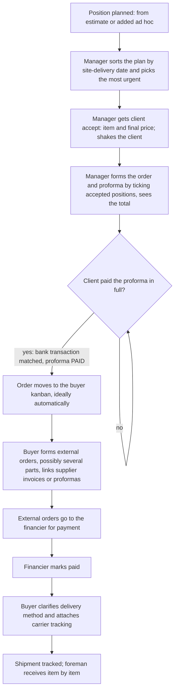
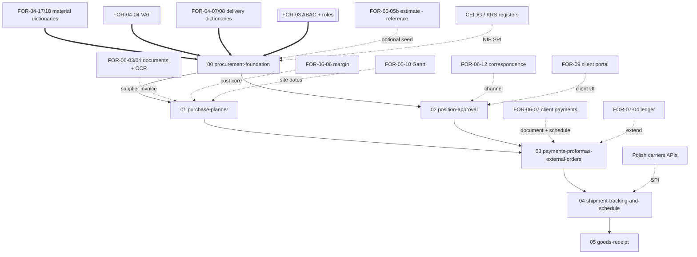

# FOR-11: Delivery Management (procurement, buyer workspace, delivery tracking, site receipt)

> **Status:** parent OVERVIEW + child-spec definitions only (revision 5: full call transcript +
> product-owner decisions; all open questions closed). No child `requirements.md` / `design.md` /
> `tasks.md` exist yet; each child is elaborated separately later. Per the workspace hooks,
> **i18n fields** (`nameRU`/`namePL` variants, UI keys, PL/RU translations) and the **notification
> set** of each child are settled at that child's **requirements** phase. This file records only
> *candidates*.
>
> **Numbering:** `FOR-11` was earlier folded into FOR-06 (payroll) and is free again. This parent
> **supersedes the `FOR-07-07-company-deliveries` placeholder** (the Dostawy menu slot reserved by
> FOR-07-05).
>
> **Out of the call, not in scope here:** the dashboard/widget demo (FOR-10), personal tasks, the AI
> bot. The only dashboard touchpoint is a FOR-10 dataset for the new entities.

## Overview

FOR-11 covers **procurement and delivery** for a project: from "what must be bought" through client
agreement, the manager's proforma, the buyer's external orders, supplier payment by the financier,
shipment and carrier tracking, to the foreman's **item-by-item acceptance on site**.

### How it works today (from the call)

- The **Project Manager** agrees each position with the client **in chat**, then records it (model,
  link to the shop where the price was taken, sale price) in a **Google Drive table**; the client sees
  it read-only and can only comment. Price changes live only in the chat; there is **no client
  "Accept"** in the system.
- A separate **Buyer** buys from the same table **not above the sold price** and may change the shop.
  One manager request can become **several orders / shops / deliveries / invoices**; even one shop may
  need two deliveries. Availability is known only after payment (items vanish, substitutions, **ordered
  15, delivered 17**).
- The client gets a **proforma in advance**, often a **rough reserve for several orders**. Goods are
  **bought at VAT 23% and sold at VAT 8%** (cost 1230 gross, net 1000, client price 1080). The final
  invoice is issued in the **external accounting program** (out of scope).
- Delivery goes **straight to the site** (no warehouse); the process is **per project**.
- A **Bitrix card** is created by hand after agreement (object, expected date, order number, link),
  moved by hand, auto-overdue. **Decision: replace Bitrix completely; no migration of existing cards.**

### Ground rules (product owner)

1. **Estimate materials are reference only.** Any new material can be added to the list, **even one
   that was never in the estimate** (not every work has a material attached).
2. **Material kinds.** The delivery model carries **construction** and **finishing** items from day
   one; "finishing" includes **other purchases such as lighting and sockets**; **furniture** will come
   later (reserve the kind). **Construction-material purchase flow does not change** (FOR-06-03/04/05)
   and **its delivery tracking is not touched in this phase**, but shipments/positions must not
   assume finishing-only.
3. **Reuse the dictionaries**, adding a **project scope** (also drives the buyer kanban).
4. **Maximum reuse** of finished functionality.

### Three sourcing paths

| Path | Meaning | What the client sees | Proforma / gate |
|------|---------|----------------------|-----------------|
| `CLIENT_OWN` | Client bought it himself | **No price needed** | **Skips the proforma gate**: still managed by us (planned, delivery date and method tracked), goes straight to delivery tracking |
| `PACKAGE` | Client chose from the offer package | **No price at all** (inside the package) | **Skips the proforma gate**: goes straight to the buyer |
| `AGREED` | Agreed with the client (links, manager proposals, analogs) | **Only the final price on which the proforma is issued** | Full gate below |

Purchase price is **never** shown to the client. **Substitution by an analog requires full client
acceptance: the item and the price.**

### The main flow (`AGREED` path, product-owner decision)

**Hard rule:** until the client has paid the proforma **in full**, nothing moves on. The manager
works in the overall procurement plan, sees **site delivery dates** (so work is not blocked), sorts
by date and takes the most urgent. The positions are only clicked into a proforma after acceptance.

### Project-scoped materials in the existing dictionary

Verified in the code: `finishing_materials` already has `producer`, `link`, `photo`, `unit`, `model`,
`sku`, prices, `category`/`type`; it has **no `seller` and no project**; `construction_materials`
has a `seller`. Decision: **reuse the dictionaries and add project scope** (nullable `project_id`;
`NULL` = global row, as today).

- Project rows are **hidden from global lists/pickers** and **shown in the planner and buyer kanban**.
- A material can be added to a project at any time, independent of the estimate.
- Add nullable `seller_id` to `finishing_materials`. `construction_materials` gets the same
  `project_id` only if the later construction flow needs it (not in this phase; decide in child 00).
- Details to settle in 00 requirements: whether `category`/`type` stay mandatory for project rows,
  promotion of a project material into the global dictionary, uniqueness.

### Sellers by NIP

All sellers are legal entities (rare exceptions). Flow: type a NIP, search **our `material_sellers`
dictionary first**; if not found, call an **external NIP lookup service** (Polish registers: **CEIDG
for sole traders (JDG)** and **KRS for companies**) and create the seller from the result. Add `nip` to
`material_sellers` (unique where present). Implemented as an SPI (`CompanyRegistryLookup`) with a
disabled fallback, following the project's provider pattern. Notes from the investigation:

- KRS Open API takes the **KRS number** as the key, not NIP, so NIP -> KRS number must be resolved
  first ([KRS API overview](https://companydata.com/krs-api/)). The Ministry of Finance VAT white list
  can resolve a NIP to name, address, REGON and KRS and is free without a key
  ([overview](https://dev.to/bartoszkuc/checking-polish-companies-from-code-vat-krs-regon-eu-vat-rest-python-mcp-2pkc)).
  **The white-list API moved to a new host on 15 Oct 2026 and the old host stops on 1 Dec 2026**
  ([notice](https://dev.to/rostyslab/the-polish-vat-white-list-api-moved-wl-apimfgovpl-stops-on-1-december-2026-2kk9)),
  so the adapter must use the new host.
- CEIDG access needs an API token to be obtained from the official portal (not yet verified).
- **GUS REGON (BIR1) SOAP API** looks up a company by NIP or KRS and covers both sole traders and
  companies; it needs a user key issued by the REGON administrators (client-library docs point to
  regon_bir@stat.gov.pl, [example](https://github.com/espago/gus_bir1)). Candidate primary adapter,
  with CEIDG/KRS for detail; adapter order is decided in child 00.
- CEIDG data comes from the CEIDG data warehouse API v2 (portal `dane.biznes.gov.pl`, docs
  `akademia.biznes.gov.pl/dokumentacja-api-v2`); access needs registration there.
- Not verified here: rate limits, exact CEIDG/KRS/GUS contracts and registration steps; confirm in
  child 00. Credentials are obtained by the product owner; the SPI ships with a disabled fallback.

### Purchase position and its documents

Position fields, as dictated: material **kind** and **group**, concrete **model, link, picture,
seller**; **planned item vs actually purchased item** (unmarked = same); quantities (**agreed,
ordered, shipped, received, missing, returned, accepted net**); prices (**planned purchase, agreed
sale price, actual purchase price, delivery cost allocated to the position**); VAT purchase 23% vs
sale 8% from the VAT dictionary; three dates (**need-by**, **order-by**, **client decision
deadline**); blocks (rough plumbing first); sourcing path; order number (shared across positions of
one order, tracking still per position); delivery form and tracking.

**Delivery cost is allocated to positions proportionally to their cost, for margin calculation.**

Documents (many-to-many with amount/quantity, independent of each other):

| Document | Who | Role |
|----------|-----|------|
| **Internal order / purchase request** | manager -> buyer | Replaces the Bitrix card; grouped by category; released to the buyer **only after the proforma is paid** |
| **Client proforma** | us -> client | Ticked positions, total shown; **the same generated document used today for client payments (works only), extended to carry material purchases**; goes into the client payment schedule |
| **External (supplier) order** | buyer | Several per request; carries supplier invoice/proforma (existing `ProcurementDocument`), **delivery cost and delivery dates**; goes to the financier for payment |

The planner table can be grouped by internal order, external order or proforma with group totals
(external groups: delivery cost and dates); slices: on schedule, late, changed, paid / not paid.

### Quantity handling (partial deliveries and returns)

A position may need **more than one unit** and arrive partly. Example: ordered 3, shipped 2 (1 never
arrived), of 2 received 1 is returned under complaint -> accepted net 1, **outstanding 2**
(1 missing + 1 returned). A complaint **only changes quantities and creates a new delivery** for the
outstanding units; there is no credit-note modelling. Receipt is recorded as events per position
(accepted / missing / returned) so the quantity ledger is derivable and auditable.

### BUYER role (new)

- New role **`BUYER`** with its own access. It sees **all purchases of all projects, even without
  project membership** (company-wide grant via its own ABAC resource, same pattern as FOR-07-03
  `COMPANY_PURCHASES`; the project-scope guard is not relaxed).
- Gets a **purchase kanban** and a **company-wide purchase view with project filters**.
- Sees the sale price as the ceiling for buying; does not edit client-facing documents.
- Needs the usual role scaffolding: role seed, role-resource matrix, **dashboard role defaults**
  (FOR-10 changeset pattern), navigation, mobile bottom bar (FOR-07-05), user form role option.

### Carrier tracking

A **generic tracking service** resolves delivery status **by carrier code** (SPI registry, one
adapter per carrier). **Decision: use the public tracking page every carrier offers for a tracking
number** (no per-carrier contract), with these mechanisms:

- **Scheduler** refreshing open shipments **4 times per working day** (working hours only,
  configurable); shipments in a terminal state are skipped.
- **Manual refresh** per shipment (rate-limited).
- **Manual entry** as the fallback: delivery date/time and driver contact (also for shop delivery,
  phone-only delivery, or when a carrier page fails).
- Scope: **all Polish carriers** (InPost, DPD, DHL, GLS, UPS, FedEx, Poczta Polska/Pocztex, Orlen
  Paczka, others later). One carrier = one adapter: tracking-number pattern, public page/endpoint,
  parser to a normalised status (`CREATED`, `IN_TRANSIT`, `OUT_FOR_DELIVERY`, `DELIVERED`,
  `EXCEPTION`, `UNKNOWN`) and last-event time.
- Child 04 includes a **short spike per carrier** to pick the least fragile public mechanism (public
  JSON endpoint behind the tracking page, official unauthenticated endpoint, or page parsing). Page
  parsing can break and carriers' terms of use may restrict automated access, so the service must
  back off, cache, never hammer, and degrade to manual data. Terms of use per carrier are **not
  verified** and are reviewed in the spike.
- Reference points (to validate in the spike): InPost also has a documented token API
  ([docs](https://dokumentacja-inpost.atlassian.net/wiki/spaces/PL/pages/18153485/Shipment)) that can
  replace its page adapter later; aggregators such as [17TRACK](https://www.17track.net/en/api) and
  [AfterShip](https://www.aftership.com/carriers/dpd-poland) cover InPost PL, DPD Poland, DHL Poland
  and Poczta Polska and remain an optional adapter behind the same SPI.

## Principle: reuse first

| Need | Reused as-is / extended | Where it lives |
|------|--------------------------|----------------|
| Finishing / construction material master data | `FinishingMaterialEntity`, `ConstructionMaterialEntity`, producers, sellers; **add** `project_id` (+ `seller_id`, seller `nip`) | FOR-04-17/18 |
| Packages | `OfferPackageEntity` | FOR-04-10, FOR-05-04/06 |
| Estimate / BoM (reference) | `EstimateLineRoomMaterialEntity` | FOR-05-05/05b |
| VAT | VAT-rate dictionary | FOR-04-04 |
| Delivery dictionaries | `DeliveryCategory`, `DeliveryStatus` (+ statuses by seed only) | FOR-04-07/08 |
| `/deliveries` route, menu slot | Replaced in place | FOR-07-05 |
| Correspondence with client | `ClientMessage*` thread | FOR-06-12 |
| Client portal | Client sees/accepts | FOR-09 |
| Approval pattern | Offer approval rounds (model, not code) | FOR-05-07 |
| Client payment schedule and document | `PaymentSchedule` / `PaymentTranche`, reconciliation, the generated payment document (extended with materials) | FOR-06-07 |
| Supplier invoice and lines | `ProcurementDocument` / `ProcurementLine`, OCR, upload | FOR-06-03/04, FOR-07-03 |
| Payment state of an invoice | `DocumentPaymentStatus` | FOR-07-04 |
| Bank ledger and matching | `BankTransaction*`, `LinkKind`, matcher, accept/search UI | FOR-07-04 |
| Margin | `MarginCostService`, margin matrix | FOR-05-06, FOR-06-06 |
| Gantt | `ProjectScheduleBarEntity`, Gantt, plan/fact | FOR-05-10/10b, FOR-06-02 |
| Company-wide grant pattern | Separate ABAC resource instead of relaxing the guard | FOR-07-03 |
| Provider/SPI + disabled fallback | Pattern from e-signing, bank feed, OCR | FOR-05-08, FOR-07-04 |
| Roles, ABAC, tabs, menu, files, notifications, datasets, dashboard role defaults | existing | FOR-02/03/04/05/06/07/10 |

> **Not rebuilt:** supplier invoice document, OCR, bank matching, correspondence, Gantt, material
> dictionaries, delivery dictionaries, margin, payment-document generation, notifications.
> **New persistence:** purchase position (+ document links), internal order, external order,
> shipment/tracking, goods-receipt events, seller NIP, project scope columns, BUYER role seeds.

## Child specs (preliminary)

| # | Child spec | Type | Area | Reuses / depends on |
|---|------------|------|------|---------------------|
| 00 | `FOR-11-00-procurement-foundation` | backend-first + thin frontend | **Spec ready (requirements/design/tasks/test-cases).** The internal request is named `PurchaseRequest` (resource `PURCHASE_REQUESTS`); the NIP registry seam ships disabled (configurable URL + API key); only `FINISHING` positions are creatable. Also in 00: inline seller quick-create (name + NIP), per-position **variant history**, `hideDelivered` filter, system-owned `plannedDeliveryDate` with the foreman **upcoming deliveries** endpoint, and dashboard widgets (`UPCOMING_DELIVERIES`, `PROCUREMENT_BY_STAGE`, `POSITIONS_WITH_BUYER`) with FOREMAN/MANAGER/BUYER defaults. Project scope on material dictionaries; ad hoc positions outside the estimate; **`PurchasePosition`** (kind CONSTRUCTION/FINISHING, FURNITURE reserved; fields above); **internal order**; position **state machine incl. the proforma-paid gate**; **BUYER role** (seeds, ABAC, company-wide resource, dashboard defaults, nav); seller `nip` and the **NIP lookup SPI** (own dictionary first, then CEIDG/KRS adapters); delivery-status seeds; datasets; managed-entity checklist. | FOR-04-04/07/08/10/17/18, FOR-05-05b, FOR-03, FOR-10 |
| 01 | `FOR-11-01-purchase-planner` | full-stack | **Spec ready (requirements/design/tasks/test-cases); no notifications; grouping by external order / proforma is reserved for 03; the board is read-only; the schedule link is a nullable `work_category_id` on the position (changeset 233).** Manager **planner**: overall plan sorted by site-delivery date, urgent selection, link to the work schedule, tick-to-proforma total; grouping and totals by internal order / external order / proforma; slices (on schedule, late, changed, paid / not); **BUYER kanban** and **company-wide purchase view with project filters**; per-position margin with proportional delivery cost; purchase price hidden from client roles; replaces `/deliveries` placeholder. **Added after 00 revision:** the planner table gets a **"hide delivered" switcher (default ON, remembered per user)** over the 00 `hideDelivered` parameter; the position form embeds the 00 **`SellerPicker`** (inline seller creation by name + NIP); the main row shows only the current material option and a **variant-history expander** (pick a known analog via the 00 variants/suggestions API). | 00, FOR-06-03/04, FOR-07-03, FOR-06-06 |
| 02 | `FOR-11-02-position-approval` | full-stack | **Spec ready (requirements/design/tasks/test-cases).** **Client agreement as approval rounds** (`PROPOSAL`, `ANALOG`, `PACKAGE_CHOICE`, `CLIENT_SUGGESTION`, `CLIENT_OWN`) that drive the 00 SYSTEM edges `PLANNED -> PROPOSED -> ACCEPTED` and the 00 variant replace; blocks with a decision deadline (derived `overdue` flag only, no automation, seam for FOR-06-08); explicit **Accept with fixed item and price** (the server compares the price the client saw, plus a stale check); an analog needs acceptance of the item **and** the price (also after `ACCEPTED`, back to `PROPOSED`); client **own link** suggestion; **"buying myself"** (path becomes `CLIENT_OWN`); package choice **without prices**; a manager can record a decision **on behalf** of the client. **The client logs in now:** new ABAC resource `POSITION_APPROVALS` (CLIENT: READ + APPROVE) and a **client-safe backend surface** with separate client DTOs that hold no purchase-side field, admin-only `internal*` fields, a reflection leak guard and a sentinel JSON test; `PositionPriceVisibility` lets a CLIENT see `salePrice` from `PROPOSED`. **Client UI inside the project workspace** (tab `positionApprovals`, mobile-first) plus the manager's staff view; discussion stays in the FOR-06-12 thread (a button, no schema change). **Six notifications** (the five candidates plus `suggestionReceived`). The FOR-09 portal shell stays a separate spec. | 00, FOR-06-12, FOR-05-07, FOR-06-08 (later) |
| 03 | `FOR-11-03-payments-proformas-external-orders` | full-stack | **Proforma** from ticked positions using the FOR-06-07 payment-document generator extended with materials; paid state drives the gate; **external orders** (buyer links supplier invoices/proformas, several per request) and the **financier payment hand-off**; FOR-07-04 extension (new link kinds, both-direction matching, accept/search); lists of client proformas and our invoices. | 00, 01, FOR-06-07, FOR-07-04, FOR-06-03/04 |
| 04 | `FOR-11-04-shipment-tracking-and-schedule` | full-stack | **Shipment** per position/order part; **generic carrier-tracking service** resolving status by carrier code through each carrier's public tracking page (SPI), **scheduler 4x per working day**, **manual refresh**, **manual date/time and driver contact**; **short spike per Polish carrier**; shop-order link or phone contact; **materials vs works Gantt overlay** for manager (order-by) and foreman (arrival vs works); the **foreman's "upcoming deliveries" screen** (mobile list over the 00 `upcoming` endpoint, later fed by shipment ETAs through the same `plannedDeliveryDate` synchronizer). | 03, FOR-05-10/10b, FOR-06-02 |
| 05 | `FOR-11-05-goods-receipt` | full-stack (mobile-first) | **Receipt events** per position (accepted / missing / returned) with the quantity ledger (multi-unit, partial cases), photos, comments; returns and missing units open a **new shipment**. Foreman bottom-bar entry. | 04, FOR-04-17, FOR-07-05 |

## Dependency graph

## Recommended order

1. **00**. 2. **01** and **02** (02 can start right after 00). 3. **03** (needs 01 and 02). 4. **04**.
5. **05**.

## Preliminary i18n and notification candidates

> Candidates; confirmed at each child's requirements phase.

**Entity i18n:** existing dictionaries keep `nameRU`/`namePL`; new delivery statuses need both. The
new `BUYER` role needs RU/PL names and description. Project-scoped materials follow the existing
pattern (model/SKU/link are free text). Positions, orders, shipments, receipts hold user data (not
i18n); enum labels (sourcing path, kind, receipt result, overdue) are frontend keys. Key groups
(PL + RU parity): `procurement.*`, `purchasePlanner.*`, `buyerKanban.*`, `positionApproval.*`,
`clientProformas.*`, `externalOrders.*`, `shipments.*`, `goodsReceipt.*`; menu reuses `nav.deliveries`.

**Notification candidates (generic service only):**

| Candidate | Recipient | Trigger | Child |
|-----------|-----------|---------|-------|
| `notification.position.decisionRequested` | client | manager asks to decide by a deadline | 02 |
| `notification.position.clientOwn` | PM, buyer | client marked "buying myself" | 02 |
| `notification.position.accepted` / `.rejected` / `.analogProposed` | PM / client | client decision; analog proposed | 02 |
| `notification.position.suggestionReceived` | PM | client proposed an own link (added in 02) | 02 |
| `notification.position.orderBy` | PM | order-by date reached | 04 |
| `notification.order.releasedToBuyer` | BUYER | proforma fully paid, order moved to the buyer kanban | 03 |
| `notification.externalOrder.sentForPayment` | FINANCIER | buyer submitted an external order | 03 |
| `notification.externalOrder.paid` | BUYER | financier marked paid -> add delivery method and tracking | 03 |
| `notification.proforma.paid` | PM | proforma covered by incoming payment | 03 |
| `notification.invoice.matchProposed` | FINANCIER | bank transaction got a proposed match | 03 |
| `notification.request.overdue` | BUYER, PM | expected date passed | 00 |
| `notification.shipment.shipped` / `.delayed` | foreman, PM | dispatched; expected date later | 04 |
| `notification.shipment.downtimeRisk` | foreman, PM | arrival after start of dependent works | 04 |
| `notification.receipt.discrepancy` | PM, BUYER | missing or complaint recorded | 05 |

## Boundaries

| Area | Owner | FOR-11 rule |
|------|-------|-------------|
| Construction-material purchase flow and matrix | FOR-06-03/04/05 | Unchanged; their delivery tracking not touched now |
| Estimate, BoM, packages | FOR-04/05 | Reference only |
| Dictionaries | FOR-04 | Project scope column; project rows hidden globally |
| Bank ledger | FOR-07-04 | Extended, not duplicated |
| Client payment schedule/document | FOR-06-07 | Document generator extended with materials |
| Correspondence | FOR-06-12 | Reused; no second chat |
| Client portal | FOR-09 | Client views; FOR-11 supplies endpoints |
| Accounting program / final invoice | external | Out of scope |
| Bitrix | external | Replaced; no migration |

## Open questions

None blocking. Closed in revision 5:

1. A materials proforma is a tranche of a new `MATERIALS` kind produced by the same generator as the
   FOR-06-07 payment document.
2. `PACKAGE` and `CLIENT_OWN` skip the "proforma paid" gate (package goes straight to the buyer,
   client-own straight to delivery tracking).
3. External order "paid": set by the financier by hand **or** automatically by the linked outgoing
   bank transaction (FOR-07-04); the ledger link wins.
4. Carrier status comes from the public tracking page (scheduler 4x per working day, manual refresh,
   manual entry).
5. CEIDG / GUS REGON credentials are obtained by the product owner; SPIs ship with a disabled
   fallback until the keys exist.
6. The notification candidate set above is confirmed.

Remaining details (field-level i18n, exact state names, NIP adapter order, per-carrier terms of use)
are settled in the children's requirements phases.

---

*Updated when child specs of FOR-11 are added, changed or completed.*
