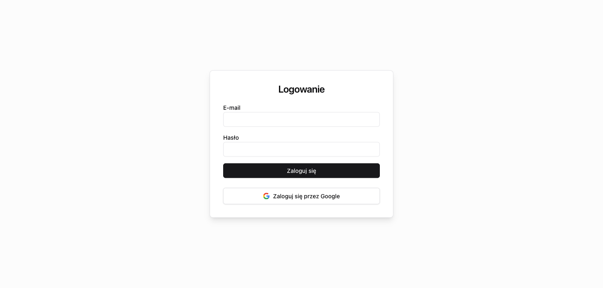
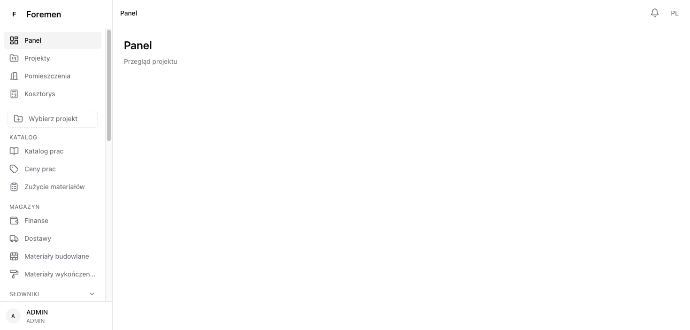
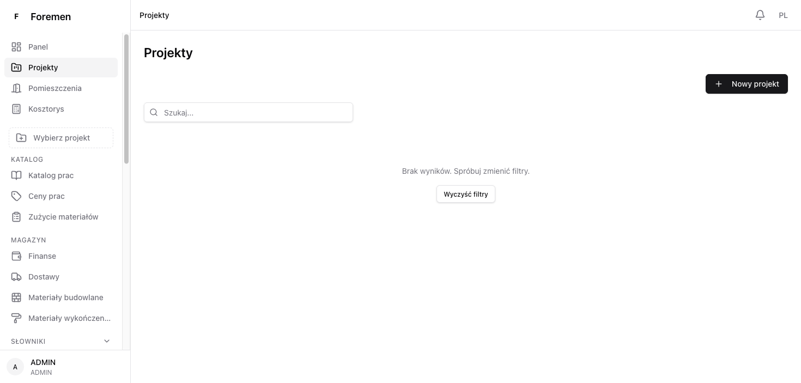
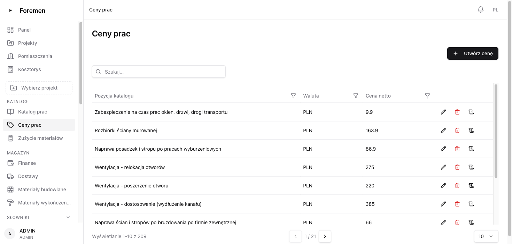
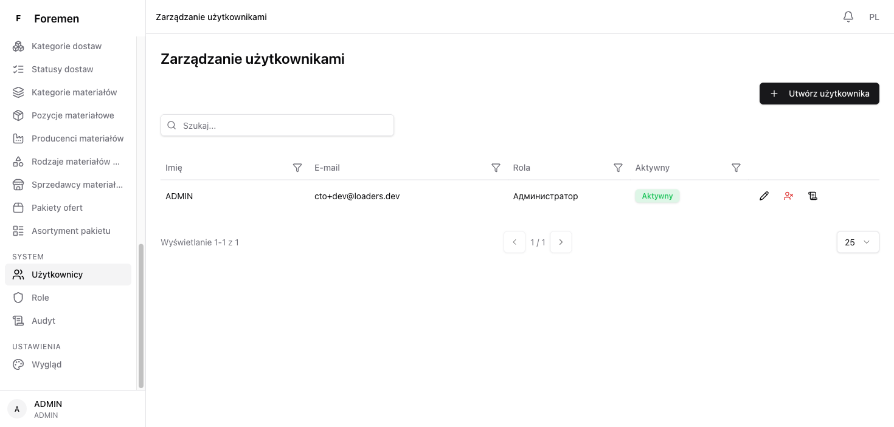
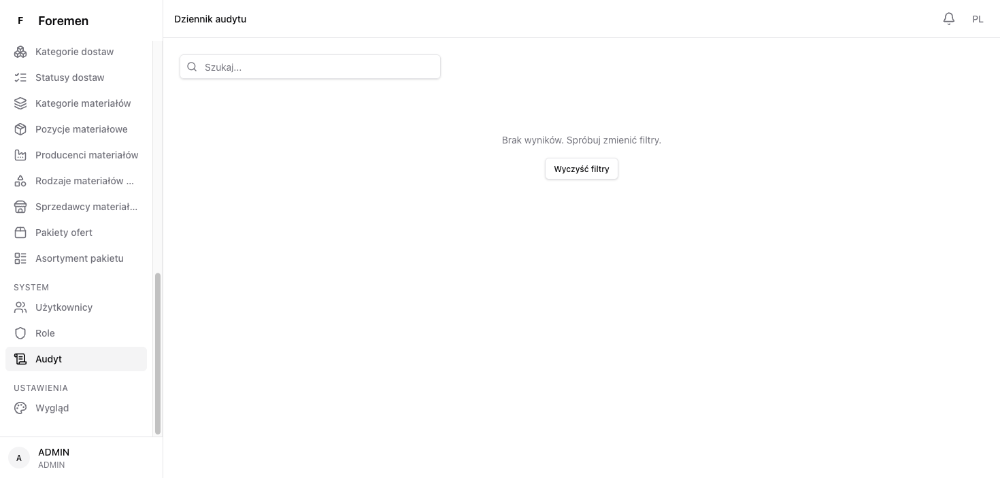

# Foremen DEV — Environment Checkup Report

**Date:** 2026-10-06
**Environment:** dev (GCP project `starry-tracker-505110-s3`, VM `foremen-dev`, `europe-central2-a`)
**Public URL:** http://34.116.142.204/ (HTTP only — no TLS on the bare IP yet)
**Tested as:** `cto+dev@loaders.dev` (role **ADMIN**)
**Tool:** Playwright (headless browser), live against the running environment
**Scope note:** read-only walkthrough — **no projects or other entities were created**, per request.

---

## Verdict: ✅ PASS

The dev environment is fully operational. Login works, the admin sees the full
role-appropriate UI, every visited section loaded real data, all API calls
returned success, and there were **zero console errors** across the session.

---

## Infrastructure state at test time

| Component | Status |
|-----------|--------|
| `backend` container  | Up (healthy) — deployed by Cloud Build |
| `frontend` container | Up (healthy) — deployed by Cloud Build |
| `postgres` container | Up (healthy) |
| Public root `/`      | HTTP 200 |
| `/api/auth/me`       | HTTP 401 unauthenticated / 200 after login |

---

## Checks performed

| # | Check | Result | Evidence |
|---|-------|--------|----------|
| 1 | Login page renders (PL i18n) | ✅ | Fig. 1 |
| 2 | Admin login succeeds, redirects to dashboard | ✅ | Fig. 2 |
| 3 | Full nav tree visible for ADMIN (Katalog, Magazyn, Słowniki, System, Ustawienia) | ✅ | Fig. 2 |
| 4 | Role shown in sidebar + topbar (ADMIN) | ✅ | Fig. 2 |
| 5 | Projects list loads (empty list, read-only) | ✅ | Fig. 3 |
| 6 | Work Prices catalog loads seeded data (Excel import) | ✅ | Fig. 4 |
| 7 | Users list shows bootstrapped admin (ADMIN, Aktywny) | ✅ | Fig. 5 |
| 8 | Audit log page loads | ✅ | Fig. 6 |
| 9 | All `/api/*` calls return 200 | ✅ | network log below |
| 10 | Zero browser console errors | ✅ | console log |

---

## API calls observed (all successful)

```
POST /api/auth/login                 => 200
GET  /api/auth/me                    => 200
GET  /api/notifications              => 200
GET  /api/notifications/unread-count => 200
GET  /api/users/1/display-preferences=> 200
GET  /api/projects?...               => 200
GET  /api/work-prices?...            => 200
GET  /api/users?...                  => 200
GET  /api/audit?...                  => 200
```

> Three initial requests (`/api/notifications`, `/unread-count`,
> `/display-preferences`) appear once as `ERR_ABORTED` then immediately succeed.
> This is the frontend's deliberate request-cancellation-on-navigation behaviour
> (requests aborted during the auth/redirect transition and retried) — not an
> error. Confirmed by the matching 200s that follow.

## Console

`Total messages: 0 (Errors: 0, Warnings: 0)` across the whole session.

---

## Screenshots

### Fig. 1 — Login (PL)


### Fig. 2 — Dashboard (ADMIN, full navigation)


### Fig. 3 — Projects (read-only, none created)


### Fig. 4 — Work Prices catalog (seeded from Excel)


### Fig. 5 — Users (bootstrapped admin present)


### Fig. 6 — Audit log


---

## Notes / caveats (unchanged from infra setup)

- **No HTTPS.** Served over `http://` on the VM's public IP; the browser marks it
  "not secure" and credentials travel in clear. TLS arrives with `dev.foremen.eu`.
- **Admin credentials** live in Secret Manager (`foremen-dev-admin-password`); they
  were read only to perform this login and are not reproduced in this report.
- The checkup was read-only; no data was created, so project-scoped flows
  (estimate/offer inside a real project) were not exercised here by design.
