# Role timelines

One ordered list for the whole project, grouped by phase. Each step has one role. The step ID (`L01` …
`L48`) is the execution order and appears in the test title. `Mode` is `UI` for browser steps through the
real screens, or `API` for calls made with the role's own bearer token. `Needs` lists the steps that must
pass first. If one fails, the dependent step is reported **BLOCKED** and not run.

`WORKAROUND` marks a step that moves the lifecycle forward a different way than the spec describes. `BLK-1`
is the expired Google Cloud Storage credential. Defect IDs are in `BUG-REPORT.md`.

Status below is from the final validation run, `run-19`: 51 PASS, 0 WORKAROUND, 0 FAIL, 0 BLOCKED. Earlier runs (run-11) showed the defects that are now fixed.

## Phase 1: Foundation and project creation

| ID | Role | Mode | Step | Expected | Result | Needs |
|---|---|---|---|---|---|---|
| L01 | ADMIN | UI | Signs in and sees the System menu. | Użytkownicy, Role and Audyt are visible. | PASS | — |
| L02 | ADMIN | API | Creates the project with six team members and an existing CLIENT. | 201, DRAFT, all six team members present. | PASS | — |
| L03 | ADMIN | UI | Opens the new project's workspace. | Name and status Szkic are shown. The project list is paged, so the workspace is used instead. | PASS | L02 |

## Phase 2: Design, rooms and estimate

| ID | Role | Mode | Step | Expected | Result | Needs |
|---|---|---|---|---|---|---|
| L04 | MANAGER | UI | Signs in and opens the project. | Six design tabs are visible. | PASS | L03 |
| L05 | MANAGER | API | Creates two rooms. | 200 for each. | PASS | L02 |
| L06 | ESTIMATOR | API | Tries to create a room, then reads the estimate. | 403 on create, 200 on read. | PASS | L05 |
| L07 | ESTIMATOR | API | Adds a priced line and room quantities. | 200, total above 0. | PASS | L05 |
| L08 | FOREMAN | API | Tries to add an estimate line. | 403, read-only. | PASS | L07 |

## Phase 3: Offer and client approval

| ID | Role | Mode | Step | Expected | Result | Needs |
|---|---|---|---|---|---|---|
| L09 | SALESMAN | API | Prepares an offer from the estimate. | 200, DRAFT. | PASS | L07 |
| L10 | MANAGER | UI | Sends the offer from the Oferty tab. | Status Wysłana. | PASS | L09 |
| L11 | MANAGER | API | Reads the project status after the send. | OFFERED. | PASS (BUG-01 fixed) | L10 |
| L12 | ESTIMATOR | API | Adds an estimate line after the send. Edits stay allowed while the offer is out. | 200. | PASS | L10 |
| L13 | CLIENT | UI | Opens the offer and presses Zatwierdź. | Offer APPROVED, read back through the API. | PASS | L10 |
| L14 | FINANCIER | API | Tries to approve the offer. | 403, read-only. | PASS | L13 |

## Phase 4: Team, schedule and contract

| ID | Role | Mode | Step | Expected | Result | Needs |
|---|---|---|---|---|---|---|
| L15 | MANAGER | API | Adds a WORKER and assigns a work category. | 201, then 200. | PASS | L02 |
| L16 | MANAGER | API | Auto-creates the schedule. | 200, crew size 1 or more. | PASS | L15 |
| L17 | MANAGER | API | Lists signable document types to make a contract. | 200 with CONTRACT_WORKS. | PASS (BUG-03 fixed) | L02 |
| L18 | SALESMAN | API | Tries to create a contract. | 403 from the signing guard. | PASS (O-1) | L02 |
| L19 | MANAGER | API | Creates the CONTRACT_WORKS draft and generates the body. | 200, 200. | PASS | L13 |
| L20 | MANAGER | API | Requests the client signature. | 200, PENDING_SIGNATURES. | PASS (BLK-1 resolved) | L19 |
| L21 | CLIENT | API | Uploads the signed scan (OTP sign-in). | 200. | PASS | L20 |

## Phase 5: Activation

| ID | Role | Mode | Step | Expected | Result | Needs |
|---|---|---|---|---|---|---|
| L22 | MANAGER | API | Reads the project after the contract is signed (no force). | ACTIVE, activated by the signed contract. | PASS | L21, L13, L15, L16 |
| L12b | ESTIMATOR | API | Adds a line to the estimate of the ACTIVE project. | 409 error.estimate.locked (TC-LOCK-01). | PASS (BUG-02 fixed) | L22 |
| L23 | MANAGER | UI | Opens the workspace of the active project. | Aktywny shown. Four execution tabs visible. | PASS | L22 |
| L24 | MANAGER | UI | Opens the team tab of the active project. | Team tab is reachable. | PASS | L23 |

## Phase 6: Execution

| ID | Role | Mode | Step | Expected | Result | Needs |
|---|---|---|---|---|---|---|
| L25 | WORKER | API | Submits a work report for a room. | 200, one report. | PASS | L22, L15 |
| L26 | WORKER | API | Tries to approve the report. | 403. | PASS | L25 |
| L27 | FOREMAN | API | Approves the report. | 200. | PASS | L25 |
| L28 | MANAGER | UI | Opens Plan/wykonanie. | Completion above 0%. | PASS | L27 |
| L29 | MANAGER | API | Generates and publishes a three-tranche schedule. | 200 each, three tranches. | PASS | L22 |
| L30 | FINANCIER | API | Records a manual payment of 100 against the schedule. | 200. | PASS | L29 |
| L31 | CLIENT | UI | Posts a question in Komunikacja. | Message appears. | PASS | L23 |
| L32 | MANAGER | UI | Replies in Komunikacja. | Reply appears. | PASS | L31 |
| L33 | CLIENT | API | Tries to record a payment. | 403. | PASS | L29 |
| L34 | FINANCIER | API | Creates a payout for the worker. | 200 or 201. | PASS | L27 |
| L35 | WORKER | API | Reads company payroll. | 403. | PASS | L34 |

## Phase 7: Amendments

| ID | Role | Mode | Step | Expected | Result | Needs |
|---|---|---|---|---|---|---|
| L36 | MANAGER | API | Opens an amendment with POST /api/amendments. | 200 or 201. | PASS (BUG-10 fixed) | L22 |
| L36b | MANAGER | API | Adds an additional-work line. An empty amendment cannot be sent. | 200, one line. | PASS | L36 |
| L37 | MANAGER | API | Sends the amendment for signing (PRINT, AdES). | 200. | PASS | L36b |
| L38 | CLIENT | API | Signs the amendment document (scan). | 200. | PASS | L37 |
| L38b | MANAGER | API | Countersigns as executor. The document becomes SIGNED. | 200, status SIGNED. | PASS | L38 |

## Phase 8: Delivery access (FOR-11)

| ID | Role | Mode | Step | Expected | Result | Needs |
|---|---|---|---|---|---|---|
| L39 | BUYER | API | Reads shipments and external orders. | 200 for both. | PASS | L15 |
| L40 | FOREMAN | API | Reads goods due for receipt. | 200. | PASS | L22 |
| L41 | FOREMAN | API | Tries to create a purchase request. | 403. | PASS | L22 |

Positions and the purchase-to-receipt chain are covered by the existing `tests/for11` suites. This run
checks role access only.

## Phase 9: Finalization and oversight

| ID | Role | Mode | Step | Expected | Result | Needs |
|---|---|---|---|---|---|---|
| L42 | MANAGER | API | Sets the project status to COMPLETED (PUT, as the edit form does). | 200, COMPLETED. No gate is defined (G-1). | PASS | L30, L32 |
| L43 | MANAGER | API | Submits a work report after COMPLETED. | 403 or 409 (FOR-06-01 R10). | PASS | L42 |
| L44 | ADMIN | API | Reads the audit trail. | Entries exist. | PASS | L42 |
| L45 | ADMIN | API | Deactivates a user, then that user signs in. | 403. | PASS (BUG-06 fixed) | L02 |
| L46 | CLIENT | API | Signs in with a password. | 401, the same answer as a wrong password. | PASS (BUG-07 fixed) | L02 |
| L47 | OTHER | API | Reads the project. Also a FOREMAN who is not a member. | OTHER: 403 (no PROJECTS grant). Non-member FOREMAN: 404. | PASS | L02 |
| L48 | ADMIN | API | Deletes the project that still has rooms. | 409 error.project.hasDependents. | PASS (BUG-09 fixed) | L42 |

## Timeline graph

Each box is one step. The colour is the role. Failed steps are labelled with their defect.

```mermaid
flowchart TB
  classDef admin fill:#fde2e2,stroke:#b42318
  classDef mgr fill:#e0ecff,stroke:#1d4ed8
  classDef est fill:#e6f7e6,stroke:#15803d
  classDef sal fill:#fff4d6,stroke:#b45309
  classDef fore fill:#f3e8ff,stroke:#7e22ce
  classDef work fill:#ecfeff,stroke:#0e7490
  classDef fin fill:#fdf2f8,stroke:#be185d
  classDef buy fill:#f1f5f9,stroke:#475569
  classDef cli fill:#fefce8,stroke:#a16207
  classDef oth fill:#f5f5f4,stroke:#57534e
  classDef bad fill:#fee2e2,stroke:#dc2626,stroke-width:3px

  subgraph P1["Phase 1 Foundation"]
    L01[L01 ADMIN menu]:::admin --> L02[L02 ADMIN create project]:::admin --> L03[L03 ADMIN workspace Szkic]:::admin
  end
  subgraph P2["Phase 2 Design"]
    L04[L04 MGR tabs]:::mgr
    L05[L05 MGR rooms]:::mgr --> L06[L06 EST no room create]:::est
    L05 --> L07[L07 EST priced estimate]:::est --> L08[L08 FOR read-only]:::fore
  end
  subgraph P3["Phase 3 Offer"]
    L09[L09 SAL prepare offer]:::sal --> L10[L10 MGR send offer]:::mgr
    L10 --> L11[L11 MGR OFFERED]:::bad
    L10 --> L12[L12 EST estimate locked]:::bad
    L10 --> L13[L13 CLI approve UI]:::cli --> L14[L14 FIN cannot approve]:::fin
  end
  subgraph P4["Phase 4 Team, schedule, contract"]
    L15[L15 MGR add worker]:::mgr --> L16[L16 MGR schedule]:::mgr
    L17[L17 MGR list doc types]:::bad
    L18[L18 SAL cannot create contract]:::sal
    L13 --> L19[L19 MGR contract draft]:::mgr --> L20[L20 MGR request signature]:::bad --> L21[L21 CLI sign BLOCKED]:::cli
  end
  subgraph P5["Phase 5 Activation"]
    L22[L22 MGR force activate WORKAROUND]:::mgr --> L23[L23 MGR Aktywny]:::mgr --> L24[L24 MGR team tab]:::mgr
  end
  subgraph P6["Phase 6 Execution"]
    L25[L25 WRK report]:::work --> L26[L26 WRK cannot approve]:::work
    L25 --> L27[L27 FOR approve]:::fore --> L28[L28 MGR plan vs fact]:::mgr
    L29[L29 MGR payment schedule]:::mgr --> L30[L30 FIN record payment]:::fin
    L31[L31 CLI question]:::cli --> L32[L32 MGR reply]:::mgr
    L33[L33 CLI cannot pay]:::cli
    L34[L34 FIN payout]:::fin --> L35[L35 WRK no payroll]:::work
  end
  subgraph P7["Phase 7 Amendments"]
    L36[L36 MGR open amendment]:::bad --> L37[L37 MGR send for signing BLOCKED]:::mgr --> L38[L38 CLI sign BLOCKED]:::cli
  end
  subgraph P8["Phase 8 Delivery access"]
    L39[L39 BUY shipments]:::buy
    L40[L40 FOR goods receipts]:::fore
    L41[L41 FOR no purchase request]:::fore
  end
  subgraph P9["Phase 9 Finalization"]
    L42[L42 MGR COMPLETED]:::mgr --> L43[L43 MGR no work after COMPLETED]:::mgr
    L42 --> L44[L44 ADM audit]:::admin
    L42 --> L48[L48 ADM delete project]:::bad
    L45[L45 ADM deactivated login]:::bad
    L46[L46 CLI password login]:::bad
    L47[L47 OTH no access]:::oth
  end
  L03 --> L04
  L07 --> L09
  L22 --> L23 --> L25
  L27 --> L28
  L30 --> L42
  L34 --> L35
  L22 --> L36
  L22 --> L39
```

## Role summary

Counts per role come from `lifecycle/reports/run-19/results.json`. Each step has one acting role and one
mode, so the UI and API counts add up to the step count for each role.
