# Project lifecycle graph

One project moves through four stages. Each stage lists the spec that owns it. Arrows are the
state changes or artifacts that make the next step possible.

Sources: `.kiro/specs/FOR-05-project-estimate`, `FOR-06-project-in-progress`, `FOR-07-company-wide`,
`FOR-11-Delivery-Management`, `FOR-03-auth-system`, `FOR-02-admin-panel`, `FOR-04-base-entities`,
`FOR-08-ai-estimate`, `FOR-10-dashboard`. Code checks were made against the running backend.

## Stages

| Stage | Project status | Owning specs | What happens |
|---|---|---|---|
| 0. Foundation | none | FOR-02, FOR-03, FOR-04 | Admin creates users, roles, reference catalogs. Project is created with team and client. |
| 1. Design (FOR-05) | DRAFT, READY_TO_OFFER, OFFERED, APPROVED | FOR-05-01 … 13 | Rooms, estimate, offer, client approval, team, schedule, contract, readiness. |
| 2. Execution (FOR-06) | ACTIVE | FOR-06-00 … 13 | Work reports, plan/fact, amendments, client payments, payroll, client messages, acceptance acts. |
| 3. Delivery (FOR-11) | ACTIVE | FOR-11-00 … 06 | Purchase requests, client position approval, external orders, payment gate, shipments, goods receipt. |
| 4. Finalization | COMPLETED | none defined | No spec defines the ACTIVE → COMPLETED gate. See gap G-1. |

Company-wide features (FOR-07 bank ledger, company payroll, staffing Gantt, company procurement) and
the AI assistant (FOR-08) and dashboard (FOR-10) read or write project data across stages. They are
not in the single-project timeline except where a step reads them.

## Graph

```mermaid
flowchart LR
  subgraph S0["0 Foundation (FOR-02/03/04)"]
    A1[Users and roles] --> A2[Project created with team and client]
    A3[Reference catalogs seeded] --> A2
  end
  subgraph S1["1 Design (FOR-05)"]
    B1[Rooms] --> B2[Estimate lines and room quantities]
    B2 --> B3[Offer prepared]
    B3 --> B4[Offer sent]
    B4 --> B5[Client approves offer]
    A2 --> B1
    B4 --> B6[Team and worker categories]
    B6 --> B7[Schedule auto-created]
    B5 --> B8[Contract created and generated]
    B8 --> B9[Signature requested]
    B9 --> B10[Client signs contract]
    B7 --> B11[Readiness 100 percent]
    B10 --> B11
    B5 --> B11
  end
  subgraph S2["2 Execution (FOR-06)"]
    C1[Work report submitted] --> C2[Foreman approves report]
    C2 --> C3[Plan vs fact progress]
    C2 --> C4[Worker payout]
    D1[Amendment created] --> D2[Amendment sent for signing]
    D2 --> D3[Client signs amendment]
    E1[Client payment schedule generated and published] --> E2[Tranche paid]
    F1[Client posts message] --> F2[Manager replies]
  end
  subgraph S3["3 Delivery (FOR-11)"]
    G1[Purchase request] --> G2[Client position approval]
    G2 --> G3[Proforma and external order]
    G3 --> G4[Financier pays supplier]
    G4 --> G5[Shipment]
    G5 --> G6[Goods receipt on site]
  end
  subgraph S4["4 Finalization"]
    H1[Project status COMPLETED]
  end
  B11 -->|"ACTIVE via contract or forced activation"| C1
  B11 --> D1
  B11 --> E1
  B11 --> G1
  C3 --> H1
  E2 --> H1
  G6 --> H1
```

Read the graph left to right inside each stage. The `B11 → C1` arrow is the state change
`READY_TO_OFFER/OFFERED/APPROVED → ACTIVE`. Only a signed `CONTRACT_*` document with an approved
offer does this automatically (`ProjectActivationSignal`), or an explicit `POST /api/projects/{id}/activate`
at 100 percent readiness. MANAGER and ADMIN may force it past readiness.

## Hard dependencies

| Step | Depends on | Why |
|---|---|---|
| Estimate lines | Project, room, work price, unit | `EstimateLineService` takes the price from `WorkPrice`. |
| Offer prepare | Estimate with a priced line | Empty estimate has totals of 0. |
| Offer send | Offer in DRAFT | Sending from another state returns 409. |
| Offer approve by client | Offer SENT | Only one offer per project may be APPROVED. |
| Schedule auto-create | Estimate lines, team | Crew size comes from team members with work categories. |
| Contract generate | Document type, PL template | Template lookup is by exact locale `PL`. |
| Contract request-signatures | Generated body, GCS storage | Freezes the PDF into Google Cloud Storage. See blocker BLK-1. |
| Work report | ACTIVE project, worker with the work category | `Pracownik nie wykonuje wybranego rodzaju prac` otherwise. |
| Client message | ACTIVE project | 409 `projekt nie jest w realizacji` otherwise. |
| Amendment send for signing | Signing and GCS storage | Same freeze as contracts. See BLK-1. |
| Acceptance acts (FOR-06-13) | ACTIVE or COMPLETED | Requirements only. Not built. See gap G-2. |

## Gaps in the specs

- **G-1 Finalization gate.** The only mention of COMPLETED is a state diagram in FOR-05 design.md
  (`ACTIVE ──all reported──> COMPLETED`). No spec names the trigger, owner, or gate.
- **G-2 Acceptance acts.** FOR-06-13 has requirements only. Its design, tasks, and test-cases are not
  written, and FOR-06-14 has no folder.
- **G-3 Project status after an offer.** FOR-05-07 expects DRAFT → READY_TO_OFFER → OFFERED. No code
  path sets READY_TO_OFFER. See BUG-01.
- **G-4 Signing providers.** ONLINE and PODPIS_GOV_PL have no live provider (FOR-05-08 design §14).
  Only PRINT and TABLET_INITIALS can complete in tests.
